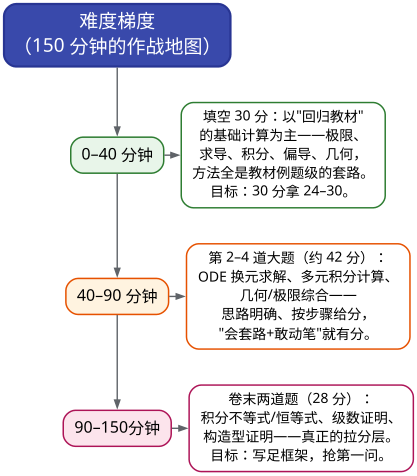

# CMC 手把手精讲
## ——《00 总纲与考点地图》：34 天，从"一年没碰数学"到初赛上场

> 🐱 喵～欢迎来到 CMC 精讲系列的**总纲篇**。这一篇不教任何解题技巧，它只做一件事：**把整个战场画成一张地图**——考什么、怎么考、哪些分必须拿、34 天怎么排。读完它（约 40 分钟），你会对"接下来一个月要干什么"清清楚楚。
>
> **本套资料给谁写的**：中国科学院大学计算机专业大三的你。大一学过华东师大《数学分析》上下册、大二学过《数学物理方法》，但**已经一年没系统碰过数学**。目标：2026 年 11 月 14 日，第十八届全国大学生数学竞赛（非数学专业 A 类·甲组）初赛。
>
> **数据口径说明**（全系列通用）：
> - 【统计】= 基于已核对的官方真题逐卷清点；【估计】= 外推推断；【二手】= 转引外部资料
> - 真题样本：第 1–17 届初赛（19 份卷，含两场补赛），重点近 3 届 A 类（2023/2024/2025）
>
> **本套资料的结构**（读完后你就知道每一件工具在哪里）：
> ```
> 教学文档/    14 篇手把手精讲（00 总纲 + 01–13 专题）← 你正在读第 00 篇
> 练习/
>   ├── 专题练习/   13 个专题的真题练习（带详解，学一篇做一篇）
>   ├── 历年真题整卷/
>   │   ├── 题面卷/  第 1–17 届真题（已去掉答案，可打印模拟）
>   │   └── 答案册/  完整版（题面 + 官方解答）
>   └── 模拟卷/     原创模拟卷 3 套（基础/标准/冲刺）
> 研究/        原始真题库、板块研究笔记、考点地图素材（备考弹药库）
> 参考资料/    你的教材 + 后续补充资料
> ```

---

# 一、考试情报：先看清对手

## 1.1 基本盘（必须刻进脑子）

| 项目 | 信息 |
|---|---|
| **赛事** | 第十八届全国大学生数学竞赛（北京赛区 = 北京市第 37 届大学生数学竞赛） |
| **初赛时间** | **2026 年 11 月 14 日（周六）9:00–11:30**，150 分钟 |
| **你的组别** | 非数学专业 **A 类（理工类）· 甲组**（双一流高校赛道） |
| **考试形式** | 闭卷，满分 100 分 |
| **初赛范围** | **只考高等数学**（微积分全部 8 大板块，见 §2）；线性代数**只在决赛考**（那是 2027 年 4 月的事，这次完全不用管） |
| **考场** | 主赛场北京科技大学，部分高校设分考场（以准考证为准） |

📌 **卷面结构**（第 15–17 届 A 类连续三年完全一致【统计】）：

| 题号 | 一（填空×5） | 二～六（解答×5） | 总分 |
|---|---|---|---|
| 分值 | 每题 6 分，共 **30 分** | 每题 14 分，共 **70 分** | 100 分 |

🎯 两个直接推论：
1. **没有选择题**——不存在"蒙四分之一的运气"，一切靠手上功夫；
2. **解答题占 70%**——是绝对主战场，"只会算填空"远不够，证明和计算的书写能力决定成败。

## 1.2 奖项与目标（知道标准在哪）

- 全国奖：一/二/三等奖分别不超过参赛人数的 **6% / 9% / 15%**（合计 ≤30%）【统计：赛区通知】
- 北京市奖：一/二/三等奖分别不超过 **8% / 12% / 15%**（合计 ≤35%）——北京市奖与全国奖**同时评**
- 进入全国决赛（2027 年 4 月·大连理工）的资格：从**一等奖**获得者中推选

📌 **参考坐标（你去年十七届拿到全国三等奖+省级三等奖）**：以"未学微分方程、几乎裸考"的状态尚能获奖，说明这个考试的**保底比想象中宽松、上限比想象中吃功夫**。这次的系统备战目标定为：**保省级二等以上、冲省级一等/全国二等**——而要摸到一等奖的门口，卷面大致需要 **60 分以上**（估计）。

## 1.3 难度真相（别被"全国竞赛"四个字吓住）

用近三届官方卷 + 公开点评还原真实难度【统计 + 二手】：



💡 **打比方**：这个考试像一场"**开卷知识库 + 闭卷手速**"的游戏——所有方法都在你的教材里（大纲就是教材目录，【二手：16 届外部点评称"约 70 分属回归教材层"】），比的是**你能否在 150 分钟内、不看任何书、稳准快地把它们调出来**。这正是为什么"零基础手把手 + 真题训练"的路线对路：先让每个方法在脑子里"活过来"，再用真题练到"手比脑快"。

⚠️ **常见误区**（现在纠正，别到考场才明白）：
1. "竞赛题都是偏题怪题"——**错**。以近三届为准，难题集中在卷末 1–2 道；前 70 分是"熟练度考试"。
2. "先做难题显得厉害"——**错**。考场上 150 分钟里，30 分填空 + 42 分中档大题是"存款"，卷末难题是"彩票"；先存款，再买彩票。
3. "证明题写不出来就空着"——**错**。官方解答按步骤给分（如 ODE 大题：换元一步 5–8 分，回代一步 5–8 分【统计：官方评分点】）。**空题是唯一 0 分的答案**。

---

# 二、命题的七条"铁律"：真题告诉我们的事

> 这一节是全系列最值钱的一节。它来自对第 1–17 届（19 份卷）的逐题清点，**每一条都能直接指导你的复习动作**。

## 铁律一：填空题第 1 题（或第 2 题）必是"极限计算"——8/8 届命中

【统计】10–17 届每一届的填空第 1 题（16 届为第 2 题）都是极限计算题：泰勒定参数、根式有理化、变限积分、等价无穷小——全是"三件套"（等价无穷小/泰勒/洛必达）的排列组合。

🎯 **动作**：这是"保底 6 分"。01 篇会把它练到条件反射；考前最后一天，把 10–17 届所有填空极限题限时 3 分钟/道刷一遍。

## 铁律二：填空第 5 题，近三届连续是"多元积分技巧题"——3/3

【统计】15 届第一类曲面积分 → 16 届格林公式挖洞 → 17 届对弧长曲线积分。命题组连着三年把最后一个填空留给"多元积分的小型技巧题"。

🎯 **动作**：07 板块（多元积分）的填空级技巧要练全：投影、对称、换元、挖洞、补面——每种都是 6 分。

## 铁律三：常微分方程大题，近三届连续三年考——每年 14 分

【统计】15/16/17 届的第 2–3 题位置固定是"**换元求解型一阶方程**"：观察出不变量代换（$u=y^2$、$u=\cos y$、平移化齐次……）→ 化为可分离/线性/伯努利 → 回代。难度高于教材例题，但**换元、回代各占 5–8 分**。

⚠️ 这对你意义特殊：**微分方程是你去年完全没学的板块**——它是最大的一块"知识真空"，也是最有确定性的一块投入（套路高度稳定，见第 07 篇）。

## 铁律四：级数大题几乎每年在"卷末"等你——19 份卷 18 份出现

【统计】自第 10 届起，级数稳定占据**倒数第一或第二题**（压轴位）；形态：判敛放缩、幂级数、裂项/递推求和、交错级数。它是 14 分的固定考点，**第一问（判敛/求收敛域）通常不难，先把第一问的 7 分拿稳**。

## 铁律五：一道题常横跨两三个板块——别按"板块"割裂地学

【统计】17 届第二题 = 极限 + 定积分方程；15 届第六题 = 递推数列 + 级数；14 届第五题 = 多元积分 + 极限 + 微分。各板块自算分值加起来会超过 100 分——这正是"综合题"存在的证据。

🎯 **动作**：学完基础篇后，专门做"跨板块综合题"（真题里的它们就是最好的素材），练习"从题面信号瞬间判断该调用哪套方法"。教学文档的 14 篇是**训练单元**，不是考试的分区——考场上题目不会告诉你"我是第几板块"。

## 铁律六：老题改头换面重考是常态——真题必须刷透到"认脸"

【统计】17 届解答第三题 ≈ 14 届填空第 4 题（**同一道微分方程题**：6 分填空十年后变成 14 分大题）；15 届填空 1 与 12 届填空 1 同型（洛必达 + 根式）。

🎯 **动作**：这是"**真题即题库**"的最强理由。本套资料把 1–17 届真题按专题重排（练习/专题练习/），训练素材量共 **223 题**（13 册实点，真题为主 + 同型训练），全部是"可能再考"的题。

## 铁律七：命题组喜欢"哪壶不开提哪壶"——低频考点留 10 分钟保底

【统计】9 届突然考斯托克斯公式（该考点在 1–8 届材料中从未出现，系初赛首考）；17 届首次考"对弧长的曲线积分"；6 届考"球缺体积/球冠面积"这种教材边角。

⚠️ **动作**：每个板块的"低频保底项"（渐近线、曲率、欧拉方程、斯托克斯基本款、傅里叶收敛值……）总投入小几小时，但要真的看一眼——遇到时"有印象"和"完全没见过"是 6 分和 0 分的差距。这正是本系列每篇都有「🎯 考试定位：了解一下即可」小节的用意。

---

# 三、考点地图：哪些分"必须"是你的

> 完整的研究数据在 `研究/考点地图_素材.md`（431 行，含全部频次证据）。这里只给你两样东西：**一张板块分值表** + **一张 S 级必拿清单**。

## 3.1 八大板块的"分值画像"（近三届 A 类基准【统计】）

| 板块 | 单卷分值（估计） | 主力题型 | 本系列篇目 |
|---|---|---|---|
| ① 函数、极限、连续 | 20–34 分（含交叉） | 填空保底 + 数列/含积分大题 | 01、02 |
| ② 一元函数微分学 | 14–28 分 | 填空求导 + 证明/最值大题 | 03、04 |
| ③ 一元函数积分学 | 20–34 分（含交叉） | 填空计算 + 积分证明（压轴） | 05、06 |
| ④ 常微分方程 | **14 分（近三届连续）** | 换元求解大题 | 07 |
| ⑤ 向量代数与空间解析几何 | 6–14 分 | 填空（或最简单大题） | 08 |
| ⑥ 多元函数微分学 | 6 分（填空位；宽口径 6–20 分，含大题工具步骤，见底稿） | 复合偏导/隐函数求导 | 09 |
| ⑦ 多元函数积分学 | **18–26 分（连续 6 届）** | 填空 + 完整计算大题 | 10、11 |
| ⑧ 无穷级数 | 14–20 分 | 卷末大题（压轴位） | 12、13 |

> 注：板块分值含"一道题跨板块重复计入"，故合计会超过 100——这不是错误，是"综合题"的体现（见铁律五）。**看这张表的正确方式**：不是"学完某某板块就拿到多少分"，而是"哪个板块的投入最可能转化为卷面分数"。

💡 一句话读表：**多元积分（⑦）+ 极限（①）+ 一元积分（③）是三大分值支柱**；**常微分方程（④）、解析几何（⑤）、多元微分（⑥）是"高确定性小块"**（套路固定、投入即可靠）；**级数（⑧）是固定压轴，微分证明（②④篇）是拉分主产区**。

## 3.2 S 级必拿清单（17 项，按"训练单元"打包）

> S 级 = 高频 + 套路化 + 直接分值大 → **必须练到条件反射**。这 17 项覆盖了填空 30 分的主体和多数大题（估计）。清单后附"它出现在真题的哪里"，方便你学完后回练。

| # | 必拿考点包 | 真题锚点（练它！） | 对应篇目 |
|---|---|---|---|
| S1 | 极限三件套：等价无穷小表 + 泰勒 5 式 + 洛必达规范 | 10 填1、11 填1、12 填1/5、14 填1、15 填1、17 填1 | 01 |
| S2 | 数列极限与递推（单调有界/夹逼/裂项求和） | 13 届二、15 届六、12 届二 | 01、12 |
| S3 | 变限积分型极限/求导模板 | 13 填3、17 填3、15 届四 | 01、05 |
| S4 | 连续性判定、间断点分类（含复合函数） | 16 届三、14 填2 | 02 |
| S5 | 隐函数/参数方程求导 + 切线法线 | 10 填2、12 填3、14 补二填2 | 03 |
| S6 | n 阶导数四条路线（部分分式/莱布尼茨/递推/泰勒系数） | 15 填3、12 填2、8 填4 | 03 |
| S7 | 中值定理构造"四板斧"（原函数法/常数 k 值/双中点/泰勒） | 12 届三、14 届三、14 补二四 | 04 |
| S8 | 单调性→极值/最值 + 导数不等式 | 16 届三、16 届五 | 04 |
| S9 | 定积分计算技巧包 + 不定积分三板斧 | 16 填1、17 填3、13 补、5 届 | 05 |
| S10 | 定积分为常数的函数方程（设参→积分→解方程） | **17 届二（原题模板）**、1 届一(2) | 05 |
| S11 | 积分不等式/恒等式"四板斧" | 15 届五、17 届六 | 06 |
| S12 | 一元积分 × 极限/数列（换元挪 n + 夹逼、黎曼和误差） | 15 届四、13 届五、12 届七 | 05 |
| S13 | ODE 三件套：一阶换元求解 + 一阶线性/伯努利 + 二阶常系数 | 17 届三、16 届二、15 届二、14 补二填3 | 07 |
| S14 | 多元微分填空两件套：抽象复合二阶偏导 + 隐函数求导 | 15 填2、16 填3、17 填4 | 09 |
| S15 | 多元积分主武器：二重/三重/曲面/Green 挖洞/Gauss 补面 | 17 届四、16 届四、15 届三、16 填5 | 10、11 |
| S16 | 解析几何闭环：向量三积/平面束/投影/距离/二次曲面识别 | 17 填2、16 填4、13 填4、11 填5 | 08 |
| S17 | 级数五件套：判敛放缩/幂级数/裂项递推/交错/展开式求和 | 15 届六、16 届六、17 届五、13 届六 | 12、13 |

🎯 **给这 17 项一个总数**：把 S 级练到"会做、做对"，你的卷面期望大致在 **60–75 分**（估计，取决于完成度和临场）——这就是"保省级二等、冲一等"的分数底座。

## 3.3 战略放弃清单（C 级：考场只写台阶分）

> 35 天 × 每天 1–2 小时的预算下，**放弃不是懦弱，是把时间押在回报率最高的地方**。以下内容**不专项训练**（考场上遇到了：写能写的框架，拿台阶分就走）：

| 放弃项 | 理由 |
|---|---|
| 上下极限、施托尔茨定理、一致连续性、实数完备性证明 | **不在非数学大纲里**（那是数学专业的内容） |
| ε-语言构造压轴题（14 届六、1 届八型） | 投入产出比极低；只争取 4–6 分铺垫步骤分 |
| 含参量积分、Beta/Gamma 函数、留数法 | 超纲（**大一学的数理方法那套别带进考场**） |
| 二重级数/渐近等价超难构造（16 届六第二问型） | 竞赛级构造直觉，短期无法训练；保第一问 |
| 级数版 Abel/Dirichlet 判别法、一致收敛 M 判别法 | 大纲明确不要求 |
| 万能代换硬算复杂三角有理式、高次有理函数完整部分分式 | 近十年未考；考场最后保底用 |
| 异面直线公垂线、二次曲线一般理论、直纹面 | 数学类专业大纲内容，非数学从未考 |

⚠️ **注意**：放弃清单与「哪壶不开提哪壶」铁律（铁律七）**不矛盾**——B 级"保底项"（渐近线公式、曲率公式、欧拉方程代换、斯托克斯基本款、傅里叶收敛值）**要做**（各 10–20 分钟级）；C 级放弃的是"深层超纲内容"。判断标准一句话：**大纲里有、真题零星考过的=保底看一眼；大纲外、数学专业才学的=果断放弃。**

---

# 四、34 天冲刺路线：五周地图

> 起点 2026-10-10 → 考试 2026-11-14，共 34–35 天 ≈ 5 周。按"每天 1–2 小时、周预算 7–14 小时"设计，总预算约 35–70 小时（估计）。
> 排序依据（为什么是这个顺序）：**极限是一切的地基 → 求导供能给微分/多元/ODE → 一元积分先于多元积分 → 级数依赖极限与积分 → 解析几何当"信心板块+缓冲" → 多元积分与级数压轴主攻。**

## 第 1 周（D1–7）：极限与求导基本功 —— 全卷地基周

| 天 | 任务 | 材料 |
|---|---|---|
| D1–2 | 等价无穷小表 + 泰勒 5 式 + 洛必达规范 | 01 篇 §二、§三 |
| D3–4 | 极限计算密集训练：10–17 届全部填空极限题（13 道）+ 自测题 | 01 篇 §四、§六 |
| D5 | 数列极限（单调有界/夹逼/不动点/递推） | 01 篇 §3.5–3.6 |
| D6 | 连续性判定/间断点 + 变限积分型极限 | 02 篇 |
| D7 | 求导恢复：隐函数/参数方程/反函数 + n 阶导数四路线 | 03 篇 |

✅ **验收**：填空极限题每题 3 分钟内、全对；隐函数求导真题 8 道限时完成。

## 第 2 周（D8–14）：一元积分 + 微分学证明 —— 计算力 + 证明模板周

| 天 | 任务 | 材料 |
|---|---|---|
| D8–9 | 不定积分三板斧 + 定积分技巧包（区间再现/对称/周期） | 05 篇 |
| D10 | 变限积分函数 + 定积分为常数的方程（**17 届二重做两遍**） | 05 篇 |
| D11–12 | 中值定理四板斧（12 届三、14 届三、14 补二四） | 04 篇 |
| D13 | 导数不等式与最值（16 届五"取邻域 h"技巧） | 04 篇 |
| D14 | 积分不等式四板斧开场（15 届五、17 届六的"第一步式子"） | 06 篇 |

✅ **验收**：能独立写出 15 届五、17 届二 的完整解答或首段框架。

## 第 3 周（D15–21）：ODE + 解析几何 + 多元微分 —— 确定性板块抱团周

| 天 | 任务 | 材料 |
|---|---|---|
| D15–16 | 一阶方程六解法 + 换元套路；近三届 ODE 大题+14 届填4 连做两遍 | 07 篇 |
| D17 | 二阶常系数 + "隐藏型 ODE"识别（积分恒等式求导、路径无关） | 07 篇 |
| D18–19 | 解析几何闭环（6 题真题：17 填2、16 填4、15 届三、14 届二、13 填4、11 填5） | 08 篇 |
| D20–21 | 多元微分：复合二阶偏导 + 隐函数 + 切平面（15 填2、16 填3、17 填4） | 09 篇 |
| 周末 | **半程体检**：13 届整卷（题面卷模式） | 练习/整卷 |

✅ **验收**：ODE 近三届大题 15 分钟内独立完成；解析几何 6 题全对。

## 第 4 周（D22–28）：多元积分 + 级数前半 —— 拉分板块主攻周

| 天 | 任务 | 材料 |
|---|---|---|
| D22–24 | 二重积分（极坐标/奇偶/换序）+ 三重积分（球柱坐标/截面法/对称） | 10 篇 |
| D25–26 | 曲线积分（格林/挖洞/路径无关）+ 曲面积分（投影/Gauss 补面） | 11 篇 |
| D27–28 | 级数判敛地基 + 幂级数收敛域/和函数 | 12 篇 |

✅ **验收**：16 届四、17 届四独立复现（多元积分压舱大题）。

## 第 5 周（D29–34/35）：级数收尾 + 整卷模考 + 错题回炉 —— 合卷周

| 天 | 任务 | 材料 |
|---|---|---|
| D29 | 裂项/递推求和 + 交错级数条件收敛 | 12 篇 |
| D30 | 展开式求和 + 傅里叶收敛值（20 分钟保 6 分） | 13 篇 |
| D31–33 | **三套整卷模考**（顺序：17A → 16A → 15A），150 分钟计时 + 次日复盘 | 题面卷/ |
| D34 | 错题回炉 + 全部易错点过一遍 + S 级触发信号默写 | 各篇 §五 |

✅ **验收**：整卷填空目标 24–30/30；S 级对应大题全部能动笔。

⏱️ **时间不足时的收缩顺序**：先保 S1–S17；放弃顺序从 C 级 → B 级 → A 级尾部。**任何情况下都别放弃**：极限三件套（S1）、ODE（S13）、多元积分（S15）——这三块是"确定性分数"。

---

# 五、学习方法与考场策略

## 5.1 给"遗忘状态"的你：重建比新学快，但要重建对

你现在的状态不是"零基础"，而是"**教材在脑子里，索引丢了**"。所以策略不是从头精读教材（来不及也没必要），而是：

1. **"认领"式复习**：每篇教学文档先用 5 分钟扫"方法速查表"——认出哪些有印象（快速激活）、哪些彻底陌生（重点标记）；
2. **做题暴露漏洞**：每个方法先看 1 个例题，然后立刻动笔做 2–3 道真题——**遗忘的地方会在动笔时精确暴露**，比通读效率高 3 倍；
3. **错题二刷节奏**：当天错题当日清；每周日把本周错题重做一遍；**模考错题按板块归档**，考前专攻；
4. **符号肌肉记忆**：等价无穷小表、泰勒展开式、幂级数和函数公式、凑微分四式、特征根三情形、距离公式表——这些"表"要**默写**（✍️ 文档里标了默写点），不是"看懂"。

## 5.2 考场时间分配（150 分钟怎么切）

```
9:00–9:40   填空 30 分（5 题 ×6 分）
            · 每题预算 6 分钟，遇到卡壳立即跳过做下一题
            · 20 分钟内做完 → 状态极佳；40 分钟仍是红线
9:40–11:00  解答题第 2–4 道（42 分，通常 ODE / 多元积分 / 几何综合）
            · 每题 20–25 分钟；先写"框架"（方法名+第一步式子）再精算
11:00–11:25 卷末两题（28 分）：优先会的先写；难题写出：①涉及的公式/定理
            · ②能下手的第一步 ③关键转化（如"补面用高斯公式"）
11:25–11:30 检查：填空回代验算、大题负号/系数复查
```

🎯 **三条考场纪律**：
1. **填空零失误**是最高优先级——它们是你最熟悉的题型，丢分只在"粗心"（⚠️ 每题做完立即回代/验算）；
2. **大题写台阶**：官方就是按步骤给分的，写出换元、写出公式、写出辅助函数 = 分数（如 ODE 题光"设出换元"就有 5 分级别）；
3. **跳过不恋战**：一道题卡 8 分钟就跳走，回头再做——150 分钟里"心态的流动性"比"死磕"值钱。

## 5.3 考前 72 小时

- **只看三样东西**：各篇的「防身 N 句话」+ 易错点清单 + 速查表（**不碰新题**）；
- 把 S 级 17 项的**触发信号**在脑子里过一遍（"看到变限积分 → 换元/洛必达"级别的条件反射检查）；
- 模考时形成的时间节奏**照着执行**，不在考场上做新实验（比如突然改答题顺序）。

---

# 六、资料使用指南

## 6.1 本套资料怎么配合用

| 场景 | 用什么 | 怎么用 |
|---|---|---|
| 每天学习（1–2h） | 教学文档（按路线表） | 读方法 → 立即做文档内 ✅ 例题 → 做对应专题练习 |
| 学完一篇 | 练习/专题练习/ 对应专题 | 每题限时；错题标记；对答案看"官方解答怎么给分" |
| 每周日 | 错题回炉 | 重做本周错题 + 快速过速查表 |
| 周末（第 3 周起） | 练习/历年真题整卷/题面卷 | 150 分钟全真模拟（打印或分屏），次日复盘 |
| 第 5 周 | 三套整卷 + 模拟卷 | 严格计时；用答题纸习惯书写 |
| 考前 3 天 | 各篇「防身句」+ 易错清单 + 速查表 | 只复习，不做新题 |

## 6.2 与你的教材的关系

你手头有华东师大《数学分析》上下册 + 吴崇试《数学物理方法》（参考资料/ 目录）。本系列每篇都有「对应教材章节」小节——**遇到想深入的概念**可以翻教材；但注意两点：
1. 《数学分析》比竞赛大纲**要求更多更深**（如确界原理、一致收敛）——那些超纲内容**看了不亏、但别花时间**；
2. 《数学物理方法》的复变函数、特殊函数**不在初赛范围**——备考期间把它当"禁书"（决赛考完再叙旧）。

## 6.3 关于"原始资料"（研究/ 目录）

`研究/原始资料/真题/` 里有 1–17 届全部真题原件 + 逐题 Markdown 转录（含官方解答）+ 官方参考解答（其中第 7 届为流传版、非官方发布）。你**不需要**每天进去看——它是"弹药库"：当某道题的解答你想看原卷排版时、当你想核对某届全卷时，按需取用。

---

# 结语：把地图收好，开始行军

```
         34 天冲刺 · 一句话版
 D1–7   极限+求导地基    ┃ D8–14  一元积分+微分证明
 D15–21 ODE+几何+多元微分 ┃ D22–28 多元积分+级数前半
 D29–34 级数收尾+整卷模考+错题回炉
```

**给你的三句定心丸**：
1. 这个考试前 70 分是"熟练度考试"——你的数分底子在，**重建比新学快得多**；
2. 高频考点高度稳定（填空 1 极限 8/8、ODE 大题 3/3、级数卷末 18/19）——**训练方向是确定的，不赌运气**；
3. 你去年几乎没做准备都能拿到全国三等奖，这次有地图、有弹药、有 34 天——**目标不是"参与"，是把"保二争一"打成既定事实**。

下一篇（01 篇）从这里开始：把"极限计算"练成你的提款机。开工喵！🐱📚

> 💡 **本篇使用建议**：
> 1. 现在花 10 分钟，把 §3.2 的 S 级清单和 §4 的五周表**抄一遍**（手抄，别复制）——行军前先认地图；
> 2. 把 §5.2 的考场时间表贴在书桌前——从今天起，所有做题都按"填空 6 分钟/大题 20 分钟"的节奏训练；
> 3. 有任何一节觉得尺度不对（太难/太浅），回来告诉我，整篇文档可以按你的手感重调。
