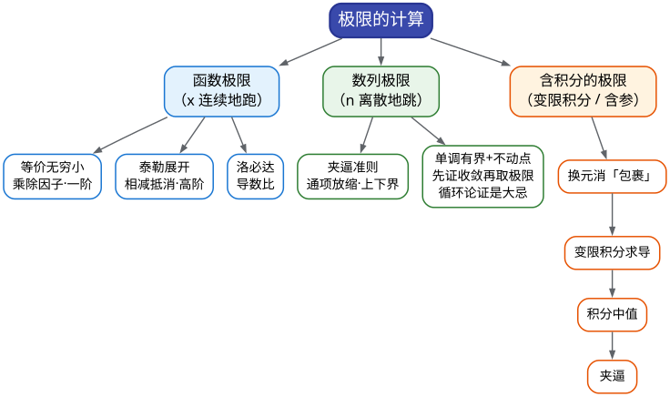

# CMC 手把手精讲
## ——《01 极限的计算方法》：从"三大工具"到真题零失误

> 🐱 喵～欢迎来到 CMC 精讲系列的**第一篇专题课**（开读之前，建议先花 40 分钟过一遍《00 总纲与考点地图》——它把整个战场画成一张地图）。这篇文档写给**一年没碰数学、现在要从零捡起**的你：不预设记忆、不甩公式，一切从"为什么"讲起。
>
> **本篇在考试中的地位**（数据口径：第 10–17 届初赛，共 8 套非数学类/非数学 A 类试卷，真题已逐题核对）：
> - 本板块（函数、极限、连续）每套卷稳定贡献约 **20–34 分**（含跨板块交叉计入），8 届平均约 24 分，是**全卷第一基础板块**；
> - 最强命题规律（**8/8 命中**）：每一届的**第一或第二道填空题**都是"极限计算"——10、11、12、13、14、15、17 届在填空第 1 题，16 届在填空第 2 题；其中 10 届填空 1 是数列极限（夹逼）；
> - 也就是说：极限计算是"**保底 6 分 + 所有大题的前置技能**"。本篇的目标只有两个：**填空极限零失误**、**大题第一步不卡壳**。
>
> **大纲对应条目**（《全国大学生数学竞赛考试内容》非数学专业类·函数极限部分原文摘录）：
> - 条目 4：数列极限与函数极限的定义及其性质、函数的左极限与右极限；
> - 条目 5：无穷小和无穷大的概念及其关系、无穷小的性质及无穷小的比较；
> - 条目 6：极限的四则运算、极限存在的**单调有界准则和夹逼准则**、**两个重要极限**。
>
> （注：洛必达法则与泰勒公式在官方大纲里列在"一元函数微分学"条目下，但它们是极限计算题的两把主武器，本篇必须打通——这条学习路线是历年真题逼出来的，不是超纲。）
>
> **先修提示**：**建议先读 00 总纲**（30 分钟速读，看清"考什么、怎么考"再回来）。除此之外无门槛——本篇是专题课的开篇，一切从"重新捡起"写起。你只需要记得一点点求导公式（忘了也没关系，用到时我们会现场换）。
>
> **预计学时**：2–3 天（按每天 1–2 小时折算；对应 00 总纲行军表的**第 1 周 D1–D4**——D1–2 攻三件套、D3–4 做填空真题密集训练）。第一天：§一 + §二 + §3.1–3.3；第二天：§3.4–3.8 + 精讲前 5 题；第三天：精讲后 5 题 + 易错点 + 自测题。
>
> 阅读建议：
> 1. 先花 3 分钟扫一遍 §一的两张表，建立"什么题面用什么武器"的直觉；
> 2. 不要跳读 §二——你以为你记得"极限"，但竞赛要的是手感，直觉断了就得重接；
> 3. 所有标了 ✍️ 的地方，真的动笔（不是"看一眼觉得会了"）；
> 4. 真题精讲里的"思路分析"比解答本身更值钱，先自己卡 1 分钟再看。
>
> 符号说明：📌 重点 | 💡 直觉/类比 | ⚠️ 易错点 | ✍️ 动笔练一练 | ❓ 自测题 | 🎯 考试定位 | ⏱️ 省时技巧

---

# 一、本篇地图

## 1.1 目录（读之前先看这张施工图）

- **§二 知识讲解**：极限的直觉 → 无穷小的阶 → 三大工具是怎么"长"出来的（等价无穷小 / 泰勒 / 洛必达的来龙去脉，以及洛必达什么时候会骗你）→ 七大未定式 → 幂指函数与 $`1^\infty`$ 型 → 夹逼与单调有界 → 数列极限的两个额外习惯
- **§三 方法手册**：3.1 等价无穷小替换 | 3.2 泰勒展开 | 3.3 洛必达法则 | 3.4 幂指函数与 $`1^\infty`$ | 3.5 夹逼准则 | 3.6 单调有界与递推数列 | 3.7 含积分（变限积分）的极限 | 3.8 通用五步流程与作战纪律
- **§四 真题精讲**：10 道真题完整精讲（17 届填 1/填 3/大二、15 届填 1、12 届填 1/填 5、11 届填 1、10 届填 4、13 届填 3/大二）
- **§五 易错点清单**：12 条 ❌→✅ 对照
- **§六 自测题**：7 道，附完整答案
- **§七 结语**："极限计算防身六句话" + 学习建议 + 02 篇预告

## 1.2 方法速查表：什么题面 → 用什么武器（一屏版）

| 题面长相（信号） | 首选武器 | 说明 / 升级路线 |
|---|---|---|
| $`\dfrac{0}{0}`$ 型，且式中有 $`\sin,\tan,\ln(1+\Box),e^{\Box}-1,(1+\Box)^a-1,1-\cos\Box`$ | **等价无穷小替换** | 只对**乘除因子**替换；替换后"相减抵消"就升级到泰勒 |
| $`\dfrac{0}{0}`$ 型，替换后还抵消，或含多重复合（根号套根号、连乘） | **泰勒展开** | 展到"分母的最低阶"为止；求参数题必用 |
| $`\dfrac{0}{0}`$ 或 $`\dfrac{\infty}{\infty}`$ 且**含变限积分**或**抽象函数**（只知可导） | **洛必达法则** | 求导能把积分消掉，这是洛必达的主场 |
| 根式 $`-`$ 根式（同一分点附近） | **有理化**（分子分母乘共轭式） | 洛必达也可，但有理化更快、更稳 |
| $`\infty-\infty`$ | **通分 / 有理化 / 提取主项** | 先化成 $`0/0`$ 或 $`\infty/\infty`$ 再谈 |
| $`0\cdot\infty`$ | 把其中一个**翻到分母上** | 如 $`u\cdot v=\dfrac{u}{1/v}`$，化成 $`0/0`$ |
| $`1^\infty`$、$`0^0`$、$`\infty^0`$（幂指函数 $`u^v`$） | $`u^v=e^{v\ln u}`$ | $`u\to1`$ 时用速记式 $`e^{\lim v(u-1)}`$ |
| 求和型 / 连乘型数列极限，放缩后上下界同极限 | **夹逼准则** | 找主项，把"尾巴"放缩掉 |
| 递推数列 $`x_{n+1}=f(x_n)`$，"证明收敛并求极限" | **单调有界准则 + 不动点** | 先证收敛（评分点！）再解 $`A=f(A)`$ |
| 极限式中含 $`\int_0^{\varphi(x)} f`$、$`\int_0^x(x-t)f(t)\,\mathrm{d}t`$ | **换元 → 变限积分求导 / 积分中值定理** | 见 3.7 的三步模板 |
| 求参数 $`a`$，"使极限存在/等于某值" | **泰勒定阶（系数匹配）** | 17 届填 1 就是这个套路（自测 2 同型） |

## 1.3 知识树：本篇全部内容的骨架



一句话总结这张图：**函数极限靠"三件套"（等价、泰勒、洛必达），数列极限靠"两把尺"（夹逼、单调有界），含积分的极限是两者的合体（换元消包裹后再用三件套）。**

---

# 二、知识讲解：极限是什么？三大工具从哪来？

## 2.1 极限的直觉：迭代算法的"归宿"

先忘掉课本，看一个你最熟悉的东西：

```math
x_n=\Big(1+\frac{1}{n}\Big)^n.
```

算几项感受一下：$`n=10`$ 时约 $`2.594`$，$`n=100`$ 时约 $`2.705`$，$`n=1000`$ 时约 $`2.717`$，$`n=10^6`$ 时约 $`2.718280`$……它显然在"安定"到某个数附近。谁也不会有闲心去算第 $`10^{100}`$ 项——我们关心的是**趋势**：这串数最终奔向 $`2.71828\ldots`$（也就是 $`e`$）。

💡 **打比方（写给会写代码的你）**：极限就像数值算法的**收敛性**。二分法每轮把误差砍半，牛顿迭代二次收敛——你断定"算法会收敛"，靠的不是跑无穷多轮，而是看**通项的结构**。极限计算题也一样：我们的全部工作，是**一眼看出这串数/这个函数最终奔向哪里**，而不是真的去"趋近"。

于是有直觉定义：

> 当 $`x`$ 无限接近 $`x_0`$（但可能永远不等于 $`x_0`$）时，$`f(x)`$ 无限接近某个确定的数 $`A`$，就称 $`A`$ 是 $`f(x)`$ 当 $`x\to x_0`$ 时的**极限**，记作
>
> ```math
> \lim_{x\to x_0}f(x)=A.
> ```
>

这个"无限接近"的严格化（$`\varepsilon`$-$`\delta`$ 语言）是 02 篇的事，本篇你只需要拿住三条命门：

1. **极限与 $`f(x_0)`$ 本身无关**。$`\lim\limits_{x\to 0}\dfrac{\sin x}{x}=1`$，哪怕 $`\dfrac{\sin x}{x}`$ 在 $`x=0`$ 处根本没定义——极限看的是"路上"的趋势，不是"终点"的值。
2. **"无限接近"= 要多小有多小**，不是"离得越来越近就行"。数列 $`x_n=1+\dfrac{(-1)^n}{n}`$ 一路"一近一远"地蹦跶，但它也收敛到 $`1`$——因为差距 $`1/n`$ 最终小于**任何**给定的小量。
3. **极限可以不存在**。$`x\to+\infty`$ 时 $`\sin x`$ 永远振荡；$`x_n=(-1)^n`$ 永远摇摆；而 $`x\to 0^+`$ 时 $`\dfrac{1}{x}\to+\infty`$ 属于"发散到无穷"，也不是（有限的）极限。竞赛里"证明极限存在"经常就是排除这些情况（02 篇展开）。

📌 **两个重要极限**（大纲条目 6 明文要求，必须肌肉记忆）：

```math
\lim_{x\to 0}\frac{\sin x}{x}=1,\qquad \lim_{x\to 0}(1+x)^{1/x}=e.
```

第一个的直觉：画个单位圆，弧长 $`x`$ 与半弦 $`\sin x`$ 在 $`x\to 0`$ 时几乎重合——所以 $`\sin x\approx x`$。记住这个"$`\sin x\approx x`$"，它后面会反复出现（它是"等价无穷小"的源头）。

## 2.2 无穷小与阶：谁是主部

**无穷小**：以 $`0`$ 为极限的量（$`\lim\alpha=0`$ 就称 $`\alpha`$ 是无穷小）。注意它是个**过程量**，不是"很小的数"——$`10^{-100}`$ 不是无穷小，$`x^2`$（$`x\to 0`$ 时）才是。

$`x\to 0`$ 时，$`x,\ x^2,\ x^3`$ 都跑向 $`0`$，但速度天差地别：$`x=0.001`$ 时三者是 $`0.001`$、$`0.000001`$、$`0.000000001`$——$`x^2`$ 把 $`x`$ "远远甩在后面"。为了量化这种速度，我们定义**阶**：

> 设 $`\alpha,\beta`$ 都是无穷小，且 $`\beta/\alpha`$ 有极限：
> - 若 $`\lim\dfrac{\beta}{\alpha}=0`$：称 $`\beta`$ 是 $`\alpha`$ 的**高阶无穷小**，记 $`\beta=o(\alpha)`$（"$`\beta`$ 比 $`\alpha`$ 跑得快"）；
> - 若 $`\lim\dfrac{\beta}{\alpha}=c\ne 0`$：称**同阶**无穷小；
> - 若 $`\lim\dfrac{\beta}{\alpha}=1`$：称**等价**无穷小，记 $`\alpha\sim\beta`$（"速度几乎一模一样"）。

💡 **打比方**：阶就是**复杂度的量级**。$`x`$ 与 $`\sin x`$ 像 $`n`$ 与 $`n+1`$——同一个量级（等价）；$`x^2`$ 相对 $`x`$ 像 $`n^2`$ 相对 $`n`$——高一阶。$`x^p`$ 的阶就是 $`p`$（可以是分数：$`\sqrt{x}=x^{1/2}`$ 是"半阶"；在 11 届填 1 里你会看到 $`x^{2/3}`$ 这种 2/3 阶的家伙，别慌，规则一样）。

📌 **等价无穷小替换定理**：若 $`\alpha\sim\alpha'`$，$`\beta\sim\beta'`$，则

```math
\lim\frac{\alpha}{\beta}=\lim\frac{\alpha'}{\beta'}.
```

**但这条定理只对"整体乘除"成立**。为什么？因为 $`\alpha\sim\alpha'`$ 的含义是 $`\alpha=\alpha'(1+o(1))`$——**乘除时，$`(1+o(1))`$ 会被约掉或整体趋于 1**；而**加减时，$`o(1)`$ 那一项可能恰恰是"主部相消后剩下的全部信息"**（见 2.3 节）。

📌 **常用等价无穷小（$`x\to 0`$，考试高频，建议直接背）**：

```math
x\sim\sin x\sim\tan x\sim\arcsin x\sim\arctan x\sim\ln(1+x)\sim e^{x}-1,
```

```math
(1+x)^a-1\sim ax,\qquad 1-\cos x\sim\frac{x^2}{2},\qquad x-\sin x\sim\frac{x^3}{6},\qquad \tan x-x\sim\frac{x^3}{3},
```

```math
\sqrt{1+x}-1\sim\frac{x}{2},\qquad \sqrt[3]{1+x}-1\sim\frac{x}{3}.
```

💡 这张表**没有一个需要"另背"**——它们全是泰勒展开的第一项（下一节你就懂了）。真正要背的其实只有 2.3 节的那张泰勒表，等价无穷小是它的"一阶速记版"。

⚠️ 替换时要盯住"**框**"：把整个趋于 0 的块看作一个整体 $`\Box`$。例如 $`\sqrt[3]{1-\cos x}\sim\sqrt[3]{\dfrac{x^2}{2}}=\dfrac{x^{2/3}}{\sqrt[3]{2}}`$——先算里面，再套公式。这是 11 届填 1 的核心零件。

📌 **增长速度序（$`n\to\infty`$；1.2 速查表“抓大头”的判据）**：

```math
\ln n\ \ll\ n^{\alpha}\ (\alpha>0)\ \ll\ a^{n}\ (a>1)\ \ll\ n!\ \ll\ n^{n}.
```

“$`\ll`$”读作“远慢于”（越靠右增长越快）。它是无穷小阶表的“反方向版本”：$`\dfrac{\infty}{\infty}`$ 型比的正是这个序——**主导项谁快，谁就说了算**（品种相同再比幂次、比系数）。抓大头例（分子分母同除以 $`n!`$）：

```math
\lim_{n\to\infty}\frac{3^n+n^{10}}{n!+3^n}=\lim_{n\to\infty}\frac{3^n/n!+n^{10}/n!}{1+3^n/n!}=\frac{0+0}{1+0}=0
```

（两次查表：$`n^{10}\ll 3^{n}\ll n!`$——分子的主导项是 $`3^n`$、分母的主导项是 $`n!`$，故整体趋于 $`0`$。）

## 2.3 三大工具是怎么"长"出来的

### （1）等价无穷小为什么不够用？

考虑 $`\lim\limits_{x\to 0}\dfrac{x-\sin x}{x^3}`$。若把 $`\sin x\sim x`$ 一换，分子变成 $`x-x=0`$——**信息全没了**。为什么？因为 $`x-\sin x`$ 里，两个"一阶主部"精确抵消了，剩下的全部信息藏在**三阶**里：$`\sin x=x-\dfrac{x^3}{6}+\cdots`$，所以 $`x-\sin x\sim\dfrac{x^3}{6}`$，原极限 $`=\dfrac{1}{6}`$。

💡 **打比方（浮点相消误差）**：你在程序里算 $`1.0000001-1.0000000`$，单精度下可能直接得到 $`0`$——两个几乎相等的数相减，剩下的全是"误差的细节"。同理，"相减抵消主项"的极限题，一阶近似必然失灵，必须拿到**更高精度**：这就是泰勒展开出场的理由。

### （2）泰勒展开：把函数翻译成"多项式 + 零头"

泰勒（麦克劳林）公式说：光滑函数在 $`x=0`$ 附近可以写成

```math
f(x)=f(0)+f'(0)x+\frac{f''(0)}{2!}x^2+\cdots+\frac{f^{(n)}(0)}{n!}x^n+o(x^n).
```

翻译成人话：**任何好函数 = 多项式 + 一个比 $`x^n`$ 跑得还快的零头**。竞赛里我们用的不是"推导"，而是下面这张**展开表**（全部 $`x\to 0`$，全部写到三阶或以上，直接背）：

📌 **五个必背展开（外加两个补充）**：

```math
e^x=1+x+\frac{x^2}{2}+\frac{x^3}{6}+o(x^3),
```

```math
\sin x=x-\frac{x^3}{6}+o(x^3),\qquad \cos x=1-\frac{x^2}{2}+\frac{x^4}{24}+o(x^4),
```

```math
\begin{aligned}\ln(1+x)&=x-\frac{x^2}{2}+\frac{x^3}{3}+o(x^3),\\ (1+x)^a&=1+ax+\frac{a(a-1)}{2}x^2+\frac{a(a-1)(a-2)}{6}x^3+o(x^3),\end{aligned}
```

```math
\tan x=x+\frac{x^3}{3}+o(x^3),\qquad \arcsin x=x+\frac{x^3}{6}+o(x^3).
```

使用规则就三条：

1. **展到几阶？看分母**。分母是 $`x^k`$，就把分子展到 $`x^k`$（更高也行，但没用）；若分母是 $`ax^3`$ 而你想求 $`a`$，那就必须展到恰好让 $`x^3`$ 系数"露出来"。
2. **相减抵消就再展一阶**。代入后首项抵消为 0，说明阶数不够，立刻补一阶（17 届填 1 就是这么干的）。
3. **$`o(x^n)`$ 是记账符号**，只参与"定性"（说明它比 $`x^n`$ 快、可忽略），**不参与主部计算**。合并同类项时，把所有 $`o(x^n)`$ 一并写成 $`o(x^n)`$。

### （3）泰勒为什么能"替代"洛必达？

洛必达法则（先给个粗粒度版本，精确条件见 3.3）：对 $`\dfrac{0}{0}`$ 型，

```math
\lim_{x\to x_0}\frac{f(x)}{g(x)}=\lim_{x\to x_0}\frac{f'(x)}{g'(x)}\quad(\text{当}\lim_{x\to x_0}\frac{f'(x)}{g'(x)}\text{存在或为无穷时}).
```

它来自柯西中值定理，本质是"**函数之比的极限 = 导数之比**"——把比较函数降级成比较它们的斜率。如果一次不够，就再求导——**逐阶比较导数**。

看出问题了吗？"逐阶比较"和泰勒"逐阶列系数"**是同一件事的两种写法**：一次洛必达把两个函数的展开同时降一阶，反复洛必达 = 逐阶对齐系数 = 泰勒在做的事。所以：

- **泰勒像"一次性把所有需要的信息列全"**（预处理），**洛必达像"一步一步试探"**（在线算法）；
- 结构能整体展开时（乘法、根式、连乘、复合），**泰勒通常更快、更不容易出错**——因为它不需要求导，只查表；
- 什么时候洛必达反而更好？**结构"求导会变简单"的时候**：含变限积分（求导正好消掉积分号！）、抽象函数（只知道可导，没有展开式可用）。

**实战对照（真题，第 14 届非数学类·填空第 1 题，2022）**：

```math
\lim_{x\to 0}\frac{1-\sqrt{1-x^2}\cos x}{1+x^2-\cos^2 x}.
```

- **官方解法（洛必达）**：求导一次得 $`\lim\limits_{x\to 0}\dfrac{\sqrt{1-x^2}\sin x+\dfrac{x\cos x}{\sqrt{1-x^2}}}{2x+2\cos x\sin x}`$，再分子分母同除以 $`x`$、凑 $`\dfrac{\sin x}{x}\to 1`$、把 $`x\to 0`$ 代入其余部分，得 $`\dfrac{1}{2}`$。（四行，需两次拼凑。）
- **泰勒解法**：分子 $`= \big[1-\sqrt{1-x^2}\big]+\sqrt{1-x^2}\,(1-\cos x)\sim\dfrac{x^2}{2}+\dfrac{x^2}{2}=x^2`$，分母 $`= \sin^2x+x^2\sim 2x^2`$，**立刻得 $`\dfrac{1}{2}`$**。（两行。）
> 点评：这不是说洛必达不好，而是让你体会"**看到多项式结构优先泰勒**"的选型直觉。考场上两种会一种即可，但**都要会检查**（洛必达记得验型，泰勒记得查阶）。

### （4）洛必达什么时候会骗你？三个坑

⚠️ **坑 1：没验型就求导**。洛必达只对 $`\dfrac{0}{0}`$ 或 $`\dfrac{\infty}{\infty}`$ 生效。$`0\cdot\infty`$、$`\infty-\infty`$、$`1^\infty`$ 都要**先化成这两种型**（见 1.2 速查表）。
⚠️ **坑 2：求导后的极限不存在，不等于原极限不存在**！经典反例：

```math
\lim_{x\to+\infty}\frac{x+\sin x}{x}=1\quad\text{存在},
```

但若洛必达（求导后得 $`\lim(1+\cos x)`$），这个极限**不存在**。法则只是"单向门"：导数比存在 $`\Rightarrow`$ 原极限存在；反过来不成立。
⚠️ **坑 3：越洛越复杂还硬洛**。根式套根式、连乘积这类题，求导会让式子"爆炸"（链式法则+乘积法则叠buff）。**判断标准**：求导两轮后如果式子更丑了，立即回退——要么有理化，要么泰勒。

## 2.4 七大未定式一张表

"未定式"就是**表面看不出答案的式子**：代入后出现 $`\dfrac{0}{0}`$、$`\dfrac{\infty}{\infty}`$、$`0\cdot\infty`$、$`\infty-\infty`$、$`1^\infty`$、$`0^0`$、$`\infty^0`$ 这七种"没有确定的答案"的组合。全部处理原则：**归约到 $`\dfrac{0}{0}`$ 或 $`\dfrac{\infty}{\infty}`$，然后上三件套**。

| 未定式 | 长相 | 第一动作 |
|---|---|---|
| $`\dfrac{0}{0}`$ | 两边都跑向 0 | 等价替换 →（不够就）泰勒 / 洛必达 |
| $`\dfrac{\infty}{\infty}`$ | 两边都跑向无穷 | 抓大头（比增长速度，见 §2.2 增长速度序）；或洛必达 |
| $`0\cdot\infty`$ | 一个跑 0，一个跑无穷 | 把其中一个翻到分母：$`uv=\dfrac{u}{1/v}`$，化成 $`\dfrac{0}{0}`$ |
| $`\infty-\infty`$ | 两个大的相减 | 通分 / 有理化 / 提取主项，化出公共分母 |
| $`1^\infty`$ | 底跑 1，指数跑无穷 | $`e^{\lim v(u-1)}`$ 速记式（下一节） |
| $`0^0`$ | 底跑 0，指数跑 0 | $`u^v=e^{v\ln u}`$，算出指数 |
| $`\infty^0`$ | 底跑无穷，指数跑 0 | 同上 |

两个现场小演算（都是竞赛小题级别）：

- $`0\cdot\infty`$：$`\lim\limits_{x\to 0^+}x\ln x=\lim\limits_{x\to 0^+}\dfrac{\ln x}{1/x}\ \xrightarrow{\text{洛必达}}\ \lim\limits_{x\to 0^+}\dfrac{1/x}{-1/x^2}=\lim\limits_{x\to 0^+}(-x)=0`$。
- $`\infty-\infty`$：$`\lim\limits_{x\to+\infty}\big(\sqrt{x^2+x}-x\big)=\lim\limits_{x\to+\infty}\dfrac{(x^2+x)-x^2}{\sqrt{x^2+x}+x}=\lim\limits_{x\to+\infty}\dfrac{x}{\sqrt{x^2+x}+x}=\dfrac{1}{2}`$。（有理化：分子分母乘共轭式。）

## 2.5 幂指函数与 $`1^\infty`$ 型

底数和指数都"长在变量上"的式子 $`u(x)^{v(x)}`$，处理方式只有一招——**取 $`e`$**：

```math
u^v=e^{v\ln u}\qquad(u>0).
```

这一步没有任何玄机（指数函数与对数函数互逆），但它把"幂"翻译成了"指数位置上的乘积"，于是 $`1^\infty`$、$`0^0`$、$`\infty^0`$ 全部变成一个普通的"求指数极限"问题。

当 $`u\to 1`$（也就是 $`1^\infty`$ 型）时，有**速记公式**：

```math
\lim u^v=e^{\lim\,v\ln u}=e^{\lim\,v(u-1)}\qquad(u\to 1,\ v\to\infty).
```

推导只需一行：$`\ln u\sim u-1`$（$`u\to 1`$ 时 $`\ln u`$ 与 $`u-1`$ 是等价无穷小），**再看一眼**：这正是把"$`\ln`$"这个跑得慢的家伙换成了"$`u-1`$"这个跑得一样快的家伙。

💡 例：$`\lim\limits_{x\to 0}(1+x^2)^{1/(1-\cos x)}=e^{\lim\frac{x^2}{x^2/2}}=e^{2}`$（用了 $`1-\cos x\sim x^2/2`$）。

⚠️ 三个检查项：① 先确认 $`u`$ 在去心邻域内**为正**（保号性给出，12 届填 5 官方解的第一步就是干这个）；② $`1^\infty`$ 型的结论是 $`e^{\lim v(u-1)}`$，**别漏掉 $`e`$，也别把它写成 $`1^{?}=1`$**；③ 底为负、指数非整数的情形不要硬套公式，先讨论定义域。

## 2.6 夹逼准则与单调有界准则

### 夹逼准则（"两条闸门夹着走"）

> 若在某过程中（比如 $`n\to\infty`$）恒有 $`y_n\le x_n\le z_n`$，且 $`\lim y_n=\lim z_n=A`$，则 $`\lim x_n=A`$。

💡 **打比方**：安检闸机两边各一扇门，两扇门同时收到同一个点，中间的人不得不停在那里。它的威力在于：**我们不需要知道 $`x_n`$ 的通项极限，只需要"把它夹住"**。

数列版操作套路（三步）：
1. **找主项**：看清 $`x_n`$ 里哪部分主导、总共多少项；
2. **放缩尾巴**：把"碍事的部分"用常用不等式压住（下面四件套）；
3. **让上下界同极限**：通常要写成 $`A-\varepsilon_n\le x_n\le A+\varepsilon_n`$ 且 $`\varepsilon_n\to 0`$。

📌 **常用放缩四件套**：$`\dfrac{1}{n+1}<\dfrac{1}{n}`$；$`|\sin\Box|\le 1`$；$`\sin x\le x\ (x\ge 0)`$；$`\ln(1+t)\le t\ (t>-1)`$。（补充两个进阶：$`\sin x\ge\dfrac{2}{\pi}x,\ x\in[0,\tfrac{\pi}{2}]`$；当 $`0<\alpha<1,\ t>0`$ 时 $`(1+t)^{\alpha}<1+t`$——10 届填 1 的放缩就靠它。）

### 单调有界准则（递推数列的"准入证"）

> 单调有界数列必有极限。（这是实数完备性的体现，竞赛里**直接用**，不需要证明原理。）

**为什么必须先用它**？见 3.6：递推数列 "$`x_{n+1}=f(x_n)`$，证明 $`\{x_n\}`$ 收敛并求极限"是 8 届里出现 3 次的大题（12、13、15 届；另有 10 届填空 1 也是数列极限，用夹逼），**评分点的一半在"证收敛"，直接设 $`\lim x_n=A`$ 是循环论证，扣分**。标准三步：

1. **猜界**：令 $`A=f(A)`$ 解出**不动点**，它就是极限的"嫌疑人"，也是界和单调性的标尺；
2. **证有界**：数学归纳法 / 均值不等式（$`y+\dfrac{a}{y}\ge 2\sqrt{a}`$ 是递归式的万能钥匙）；
3. **证单调**：作差 $`x_{n+1}-x_n`$ 定号（或作商）；最后设 $`\lim x_n=A`$，由**连续性**让 $`A=f(A)`$ 得解。

## 2.7 数列极限的两个额外习惯

数列题比函数题多一层"手工活"，两个习惯从今天养成：

**习惯 1：先证收敛，再取极限**。题面若说"证明收敛并求值"，必须分两步写；若已给"设 $`\{x_n\}`$ 收敛"，才可以直设极限 $`A`$。夹逼/单调有界的书写中**要点明准则名字**——竞赛按步骤给分（评分细则里"由夹逼准则"这几个字就是分）。

**习惯 2：先变形，再求极限**。数列很难直接套三件套（没有"附近展开"），常用变形有四把扳手：
- **取倒数**：$`\dfrac{1}{a_{n+1}}=(n+1)\Big(1+\dfrac{1}{a_n}\Big)`$ 一路迭代（12 届大二）；
- **取对数**：连乘型 $`n!`$、$`\prod`$ 类；
- **裂项**：把 $`x_n`$ 写成 $`g(n)-g(n+1)`$，求和时中间项相消（15 届大六：$`x_n=\dfrac{x_n}{1-x_n}-\dfrac{x_{n+1}}{1-x_{n+1}}`$）；
- **提取公因子**：把 $`n^\alpha`$、$`a^n`$ 之类的主项提出来，剩下的部分才对三件套"友好"。

🎯 **考试定位：定积分定义型（Riemann 和）**——了解一下即可。识别信号是 $`\dfrac{1}{n}\sum f\!\left(\dfrac{k}{n}\right)`$ 的结构（14 届补赛填空 1 考过：$`\lim\limits_{n\to\infty}\dfrac{1}{n^3}[1^2+3^2+\cdots+(2n-1)^2]=4\displaystyle\int_0^1x^2\,\mathrm{d}x=\dfrac{4}{3}`$）。考场上给 1 分钟，认出来就写，认不出就跳过，不值得专项投入。

---

# 三、方法手册：五套武器，见招拆招

每个方法按统一格式展开：【适用信号】→【步骤】→【关键公式】→【真题微型例子】。再强调一遍："**你缺的不是方法本身，而是什么时候用它**"——所以【适用信号】比公式更值得你花时间。

## 3.1 等价无穷小替换

**【适用信号】** $`\dfrac{0}{0}`$ 型；式中出现 $`\sin\Box,\ \tan\Box,\ \ln(1+\Box),\ e^{\Box}-1,\ (1+\Box)^a-1,\ 1-\cos\Box`$ 等标准对象，且这些块处在**乘除因子**的位置（包括"分母整体""分子里的乘积"）。

**【步骤】**
1. 把每个趋于 0 的块圈成一个"框"$`\Box`$（如 $`\sin^2x`$、$`\sqrt[3]{1-\cos x}`$ 各是一个框）；
2. **只对乘除因子**替换，一次换一块，换完看一眼剩余部分是否还可以继续换；
3. 若出现**加减项替换后相消为 0**，说明这里需要高阶信息——立即转 3.2 泰勒；
4. 替换后检查：剩余式子的极限确实存在（或其行为明确），否则替换"白换"。

**【关键公式】**（$`x\to 0`$）

```math
x\sim\sin x\sim\tan x\sim\arcsin x\sim\arctan x\sim\ln(1+x)\sim e^{x}-1,
```

```math
(1+x)^a-1\sim ax,\qquad 1-\cos x\sim\frac{x^2}{2},\qquad \sqrt{1+x}-1\sim\frac{x}{2},\qquad \sqrt[3]{1+x}-1\sim\frac{x}{3}.
```

注意后两个是第三个的特例：$`(1+x)^{1/2}-1\sim\dfrac{x}{2}`$，$`(1+x)^{1/3}-1\sim\dfrac{x}{3}`$——**指数是几分之一，答案就是几分之一乘 $`x`$**，不用另背。

**【真题微型例子】**（第 16 届非数学 A 类·大题三(1)，2024；这里只看它求 $`k`$ 的第一步）求

```math
\lim_{x\to 0^+}\Big(\frac{1}{\ln(1+x)}-\frac{1}{x}\Big).
```

看到 $`\dfrac{1}{\ln(1+x)}-\dfrac{1}{x}`$ 是 $`\infty-\infty`$ 型（两个都跑向无穷）——**第一动作是通分**：

```math
\frac{1}{\ln(1+x)}-\frac{1}{x}=\frac{x-\ln(1+x)}{x\ln(1+x)}.
```

分母的 $`x\ln(1+x)`$ 是**乘积结构**，可以整体替换：$`x\ln(1+x)\sim x\cdot x=x^2`$。分子 $`x-\ln(1+x)`$ 是**相减抵消**（两个 $`x`$ 抵消了），一阶信息不够——用泰勒补二阶：

```math
\ln(1+x)=x-\frac{x^2}{2}+o(x^2)\ \Rightarrow\ x-\ln(1+x)=\frac{x^2}{2}+o(x^2).
```

所以原式 $`=\lim\limits_{x\to 0^+}\dfrac{x^2/2+o(x^2)}{x^2}=\dfrac{1}{2}`$。（官方解答改为洛必达一步也可：$`\lim\limits_{x\to 0^+}\dfrac{1-\dfrac{1}{1+x}}{2x}=\lim\limits_{x\to 0^+}\dfrac{1}{2(1+x)}=\dfrac{1}{2}`$。）

> ⏱️ **省时技巧**：这道小题的"半个版"就是 $`\lim\limits_{x\to 0}\dfrac{x-\ln(1+x)}{x^2}=\dfrac{1}{2}`$，把它当作常备结论背下来，16 届大题三、13 届补赛填空 1 都能直接调用。

## 3.2 泰勒展开

**【适用信号】** $`\dfrac{0}{0}`$ 型且**等价替换后仍相消**；题目要求"求 $`a`$ 使极限存在/等于某值"；结构复杂（连乘、嵌套根式、幂指函数化 $`e`$ 之后）；你觉得洛必达会"越洛越丑"的所有场合。

**【步骤】**
1. **定阶**：先看分母（或方程里已知的那个主部）的最低阶 $`k`$——分母是 $`x^k`$，分子就展到 $`x^k`$；
2. **展开**：把分子里每个非多项式函数查表展开，复合结构先换元（$`\sin^2x`$ 就是 $`\Box=\sin x`$ 代入 $`\Box^2`$ 之类）；
3. **合并**：同类项相消，低阶项"恰好抵消"是正常剧情（不是错误）；
4. **收尾**：用"$`o(x^k)`$ 不参与主部计算"一句话清场：所有零头统一记作 $`o(x^k)`$，极限 $`=\dfrac{\text{主部系数之比}}{}`$。

**【关键公式】**（$`x\to 0`$，至少背到三阶）

```math
e^x=1+x+\frac{x^2}{2}+\frac{x^3}{6}+o(x^3),\qquad \sin x=x-\frac{x^3}{6}+o(x^3),\qquad \cos x=1-\frac{x^2}{2}+\frac{x^4}{24}+o(x^4),
```

```math
\begin{aligned}\ln(1+x)&=x-\frac{x^2}{2}+\frac{x^3}{3}+o(x^3),\\ (1+x)^a&=1+ax+\frac{a(a-1)}{2}x^2+\frac{a(a-1)(a-2)}{6}x^3+o(x^3),\\ \tan x&=x+\frac{x^3}{3}+o(x^3).\end{aligned}
```

**【真题微型例子】**（第 17 届非数学 A 类·填空第 1 题，2025；这里是速览版）设 $`f(x)=x-\ln(1+x)-\dfrac{1}{2}x\sin x`$，$`g(x)=ax^3`$，且 $`\lim\limits_{x\to 0}\dfrac{f(x)}{g(x)}=1`$，求 $`a`$。
分母是 $`ax^3`$（主部三阶），所以分子展到三阶：

```math
\ln(1+x)=x-\frac{x^2}{2}+\frac{x^3}{3}+o(x^3)\Rightarrow x-\ln(1+x)=\frac{x^2}{2}-\frac{x^3}{3}+o(x^3),
```

```math
x\sin x=x\Big(x-\frac{x^3}{6}+o(x^3)\Big)=x^2+o(x^3)\ \Rightarrow\ \frac{1}{2}x\sin x=\frac{x^2}{2}+o(x^3).
```

相减，$`x^2`$ 项正好抵消：$`f(x)=-\dfrac{x^3}{3}+o(x^3)`$。由 $`\lim\dfrac{-x^3/3+o(x^3)}{ax^3}=-\dfrac{1}{3a}=1`$，得 $`a=-\dfrac{1}{3}`$。（完整分析见精讲第 1 题。）

✍️ **动笔练一练**（类型题·仿竞赛风格）：$`\lim\limits_{x\to 0}\dfrac{1-x\cot x}{x^2}`$。提示：$`x\cot x=\dfrac{x\cos x}{\sin x}`$，视作 $`\dfrac{\cos x}{\sin x/x}`$，把分母展开到 $`x^2`$。答案 $`\dfrac{1}{3}`$。

## 3.3 洛必达法则

**【适用信号】** $`\dfrac{0}{0}`$ 或 $`\dfrac{\infty}{\infty}`$ 型；式含**变限积分**（求导正好消积分号）；含**抽象函数**（只告诉你可导，不给你展开式）；去心邻域内分子分母可导。

**【步骤】**
1. **验型**：代入看是不是 $`\dfrac{0}{0}`$ 或 $`\dfrac{\infty}{\infty}`$，不是就先化成这两种（见 2.4 表）；
2. **求导化简**：能先约分、先等价替换、先提取因子的，统统先做，再求导；
3. **反查**：只有当<strong>求导后的极限存在（或为无穷）</strong>时，才能断定原极限存在；否则法则"不适用"，换工具；
4. **反复使用前每次重新验型**。

**【关键公式与警示】**

```math
\lim_{x\to x_0}\frac{f(x)}{g(x)}=\lim_{x\to x_0}\frac{f'(x)}{g'(x)},
```

⚠️ 反向不成立：$`\lim\dfrac{f'}{g'}`$ 不存在时，原极限**仍可能**存在。经典反例：

```math
\lim_{x\to+\infty}\frac{x+\sin x}{x}=1\ \text{存在},\qquad\text{但}\ \lim_{x\to+\infty}(1+\cos x)\ \text{不存在}.
```

**【真题微型例子】**（第 14 届非数学类·填空第 1 题，2022；以下为官方解法）求

```math
\lim_{x\to 0}\frac{1-\sqrt{1-x^2}\cos x}{1+x^2-\cos^2 x}.
```

验型：$`x\to 0`$ 时分子、分母都 $`\to 0`$，是 $`\dfrac{0}{0}`$。洛必达一次（分子求导：$`-\sqrt{1-x^2}`$ 的导数 $`\times\cos x`$ 加 $`\sqrt{1-x^2}\times(-\sin x)`$ 的符号整理；分母求导 $`2x+2\cos x\sin x`$）：

```math
=\lim_{x\to 0}\frac{\sqrt{1-x^2}\sin x+\dfrac{x\cos x}{\sqrt{1-x^2}}}{2x+2\cos x\sin x}.
```

上下同除 $`x`$，凑出 $`\dfrac{\sin x}{x}\to 1`$：

```math
=\lim_{x\to 0}\frac{\sqrt{1-x^2}\cdot\dfrac{\sin x}{x}+\dfrac{\cos x}{\sqrt{1-x^2}}}{2+2\dfrac{\sin x}{x}\cdot\cos x}=\frac{1\cdot 1+1}{2+2\cdot 1}=\frac{1}{2}.
```

> 对比一下 2.3 节给的"泰勒两行版"：$`\dfrac{x^2+x^2}{2x^2}=\dfrac{1}{2}`$。同一道题，洛必达四行、泰勒两行——**不是因为洛必达弱，而是这道题天生适合展开**。考场上你选哪个都行，但一定要会"读题选武器"。
>
> ⏱️ 根式题还有第三条路：**有理化**（见精讲第 3 题的一题两解）。

## 3.4 幂指函数与 $`1^\infty`$ 型

**【适用信号】** 式子是 $`u(x)^{v(x)}`$ 结构；代入后底 $`\to 1`$、指数 $`\to\infty`$（$`1^\infty`$）；或 $`0^0`$、$`\infty^0`$。

**【步骤】**
1. 先由保号性确认 $`u>0`$（在去心邻域内），否则公式 $`u^v=e^{v\ln u}`$ 不合法；
2. 改写 $`u^v=e^{v\ln u}`$，问题转化为"求指数 $`v\ln u`$ 的极限"；
3. 对指数用三件套（$`u\to1`$ 时 $`\ln u\sim u-1`$；$`v`$ 是无穷大就把它当成"系数"提出来）；
4. 最后 $`e^{\text{指数的极限}}`$ 即答案——**别忘了外面还有个 $`e`$**。

**【关键公式】**

```math
u^v=e^{v\ln u}\qquad(u>0),
```

```math
u\to1\ \Rightarrow\ \lim u^v=e^{\lim\, v(u-1)}\qquad(1^\infty\ \text{速记式}).
```

**【真题微型例子】**（类型题·仿竞赛风格）求 $`\lim\limits_{x\to 0}(\cos x)^{1/x^2}`$。
标准 $`1^\infty`$ 型（底 $`\to 1`$，指数 $`\to\infty`$）。$`x\to 0`$ 附近 $`\cos x>0`$，合法。指数部分：

```math
v(u-1)=\frac{1}{x^2}(\cos x-1)\sim\frac{1}{x^2}\cdot\Big(-\frac{x^2}{2}\Big)=-\frac{1}{2},
```

所以原式 $`=e^{-1/2}`$。
> 完整真题请见精讲第 8 题（第 12 届非数学类·填空第 5 题，2020）：那道题的官方解第一步就是"**用保号性**取以 0 为心的去心邻域使 $`f,g>0`$"——这是我们步骤 1 的真题出处；随后把 $`[g(x)]^{g(x)}`$ 提出去、用 $`e^{\theta}-1\sim\theta`$ 与 $`\ln(1+\theta)\sim\theta`$ 连用，答案 $`a^a`$。

⚠️ **三个别作死**：别把 $`1^\infty`$ 写成 $`1`$；别漏 $`e`$；底若在邻域内有负值，先分段讨论，不要硬套。

## 3.5 夹逼准则

**【适用信号】** 求和型/连乘型数列极限；通项里有一批"随 $`k`$ 变动的尾巴"；含绝对值、取整函数；放缩之后**上下界能跑到同一个数**。

**【步骤】**
1. **数清楚"有多少项、主项是谁"**（比如 $`n`$ 项，每项约 $`\dfrac{1}{n}`$，总数就约 $`1`$）；
2. **放缩**：把所有项统一换成"最大的那一项"得下界，换成"最小的那一项"得上界——放大缩小**分别做**，不要中途混用；
3. **两侧同极限**：让上下界都趋于 $`A`$，中间项就被"夹"到 $`A`$。

**【关键公式/工具】** 常用放缩：$`\dfrac{1}{n+1}<\dfrac{1}{n}`$；$`|\sin\Box|\le 1`$；$`\sin x\le x\ (x\ge0)`$；$`\ln(1+t)\le t\ (t>-1)`$；$`\sin x\ge\dfrac{2}{\pi}x\ (0\le x\le\dfrac{\pi}{2})`$。

**【真题微型例子 1】**（第 10 届非数学类·填空第 1 题，2018）设 $`\alpha\in(0,1)`$，求 $`\lim\limits_{n\to+\infty}\big[(n+1)^{\alpha}-n^{\alpha}\big]`$。
提出 $`n^\alpha`$ 看结构：$`(n+1)^\alpha-n^\alpha=n^\alpha\Big[\Big(1+\dfrac{1}{n}\Big)^\alpha-1\Big]`$。因为 $`0<\alpha<1`$ 时 $`\Big(1+\dfrac{1}{n}\Big)^\alpha<1+\dfrac{1}{n}`$（凹函数的切线在图像上方），所以

```math
0<(n+1)^\alpha-n^\alpha<n^\alpha\cdot\frac{1}{n}=n^{\alpha-1}\to 0.
```

两侧夹住，极限 $`=0`$。（记住这个手感：**幂函数差 $`\to`$ 把增量"压"到 $`n^{\alpha-1}`$**。它是填空第 1 题级别的送分题，30 秒应拿下。）

**【真题微型例子 2】**（第 15 届非数学 A 类·大题四，2023；含参积分 + 夹逼）设 $`I_n=n\displaystyle\int_1^a\dfrac{\mathrm{d}x}{1+x^n}`$（$`a>1`$），求 $`\lim\limits_{n\to\infty}I_n`$。
记 $`b=\dfrac{1}{a}\in(0,1)`$，先**换元** $`x=\dfrac{1}{t}`$：

```math
I_n=n\int_b^1\frac{t^{n-2}}{1+t^n}\,\mathrm{d}t=\int_b^1\frac{\mathrm{d}\big(\ln(1+t^n)\big)}{t}\quad(\text{凑微分：}\mathrm{d}\ln(1+t^n)=\tfrac{nt^{n-1}}{1+t^n}\,\mathrm{d}t).
```

**分部积分**：

```math
I_n=\ln 2-\frac{\ln(1+b^n)}{b}+\int_b^1\frac{\ln(1+t^n)}{t^2}\,\mathrm{d}t.
```

最后的尾巴用 $`\ln(1+t^n)\le t^n`$ **放缩**：

```math
0\le\int_b^1\frac{\ln(1+t^n)}{t^2}\,\mathrm{d}t\le\int_b^1t^{n-2}\,\mathrm{d}t=\frac{1-b^{n-1}}{n-1}\to 0.
```

再注意 $`\dfrac{\ln(1+b^n)}{b}\to 0`$，由夹逼准则 $`\lim I_n=\ln 2`$。
> 这道题的骨架"**换元 → 分部 → 放缩 → 夹逼**"是含参积分极限的万能模板，出现在 15 届的大题四（14 分）。考场上哪怕卡在分部，把"换元 + 第一行"写上去也有步骤分。

## 3.6 单调有界准则与递推数列（求值侧）

**【适用信号】** $`x_{n+1}=f(x_n)`$ 型递推；题面出现"证明 $`\{x_n\}`$ 收敛，并求 $`\lim x_n`$"；均值型递推（含 $`x_n+\dfrac{a}{x_n}`$）；或题设已给"已知收敛"（那就直接不动点）。

**【步骤】**
1. **猜界**：解**不动点方程** $`A=f(A)`$，得到"极限嫌疑人"；均值型递推用 $`y+\dfrac{a}{y}\ge 2\sqrt{a}`$ 找下界；
2. **证有界**：数学归纳法（初始值满足，递推保号）；
3. **证单调**：作差 $`x_{n+1}-x_n`$ 定符号（常用第 2 步的界来判定）；或作商；
4. **取极限**：设 $`\lim x_n=A`$，对递推式两边取极限（$`f`$ 连续），解 $`A=f(A)`$，**排除不合理的根**（负根、越界的根）。

**【关键公式】** 不动点 $`A=f(A)`$；均值不等式；$`\dfrac{a}{y}+y\ge2\sqrt{a}`$。

**【真题微型例子 1】**（第 12 届非数学类·解答题二，2020；取倒数 + 与 $`e`$ 连线）设 $`a_1=1`$，$`a_{n+1}=\dfrac{a_n}{(n+1)(a_n+1)}`$，求 $`\lim\limits_{n\to\infty}n!\,a_n`$。
递推式**取倒数**立刻变简单：$`\dfrac{1}{a_{n+1}}=(n+1)\Big(1+\dfrac{1}{a_n}\Big)=(n+1)+\dfrac{n+1}{a_n}`$。把右边的 $`\dfrac{1}{a_n}`$ 一层层展开：

```math
\frac{1}{a_{n+1}}=(n+1)+(n+1)n+(n+1)n\cdot\frac{1}{a_{n-1}}=\cdots=(n+1)!\sum_{k=0}^{n}\frac{1}{k!}.
```

于是 $`n!\,a_n=\dfrac{n!}{n!\sum_{k=0}^{n-1}\frac{1}{k!}}=\dfrac{1}{\sum_{k=0}^{n-1}\frac{1}{k!}}`$，而 $`\lim\limits_{n\to\infty}\sum_{k=0}^{n-1}\dfrac{1}{k!}=e`$，所以极限 $`=\dfrac{1}{e}`$。
> 技巧点：**数列题"打不开"时先取倒数或取对数**，把乘积/分式结构拉直。

**【真题微型例子 2】**（第 15 届非数学 A 类·大题六，2023；递推 + 裂项）设 $`x_0=\dfrac{1}{3}`$，$`x_{n+1}=\dfrac{x_n^2}{1-x_n+x_n^2}`$，证明 $`\sum\limits_{n=0}^{\infty}x_n`$ 收敛并求和。
先做**存在性铺垫**：归纳知 $`x_n>0`$；作差 $`x_{n+1}-x_n=-\dfrac{x_n(1-x_n)^2}{1-x_n+x_n^2}<0`$，故 $`\{x_n\}`$ 单调递减；又 $`x_{n+1}=x_n\cdot\dfrac{x_n}{1-x_n+x_n^2}\le\dfrac{4}{9}x_n`$（在 $`x_n\le\dfrac13`$ 范围内验证二次不等式），故 $`x_n\le\left(\dfrac{4}{9}\right)^n x_0\to 0`$。
再做**裂项恒等式**（这是本题最漂亮的一步，直接验证即可）：

```math
x_n=\frac{x_n}{1-x_n}-\frac{x_{n+1}}{1-x_{n+1}}.
```

求和时中间项全部相消：$`\sum\limits_{i=0}^{n}x_i=\dfrac{x_0}{1-x_0}-\dfrac{x_{n+1}}{1-x_{n+1}}`$，令 $`n\to\infty`$ 得级数和 $`=\dfrac{1/3}{2/3}=\dfrac{1}{2}`$。
> 这道题横跨"数列极限 × 级数"：**先证收敛（极限为 0），再用裂项把求值变成望远镜**。递推题少见但杀伤力大，思维要记住"证收敛"和"凑裂项"两板斧。

## 3.7 含积分（变限积分）的极限

**【适用信号】** 极限式中含 $`\displaystyle\int_0^{\varphi(x)}f(t)\,\mathrm{d}t`$、$`\displaystyle\int_0^x(x-t)f(t)\,\mathrm{d}t`$、二重积分分式等。

**【步骤（三步模板）】**
1. **换元消"包裹"**：把"函数里套变量"的结构先拉平，如用换元 $`u=x-t`$ 把 $`\displaystyle\int_0^xf(x-t)\,\mathrm{d}t`$ 拉平为 $`\displaystyle\int_0^xf(u)\,\mathrm{d}u`$；
2. **变限积分求导 + 洛必达**：$`\dfrac{\mathrm{d}}{\mathrm{d}x}\displaystyle\int_a^{\varphi(x)}f(t)\,\mathrm{d}t=f(\varphi(x))\,\varphi'(x)`$——**别忘了链式因子 $`\varphi'(x)`$**！
3. **出现"一阶小量"时换武器**：积分中值定理 $`\displaystyle\int_a^bf(x)\,\mathrm{d}x=f(\xi)(b-a)`$，再配夹逼处理 $`\xi`$ 的"位置不确定性"；
4. 二重积分先换序/极坐标，把主部算出来再用泰勒/等价。

**【关键公式】** 变限求导公式；积分中值定理；换序示意：$`0\le t\le x^2,\ \sqrt{t}\le u\le x\ \Longleftrightarrow\ 0\le u\le x,\ 0\le t\le u^2`$（即 $`u`$ 介于 $`x`$ 与 $`\sqrt{t}`$ 之间；注意 $`\int_x^{\sqrt t}=-\int_{\sqrt t}^{x}`$，方向差一个负号——重积分换序时画"区域图"，一画就清楚）。

**【真题微型例子 1】**（第 16 届非数学 A 类·填空第 2 题，2024）设 $`D:x^2+y^2\le r^2`$，求 $`\lim\limits_{r\to 0^+}\dfrac{\iint_D\big(e^{x^2+y^2}-1\big)\,\mathrm{d}x\,\mathrm{d}y}{r^4}`$。
极坐标：$`x=\rho\cos\theta,\ y=\rho\sin\theta`$，面积元 $`\mathrm{d}x\,\mathrm{d}y=\rho\,\mathrm{d}\rho\,\mathrm{d}\theta`$：

```math
\iint_D\big(e^{x^2+y^2}-1\big)\,\mathrm{d}x\,\mathrm{d}y=2\pi\int_0^r\big(e^{\rho^2}-1\big)\rho\,\mathrm{d}\rho=\pi\big(e^{r^2}-1-r^2\big).
```

再把分子**泰勒展开**：$`e^{r^2}-1-r^2=\dfrac{r^4}{2}+o(r^4)`$，故原式 $`=\lim\dfrac{\pi\big(\frac{r^4}{2}+o(r^4)\big)}{r^4}=\dfrac{\pi}{2}`$。
> 三件工具在同一道题里接力：**极坐标（化简）+ 凑微分（积出来）+ 泰勒（定阶）**。

**【真题微型例子 2】**（第 14 届非数学类·解答题五，2022；压轴级）设 $`f`$ 在 $`D=\{(x,y)\mid0\le x\le1,\,0\le y\le1\}`$ 上可微，$`f(0,0)=0`$，$`\mathrm{d}z|_{(0,0)}=3\mathrm{d}x+2\mathrm{d}y`$，求

```math
\lim_{x\to 0^+}\frac{\displaystyle\int_0^{x^2}\!\mathrm{d}t\int_x^{\sqrt{t}}f(t,u)\,\mathrm{d}u}{1-\sqrt[4]{1-x^4}}.
```

**解**（官方五步子）：① 分母等价：$`1-\sqrt[4]{1-x^4}\sim\dfrac{x^4}{4}`$。② 交换次序：内层 $`\displaystyle\int_x^{\sqrt{t}}f\,\mathrm{d}u`$ 的积分方向是"反的"（当 $`t<x^2`$ 时 $`\sqrt{t}<x`$），先倒正再换序：

```math
\int_0^{x^2}\!\mathrm{d}t\int_x^{\sqrt{t}}f(t,u)\,\mathrm{d}u=-\int_0^x\!\mathrm{d}u\int_0^{u^2}\!f(t,u)\,\mathrm{d}t.
```

③ 记 $`\varphi(u)=\displaystyle\int_0^{u^2}f(t,u)\,\mathrm{d}t`$，则原式 $`=\lim\limits_{x\to 0^+}\dfrac{-\displaystyle\int_0^x\varphi(u)\,\mathrm{d}u}{x^4/4}\overset{\text{洛必达}}{=}-\lim\limits_{x\to 0^+}\dfrac{\varphi(x)}{x^3}=-\lim\limits_{x\to 0^+}\dfrac{\displaystyle\int_0^{x^2}f(t,x)\,\mathrm{d}t}{x^3}`$。④ 积分中值定理（$`0<\xi<x^2`$）：$`=-\lim\limits_{x\to 0^+}\dfrac{f(\xi,x)\,x^2}{x^3}=-\lim\limits_{x\to 0^+}\dfrac{f(\xi,x)}{x}`$。⑤ 用可微性展开：$`f(\xi,x)=3\xi+2x+o\big(\sqrt{\xi^2+x^2}\big)`$，且 $`0<\dfrac{\xi}{x}<x\to 0`$（夹逼），零头除以 $`x`$ 后 $`\to 0`$，故原式 $`=-(0+2)=-2`$。
> 这道题把"分母等价 → 换序 → 洛必达 → 积分中值 → 可微展开 → 夹逼"串成一条完整的流水线，是含积分极限的**终极模板**。难度高（当年压轴），但每一步都是前面方法的直接调用——值得为它单独抄一遍。

## 3.8 通用五步流程与"块存在"纪律

任何一道极限计算题，按这个流程走都不会乱：

1. **验型**：先代入看一眼（$`\dfrac{0}{0}`$？$`\dfrac{\infty}{\infty}`$？还是别的六种）；
2. **化简**（无成本动作，先做）：能约分先约分、能因式分解先分解、能通分先通分、能有理化先有理化、能换元先换元；
3. **选武器**：对照 1.2 速查表；犹豫时优先"泰勒 vs 洛必达"二选一（能展开选泰勒，变限积分/抽象函数选洛必达）；
4. **计算**：每用一步工具就复核条件（洛必达验型、等价只在乘除、泰勒查阶）；
5. **验算**：把答案做一次"交叉验证"——泰勒再对一遍系数，或取 $`x=0.01`$ 用计算器估一下数量级（合法且高效的自检）。

⚠️ **"块存在"纪律（拆分的合法性）**：$`\lim(A+B)=\lim A+\lim B`$ **只在两个极限各自存在时成立**。反例：把 $`\lim\limits_{x\to 0}\dfrac{\sin x-x}{x^3}`$ 拆成 $`\lim\dfrac{\sin x}{x^3}-\lim\dfrac{x}{x^3}`$，两块各自都是无穷——拆分无效，正确答案要靠泰勒（$`=-\dfrac{1}{6}`$）。反过来，精讲第 5 题里官方把分子拆成**三块**，每块极限都存在（两块 $`\to0`$、一块 $`=\dfrac{1}{4}`$），拆分就是合法的。
>
> 📌 **一句话记法**：**"先看型，再化简；乘除用等价，加减用泰勒；拆开要保证每块都在。"**

🎯 **交叉题型（了解一下即可）：幂级数型极限**。形如 $`\lim\limits_{x\to 1^-}(1-x)^3\sum\limits_{n=1}^{\infty}n^2x^n`$ 的题（第 14 届非数学类·填空第 3 题，2022）：**先求和函数，再取极限**。由公式 $`\sum\limits_{n=1}^{\infty}n^2x^n=\dfrac{x^2+x}{(1-x)^3}\ (|x|<1)`$，原式 $`=\lim\limits_{x\to 1^-}(x^2+x)=2`$。识别信号：极限对象里挂着级数——这类题"极限部分"往往只有最后一步，主战场在级数篇，本篇只需认得它。

---

# 四、真题精讲（10 道）

> 说明：以下 10 道题**全部为已核对的官方真题**（第 10–17 届初赛，转录与扫描件逐字核对）。每道题按"**题面 → 思路分析（真实思考过程，包括试错方向）→ 完整解答 → 点评**"展开。标注 ⏱️ 的是"这道题在考场上应该花的时间"。
>
> 🎯 总定位：其中 8 道是填空题（每题 6 分），目标"**3 分钟内、零失误**"；2 道是 14 分大题（递推数列、抽象函数方程各一道），目标"**把收敛性/化归的前半段拿满**"。

### 精讲 1：泰勒展开定参数（第 17 届非数学 A 类·填空第 1 题，2025）

**题面**：设函数 $`f(x)=x-\ln(1+x)-\dfrac{1}{2}x\sin x`$，$`g(x)=ax^3`$，且满足 $`\lim\limits_{x\to 0}\dfrac{f(x)}{g(x)}=1`$，则 $`a=\underline{\qquad}`$。

**思路分析（真实思考）**：看到"求参数 $`a`$ 使极限 $`=1`$"，核心信息是**分母 $`ax^3`$ 就是标尺**——它告诉你分子的主部必须是三阶。于是问自己两个问题：
① 试等价替换行不行？——不行，$`f(x)`$ 里 $`x`$、$`\ln(1+x)`$、$`\dfrac12x\sin x`$ 三项是**加减结构**，一阶替换（$`\ln(1+x)\sim x`$、$`\sin x\sim x`$）会立刻相消成 0，信息全丢；
② 那洛必达呢？——要连用三次，而且 $`x\sin x`$ 的乘积求导越导越啰嗦。**决策：直接泰勒，一步到位。**

**完整解答**：
把两个标准展开各写到 $`x^3`$（因为分母是三阶）：

```math
\ln(1+x)=x-\frac{x^2}{2}+\frac{x^3}{3}+o(x^3),\qquad \sin x=x-\frac{x^3}{6}+o(x^3).
```

第一项与第二项合并：

```math
x-\ln(1+x)=x-\Big(x-\frac{x^2}{2}+\frac{x^3}{3}\Big)+o(x^3)=\frac{x^2}{2}-\frac{x^3}{3}+o(x^3);
```

第三项：$`x\sin x=x\Big(x-\dfrac{x^3}{6}+o(x^3)\Big)=x^2+o(x^3)`$，故 $`\dfrac{1}{2}x\sin x=\dfrac{x^2}{2}+o(x^3)`$。
两式相减，$`x^2`$ 项**恰好抵消**（这是命题人设计的"悬念"）：

```math
f(x)=\Big(\frac{x^2}{2}-\frac{x^3}{3}\Big)-\frac{x^2}{2}+o(x^3)=-\frac{x^3}{3}+o(x^3).
```

由 $`\lim\limits_{x\to 0}\dfrac{-\frac{x^3}{3}+o(x^3)}{ax^3}=-\dfrac{1}{3a}=1`$，得 $`a=-\dfrac{1}{3}`$。

**点评**：这是**最近一届的填空第 1 题**，再次印证"填空第一题 = 极限计算"的铁律。三个知识点：① 求参数 = 分子分母"**同阶系数匹配**"；② 展的阶数由**分母**决定；③ 相减抵消是正常剧情，补高阶即可，不要慌。
⏱️ 目标用时：**90 秒**。这道题是"泰勒定参"模板的标准件，必须做到闭卷心跳不加速地写完。

---

### 精讲 2：等价无穷小 + 高阶替换（第 12 届非数学类·填空第 1 题，2020）

**题面**：$`\lim\limits_{x\to 0}\dfrac{(x-\sin x)e^{-x^2}}{\sqrt{1-x^3}-1}=\underline{\qquad}`$。

**思路分析（真实思考）**：验型——分子分母都 $`\to 0`$，$`\dfrac{0}{0}`$。扫描结构：
- 分母 $`\sqrt{1-x^3}-1`$ 是**根式减一**，标准等价对象，直接上 $`(1+u)^{1/2}-1\sim\dfrac{u}{2}`$，这里 $`u=-x^3`$；
- 分子是**乘积** $`(x-\sin x)\cdot e^{-x^2}`$：乘积因子可以"分开算"——$`e^{-x^2}\to 1`$ 先放一边；
- $`x-\sin x`$ 是**相减抵消**结构，一阶等价会归零，必须调用**三阶结论** $`x-\sin x\sim\dfrac{x^3}{6}`$。

**完整解答**：

```math
\sqrt{1-x^3}-1\sim\frac{1}{2}(-x^3)=-\frac{x^2\cdot x}{2}=-\frac{x^3}{2},\qquad e^{-x^2}\to 1,\qquad x-\sin x\sim\frac{x^3}{6}.
```

代入：

```math
\text{原式}=-2\lim_{x\to 0}\frac{x-\sin x}{x^3}=-2\cdot\frac{1}{6}=-\frac{1}{3}.
```

（官方解法用洛必达两次求 $`\lim\dfrac{x-\sin x}{x^3}`$：$`\dfrac{1-\cos x}{3x^2}\to\dfrac{1}{6}`$——你也可以这么算，但**背下 $`x-\sin x\sim\dfrac{x^3}{6}`$ 显然更快**。）

**点评**：考点全是"表上的东西"：根式等价、乘积因子拆算、高阶等价。**注意"谁先算"**：$`e^{-x^2}`$ 趋于 1，作为乘除因子直接替换成 1 是完全合法的（不像加减项那样危险）。
⏱️ 目标用时：**60 秒**。零失分题。

---

### 精讲 3：根式 $`0/0`$ 的一题两解（第 15 届非数学 A 类·填空第 1 题，2023）

**题面**：$`\lim\limits_{x\to 3}\dfrac{\sqrt{x^{3}+9}-6}{2-\sqrt{x^{3}-23}}=\underline{\qquad}`$。

**思路分析（真实思考）**：验型：$`x\to 3`$ 时 $`\sqrt{27+9}-6=0`$、$`2-\sqrt{27-23}=0`$——$`\dfrac{0}{0}`$。特征：**根式减根式、都在一个具体的点附近**。两条路摆面前：
- 洛必达：一次就能消掉根式（求导后 $`\dfrac{3x^2}{2\sqrt{\ }}`$ 还能约掉 $`3x^2`$），**官方走的就是这条路**；
- 有理化：分子分母各乘共轭式，把 $`x^3-27`$ 的公因子提出来约掉，**更少出错**。
选哪条？填空题求快——洛必达在"根式里是多项式"时很省事；但如果你对求导的系数没把握，有理化是保险绳。

**完整解答（解法一：洛必达，官方）**：

```math
\lim_{x\to 3}\frac{\sqrt{x^3+9}-6}{2-\sqrt{x^3-23}}=\lim_{x\to 3}\frac{\dfrac{3x^2}{2\sqrt{x^3+9}}}{-\dfrac{3x^2}{2\sqrt{x^3-23}}}=-\lim_{x\to 3}\frac{\sqrt{x^3-23}}{\sqrt{x^3+9}}=-\frac{\sqrt{4}}{\sqrt{36}}=-\frac{1}{3}.
```

（注意求导后上下都出现 $`3x^2`$，**先约掉再代入**——这是洛必达最重要的化简动作。）

**完整解答（解法二：有理化）**：
分子分母同乘 $`\big(\sqrt{x^3+9}+6\big)\big(2+\sqrt{x^3-23}\big)`$：

```math
\text{原式}=\lim_{x\to 3}\frac{(x^3-27)\big(2+\sqrt{x^3-23}\big)}{(27-x^3)\big(\sqrt{x^3+9}+6\big)}=\lim_{x\to 3}\frac{-\big(2+\sqrt{x^3-23}\big)}{\sqrt{x^3+9}+6}=\frac{-(2+2)}{6+6}=-\frac{1}{3}.
```

（分子乘共轭后得 $`x^3-27`$、分母乘共轭后得 $`27-x^3`$，**恰好差一个负号**——这就是命题人的送分设计。）

**点评**："**根式型 $`0/0`$：有理化 or 洛必达**"是这个题型的口诀。这道题还有第三重价值：它与你做过的精讲 2（12 届填 1）是"同族的根式题"——**老题改头换面重考是常态**（15 届这道和 12 届那道都出现在填空第 1 题），所以历年真题必须刷透。
⏱️ 目标用时：**两分钟**（洛必达路线）/ 三分钟（有理化路线）。

---

### 精讲 4：连乘结构的"逐层剥皮"（第 10 届非数学类·填空第 4 题，2018）

**题面**：$`\lim\limits_{x\to 0}\dfrac{1-\cos x\sqrt{\cos 2x}\sqrt[3]{\cos 3x}}{x^2}=\underline{\qquad}`$。

**思路分析（真实思考）**：验型 $`\dfrac{0}{0}`$（$`x\to0`$ 时三个 $`\cos\to1`$，乘积 $`\to1`$，分子 $`\to0`$）。难点：分子是"$`1`$ 减去**连乘**"。你不可能把三个 $`\cos`$ 乘起来再展开（四阶以上的地狱）。**正解是拆**——用代数恒等式：

```math
1-abc=(1-a)+a(1-b)+ab(1-c).
```

检验一下：右边 $`=1-a+a-ab+ab-abc=1-abc`$ ✓。它的意义是：把"连乘的误差"拆成"一层一层各自的误差"——每一层都能用**等价无穷小**单独处理，而不是硬算整体。

**完整解答**：取 $`a=\cos x,\ b=\sqrt{\cos 2x},\ c=\sqrt[3]{\cos 3x}`$，则分子 $`=(1-\cos x)+\cos x\,(1-\sqrt{\cos 2x})+\cos x\sqrt{\cos 2x}\,(1-\sqrt[3]{\cos 3x})`$。三块除以 $`x^2`$ 分别算：
- 第一块：$`\dfrac{1-\cos x}{x^2}\to\dfrac{1}{2}`$；
- 第二块：用 $`(1+u)^{1/2}-1\sim\dfrac{u}{2}`$，令 $`u=\cos 2x-1`$，则

```math
1-\sqrt{\cos 2x}\sim-\frac{\cos 2x-1}{2}=\frac{1-\cos 2x}{2}\sim\frac{2x^2}{2}=x^2,
```

而前因子 $`\cos x\to1`$，故第二块 $`\to1`$；
- 第三块：用 $`(1+u)^{1/3}-1\sim\dfrac{u}{3}`$，同理

```math
1-\sqrt[3]{\cos 3x}\sim\frac{1-\cos 3x}{3}\sim\frac{\frac{9x^2}{2}}{3}=\frac{3x^2}{2},
```

前因子 $`\to1`$，故第三块 $`\to\dfrac{3}{2}`$。

三块极限都存在，拆分合法，故原式 $`=\dfrac{1}{2}+1+\dfrac{3}{2}=3`$。

**点评**：官方答案 $`3`$。这道题教会你两件事：① **连乘题的通用手术**："$`1-`$ 连乘"永远拆成"一层一层减一"（三项就用上式，$`n`$ 项就 $`\sum`$ 变形）；② 根式层的等价是 $`(1+u)^{1/n}-1\sim\dfrac{u}{n}`$——**分母是几就除几**。同类技巧后来又在 12 届填 1（$`\sqrt{1-x^3}`$）、17 届填 3（$`\sqrt[3]{1+x^3}`$）、11 届填 1（$`\sqrt[3]{1-\cos x}`$）里反复出现，属于"武器库必配"。
⏱️ 目标用时：**3 分钟**（要写三块，不能更慢）。

---

### 精讲 5：豪华拆分技巧（第 11 届非数学类·填空第 1 题，2019）

**题面**：$`\lim\limits_{x\to 0}\dfrac{\ln\big(e^{\sin x}+\sqrt[3]{1-\cos x}\big)-\sin x}{\arctan\big(4\sqrt[3]{1-\cos x}\big)}=\underline{\qquad}`$。

**思路分析（真实思考）**：先给"烦人的家伙"起个名字：记 $`t=\sqrt[3]{1-\cos x}`$。$`x\to 0`$ 时 $`1-\cos x\sim\dfrac{x^2}{2}`$，所以

```math
t=\sqrt[3]{1-\cos x}\sim\left(\frac{x^2}{2}\right)^{1/3}=\frac{x^{2/3}}{\sqrt[3]{2}}\quad(\text{注意：}\tfrac{2}{3}\ \text{阶！分数阶第一次登场}).
```

分母 $`\arctan(4t)\sim 4t`$——等价替换，分母就是 $`4t`$。
分子的 $`\ln(e^{\sin x}+t)`$：括号里 $`e^{\sin x}\to1`$、$`t\to0`$，所以它是"$`\ln(1+\text{小量})`$"，用 $`\ln(1+u)\sim u`$，其中 $`u=(e^{\sin x}-1)+t`$：

```math
\ln(e^{\sin x}+t)\approx (e^{\sin x}-1)+t.
```

现在分子变成 $`(e^{\sin x}-1)+t-\sin x`$。**侦察各部分的阶**：$`t`$ 是 $`x^{2/3}`$ 阶，$`e^{\sin x}-1\sim\sin x\sim x`$ 是一阶，$`\sin x\sim x`$ 也是一阶——**一阶量除以 $`x^{2/3}`$ 阶的分母还剩 $`x^{1/3}`$，所以它们都是"小角色"**，真正的主部只有 $`t`$。于是答案呼之欲出：$`t/(4t)=1/4`$，其余项"陪跑"（$`\to0`$）。

**完整解答**（官方三步）：

```math
\text{原式}=\lim_{x\to 0}\frac{(e^{\sin x}-1)+t-\sin x}{4t}=\lim_{x\to 0}\frac{e^{\sin x}-1}{4\cdot\big(\frac{x^2}{2}\big)^{1/3}}+\frac{1}{4}-\lim_{x\to 0}\frac{\sin x}{4\cdot\big(\frac{x^2}{2}\big)^{1/3}}.
```

两块"陪跑"各自算：$`\dfrac{e^{\sin x}-1}{4\big(x^2/2\big)^{1/3}}\sim\dfrac{x}{4\cdot2^{-1/3}x^{2/3}}=\dfrac{2^{1/3}}{4}x^{1/3}\to0`$；同理 $`\dfrac{\sin x}{4\big(x^2/2\big)^{1/3}}\to0`$。中间那块 $`=\dfrac{t}{4t}=\dfrac{1}{4}`$。三块极限都存在，拆分合法，故

```math
\text{原式}=0+\frac{1}{4}-0=\frac{1}{4}.
```

（精度备注：$`\ln(1+u)=u+O(u^2)`$，误差是 $`x^{4/3}`$ 阶，比分母 $`t`$ 的 $`x^{2/3}`$ 阶**高一阶**，除以分母后仍 $`\to 0`$，所以把 $`\ln`$ 换成 $`u`$ 是安全的——这就是"等价替换只在乘除结构上做"的又一次实例。）

**点评**：官方答案 $`\dfrac{1}{4}`$。这是 8 届里"技巧浓度最高"的一道填空：**换元命名（记 $`t`$）+ $`\ln(1+u)\sim u`$ + 分母等价 + 阶的侦察 + 三块拆分**。要点：① 分数阶 $`x^{2/3}`$ 不比整数阶可怕，比较阶数的方法一样；② 拆分的合法性来自"每一块的极限都存在"。考场如果做不出来，至少写下"记 $`t=\cdots`$、分母 $`\sim4t`$"——评分点意识要从平时练习养成。
⏱️ 目标用时：**4 分钟**（本题偏难，考场允许慢一点，但要保证拿全）。

---

### 精讲 6：变限积分 + 主部速算（第 17 届非数学 A 类·填空第 3 题，2025）

**题面**：$`\lim\limits_{x\to 0}\dfrac{\displaystyle\int_0^{\sin^2 x}\ln(1+t)\,\mathrm{d}t}{\big(\sqrt[3]{1+x^3}-1\big)\sin x}=\underline{\qquad}`$。

**思路分析（真实思考）**：扫描结构，先定"谁当分母"：分母是两个因子的乘积，逐个等价：$`\sqrt[3]{1+x^3}-1\sim\dfrac{x^3}{3}`$，$`\sin x\sim x`$，所以**分母 $`\sim\dfrac{x^4}{3}`$**——四阶。分子是变限积分（上限 $`\sin^2x`$ 还是"函数型上限"）。两条路：
- **官方路线（洛必达）**：分子求导 $`=\ln(1+\sin^2x)\cdot 2\sin x\cos x`$（别忘了链式因子！），分母求导得 $`\dfrac{4x^3}{3}`$，代入即可；
- **教学路线（先等价再积分）**：被积函数 $`\ln(1+t)\sim t`$，所以分子 $`\sim\displaystyle\int_0^{\sin^2x}t\,\mathrm{d}t=\dfrac{\sin^4x}{2}\sim\dfrac{x^4}{2}`$，两行结束。

**完整解答（官方，洛必达）**：

```math
\text{原式}=\lim_{x\to 0}\frac{\int_0^{\sin^2x}\ln(1+t)\,\mathrm{d}t}{\dfrac{x^4}{3}}=\lim_{x\to 0}\frac{\ln(1+\sin^2x)\cdot 2\sin x\cos x}{\dfrac{4x^3}{3}}.
```

此时分子 $`\sim\sin^2x\cdot 2\sin x\cos x\sim x^2\cdot 2x=2x^3`$，故

```math
\text{原式}=\frac{2x^3}{\dfrac{4x^3}{3}}=\frac{3}{2}.
```

**完整解答（教学路线，一行主部）**：

```math
\int_0^{\sin^2x}\ln(1+t)\,\mathrm{d}t\sim\int_0^{\sin^2x}t\,\mathrm{d}t=\frac{\sin^4 x}{2}\sim\frac{x^4}{2}\ \Rightarrow\ \text{原式}=\frac{x^4/2}{x^4/3}=\frac{3}{2}.
```

（"积分号里做等价"的合法性一句话说明：把上限记为 $`s`$，则 $`\dfrac{\mathrm{d}}{\mathrm{d}s}\displaystyle\int_0^s\ln(1+t)\,\mathrm{d}t\big/\dfrac{\mathrm{d}}{\mathrm{d}s}\Big(\dfrac{s^2}{2}\Big)=\dfrac{\ln(1+s)}{s}\to1`$，用一次洛必达即证 $`\int_0^s\ln(1+t)\,\mathrm{d}t\sim\dfrac{s^2}{2}`$。）

**点评**：这是**最近一届的填空第 3 题**，也是"变限积分型极限"（5/8 届出现过的交叉高频题型）的标准件。两个关键动作：① **链式因子不能漏**：$`(\int_0^{\sin^2x}\cdots)'=\text{被积函数}(\sin^2x)\cdot 2\sin x\cos x`$；② 两条路线都要会——考场上哪条快走哪条，但**只会洛必达的人在复杂被积函数上会翻车**。
⏱️ 目标用时：**两分钟**。

---

### 精讲 7：变限积分 + 换元 + 积分中值定理（第 13 届非数学类·填空第 3 题，2021）

**题面**：设函数 $`f(x)`$ 连续，且 $`f(0)\ne 0`$，则 $`\lim\limits_{x\to 0}\dfrac{2\displaystyle\int_0^x(x-t)f(t)\,\mathrm{d}t}{x\displaystyle\int_0^xf(x-t)\,\mathrm{d}t}=\underline{\qquad}`$。

**思路分析（真实思考）**：分母里的 $`f(x-t)`$ 是"**包裹型**"（变量 $`x`$ 藏进了 $`f`$ 的肚子里）——按模板**第一步换元消包裹**：$`u=x-t`$。换完之后，分子的 $`\int_0^x(x-t)f(t)\,\mathrm{d}t`$ 要把 $`x`$（对 $`t`$ 来说是常数）拆出去：$`=x\int_0^xf(t)\,\mathrm{d}t-\int_0^xtf(t)\,\mathrm{d}t`$。此时再看型：两处积分都 $`\to0`$，是整个 $`\dfrac{0}{0}`$——洛必达一次；求导后出现 $`\int_0^xf`$ 这种"没有初等原函数也算得动"的结构，最后用**积分中值定理**把 $`\int_0^xf`$ 换成 $`xf(\xi)`$ 收尾。

**完整解答**：
分母换元（$`u=x-t`$：换元带来的 $`\mathrm{d}t=-\mathrm{d}u`$ 与上下限翻转各出一个负号，正好抵消）：

```math
\int_0^xf(x-t)\,\mathrm{d}t=\int_0^xf(u)\,\mathrm{d}u.
```

分子拆开：$`\displaystyle\int_0^x(x-t)f(t)\,\mathrm{d}t=x\int_0^xf(t)\,\mathrm{d}t-\int_0^xtf(t)\,\mathrm{d}t`$。于是

```math
\text{原式}=\lim_{x\to 0}\frac{2x\int_0^xf(t)\,\mathrm{d}t-2\int_0^xtf(t)\,\mathrm{d}t}{x\int_0^xf(u)\,\mathrm{d}u}.
```

洛必达一次（分子求导：$`2\int_0^xf+2xf-2xf=2\int_0^xf`$；分母求导：$`\int_0^xf+xf(x)`$）：

```math
=\lim_{x\to 0}\frac{2\displaystyle\int_0^xf(t)\,\mathrm{d}t}{\displaystyle\int_0^xf(t)\,\mathrm{d}t+xf(x)}.
```

对 $`\int_0^xf(t)\,\mathrm{d}t`$ 用**积分中值定理**：存在 $`\xi`$ 介于 $`0,x`$ 之间，使 $`\int_0^xf=f(\xi)\,x`$。代入：

```math
=\lim_{x\to 0}\frac{2xf(\xi)}{xf(\xi)+xf(x)}=\lim_{x\to 0}\frac{2f(\xi)}{f(\xi)+f(x)}=\frac{2f(0)}{f(0)+f(0)}=1.
```

（最后一步：$`x\to0`$ 时 $`\xi\to0`$，由 $`f`$ 连续，$`f(\xi)\to f(0)`$、$`f(x)\to f(0)`$；$`f(0)\ne0`$ 保证分母不塌。）

**点评**：**换元 → 洛必达 → 中值定理**是变限积分极限的第三条流水线（对比：精讲 6 的 17 届题走洛必达、§3.7 的 16 届题走极坐标+泰勒）。这道题的两个易错点：① 换元时**上下限翻转**产生的符号（$`u=x-t`$ 是减号换元，翻一次正好抵消，要仔细）；② 洛必达后 $`2xf-2xf`$ 相消——这是命题人特意安排的"抵消点"。
⏱️ 目标用时：**3 分钟**。

---

### 精讲 8：幂指函数提取公因式（第 12 届非数学类·填空第 5 题，2020）

**题面**：设 $`f(x)`$，$`g(x)`$ 在 $`x=0`$ 的某一邻域 $`U`$ 内有定义，对任意 $`x\in U`$，$`f(x)\ne g(x)`$，且 $`\lim\limits_{x\to 0}f(x)=\lim\limits_{x\to 0}g(x)=a>0`$，则 $`\lim\limits_{x\to 0}\dfrac{[f(x)]^{g(x)}-[g(x)]^{g(x)}}{f(x)-g(x)}=\underline{\qquad}`$。

**思路分析（真实思考）**：这是**抽象函数**（没有具体表达式、没有展开式），所以泰勒、洛必达的"明算"都走不通，只能做**结构变形**。观察：分子是两个幂指函数相减，而它们的**指数相同**（都是 $`g(x)`$）——这是关键暗示：把 $`[g(x)]^{g(x)}`$ 提出来：

```math
[f]^{g}-[g]^{g}=[g]^{g}\left[\Big(\frac{f}{g}\Big)^{g}-1\right].
```

括号里是"$`e^{\theta}-1`$"的形状（因为 $`\Big(\dfrac fg\Big)^g=e^{g\ln(f/g)}`$），用 $`e^{\theta}-1\sim\theta`$；而 $`\ln\dfrac fg=\ln\Big(1+\dfrac{f-g}{g}\Big)\sim\dfrac{f-g}{g}`$。两层等价一串，$`f-g`$ 就会被约掉——答案必须与 $`f,g`$ 的具体形状无关，只剩 $`a^a`$。

**完整解答**（官方链条）：
① 由保号性（$`a>0`$），在 $`x=0`$ 的某去心邻域内 $`f(x)>0`$、$`g(x)>0`$，以下幂指运算合法。
② 提取 $`[g(x)]^{g(x)}`$：

```math
\text{原式}=\lim_{x\to 0}[g(x)]^{g(x)}\cdot\frac{\Big(\dfrac{f(x)}{g(x)}\Big)^{g(x)}-1}{f(x)-g(x)}.
```

③ 括号处：$`\Big(\dfrac fg\Big)^{g}-1=e^{g\ln\frac fg}-1\sim g\ln\dfrac fg=g\ln\Big(1+\Big(\dfrac fg-1\Big)\Big)\sim g\Big(\dfrac fg-1\Big)=\dfrac{g}{g}(f-g)`$，故

```math
\frac{\Big(\dfrac fg\Big)^{g}-1}{f(x)-g(x)}\longrightarrow 1.
```

④ 于是原式 $`=\lim\limits_{x\to 0}[g(x)]^{g(x)}=a^a`$（幂指函数连续性：$`g\to a`$，$`g\ln g\to a\ln a`$）。

**点评**：官方答案 $`a^a`$。这道题三件工具一个没用，考的是"**见结构拆结构**"的代数手感：① "指数相同 → 提公因式"；② "$`e^{\theta}-1\sim\theta`$ 与 $`\ln(1+\theta)\sim\theta`$ 连环使用"（大纲条目 6 的延伸）；③ 条件 $`f\ne g`$、$`a>0`$ 都是为运算合法性配的，读题时要能读出"**命题人为什么加这个条件**"——考点就藏在这些条件里。
⏱️ 目标用时：**3 分钟**。

---

### 精讲 9：递推数列（14 分大题）（第 13 届非数学类·解答题二，2021）

**题面**：设 $`x_1=2021`$，$`x_n^2-2(x_n+1)x_{n+1}+2021=0\ (n\ge1)`$，证明数列 $`\{x_n\}`$ 收敛，并求极限 $`\lim\limits_{n\to\infty}x_n`$。

**思路分析（真实思考）**：① 递推式是**隐式的**（藏在二次方程里）——先解出来：$`x_{n+1}=\dfrac{x_n^2+2021}{2(x_n+1)}`$。② 题目是"证明收敛 + 求极限"——套路只有单调有界三步走（3.6 节）。③ 观察递推形状：分母 $`2(x_n+1)`$、分子 $`x_n^2+2021`$——这种"$`\dfrac{x^2+a}{2x+2}`$"型是经典的**均值迭代**暗示。做换元 $`y_n=1+x_n`$，结构立刻现形：$`y_{n+1}=\dfrac{y_n^2+2022}{2y_n}=\dfrac{y_n}{2}+\dfrac{1011}{y_n}`$——标准的"$`y+a/y`$"！均值不等式给下界，作差给单调。④ 求值：设极限 $`A`$，代回不动点方程。

**完整证明与解答**：
**第一步（整理递推 + 换元）**：由 $`x_n^2-2(x_n+1)x_{n+1}+2021=0`$ 得 $`x_{n+1}=\dfrac{x_n^2+2021}{2(x_n+1)}`$。记 $`a=1011`$，$`y_n=1+x_n`$，则 $`y_1=2022=2a`$，且

```math
y_{n+1}=1+x_{n+1}=1+\frac{x_n^2+2021}{2(x_n+1)}=\frac{(1+x_n)^2+2022}{2(1+x_n)}=\frac{y_n}{2}+\frac{a}{y_n}.
```

**第二步（有下界）**：对 $`f(x)=\dfrac{x}{2}+\dfrac{a}{x}\ (x>0)`$，由均值不等式

```math
f(x)=\frac{x}{2}+\frac{a}{x}\ge 2\sqrt{\frac{a}{2}}=\sqrt{2a}=\sqrt{2022},
```

且当 $`x>\sqrt{2a}`$ 时取严格不等号。
**第三步（单调递减）**：当 $`x>\sqrt{2a}`$ 时，

```math
f(x)<x\ \Longleftrightarrow\ \frac{x}{2}+\frac{a}{x}<x\ \Longleftrightarrow\ a<\frac{x^2}{2}\ \Longleftrightarrow\ x>\sqrt{2a}\quad\checkmark,
```

故 $`x>\sqrt{2a}`$ 时恒有 $`x>f(x)>\sqrt{2a}`$。归纳：$`y_1=2022>\sqrt{2022}`$ 且"$`y_n>\sqrt{2a}\Rightarrow y_{n+1}=f(y_n)\in(\sqrt{2a},\,y_n)`$"——即 $`\{y_n\}`$ **单调递减、有下界 $`\sqrt{2a}`$**，由单调有界准则收敛。
**第四步（求值）**：设 $`\lim y_n=A>0`$，对 $`y_{n+1}=\dfrac{y_n}{2}+\dfrac{a}{y_n}`$ 两边取极限：$`A=\dfrac{A}{2}+\dfrac{a}{A}`$，解得 $`A^2=2a=2022`$，即 $`A=\sqrt{2022}`$。所以

```math
\lim_{n\to\infty}x_n=\sqrt{2022}-1.
```

**点评**：递推数列大题在 8 届里出现 3 次（12、13、15 届），**"前一半（证明收敛）是稳定的得分点，后一半（求值）基本是送分"**——因为一旦证出收敛，设 $`A`$ 解方程就是机械动作。这道题的三个教学点：① 隐式递推先**显式化**；② 看到 $`\dfrac{x^2+\text{常数}}{2x+2}`$ 就试换元配"$`y+\dfrac{a}{y}`$"；③ 书写中**必须写明"由单调有界准则，$`\{y_n\}`$ 收敛"**——这几个字是评分点（官方解答分 5+5+4 三段给分）。
🎯 考试定位：这类 14 分题目标"**拿 12+ 分**"，复习时按"猜界 → 归纳 → 作差 → 取极限"四段模板默写几遍。⏱️ 目标用时：**8–10 分钟**。

---

### 精讲 10：抽象函数方程（14 分大题）（第 17 届非数学 A 类·解答题二，2025）

**题面**：设 $`f(x)`$ 在 $`(-\infty,+\infty)`$ 上连续，在 $`x=0`$ 处可导，且满足

```math
f(x)=x^3+x^2\lim_{x\to 0}\frac{f(x)}{x}-x\int_0^1f(x)\,\mathrm{d}x,
```

求函数 $`f(x)`$ 的表达式。

**思路分析（真实思考）**：这个式子里藏着两个"妖怪"：$`\lim\limits_{x\to 0}\dfrac{f(x)}{x}`$ 和 $`\displaystyle\int_0^1f(x)\,\mathrm{d}x`$。**命门在这里**——虽然它们写在 $`f(x)`$ 的解析式里，但它们**都是数**（定值）！注意那个 $`\lim`$ 里的 $`x`$ 是"哑变量"，跟式子外面的 $`x`$ 没有任何关系（命题人故意用同一个字母来迷惑你，这是本题最大的坑）。
于是策略：**先把两个妖怪设成常数** $`a,b`$，$`f`$ 的形状立刻被锁定为 $`x^3+ax^2-bx`$（三次多项式，只剩两个未知数）；再用题目条件造两个方程解出 $`a,b`$：① 让 $`x\to0`$ 取极限得到 $`a`$ 与 $`b`$ 的关系；② 对等式在 $`[0,1]`$ 上积分得到另一个方程。

**完整解答**：
由原式取 $`x\to 0`$：右边 $`\to 0`$（$`x^3\to0`$、$`x^2\cdot a\to0`$、$`bx\to0`$），而 $`f`$ 连续，故 $`f(0)=0`$。于是

```math
\lim_{x\to 0}\frac{f(x)}{x}=\lim_{x\to 0}\frac{f(x)-f(0)}{x-0}=f'(0)\quad(\text{导数定义}).
```

记 $`a=f'(0)`$，$`b=\displaystyle\int_0^1f(x)\,\mathrm{d}x`$，则原式变成

```math
f(x)=x^3+ax^2-bx.\qquad\text{(1)}
```

**造第一个方程**：对 (1) 取 $`x\to 0`$ 计算 $`a=\lim\limits_{x\to 0}\dfrac{f(x)}{x}`$：

```math
a=\lim_{x\to 0}\big(x^2+ax-b\big)=-b.\qquad\text{(2)}
```

**造第二个方程**：对 (1) 两边在 $`[0,1]`$ 上积分：

```math
b=\int_0^1x^3\,\mathrm{d}x+a\int_0^1x^2\,\mathrm{d}x-b\int_0^1x\,\mathrm{d}x=\frac{1}{4}+\frac{a}{3}-\frac{b}{2}.\qquad\text{(3)}
```

联立 (2)(3)：由 $`a=-b`$ 代入 (3) 得 $`b=\dfrac14-\dfrac b3-\dfrac b2=\dfrac14-\dfrac{5b}{6}`$，即 $`\dfrac{11b}{6}=\dfrac14`$，解得 $`b=\dfrac{3}{22}`$，$`a=-\dfrac{3}{22}`$。所以

```math
f(x)=x^3-\frac{3}{22}x^2-\frac{3}{22}x,\qquad -\infty<x<+\infty.
```

**点评**：这是**最新一届（2025）的解答题第一题**。它的出题套路值得单独记一条笔记："**函数方程里的 $`\lim`$ 和 $`\int`$ 都是数**——先设常数，再取极限/积分造方程组"。三个易错读数点：① $`\lim\limits_{x\to0}\dfrac{f(x)}{x}`$ 是常数，别试图对它"洛必达"或"继续展开"；② 式子里的 $`x`$ 和 $`\lim`$ 里的 $`x`$ 是两回事（哑变量改名 $`t`$ 就不会晕）；③ 验证：解出的 $`f`$ 满足 $`f'(0)=-\dfrac{3}{22}`$、$`\displaystyle\int_0^1f=\dfrac3{22}`$，代回原方程左右相符——**考场最后 30 秒做一次这样的代回自检**。
🎯 官方按 6／10／14 分三档给分：写出 $`f=x^3+ax^2-bx`$ 并得到 $`a=-b`$ 已进入 6 分档；两个方程齐了到 10 分档；解出答案才满 14 分。哪怕方程没解完，**写出"设 $`a,b`$、$`f=x^3+ax^2-bx`$"就已经站在 6 分上了**。⏱️ 目标用时：**8–10 分钟**。（同题另见 05 篇精讲 10。）

---

# 五、易错点清单（每条都是"考场上真丢过分的地方"）

> 用法：每条先看 ❌（错误示范，很多是你"觉得对"的写法），默想 3 秒"错在哪"，再看 ✅。考前最后一天，只看这张表。

**① 加减里乱用等价无穷小**
❌ $`\lim\limits_{x\to 0}\dfrac{x-\sin x}{x^3}`$：把 $`\sin x\sim x`$ 一换，得 $`0`$。
✅ 相减抵消 = 需要高阶信息：$`x-\sin x\sim\dfrac{x^3}{6}`$，极限 $`=\dfrac{1}{6}`$。**口诀：乘除放心换，加减别手痒。**

**② 无视"先化简再替换"的顺序**
❌ $`\lim\limits_{x\to 0}\dfrac{\tan x-\sin x}{x^3}`$：拆成 $`\dfrac{\tan x}{x^3}-\dfrac{\sin x}{x^3}`$ 分别替换，得 $`0`$（还犯了拆分违规）。
✅ 先提公因式化成乘积：$`\tan x-\sin x=\tan x\,(1-\cos x)\sim x\cdot\dfrac{x^2}{2}=\dfrac{x^3}{2}`$，极限 $`=\dfrac{1}{2}`$。**先因式分解，再替换。**

**③ 泰勒展开的阶数不够（或"多展无用功"）**
❌ 17 届填 1 里把分子展到 $`x^2`$ 就代入，发现抵消后"卡住"。
✅ 分母是 $`ax^3`$，一开始就该展到 $`x^3`$；**抵消是剧情需要，补一阶即可**。

**④ 洛必达不验型**
❌ 对 $`0\cdot\infty`$、$`\infty-\infty`$、$`1^\infty`$ 直接求导。
✅ 先归约成 $`\dfrac{0}{0}`$ 或 $`\dfrac{\infty}{\infty}`$（通分/有理化/取 $`e`$）再洛。**每次用洛必达前，重验一次型。**

**⑤ 把"洛必达失败"误判成"极限不存在"**
❌ 对 $`\lim\limits_{x\to+\infty}\dfrac{x+\sin x}{x}`$ 用洛必达得 $`\lim(1+\cos x)`$ 不存在，就断言原极限不存在。
✅ 原极限 $`=1`$（分子分母同除 $`x`$）。法则只是单向门：**导数比不存在，原极限可能照样存在**，换工具再战。

**⑥ 求导爆炸了还硬洛**
❌ 根式套根式、连乘积的题，用洛必达把式子越导越丑，最后算不动。
✅ 求导两轮后式子变丑，**立即回退**：能因式分解、能有理化、能泰勒的，都不该走洛必达。

**⑦ 把 $`1^\infty`$ 写成 1，或忘记 $`e`$**
❌ $`\lim\limits_{x\to 0}(1+x^2)^{1/x^2}`$"底 $`\to1`$，所以 $`=1`$"。
✅ $`=e^{\lim\frac{x^2}{x^2}}=e`$。**幂指函数先取 $`e`$，指数算完再回来。**

**⑧ 变限积分求导漏链式因子**
❌ $`\dfrac{\mathrm{d}}{\mathrm{d}x}\displaystyle\int_0^{\sin^2x}\ln(1+t)\,\mathrm{d}t=\ln(1+\sin^2x)`$。
✅ 还要乘上限的导数：$`=\ln(1+\sin^2x)\cdot 2\sin x\cos x`$。

**⑨ $`f(x-t)`$ 不换元就"假装"是普通变限积分**
❌ 对 $`\displaystyle\int_0^xf(x-t)\,\mathrm{d}t`$ 直接套"求导 $`=f(x)`$"或 $`f(0)`$。
✅ 先换元 $`u=x-t`$：$`\displaystyle\int_0^xf(x-t)\,\mathrm{d}t=\int_0^xf(u)\,\mathrm{d}u`$，**换元让"包裹"消失**，再谈求导。

**⑩ 递推数列没证收敛就设极限**
❌ "设 $`\lim x_n=A`$，由 $`A=f(A)`$ 得 $`A=\cdots`$"——**循环论证，直接扣分**。
✅ 三段式：归纳证有界 → 作差证单调 → 写明"由单调有界准则 $`\{x_n\}`$ 收敛"→ 再设 $`A`$ 取极限。
🎯 反面细节：夹逼题也要写"由夹逼准则"——**准则的名字就是分数**（官方答案处处标这些字样）。

**⑪ 拆分越权（拆出"各自不存在"的两块）**
❌ $`\lim\dfrac{\sin x-x}{x^3}=\lim\dfrac{\sin x}{x^3}-\lim\dfrac{x}{x^3}=\infty-\infty`$。
✅ 拆分的合法前提是**每一块的极限都存在**；这里老老实实泰勒，$`=-\dfrac{1}{6}`$。
（正面例子：11 届填 1 拆成三块 $`0+\dfrac14+0`$，合法。）

**⑫ 幂指函数扔了"保号"这个前提**
❌ 对 $`[f(x)]^{g(x)}`$ 直接写 $`e^{g\ln f}`$，不管 $`f`$ 在邻域内的符号。
✅ 由 $`\lim f=a>0`$ 用**保号性**先框出去心邻域使 $`f>0`$（12 届填 5 的官方解第一步），幂指运算才合法。

---

# 六、自测题（7 道，附完整答案）

> 规则：**先合上答案，限时做**。1–5 题每题 3 分钟，6–7 题每题 6 分钟。做完对照答案，错题回炉到对应章节。
> （除注明外，均为**类型题·仿竞赛风格**——难度与填空第 1 题对齐；答案里标了对应的"方法出处"。）

❓ **自测 1（泰勒/等价综合，§3.2）**：$`\lim\limits_{x\to 0}\dfrac{\cos x-e^{-x^2/2}}{x^4}=\underline{\qquad}`$。

❓ **自测 2（泰勒定参数，§3.2）**：设 $`\lim\limits_{x\to 0}\dfrac{\sqrt{1+ax^2}-\cos x}{x^4}=b`$（$`b`$ 为有限数），则 $`a=\underline{\qquad}`$，$`b=\underline{\qquad}`$。

❓ **自测 3（幂指函数 $`1^\infty`$，§3.4）**：$`\lim\limits_{x\to 0}\Big(\dfrac{\cos 2x}{\cos x}\Big)^{1/x^2}=\underline{\qquad}`$。

❓ **自测 4（变限积分，§3.7）**：$`\lim\limits_{x\to 0}\dfrac{\displaystyle\int_0^{1-\cos x}\sqrt{t}\,\mathrm{d}t}{x^3}=\underline{\qquad}`$。

❓ **自测 5（$`\infty-\infty`$，§2.4）**：$`\lim\limits_{x\to+\infty}x^{3/2}\big(\sqrt{x+2}-2\sqrt{x+1}+\sqrt{x}\big)=\underline{\qquad}`$。

❓ **自测 6（夹逼，§3.5）**：$`\lim\limits_{n\to\infty}\displaystyle\sum_{k=1}^{n}\dfrac{1}{n+\sqrt{k}}=\underline{\qquad}`$。

❓ **自测 7（递推数列，§3.6）**：设 $`x_1=1`$，$`x_{n+1}=\sqrt{2+x_n}\ (n\ge1)`$。证明 $`\{x_n\}`$ 收敛，并求 $`\lim\limits_{n\to\infty}x_n`$。

---

## 自测题答案与完整解答

**答 1**：$`-\dfrac{1}{12}`$。
两个函数都展到 $`x^4`$：$`\cos x=1-\dfrac{x^2}{2}+\dfrac{x^4}{24}+o(x^4)`$；对 $`e^{-x^2/2}`$ 用 $`e^u=1+u+\dfrac{u^2}{2}+o(u^2)`$（$`u=-\dfrac{x^2}{2}`$）：

```math
e^{-x^2/2}=1-\frac{x^2}{2}+\frac{1}{2}\cdot\frac{x^4}{4}+o(x^4)=1-\frac{x^2}{2}+\frac{x^4}{8}+o(x^4).
```

相减，$`x^2`$ 项抵消：

```math
\cos x-e^{-x^2/2}=\Big(\frac{1}{24}-\frac{1}{8}\Big)x^4+o(x^4)=-\frac{1}{12}x^4+o(x^4)\ \Rightarrow\ \text{极限}=-\frac{1}{12}.
```

> 方法出处：精讲 1 的"定阶 + 系数相减"同款；注意 $`e`$ 的展开里 $`u^2`$ 项是 $`\dfrac{1}{2}u^2`$——漏掉这个 $`\dfrac12`$ 是本题最大陷阱。

**答 2**：$`a=-1`$，$`b=-\dfrac{1}{6}`$。
分别展开到 $`x^4`$：

```math
\sqrt{1+ax^2}=1+\frac{a}{2}x^2-\frac{a^2}{8}x^4+o(x^4)\quad(\text{用 }(1+u)^{1/2}=1+\tfrac{u}{2}-\tfrac{u^2}{8}+o(u^2),\ u=ax^2),
```

```math
\cos x=1-\frac{x^2}{2}+\frac{x^4}{24}+o(x^4).
```

分子 $`=\Big(\dfrac{a}{2}+\dfrac{1}{2}\Big)x^2-\Big(\dfrac{a^2}{8}+\dfrac{1}{24}\Big)x^4+o(x^4)`$。要使极限为**有限数** $`b`$，$`x^2`$ 项必须消失：

```math
\frac{a}{2}+\frac{1}{2}=0\ \Rightarrow\ a=-1.
```

此时分子 $`=\Big(-\dfrac{1}{8}-\dfrac{1}{24}\Big)x^4+o(x^4)=-\dfrac{1}{6}x^4+o(x^4)`$，故 $`b=-\dfrac{1}{6}`$。
> 方法出处：17 届填 1 的"参数匹配"套路。**注意读题**："$`b`$ 为有限数"这句话就是在提示你"先干掉低阶项"。

**答 3**：$`e^{-3/2}`$。
$`1^\infty`$ 型，用速记式 $`e^{\lim v(u-1)}`$，其中 $`u=\dfrac{\cos 2x}{\cos x}`$、$`v=\dfrac{1}{x^2}`$：

```math
v(u-1)=\frac{\cos 2x-\cos x}{x^2\cos x}\sim\frac{\cos 2x-\cos x}{x^2}\quad(\cos x\to1).
```

把分子展开到 $`x^2`$：$`\cos 2x=1-2x^2+o(x^2)`$，$`\cos x=1-\dfrac{x^2}{2}+o(x^2)`$，相减得

```math
\cos 2x-\cos x=-2x^2+\frac{x^2}{2}+o(x^2)=-\frac{3}{2}x^2+o(x^2).
```

故 $`v(u-1)\to-\dfrac{3}{2}`$，原式 $`=e^{-3/2}`$。
> 方法出处：§3.4 + 精讲 8。$`\cos 2x`$ 的展开中 $`2x`$ 的平方别忘了：$`\cos 2x=1-\dfrac{(2x)^2}{2}+\cdots`$。

**答 4**：$`\dfrac{\sqrt{2}}{6}`$。
分子先积出来（凑微分）：$`\displaystyle\int_0^{1-\cos x}\sqrt{t}\,\mathrm{d}t=\dfrac{2}{3}(1-\cos x)^{3/2}`$。
再用 $`1-\cos x\sim\dfrac{x^2}{2}`$：

```math
\frac{2}{3}(1-\cos x)^{3/2}\sim\frac{2}{3}\Big(\frac{x^2}{2}\Big)^{3/2}=\frac{2}{3}\cdot\frac{x^3}{2\sqrt{2}}=\frac{x^3}{3\sqrt{2}}.
```

故原式 $`=\dfrac{1}{3\sqrt{2}}=\dfrac{\sqrt{2}}{6}`$。
> 方法出处：§3.7 模板"换元/积分 → 等价"。分数幂的等价：$`\big(\dfrac{x^2}{2}\big)^{3/2}=\dfrac{x^3}{2^{3/2}}`$，别把 $`3/2`$ 次幂和 $`\sqrt{2}`$ 搞混。

**答 5**：$`-\dfrac{1}{4}`$。
提公因子 $`\sqrt{x}`$ 后逐项展成 $`\dfrac{1}{x}`$ 的幂（用 $`(1+t)^{1/2}=1+\dfrac{t}{2}-\dfrac{t^2}{8}+o(t^2)`$）：

```math
\sqrt{x+2}=\sqrt{x}\Big(1+\frac{2}{x}\Big)^{1/2}=\sqrt{x}\Big(1+\frac{1}{x}-\frac{1}{2x^2}+o(x^{-2})\Big),
```

```math
\sqrt{x+1}=\sqrt{x}\Big(1+\frac{1}{2x}-\frac{1}{8x^2}+o(x^{-2})\Big).
```

代入括号内：

```math
\sqrt{x+2}-2\sqrt{x+1}+\sqrt{x}=\sqrt{x}\Big[\Big(1+\frac{1}{x}-\frac{1}{2x^2}\Big)-2\Big(1+\frac{1}{2x}-\frac{1}{8x^2}\Big)+1\Big]+o(x^{-3/2})
```

```math
=\sqrt{x}\cdot\Big(-\frac{1}{4x^2}\Big)+o(x^{-3/2})=-\frac{1}{4x^{3/2}}+o(x^{-3/2}).
```

乘上 $`x^{3/2}`$，极限 $`=-\dfrac{1}{4}`$。
> 方法出处：$`\infty-\infty`$ 归约 + 广义泰勒（对 $`\dfrac{1}{x}`$ 展开）。**结构识别**：这是 $`f(x+2)-2f(x+1)+f(x)`$ 的"二阶差分"，最大值项的二次相消一定发生在 $`x^{-3/2}`$ 阶——展开时耐心对齐。

**答 6**：$`1`$。
对每项放缩：$`k=1,\dots,n`$ 时 $`1\le\sqrt{k}\le\sqrt{n}`$，故

```math
\frac{1}{n+\sqrt{n}}\le\frac{1}{n+\sqrt{k}}\le\frac{1}{n+1}.
```

求和（$`n`$ 项）：

```math
\frac{n}{n+\sqrt{n}}\le\sum_{k=1}^{n}\frac{1}{n+\sqrt{k}}\le\frac{n}{n+1}.
```

两侧极限都是 $`1`$，由**夹逼准则**原式 $`=1`$。
> 方法出处：§3.5。写法上务必点明"由夹逼准则"——这是评分点。

**答 7**：$`\lim\limits_{n\to\infty}x_n=2`$。
**第一步（有界）**：归纳证明 $`1\le x_n<2`$。$`x_1=1`$ 成立；若 $`1\le x_n<2`$，则 $`x_{n+1}=\sqrt{2+x_n}\in[\sqrt{3},2)`$，仍在 $`[1,2)`$ 内。
**第二步（单调）**：作差比较平方（更干净）：当 $`x_n<2`$ 时

```math
x_{n+1}^2-x_n^2=(2+x_n)-x_n^2=(2-x_n)(1+x_n)>0\ \Rightarrow\ x_{n+1}>x_n,
```

故 $`\{x_n\}`$ 单调递增。
**第三步（取极限）**：$`\{x_n\}`$ 单调递增有上界，由**单调有界准则**收敛。设 $`\lim\limits_{n\to\infty}x_n=A`$，对 $`x_{n+1}=\sqrt{2+x_n}`$ 两边取极限：$`A=\sqrt{2+A}`$，即 $`A^2-A-2=0`$，$`(A-2)(A+1)=0`$。由 $`x_n\ge1`$ 知 $`A\ge1`$，故 $`A=2`$（舍去 $`A=-1`$）。
> 方法出处：§3.6 / 精讲 9。注意"取极限后解方程"必须**排除不合理的根**（这里是 $`A=-1`$），这一步是细节分。

---

# 七、结语：把"极限"变成你的提款机

恭喜！走完这一篇，你已经完成了从"一年没碰数学"到"极限计算有章法"的第一跳。回头看一遍你征服过的东西：

```
§二 直觉重建    极限是什么 → 无穷小的阶 → 三大工具的生长史
                           （等价不够 → 泰勒 → 泰勒替代洛必达 → 洛必达的坑）
§三 武器库      3.1 等价替换 → 3.2 泰勒 → 3.3 洛必达 → 3.4 幂指与 1^∞
                           → 3.5 夹逼 → 3.6 单调有界 → 3.7 变限积分 → 3.8 流程与纪律
§四 真题实战    10 道官方真题：8 道填空（每题 ≤3 分钟）+ 2 道大题（拿满铺垫分）
```

**这一篇在整套 14 篇里的位置**：它是唯一的地基篇。之后你学导数（03 篇起）、积分、级数、微分方程……每一个板块的解法里都会闪回今天的三件套：等价替换是"一阶近似"，泰勒是"高阶近似"，洛必达是"导数比较"——后面遇到 $`\dfrac{0}{0}`$，你的手会比脑子先动。

**下一篇预告（02 篇）**：本篇只解决"**怎么算得又快又对**"；那些"**证明存在**"的活——$`\varepsilon`$-$`N`$ 语言的写法、单调有界/夹逼做**证明题**的规范表述、连续性判定与间断点分类——全部留给《02 极限的证明与连续性》。一句话分工：**本篇管"算"，02 篇管"证"，两者合起来才是 "极限" 这道大菜的全貌。**

---

## 「极限计算防身六句话」（考前最后一天只看这段）

1. **先验型，再化简**：代入看一眼属于七种未定式哪一种；通分、有理化、提取主项、取 $`e`$，先把"型"归约成 $`\dfrac{0}{0}`$ 或 $`\dfrac{\infty}{\infty}`$。
2. **乘除用等价，加减用泰勒**：等价替换只对乘除因子合法；一相减就报高阶信息——该展几阶展几阶，抵消了"再展一阶"。
3. **泰勒定阶看分母**：分母是几阶，分子展到几阶；$`o(x^k)`$ 只负责记账，不参与主部计算。
4. **洛必达讲武德**：先验型、先化简、单向门（导数比不存在≠原极限不存在）；两轮求导后式子变丑，立即回退换武器。
5. **幂指函数先取 $`e`$**：$`u^v=e^{v\ln u}`$，$`1^\infty`$ 用 $`e^{\lim v(u-1)}`$；先由保号性确认底为正。
6. **数列先证收敛再取极限**：夹逼、单调有界都要把"准则的名字"写出来；递推题按"猜界 → 归纳 → 作差 → 不动点"四步走。

> 💡 **学习建议**（按每天 1–2 小时、3 天节奏）：
> 1. **第 1 天**：把 §2 的两张表（等价表、泰勒表）**默写**一遍，错一项罚抄五遍；做完自测 1–4。
> 2. **第 2 天**：真题二刷（限时）：10 届填 1/填 4、11 届填 1、12 届填 1/填 5、13 届填 3、14 届填 1、15 届填 1、16 届填 2、17 届填 1/填 3——**共 11 道填空，目标每题 ≤3 分钟、全对**；重写 13 届大二、17 届大二两道大题（各限时 10 分钟，完整书写）。
> 3. **第 3 天**：自测 5–7 + 错题回炉；把易错点清单从 ❌ 到 ✅ 默背一遍；有余力再碰 §3.8 的幂级数交叉题。
> 4. ✍️ 配套练习：学完本篇后，直接做 `练习/专题练习/01-极限的计算方法-练习.md`（收录本专题真题、附完整详解）；在那之前，先把上面第 2 天的 11 道真题和二刷错题做到"闭卷零卡顿"。
> 5. 有任何一节没看懂，回来问我，我可以把任何一页再展开成十倍的细节。

最后的最后：极限计算这件事，**不是"会不会"，是"熟不熟"**。11 道填空真题 + 10 道精讲 + 7 道自测，加起来不到 30 道题——把它们吃透，CMC 卷面上最初的那 6 分就永远是你的，而它是全卷心态的定海神针。加油喵！🐱📚
