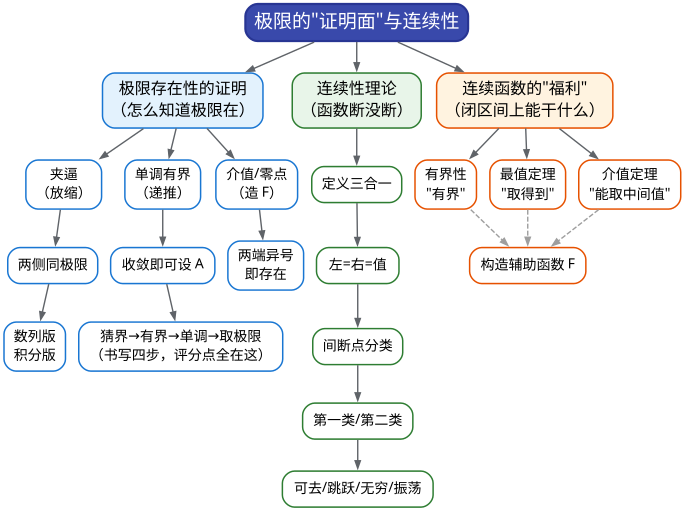
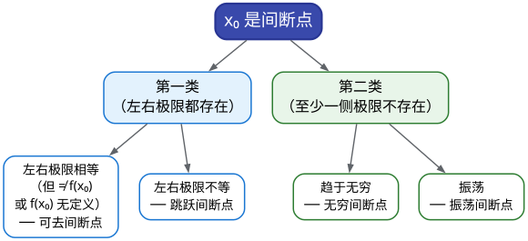

# CMC 手把手精讲
## ——《02 极限证明与连续性》：把"存在"两个字写成分数

> 🐱 喵～欢迎来到第二篇。如果说 01 篇教你的是"**把极限算出来**"，这一篇教你的是另一门更值钱的手艺：**"证明极限存在"**、**"判断函数连续"**、**"用连续函数的性质证明存在某个点"**。
>
> **本篇在考试中的地位**（数据口径：第 10–17 届初赛，共 8 套非数学类/非数学 A 类试卷，逐题核对）：
> - 本板块（函数、极限、连续）每套卷稳定贡献约 **20–34 分**（含跨板块交叉计入），8 届平均约 24 分；其中<strong>"证明与连续"这一半</strong>的实点分布是：数列极限证明大题 **3/8 届**（12 届二 10 分、13 届二 14 分、15 届六 14 分）、连续性/间断点的填空或大题第一问 **2 届**（14 届填 2、16 届三(1)）、闭区间连续函数性质（介值/零点/最值）证明 **2–3 届**（12 届三(1)、16 届三(2)、8 届五——其中 8 届五的官方解法实为"变限积分 + 双中值"，见精讲 5）。
> - 一句话定级：**"算"是保底 6 分，"证"是 14 分大题的半壁江山**——近 8 届中，凡出现"证明……收敛""证明存在……"字样的题目，评分的一半都落在**存在性论证与规范表述**上（估计）。
> - ⚠️ 考情提醒：本篇的方法（单调有界、夹逼、介值定理）**不只服务于本板块**——它们会原样出现在中值定理证明（04 篇）、积分不等式（06 篇）、级数判敛（12 篇）里。**这一篇的书写格式，是你后面所有证明题的"语法"**。
>
> **大纲对应条目**（《全国大学生数学竞赛考试内容》非数学专业类·函数极限部分原文摘录）：
> - 条目 4：数列极限与函数极限的定义及其性质、函数的左极限与右极限；
> - 条目 6：（后半句）极限存在的**单调有界准则和夹逼准则**；
> - 条目 7：函数的连续性（含左连续与右连续）、函数**间断点的类型**；
> - 条目 8：连续函数的性质和初等函数的连续性；
> - 条目 9：**闭区间上连续函数的性质（有界性、最大值和最小值定理、介值定理）**。
>
> （口径说明：ε-δ 语言的**严格证明题**不在非数学类大纲的考查重点里——近 8 届初赛没有一道以 ε 构造为核心的题；但**ε 语言的读法**必须会，因为竞赛答案里到处是"对任意 ε>0，存在 N……"的句式，函授读题能力从这里来。）
>
> **先修提示**：请先看完 **01 篇**（极限的计算方法）。本篇会大量回指 01 篇的"三件套"（等价无穷小/泰勒/洛必达）——但请放心：**01 篇管"算"，本篇管"证"，两篇的分工划得很干净**，涉及到"把具体极限算出来"的地方，我都会写明"回 01 篇某节"。
>
> **预计学时**：2–3 天（按每天 1–2 小时折算）。对应 00 总纲行军表：**第 1 周 D5（数列极限）+ D6（连续性判定/间断点）**，以及第 2 周做真题时的回炉。建议节奏：第 1 天 §一+§二+§3.1–3.3；第 2 天 §3.4–3.8 + 精讲 1–5；第 3 天精讲 6–10 + 易错点 + 自测题。
>
> 阅读建议：
> 1. 先花 3 分钟扫 §一的两张表，建立"题面在说什么 → 我该动哪件武器"的直觉；
> 2. §二 的 2.1（ε 语言）**不要跳过也别死磕**——目标是"能翻译"，不是"能构造"，用 20 分钟拿下；
> 3. 所有证明题精讲，**先自己在草稿纸上写"第一句话"再看解答**——证明题的功力全在"第一句话"；
> 4. 本篇的"易错点清单"比 01 篇还重要：证明题扣分**几乎全是格式和条件**，不是算错。
>
> 符号说明：📌 重点 | 💡 直觉/类比 | ⚠️ 易错点 | ✍️ 动笔练一练 | ❓ 自测题 | 🎯 考试定位 | ⏱️ 省时技巧

---

# 一、本篇地图

## 1.1 目录（施工图）

- **§二 知识讲解**：ε-N/ε-δ 语言的读法 → 三大存在性工具（夹逼/单调有界/介值）的"出生证明" → 连续性的定义与直觉 → 间断点分类（含复合函数这个坑） → 闭区间连续函数三大性质 → 上/下极限（点到为止）
- **§三 方法手册**：3.1 夹逼准则做证明题 | 3.2 单调有界准则的四步书写模板 | 3.3 递推数列的变形四把扳手 | 3.4 连续性判定与求参数 | 3.5 间断点分类（含复合函数重写） | 3.6 介值/零点定理构造辅助函数 | 3.7 极限存在性证明的三条流水线 | 3.8 通用流程与书写纪律
- **§四 真题精讲**：10 道真题完整精讲（10 届一(1)、13 届补一(1)、14 届一(2)、16 届三、8 届五、7 届五、13 届五、15 届四、15 届六、14 届补二三）
- **§五 易错点清单**：12 条 ❌→✅ 对照
- **§六 自测题**：7 道，附完整答案
- **§七 结语**："证明题防身六句话" + 学习建议 + 与 04 篇的衔接

## 1.2 方法速查表：什么题面 → 用什么武器（一屏版）

| 题面长相（信号） | 首选武器 | 一句话要领 |
|---|---|---|
| "设 $`x_{n+1}=f(x_n)`$，**证明 $`\{x_n\}`$ 收敛**，并求极限" | **单调有界准则** | 猜界（不动点）→ 归纳有界 → 作差证单调 → 再取极限 |
| "证明 $`\lim`$ 存在" + 通项是**求和/连乘/绝对值/取整**型 | **夹逼准则** | 找主项、放缩尾巴、两侧同极限、**点名"由夹逼准则"** |
| 通项里出现 $`f(x)-f(x/3)`$、$`f(x)-f(cx)`$ 这类"**压缩差**" | **迭代铺展 + telescoping** | 把尺度按 $`c, c^2,\dots,c^n`$ 铺成 $`n`$ 项，先对固定 $`n`$ 求和再令 $`n\to\infty`$ |
| 递推式"打不开"（分数嵌套、乘积缠绕） | **取倒数 / 取对数 / 裂项** | 取倒数常直接把 "$`y+a/y`$" 结构拉直 |
| 分段函数 + 参数 $`k`$："求 $`k`$ 使 $`f`$ 在 $`x_0`$ **连续**" | **连续性三合一判定** | 左极限 = 右极限 = $`f(x_0)`$，三者缺一不可 |
| "求复合函数 $`f[g(x)]`$ 的**间断点**" | **先重写显式分段** | 看 $`g(x)`$ 的值域落在 $`f`$ 的哪一段，逐段翻译 |
| "存在 $`\xi`$ 使 $`f(\xi)=`$ 某个式子/某个值" | **介值定理 + 构造 $`F`$** | 移项作差造 $`F`$，验证"闭区间连续 + 两端异号" |
| "证明 $`f(x)=0`$ 在区间内**恰有** $`n`$ 个实根" | **零点定理 + 单调性** | 「至少」来自介值，「至多」来自每段严格单调 |
| 闭区间上"求最小值 $`\lambda`$、最大值 $`\mu`$" | **最值定理 + 单调性判定** | 先证 $`f'`$ 定号（往往要二阶导接力），再取端点 |
| 结论要"**两个不同点** $`\xi\ne\eta`$ 同时出现" | **分段两次中值**（详见 04 篇） | 先用介值定理在区间内部"钉"一个分点 |
| "$`\varepsilon`$-$`\delta`$ 型"结论（如 $`\lvert x_n-A\rvert<\varepsilon`$） | 定义直译 + 放大不等式 | 竞赛里多为**小题的一个台阶**，不整题构造 |

## 1.3 知识树：本篇全部内容的骨架



一句话总结：**判断"极限在不在"用两条闸门（夹逼）和一张准入证（单调有界）；判断"函数断没断"看三合一；想在闭区间上"造出一个点"（使 $`f(\xi)`$ 等于某值），就用介值定理 + 构造辅助函数。**

🎯 **本板块两种题的正确打开方式**：

| 题型 | 目标分 | 策略 |
|---|---|---|
| 6 分填空（间断点、连续性定参数、迭代数列极限值） | **6/6 必拿** | 都用本篇 §3.4–3.5、§3.3 的机械流程，目标 3 分钟内 |
| 14 分证明大题（递推数列、介值、夹逼估计） | **10–14 分** | 「存在性论证」每字都算分——把 §3.2 的四步模板**默写**出来就是 6–8 分 |

---

# 二、知识讲解：从"无限接近"到"造出一个点"

## 2.1 ε-N 与 ε-δ：极限定义的"读法"（20 分钟拿下，不深挖）

01 篇我们靠直觉说"$`x_n`$ 最终奔向 $`A`$"。严格化之后就是课本上那段吓人的话：

📌 **数列极限的 ε-N 定义**：$`\lim\limits_{n\to\infty}x_n=A`$ 指的是——
> 对**任意**给定的 $`\varepsilon>0`$，都存在**某个**正整数 $`N`$，使得当 $`n>N`$ 时，恒有 $`|x_n-A|<\varepsilon`$。

📌 **函数极限的 ε-δ 定义**：$`\lim\limits_{x\to x_0}f(x)=A`$ 指的是——
> 对任意 $`\varepsilon>0`$，都存在 $`\delta>0`$，使得当 $`0<|x-x_0|<\delta`$ 时，恒有 $`|f(x)-A|<\varepsilon`$。

💡 **打比方（给考过驾照的你）**：这是一场"**挑战-响应**"游戏。出题人扮演"刁难者"：他提出任意小的精度要求 $`\varepsilon`$（"你必须离终点 1 毫米以内"）；你扮演"证明者"：你必须交出一个具体的**门槛** $`N`$（或 $`\delta`$）说"从第 $`N`$ 项开始，全都达标"。他要求的精度越苛刻，你交的门槛通常越大——**但只要对每个 $`\varepsilon`$ 你都能交出门槛，极限就存在**。

严格定义与直觉定义的区别只有一个，而且正是竞赛爱考的那个：

| 直觉说法 | 严格的 ε 语言 | 差在哪 |
|---|---|---|
| $`x_n`$ 越来越接近 $`A`$ | 对任意 $`\varepsilon`$，**最终**（某 $`N`$ 之后）全部落在 $`(A-\varepsilon,A+\varepsilon)`$ 内 | 「越来越近」不是数学要求——"距离每次减半"和"距离回到 $`0.9`$"都叫越来越近，但后者可以不收敛 |
| $`f(x)`$ 在 $`x_0`$ 附近接近 $`A`$ | 对任意 $`\varepsilon`$，存在**去心邻域** $`0<\lvert x-x_0\rvert<\delta`$ 全部达标 | "去心"两个字很关键：极限**不管** $`f(x_0)`$ 本身 |

⚠️ **考情校准**：00 总纲把"ε 语言构造压轴题"列在 C 级战略放弃（14 届六、1 届八型），这是对的。但请把下面这张**翻译表**记住，因为竞赛答案里这些句子每天都会出现：

| 你想说 | 竞赛规范写法 |
|---|---|
| "$`x_n`$ 与 $`A`$ 要多大差距都行" | 对任意 $`\varepsilon>0`$，存在 $`N`$，当 $`n>N`$ 时「$`\lvert x_n-A\rvert<\varepsilon`$」 |
| "$`x_n`$ 是有界的小量" | 存在 $`M>0`$，使 $`\lvert x_n\rvert\le M`$ 对一切 $`n`$ 成立 |
| "$`\alpha(x)`$ 是 $`x\to0^+`$ 时的无穷小" | $`\lim\limits_{x\to0^+}\alpha(x)=0`$，即对任意 $`\varepsilon>0`$，存在 $`\delta>0`$，$`0<x<\delta`$ 时 $`\lvert\alpha(x)\rvert<\varepsilon`$ |
| "误差比 $`x^n`$ 更高阶" | $`o(x^n)`$：即 $`\lim\limits_{x\to0}\dfrac{o(x^n)}{x^n}=0`$ |

✍️ **动笔练一练**（类型题·仿竞赛风格）：用 ε-N 定义证明 $`\lim\limits_{n\to\infty}\dfrac{n}{n^2+1}=0`$。
提示：$`0<\dfrac{n}{n^2+1}<\dfrac{1}{n}<\varepsilon`$ 只要 $`n>\dfrac{1}{\varepsilon}`$——取 $`N=\left[\dfrac{1}{\varepsilon}\right]+1`$ 即可。**这道小题的意义**：ε 语言的标准动作就是"**先放缩、再解不等式、最后取整取 $`N`$**"，和夹逼题是同一套手感。

## 2.2 三大存在性工具的"出生证明"

这一节回答三个"为什么"——理解它们，你才知道什么时候该用谁。

### （1）夹逼准则：为什么两条闸门能定住中间的人？

> 若在某个过程中恒有 $`y_n\le x_n\le z_n`$，且两侧极限都是 $`A`$，则 $`\lim x_n=A`$。

**证明的直觉**（用 2.1 的语言）：出题人要精度 $`\varepsilon`$。左侧 $`y_n\to A`$ 保证"过了 $`N_1`$ 之后 $`y_n>A-\varepsilon`$"，右侧 $`z_n\to A`$ 保证"过了 $`N_2`$ 之后 $`z_n<A+\varepsilon`$"。取 $`N=\max\{N_1,N_2\}`$，之后就有

```math
A-\varepsilon<y_n\le x_n\le z_n<A+\varepsilon\ \Rightarrow\ |x_n-A|<\varepsilon.
```

看出关键了吗——**我们从来没有描述过 $`x_n`$ 本身长什么样**，只用了它"被夹住"这个被动事实。

💡 **什么时候这是唯一出路**：当 $`x_n`$ 的**精确通项根本写不出来**时（如 $`\displaystyle\sum_{k=1}^n\dfrac{1}{n+\sqrt{k}}`$、含 $`\sin`$ 的积分、含取整函数）。这类题的题面信号极好认：**通项里有"一批随 $`k`$ 变动的杂项"**。

### （2）单调有界准则：为什么"准入证"必须先发？

> 单调有界数列必有极限。（竞赛里直接用，不证原理——它是实数完备性的一部分。）

它的价值在于：**不需要知道极限是多少，就能断言"极限存在"**。这解决了递推数列的核心矛盾——递推式 $`x_{n+1}=f(x_n)`$ 往往解不出通项，但"存在性"可以先立住，再通过 $`A=f(A)`$ 把值算出来。

⚠️ **书写红线**：题面说"证明收敛并求极限"时，**先证收敛、再设极限**是评分逻辑；反过来直接"设 $`\lim x_n=A`$"就是**循环论证**（你凭什么默认极限存在？），官方评分点就扣在这。01 篇精讲 9 和本篇 §3.2 给出的四步模板，请默到闭眼能写。

💡 **打比方**：单调有界准则像"**地铁进站必须刹车**"——一辆车只朝一个方向开（单调）且前方有墙（有界），那么它一定会停在某处（收敛）。收敛到哪里？**解不动点方程**就知道了：停车的位置必须满足"下一脚油门不动"（$`A=f(A)`$）。

### （3）介值定理：为什么"两端异号必有零点"？

> 若 $`F`$ 在 $`[a,b]`$ 上连续，则 $`F`$ 取到介于 $`F(a)`$ 与 $`F(b)`$ 之间的**一切**中间值。（零点定理是它取"中间值 $`=0`$"的特例。）

**直觉**：连续函数的图像是"一笔画、不许抬笔"。从 $`x`$ 轴下方出发、在上方收笔，这条线**必须**跨过 $`x`$ 轴——跨过的地方就是零点。

📌 **使用介值定理的两个必查条件**（就是评分点）：
1. **闭区间上连续**（题设若只说"在 $`(0,1)`$ 内可导"，可导**蕴含连续**，但要把这句话写出来）；
2. **两端的函数值异号**（或目标值落在两端之间）——所以要**构造**一个辅助函数 $`F`$，让它的两端值恰好异号。

💡 **它的思想地位**：这是"**存在性证明的第一范式**"——你无法指着某一点说"它就在这里"，但你能证明"它不可能不在"。后面 04 篇的中值定理（罗尔、拉格朗日）都是它的"升级版"：先造辅助函数，再用导数信息把零点钉在区间内部。

## 2.3 连续性：函数"断没断"

📌 **连续性定义**：$`f`$ 在 $`x_0`$ 处连续 $`\iff`$ $`\lim\limits_{x\to x_0}f(x)=f(x_0)`$，展开成三件事：

```math
\underbrace{\lim_{x\to x_0^-}f(x)=\lim_{x\to x_0^+}f(x)}_{\text{左右极限存在且相等}}=\underbrace{f(x_0)}_{\text{函数值存在}}
```

💡 **打比方**：连续 = 你从左右两边走向 $`x_0`$，"看到的高度"和"站在 $`x_0`$ 那一点实际的高度"**一致**。三个条件像三条腿的凳子：左极限、右极限、函数值——缺哪条腿都塌。

**三条实用结论**（不用每次都回到定义）：

1. **初等函数在其定义区间内连续**——所以 $`\dfrac{1}{\ln(1+x)}-\dfrac{1}{x}`$ 在 $`(0,1]`$ 上天然连续，不需要论证；
2. **连续函数的四则运算、复合、反函数仍连续**（在定义域内）；
3. **可导 ⟹ 连续**（反过来不对：$`|x|`$ 在 $`0`$ 处连续但不可导）。

**考场上真正要动手的只有一种**：**分段函数的分段点**（或定义域端点）处的连续性——因为别处都靠结论 1 白送。判定流程（§3.4 展开）：

```
在分段点 x_0：① 算左极限 ② 算右极限 ③ 看 f(x_0) 的值（含参数！）
             → 三者相等 ⟹ 连续；否则间断
```

⚠️ **最高频失分点**：只比较了左右极限，**漏掉函数值**（或者忘了函数值里含参数）。16 届第三题(1) 就是"左极限 $`=\dfrac12`$、而 $`f(0)=k`$"，所以 $`k`$ 必须取 $`\dfrac12`$。

## 2.4 间断点分类：四种断法，一张分类树

**间断点** = 连续三条件中至少一条不满足的点。分类的判据只有两个：**左右极限存在吗？相等吗？**



- **可去间断点**：如 $`f(x)=\dfrac{\sin x}{x}`$ 在 $`x=0`$（左右极限都为 1，但函数值未定义）——"补一个值就能救活"；
- **跳跃间断点**：如 $`\mathrm{sgn}(x)`$ 在 $`0`$ 处（左 $`-1`$、右 $`1`$）；
- **无穷间断点**：如 $`\dfrac1x`$ 在 $`0`$ 处；
- **振荡间断点**：如 $`\sin\dfrac1x`$ 在 $`0`$ 处。

⏱️ **考场三步**：① 找出**可疑点**（分段点、分母零点、$`\ln`$ 的边界等）；② 对每个可疑点求左右极限；③ 查表分类。整个过程 2 分钟内完成，6 分白给。

### ⚠️ 复合函数的间断点：为什么不能照搬？（14 届填空 2 的坑）

这是本小节的重点。给定外层函数 $`f`$ 与内层函数 $`g`$，问 $`f[g(x)]`$ 的间断点——很多同学一看 $`f`$ 在 $`0`$ 处间断，就答"$`x=0`$"；一看 $`g`$ 在 $`1`$ 处间断，就答"$`x=1`$"。**都不对。**

**正确的做法只有一条**：设 $`u=g(x)`$，先问"**当 $`x`$ 扫过整个定义域时，$`u`$ 经过了哪些值**"，再把这些 $`u`$ 值**翻译回 $`x`$**：

```math
\text{外层 } f \text{ 在哪断} \quad\Longrightarrow\quad \text{令 } g(x) \text{ 取到那些"危险值"，解得 } x
```

💡 **打比方**：$`f`$ 是"安检门"，只有在特定身高（危险值）的人通过时会响；$`g`$ 是"人流路线"。安检门响不响，取决于**路线上有没有人身高恰好等于危险值**——路线绕开了危险值，门就永远不响（间断点消失）；路线经过危险值，对应位置 $`x`$ 就是复合函数的间断点。

**真题试看**（14 届·填空 2，完整精讲见 §四 精讲 3）：$`f(x)=\begin{cases}1, & x>0,\\ 0, & x\le0,\end{cases}`$ 的危险值是"$`u`$ 跨过 $`0`$"；而 $`g(x)=\begin{cases}x-1,&x\ge1\\1-x,&x<1\end{cases}`$ 的路线是"$`u\ge0`$ 恒成立，除 $`x=1`$ 处 $`u=0`$"。于是 $`f[g(x)]`$ 只在 $`x=1`$ 处（$`u`$ 恰好卡在危险值上）断开——**$`f`$ 自己的间断点 $`x=0`$、$`g`$ 自己的间断点 $`x=1`$，在复合后一个消失、一个被保留**。

✍️ **动笔练一练**（类型题·仿竞赛风格）：$`f(x)=\begin{cases}0,&x<0\\1,&x\ge0\end{cases}`$，$`g(x)=x^2-1`$。求 $`f[g(x)]`$ 的间断点。
提示：危险值是 $`u=0`$；$`g(x)=0\iff x=\pm1`$；两个点都要检查左右——在 $`x=1`$ 处 $`g`$ 从 $`<0`$ 变到 $`\ge0`$，在 $`x=-1`$ 处 $`g`$ 从 $`>0`$ 变到 $`<0`$。故间断点为 $`x=\pm1`$（均为跳跃间断点）。

## 2.5 闭区间上连续函数的三大性质：竞赛证明题的"素材库"

设 $`f`$ 在**闭区间** $`[a,b]`$ 上连续，则：

📌 **性质 1（有界性）**：$`f`$ 在 $`[a,b]`$ 上有界，即存在 $`M>0`$ 使 $`|f(x)|\le M`$。
📌 **性质 2（最值定理）**：$`f`$ 在 $`[a,b]`$ 上取到最大值 $`M`$ 与最小值 $`m`$。
📌 **性质 3（介值定理）**：对任意介于 $`m`$ 与 $`M`$ 之间的 $`\mu`$，存在 $`\xi\in[a,b]`$ 使 $`f(\xi)=\mu`$。

⚠️ **"闭区间"三个字是命门**：开区间上全部失效——$`\dfrac1x`$ 在 $`(0,1)`$ 上无界、无最值。凡是题目给"闭区间"又要求"证明存在某点"，十有八九就是这三条性质上场。反过来，若题目只给"$`(0,1)`$ 内可导"，你**可以**说"可导蕴含连续，故在闭子区间上连续"，但**不能**直接说"在 $`(0,1)`$ 上取到最值"。

💡 **三大性质的心智模型**：它们合起来的意思是——"**闭区间上的连续函数，是一张受控的、没有漏洞的、取遍所有中间值的曲线**"。所有存在性证明题，本质都是从这张曲线上"抠下一个点"。

**三大性质的三种典型用法**（后文方法手册逐一展开）：

| 用法 | 题面信号 | 关键动作 |
|---|---|---|
| 造分点 | "存在 $`x_0`$ 使 $`f(x_0)=`$ 与 $`x_0`$ 有关的式子" | 令 $`F(x)=f(x)-`$（那个式子），验证 $`F`$ 两端异号 |
| 定界 | "估计 $`\lvert f(x)\rvert`$ 或 $`f`$ 的最大值" | 用最值定理取出 $`M=\max\lvert f\rvert`$，把"逐点"估计升级为"一致"估计 |
| 逼近 | 结论含"≥ 或 >"，需要"几乎取到" | 用连续性把 $`\sup`$/极限行为转化为"真的取到某值" |

✍️ **动笔练一练**（类型题·仿竞赛风格）：设 $`f`$ 在 $`[0,1]`$ 上连续，$`f(0)=f(1)`$。证明：存在 $`x_0\in\left[0,\dfrac12\right]`$ 使 $`f(x_0)=f\left(x_0+\dfrac12\right)`$。
提示：令 $`F(x)=f(x)-f\left(x+\dfrac12\right)`$，在 $`\left[0,\dfrac12\right]`$ 上考察。$`F(0)=f(0)-f\left(\dfrac12\right)`$，$`F\left(\dfrac12\right)=f\left(\dfrac12\right)-f(1)=f\left(\dfrac12\right)-f(0)`$，两者异号（或都为 $`0`$），零点定理即得。这是经典"一题两解"的原型（本题即 12 届三(1)、14 届补二四的"分点思路"的最简版）。

## 2.6 上/下极限：点到为止（10 分钟，防冷门）

🎯 **考试定位：了解一下即可**。上/下极限（$`\varlimsup`$、$`\varliminf`$）**不在非数学类大纲里**，近 8 届初赛零出现，00 总纲把它列在 C 级放弃清单。但它是理解"极限不存在时怎么办"的一把钥匙，花 10 分钟认识它，以后读答案不卡壳。

**定义直觉**：数列 $`x_n=(-1)^n`$ 不收敛，但它的"上侧帽子"稳定在 $`1`$（所有收敛的子列中最大的极限叫上极限），"下侧鞋子"稳定在 $`-1`$。一般地：

```math
\varlimsup_{n\to\infty}x_n=\lim_{n\to\infty}\Big(\sup_{k\ge n}x_k\Big),\qquad \varliminf_{n\to\infty}x_n=\lim_{n\to\infty}\Big(\inf_{k\ge n}x_k\Big).
```

（"从第 $`n`$ 项往后的最大值"随 $`n`$ 增大而不增，故有极限——这就是上极限。）

📌 **唯一需要记住的性质**：$`\lim x_n`$ 存在 $`\iff`$ $`\varlimsup x_n=\varliminf x_n`$（此时公共值就是极限）。

💡 **它有什么用**：当你只能证明"对任何 $`\varepsilon`$，$`x_n`$ 最终 $`\le A+\varepsilon`$"（而不知道下界）时，你得到的其实是"$`\varlimsup x_n\le A`$"。参考答案偶尔会用这种"夹上极限、再夹下极限"的语言组织论证（把单侧估计包装成上/下极限的夹逼）；考场上遇到它，**读懂即可，不必主动使用**——把相应的句子改写成"最终 $`\le A+\varepsilon`$ 对一切 $`\varepsilon>0`$ 成立"的直白形式即可。

---

# 三、方法手册：五套武器，见招拆招

每个方法按统一格式展开：【适用信号】→【步骤】→【关键公式/书写模板】→【真题微型例子】。本篇是证明题篇，**"怎么写"和"写什么"一样重要**——下面每个步骤模板都可以直接抄到卷面上。

## 3.1 夹逼准则（做证明题版）

**【适用信号】** 题面要"证明极限存在"或"求极限"；通项是**求和、连乘、含绝对值/取整/三角、含积分**的结构；放缩之后上下界能跑到同一个数。**与 01 篇的区别**：01 篇的夹逼多用于"算"，本篇的夹逼用于"证"——书写里必须**点名"由夹逼准则"**。

**【步骤（四步书写模板）】**
1. **找主项**：看清楚 $`x_n`$ 一共几项、每项的数量级（"$`n`$ 项、每项约 $`\frac1n`$，总量约 $`1`$"）；
2. **放缩**：把所有项换成"最大的那一批"得**上界**，换成"最小的那一批"得**下界**（放大缩小**分开做**，不得中途混用）；
3. **两侧同极限**：分别算出 $`\lim y_n`$ 与 $`\lim z_n`$，确认**相等**；
4. **收尾一句话**：写"∵ $`y_n\le x_n\le z_n`$ 对一切 $`n`$ 成立，且 $`\lim y_n=\lim z_n=A`$，∴ **由夹逼准则** $`\lim x_n=A`$"。——最后这句"由夹逼准则"，就是官方评分点（15、16 届官方解答里处处标注）。

**【关键公式/不等式库（放到手边）】**

```math
\frac{1}{n+1}<\frac1n;\qquad |\sin\Box|\le1,\ |\cos\Box|\le1;\qquad \sin x\le x\ (x\ge0);\qquad \ln(1+t)\le t\ (t>-1);
```

```math
\sin x\ge\frac{2}{\pi}x\ \Big(0\le x\le\frac{\pi}{2}\Big);\qquad \ln(1+t)\le t\ \text{与}\ \ln(1+t)\ge t-\frac{t^2}{2}\ (t\in[0,1]).
```

**积分版放缩**：被积函数整体放缩（如 $`0\le\ln(1+t^n)\le t^n`$），或把积分区间"掐短/延长"（$`0\le\int_b^1 g\le\int_b^1 h`$）。

**【真题微型例子】**（第 10 届非数学类·填空第 1 题，2018；这里是证明视角的完整书写）设 $`\alpha\in(0,1)`$，求 $`\lim\limits_{n\to+\infty}\big[(n+1)^\alpha-n^\alpha\big]`$。
先提出主项看结构：$`(n+1)^\alpha-n^\alpha=n^\alpha\Big[\Big(1+\dfrac1n\Big)^\alpha-1\Big]`$。因为 $`0<\alpha<1`$ 时函数 $`t\mapsto t^\alpha`$ 是凹的（图像在切线下方），故 $`\Big(1+\dfrac1n\Big)^\alpha<1+\dfrac1n`$，于是

```math
0<(n+1)^\alpha-n^\alpha<n^\alpha\cdot\frac1n=n^{\alpha-1}\to0.
```

**书写要点**：两侧分别交代——"$`>0`$ 由上侧递增性（或直接看结构），$`<n^{\alpha-1}`$ 由凹函数不等式"；最后一句"由夹逼准则，极限为 0"。**注意这道题的"陷阱"是方向**：若 $`\alpha>1`$ 结论完全不同（趋于 $`+\infty`$），所以凹性方向不能记反。
> ⏱️ 填空写法只需三行：提出主项 → 放缩 → 夹逼。目标 90 秒。

## 3.2 单调有界准则（四步书写模板——本篇最值钱的一页）

**【适用信号】** 题面出现"$`x_{n+1}=f(x_n)`$，证明 $`\{x_n\}`$ 收敛，并求 $`\lim x_n`$"；或"数列由递推式给出"且要你讨论收敛性。近 8 届 3 次以证明大题出现（12 届二 10 分、13 届二与 15 届六各 14 分）。

**【步骤（四步模板，建议整段默写）】**

> **第一步（猜界/预处理）**：若递推式是隐式的（藏在方程里），先**解出** $`x_{n+1}=\cdots`$；必要时作换元（见 3.3）。解**不动点方程** $`A=f(A)`$ 得到"极限嫌疑人" $`A`$——它同时是**界**和**单调性标尺**的候选。
>
> **第二步（证有界）**：归纳法。写出"$`x_1\in`$ 区间"（初始验证）+"若 $`x_n\in`$ 区间则 $`x_{n+1}=f(x_n)\in`$ 区间"（归纳步）。界通常来自**均值不等式**：$`y+\dfrac{a}{y}\ge2\sqrt a`$；或来自不动点：$`y>\sqrt{2a}\Rightarrow f(y)>\sqrt{2a}`$。
>
> **第三步（证单调）**：作差 $`x_{n+1}-x_n=f(x_n)-x_n`$ 并**把它因式分解、定符号**；若不够，作商 $`\dfrac{x_{n+1}}{x_n}`$。定符号时引用第二步的界。
>
> **第四步（收尾取极限）**：写"$`\{x_n\}`$ 单调（增/减）且有（上/下）界，**由单调有界准则，$`\{x_n\}`$ 收敛**。设 $`\lim x_n=A`$，对递推式两边取极限（$`f`$ 连续），$`A=f(A)`$，解得 $`A=\cdots`$（**排除不合理的根**：负根、越界的根），故 $`\lim x_n=A`$。"

⚠️ **评分点分布**（以 13 届二官方为例）：整理递推+换元 5 分 / **单调有界论证 5 分** / 解不动点得值 4 分。注意"单调有界"这 5 分是**整段论证**的分——第二步和第三步缺一不可。

**【真题微型例子】**（第 15 届非数学 A 类·大题六前半段，2023）设 $`x_0=\dfrac13`$，$`x_{n+1}=\dfrac{x_n^2}{1-x_n+x_n^2}`$。证明 $`\sum x_n`$ 收敛（前半：先证 $`x_n`$ 收敛于 0）。
归纳知 $`x_n>0`$；作差

```math
x_{n+1}-x_n=\frac{x_n^2}{1-x_n+x_n^2}-x_n=\frac{x_n^2-x_n+x_n^2-x_n^3}{1-x_n+x_n^2}=\frac{-x_n(1-x_n)^2}{1-x_n+x_n^2}<0\ (0<x_n<1),
```

故 $`\{x_n\}`$ 单调递减且 $`x_n\le\dfrac13`$——**由单调有界准则收敛**；再由 $`x_{n+1}=x_n\cdot\dfrac{x_n}{1-x_n+x_n^2}\le\dfrac49x_n`$ 知极限为 $`0`$（完整版见精讲 9）。
> 注意作差后的**因式分解质量**：$`-x_n(1-x_n)^2/(1-x_n+x_n^2)`$ 一眼定号（分子恒负、分母恒正），这是命题人留的"顺风路"。如果作差得到的式子不能定号，立刻改作商或先换元。

## 3.3 递推数列的变形四把扳手

递推式直接作差打不开时，先"掰直"它。四把扳手按优先级排序：

**扳手 1：取倒数**。适用信号：递推式是"分式除以 $`x_n`$"或形如 $`\dfrac{x_n}{a+bx_n}`$；取倒数后右端常变成**线性**（可逐层展开求和）。
**【真题微型例子】**（第 12 届非数学类·解答题二，2020）$`a_1=1`$，$`a_{n+1}=\dfrac{a_n}{(n+1)(a_n+1)}`$，求 $`\lim n!\,a_n`$。
取倒数：$`\dfrac{1}{a_{n+1}}=(n+1)\Big(1+\dfrac1{a_n}\Big)=(n+1)+\dfrac{n+1}{a_n}`$，逐层展开得 $`\dfrac{1}{a_{n+1}}=(n+1)!\displaystyle\sum_{k=0}^{n}\dfrac1{k!}`$，故 $`n!a_n=\dfrac{1}{\sum_{k=0}^{n-1}\frac1{k!}}\to\dfrac1e`$。
> （01 篇 §3.6 有完整推导。）**记忆点**：取倒数把"乘积缠绕"拉直成"求和"，而求和往往能凑出 $`e`$、望远镜或递推。

**扳手 2：换元配"$`y+\dfrac{a}{y}`$"**。适用信号：递推式形如 $`\dfrac{x^2+\text{常数}}{2x+2}`$。换元（如 $`y_n=x_n+1`$）后落到均值不等式的地盘，下界自动浮现。
**【真题微型例子】**（第 13 届·解答题二，2021）$`x_{n+1}=\dfrac{x_n^2+2021}{2(x_n+1)}`$：令 $`a=1011`$，$`y_n=1+x_n`$，则 $`y_{n+1}=\dfrac{y_n}{2}+\dfrac{a}{y_n}`$——标准的均值迭代，$`y_{n+1}\ge\sqrt{2a}`$。（详见 01 篇精讲 9。）

**扳手 3：裂项（望远镜）**。适用信号：题面要"求和/求级数和"，而递推式能整理出 $`x_n=g(n)-g(n+1)`$ 的形状；或能验证恒等式 $`x_n=\dfrac{x_n}{1-x_n}-\dfrac{x_{n+1}}{1-x_{n+1}}`$（15 届六官方"方法 2"）。
**书写要领**：$`\displaystyle\sum_{i=0}^n x_i=g(0)-g(n+1)`$，再令 $`n\to\infty`$ 用"$`x_n\to0`$（先证）"收尾。

**扳手 4：取对数**。适用信号：递推式是**乘积**结构（连乘、幂次），如 $`x_n=\prod\Big(1+\frac1k\Big)^{1/k}`$ 型。取对数把乘积化为求和。
**提醒**：取对数前要先证 $`x_n>0`$（归纳一步），这样 $`\ln`$ 才合法——这个"合法性检查"本身就是评分点。

## 3.4 连续性判定与求参数

**【适用信号】** 分段函数（或补充定义型）+"求 $`k`$ 使 $`f`$ 在 $`x_0`$ 连续"；含参数 $`a,b`$ 的两个分段点。

**【步骤（三查一写）】**
1. **查左极限** $`f(x_0^-)`$，**查右极限** $`f(x_0^+)`$（用 01 篇的三件套算这两个极限）；
2. **查函数值** $`f(x_0)`$——**注意它常常也含参数**；
3. **写结论**："由 $`\lim\limits_{x\to x_0^-}f=\lim\limits_{x\to x_0^+}f=f(x_0)`$，故 $`f`$ 在 $`x_0`$ 处连续。"（三个量相等，一个都不能省。）

**【关键公式/常备小结论】**

```math
\lim_{x\to 0}\frac{\sin x}{x}=1,\qquad \lim_{x\to 0}\frac{x-\ln(1+x)}{x^2}=\frac12,\qquad \lim_{x\to 0}\frac{e^x-1-x}{x^2}=\frac12,\qquad \lim_{x\to0}\frac{1-\cos x}{x^2}=\frac12.
```

（后一个是 16 届三的官方"半成品结论"——把 $`\dfrac{x-\ln(1+x)}{x^2}\to\dfrac12`$ 背下来，考场上省一整步洛必达。）

**【真题微型例子】**（第 16 届非数学 A 类·大题三(1)，2024）$`f(x)=\dfrac{1}{\ln(1+x)}-\dfrac1x`$（$`0<x\le1`$），$`f(0)=k`$，求 $`k`$ 使 $`f`$ 在 $`[0,1]`$ 连续。

```math
\lim_{x\to0^+}f(x)=\lim_{x\to0^+}\frac{x-\ln(1+x)}{x\ln(1+x)}\overset{\text{分母等价}}{=}\lim_{x\to0^+}\frac{x-\ln(1+x)}{x^2}\overset{\text{洛必达}}{=}\lim_{x\to0^+}\frac{1-\frac1{1+x}}{2x}=\lim_{x\to0^+}\frac{1}{2(1+x)}=\frac12,
```

故 $`k=\dfrac12`$。（完整版+第二问见精讲 4。）**两个技术点**：① 通分是"化 $`\infty-\infty`$"的标准第一动作；② 分母用等价替换 $`x\ln(1+x)\sim x^2`$ 比洛必达更快——这是 01 篇"乘除因子放心换"的直接应用。

## 3.5 间断点分类（含复合函数重写）

**【适用信号】** "求 $`f`$ 的间断点并指出类型"；"求 $`f[g(x)]`$ 的间断点"。

**【步骤】**
1. **锁可疑点**：分段点、分母零点、$`\ln`$/根号的边界、$`[x]`$、$`\tan`$ 的极点；
2. **对每个可疑点算左右极限**；若含复合，**先重写 $`f[g(x)]`$ 的显式分段**（核心步骤，见 2.4 的方法）；
3. **对照分类树**（2.4 节）落笔：可去 / 跳跃 / 无穷 / 振荡。

**【关键公式/书写模板】**
> "当 $`x\to x_0^-`$ 时 $`f(x)\to A_1`$，当 $`x\to x_0^+`$ 时 $`f(x)\to A_2`$。因 $`A_1=A_2\ne f(x_0)`$（或"$`A_1\ne A_2`$"），故 $`x_0`$ 是**可去（跳跃）间断点**。"

**【真题微型例子】**（第 14 届非数学类·填空第 2 题，2022）$`f(x)=\begin{cases}1,&x>0\\0,&x\le0\end{cases}`$，$`g(x)=\begin{cases}x-1,&x\ge1\\1-x,&x<1\end{cases}`$，求 $`f[g(x)]`$ 的间断点。
**重写**是唯一正解：$`f[g(x)]=\begin{cases}1,&g(x)>0\\0,&g(x)\le0\end{cases}`$。先解 $`g(x)`$ 的零点：$`g(1)=0`$，且当 $`x\ne1`$ 时 $`g(x)>0`$（$`x>1`$ 时 $`g=x-1>0`$；$`x<1`$ 时 $`g=1-x>0`$）。所以

```math
f[g(x)]=\begin{cases}1,&x\ne1\\0,&x=1\end{cases}
```

在 $`x=1`$ 处左极限 $`=`$ 右极限 $`=1\ne f(1)=0`$——可去间断点。**答案：$`x=1`$（可去）**。
> 点评：$`f`$ 自己的间断点 $`x=0`$ 在复合后**消失**了（因为 $`g`$ 的值域是 $`[0,+\infty)`$，只碰到 $`0`$ 一次）。官方解答只有一句话"显然"，但考场上的你要**真的做这一步翻译**，不然就会写错答案。

## 3.6 介值/零点定理：构造辅助函数的标准套路

**【适用信号】** 结论形如"存在 $`\xi`$，使 $`f(\xi)=`$（某个能用题设算出的值/某个关于 $`\xi`$ 的式子）"；"证明方程在区间内至少/恰有 $`n`$ 个根"。

**【步骤】**
1. **移项作差**：把结论写成"某函数 $`=0`$"，命 $`F(x)=`$（结论式移项后的左端）；
2. **验两端**：计算 $`F(a)`$、$`F(b)`$（或合适的两个点），确认**异号**（或至少一端为零）；
3. **点明条件**："$`F`$ 在 $`[a,b]`$ 上连续（因 $`f`$ 连续），且 $`F(a)F(b)<0`$，**由零点定理**，存在 $`\xi\in(a,b)`$ 使 $`F(\xi)=0`$"；
4. **翻译回去**：把 $`F(\xi)=0`$ 整理成题目要的等式形式。

**【关键公式/常用构造表】**

| 要证的结论 | 辅助函数 $`F(x)`$ | 两端值 |
|---|---|---|
| $`f(\xi)=\mu`$（常数） | $`F=f-\mu`$ | $`f(a)-\mu`$，$`f(b)-\mu`$ 异号 |
| $`f(\xi)=\alpha\xi+\beta`$（线性） | $`F=f-\alpha x-\beta`$ | 代入端点算 |
| $`f(\xi)=\dfrac1{b-a}\displaystyle\int_a^b f`$（平均值） | $`F=f-I`$（$`I`$ 为平均值） | 用积分估计夹出符号 |
| $`f(\xi)=g(\xi)`$（两个函数相等） | $`F=f-g`$ | 两端代入 |

⏱️ **两个快速检查**：① 题目给的是**闭区间连续**还是**开区间可导**？后者要先写"可导 $`\Rightarrow`$ 连续"；② 要求点落在**开区间** $`(a,b)`$ 内时，"异号"是最保险的（两端都非零），这样零点定理直接给出内部点——若只用"两端之间有目标值"，还要多补一句"值域是区间"。

**【真题微型例子】**（第 12 届非数学类·解答题三(1)，2020）$`f\in C[0,1]`$、$`(0,1)`$ 内可导、$`f(0)=0`$、$`f(1)=1`$，证明存在 $`x_0\in(0,1)`$ 使 $`f(x_0)=2-3x_0`$。
构造 $`F(x)=f(x)+3x-2`$（即把 $`2-3x_0`$ 移过来），则 $`F(0)=-2<0`$，$`F(1)=2>0`$，$`F`$ 连续——由介值定理得 $`x_0\in(0,1)`$ 使 $`F(x_0)=0`$，即 $`f(x_0)=2-3x_0`$。
> 这道题的 (1) 问就是"造分点"（它的 (2) 问是双中值的开场，完整版请见 **04 篇** 精讲 1）。**注意 (1) 这种小问在 14 分大题里值 5 分**：造对 $`F`$、算对两端、点明定理名——三句话 5 分到手。

## 3.7 极限存在性证明的三条流水线

有些题的题面不是递推、也不是求和，而是"**给出别的东西（压缩差、积分、级数）要你证极限**"。此时按下面三条流水线对号入座：

**流水线 A：ε 定义直译（放缩 + 解不等式）**——题面给出精度语言，或你要把"$`\to0`$"写成合格句子。
动作：写出 $`|u_n-A|`$，用不等式放大成"只含 $`n`$ 的简单式子"，解出 $`n>N(\varepsilon)`$。
（例：把 $`\Big|\dfrac{x_n}{n}\Big|\le\dfrac{C}{n}<\varepsilon`$ 写成合格证明——这是 3 届二、9 届五型"均值极限题"的收尾动作。）

**流水线 B：压缩迭代（telescoping）**——题面出现 $`f(x)-f(cx)`$ 型"压缩差"的估计。
动作：把尺度按 $`c,c^2,\dots,c^n`$ 铺开成 $`n`$ 项和，**先对固定 $`n`$ 求和（望远镜），再令 $`n\to\infty`$**。
**【真题微型例子】**（第 14 届·第二次补赛·题三，2023）已知 $`\lim\limits_{x\to0^+}f(x)=0`$ 且 $`\lim\limits_{x\to0^+}\dfrac{f(x)-f(x/3)}{x}=0`$，证明 $`\lim\limits_{x\to0^+}\dfrac{f(x)}{x}=0`$。
把 $`x`$ 换成 $`x/3^k`$ 得每"一层"的估计，作和：

```math
\frac{f(x)-f(x/3^n)}{x}=\sum_{k=0}^{n-1}\frac{f(x/3^k)-f(x/3^{k+1})}{x/3^k}\cdot\frac{1}{3^k}=\sum_{k=0}^{n-1}\alpha_k(x)\cdot\frac{1}{3^k},
```

其中每个 $`\alpha_k(x)`$ 当 $`x\to0^+`$ 时是无穷小（有限和！），故左端当 $`x\to0^+`$ 时趋于 $`0`$：$`f(x)-f(x/3^n)=x\alpha(x)`$。再令 $`n\to\infty`$，用 $`f(x/3^n)\to0`$ 得 $`f(x)=x\alpha(x)`$，故 $`\dfrac{f(x)}{x}\to0`$。（完整版见精讲 10，注意"先固定 $`n`$ 求和、再 $`n\to\infty`$"的次序。）
> ⚠️ **原卷笔误一处**（照抄+加注）：原卷求和下标印为 $`k=1`$ 至 $`n`$，与左端不符，应为 $`k=0`$ 至 $`n-1`$。

**流水线 C：估计型（泰勒/积分放缩 + 夹逼）**——题面要"证明某表达式有极限/求极限"，而对象是**误差、和式或含参积分**。
动作：把对象化成"每段上的小误差之和"，用**中值/泰勒**给每段配一个系数，再用 Riemann 和或夹逼收尾。
**【真题微型例子】**（第 13 届·解答题五，2021，压轴级）中点公式误差估计——完整版见精讲 7；核心动作是"在每段中点做一次带 Lagrange 余项的泰勒，积掉一次项，误差化为 $`\int(x-\xi_k)^2`$，再用上下和夹逼"。

## 3.8 通用流程与书写纪律

任何一道"证明/连续性"题，按这个流程走：

1. **读结论**：先看"要我证什么"——是"存在某点"（→ §3.6）、"收敛/有极限"（→ §3.1/3.2/3.7）、还是"连续/间断"（→ §3.4/3.5）；
2. **抄条件**：把题设条件逐条翻译成"可用的工具"（闭区间连续→最值/介值可用；可导→连续可用；有界→放大时有个 $`M`$）；
3. **选流水线**：对号入座上面的方法；
4. **写"第一句话"**：所有证明题的分数从第一句话开始——"令 $`F(x)=\cdots`$""记 $`M=\max|f|`$""由数学归纳法"——第一句话就等于"我开始了"；
5. **回头检查评分点**：准则的名字写了吗？条件验了吗？区间是开的还是闭的？

⚠️ **书写纪律三条**（考场上真的会扣分的）：
1. **点明工具名字**："由夹逼准则""由单调有界准则""由零点定理""由拉格朗日中值定理"——官方答案每处都写，这些字就是分；
2. **验证条件**：用介值定理前写"连续"，用罗尔前写"可导且端点等值"，用单调有界前写"单调、有界"两个词；
3. **区分开/闭**：得到的中值点/零点在**开区间**还是**闭区间**，按题目要求写对；题目要 $`(0,1)`$ 内，你就要有"内部点"的论证。

---

# 四、真题精讲（10 道）

> 说明：以下 10 道题的**题面**全部取自 `研究/原始资料/真题/转录/` 已核对的官方转录（含两场补赛），逐字校对；**解答**：10、13、13 补、14 补二、15、16 届为官方参考答案的整理版（保留评分点意识），7、8 届已与转录库《第0X届…-参考解答.md》（公众号参考解答版）逐题核对一致（8 届五的解答**直接采用官方版**，见精讲 5 点评）。每道题按"**题面 → 思路分析（真实思考过程）→ 完整解答 → 点评**"展开。
>
> 🎯 配置：3 道 6 分填空（精讲 1、2、3，速通）+ 7 道大题（精讲 4–10；其中 3 道证"存在/收敛"——精讲 5、6、9；4 道求极限、连续性最值——精讲 4、7、8、10）。全部与 `练习/专题练习/02-极限证明与连续性-练习.md` 的 A1–A9、B5、B6 一一对应。

### 精讲 1：夹逼准则的标准件（第 10 届非数学类·填空第 1 题，2018）

**题面**：设 $`\alpha\in(0,1)`$，则 $`\lim\limits_{n\to+\infty}\left[(n+1)^\alpha-n^\alpha\right]=\underline{\qquad}`$。

**思路分析（真实思考）**：看到"幂函数之差"先做两件事：① **提出主项** $`n^\alpha`$，把式子写成"$`n^\alpha\times`$（一个趋于 0 的括号）"——这是所有"幂差"题的第一动作；② 括号里是 $`\left(1+\frac1n\right)^\alpha-1`$，若 $`\alpha`$ 是整数这是二项式，但 $`\alpha\in(0,1)`$ 是任意实数——**不能展开，只能放缩**。放缩的钥匙是"凹函数图像在切线上方/下方"：$`t^\alpha`$（$`0<\alpha<1`$）是凹函数，在 $`t=1`$ 处有 $`\left(1+\frac1n\right)^\alpha < 1+\frac1n`$。于是括号 $`<\frac1n`$，整体 $`<n^{\alpha-1}\to0`$；另一侧显然 $`>0`$。**两条边合拢，夹逼完成。**

**完整解答**：
由于 $`0<\alpha<1`$ 时 $`\left(1+\dfrac1n\right)^\alpha<1+\dfrac1n`$，则

```math
(n+1)^\alpha-n^\alpha=n^\alpha\left[\left(1+\frac1n\right)^\alpha-1\right]<n^\alpha\left[\left(1+\frac1n\right)-1\right]=\frac{1}{n^{1-\alpha}},
```

于是 $`0<(n+1)^\alpha-n^\alpha<\dfrac{1}{n^{1-\alpha}}`$，而 $`\lim\limits_{n\to+\infty}\dfrac{1}{n^{1-\alpha}}=0`$（因 $`1-\alpha>0`$）。**应用两边夹法则**，得 $`\lim\limits_{n\to+\infty}\left[(n+1)^\alpha-n^\alpha\right]=0`$。

**点评**：这是 10–17 届里"数列极限当填空第 1 题"的唯一一次（其余各届都是函数极限）。三个教学点：① **幂差的套路**：提主项 → 化成"$`\left(1+\frac1n\right)^\alpha-1`$"→ 放缩；② 凹函数不等式 $`\left(1+\frac1n\right)^\alpha<1+\frac1n`$ 值得单记（01 篇 §2.6 的"放缩四件套"的进阶款）；③ **方向感**：若 $`\alpha>1`$，结论会变成 $`+\infty`$——放缩前先确认 $`\alpha`$ 的范围。
⏱️ 目标用时：**90 秒**。零失分题。

---

### 精讲 2：迭代数列与"差分之比"（第 13 届·补赛·填空第 1 题，2021）

**题面**：设 $`x_0=1`$，$`x_n=\ln(1+x_{n-1})\ (n\ge1)`$，则 $`\lim\limits_{n\to+\infty}nx_n=\underline{\qquad}`$。

**思路分析（真实思考）**：$`nx_n`$ 是 "$`n\times`$ 无穷小"的不定式（$`\infty\cdot0`$），先要估出 $`x_n`$ **衰减的速度**。
① 先做存在性铺垫：$`x_1=\ln2<1`$，且 $`x_n=\ln(1+x_{n-1})<x_{n-1}`$、$`x_n>0`$——**单调递减有下界**，故收敛；设极限 $`A`$，由连续性 $`A=\ln(1+A)`$，只有解 $`A=0`$。（这段是送分，但要写。）
② 现在看 "$`nx_n`$"：这是"$`n`$ 与收敛到 0 的 $`x_n`$"的乘积。**经验**：凡问"$`n\cdot(\text{小量})`$"的极限，都是在问小量的**衰减阶**。一个通用技巧是**取倒数**：把 $`n x_n`$ 变成 $`\dfrac{n}{1/x_n}`$——分母 $`1/x_n\to+\infty`$，而"$`\{1/x_n\}`$ 与 $`\{n\}`$ 都趋于无穷"，这正是 Stolz 定理（或 Cesàro 均值）的地盘。计算**差分**：$`\dfrac{1}{x_{n+1}}-\dfrac{1}{x_n}=\dfrac{x_n-x_{n+1}}{x_nx_{n+1}}`$，把 $`x_{n+1}=\ln(1+x_n)`$ 代入、对分母用 $`\ln(1+x_n)\sim x_n`$、对分子用 $`x-\ln(1+x)\sim\frac{x^2}{2}`$——**答案自动浮现 $`=\frac12`$**。

**完整解答（官方路线：Stolz 定理）**：
$`x_n\in(0,1)`$ 单调减少且 $`\lim\limits_{n\to+\infty}x_n=0`$。由 Stolz 定理（$`\{1/x_n\}`$ 与 $`\{n\}`$ 均趋于 $`+\infty`$、$`\{n\}`$ 严格增）：

```math
\lim_{n\to+\infty}\frac{1}{nx_n}=\lim_{n\to+\infty}\left(\frac{1}{x_{n+1}}-\frac{1}{x_n}\right)=\lim_{n\to+\infty}\frac{x_n-x_{n+1}}{x_nx_{n+1}}=\lim_{n\to+\infty}\frac{x_n-\ln(1+x_n)}{x_n\ln(1+x_n)}.
```

对分母用 $`\ln(1+x_n)\sim x_n`$，对分子用 Taylor 展开 $`x_n-\ln(1+x_n)=x_n-\left[x_n-\frac12x_n^2+o(x_n^2)\right]=\frac12x_n^2+o(x_n^2)`$：

```math
=\lim_{n\to+\infty}\frac{\frac12x_n^2+o(x_n^2)}{x_n^2}=\frac12.
```

因此 $`\lim\limits_{n\to+\infty}nx_n=2`$。

**完整解答（教学路线：不用 Stolz，用 Cesàro 均值）**：
把倒数拆成望远镜：因 $`x_0=1`$，

```math
\frac{1}{x_n}=\frac{1}{x_0}+\sum_{k=0}^{n-1}\left(\frac{1}{x_{k+1}}-\frac{1}{x_k}\right)=1+\sum_{k=0}^{n-1}d_k,\qquad d_k:=\frac{x_k-\ln(1+x_k)}{x_k\ln(1+x_k)}\ \xrightarrow{k\to\infty}\ \frac12.
```

两边除以 $`n`$：$`\dfrac{1}{nx_n}=\dfrac{1}{n}+\dfrac{1}{n}\displaystyle\sum_{k=0}^{n-1}d_k`$。由**算术平均（Cesàro 均值）定理**——差分之比 $`d_k\to\frac12`$ 则其均值 $`\frac1n\sum d_k\to\frac12`$（这正是第 3 届·第二题(1) 考过的结论）——得 $`\lim\dfrac{1}{nx_n}=\dfrac12`$，故 $`\lim nx_n=2`$。

**点评**：官方答案 $`2`$。这道题是"**$`n\times`$ 无穷小 = 问衰减阶**"这一大类的母题，三个技术点：① 先证收敛（$`A=\ln(1+A)`$ 只有零解）；② 取倒数把乘积极限化为分式；③ 差分 $`d_k`$ 的分母用 $`\ln(1+x)\sim x`$（**等价替换在乘除结构上放心用**——01 篇的纪律）、分子用二阶 Taylor。Stolz 定理**不在非数学类大纲**（00 总纲 C 级清单），但官方当年就是用它解的——所以**读懂 Stolz、会用 Cesàro 替代**是本题的安全策略。⏱️ 目标用时：**4 分钟**（填空偏难，允许慢）。

---

### 精讲 3：复合函数的间断点（第 14 届非数学类·填空第 2 题，2022）

**题面**：设 $`f(x)=\begin{cases}1,&x>0,\\0,&x\le0,\end{cases}`$ $`g(x)=\begin{cases}x-1,&x\ge1,\\1-x,&x<1,\end{cases}`$ 则复合函数 $`f[g(x)]`$ 的间断点为 $`x=\underline{\qquad}`$。

**思路分析（真实思考）**：**绝不能**把 $`f`$ 的间断点（$`x=0`$）或 $`g`$ 的间断点（$`x=1`$）直接抄上去——复合之后"谁断谁不断"要重新算。正确的姿势：$`f`$ 的"开关"是它的自变量 $`u`$ 是否跨过 $`0`$；现在 $`f`$ 的自变量是 $`u=g(x)`$，所以问题变成"**$`g(x)`$ 的符号在哪里发生变化**"。先求 $`g`$ 的零点：$`x=1`$（$`g(1)=0`$）；再查符号：$`x>1`$ 时 $`g=x-1>0`$，$`x<1`$ 时 $`g=1-x>0`$——**$`g`$ 在 $`x\ne1`$ 时恒正**，只在 $`x=1`$ 处碰到 $`0`$。

**完整解答**：
显然

```math
f[g(x)]=\begin{cases}1,&g(x)>0,\\0,&g(x)\le0,\end{cases}=\begin{cases}1,&x\ne1,\\0,&x=1.\end{cases}
```

（因为 $`g(x)>0`$ 对一切 $`x\ne1`$ 成立，而 $`g(1)=0`$。）
所以 $`f[g(x)]`$ 在 $`x=1`$ 处左、右极限都为 $`1`$，而函数值 $`f[g(1)]=0`$——左右极限相等但不等于函数值。故 $`f[g(x)]`$ 的**唯一间断点为 $`x=1`$（可去间断点）**。

**点评**：官方答案 $`x=1`$。这道题的杀伤力全在"惯性思维"：$`f`$ 在 $`0`$ 处断、$`g`$ 在 $`1`$ 处断，但**复合后 $`f`$ 的断点消失了**——因为 $`g`$ 的取值路线（值域 $`[0,+\infty)`$）只在单点 $`x=1`$ 触到 $`f`$ 的危险值 $`u=0`$。**口诀：复合函数的间断点，看内层函数"把哪些 $`x`$ 映射到外层的危险值上"。** ⏱️ 目标用时：**2 分钟**（关键是别跳步，老老实实重写分段式）。

---

### 精讲 4：连续性定参数 + 最值（第 16 届非数学 A 类·大题三，2024，14 分）

**题面**：设 $`f(x)=\begin{cases}\dfrac{1}{\ln(1+x)}-\dfrac1x,&0<x\le1,\\[6pt]k,&x=0.\end{cases}`$
(1) 求常数 $`k`$，使得 $`f(x)`$ 在区间 $`[0,1]`$ 上连续；(2) 对 (1) 中的 $`k`$，求 $`f(x)`$ 的最小值 $`\lambda`$ 与最大值 $`\mu`$。

**思路分析（真实思考）**：
(1) 是标准"连续性三查"：$`f`$ 在 $`(0,1]`$ 上是初等函数（连续），唯一要查的是分段点 $`x=0`$。算右极限：$`\dfrac{1}{\ln(1+x)}-\dfrac1x`$ 是 $`\infty-\infty`$，**先通分**：$`\dfrac{x-\ln(1+x)}{x\ln(1+x)}`$；分母等价替换成 $`x^2`$，分子是"相减抵消"型（一阶项没了），用洛必达或 Taylor 得 $`\dfrac12`$。故 $`k=\dfrac12`$。
(2) 要求最值，先定单调性。求导：$`f'(x)=-\dfrac{1}{(1+x)\ln^2(1+x)}+\dfrac{1}{x^2}`$，通分成一个分式后**符号完全由分子** $`g(x)=(1+x)\ln^2(1+x)-x^2`$ 决定。$`g`$ 的符号看不出来？**接力求导**：$`g'(x)=\ln^2(1+x)+2\ln(1+x)-2x`$ 还是看不出来——**再求一次** $`g''(x)=\dfrac{2\ln(1+x)-2x}{1+x}<0`$！于是 $`g'\downarrow`$、$`g'(x)<g'(0)=0`$、$`g\downarrow`$、$`g(x)<g(0)=0`$——**三层梯队**一路下行，$`f'<0`$，$`f`$ 递减。最值就是两个端点。

**完整解答**：
**(1)** 当 $`x\to0^+`$ 时，

```math
\lim_{x\to0^+}f(x)=\lim_{x\to0^+}\frac{x-\ln(1+x)}{x\ln(1+x)}=\lim_{x\to0^+}\frac{x-\ln(1+x)}{x^2}=\lim_{x\to0^+}\frac{1-\frac{1}{1+x}}{2x}=\lim_{x\to0^+}\frac{1}{2(1+x)}=\frac12.
```

令 $`k=\dfrac12`$，则 $`\lim\limits_{x\to0^+}f(x)=f(0)=\dfrac12`$（左端点无左侧，右极限等于函数值即为右连续），故 $`f`$ 在 $`[0,1]`$ 上连续。
**(2)** $`f`$ 在 $`(0,1)`$ 内可导，且

```math
f'(x)=-\frac{1}{(1+x)\ln^2(1+x)}+\frac{1}{x^2}=\frac{(1+x)\ln^2(1+x)-x^2}{x^2(1+x)\ln^2(1+x)}=\frac{g(x)}{x^2(1+x)\ln^2(1+x)},
```

其中 $`g(x)=(1+x)\ln^2(1+x)-x^2`$。因为

```math
g'(x)=\ln^2(1+x)+2\ln(1+x)-2x,\qquad g''(x)=\frac{2\ln(1+x)}{1+x}+\frac{2}{1+x}-2=\frac{2\ln(1+x)-2x}{1+x}<0\quad(0<x\le1),
```

所以 $`g'`$ 在 $`[0,1]`$ 上单调递减，故 $`0<x\le1`$ 时 $`g'(x)<g'(0)=0`$；这又推出 $`g`$ 在 $`[0,1]`$ 上递减，$`0<x\le1`$ 时 $`g(x)<g(0)=0`$；从而 $`f'(x)<0`$（$`0<x\le1`$），$`f`$ 在 $`[0,1]`$ 上单调递减。因此

```math
\min_{0\le x\le1}f(x)=f(1)=\frac{1}{\ln2}-1=\lambda,\qquad \max_{0\le x\le1}f(x)=f(0)=\frac12=\mu.
```

**点评**：官方评分 4 分 + 10 分。三个技术点：① (1) 问是"极限 + 连续性"的组合拳，**三段话（通分 → 等价 → 洛必达/Taylor）就能拿满 4 分**——考场上先把这 4 分揣兜里；(2) 问的真正难点是"**符号接力**"：$`g\to g'\to g''`$ 三层求导才看出符号，作差不行就求导、一层不行就两层，这是"用导数判单调"的通用军规（也是 04 篇 3.6 节的伏笔）；② **链式因子**别漏：$`\left(\ln^2(1+x)\right)'=2\ln(1+x)\cdot\dfrac{1}{1+x}`$。⏱️ 目标用时：**(1) 2 分钟、(2) 6 分钟**。

---

### 精讲 5：把中值定理用在"变限积分"上（第 8 届非数学类·第五题，2016，14 分）

**题面**：设函数 $`f(x)`$ 在区间 $`[0,1]`$ 上连续，且 $`I=\displaystyle\int_0^1f(x)\,\mathrm{d}x\ne0`$。证明：在 $`(0,1)`$ 内存在**不同**的两点 $`x_1`$，$`x_2`$，使得

```math
\frac{1}{f(x_1)}+\frac{1}{f(x_2)}=\frac{2}{I}.
```

（原卷为"第五题"编号，满分 14 分；本解答整理自官方参考解答。）

**思路分析（真实思考）**：目标等式里有两个未知点，直接对 $`f`$ 动手抓不住（$`f`$ 的导数根本没出现在题里，中值定理对 $`f`$ 用等于白用）。**换个视角**——把式子"翻过来"看：它说的是"**两个点处函数值的倒数之和是定值**"。问到"$`f`$ 的倒数"，就该想到那个**导数恰好是 $`f`$ 的函数**——变限积分！
令 $`F(x)=\dfrac{1}{I}\displaystyle\int_0^xf(t)\,\mathrm{d}t`$，则 $`F'(x)=\dfrac{f(x)}{I}`$，它的**倒数** $`\dfrac{1}{F'(x)}=\dfrac{I}{f(x)}`$ 正是题目要的形状。而且 $`F`$ 自带两份厚礼：$`F(0)=0`$、$`F(1)=\dfrac{1}{I}\cdot I=1`$——**两端值是现成的**。
接下来是老套路：先由**介值定理**在内部钉一个点 $`\xi`$ 使 $`F(\xi)=\dfrac12`$，再在 $`[0,\xi]`$、$`[\xi,1]`$ 两段上分别用**拉格朗日**——算出的 $`F'(x_1)=\dfrac{1/2}{\xi}`$、$`F'(x_2)=\dfrac{1/2}{1-\xi}`$ 取倒数后相加：$`2\xi+2(1-\xi)=2`$，**答案自动落地**。**这道题的全部秘密，就是"选对把中值定理用在哪个函数上"。**

**完整解答**：
令

```math
F(x)=\frac{1}{I}\int_0^xf(t)\,\mathrm{d}t,\qquad x\in[0,1].
```

则 $`F`$ 在 $`[0,1]`$ 上连续、在 $`(0,1)`$ 内可导，$`F'(x)=\dfrac{f(x)}{I}`$，且

```math
F(0)=0,\qquad F(1)=\frac{1}{I}\int_0^1f(t)\,\mathrm{d}t=1.
```

由**介值定理**（$`\dfrac12`$ 介于 $`F(0)=0`$ 与 $`F(1)=1`$ 之间），存在 $`\xi\in(0,1)`$ 使得

```math
F(\xi)=\frac12.
```

在区间 $`[0,\xi]`$、$`[\xi,1]`$ 上分别应用**拉格朗日中值定理**：存在 $`x_1\in(0,\xi)`$、$`x_2\in(\xi,1)`$，使得

```math
\frac{f(x_1)}{I}=F'(x_1)=\frac{F(\xi)-F(0)}{\xi-0}=\frac{1/2}{\xi},\qquad \frac{f(x_2)}{I}=F'(x_2)=\frac{F(1)-F(\xi)}{1-\xi}=\frac{1/2}{1-\xi}.
```

两边取倒数：

```math
\frac{1}{f(x_1)}=\frac{2\xi}{I},\qquad \frac{1}{f(x_2)}=\frac{2(1-\xi)}{I}.
```

（顺带看出 $`f(x_i)\ne0`$ 自动成立。）又由 $`x_1<\xi<x_2`$ 知 $`x_1\ne x_2`$。于是

```math
\frac{1}{f(x_1)}+\frac{1}{f(x_2)}=\frac{2\xi}{I}+\frac{2(1-\xi)}{I}=\frac{2}{I}.\qquad\blacksquare
```

> 注：官方参考解答在第二段中值点处印作 $`x_2\in(0,\xi)`$，按所在子区间应为 $`x_2\in(\xi,1)`$（照抄+加注）。

**点评**：官方解法短得惊人，但蕴含着本板块最大的一个决策点：**中值定理要用在"哪个函数"上？** 针对 $`f`$ 本身用，只会得到 $`f'(\xi)`$（题里没用）；针对变限积分 $`F`$ 用，$`F'=f/I`$ 的**倒数**恰好配上题目的形状——一步到位。三个记忆点：① **看到"$`f`$ 的倒数 / $`f`$ 与 $`I`$ 之比"型结论，先试试把中值定理用在 $`f`$ 的变限积分上**；② 变限积分函数自带端点值（$`F(0)=0`$、$`F(1)=1`$），这是它好用的一半原因；③ "开区间内造分点"仍由介值定理提供，两个中值点分居 $`\xi`$ 两侧、自动互异。⏱️ 目标用时：**看懂 5 分钟，独立复现 10 分钟**。（对比之下，若只会"对 $`f`$ 硬套中值 + 对取值范围做参数化构造"，这道题会膨胀成十几行的苦役——**选对靶子，四两拨千斤**。）

---

### 精讲 6："最值定理 + 反证"双连击（第 7 届非数学类·第五题，2015，16 分）

**题面**：设函数 $`f`$ 在 $`[0,1]`$ 上连续，且 $`\displaystyle\int_0^1f(x)\,\mathrm{d}x=0`$，$`\displaystyle\int_0^1xf(x)\,\mathrm{d}x=1`$。试证：
**(1)** $`\exists\,x_0\in[0,1]`$ 使得 $`|f(x_0)|>4`$；**(2)** $`\exists\,x_1\in[0,1]`$ 使得 $`|f(x_1)|=4`$。
（本解答与转录库参考解答〔该卷为非官方发布版〕核对一致；该版在 (2) 中把"最小值"表述为"先证存在 $`x_2`$ 使 $`|f(x_2)|<4`$"，与本解答的 $`m\le4<M`$ 同义。）

**思路分析（真实思考）**：条件给的是两个积分值，结论是"某点的函数值"——**桥梁只能是"最值定理 + 积分估计"**。
① 记 $`M=\max|f|`$，想法是：把 $`1=\int_0^1xf`$ 这个已知的"大数"用 $`M`$ 控制住，反解出 $`M`$ 的下界。
② 为什么答案偏偏是 $`4`$？试试看：常数 $`\int_0^1(x-\frac12)`$ 的绝对值 = 把 $`\int f=0`$ 用上后，$`1=\int_0^1xf=\int_0^1\left(x-\frac12\right)f`$，而 $`\int_0^1\left|x-\frac12\right|\mathrm{d}x=\dfrac14`$——**$`1\le M\cdot\frac14`$，即 $`M\ge4`$**。数字 $`4`$ 就是这么来的。
③ 要证的是**严格大于**（(1) 问）与**等于**（(2) 问）。严格性从哪来？如果 $`M=4`$ 恰好取等，说明所有的"$`\le`$"都取等号，这会逼出 $`|f|\equiv4`$——但 $`|f|\equiv4`$ 与 $`\int f=0`$ 矛盾！<strong>取等分析（反证）</strong>就是 (1) 问的全部技术含量。(2) 问则是：已知 $`M>4`$，只要再说明 $`|f|`$ 还会 **$`\le4`$** 一次（用 $`\int f=0`$ 排除 $`|f|>4`$ 恒成立），介值定理就给出"恰好等于 4"。

**完整解答**：
记 $`M=\max\limits_{[0,1]}|f(x)|`$（$`|f|`$ 连续，最值存在）。
**(1)** 由 $`\displaystyle\int_0^1f(x)\,\mathrm{d}x=0`$ 得

```math
1=\int_0^1xf(x)\,\mathrm{d}x=\int_0^1\left(x-\frac12\right)f(x)\,\mathrm{d}x,
```

于是

```math
1=\left|\int_0^1\left(x-\frac12\right)f(x)\,\mathrm{d}x\right|\le\int_0^1\left|x-\frac12\right||f(x)|\,\mathrm{d}x\le M\int_0^1\left|x-\frac12\right|\mathrm{d}x=\frac{M}{4},
```

所以 $`M\ge4`$。**下面反证 $`M\ne4`$**：若 $`M=4`$，则上式所有不等号同时取等号，特别地

```math
\int_0^1\left|x-\frac12\right|\bigl(4-|f(x)|\bigr)\mathrm{d}x=4\int_0^1\left|x-\frac12\right|\mathrm{d}x-\int_0^1\left|x-\frac12\right||f(x)|\mathrm{d}x=0,
```

被积函数非负连续，故恒为 $`0`$，即 $`x\ne\dfrac12`$ 时 $`|f(x)|=4`$；再由 $`f`$ 的连续性得 $`|f|\equiv4`$。而连续函数若 $`|f|\equiv4`$，由介值定理（或"连通的像"）它只能恒等于 $`4`$、或恒等于 $`-4`$（否则必取到 $`0`$），于是 $`\displaystyle\int_0^1f=\pm4\ne0`$，与题设矛盾。所以 $`M>4`$；取 $`x_0`$ 为 $`|f|`$ 的最大值点，则 $`|f(x_0)|=M>4`$。
**(2)** 记 $`m=\min\limits_{[0,1]}|f(x)|`$。若 $`m>4`$，即 $`|f(x)|>4`$ 对一切 $`x`$ 成立，则由连续性 $`f`$ 在 $`[0,1]`$ 上不变号（否则中间点取到 $`0`$，与 $`|f|>4`$ 矛盾），于是 $`\displaystyle\int_0^1f\ge4>0`$ 或 $`\displaystyle\int_0^1f\le-4<0`$，都与 $`\displaystyle\int_0^1f=0`$ 矛盾。所以 $`m\le4<M`$。
而 $`|f|`$ 在 $`[0,1]`$ 上连续，由介值定理可取到 $`m`$ 与 $`M`$ 之间的一切值，特别地存在 $`x_1\in[0,1]`$ 使 $`|f(x_1)|=4`$。$`\blacksquare`$

**点评**：这道题是"**积分条件 → 函数值结论**"的教科书式范例，两个通用武器：① **中值平移技巧**：$`\int xf`$ 与 $`\int f`$ 一起出现时，永远把 $`x`$ 换成 $`x-\frac12`$（或 $`x-\frac{a+b}{2}`$），让权重函数"对称、可积出简单值"；② **取等分析**：不等式链要证"严格"，就反设"全取等"，用"非负连续函数积分为零 ⟹ 恒为零"逼出反例（这个引理 14 届补二三、16 届五、13 届补二里都会再遇到）。⏱️ 目标用时：**(1) 8 分钟、(2) 4 分钟**。

---

### 精讲 7：误差估计型极限——中点公式的余项（第 13 届非数学类·解答题五，2021，14 分）

**题面**：设函数 $`f(x)`$ 在闭区间 $`[a,b]`$ 上有连续的二阶导数，证明：

```math
\lim_{n\to\infty}n^2\left[\int_a^bf(x)\,\mathrm{d}x-\frac{b-a}{n}\sum_{k=1}^nf\left(a+\frac{2k-1}{2n}(b-a)\right)\right]=\frac{(b-a)^2}{24}\left[f'(b)-f'(a)\right].
```

**思路分析（真实思考）**：括号里的量 $`B_n`$ 是"**真积分 $`-`$ 中点黎曼和**"——每个小段上，对 $`f`$ 的"平均值"用中点的函数值代替，产生的**误差**。$`\times n^2`$ 说明这个误差是 $`O\left(\frac{1}{n^2}\right)`$ 量级的。怎么把每段的误差算出来？**在每段中点做 Taylor**：

```math
f(x)=f(\xi_k)+f'(\xi_k)(x-\xi_k)+\frac{f''}{2}(x-\xi_k)^2+\cdots
```

把它在小段上积分——**关键红利来了**：一次项 $`\int_{x_{k-1}}^{x_k}(x-\xi_k)\mathrm{d}x=0`$（中点两侧对称相消！）——这就是"中点公式比左/右端点公式高一个精度档"的根本原因。所以误差恰好只剩二次项：$`\frac12\int f''(x)(x-\xi_k)^2\mathrm{d}x`$。
现在遇到一个新麻烦：$`\eta_k`$ 依赖于 $`x`$，不能直接积出来。**处理办法**：把 $`f''`$ 用小段上的最小值 $`m_k`$、最大值 $`M_k`$ 夹住（$`f''`$ 连续，故最值存在），再把 $`\int(x-\xi_k)^2\mathrm{d}x=\frac{(b-a)^3}{12n^3}`$ 算出来——误差被夹在两串"**黎曼和**"之间，两端和的极限都是 $`\int_a^bf''=f'(b)-f'(a)`$，夹逼收工。**这道题的精髓：先 Taylor 消项，再夹逼定值。**

**完整解答**：
记 $`x_k=a+\dfrac{k(b-a)}{n}`$，$`\xi_k=a+\dfrac{(2k-1)(b-a)}{2n}`$（$`k=1,2,\cdots,n`$，即 $`\xi_k`$ 是 $`[x_{k-1},x_k]`$ 的中点）。将 $`f(x)`$ 在 $`[x_{k-1},x_k]`$ 上展开成泰勒公式：

```math
f(x)=f(\xi_k)+f'(\xi_k)(x-\xi_k)+\frac{f''(\eta_k)}{2}(x-\xi_k)^2,
```

其中 $`x\in[x_{k-1},x_k]`$，$`\eta_k`$ 介于 $`\xi_k`$ 与 $`x`$ 之间。
> 注：此处原卷笔误一处（原卷印为"$`\eta_k`$ 介于 $`0`$ 和 $`x`$ 之间"），照抄+加注：按 Taylor 余项的定义，$`\eta_k`$ 应介于 $`\xi_k`$ 和 $`x`$ 之间。

于是

```math
B_n=\int_a^bf(x)\,\mathrm{d}x-\frac{b-a}{n}\sum_{k=1}^nf\left(a+\frac{2k-1}{2n}(b-a)\right)=\sum_{k=1}^n\int_{x_{k-1}}^{x_k}\bigl(f(x)-f(\xi_k)\bigr)\mathrm{d}x
```

```math
=\sum_{k=1}^n\int_{x_{k-1}}^{x_k}\left[f'(\xi_k)(x-\xi_k)+\frac{f''(\eta_k)}{2}(x-\xi_k)^2\right]\mathrm{d}x=\frac12\sum_{k=1}^n\int_{x_{k-1}}^{x_k}f''(\eta_k)(x-\xi_k)^2\,\mathrm{d}x
```

（中间一步用 $`\displaystyle\int_{x_{k-1}}^{x_k}(x-\xi_k)\,\mathrm{d}x=0`$ 消去了一次项）。
设 $`f''`$ 在 $`[x_{k-1},x_k]`$ 上的最大值、最小值分别为 $`M_k`$、$`m_k`$。因为

```math
\int_{x_{k-1}}^{x_k}(x-\xi_k)^2\,\mathrm{d}x=\frac{(b-a)^3}{12n^3},
```

所以

```math
\frac{(b-a)^2}{24}\sum_{k=1}^nm_k\frac{b-a}{n}\le n^2B_n\le\frac{(b-a)^2}{24}\sum_{k=1}^nM_k\frac{b-a}{n}
```

（两侧同乘 $`n^2`$；$`n^2\cdot\dfrac12\cdot\dfrac{(b-a)^3}{12n^3}=\dfrac{(b-a)^3}{24n}=\dfrac{(b-a)^2}{24}\cdot\dfrac{b-a}{n}`$）。
因为 $`f''`$ 在 $`[a,b]`$ 上连续，所以 $`f''`$ 在 $`[a,b]`$ 上可积，根据定积分定义及牛顿-莱布尼茨公式，

```math
\lim_{n\to\infty}\sum_{k=1}^nm_k\frac{b-a}{n}=\lim_{n\to\infty}\sum_{k=1}^nM_k\frac{b-a}{n}=\int_a^bf''(x)\,\mathrm{d}x=f'(b)-f'(a)
```

> 注：原卷此处印为"定积分 $`\int_0^1f''(x)\mathrm{d}x`$ 的定义"，结合上下文应为 $`\int_a^bf''(x)\,\mathrm{d}x`$，照抄+加注。

再根据**夹逼准则**，得

```math
\lim_{n\to\infty}n^2B_n=\frac{(b-a)^2}{24}\left[f'(b)-f'(a)\right].\qquad\blacksquare
```

**点评**：这是 10–17 届里技巧浓度最高的证明题之一（当年压轴），但它的骨架是**两件你已会的事**：在"条件最集中的点"（这里是中点）做 Taylor + 用夹逼把依赖于位置的中值"平均掉"。三个记忆点：① **中点的一阶项自动消失**（对称性），这是"中点公式"高精度的证明核心；② 遇到 $`\eta_k`$ 这类"位置未知"的对象就**先用最值夹住**（与积分中值定理配夹逼是同一招，见 01 篇 §3.7）；③ 结论里的 $`f'(b)-f'(a)=\int_a^bf''`$ 是**牛顿-莱布尼茨**的临门一脚——**看到 $`f''`$ 的黎曼和要条件反射想到它**。
⏱️ 目标用时：**15 分钟**。考场上就算卡住，把"记 $`\xi_k`$ 为中点、在每段 Taylor 展开、一次项积分为零"这三行写出来，框架分先拿住。

---

### 精讲 8：含参积分的极限——"换元 → 分部 → 放缩 → 夹逼"（第 15 届非数学 A 类·大题四，2023，14 分）

**题面**：设 $`I_n=n\displaystyle\int_1^a\frac{\mathrm{d}x}{1+x^n}`$，其中 $`a>1`$。求极限 $`\lim\limits_{n\to\infty}I_n`$。

**思路分析（真实思考）**：被积函数 $`\dfrac{1}{1+x^n}`$ 随 $`n`$ 增大，在 $`x>1`$ 上**飞速趋于 0**——积分本身趋于 0，前面乘的 $`n`$ 是在"抢救"它，所以极限是个有限的非零数（悬念：多少？）。
这种"$`n\times`$（含 $`x^n`$ 的积分）"题的**固定第一动作**：**换元 $`x=1/t`$**，把 $`x^n`$ 翻到分母里变成 $`t^n`$，区间翻转成 $`(b,1)`$（$`b=1/a\in(0,1)`$）——这样积分区间与 1 的距离是固定的，而 $`t^n\to0`$ 干净利落。换完发现 $`\dfrac{nt^{n-1}}{1+t^n}`$ 恰好是 $`\left(\ln(1+t^n)\right)'`$——**凑微分**！于是 $`I_n=\displaystyle\int_b^1\frac{\mathrm{d}\ln(1+t^n)}{t}`$，**分部积分**把 $`\ln`$ 挪到分子、把 $`\frac1t`$ 的积分花掉，剩下一个可以放缩的小尾巴（$`\ln(1+t^n)\le t^n`$），夹逼送走它，前面留下 $`\ln2`$。

**完整解答**：
记 $`b=\dfrac1a`$，则 $`0<b<1`$。作变量替换 $`x=\dfrac1t`$（$`\mathrm{d}x=-\dfrac{\mathrm{d}t}{t^2}`$，$`x=1`$ 对应 $`t=1`$；$`x=a`$ 对应 $`t=b`$），得到

```math
I_n=n\int_b^1\frac{1}{1+t^{-n}}\cdot\frac{\mathrm{d}t}{t^2}=n\int_b^1\frac{t^{n-2}}{1+t^n}\,\mathrm{d}t=\int_b^1\frac{\mathrm{d}\left(\ln(1+t^n)\right)}{t}
```

（最后一步：$`\mathrm{d}\ln(1+t^n)=\dfrac{nt^{n-1}}{1+t^n}\mathrm{d}t`$，两边恰好差一个 $`t`$）。
分部积分得

```math
I_n=\left.\frac{\ln(1+t^n)}{t}\right|_b^1+\int_b^1\frac{\ln(1+t^n)}{t^2}\,\mathrm{d}t=\ln2-\frac{\ln(1+b^n)}{b}+\int_b^1\frac{\ln(1+t^n)}{t^2}\,\mathrm{d}t.
```

当 $`t\in[b,1]`$ 时，由 $`\ln(1+u)\le u\ (u\ge0)`$ 得 $`\dfrac{\ln(1+t^n)}{t^2}\le t^{n-2}`$，故

```math
0\le\int_b^1\frac{\ln(1+t^n)}{t^2}\,\mathrm{d}t\le\int_b^1t^{n-2}\,\mathrm{d}t=\frac{1-b^{n-1}}{n-1},
```

而 $`\lim\limits_{n\to\infty}\dfrac{1-b^{n-1}}{n-1}=0`$，**由夹逼准则**，$`\lim\limits_{n\to\infty}\displaystyle\int_b^1\frac{\ln(1+t^n)}{t^2}\,\mathrm{d}t=0`$。又 $`\lim\limits_{n\to\infty}\dfrac{\ln(1+b^n)}{b}=0`$。所以

```math
\lim_{n\to\infty}I_n=\ln2.
```

**点评**：官方答案 $`\ln 2`$。这条流水线"**换元（把参数 $`n`$ 挪到容易处理的位置）→ 凑微分 → 分部积分 → 不等式放缩 → 夹逼**"是"含参积分/含 $`x^n`$ 积分"的万能模板，请整段背诵。三个细节：① $`x=\dfrac1t`$ 会带出**两个负号**（$`\mathrm{d}x=-\dfrac{\mathrm{d}t}{t^2}`$ 一个、上下限翻转一个），它们正好抵消——但你必须亲自确认这一步，别凭手感跳；② $`\ln(1+u)\le u`$ 是放缩的发动机；③ 尾项 $`\dfrac{\ln(1+b^n)}{b}`$ 因为 $`b^n\to0`$ 自动阵亡。⏱️ 目标用时：**10 分钟**，14 分题里少见的"模板题"，务必拿满。

---

### 精讲 9：递推数列 + 裂项求和（第 15 届非数学 A 类·大题六，2023，14 分）

**题面**：设数列 $`\{x_n\}`$ 满足 $`x_0=\dfrac13`$，$`x_{n+1}=\dfrac{x_n^2}{1-x_n+x_n^2}`$，$`n\ge0`$。证明：无穷级数 $`\displaystyle\sum_{n=0}^\infty x_n`$ 收敛并求和。

**思路分析（真实思考）**：目标是"**级数和**"，所以分两段打：**先证收敛（存在性），再求值**。
① 收敛性：通项 $`x_n`$ 从 $`x_0=\frac13`$ 出发，先归纳证 $`x_n>0`$；作差 $`x_{n+1}-x_n`$ 因式分解后是明显的负号（分子 $`-x_n(1-x_n)^2`$）——**单调递减**有下界 0，故收敛；再把它"压成等比"：$`x_{n+1}=x_n\cdot\dfrac{x_n}{1-x_n+x_n^2}\le\dfrac49x_n`$（用 $`x_n\le\frac13`$ 验证二次不等式），所以 $`x_n\to0`$。
② 求值：递推式有没有"裂项恒等式"？**试一试最经典的候选** $`\dfrac{x_n}{1-x_n}`$：计算

```math
\frac{x_n}{1-x_n}-\frac{x_{n+1}}{1-x_{n+1}}=\frac{x_n(1-x_n)}{1-x_n}=x_n\quad\left(\text{因为}\ \frac{x_{n+1}}{1-x_{n+1}}=\frac{x_n^2}{1-x_n}\right)
```

**对了！** 于是部分和是望远镜：$`\sum\limits_{i=0}^nx_i=\dfrac{x_0}{1-x_0}-\dfrac{x_{n+1}}{1-x_{n+1}}\to\dfrac12`$。

**完整解答**：
**第一步（$`x_n>0`$ 与单调性）**：由数学归纳法知 $`x_n>0`$。此外

```math
x_{n+1}-x_n=\frac{x_n^2}{1-x_n+x_n^2}-x_n=\frac{x_n^2-x_n+x_n^2-x_n^3}{1-x_n+x_n^2}=\frac{-x_n(1-x_n)^2}{1-x_n+x_n^2}<0\qquad(0<x_n<1),
```

故 $`\{x_n\}`$ 单调递减，$`x_n\le\dfrac13`$。
**第二步（$`\lim x_n=0`$）**：于是

```math
x_{n+1}=x_n\cdot\frac{x_n}{1-x_n+x_n^2}\le\frac49x_n\qquad\left(\text{由}\ x_n\le\frac13\ \text{可验}\ \frac{x_n}{1-x_n+x_n^2}\le\frac49\right),
```

故 $`0<x_n\le\left(\dfrac49\right)^nx_0\to0`$；由**单调有界准则**（单调递减有下界 0）$`x_n`$ 收敛，且极限只能是 $`0`$。
**第三步（裂项求部分和）**：注意到关键恒等式

```math
x_n=\frac{x_n}{1-x_n}-\frac{x_{n+1}}{1-x_{n+1}}
```

（验证：$`\dfrac{x_{n+1}}{1-x_{n+1}}=\dfrac{x_n^2}{1-x_n+x_n^2}\cdot\dfrac{1-x_n+x_n^2}{1-x_n}=\dfrac{x_n^2}{1-x_n}`$，而 $`\dfrac{x_n}{1-x_n}-\dfrac{x_n^2}{1-x_n}=\dfrac{x_n(1-x_n)}{1-x_n}=x_n`$ ✓）。求和时中间项成对消去：

```math
\sum_{i=0}^nx_i=\frac{x_0}{1-x_0}-\frac{x_{n+1}}{1-x_{n+1}}\ \xrightarrow{\ n\to\infty\ }\ \frac{x_0}{1-x_0}-0=\frac{1/3}{2/3}=\frac12,
```

（因为 $`x_{n+1}\to0`$）。所以级数 $`\displaystyle\sum_{n=0}^\infty x_n`$ 收敛，且和为 $`\dfrac12`$。（官方另给一解法：用 $`f(x)=\dfrac{x}{1+x}`$ 的反函数写成 $`x_n=f^{-1}(x_n)-f^{-1}(x_{n+1})`$，本质相同。）

**点评**：这是"**递推数列 × 级数**"的合体题，横跨本板块与 12 篇。三个教学点：① **先证收敛再求和**——第一步第二步是存在性论证（约 6 分），第三步才是求值（约 8 分）；② **压缩到等比**（$`x_{n+1}\le\frac49x_n`$）是"证明趋 0"的常用补刀；③ **裂项靠试**：候选形状就是"$`\frac{x_n}{1-x_n}`$"这类把递推式化简后自然出现的分式——**盯着递推式里 $`1-x_n+x_n^2`$ 这个结构，把它和 $`1-x_n`$ 挂钩**是最快的线索。⏱️ 目标用时：**10 分钟**。

---

### 精讲 10：压缩迭代（telescoping）——最难的一类存在性题（第 14 届·第二次补赛·题三，2023，14 分）

**题面**：设函数 $`f(x)`$ 在区间 $`(0,1)`$ 内有定义，$`\lim\limits_{x\to0^+}f(x)=0`$，且

```math
\lim_{x\to0^+}\frac{f(x)-f\left(\dfrac{x}{3}\right)}{x}=0.
```

证明：$`\lim\limits_{x\to0^+}\dfrac{f(x)}{x}=0`$。

**思路分析（真实思考）**：条件和结论之间隔着一层"看不见的膜"：条件说"每一步收缩到 1/3 时，差值都是 $`o(x)`$"，结论要"$`f`$ 本身是 $`o(x)`$"。
① **第一灵感**：$`f(x)`$ 可以写成"$`f(x)-f(x/3^n)`$"加上"$`f(x/3^n)`$"。前者如果按 1/3 的步长**层层铺开**：把 $`f(x)-f(x/3^n)`$ 拆成 $`\sum_{k=0}^{n-1}\left[f(x/3^k)-f(x/3^{k+1})\right]`$，每一项都用条件给的估计——**注意每项的"尺度"是 $`x/3^k`$**，所以第 $`k`$ 项 $`\approx`$（无穷小）$`\cdot\dfrac{x}{3^k}`$。求和后等比级数收敛，总误差 $`\le C\cdot x\cdot`$（无穷小量）。
② **第二灵感**：$`f(x/3^n)\to0`$ 是因为 $`x/3^n\to0`$（条件 $`\lim_{x\to0^+}f=0`$）——**先对固定 $`n`$ 完成求和（把 $`n`$ 当常数），再令 $`n\to\infty`$**。次序不能反！这正是官方评分点藏身之处。

**完整解答**：
根据题设，对任意固定的非负整数 $`k`$，把条件中的 $`x`$ 换为 $`\dfrac{x}{3^k}`$（当 $`x\to0^+`$ 时 $`\dfrac{x}{3^k}\to0^+`$）：

```math
\lim_{x\to0^+}\frac{f\left(\dfrac{x}{3^k}\right)-f\left(\dfrac{x}{3^{k+1}}\right)}{\dfrac{x}{3^k}}=0.
```

令 $`k=0,1,2,\cdots,n-1`$（$`n`$ 固定）并求和：

```math
\frac{f(x)-f\left(\dfrac{x}{3^n}\right)}{x}=\sum_{k=0}^{n-1}\frac{f\left(\dfrac{x}{3^k}\right)-f\left(\dfrac{x}{3^{k+1}}\right)}{\dfrac{x}{3^k}}\cdot\frac{1}{3^k}=:\sum_{k=0}^{n-1}\alpha_k(x)\cdot\frac{1}{3^k},
```

其中每个 $`\alpha_k(x)`$ 都是当 $`x\to0^+`$ 时的无穷小。**有限个无穷小之和仍为无穷小**，故左端当 $`x\to0^+`$ 时趋于 $`0`$。因此存在当 $`x\to0^+`$ 时的无穷小 $`\alpha(x)`$，使

```math
f(x)-f\left(\dfrac{x}{3^n}\right)=x\,\alpha(x).
```

对固定的 $`x`$，令 $`n\to\infty`$：由 $`\dfrac{x}{3^n}\to0`$ 及 $`\lim\limits_{x\to0^+}f(x)=0`$ 得 $`f\left(\dfrac{x}{3^n}\right)\to0`$，于是

```math
f(x)=x\,\alpha(x),\qquad \lim_{x\to0^+}\frac{f(x)}{x}=\lim_{x\to0^+}\alpha(x)=0.\qquad\blacksquare
```

> 注：原卷求和下标印为 $`k=1`$ 至 $`n`$（照抄+加注），但那会使左端的望远镜结果变成 $`\dfrac{f(x/3)-f(x/3^{n+1})}{x}`$，与题设左端不符；正确的下标应为 $`k=0`$ 至 $`n-1`$。

**点评**：这是 2023 年补赛的压轴型证明题，也是"**ε 型论证**"从 C 级清单里探出头的一次（00 总纲说过：这类题只求拿铺垫分——但本题其实**每一步都是基础动作**）。三个记忆点：① **压缩差不变量**：看到 $`f(x)-f(x/3)`$、$`f(x)-f(x/2)`$ 就想到"按压缩比铺开成 $`n`$ 项和"；② **次序纪律**："对固定的 $`n`$ 先求和，再令 $`n\to\infty`$"——两个极限交换是大忌（本解里只做了一次 $`n\to\infty`$，且是在 $`x`$ 固定后做的）；③ **有限和 vs 无穷和**：铺开的 $`n`$ 项和是**有限和**（$`n`$ 固定），所以"$`n`$ 个无穷小之和是无穷小"成立；换成无穷和就要额外的收敛性论证——这个概念区分就是 12 篇级数收敛性的源头。⏱️ 目标用时：**12–15 分钟**（难题，拿一半即赚）。

---

# 五、易错点清单（每条都是"考场上真丢过分的地方"）

> 用法：每条先看 ❌（错误示范，很多是你"觉得对"的写法），默想 3 秒"错在哪"，再看 ✅。考前最后一天，只看这张表。

**① 递推数列没证收敛就设极限**
❌ "$`x_0=\frac13`$，设 $`\lim x_n=A`$，由 $`A=\frac{A^2}{1-A+A^2}`$ 解得……"
✅ 循环论证，直接扣分。正确顺序：归纳证有界 → 作差证单调 → 写明"**由单调有界准则，$`\{x_n\}`$ 收敛**"→ 再设 $`A`$ 取极限。
🎯 反面细节：**准则的名字就是分数**——"由单调有界准则""由夹逼准则""由零点定理"这些字样，官方答案每处都写。

**② 用单调有界准则，却只写了"有界"（或只写了"单调"）**
❌ "$`x_n\le1`$ 有界，故收敛。"
✅ 单调有界准则要求**两个条件同时成立**。书写模板："$`\{x_n\}`$ 单调递减且有下界 0，由单调有界准则收敛。"
⚠️ 加练：若题目只给"有界"（没有单调），**不能**用单调有界准则——考虑用夹逼或反证。

**③ 夹逼题两侧不同极限还硬夹**
❌ 上界 $`\to1`$、下界 $`\to0`$，写"由夹逼准则得极限为……"
✅ 夹逼成立的前提是 $`\lim y_n=\lim z_n`$（**同一个数**）。两侧不同说明放缩太粗——通常要重新找主项（再分一段估计）。

**④ 介值定理漏验条件**
❌ "由介值定理，存在 $`\xi`$ 使 $`f(\xi)=0`$。"（没验连续、没算两端值）
✅ 三件套一句话写全："$`F`$ 在 $`[a,b]`$ 上**连续**（因 $`f`$ 连续），且 $`F(a)=-2<0`$、$`F(b)=2>0`$，**由零点定理**，存在 $`\xi\in(a,b)`$ 使 $`F(\xi)=0`$。"
🎯 特别注意：题设<strong>只给"开区间可导"</strong>时，要先补一句"可导蕴含连续"，才能用连续函数性质。

**⑤ 复合函数间断点照搬内/外层**
❌ 14 届填 2 里答"$`x=0`$（$`f`$ 的间断点）"或答"$`x=0`$ 和 $`x=1`$"。
✅ 先把 $`f[g(x)]`$ **重写为显式分段**，再看它自己的分段点：答案只有 $`x=1`$。**口诀：看内层把哪些 $`x`$ 映射到外层的危险值。**

**⑥ 连续性判定漏查"函数值"**
❌ 只算 $`\lim\limits_{x\to0^-}f=\lim\limits_{x\to0^+}f=\frac12`$，就宣布"连续"。
✅ 三查缺一不可：左极限、右极限、**$`f(x_0)`$ 本身**（且 $`f(x_0)`$ 常常含参数——16 届三的 $`k`$ 就是这么定的）。

**⑦ 在开区间上乱用最值定理**
❌ 对 $`(0,1)`$ 上的连续（甚至只是可导）函数写"$`f`$ 在 $`(0,1)`$ 上有最大值 $`M`$"。
✅ 最值定理**只对闭区间**成立。开区间上要么改用"闭子区间套最值 + 令子区间逼近"，要么用"上下确界 + 极限语言"（如 14 届三官方解的最后一步：不等式对一切 $`x\in(0,1)`$ 成立，再令 $`x\to1^-`$ 取极限）。

**⑧ 取极限后不排除不合理的根**
❌ $`A=f(A)`$ 解得 $`A=\pm2`$，直接写 $`\lim x_n=2`$ 或 $`-2`$。
✅ 用有界性/正性排除：由 $`x_n\ge1`$ 知 $`A\ge1`$，故舍去 $`A=-1`$ 型。这一步是细节分，别省。

**⑨ 换元忘了改上下限或丢符号**
❌ 15 届四里令 $`x=\frac1t`$ 后写 $`\int_1^a\frac{\mathrm{d}x}{1+x^n}=\int_1^b\frac{\mathrm{d}t}{t^2(1+t^{-n})}`$。
✅ 换元三件套：**改被积表达式、改微分、改上下限**。$`x=\frac1t`$ 带出两个负号（$`-\frac{\mathrm{d}t}{t^2}`$ 与限翻转），它们抵消——但要亲自确认，不要凭手感。

**⑩ 交换极限次序（telescoping 题的大坑）**
❌ 14 届补二三里，还没对固定 $`n`$ 求和就写"令 $`n\to\infty`$"。
✅ 正确次序：**固定 $`n`$，先让 $`x\to0^+`$ 完成求和（有限个无穷小之和）→ 得到恒等式 → 最后令 $`n\to\infty`$**。
🎯 记忆点："**先固定一个、再放另一个**"；两个极限同时动，所有的估计都会失效。

**⑪ 归纳法只写归纳步，漏初始验证**
❌ "$`x_n>0\Rightarrow x_{n+1}>0`$，故 $`x_n>0`$。"
✅ 归纳法 = **初始验证 + 归纳步**两句话。漏初始验证是最常见的"半个归纳法"，视同没证。

**⑫ 把"两边夹"用成"两边估计"**
❌ 11 届式的题里写"因为 $`|f(x)|\le M`$，所以极限存在"。
✅ "有界"**不等于**"收敛"。要收敛必须给出一对**同极限**的上下界（夹逼）或单调有界。乱用"有界⟹有极限"是概念性失分。

---

# 六、自测题（7 道，附完整答案）

> 规则：**先合上答案，限时做**。1–4 题每题 6 分钟，5–7 题每题 10 分钟。做完对照答案，错题回炉到对应章节。
> （均为**类型题·仿竞赛风格**或经典真题改编——难度与真题同型；答案里标了对应的"方法出处"。）

❓ **自测 1（夹逼，§3.1）**：$`\lim\limits_{n\to\infty}\left(\dfrac{1}{\sqrt{n^2+1}}+\dfrac{1}{\sqrt{n^2+2}}+\cdots+\dfrac{1}{\sqrt{n^2+n}}\right)=\underline{\qquad}`$。

❓ **自测 2（单调有界，§3.2）**：设 $`x_1=1`$，$`x_{n+1}=\dfrac12\left(x_n+\dfrac{2}{x_n}\right)\ (n\ge1)`$。证明 $`\{x_n\}`$ 收敛，并求 $`\lim\limits_{n\to\infty}x_n`$。

❓ **自测 3（间断点分类，§3.5）**：设 $`f(x)=\lim\limits_{n\to\infty}\dfrac{x^n-1}{x^n+1}`$，求 $`f`$ 的间断点并指出类型。

❓ **自测 4（连续性定参数，§3.4）**：设

```math
f(x)=\begin{cases}\dfrac{\tan x}{x},&x<0,\\[6pt]\dfrac{\sin ax}{bx},&x>0,\\[6pt]1,&x=0.\end{cases}
```

求常数 $`a`$、$`b`$ 满足的条件，使 $`f(x)`$ 在 $`x=0`$ 处连续。

❓ **自测 5（零点个数，§3.6）**：证明方程 $`x\cdot2^x=1`$ 在开区间 $`(0,1)`$ 内恰有一个实根。

❓ **自测 6（介值定理 + 变限积分，§3.6）**：设 $`f(x)`$ 在 $`[a,b]`$ 上连续且 $`f(x)>0`$。证明：存在 $`\xi\in(a,b)`$，使得

```math
\int_a^\xi f(x)\,\mathrm{d}x=\int_\xi^b f(x)\,\mathrm{d}x.
```

❓ **自测 7（综合·反证 + 中值平移，§3.6 / 精讲 6）**：设 $`f(x)`$ 在 $`[0,1]`$ 上连续，且

```math
\int_0^1f(x)\,\mathrm{d}x=0,\qquad\int_0^1xf(x)\,\mathrm{d}x=0.
```

证明：$`f`$ 在 $`(0,1)`$ 内至少有两个零点。

---

## 自测题答案与完整解答

**答 1**：$`1`$。
对每一项放缩：$`k=1,2,\cdots,n`$ 时 $`n^2<n^2+k\le n^2+n`$，故 $`\dfrac{1}{\sqrt{n^2+n}}\le\dfrac{1}{\sqrt{n^2+k}}<\dfrac1n`$。求和（共 $`n`$ 项）：

```math
\frac{n}{\sqrt{n^2+n}}\le\sum_{k=1}^n\frac{1}{\sqrt{n^2+k}}<n\cdot\frac1n=1,
```

而 $`\lim\limits_{n\to\infty}\dfrac{n}{\sqrt{n^2+n}}=\lim\limits_{n\to\infty}\dfrac{1}{\sqrt{1+\frac1n}}=1`$。两侧极限都是 $`1`$，**由夹逼准则**原式 $`=1`$。
> 方法出处：§3.1。**注意两侧边界都要真的算一遍极限**（右界是常数 1 也要说明），并在结尾点名"由夹逼准则"。

**答 2**：$`\lim\limits_{n\to\infty}x_n=\sqrt2`$。
**第一步（有下界）**：由均值不等式 $`x_{n+1}=\dfrac12\left(x_n+\dfrac2{x_n}\right)\ge\sqrt{x_n\cdot\dfrac2{x_n}}=\sqrt2`$，且等号仅在 $`x_n=\sqrt2`$ 时成立。故 $`n\ge2`$ 时 $`x_n\ge\sqrt2>0`$。
**第二步（单调递减，$`n\ge2`$）**：作差

```math
x_{n+1}-x_n=\frac12\left(\frac{2}{x_n}-x_n\right)=\frac{2-x_n^2}{2x_n}\le0\qquad(x_n\ge\sqrt2),
```

故 $`\{x_n\}`$ 从第二项起单调递减且有下界 $`\sqrt2`$——**由单调有界准则，$`\{x_n\}`$ 收敛**。
**第三步（取极限）**：设 $`\lim x_n=A`$，对递推式两边取极限：$`A=\dfrac12\left(A+\dfrac2A\right)`$，即 $`A^2=2`$；由 $`x_n\ge\sqrt2`$ 知 $`A\ge\sqrt2`$，故 $`A=\sqrt2`$（舍去 $`-\sqrt2`$）。
> 方法出处：§3.2 四步模板。这就是"牛顿迭代开平方"的收敛性证明；两个细节：界 $`\sqrt2`$ 来自均值不等式（不动点也恰好是 $`\sqrt2`$）；**必须排除负根**（易错点⑧）。

**答 3**：间断点为 $`x=1`$ 与 $`x=-1`$，**都是跳跃间断点**。
先求极限函数：$`x^n\to0\ (|x|<1)`$、$`x^n\to+\infty\ (|x|>1)`$、$`x=1`$ 时 $`x^n\equiv1`$、$`x=-1`$ 时 $`x^n=(-1)^n`$ 无极限。于是

```math
f(x)=\begin{cases}1,&|x|>1,\\0,&x=1,\\-1,&|x|<1,\end{cases}
```

而 $`x=-1`$ 处该极限不存在，$`f(-1)`$ 无定义。逐点检查两个可疑点：
- $`x=1`$：左极限 $`=-1`$、右极限 $`=1`$、$`f(1)=0`$——左右极限都存在但不相等，**跳跃间断点**；
- $`x=-1`$：左极限 $`=1`$（走 $`|x|>1`$ 那段）、右极限 $`=-1`$（走 $`|x|<1`$ 那段）——都存在但不相等，**跳跃间断点**。

其余点连续。
> 方法出处：§3.5。"含 $`n`$ 的极限函数"题的标准动作是**按 $`|x|`$ 与 1 的大小分层讨论**；注意 $`x=1`$ 处 $`f`$ 有定义（$`=0`$）而 $`x=-1`$ 处没有——分类时四条线（左极限、右极限、函数值、类型）一条都不能乱。

**答 4**：$`a=b\ne0`$（即 $`a`$ 与 $`b`$ 相等且非零）。
左极限：$`\lim\limits_{x\to0^-}\dfrac{\tan x}{x}=1`$（两个重要极限的孪生款）。右极限：$`\lim\limits_{x\to0^+}\dfrac{\sin ax}{bx}=\dfrac ab`$（用 $`\sin ax\sim ax`$，要求 $`a\ne0`$、$`b\ne0`$ 才有意义）。函数值 $`f(0)=1`$。连续性要求三者相等：

```math
1=\frac ab=1\ \Longrightarrow\ a=b\ (a\ne0).
```

> 方法出处：§3.4 三查一写。**陷阱**：只算左右极限相等（$`a=b`$）就收工的人不少，但**还要等于 $`f(0)=1`$**——本题中三者恰好相容；若把 $`f(0)`$ 改为 $`2`$，则无论 $`a,b`$ 取何值都不连续。命题人就爱在这里设"能不能救活"的判断。

**答 5**：见下。
令 $`F(x)=x\cdot2^x-1`$，则 $`F`$ 在 $`[0,1]`$ 上连续（初等函数），且

```math
F(0)=0\cdot1-1=-1<0,\qquad F(1)=1\cdot2-1=1>0,
```

**由零点定理**，存在 $`\xi\in(0,1)`$ 使 $`F(\xi)=0`$，即方程在 $`(0,1)`$ 内**至少**有一个根。
又 $`F'(x)=2^x+x\cdot2^x\ln2=2^x\left(1+x\ln2\right)>0`$（$`x\in[0,1]`$），故 $`F`$ 在 $`[0,1]`$ 上**严格单调递增**，从而 $`F`$ 的零点**至多**一个。所以方程 $`x\cdot2^x=1`$ 在 $`(0,1)`$ 内**恰有一个**实根。
> 方法出处：§3.6 与 04 篇 §3.7。**"恰有"题的标准二段式：介值定理给"至少"，严格单调给"至多"。** 只写前半段是"缺一半"，官方按半分。

**答 6**：见下。
令

```math
F(x)=\int_a^xf(t)\,\mathrm{d}t-\int_x^bf(t)\,\mathrm{d}t,\qquad x\in[a,b].
```

**$`F`$ 在 $`[a,b]`$ 上连续**（变限积分是连续函数的原函数，且 $`f`$ 连续），且

```math
F(a)=0-\int_a^bf(t)\,\mathrm{d}t<0,\qquad F(b)=\int_a^bf(t)\,\mathrm{d}t-0>0
```

（用了 $`f>0`$、$`b>a`$，两个积分都严格为正）。**由零点定理**，存在 $`\xi\in(a,b)`$ 使 $`F(\xi)=0`$，即

```math
\int_a^\xi f(x)\,\mathrm{d}x=\int_\xi^b f(x)\,\mathrm{d}x.\qquad\blacksquare
```

> 方法出处：§3.6 构造反号两端。**构造灵感**：结论要求"两个积分相等"，就把**差**造出来。这是本篇"移项作差"哲学在积分里的原样复刻。

**答 7**：见下。
**第一步（第一个零点）**：若 $`f`$ 恒为正，则 $`\int_0^1f>0`$，与题设矛盾；若 $`f`$ 恒为负同理。故 $`f`$ 在 $`[0,1]`$ 上**取到正值与负值**（或恒为零——那结论平凡），由连续性（介值定理），存在 $`x_1\in(0,1)`$ 使 $`f(x_1)=0`$。
**第二步（反证：不能只有一个零点）**：假设 $`f`$ 在 $`(0,1)`$ 内只有这**唯一**的一个零点 $`x_1`$（且 $`f`$ 不恒为零）。
由 $`\displaystyle\int_0^1f=0`$ 知 $`f`$ 必须在 $`x_1`$ 两侧异号（若同号且不恒为 0，则积分为正或为负）——不妨设

```math
f(x)<0\ (0<x<x_1),\qquad f(x)>0\ (x_1<x<1).
```

考虑 $`\displaystyle\int_0^1(x-x_1)f(x)\,\mathrm{d}x`$：当 $`x<x_1`$ 时 $`(x-x_1)f(x)>0`$（负负得正），当 $`x>x_1`$ 时 $`(x-x_1)f(x)>0`$（正正得正），故被积函数**处处非负且不恒为 0**，由连续性

```math
\int_0^1(x-x_1)f(x)\,\mathrm{d}x>0.
```

但另一方面，由题设

```math
\int_0^1(x-x_1)f(x)\,\mathrm{d}x=\int_0^1xf(x)\,\mathrm{d}x-x_1\int_0^1f(x)\,\mathrm{d}x=0-0=0,
```

**矛盾**。所以 $`f`$ 在 $`(0,1)`$ 内至少有两个零点。$`\blacksquare`$
> 方法出处：精讲 6 的"中值平移"+"非负连续函数积分为正"。**这道题的思路种子**：题目给了**两个**积分条件，就应该换来**两个**零点的结论——多一个条件，多一个零点；这个"数数"直觉在 12 届、8 届的类似题里反复好使。

---

# 七、结语：证明题，是一门"格式先于灵感"的手艺

回头看一遍你征服过的东西：

```
§二 概念重建    ε 语言（挑战-响应）→ 夹逼/单调有界/介值的出生证明
                        → 连续性三合一 → 间断点分类树（含复合函数）
§三 武器库      3.1 夹逼(证明版) → 3.2 单调有界四步模板 → 3.3 变形四把扳手
                        → 3.4 连续性三查 → 3.5 间断点重写 → 3.6 介值构造
                        → 3.7 三条存在性流水线 → 3.8 书写纪律
§四 真题实战    10 道：3 道填空速通 + 7 道大题（3 证存在 + 4 求极限）
```

**这一篇在整套 14 篇里的位置**：01 篇教你"算"，02 篇教你"证"——而 **"证"的格式从这里出发，会一路用下去**：04 篇的中值定理（罗尔/拉格朗日/泰勒）本质上是"介值定理 + 导数信息"；06 篇的积分不等式每条都要"构造 $`F`$ + 验端点"；12 篇的级数判敛靠夹逼和估计；13 篇的端点判敛沿用本篇的极限与单调工具。**你在这篇里练出的"第一句话"能力，是后面 10 篇的通用货币。**

**下一篇预告（03 篇）**：从这一篇起，你开始依赖一个基本功——**求导**。03 篇《导数与微分计算》会把求导技术（复合/隐函数/参数方程/反函数、$`n`$ 阶导数四条路线）一次性补齐；04 篇《中值定理与微分学证明》则把本篇章的"介值定理"升级成"罗尔-拉格朗日-柯西-泰勒"四件套，专攻 14 分证明大题。**本篇的 3.6 节（构造辅助函数），就是通往 04 篇的桥。**

---

## 「证明题防身六句话」（考前最后一天只看这段）

1. **证明题从"第一句话"开始**：令 $`F(x)=\cdots`$ / 记 $`M=\max|f|`$ / 由数学归纳法——写出起手式，分数就开始了。
2. **工具的名字就是分数**：由夹逼准则 / 由单调有界准则 / 由零点定理 / 由连续性——每处都写，一个不落。
3. **收敛先证再设**：递推数列严格按"猜界 → 有界 → 单调 → 取极限"四步走；直接设 $`A=\lim x_n`$ 是循环论证，直接扣分。
4. **连续性三查，一个不漏**：左极限、右极限、$`f(x_0)`$（常含参数）——三者相等才连续；复合函数的间断点先重写再分类。
5. **介值定理两必验**：闭区间上连续 + 两端异号；要开区间内的点，就用"严格异号"而不是"落在两值之间"。
6. **"恰有"= 至少 + 至多**：介值管存在、单调管唯一；估计型极限则记住"先固定 $`n`$ 求和、再令 $`n\to\infty`$"的次序纪律。

> 💡 **学习建议**（按每天 1–2 小时、3 天节奏）：
> 1. **第 1 天**：§2.1 的翻译表抄一遍（20 分钟封顶）；把 §3.2 的"单调有界四步模板"和 §3.6 的"构造辅助函数表"**默写**；做完自测 1–4。
> 2. **第 2 天**：真题二刷（限时）：10 届一(1)、13 届补一(1)、14 届一(2)（各 ≤4 分钟）；重写 16 届三、15 届六（各 10 分钟完整书写）。
> 3. **第 3 天**：精讲 5、6、7、10 挑两道独立完成（这两类"造点/估计"题是 14 分档的硬骨头）；自测 5–7 收尾；把易错点清单从 ❌ 到 ✅ 默背一遍。
> 4. ✍️ 配套练习：学完本篇后，直接做 `练习/专题练习/02-极限证明与连续性-练习.md`——**本篇 10 道精讲全部收在那册里**（对应 A1、A3–A9、B5、B6），还额外有 6 道补充题（A2 递推、B1 含参积分求导、B2/B7 Cesàro 均值两连、B3 夹逼、B4 积分幂平均）——其中 **B2 与 B7 是 2011 年与 2017 年两次考查的同一结论**（周期增量推均值极限），务必做到独立默写。
> 5. 有任何一节没看懂，回来问我——证明题的讲解可以按任意颗粒度再拆。

最后的最后：证明题从来不是"聪明人的游戏"，而是**格式与条件的游戏**。把"由……准则""验证了……条件""设 $`A`$ 并舍去不合理的根"这些句子写成肌肉记忆，你会在考场上发现：**别人"不会做"的题，你能拿到一半以上的分——因为你能把过程写出来。** 加油喵！🐱📚
