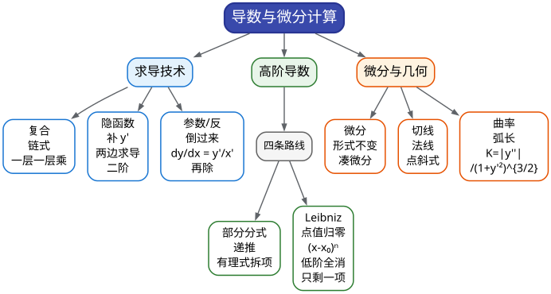

# CMC 手把手精讲
## ——《03 导数与微分计算》：从"求导表"到"n 阶导数四条路线"

> 🐱 喵～欢迎来到第三篇。01 篇你学会了"算极限"，这一篇把主角换成**导数**——它是整套 14 篇里**出勤率最高的工具人**：04 篇的中值定理要用它、07 篇的微分方程要验它、09 篇的偏导数就是它的多元版、12–13 篇的级数求和求导一遍又一遍。所以本篇的口号是：**把求导练成肌肉记忆，让后面所有篇章都轻装上阵。**
>
> **本篇在考试中的地位**（数据口径：第 10–17 届初赛 8 套卷 + 补赛，真题已逐题核对）：
> - 本板块（一元函数微分学）**每届必考**，直接分值常年 **14–28 分**（中位约 20 分，占卷面 15%–25%）；
> - 其中**填空位的 6 分是"白给题"**：几乎每届一道，形态"三选一"——隐函数/参数方程求导（10 届填 2、12 届填 3、14 补二填 2）、n 阶导数（8 届填 4、12 届填 2、15 届填 3）、导数定义凑极限（8 届填 1、9 届填 4）；
> - 对应的 S 级必拿考点包有两个：**S5 隐函数/参数方程求导 + 切线法线**、**S6 n 阶导数四条路线**。培训界对 n 阶导数题的评价是"**出现频率非常高的题型**"（转引：考研竞赛数学公众号对 15 届 A 卷的点评）。
> - 另一块 14 分大题（中值定理证明、单调性最值）归属 **04 篇**——本篇只管"**算得又快又对**"，证明的活下一篇干。
>
> **大纲对应条目**（《全国大学生数学竞赛考试内容》非数学专业类·一元函数微分学·原文摘录）：
> - 条目 (1)：导数和微分的概念、导数的几何意义和物理意义、函数的可导性与连续性之间的关系、平面曲线的切线和法线；
> - 条目 (2)：基本初等函数的导数、导数和微分的四则运算、**一阶微分形式的不变性**；
> - 条目 (3)：**复合函数、反函数、隐函数以及参数方程**所确定的函数的微分法；
> - 条目 (4)：高阶导数的概念、**分段函数的二阶导数**、某些简单函数的 **n 阶导数**；
> - 条目 (9)：弧微分、曲率、曲率半径（⚠️ 在纲但低频，本篇 §3.9 给你 10 分钟保底版）。
>
> **先修提示**：本篇用到一点 01 篇的"极限手感"（导数定义就是极限），但基本自给自足；只要你记得中学的求导公式表（忘了也来得及，§2.2 会重列）。
>
> **预计学时**：2–3 天（对应冲刺路线表**第 1 周 D7**"求导恢复"）。第一天：§一 + §二 + 精讲 1–3；第二天：§三 + 精讲 4–7；第三天：精讲 8–10 + 易错点 + 自测题。
>
> 阅读建议：
> 1. 先花 3 分钟扫 §1.2 速查表——建立"**看到题面长相 → 认出该用哪把刀**"的条件反射；
> 2. §3.7 的 n 阶导数四条路线是**本篇的心脏**，四种武器各自的"适用信号"要背下来（你缺的从来不是方法，是"什么时候用哪把"）；
> 3. 所有标了 ✍️ 的地方真的动笔；真题精讲先自己卡 60 秒再看思路分析。
>
> 符号说明：📌 重点 | 💡 直觉/类比 | ⚠️ 易错点 | ✍️ 动笔练一练 | ❓ 自测题 | 🎯 考试定位 | ⏱️ 省时技巧

---

# 一、本篇地图

## 1.1 目录（读之前先看这张施工图）

- **§二 知识讲解**：导数的三张脸 → 求导基本盘（三张表 + 三条法则）→ 隐函数/参数方程/反函数求导的直觉 → n 阶导数四条路线的"生长史" → 微分与可微性 → 切线法线 + 曲率弧微分保底
- **§三 方法手册**：3.1 复合函数 | 3.2 隐函数 | 3.3 参数方程 | 3.4 反函数 | 3.5 幂指函数 | 3.6 变限积分 | 3.7 n 阶导数四路线 | 3.8 函数方程求切线（导数定义实战）| 3.9 通用四步流程与考场纪律（曲率弧微分保底见 §2.8）
- **§四 真题精讲**：10 道真题完整精讲（10 届填 2、12 届填 2/填 3、14 补二填 2/大题二、15 届填 3、8 届填 2/填 4、9 届填 1、11 届填 2）
- **§五 易错点清单**：12 条 ❌→✅ 对照
- **§六 自测题**：7 道，附完整答案
- **§七 结语**："求导防身七句话" + 学习建议 + 04 篇预告

## 1.2 方法速查表：什么题面 → 用什么武器（一屏版）

| 题面长相（信号） | 首选武器 | 说明 / 升级路线 |
|---|---|---|
| 外层套内层（$`\sin(\ln x)`$、$`\sqrt{1+x^2}`$、$`e^{\sin x}`$） | **链式法则**（由外向内逐层剥） | 层数多就画"剥皮顺序"，一层一层乘 |
| 方程给出 $`y=y(x)`$（含 $`y`$ 与 $`x`$ 混在一起） | **隐函数求导**（两边对 $`x`$ 求，$`y`$ 补 $`y'`$） | 要 $`y'`$ 的具体值就**先代点后解方程** |
| $`\begin{cases} x=x(t)\\ y=y(t)\end{cases}`$ 或"$`x,y`$ 分别由 $`t`$ 隐式给出" | **参数方程求导** $`y'/x'`$ | 二阶导记得再除一次 $`x'(t)`$（不是 $`y''/x''`$！） |
| 反函数 $`x=\varphi(y)`$ 与 $`f`$ 的关系题 | **反函数求导** $`1/f'(x)`$ | 画"$`\mathrm{d}y/\mathrm{d}x`$ 与 $`\mathrm{d}x/\mathrm{d}y`$ 互为倒数" |
| 底和指数都含 $`x`$（$`u^v`$ 型） | **取对数（对数求导法）** | 三招：取 $`\ln`$ / 化 $`e^{v\ln u}`$ / 写成 $`e`$ 再求导 |
| $`\int_0^{\varphi(x)}f(t)\,\mathrm{d}t`$ 出现在求导式里 | **变限积分求导** = 被积函数（上限）$`\times`$ 上限导数 | 被积函数还含 $`x`$ 就先**换元**把它"择"出来 |
| 求 $`f^{(n)}(x_0)`$，$`f`$ 是**有理分式** | **部分分式 + 基本 n 阶导公式** | $`\left(\frac{1}{x-a}\right)^{(n)}=\frac{(-1)^nn!}{(x-a)^{n+1}}`$ |
| 求 $`f^{(n)}(x_0)`$，$`f`$ 是**乘积** $`(x-x_0)^n g(x)`$ | **Leibniz 公式 + 点值归零** | 在 $`x_0`$ 处只有一项不为 0，直接秒杀 |
| 求 $`f^{(n)}(0)`$，$`f`$ 由**变限积分/乘因子**定义 | **隐式递推**（对导数方程再求 $`n-1`$ 阶导） | 14 补二大题二的官方模板 |
| 求 $`f^{(n)}(0)`$，$`f`$ 能**展开成幂级数** | **泰勒系数法** $`f^{(n)}(0)=n!\cdot[x^n]f(x)`$ | 分母能展开、乘除结构的好用 |
| 题面给 $`f(1+x)-3f(1-x)=4+2x+o(x)`$ 之类"函数方程" | **取极限定 $`f(x_0)`$ + 导数定义凑 $`f'(x_0)`$** | 14 补二填 2 模板；**不要洛必达** |
| 求切线/法线（任何包装：隐函数/参数/函数方程） | **先定点 → 再求斜率 → 点斜式** | 三个信息：切点坐标、斜率、直线方程 |
| 曲率、弧微分、渐近线 | **背公式**（10 分钟保底） | 样本近 8 届零命中，但"哪壶不开提哪壶"要防 |

## 1.3 知识树：本篇全部内容的骨架



一句话总结这张图：**求导技术解决"给定的函数怎么导"，高阶导数解决"导 n 次后的值"，微分与几何把"导数"翻译成"切线、弧长、曲率"。** 三者共用同一个内核：**导数 = 局部线性化的系数**。

---

# 二、知识讲解：导数是什么？四把刀从哪来？

## 2.1 导数的三张脸：变化率、斜率、线性化系数

一年没碰数学，先把"导数"这个词重新捂热。同一个东西，它有**三张脸**，考场上从哪张脸看进去都行：

**脸 1：变化率**。$`f'(x_0)=\lim\limits_{\Delta x\to 0}\dfrac{f(x_0+\Delta x)-f(x_0)}{\Delta x}`$——函数在 $`x_0`$ 附近的"瞬时变化速度"。定义式本身就是一个 $`\dfrac{0}{0}`$ 型极限（01 篇的老朋友）——**这就是为什么极限是地基、导数是上层建筑**。

**脸 2：切线斜率**。几何上，割线斜率 $`\dfrac{\Delta y}{\Delta x}`$ 在 $`\Delta x\to 0`$ 时"安定"到切线斜率。曲线在一点的切线，就是"贴着曲线走的那条直线"。

**脸 3：线性化系数**（最重要、最容易被忽略的一张脸）。在 $`x_0`$ 附近，

```math
f(x_0+\Delta x)\approx f(x_0)+f'(x_0)\,\Delta x.
```

翻译成人话：**任何光滑函数，在一点附近都可以"假装是直线"（线性化），而 $`f'(x_0)`$ 就是这条假直线的斜率**。

💡 **打比方（写给写代码的你）**：线性化就是**一阶近似**——牛顿迭代、卡尔曼滤波、游戏引擎里的物理步进，全都在做同一件事：局部用直线代替曲线。$`\Delta x`$ 越小时误差越小，误差的量级是 $`o(\Delta x)`$——这件事写成等式，就是下一篇（04 篇）的泰勒公式；写成极限，就是本篇 $`\mathrm{d}y=f'(x)\mathrm{d}x`$ 的来源。

三张脸的用途分工：
- **脸 1** 出场在"给个函数方程求 $`f'(x_0)`$"的题里（8 届填 1、14 补二填 2）——**凑定义式**；
- **脸 2** 出场在一切"求切线/法线"的题里（10 届填 2、12 届填 3）——**先求斜率**；
- **脸 3** 出场在"可微性、一阶近似"的题里（09 篇的多元线性化、14 届大五）——**用平面代替曲面**。

📌 **可导与连续的关系**（大纲条目 (1) 明文）：**可导必连续，连续不一定可导**。反例就那一个经典：$`y=|x|`$ 在 $`x=0`$ 连续但左右导数不相等（图像有个"尖角"）。你只需要记住"可导 $`\Rightarrow`$ 连续"这个方向——14 补二填 2 的官方解第一步"由于 $`f`$ 可微，因而连续"用的就是它。

## 2.2 求导的基本盘：三张表 + 三条法则

求导这件事，**全部内容 = 记住少数基础导数 + 三条组合法则**。先快速回炉（眼熟的直接跳过）：

📌 **基本导数表**（必须肌肉记忆）：

```math
(x^\alpha)'=\alpha x^{\alpha-1},\qquad (e^x)'=e^x,\qquad (a^x)'=a^x\ln a,\qquad (\ln x)'=\frac{1}{x},
```

```math
(\sin x)'=\cos x,\qquad (\cos x)'=-\sin x,\qquad (\tan x)'=\frac{1}{\cos^2 x},
```

```math
(\arcsin x)'=\frac{1}{\sqrt{1-x^2}},\qquad (\arctan x)'=\frac{1}{1+x^2}.
```

📌 **三条组合法则**：
1. **四则法则**：$`(u\pm v)'=u'\pm v'`$；$`(uv)'=u'v+uv'`$；$`\left(\dfrac{u}{v}\right)'=\dfrac{u'v-uv'}{v^2}`$。
2. **链式法则**（复合函数，大纲条目 (3) 的核心）：$`\big[f(g(x))\big]'=f'\big(g(x)\big)\cdot g'(x)`$。记忆口诀"**外层导数 × 内层导数**"。
3. **一阶微分形式的不变性**（大纲条目 (2) 的奇怪名字）：$`\mathrm{d}f(u)=f'(u)\,\mathrm{d}u`$——**不管 $`u`$ 是自变量还是别的变量的函数，这个式子都成立**。

第 3 条是干什么用的？它是**凑微分**的合法性来源（05 篇积分里你会天天用），也是"$`y`$ 对 $`x`$ 求导"与"$`x`$ 对 $`y`$ 求导"能互相转化的根据：$`\dfrac{\mathrm{d}y}{\mathrm{d}x}=\dfrac{1}{\mathrm{d}x/\mathrm{d}y}`$。

💡 **链式法则为什么是"乘"？** 用"脸 3"看：$`g`$ 在 $`x`$ 附近把变化**放大** $`g'(x)`$ 倍（$`\Delta u\approx g'\Delta x`$），$`f`$ 又在 $`u`$ 附近把变化放大 $`f'(u)`$ 倍（$`\Delta y\approx f'\Delta u`$）。两级放大串起来，总放大倍数就是**两个倍数相乘**：$`\Delta y\approx f'g'\Delta x`$。链条再长也是连乘——这就是"链"式法则名字的来源。

⚠️ **链式法则的书写纪律**：写"外层导数"时，**内层原封不动地放进括号**。例如 $`\big(\sin(1+x^2)\big)'=\cos(1+x^2)\cdot(2x)`$——很多人一紧张把内层抄丢或抄错，这是最冤的丢分方式。

✍️ **动笔练一练**：求 $`y=\ln(\sqrt{1+x^2}+x)`$ 的导数。（提示：外层 $`\ln`$，内层是根式加 $`x`$；答案 $`y'=\dfrac{1}{\sqrt{1+x^2}}`$——这个简洁的结果说明命题人青睐"链式套娃后大化简"的结构。）

## 2.3 隐函数求导：$`y`$ 不是字母，是"藏在方程里的函数"

到目前为止，函数都是"显式"的：$`y=x^2+1`$，$`y`$ 老老实实写在等号左边。但考场上最爱的恰恰是**隐式**的：

```math
y^2(x-y)=x^2,\qquad \arctan\frac{x}{y}=\ln\sqrt{x^2+y^2}+C,\qquad e^y+ty+\sin t=1.
```

这些方程里 $`y`$ 和 $`x`$ "搅"在一起，解出 $`y=f(x)`$ 往往不可能（或者很难看）。好在我们**根本不需要解出来**。

💡 **核心心法（一句话版本）**：**方程两边同时对 $`x`$ 求导时，把 $`y`$ 看成 $`y(x)`$；每遇到一个 $`y`$，都要用链式法则拖一个 $`y'`$ 出来。**

比如 $`y^2(x-y)=x^2`$ 两边对 $`x`$ 求导：左边是乘积，$`y^2`$ 对 $`x`$ 求导得 $`2y\cdot y'`$（链式！），$`x-y`$ 对 $`x`$ 求导得 $`1-y'`$，于是

```math
2y\,y'(x-y)+y^2(1-y')=2x.
```

这是关于 $`y'`$ 的一元一次方程，想求特定点（比如 $`(1,1)`$ 是 12 届填 3 的给点）就把坐标代进去解——**先代点，后解方程**，能省一大半计算。这叫**隐函数求导的"代入顺序纪律"**，后面 §3.2 展开。

📌 **公式版**（写给喜欢"套公式"的你）：$`F(x,y)=0`$ 确定 $`y=y(x)`$ 时

```math
y'=-\frac{F_x}{F_y}\qquad(F_y\ne 0),
```

其中 $`F_x`$、$`F_y`$ 是把 $`F`$ 对 $`x`$、$`y`$ 求**偏导**（求 $`F_x`$ 时把 $`y`$ 当常数，反之亦然）。推导一行：两边对 $`x`$ 求导 $`F_x+F_y\,y'=0`$。

⚠️ 注意：**公式版最容易翻车的点是 $`-F_x/F_y`$ 的负号和"谁在上谁在下"**——考场上与其背公式，不如直接两边求导（**推荐路线**），公式只用来交叉验算。

## 2.4 参数方程求导：$`x`$ 和 $`y`$ 各走各的路，求"同步速率之比"

曲线有时由参数给出：$`\begin{cases}x=t+\cos t,\\ e^y+ty+\sin t=1,\end{cases}`$ 或 $`\begin{cases}x=x(t),\\ y=y(t).\end{cases}`$ 这里 $`x`$ 和 $`y`$ 不直接见面，唯一的"中间人"是参数 $`t`$。

💡 **核心心法**：**把 $`t`$ 想成时间。** $`x(t),y(t)`$ 是质点在两个坐标轴上的"里程表"，$`\dfrac{\mathrm{d}x}{\mathrm{d}t}`$、$`\dfrac{\mathrm{d}y}{\mathrm{d}t}`$ 是两个方向的速度，而我们想要的 $`\dfrac{\mathrm{d}y}{\mathrm{d}x}`$ 是"**纵向位移与横向位移之比**"——两个速度相除即可：

```math
\frac{\mathrm{d}y}{\mathrm{d}x}=\frac{\mathrm{d}y/\mathrm{d}t}{\mathrm{d}x/\mathrm{d}t}=\frac{y'(t)}{x'(t)}.
```

这不是新法则，就是把"链式法则"倒过来用：$`\dfrac{\mathrm{d}y}{\mathrm{d}x}=\dfrac{\mathrm{d}y}{\mathrm{d}t}\cdot\dfrac{\mathrm{d}t}{\mathrm{d}x}`$。

**二阶导数呢？** 这里是全篇最大的坑区，先建立正确直觉再写公式。$`\dfrac{\mathrm{d}^2y}{\mathrm{d}x^2}`$ 的意思是"**把 $`\dfrac{\mathrm{d}y}{\mathrm{d}x}`$ 这个新函数，再对 $`x`$ 求一次导**"。而 $`\dfrac{\mathrm{d}y}{\mathrm{d}x}=\dfrac{y'(t)}{x'(t)}`$ 是以 $`t`$ 为变量的函数，$`x`$ 又是 $`t`$ 的函数——所以**要再求一次 $`t`$ 的导，然后除以 $`x'(t)`$**：

```math
\frac{\mathrm{d}^2y}{\mathrm{d}x^2}=\frac{1}{x'(t)}\cdot\frac{\mathrm{d}}{\mathrm{d}t}\left(\frac{y'(t)}{x'(t)}\right)=\frac{y''(t)x'(t)-x''(t)y'(t)}{[x'(t)]^3}.
```

⚠️ **$`\dfrac{\mathrm{d}^2y}{\mathrm{d}x^2}\ne\dfrac{y''(t)}{x''(t)}`$**！把二阶导写成"两个二阶导相除"是参数方程题的第一大错（下面 §5 易错点 ② 会再鞭一次）。口诀：**"求导一次除以 $`x'`$ 一次"**——每对 $`x`$ 求一阶导，就除掉一个 $`x'`$。

## 2.5 反函数求导：把整张表"倒过来读"

设 $`y=f(x)`$ 有反函数 $`x=f^{-1}(y)`$。因为 $`f^{-1}`$ 只是把 $`f`$ 的"输入输出"对调，$`y`$ 的变化率与 $`x`$ 的变化率互为倒数：

```math
(f^{-1})'(y_0)=\frac{1}{f'(x_0)},\qquad \text{其中}\ y_0=f(x_0);\qquad \text{即}\quad \frac{\mathrm{d}x}{\mathrm{d}y}=\frac{1}{\dfrac{\mathrm{d}y}{\mathrm{d}x}}.
```

💡 **用途（考试里其实就一个）**：**由已知函数求"新函数"的导数**。最经典的案例是 $`\arctan`$ 的导数怎么来的：
$`y=\arctan x\iff x=\tan y`$，两边对 $`x`$ 求导：$`1=\dfrac{1}{\cos^2 y}\cdot y'`$，故 $`y'=\cos^2 y`$；把 $`\cos^2 y=\dfrac{1}{1+\tan^2 y}=\dfrac{1}{1+x^2}`$ 代回，得 $`(\arctan x)'=\dfrac{1}{1+x^2}`$。整条链路只用了"反函数 + 三角恒等式"。
同理 $`(\arcsin x)'=\dfrac{1}{\sqrt{1-x^2}}`$ 也是这样倒推的（$`\cos y>0`$ 在 $`y\in(-\pi/2,\pi/2)`$ 上成立，开根不用带负号）。

⚠️ 倒推时**别丢"符号讨论"**：$`\cos y`$ 开根号时的正负号，取决于反函数的值域——这正是大纲条目 (3) 把"反函数的微分法"单列一条的原因。

## 2.6 n 阶导数：四条路线是怎么"长"出来的

求一次导叫一阶导，求 $`n`$ 次叫 **$`n`$ 阶导数**，记 $`f^{(n)}(x)`$。竞赛考法极其固定：**给一个具体函数，求 $`f^{(n)}(x_0)`$（点值或表达式）**——8、12、14 补二、15 届连考，是填空 6 分的常客。

为什么这种题值得单开一节？因为它**不可能硬求导**——$`n`$ 是字母，你导到第 3 次手就酸了。所以命题人一定是留了"**结构性入口**"，而入口只有四条。下面我们用"从题面长相倒推武器"的方式，理解四条路线为什么长这样：

**路线 A：有理分式 → 部分分式。** 如果 $`f`$ 是 $`\dfrac{P(x)}{Q(x)}`$（次数低、分母可因式分解），先拆成若干个 $`\dfrac{A}{x-a}`$ 的和，再用公式

```math
\left(\frac{1}{x-a}\right)^{(n)}=\frac{(-1)^n\,n!}{(x-a)^{n+1}}.
```

为什么成立？因为 $`\dfrac{1}{x-a}=(x-a)^{-1}`$，逐次求导，每求一次：指数降 1、拖出一个负号，自然累积成 $`(-1)^n n!`$。**15 届填 3 就是这个路线的标准件**（精讲 4）。

**路线 B：乘积 → Leibniz 公式 + "点值归零"。** 如果 $`f=f(x)=u(x)v(x)`$ 是两个函数的乘积，用

```math
(uv)^{(n)}=\sum_{k=0}^{n}C_n^k\,u^{(k)}v^{(n-k)}
```

（形式上像二项式定理——这不是巧合，$`(uv)^{(n)}`$ 的"选中求导次数"结构与 $`(a+b)^n`$ 的展开一一对应）。它本身是"求和"，但如果**其中一个因子是 $`(x-x_0)^n`$ 的形状**，那么在 $`x_0`$ 处取值时，$`\big[(x-x_0)^n\big]^{(k)}\big|_{x=x_0}=0`$ 对一切 $`k<n`$ 成立——**和式里只剩一项**：

```math
f^{(n)}(x_0)=n!\cdot v(x_0).
```

**12 届填 2（$`f=(x+1)^ne^{-x^2}`$ 求 $`f^{(n)}(-1)`$）就是这个套路**（精讲 5）。

**路线 C：隐式递推 → 对"导数方程"再求 $`n`$ 次导。** 如果 $`f`$ 由一个变限积分或乘积因子定义，直接求导会得到一个**新方程**（比如 $`(1+x^2)F'(x)=x^{2023}`$——因为变限积分求导正好甩掉积分号）；对这个方程两边再求 $`k`$ 阶导（用 Leibniz），再代入特殊点 $`x_0`$，就得到 $`F^{(k)}(x_0)`$ 与低阶导数值之间的**递推关系**，一层层推下去即可。**14 届补二大题二（$`f=e^{-x}\int_0^x\frac{t^{2023}}{1+t^2}\mathrm{d}t`$）是这条路线唯一的 14 分大题**（精讲 7），官方解答分 5+4+5 三段给分。

**路线 D：泰勒系数 → $`f^{(n)}(0)=n!\cdot[x^n]f(x)`$。** 如果 $`f`$ 能展开成幂级数（比如分母是可展开的乘除结构），那么 $`x^n`$ 的系数乘 $`n!`$ 就是 $`f^{(n)}(0)`$。它和路线 A 互为"验算器"：把 $`\dfrac{1}{x^2-3x+2}`$ 用等比级数展开，$`[x^n]`$ 系数算出来是 $`1-\dfrac{1}{2^{n+1}}`$，乘 $`n!`$ 正好和路线 A 的结果对上了（§3.7 会演示这个"一题两解"）。

💡 **选武器的口诀**：**"分式拆项、乘积找归零、积分递推、展开数系数"**。四条路线的【适用信号】是本节最值钱的十六个字，考场上先认题面长相，再动手。

📌 **顺带记住三个"熟脸"的 n 阶导**（考场上当公式用）：

```math
\left(e^{ax}\right)^{(n)}=a^ne^{ax},\qquad \left(\sin x\right)^{(n)}=\sin\Big(x+\frac{n\pi}{2}\Big),\qquad \left(\ln(1+x)\right)^{(n)}=\frac{(-1)^{n-1}(n-1)!}{(1+x)^n}.
```

（$`\sin`$ 的那条来自"每导一次相位前进 $`\pi/2`$"，画圆周运动图即可理解；$`\ln(1+x)`$ 的那条先求一次导变成 $`\frac{1}{1+x}`$、再用路线 A 的公式。）

## 2.7 微分与可微性：$`\Delta y`$ 被拆成"线性主部 + 零头"

把"脸 3"写成精确的等式，就是**微分**：

```math
\Delta y=f(x_0+\Delta x)-f(x_0)=\underbrace{f'(x_0)\Delta x}_{\text{线性主部}}+\underbrace{o(\Delta x)}_{\text{零头}}.
```

线性主部 $`f'(x_0)\Delta x`$ 就叫**微分**：$`\mathrm{d}y=f'(x_0)\mathrm{d}x`$（我们约定 $`\mathrm{d}x=\Delta x`$）。

📌 **一元的情形里，"可微"与"可导"是同一件事**（能写出上面的等式 $`\iff`$ 导数存在）——所以一元函数没人单独考"可微性判定"。**但到了多元函数（09 篇），"偏导存在"与"可微"会分家**，届时考的就是今天这个等式的推广。所以现在把这句话刻进脑子：**可微 = 存在线性主部（线性化成立）**。

**微分的两大用途**（了解即可，考法在别的篇）：
1. **近似计算**：$`\sqrt[3]{1.02}\approx1+\frac{0.02}{3}`$ 之类（竞赛几乎不单独考）；
2. **凑微分 / 一阶微分形式不变性**：$`\mathrm{d}f(u)=f'(u)\mathrm{d}u`$ 对任意变量链成立——由它推出"$`\mathrm{d}(x^2)=2x\mathrm{d}x`$ 后把 $`\mathrm{d}x`$ 换成 $`\mathrm{d}(x^2)/(2x)`$"这类操作合法（05 篇的凑微分、11 篇的全微分求原函数都靠它）。

⚠️ **一道必须认得的"可微反例"**：$`f(x)=|x|`$ 在 0 点连续、左导数 $`-1`$、右导数 $`+1`$，**不可导 = 不可微**。一元里"连续不可导"的样子就它一个代表——**尖点**。（多元的对应反例在 09 篇 §2.2，先混个脸熟。）

## 2.8 切线、法线与两个保底项（🎯 了解一下即可）

**切线**（大纲条目 (1) 明文）：在点 $`(x_0,f(x_0))`$ 处，斜率 $`k=f'(x_0)`$，**点斜式**：

```math
y-f(x_0)=f'(x_0)(x-x_0).
```

**法线**：过同一点、与切线垂直：$`y-f(x_0)=-\dfrac{1}{f'(x_0)}(x-x_0)`$（$`f'(x_0)\ne0`$；若 $`f'(x_0)=0`$ 则法线是竖直直线 $`x=x_0`$）。

💡 一切"求切线"的题（不管 $`y(x)`$ 由方程、参数、还是函数方程给出）都是这个**三步流水线**：**① 求切点坐标 → ② 求斜率 → ③ 点斜式**。本条流水线在 10 届、12 届、14 补二连续出手，是 S5 考点包的收割机。

🎯 **曲率、弧微分、渐近线（10 分钟保底版）**：这些内容"**在纲但近 8 届样本零命中**"（样本为 7–17 届，结论带此边界）。按"哪壶不开提哪壶"的铁律，公式必须认得，但不投训练量：

- **弧微分**：$`\mathrm{d}s=\sqrt{1+y'^2}\,\mathrm{d}x`$（"斜边 = 底边乘斜率的模长"，勾股定理的微元版）；
- **曲率**：$`K=\dfrac{|y''|}{(1+y'^2)^{3/2}}`$，**曲率半径** $`\rho=\dfrac{1}{K}`$；参数式 $`K=\dfrac{|x'y''-x''y'|}{(x'^2+y'^2)^{3/2}}`$；
- **渐近线**：水平 $`y=\lim\limits_{x\to\infty}f(x)`$；铅直 $`x=x_0`$ 处 $`f\to\infty`$；斜渐近线 $`y=kx+b`$，其中 $`k=\lim\limits_{x\to\infty}\dfrac{f(x)}{x}`$、$`b=\lim\limits_{x\to\infty}\big[f(x)-kx\big]`$（**两个极限都要存在**才配叫斜渐近线）。

✍️ **30 秒自检**：$`y=\ln x`$ 有没有斜渐近线？（答案：没有——$`k=\lim\frac{\ln x}{x}=0`$，退化成水平方向但 $`f`$ 本身发散，$`b=\lim\ln x=+\infty`$ 不存在。斜渐近线要求 $`k,b`$ 两个极限都有限。）

---

# 三、方法手册：九把刀，见招拆招

每个方法按统一格式展开：【适用信号】→【步骤】→【关键公式】→【真题微型例子】。再强调一遍：**你缺的不是方法本身，而是"什么时候用它"**。

## 3.1 复合函数求导（链式法则）

**【适用信号】** 函数有"套娃"结构（$`\ln(\cdots)`$、$`\sqrt{\cdots}`$、$`e^{\cdots}`$、$`\arctan(\cdots)`$），或分段函数拼接。

**【步骤】**
1. **定层数**：从最外层函数开始，把内层整个"打包"看成 $`\Box`$，列出"剥皮顺序"（外层 → 次外层 → … → $`x`$）；
2. **逐层求导相乘**：每剥一层，外层导数的自变量**原封不动**（内层照抄）；
3. **收尾化简**：三角、根式、对数尽量化简（命题人常把答案设计得很干净）。

**【关键公式】** $`\big[f(g(x))\big]'=f'\big(g(x)\big)\cdot g'(x)`$。

**【真题微型例子】**（第 13 届非数学类·填空第 3 题，2021；这里只看它"变限积分求导"的一步）：

```math
\frac{\mathrm{d}}{\mathrm{d}x}\int_0^{\sin^2 x}\ln(1+t)\,\mathrm{d}t=\ln\big(1+\sin^2x\big)\cdot 2\sin x\cos x.
```

链条是"外层 $`\int_0^{\Box}`$ → 内层 $`\Box=\sin^2x`$ → 再内层 $`\sin x`$"：外层的导数是"被积函数在上限取值"，乘上上限的导数 $`(\sin^2x)'=2\sin x\cos x`$。**链式因子一个都不能漏**——这是 §3.6 的先导练习。（该题完整解答见 01 篇精讲 7；17 届填 3 是它的"换代版"。）

## 3.2 隐函数求导（一阶 + 二阶）

**【适用信号】** 题面是 "$`y=y(x)`$ 由方程 $`F(x,y)=0`$（或含 $`y`$ 的复杂方程）确定"；问 $`y'`$、$`y''`$、切线、或"某点处导数值"。

**【步骤（一阶）】**
1. **两边对 $`x`$ 求导**：$`y`$ 视为 $`y(x)`$，凡遇到 $`y`$ 的表达式一律**链式补 $`y'`$**（$`y^2\mapsto2yy'`$，$`\sin y\mapsto\cos y\cdot y'`$，$`e^y\mapsto e^y y'`$，$`y\mapsto y'`$）；
2. **移项解出 $`y'`$**：把含 $`y'`$ 的项集中到一边，解一元一次方程；
3. **要点值就"先代点后解"**：如果只要 $`y'(x_0)`$，先把 $`(x_0,y_0)`$ 代进方程解出 $`y'`$——**不要求出 $`y'`$ 的一般表达式再代入**（省一半计算，还少犯代数错）。

**【步骤（二阶）】** 对①得到的 $`y'`$ 表达式（或直接用①的方程）**再对 $`x`$ 求一次导**，并把 $`y'`$ 的表达式**代回**。若只要二阶点值，同样先代点。

**【关键公式】** $`F(x,y)=0\Rightarrow y'=-\dfrac{F_x}{F_y}`$（验算用）。

**【真题微型例子】**（第 11 届非数学类·填空第 2 题，2019）设隐函数 $`y=y(x)`$ 由 $`y^2(x-y)=x^2`$ 确定，求 $`\displaystyle\int\frac{\mathrm{d}x}{y^2}`$。
看到"$`\int`$ 一个由隐函数决定的式子"别慌——先把隐关系**参数化**：令 $`y=tx`$（隐函数题的老掉牙换元），代入得 $`t^2x^2\cdot x(1-t)=x^2`$，即 $`x=\dfrac{1}{t^2(1-t)}`$，$`y=\dfrac{1}{t(1-t)}`$。于是

```math
\frac{\mathrm{d}x}{\mathrm{d}t}=\frac{-2+3t}{t^3(1-t)^2},\qquad \frac{\mathrm{d}x}{y^2}=\frac{\mathrm{d}x/\mathrm{d}t}{y^2}\,\mathrm{d}t=\frac{-2+3t}{t}\,\mathrm{d}t=\Big(3-\frac{2}{t}\Big)\mathrm{d}t,
```

积分得 $`\displaystyle\int\frac{\mathrm{d}x}{y^2}=3t-2\ln|t|+C=\frac{3y}{x}-2\ln\Big|\frac{y}{x}\Big|+C`$（回代 $`t=y/x`$）。完整分析见精讲 10。
> 这题的意义：**隐函数求导的"兄弟"是隐函数求积分**——核心动作都是"找参数、把 $`x,y`$ 都翻译成 $`t`$"。

## 3.3 参数方程求导（一阶 + 二阶）

**【适用信号】** 曲线由 $`\begin{cases}x=x(t)\\y=y(t)\end{cases}`$ 给出；或 $`x`$ 由 $`t`$ 显式给出、$`y`$ 与 $`t`$ 由方程**隐式**锁在一起（10 届填 2 就是这种"半参数、半隐式"）。问切线、$`y'`$、$`y''`$。

**【步骤】**
1. **对 $`t`$ 分别求 $`x'`$、$`y'`$**：隐式给出的那个用 §3.2 的手艺对 $`t`$ 求导（这一步千万别条件反射"对 $`x`$ 求导"——**参数题一切对 $`t`$**）；
2. **一阶导**：$`\dfrac{\mathrm{d}y}{\mathrm{d}x}=\dfrac{y'(t)}{x'(t)}`$；
3. **二阶导**（若需要）：把 $`\dfrac{y'}{x'}`$ 再对 $`t`$ 求导，**除以 $`x'(t)`$ 一次**；
4. **代点**：求出 $`t_0`$ 对应的 $`x_0,y_0`$，代入斜率，写点斜式。

**【关键公式】**

```math
\frac{\mathrm{d}y}{\mathrm{d}x}=\frac{y'(t)}{x'(t)},\qquad \frac{\mathrm{d}^2y}{\mathrm{d}x^2}=\frac{1}{x'(t)}\cdot\frac{\mathrm{d}}{\mathrm{d}t}\left(\frac{y'(t)}{x'(t)}\right)=\frac{x'(t)y''(t)-y'(t)x''(t)}{[x'(t)]^3}.
```

**【真题微型例子】**（第 10 届非数学类·填空第 2 题，2018）设曲线 $`y=y(x)`$ 由 $`\begin{cases}x=t+\cos t,\\ e^y+ty+\sin t=1\end{cases}`$ 确定，求 $`t=0`$ 处的切线。
$`t=0`$ 时 $`x=1`$；第二个方程给 $`e^0+0+\sin 0=1`$ 成立，且此时 $`y=0`$（由 $`e^y=1`$ 唯一）——**切点 $`(1,0)`$ 先落地**。然后**一切对 $`t`$ 求导**：$`x'(0)=1-\sin 0=1`$；对 $`e^y+ty+\sin t=1`$ 两边对 $`t`$ 求导：$`e^y y'+y+ty'+\cos t=0`$，代入 $`t=0,y=0`$ 得 $`y'(0)+0+0+1=0`$，即 $`y'(0)=-1`$。故 $`\dfrac{\mathrm{d}y}{\mathrm{d}x}\Big|_{t=0}=\dfrac{-1}{1}=-1`$，切线 $`y=-(x-1)`$，即 $`x+y=1`$。完整讲解见精讲 1。
> ⏱️ 注意官方解答的顺序：**先把 $`t=0`$ 的 $`x,y`$ 落定，再对 $`t`$ 求导、直接代入点值**——不求出 $`y'(t)`$ 的一般式。这个"边求导边代点"的节奏是填空题提速的关键。

## 3.4 反函数求导

**【适用信号】** 题面出现"$`f`$ 的反函数 $`f^{-1}`$（或 $`x=\varphi(y)`$）"；或要求某个函数的导数，而它的"正方向"函数是已知的（典型：反三角函数、对数与指数）。

**【步骤】**
1. 写出正方向关系 $`y=f(x)\iff x=f^{-1}(y)`$；
2. 两边对 $`x`$ 求导（把 $`f^{-1}`$ 看成 $`y`$ 的函数）：$`1=f'(x)\cdot\dfrac{\mathrm{d}x}{\mathrm{d}y}`$ 或直接套 $`1/f'`$；
3. 把结果里的 $`x`$ 用 $`y`$ 表示（或反之），得到干净公式。

**【关键公式】** $`(f^{-1})'(y_0)=\dfrac{1}{f'(x_0)}`$，$`y_0=f(x_0)`$。

**【真题微型例子】**（类型题·仿竞赛风格）设 $`y=f(x)`$ 与 $`x=g(y)`$ 互为反函数，$`f(1)=2`$，$`f'(1)=3`$，$`f''(1)=-1`$，求 $`g''(2)`$。
一阶：$`g'(2)=\dfrac{1}{f'(1)}=\dfrac{1}{3}`$。二阶：对 $`g'(y)=\dfrac{1}{f'(g(y))}`$ 再对 $`y`$ 求导：

```math
g''(y)=-\frac{f''(g(y))\cdot g'(y)}{[f'(g(y))]^2},
```

代入 $`y=2`$（$`g(2)=1`$，$`g'(2)=\frac13`$）：$`g''(2)=-\dfrac{f''(1)\cdot\frac13}{[f'(1)]^2}=-\dfrac{(-1)/3}{9}=\dfrac{1}{27}`$。
> 这道类型题展示了反函数二阶导的官方长相——2019 年的一道真题（11 届填 2）本质上就用了同一套"把 $`y`$ 当自变量、链式倒推"的语言，见精讲 10 的换元视角。

## 3.5 幂指函数求导（底和指数都有变量）

**【适用信号】** $`y=u(x)^{v(x)}`$：底和指数都长在变量上（$`x^{\sin x}`$、$`(\cos x)^{1/x^2}`$、$`x^x`$）。

**【步骤（对数求导法，首选）】**
1. **取对数**：$`\ln y=v(x)\ln u(x)`$——把"幂"拍扁成"乘积"；
2. **两边对 $`x`$ 隐式求导**：$`\dfrac{y'}{y}=v'\ln u+v\dfrac{u'}{u}`$；
3. **还原**：$`y'=y\left(v'\ln u+\dfrac{vu'}{u}\right)=u^v\left(v'\ln u+\dfrac{vu'}{u}\right)`$。

**【步骤（化为 $`e`$，等价路线）】** $`y=e^{v\ln u}`$，求导得 $`y'=e^{v\ln u}\cdot\left(v'\ln u+v\dfrac{u'}{u}\right)`$——两条路线殊途同归，考场上选顺手的。

**【关键公式】** $`y=u^v\Rightarrow y'=u^v\Big(v'\ln u+v\dfrac{u'}{u}\Big)`$。**多因子连乘除**也适用对数求导法（取对数把乘除变加减）：$`y=\dfrac{f_1f_2}{f_3}\Rightarrow\ln y=\ln f_1+\ln f_2-\ln f_3`$ 再两边求导。

**【真题微型例子】**（类型题·仿竞赛风格）求 $`y=x^{\sin x}\ (x>0)`$ 的导数。
取对数 $`\ln y=\sin x\cdot\ln x`$，两边求导 $`\dfrac{y'}{y}=\cos x\ln x+\dfrac{\sin x}{x}`$，故

```math
y'=x^{\sin x}\Big(\cos x\ln x+\frac{\sin x}{x}\Big).
```

> ⚠️ 三大作死写法：把 $`u^v`$ 当幂函数求导（$`v\,u^{v-1}u'`$）、当指数函数求导（$`u^v\ln u\cdot v'`$）——**各对一半，全错**。底和指数都含变量时，只有"取对数"或"化 $`e`$"两条正路。

## 3.6 变限积分求导（微积分交界处的最强接口）

**【适用信号】** 求导对象里有 $`\displaystyle\int_a^{\varphi(x)}f(t)\,\mathrm{d}t`$；被积函数里还混着 $`x`$（如 $`f(x-t)`$、$`(x-t)f(t)`$）；或"连续函数 $`f`$ 满足含积分的方程，求 $`f`$"。

**【步骤（基础型）】**
1. **主公式**：$`\dfrac{\mathrm{d}}{\mathrm{d}x}\displaystyle\int_a^{\varphi(x)}f(t)\,\mathrm{d}t=f\big(\varphi(x)\big)\cdot\varphi'(x)`$——**接口 = 被积函数（在上限取值）× 上限导数**；
2. **上下限都是函数**时：$`\dfrac{\mathrm{d}}{\mathrm{d}x}\displaystyle\int_{\alpha(x)}^{\beta(x)}f(t)\,\mathrm{d}t=f(\beta(x))\beta'(x)-f(\alpha(x))\alpha'(x)`$（拆成两项相减，**下限那项带负号**）；
3. **被积函数含 $`x`$ 的**（包裹型）：先**换元**把 $`x`$ 从被积函数里"择"出去（$`u=x-t`$、$`u=xt`$、$`u=t/x`$ 是三大常用换元），再回到第 1 条。

**【步骤（含未知函数的函数方程型）】** 题面给"$`f(x)\cos x+2\displaystyle\int_0^xf(t)\sin t\,\mathrm{d}t=x+1`$"这类**函数方程**：两边对 $`x`$ 求导（变限积分项直接套第 1 条），积分号消失，剩下 $`f`$ 与 $`f'`$ 的关系（微分方程）——解出来即可。

**【关键公式】** 主公式 + 三类换元；求导后别忘了 $`\varphi'(x)`$ 这个**链式因子**。

**【真题微型例子 1】**（第 9 届非数学类·填空第 1 题，2017）已知可导函数 $`f(x)`$ 满足 $`f(x)\cos x+2\displaystyle\int_0^xf(t)\sin t\,\mathrm{d}t=x+1`$，求 $`f(x)`$。
两边对 $`x`$ 求导（第二项用主公式）：

```math
f'(x)\cos x-f(x)\sin x+2f(x)\sin x=1\quad\Longrightarrow\quad f'(x)\cos x+f(x)\sin x=1.
```

两边除以 $`\cos x`$：$`f'(x)+f(x)\tan x=\sec x`$——一阶线性微分方程（07 篇的主场，这里先解）：配积分因子 $`e^{\int\tan x\,\mathrm{d}x}=e^{-\ln\cos x}=\dfrac{1}{\cos x}`$，得 $`\left(\dfrac{f(x)}{\cos x}\right)'=\dfrac{1}{\cos^2x}`$，积分 $`f(x)=\cos x(\tan x+C)=\sin x+C\cos x`$。再由原式令 $`x=0`$：$`f(0)\cdot 1+0=1`$，即 $`f(0)=1`$，代入得 $`C=1`$。故 $`f(x)=\sin x+\cos x`$。完整讲解见精讲 8。
> **本题的全部玄机只在前三行**：把积分求导"消号"、化出 $`f`$ 的微分方程；后面的求解是机械动作。回头看一眼你会心一笑：导数题包装成积分方程，其实是"求导来消积分"——**当最强的矛遇到最强的盾，盾就消失了**。

**【真题微型例子 2】**（第 17 届非数学 A 类·填空第 3 题，2025；这里是速览版）求 $`\lim\limits_{x\to 0}\dfrac{\displaystyle\int_0^{\sin^2x}\ln(1+t)\,\mathrm{d}t}{(\sqrt[3]{1+x^3}-1)\sin x}`$。
分母等价 $`\dfrac{x^3}{3}\cdot x=\dfrac{x^4}{3}`$；分子是变限积分——**可以先在积分号里做等价**（$`\ln(1+t)\sim t`$）：$`\displaystyle\int_0^{\sin^2x}t\,\mathrm{d}t=\dfrac{\sin^4x}{2}\sim\dfrac{x^4}{2}`$。故原式 $`=\dfrac{x^4/2}{x^4/3}=\dfrac{3}{2}`$。（官方走洛必达：分子求导 $`=\ln(1+\sin^2x)\cdot 2\sin x\cos x\sim 2x^3`$，分母求导 $`\dfrac{4x^3}{3}`$，同样得 $`\dfrac{3}{2}`$。）完整两解对照见 01 篇精讲 6。

## 3.7 n 阶导数四条路线（本篇心脏，逐条配真题）

**【适用信号（总）】** 求 $`f^{(n)}(x_0)`$ 或 $`f^{(n)}(x)`$，$`n`$ 是字母；题面一定有"结构入口"——先扫一眼 $`f`$ 的长相，对号入座：

| 长相 | 路线 | 一句话原理 |
|---|---|---|
| 有理分式（分母可因式分解） | **A 部分分式** | 拆成 $`\frac{1}{x-a}`$ 的线性组合，套公式 |
| 乘积，且一个因子是 $`(x-x_0)^n`$ | **B Leibniz + 点值归零** | 和式里只剩 $`k=n`$ 一项 |
| 变限积分 × 因子 / 满足导数方程 | **C 隐式递推** | 对导数方程再求导，得低阶导递推 |
| 能展开成幂级数的乘除结构 | **D 泰勒系数** | $`f^{(n)}(0)=n!\cdot[x^n]f(x)`$ |

**路线 A：部分分式**

**【步骤】** ① 分母因式分解 → 拆部分分式（待定系数解出 $`A,B,\dots`$）；② 每项套公式 $`\left(\dfrac{1}{x-a}\right)^{(n)}=\dfrac{(-1)^nn!}{(x-a)^{n+1}}`$；③ 代 $`x_0`$。

**【真题微型例子】**（第 15 届非数学 A 类·填空第 3 题，2023）$`f(x)=\dfrac{1}{x^2-3x+2}`$，求 $`f^{(n)}(0)`$。
$`x^2-3x+2=(x-1)(x-2)`$，设 $`\dfrac{1}{(x-1)(x-2)}=\dfrac{A}{x-1}+\dfrac{B}{x-2}`$。通分比较：$`A(x-2)+B(x-1)=1`$，令 $`x=1`$ 得 $`A=-1`$，令 $`x=2`$ 得 $`B=1`$。故

```math
f(x)=\frac{1}{x-2}-\frac{1}{x-1},\qquad f^{(n)}(0)=(-1)^nn!\Big(\frac{1}{(-2)^{n+1}}-\frac{1}{(-1)^{n+1}}\Big)=n!\Big(1-\frac{1}{2^{n+1}}\Big).
```

（校验：$`n=0`$ 时 $`f(0)=\frac12`$，右边 $`0!\left(1-\frac12\right)=\frac12`$ ✓。）完整讲解见精讲 4。

**路线 B：Leibniz + 点值归零**

**【步骤】** ① 确认 $`u=(x-x_0)^n`$ 或类似结构；② 写出 $`(uv)^{(n)}=\sum C_n^ku^{(k)}v^{(n-k)}`$；③ 在 $`x_0`$ 处，$`k<n`$ 的项全部归零，**只剩 $`f^{(n)}(x_0)=n!\,v(x_0)`$**（注意：这条"秒杀"只在因子恰为 $`(x-x_0)^n`$ 型时成立；若多项式因子是别种有限次形态——如自测 4 的 $`x^2`$、精讲 6 的具体 $`n=4`$——Leibniz 和式保留多项、逐项计算，见精讲 6 与自测 4）。

**【关键公式】** $`(uv)^{(n)}=\displaystyle\sum_{k=0}^{n}C_n^k\,u^{(k)}v^{(n-k)}`$。

**【真题微型例子】**（第 12 届非数学类·填空第 2 题，2020）$`f(x)=(x+1)^ne^{-x^2}`$，求 $`f^{(n)}(-1)`$。
取 $`u=(x+1)^n`$，$`v=e^{-x^2}`$，在 $`x=-1`$ 处：$`u^{(k)}(-1)=0\ (k<n)`$，$`u^{(n)}(-1)=n!`$。Leibniz 和式只剩 $`k=n`$ 一项：

```math
f^{(n)}(-1)=C_n^nu^{(n)}(-1)v(-1)=n!\cdot e^{-1}=\frac{n!}{e}.
```

完整讲解与"官方写法为什么也能只剩一项"的分析见精讲 5。

**路线 C：隐式递推（对导数方程求 n 阶导）**

**【步骤】** ① 先求一次导，得到**不含积分号的导数方程**（变限积分求导甩掉积分号）；② 对方程两边求 $`k-1`$ 阶导（Leibniz，注意多项式因子的低阶导不全为零——这跟路线 B 不同！）；③ 代入 $`x_0`$，得 $`F^{(k)}(x_0)`$ 与低阶点值的关系（递推）；④ 从最低阶开始逐层推（低阶为 0 往往让整个递推"雪崩式归零"）。

**【真题微型例子】**（第 14 届初赛第二次补赛·大题二，2023；完整版见精讲 7）$`f(x)=e^{-x}\displaystyle\int_0^x\dfrac{t^{2023}}{1+t^2}\,\mathrm{d}t`$，$`n\le 2023`$，求 $`f^{(n)}(0)`$。
记 $`F(x)=\displaystyle\int_0^x\dfrac{t^{2023}}{1+t^2}\,\mathrm{d}t`$，由主公式 $`(1+x^2)F'(x)=x^{2023}`$（**积分号消失**）。两边求 $`k-1`$ 阶导、代 $`x=0`$：$`F^{(k)}(0)=-(k-1)(k-2)F^{(k-2)}(0)`$；而 $`F(0)=F'(0)=0`$（由方程反复代 $`x=0`$ 可得 $`F''(0)=0`$ 起步），于是**递推雪崩**：所有 $`F^{(k)}(0)=0\ (k\le 2023)`$；最后 Leibniz 展开 $`f^{(n)}(0)=\sum(-1)^{n-k}C_n^kF^{(k)}(0)=0`$。

**路线 D：泰勒系数**

**【步骤】** ① 把 $`f`$ 写成已知展开式（等比、$`e^x`$、$`(1+x)^\alpha`$ 等）的乘积/复合；② 找到 $`[x^n]f(x)`$（$`x^n`$ 项系数）；③ $`f^{(n)}(0)=n!\cdot[x^n]f(x)`$。

**【关键公式】** $`f^{(n)}(0)=n!\cdot[x^n]f(x)`$（麦克劳林展开的系数公式，逆用）。

**【真题微型例子】**（15 届填 3 的"第二解"，与路线 A 互为验证）$`f(x)=\dfrac{1}{x^2-3x+2}=\dfrac{1}{x-2}-\dfrac{1}{x-1}=-\dfrac12\cdot\dfrac{1}{1-x/2}+\dfrac{1}{1-x}`$。用 $`\dfrac{1}{1-t}=\sum t^n`$ 展开：

```math
-\frac12\sum\Big(\frac x2\Big)^n+\sum x^n=\sum\Big(1-\frac{1}{2^{n+1}}\Big)x^n,
```

故 $`f^{(n)}(0)=n!\left(1-\dfrac{1}{2^{n+1}}\right)`$——与路线 A 完全一致 ✓。**两种武器算出同一个答案，这就是"选哪条路都稳"的底气。**

> 📌 **四条路线速记**：**"分式拆、乘积消、积分推、展开数"**。考场上 30 秒认门，2 分钟收工。

## 3.8 由函数方程求导数/切线（导数定义凑极限的实战）

**【适用信号】** 题面只给"$`f`$ 在 $`x_0`$ 处可导"之类的**局部信息**，配一个**函数方程**（如 $`f(1+x)-3f(1-x)=4+2x+o(x)`$、$`\lim\big[\frac{f(a+1/n)}{f(a)}\big]^n`$），求导数或切线。**绝不会给你 $`f`$ 的表达式**——这类题考的只有一件事：**把题面式子"揉"成导数定义 $`\lim\limits_{h\to 0}\frac{f(x_0+h)-f(x_0)}{h}`$ 的形状**。

**【步骤（三招）】**
1. **先取极限定函数值**：把方程令 $`x\to 0`$（或 $`h\to 0`$），用可导 $`\Rightarrow`$ 连续，解出 $`f(x_0)`$（缺 $`f(x_0)`$ 是凑不出定义式的——定义式的分子要减 $`f(x_0)`$！）；
2. **凑定义的骨架**：把方程改写成 $`\dfrac{f(x_0+h)-f(x_0)}{h}`$ 的线性组合。手法：加一项减一项（先凑出 $`-f(x_0)`$）、把"反向增量" $`\frac{f(x_0-h)-f(x_0)}{-h}`$ 也算作导数（**两个方向的差商都趋于同一个 $`f'(x_0)`$**）；
3. **解出 $`f'(x_0)`$**：让系数对上，一元一次方程。

**【关键公式】** $`f'(x_0)=\lim\limits_{h\to 0}\dfrac{f(x_0+h)-f(x_0)}{h}=\lim\limits_{h\to 0}\dfrac{f(x_0-h)-f(x_0)}{-h}`$（差商的两个方向等价）。

⚠️ **本方法的两大禁忌**：① **不要洛必达**——只知"可导"时 $`f'`$ 未必连续，洛必达的"可导+求导后极限存在"链条会断（14 届三的证明题专门利用过这个惯性坑人）；② **不要展开**——没有二阶信息时不硬套泰勒，老老实实凑差商。

**【真题微型例子 1】**（第 14 届初赛第二次补赛·填空第 2 题，2023）$`f`$ 在 $`x=1`$ 邻域可微，$`f(1+x)-3f(1-x)=4+2x+o(x)`$，求 $`(1,f(1))`$ 处切线。
**第一步定值**：令 $`x\to0`$：$`f(1)-3f(1)=4`$，即 $`-2f(1)=4`$，$`f(1)=-2`$。
**第二步凑定义**：把方程"喂"成差商——注意 $`f(1-x)-f(1)`$ 配的是分母 $`-x`$：

```math
\frac{f(1+x)-f(1)}{x}+3\cdot\frac{f(1-x)-f(1)}{-x}=2+\frac{o(x)}{x}.
```

（这一步的来路：$`[f(1+x)-f(1)]-3[f(1-x)-f(1)]=f(1+x)-3f(1-x)+2f(1)`$，而 $`2f(1)=2\times(-2)=-4`$，故它等于 $`\big(4+2x+o(x)\big)-4=2x+o(x)`$；两边除以 $`x`$、并把第二项的分母写成 $`-x`$ 即得。）
**第三步极限**：$`x\to0`$ 时两个差商各自趋于 $`f'(1)`$，得 $`f'(1)+3f'(1)=2`$，即 $`f'(1)=\frac12`$。切线：$`y+2=\frac12(x-1)`$，即 $`x-2y-5=0`$。完整讲解见精讲 3。

**【真题微型例子 2】**（第 8 届非数学类·填空第 1 题，2016）$`f`$ 在 $`a`$ 处可导，$`f(a)\ne0`$，求 $`\lim\limits_{n\to+\infty}\left[\dfrac{f(a+1/n)}{f(a)}\right]^n`$。
幂指型先**取对数**：$`n\ln\Big(1+\dfrac{f(a+1/n)-f(a)}{f(a)}\Big)\sim n\cdot\dfrac{f(a+1/n)-f(a)}{f(a)}`$（用了 $`\ln(1+u)\sim u`$），而 $`n[f(a+1/n)-f(a)]\to f'(a)`$（差商！），故极限 $`=e^{f'(a)/f(a)}`$。
> 同一招的兄弟题：9 届填 4（$`f(0)=f'(0)=0,f''(0)=6`$ 求 $`\lim\frac{f(\sin^2x)}{x^4}=3`$）——那题要用带拉格朗日余项的泰勒 $`f(u)=\frac12f''(\xi)u^2`$，本质是"差商/泰勒把未知函数翻译成已知导数"。同族手法（抽象函数 × 标准无穷小的凑差商结构）见精讲 9。

## 3.9 通用四步流程与考场纪律

任何一道求导小题，按这个流程走不会乱：

1. **认结构**：$`y`$ 是显式/隐式/参数/反函数/幂指/变限积分？——对照 1.2 速查表选刀；
2. **定目标**：要**表达式**还是要**点值**？要点值就执行"**先代点后解方程**"纪律（隐函数、参数方程都适用）；
3. **动手**：链式因子别漏、负号别丢、每步检查"这个概念在题目条件下用得起吗"（比如用 Leibniz 前确认归零结构）；
4. **验算**：点值题回代原方程；$`n`$ 阶题用 $`n=0,1`$ 校验（如 15 届填 3 用 $`n=0`$ 对 $`f(0)=\frac12`$）。

🎯 **四类"必拿信号"再默一遍**（考前扫这四行）：
- 见"隐式 $`y(x)`$ + 求切线" → 两边求导 + 先代点，**6 分**；
- 见"$`f^{(n)}`$" → 认长相选四路线之一，**6 分**；
- 见"函数方程 + 可导" → 定值 + 凑差商，**6 分**；
- 见"变限积分" → 主公式消积分号，**它是通往 01/05/07 篇所有大题的门票**。

---

# 四、真题精讲（10 道）

> 说明：以下 10 道题**全部为已核对的官方真题**（转录与官方解答逐字核对）。每道题按"**题面 → 思路分析（真实思考过程，包括试错方向）→ 完整解答 → 点评**"展开。标注 ⏱️ 的是"这道题在考场上应该花的时间"。

### 精讲 1：参数 + 隐式混合求切线（第 10 届非数学类·填空第 2 题，2018）

**题面**：若曲线 $`y=y(x)`$ 由 $`\begin{cases}x=t+\cos t,\\ e^y+ty+\sin t=1\end{cases}`$ 确定，则此曲线在 $`t=0`$ 对应点处的切线方程为 $`\underline{\qquad}`$。

**思路分析（真实思考）**：读题第一句心里就要亮灯：**"曲线由参数系统给出 + 求切线"** → 三步流水线（切点 → 斜率 → 点斜式）。
- 切点：$`t=0`$ 直接代 $`x=1`$；$`y`$ 呢？第二个方程是 $`y`$ 与 $`t`$ 的**隐式关系**，把 $`t=0`$ 代进去：$`e^y=1\Rightarrow y=0`$。✓ 切点 $`(1,0)`$。
- 斜率：$`x'(t)=1-\sin t`$ 一行搞定；$`y`$ 对 $`t`$ 的导数要对隐式方程"两边对 $`t`$ 求导"（**这里最容易条件反射地对 $`x`$ 求导——记住参数题一切对 $`t`$**）：$`e^y y'+y+ty'+\cos t=0`$。
- 我不打算求出 $`y'(t)`$ 的一般式——**直接代点**（速度优先）：$`t=0,y=0`$：$`y'+0+0+1=0`$，$`y'=-1`$。

**完整解答**：
$`t=0`$ 时 $`x=1`$；代入 $`e^y+ty+\sin t=1`$ 得 $`e^y=1`$，故 $`y=0`$。对 $`x=t+\cos t`$ 两边关于 $`t`$ 求导：$`\dfrac{\mathrm{d}x}{\mathrm{d}t}=1-\sin t`$，故 $`\dfrac{\mathrm{d}x}{\mathrm{d}t}\Big|_{t=0}=1`$。对 $`e^y+ty+\sin t=1`$ 两边关于 $`t`$ 求导：

```math
e^y\frac{\mathrm{d}y}{\mathrm{d}t}+y+t\frac{\mathrm{d}y}{\mathrm{d}t}+\cos t=0,
```

代入 $`t=0,y=0`$：$`\dfrac{\mathrm{d}y}{\mathrm{d}t}\Big|_{t=0}=-1`$。于是斜率 $`k=\dfrac{\mathrm{d}y}{\mathrm{d}x}\Big|_{t=0}=\dfrac{-1}{1}=-1`$，切线方程

```math
y-0=-(x-1),\quad \text{即}\quad x+y=1.
```

**点评**：**S5 考点包的标准件**（同族切线题三度出现在填空位：10 届 → 12 届 → 14 补二，隔届回锅）。三个教学点：① 参数题对 $`t`$ 求导、隐式方程也**对 $`t`$**；② 边求导边代点，不算一般式；③ 若题目改成"求该点处 $`\frac{\mathrm{d}^2y}{\mathrm{d}x^2}`$"，就在 $`y'/x'`$ 基础上"再对 $`t`$ 求导、除以 $`x'`$"，绝不要写 $`y''/x''`$。
⏱️ 目标用时：**2 分钟**。

---

### 精讲 2：隐函数求导 + 切线（第 12 届非数学类·填空第 3 题，2020）

**题面**：设 $`y=f(x)`$ 是由方程 $`\arctan\dfrac{x}{y}=\ln\sqrt{x^2+y^2}-\dfrac{1}{2}\ln 2+\dfrac{\pi}{4}`$ 确定的隐函数，且满足 $`f(1)=1`$，则曲线 $`y=f(x)`$ 在点 $`(1,1)`$ 处的切线方程为 $`\underline{\qquad}`$。

**思路分析（真实思考）**：结构识别——**"隐函数 + 求切线"**，流水线照旧。切点已给 $`(1,1)`$（这个给法很贴心，因为要你自己解隐方程取点会浪费 2 分钟），只剩斜率。
- 方程又带 $`\arctan`$ 又带 $`\ln\sqrt{\ \cdot\ }`$，硬求导会有一坨；但任务是"在 $`(1,1)`$ 求斜率"——**先代点能化掉大量结构**吗？直接对 $`x`$ 求导会得到 $`y'`$ 在 $`x,y`$ 混合式子里的方程，再代点即可，不必先化简。
- 预期：求导后 $`y'`$ 的系数、常数项在 $`(1,1)`$ 处都是整数，答案大概率是 $`y'=0`$（切线水平 $`y=1`$）——这是命题人设计过的"漂亮答案"。

**完整解答**：
对所给方程两端关于 $`x`$ 求导。左侧：$`\left(\arctan\dfrac{x}{y}\right)'=\dfrac{1}{1+\left(\frac{x}{y}\right)^2}\cdot\dfrac{y-xy'}{y^2}`$（商法则，且 $`y`$ 是 $`y(x)`$）。右侧：$`\big(\ln\sqrt{x^2+y^2}\big)'=\dfrac{x+yy'}{x^2+y^2}`$。故

```math
\frac{\dfrac{y-xy'}{y^2}}{1+\left(\dfrac{x}{y}\right)^2}=\frac{x+yy'}{x^2+y^2}.
```

在 $`(1,1)`$ 处代入：左边 $`=\dfrac{1-y'/1}{2}=\dfrac{1-y'}{2}`$，右边 $`=\dfrac{1+y'}{2}`$。解之：$`1-y'=1+y'`$，得 $`y'=0`$。所以切线为

```math
y-1=0\cdot(x-1),\quad \text{即}\quad y=1.
```

**点评**：与精讲 1 同一张"考卷模板"（同族切线题三度出现在填空位：10 届 → 12 届 → 14 补二，隔届换皮）。官方解法核心只有一步"**两端求导 + 代入点值**"。注意两个书写分细节：① 对 $`\arctan\frac{x}{y}`$ 求导时，$`\frac{x}{y}`$ 里的 $`y`$ 也要拖出 $`y'`$（**分母求导得 $`-xy'/y^2`$**，有人只写分子求导）；② 最后写切线方程别漏"$`y=`$"两边的整理。若题目问的是"该方程还能不能解出别的 $`y`$ 值"，记住隐函数在点时唯一性靠隐函数定理（竞赛不考证明，只考"题给 $`f(1)=1`$ 直接用"）。
⏱️ 目标用时：**2.5 分钟**。

---

### 精讲 3：函数方程求切线（第 14 届初赛第二次补赛·填空第 2 题，2023）

**题面**：设函数 $`f(x)`$ 在 $`x=1`$ 的某一邻域内可微，且满足

```math
f(1+x)-3f(1-x)=4+2x+o(x),
```

其中 $`o(x)`$ 是当 $`x\to 0`$ 时 $`x`$ 的高阶无穷小，则曲线 $`y=f(x)`$ 在点 $`(1,f(1))`$ 处的切线方程为 $`\underline{\qquad}`$。

**思路分析（真实思考）**：看到"只给函数方程 + 求切线"，模式识别立刻选中 §3.8 的"**定值 → 凑差商**"流程：
- 切线要两个东西：$`f(1)`$ 和 $`f'(1)`$。$`f(1)`$ 藏在方程里——**令 $`x\to0`$ 挤出来**；
- $`f'(1)`$ 绝不展开、不洛必达（题干只有"可微"一级信息）——把方程配成 $`[f(1+x)-f(1)]/x`$ 与 $`[f(1-x)-f(1)]/(-x)`$ 的线性组合；
- 验一下系数会不会抵消：左边两个差商系数是 $`1`$ 和 $`3`$，极限是 $`4f'(1)`$；右边除以 $`x`$ 后是 $`2+o(1)`$。$`4f'(1)=2`$，$`f'(1)=\frac12`$——干净。

**完整解答**：
由于 $`f(x)`$ 在 $`x=1`$ 处可微，因而连续。对所给等式求极限 $`x\to 0`$：左边 $`\to f(1)-3f(1)=-2f(1)`$，右边 $`\to 4`$，故

```math
-2f(1)=4,\quad f(1)=-2.
```

仍由所给等式，加项减项凑差商：

```math
\frac{f(1+x)-f(1)}{x}+3\cdot\frac{f(1-x)-f(1)}{-x}=2+\frac{o(x)}{x}.
```

（验算左边：通分后为 $`\dfrac{f(1+x)-3f(1-x)+2f(1)}{x}=\dfrac{4+2x+o(x)-4}{x}`$ ✓。）
两边取极限 $`x\to0`$，由导数定义，第一个差商 $`\to f'(1)`$，第二个差商也 $`\to f'(1)`$（差商的两个方向极限相同），于是

```math
f'(1)+3f'(1)=4f'(1)=2,\quad f'(1)=\frac{1}{2}.
```

所以切线方程为 $`y-f(1)=f'(1)(x-1)`$，即 $`y+2=\dfrac12(x-1)`$，整理得

```math
x-2y-5=0.
```

**点评**：本题是"**导数定义凑极限**"（8 届填 1、9 届填 4 的同族）在近年的最新出场——**这类"函数方程 + 可导"题隔几届就换一张皮重来**。三个必记动作：① 先取极限定函数值；② 双向差商都算导数；③ 解题全程**禁用洛必达**（可微 $`\ne`$ 导函数连续）。顺带记住：题目给的是 $`o(x)`$ 而不是 $`o(x^2)`$——说明只需要一阶信息，别自己加戏展二阶。
⏱️ 目标用时：**2.5 分钟**。

---

### 精讲 4：部分分式求 n 阶导（第 15 届非数学 A 类·填空第 3 题，2023）

**题面**：设 $`f(x)=\dfrac{1}{x^2-3x+2}`$，则 $`f^{(n)}(0)=\underline{\qquad}`$。

**思路分析（真实思考）**：认长相——**有理分式求 $`n`$ 阶导** → 路线 A（部分分式）。流程反射：分母因式分解 $`(x-1)(x-2)`$ → 拆 $`\dfrac{A}{x-1}+\dfrac{B}{x-2}`$ → 套 $`\left(\frac{1}{x-a}\right)^{(n)}=\frac{(-1)^nn!}{(x-a)^{n+1}}`$ → 代 $`0`$。
- 拆项时用"**遮盖法**"求系数最快：$`A=\left.\frac{1}{x-2}\right|_{x=1}=-1`$（盖住 $`(x-1)`$ 这个因子，把 $`x=1`$ 代进剩下的部分），$`B=\left.\frac{1}{x-1}\right|_{x=2}=1`$。
- 符号预警：$`\frac{1}{x-2}`$ 在 $`x=0`$ 处是 $`\frac{1}{-2}`$，$`n`$ 阶导会出 $`(-2)^{n+1}`$ 与 $`(-1)^n`$ 的符号叠加——**这正是命题人设计的"陷阱点"**，收尾前用 $`n=0`$ 校验。

**完整解答**：

```math
f(x)=\frac{1}{(x-1)(x-2)}=\frac{1}{x-2}-\frac{1}{x-1}.
```

由公式 $`\left(\dfrac{1}{x-a}\right)^{(n)}=\dfrac{(-1)^nn!}{(x-a)^{n+1}}`$：

```math
f^{(n)}(x)=(-1)^nn!\left[\frac{1}{(x-2)^{n+1}}-\frac{1}{(x-1)^{n+1}}\right].
```

代入 $`x=0`$：

```math
f^{(n)}(0)=(-1)^nn!\left[\frac{1}{(-2)^{n+1}}-\frac{1}{(-1)^{n+1}}\right]=(-1)^nn!\left[\frac{(-1)^{n+1}}{2^{n+1}}-(-1)^{n+1}\right].
```

提出 $`(-1)^{n+1}`$：$`=n!\cdot(-1)^{2n+1}\left[\dfrac{1}{2^{n+1}}-1\right]=n!\left(1-\dfrac{1}{2^{n+1}}\right)`$。（注意 $`(-1)^{2n+1}=-1`$。）

**点评**：官方答案 $`n!\left(1-\dfrac{1}{2^{n+1}}\right)`$。这题被培训界评价为"**出现频率非常高的经典题型**"（转引），必拿。三个自查动作：① 拆项系数用遮盖法，别老老实实解方程组；② 符号整理到 $`(-1)^{2n+1}`$ 这一步再化简，中间别跳；③ **收尾必用 $`n=0`$ 验证**：$`f(0)=\frac{1}{2}`$ 应等于 $`0!\left(1-\frac12\right)=\frac12`$ ✓。另外记住它的"孪生验证解"：用泰勒系数（路线 D）展开也能得到同一答案（§3.7）。
⏱️ 目标用时：**2 分钟**。

---

### 精讲 5：Leibniz + 点值归零（第 12 届非数学类·填空第 2 题，2020）

**题面**：设函数 $`f(x)=(x+1)^ne^{-x^2}`$，则 $`f^{(n)}(-1)=\underline{\qquad}`$。

**思路分析（真实思考）**：认长相——**乘积 + $`(x+1)^n`$ + 求 $`x=-1`$ 处** → 这不是巧了吗！$`x=-1`$ 恰好是 $`(x+1)^n`$ 的**零点**，点值归零结构成立 → 路线 B。
先预判答案：在 $`x=-1`$ 处，$`(x+1)^n`$ 及其 $`1,2,\dots,n-1`$ 阶导全是 0（因为都是 $`(x+1)^{\text{正幂}}`$），$`n`$ 阶导是 $`n!`$。Leibniz 和式 $`\sum_k C_n^k u^{(k)}v^{(n-k)}`$ 中只有 $`k=n`$ 一项活着：$`f^{(n)}(-1)=C_n^n\cdot n!\cdot e^{-(-1)^2}=n!/e`$。
- 试错方向预警：有人会先对 $`f`$ 求一次导看看规律——没必要，结构题先数"哪一项不归零"。

**完整解答**：
写 Leibniz 公式，取 $`u(x)=(x+1)^n`$，$`v(x)=e^{-x^2}`$：

```math
f^{(n)}(x)=\sum_{k=0}^{n}C_n^k\,u^{(k)}(x)\,v^{(n-k)}(x).
```

在 $`x=-1`$ 处，对 $`k=0,1,\dots,n-1`$：$`u^{(k)}(x)=n(n-1)\cdots(n-k+1)(x+1)^{n-k}`$ 含正幂因子 $`(x+1)^{n-k}`$，故 $`u^{(k)}(-1)=0`$。只剩 $`k=n`$ 项：

```math
f^{(n)}(-1)=C_n^n\,u^{(n)}(-1)\,v(-1)=1\cdot n!\cdot e^{-(-1)^2}=\frac{n!}{e}.
```

（官方解答写作 $`f^{(n)}(x)=n!e^{-x^2}+\sum_{k=0}^{n-1}C_n^k\big[(x+1)^n\big]^{(k)}\big(e^{-x^2}\big)^{(n-k)}`$，随后指出和式各项在 $`x=-1`$ 处全为 0——同一件事的两种书写。）

**点评**：官方答案 $`\dfrac{n!}{e}`$。**"点值归零"是 Leibniz 题的灵魂**：公式本来是一长串和，但命题人在哪取值、函数按什么形状给，都暗中决定了"和式里剩几项"。做这类题先别动笔，盯着 $`(x-x_0)^n`$ 看三秒：**归零点是不是刚好是题目要求的点**？是 → 秒杀；不是 → 换路线。
⚠️ 警惕变体：若因子换成 $`(2x-1)^n`$，归零点移到 $`x=\frac12`$，此时求 $`f^{(n)}(0)`$ 就**不再是**单一项——别条件反射套"$`n!v(x_0)`$"。
⏱️ 目标用时：**90 秒**。

---

### 精讲 6：Leibniz 逐项计算（第 8 届非数学类·填空第 4 题，2016）

**题面**：设 $`f(x)=e^x\sin 2x`$，则 $`f^{(4)}(0)=\underline{\qquad}`$。

**思路分析（真实思考）**：$`n=4`$ 是**具体的数**（不是字母），所以本题不再需要"结构入口"——**Leibniz 展开逐项算**即可，两条路都通：
- **Leibniz 路线**：$`(uv)^{(4)}=\sum_{k=0}^4 C_4^k u^{(k)}v^{(4-k)}`$，$`u=e^x`$ 的各阶导都是 $`e^x`$（在 0 处为 1），$`v=\sin 2x`$ 的第 $`m`$ 阶导是 $`2^m\sin\big(2x+\frac{m\pi}{2}\big)`$，在 0 处取值 $`2^m\sin\frac{m\pi}{2}`$——**偶数阶全归零**，只剩 $`m=1,3`$ 两项，5 秒算完；
- **泰勒系数路线**：$`e^x\sin 2x`$ 的 $`x^4`$ 系数乘 $`4!`$ 就是答案（两行）。

**完整解答（Leibniz 路线）**：
$`(\sin 2x)^{(m)}\big|_{0}=2^m\sin\dfrac{m\pi}{2}`$，取值为：$`m=0:0`$，$`m=1:2`$，$`m=2:0`$，$`m=3:-8`$，$`m=4:0`$。于是

```math
f^{(4)}(0)=\sum_{k=0}^{4}C_4^k\,e^{0}\,\big(\sin 2x\big)^{(4-k)}\Big|_{0}=C_4^1\cdot(-8)+C_4^3\cdot 2=4\times(-8)+4\times 2=-32+8=-24.
```

**完整解答（泰勒系数路线）**：

```math
e^x=1+x+\frac{x^2}{2}+\frac{x^3}{6}+o(x^3),\qquad \sin 2x=2x-\frac{(2x)^3}{6}+o(x^3)=2x-\frac{4x^3}{3}+o(x^3).
```

$`x^4`$ 项只能来自"$`x\cdot x^3`$ 型"配对：$`\dfrac{x^3}{6}\cdot 2x+x\cdot\Big(-\dfrac{4x^3}{3}\Big)=\dfrac{x^4}{3}-\dfrac{4x^4}{3}=-x^4`$。故 $`[x^4]f=-1`$，$`f^{(4)}(0)=4!\times(-1)=-24`$。

**点评**：**两种路线互证 $`-24`$**。⚠️ 值得单独记一笔的历史细节：该届官方参考解答在最后一步把符号写反了（印成 $`f^{(4)}(0)=24`$），而按它自己中途算出的"$`x^4`$ 项 $`=-x^4`$"应为 $`-24`$——**我们照正确值 $`-24`$ 使用，同时记住这个教训：考场上你算出的"$`x^n`$ 系数"到"$`f^{(n)}(0)`$"之间隔着乘 $`n!`$ 和核对符号两道关，慢 10 秒、保 6 分。**
⏱️ 目标用时：**2 分钟**。

---

### 精讲 7：隐式递推求 n 阶导（14 分大题）（第 14 届初赛第二次补赛·大题二，2023）

**题面**：设函数 $`f(x)=e^{-x}\displaystyle\int_0^x\frac{t^{2023}}{1+t^2}\,\mathrm{d}t`$，正整数 $`n\le 2023`$，求导数 $`f^{(n)}(0)`$。

**思路分析（真实思考）**：这道题是"n 阶导数四条路线"里<strong>路线 C（隐式递推）</strong>的唯一 14 分大题，值得把完整的思考链走一遍：
- 第一眼：$`f`$ 是个"变限积分 × 因子"的乘积，被积函数 $`\frac{t^{2023}}{1+t^2}`$ 没有初等原函数——**积不出来，硬求导也活不过三阶**。但注意 $`2023`$ 与 $`n\le 2023`$ 的联系：题目的数字一定有用。
- 第二眼：变限积分求导会**甩掉积分号**。记 $`F(x)=\int_0^x\frac{t^{2023}}{1+t^2}\mathrm{d}t`$，则 $`F'(x)=\frac{x^{2023}}{1+x^2}`$，即 $`(1+x^2)F'(x)=x^{2023}`$——一个**多项式系数的导数方程**，右边 $`x^{2023}`$ 在 $`x=0`$ 处"很平"（低阶导数全为零）。
- 策略成型：① 对导数方程两边求 $`k-1`$ 阶导 → 得到 $`F^{(k)}(0)`$ 的递推；② 用低阶值（$`F(0)=F'(0)=0`$）让递推**雪崩**——所有 $`F^{(k)}(0)`$ 归零；③ 最后用 Leibniz 把 $`f^{(n)}(0)`$ 用 $`F^{(k)}(0)`$ 表出——全是 0，答案 $`0`$。

**完整证明与解答**：
令 $`F(x)=\displaystyle\int_0^x\dfrac{t^{2023}}{1+t^2}\,\mathrm{d}t`$，则 $`F'(x)=\dfrac{x^{2023}}{1+x^2}`$，即

```math
(1+x^2)F'(x)=x^{2023}.\tag{1}
```

**先定低阶值**：$`F(0)=0`$；对 (1) 代 $`x=0`$：$`F'(0)=0`$；对 (1) 两边求一阶导：$`2xF'+(1+x^2)F''=2023x^{2022}`$，代 $`x=0`$：$`F''(0)=0`$。
**再递推**：对 (1) 两边求 $`k-1`$ 阶导（$`k\ge2`$），用 Leibniz：

```math
(1+x^2)F^{(k)}(x)+2(k-1)xF^{(k-1)}(x)+(k-1)(k-2)F^{(k-2)}(x)=\big(x^{2023}\big)^{(k-1)}.
```

代入 $`x=0`$：右边 $`(x^{2023})^{(k-1)}\big|_0=0`$（因为 $`k-1<2023`$），中间项含 $`x`$ 因子也归零，故

```math
F^{(k)}(0)=-(k-1)(k-2)\,F^{(k-2)}(0).
```

由 $`F(0)=F'(0)=F''(0)=0`$ 起步，递推逐层"雪崩"：$`F^{(k)}(0)=0`$ 对一切 $`k\le 2023`$ 成立。
**最后组装**：对 $`f(x)=e^{-x}F(x)`$ 用 Leibniz 及 $`\big(e^{-x}\big)^{(n-k)}\big|_0=(-1)^{n-k}`$：

```math
f^{(n)}(0)=\sum_{k=0}^{n}C_n^k\,(-1)^{n-k}F^{(k)}(0)=0.
```

**点评**：官方答案 $`0`$（按 5+4+5 三段给分）。这道题是<strong>"高观点"写法的样板</strong>：明明可以"先猜答案 0、再想怎么证"，但官方把"求 $`F^{(k)}(0)`$ 的递推"写得可验证、可给分。考场上你的目标：**拿满前两段的 9 分框架分**（写出 $`F`$、写出 (1)、写出递推式），最后的 Leibniz 组装是水到渠成。三个技术点：① 变限积分求导把积分方程变代数方程，是路线 C 的开关；② 递推的"初始化"值必须逐个验（$`F''(0)`$ 别想当然）；③ $`n\le2023`$ 这个条件的作用就是在"右边求导后归零"这一步兜底——**题目里的每个数字都是有主人的**。
⏱️ 目标用时：**8–10 分钟**。

---

### 精讲 8：变限积分求导化微分方程（第 9 届非数学类·填空第 1 题，2017）

**题面**：已知可导函数 $`f(x)`$ 满足 $`f(x)\cos x+2\displaystyle\int_0^x f(t)\sin t\,\mathrm{d}t=x+1`$，则 $`f(x)=\underline{\qquad}`$。

**思路分析（真实思考）**：题面是"**未知函数 $`f`$ 与它的积分纠缠在一起**"的方程——这种题的老套路只有一招：**求导消掉积分号**（对 $`x`$ 求导一次，变限积分变成 $`f(x)\sin x`$，方程退化成 $`f,f'`$ 的关系）。
- 求导后预期得到一个一阶线性方程（$`f'+p(x)f=q(x)`$ 形），按 07 篇的公式解；
- 别忘了常数：消掉积分号后的方程比原方程"宽"了——会多出任意常数，必须**回原方程定值**（令 $`x=0`$）。这是本题唯一的细节坑。

**完整解答**：
在方程两边对 $`x`$ 求导（第二项用变限积分求导主公式）：

```math
f'(x)\cos x-f(x)\sin x+2f(x)\sin x=1,
```

即

```math
f'(x)\cos x+f(x)\sin x=1,\qquad f'(x)+f(x)\tan x=\sec x.
```

这是一阶线性方程（$`p(x)=\tan x`$，$`q(x)=\sec x`$），求解公式：

```math
f(x)=e^{-\int\tan x\,\mathrm{d}x}\left(\int \sec x\cdot e^{\int\tan x\,\mathrm{d}x}\,\mathrm{d}x+C\right).
```

用 $`e^{\int\tan x\,\mathrm{d}x}=e^{-\ln\cos x}=\dfrac{1}{\cos x}`$：

```math
f(x)=\cos x\left(\int\frac{1}{\cos x}\cdot\frac{1}{\cos x}\,\mathrm{d}x+C\right)=\cos x\left(\int\frac{\mathrm{d}x}{\cos^2x}+C\right)=\cos x(\tan x+C)=\sin x+C\cos x.
```

**定常数**：对原方程令 $`x=0`$：$`f(0)\cdot1+2\cdot0=1`$，即 $`f(0)=1`$；代入 $`f(0)=\sin0+C\cos0=C`$ 得 $`C=1`$。故

```math
f(x)=\sin x+\cos x.
```

**点评**：官方答案 $`\sin x+\cos x`$，官方解答与上述步骤一字不差。**这道题是"微分学方法解积分方程"的模板**——函数方程里出现变限积分，求导就是钥匙（同族：17 届大题二、15 届大题四都以它为骨架）。三个教学点：① 求导后立刻检查"是不是线性方程"；② 积分因子 $`e^{\int\tan x\mathrm{d}x}`$ 化简时 $`\ln\cos x`$ 的符号别乱（$`\int\tan x\,\mathrm{d}x=-\ln|\cos x|`$）；③ **回代定常数**是不容省略的收尾动作——3 分的过程分有一分在这。
⏱️ 目标用时：**4 分钟**（这是 7 分的题，允许舒展一些）。

---

### 精讲 9：导数定义 + 等价无穷小接力（第 8 届非数学类·填空第 2 题，2016）

**题面**：若 $`f(1)=0`$，$`f'(1)`$ 存在，则极限 $`I=\lim\limits_{x\to 0}\dfrac{f\left(\sin^2x+\cos x\right)\tan 3x}{\left(e^{x^2}-1\right)\sin x}=\underline{\qquad}`$。

**思路分析（真实思考）**：双重身份的题——**分子里有未知函数 $`f`$（且只知 $`f(1)=0`$、$`f'(1)`$ 存在），乘着标准无穷小**。两个开关同时按：
- 开关一（01 篇的手艺）：分母 $`(e^{x^2}-1)\sin x\sim x^2\cdot x=x^3`$，分子里 $`\tan 3x\sim 3x`$——**先把能换的乘除因子换掉**，剩下 $`\dfrac{f(\sin^2x+\cos x)}{x^2}`$ 的三倍；
- 开关二（本篇 3.8）：$`f`$ 的自变量 $`\sin^2x+\cos x\to 1`$，且在 $`x=0`$ 处它等于 1——**正是在 $`1`$ 处凑差商**：$`f(\sin^2x+\cos x)=f(1)+\big[f(1+u)-f(1)\big]`$，其中 $`u=\sin^2x+\cos x-1`$。
- 拼装预判：$`\dfrac{f(1+u)-f(1)}{u}\to f'(1)`$，$`\dfrac{u}{x^2}=\dfrac{\sin^2x+\cos x-1}{x^2}\to 1-\dfrac12=\dfrac12`$，再乘 3——答案 $`\dfrac{3}{2}f'(1)`$。

**完整解答**：
先用等价无穷小：$`\tan 3x\sim 3x`$，$`e^{x^2}-1\sim x^2`$，$`\sin x\sim x`$，故

```math
I=\lim_{x\to 0}\frac{f(\sin^2x+\cos x)\cdot 3x}{x^2\cdot x}=3\lim_{x\to 0}\frac{f(\sin^2x+\cos x)}{x^2}.
```

记 $`u(x)=\sin^2x+\cos x-1`$，则 $`u\to 0`$（$`x\to 0`$）且 $`f(1)=0`$。凑差商：

```math
3\lim_{x\to 0}\frac{f(\sin^2x+\cos x)}{x^2}=3\lim_{x\to 0}\frac{f(\sin^2x+\cos x)-f(1)}{u(x)}\cdot\frac{u(x)}{x^2}.
```

第一个因子 $`\to f'(1)`$（导数定义）；第二个因子：$`\sin^2x\sim x^2`$、$`\cos x-1\sim-\dfrac{x^2}{2}`$，故

```math
\frac{u(x)}{x^2}=\frac{\sin^2x+\cos x-1}{x^2}\to 1-\frac{1}{2}=\frac{1}{2}.
```

两个因子极限都存在，拆开合法，故 $`I=3\cdot f'(1)\cdot\dfrac12=\dfrac{3}{2}f'(1)`$。

**点评**：官方答案 $`\dfrac{3}{2}f'(1)`$。本题给"**抽象函数 + 标准无穷小**"这类混合题定了谱：**乘法部分用等价无穷小先清场（它们都是乘除因子，合法），剩下的"$`f(\text{块})-f(\text{点})`$"结构用差商收尾**。两个易错提醒：① $`f(1)=0`$ 这个条件的作用就是"补上 $`-f(1)`$ 不改变式子"——如果题目不给 $`f(1)`$ 的值，多半要先自己用连续性定出来；② 传进 $`f`$ 的"块"是 $`\sin^2x+\cos x`$，差商的分母必须配**同一个块减 1**（$`u(x)`$），不能图省事配 $`x^2`$——**差商的分母要跟自变量的增量一致**。
⏱️ 目标用时：**3 分钟**。

---

### 精讲 10：隐函数 + 参数化换元（第 11 届非数学类·填空第 2 题，2019）

**题面**：设隐函数 $`y=y(x)`$ 由方程 $`y^2(x-y)=x^2`$ 所确定，则 $`\displaystyle\int\frac{\mathrm{d}x}{y^2}=\underline{\qquad}`$。

**思路分析（真实思考）**：这题的包装相当唬人："隐函数 + 求积分"。但暗号很明确——**齐次结构**。$`y^2(x-y)=x^2`$ 左边各项关于 $`x,y`$ 的总次数都是 3（$`y^2\cdot x`$、$`y^3`$）、右边是 2 次？等等，次数不齐。那怎么下手？
再瞟一眼：**令 $`y=tx`$ 是处理"$`x,y`$ 齐次纠缠"的万能换元**——试一下：$`t^2x^2\cdot x(1-t)=x^2\Rightarrow t^2x^3(1-t)=x^2\Rightarrow x=\dfrac{1}{t^2(1-t)}`$——居然解出来了！于是 $`x,y`$ 都成了 $`t`$ 的**显函数**，特工任务从"隐函数迷宫"变成"参数方程计算 $`\int\frac{\mathrm{d}x/\mathrm{d}t}{y^2}\mathrm{d}t`$"。
- 求 $`\dfrac{\mathrm{d}x}{\mathrm{d}t}`$：商的导数，注意别算错系数；
- $`\dfrac{1}{y^2}=t^2(1-t)^2`$（由 $`y=\frac{1}{t(1-t)}`$ 平方取倒数）——两支一乘，$`t`$ 的高次幂大量相消。

**完整解答**：
令 $`y=tx`$（$`t\ne0,t\ne1`$），代入 $`y^2(x-y)=x^2`$：

```math
t^2x^2\cdot x(1-t)=x^2\ \Longrightarrow\ x=\frac{1}{t^2(1-t)},\qquad y=\frac{1}{t(1-t)}.
```

对 $`t`$ 求导：

```math
\frac{\mathrm{d}x}{\mathrm{d}t}=-\frac{2t(1-t)+t^2(-1)}{t^4(1-t)^2}=\frac{3t-2}{t^3(1-t)^2}.
```

于是

```math
\frac{\mathrm{d}x}{y^2}=\frac{\mathrm{d}x/\mathrm{d}t}{y^2}\,\mathrm{d}t=\frac{(3t-2)}{t^3(1-t)^2}\cdot t^2(1-t)^2\,\mathrm{d}t=\frac{3t-2}{t}\,\mathrm{d}t=\Big(3-\frac{2}{t}\Big)\mathrm{d}t.
```

积分：

```math
\int\frac{\mathrm{d}x}{y^2}=\int\Big(3-\frac{2}{t}\Big)\mathrm{d}t=3t-2\ln|t|+C=\frac{3y}{x}-2\ln\Big|\frac{y}{x}\Big|+C.
```

**点评**：官方答案 $`\dfrac{3y}{x}-2\ln\left|\dfrac{y}{x}\right|+C`$。这道题的教学价值在于：**它把"隐函数"和"换元"两位老将拉到同一战场**——隐函数求导的题目未必要求导，先想想"能不能参数化"（$`y=tx`$ 对 $`x,y`$ 纠缠型方程的威力，在 11 届之后还会换皮重考）。三个细节：① 换元前想清 $`t\ne0`$（否则 $`y=0`$ 代回原式不成立）与 $`1-t\ne0`$；② $`\dfrac{\mathrm{d}x}{\mathrm{d}t}`$ 的分子 $`(3t-2)`$ 符号要算对；③ 回代 $`t=y/x`$ 是最后一步，别停在 $`t`$ 的世界里。
⏱️ 目标用时：**4 分钟**。

---

# 五、易错点清单（每条都是"考场上真丢过分的地方"）

> 用法：每条先看 ❌，默想 3 秒"错在哪"，再看 ✅。考前最后一天，只看这张表。

**① 隐函数求导把 $`y`$ 当常数**
❌ 对 $`y^2(x-y)=x^2`$ 两边求导写：$`2y(x-y)+y^2=2x`$（把 $`y`$ 当成了常数）。
✅ 每个 $`y`$ 都要链式补 $`y'`$：$`2yy'(x-y)+y^2(1-y')=2x`$。**口诀：只要字母是 $`y`$，出来必带 $`y'`$。**

**② 参数方程二阶导写成 $`y''/x''`$**
❌ $`\dfrac{\mathrm{d}^2y}{\mathrm{d}x^2}=\dfrac{y''(t)}{x''(t)}`$。
✅ 先对 $`t`$ 求导再除以 $`x'(t)`$：$`\dfrac{\mathrm{d}^2y}{\mathrm{d}x^2}=\dfrac{1}{x'(t)}\left(\dfrac{y'}{x'}\right)'_t`$。**口诀：对 $`x`$ 求几次导，就除以几个 $`x'`$。**

**③ 变限积分求导漏链式因子**
❌ $`\left(\displaystyle\int_0^{\sin^2x}\ln(1+t)\,\mathrm{d}t\right)'=\ln(1+\sin^2x)`$。
✅ 还要乘上限的导数：$`=\ln(1+\sin^2x)\cdot 2\sin x\cos x`$。

**④ 被积函数含 $`x`$ 时不换元直接"套公式"**
❌ 对 $`\displaystyle\int_0^xf(x-t)\,\mathrm{d}t`$ 直接写"导数 $`=f(x-x)=f(0)`$"。
✅ 先换元 $`u=x-t`$：$`\displaystyle\int_0^xf(x-t)\,\mathrm{d}t=\int_0^xf(u)\,\mathrm{d}u`$，再谈求导。**把 $`x`$ 从被积函数里"择出去"是第一步。**

**⑤ 函数方程题乱用洛必达**
❌ 对 $`f(1+x)-3f(1-x)=4+2x+o(x)`$ 的变形式子反复洛必达。
✅ 只用导数定义凑差商（§3.8）；"可微"$`\ne`$"导函数连续"，洛必达的资格条件是断的。

**⑥ 部分分式拆项符号错**
❌ $`\dfrac{1}{x^2-3x+2}=\dfrac{1}{x-2}+\dfrac{1}{x-1}`$（系数随手写）。
✅ 遮盖法求系数：$`A=\frac{1}{x-2}\big|_{x=1}=-1`$，$`B=\frac{1}{x-1}\big|_{x=2}=1`$，即 $`\dfrac{1}{x-2}-\dfrac{1}{x-1}`$；**算完用 $`n=0`$ 回代校验**。

**⑦ Leibniz 题不验"归零结构"**
❌ 见到乘积函数就写 $`f^{(n)}(x_0)=n!v(x_0)`$。
✅ 先确认 $`(x-x_0)^n`$ 的**归零点恰是所求点**；若因子是 $`(2x-1)^n`$ 之类，归零点在 $`x=\frac12`$，套错直接全错。**先花 3 秒认结构，再花 2 分钟计算。**

**⑧ 幂指函数按"幂"或"指数"单边求导**
❌ $`\left(x^{\sin x}\right)'=\sin x\cdot x^{\sin x-1}`$（把它当幂函数）。
✅ 取对数：$`y'=x^{\sin x}\left(\cos x\ln x+\dfrac{\sin x}{x}\right)`$。**底和指数都是变量时，两边取 $`\ln`$ 是唯一正路。**（还要记得由题目条件确认底 $`>0`$。）

**⑨ 分段函数分界点用"求导公式"代替定义**
❌ 对分段函数在分界点直接对某一段的表达式求导代入。
✅ 大纲条目 (4) 明示"分段函数的二阶导数"——分界点处**必须用左右导数定义**验证（左右导数相等才可导）。

**⑩ "先代入"与"先求导"次序用反**
❌ 隐函数题先把点代入方程再求导（把方程变成恒等式，$`y'`$ 消失）。
✅ 一般做法：**求导公式态 → 代点解方程**；但对"先代点能大幅化简"的结构（17 届多元题）先代点反而更省——判别标准一句话：**代点后信息还在不在**（姊妹篇 09 篇 §3.2 的"先代值纪律" + 精讲 3 的 17 届案例有完整演示）。

**⑪ 导数定义式的分母配错**
❌ 凑差商时 $`\dfrac{f(\sin^2x+\cos x)}{x^2}`$ 直接把分母当 $`x^2`$ 用（不去配"块减 1"）。
✅ 分母必须配**自变量增量**：$`\dfrac{f(1+u)-f(1)}{u}\cdot\dfrac{u}{x^2}`$，其中 $`u=\sin^2x+\cos x-1`$。

**⑫ 曲率/弧微分公式记串**
❌ $`K=\dfrac{|y''|}{(1+y'^2)^{1/2}}`$ 或分母漏平方。
✅ $`K=\dfrac{|y''|}{(1+y'^2)^{3/2}}`$——**分母是 $`\dfrac32`$ 次方**（"斜边立方的倒数"）；配套 $`\mathrm{d}s=\sqrt{1+y'^2}\,\mathrm{d}x`$。记不住就现推：$`K=\dfrac{|\mathrm{d}\theta|}{\mathrm{d}s}`$，$`\mathrm{d}\theta=\mathrm{d}(\arctan y')=\dfrac{y''\mathrm{d}x}{1+y'^2}`$，一除就出来。

---

# 六、自测题（7 道，附完整答案）

> 规则：**先合上答案，限时做**。1–5 题每题 3 分钟，6–7 题每题 4 分钟。做完对照答案，错题回炉到对应章节。
> （除注明外，均为**类型题·仿竞赛风格**——难度与填空位对齐；答案里标了"方法出处"。）

❓ **自测 1（隐函数二阶导，§3.2）**：设 $`y=y(x)`$ 由方程 $`e^y+xy=e`$ 确定，求 $`y''(0)`$。

❓ **自测 2（参数方程二阶导，§3.3）**：设 $`\begin{cases}x=t-\sin t,\\ y=1-\cos t\end{cases}`$，求 $`\dfrac{\mathrm{d}^2y}{\mathrm{d}x^2}`$。

❓ **自测 3（部分分式 n 阶导，§3.7 路线 A）**：设 $`f(x)=\dfrac{1}{x^2-1}`$，求 $`f^{(n)}(0)`$（用 $`n`$ 表示，并注明奇偶性）。

❓ **自测 4（Leibniz，§3.7 路线 B）**：设 $`f(x)=x^2\ln x\ (x>0)`$，求 $`f^{(n)}(1)`$（$`n\ge 3`$）。

❓ **自测 5（幂指函数，§3.5）**：设 $`y=\left(1+\dfrac{1}{x}\right)^x\ (x>0)`$，求 $`y'`$。

❓ **自测 6（变限积分求导，§3.6）**：设 $`f`$ 连续，$`F(x)=\displaystyle\int_0^{x^2}(x^2-t)f(t)\,\mathrm{d}t`$，求 $`F'(x)`$。

❓ **自测 7（中值定理 + 等价无穷小，§3.8）**：设 $`f`$ 在 $`x=0`$ 的某邻域内有连续导数，$`f(0)=0`$，$`f'(0)=2`$，求 $`\lim\limits_{x\to 0}\dfrac{f(x)-f(\ln(1+x))}{x^2}`$。

---

## 自测题答案与完整解答

**答 1**：$`y''(0)=\dfrac{1}{e^2}`$。
**定值**：$`x=0`$ 代入方程：$`e^y=e`$，故 $`y(0)=1`$。
**一阶**：两边对 $`x`$ 求导：$`e^yy'+y+xy'=0`$。代 $`(0,1)`$：$`ey'+1=0`$，$`y'(0)=-\dfrac{1}{e}`$。
**二阶**：对 $`e^yy'+y+xy'=0`$ 再求导（左边第一项是乘积，且 $`y'`$ 里还藏着 $`y`$——链式再套一层）：

```math
e^y(y')^2+e^yy''+y'+y'+xy''=0.
```

代 $`(0,1,y'=-\frac1e)`$：$`e\cdot\dfrac{1}{e^2}+ey''-\dfrac{2}{e}=0`$，即 $`ey''=\dfrac{1}{e}`$，$`y''(0)=\dfrac{1}{e^2}`$。
> 方法出处：§3.2。二级坑点：第一次求导后**别急着把 $`y'`$ 解出来**——直接在"求导后的方程"上再求一次导、再代点，比先解出 $`y'`$ 通式再求导省一半力气。

**答 2**：$`\dfrac{\mathrm{d}^2y}{\mathrm{d}x^2}=-\dfrac{1}{(1-\cos t)^2}`$。
$`\dfrac{\mathrm{d}x}{\mathrm{d}t}=1-\cos t`$，$`\dfrac{\mathrm{d}y}{\mathrm{d}t}=\sin t`$，故一阶导 $`=\dfrac{\sin t}{1-\cos t}`$。二阶：

```math
\frac{\mathrm{d}^2y}{\mathrm{d}x^2}=\frac{1}{1-\cos t}\cdot\frac{\mathrm{d}}{\mathrm{d}t}\left(\frac{\sin t}{1-\cos t}\right)=\frac{1}{1-\cos t}\cdot\frac{\cos t(1-\cos t)-\sin t\cdot\sin t}{(1-\cos t)^2}.
```

分子 $`=\cos t-\cos^2t-\sin^2t=\cos t-1=-(1-\cos t)`$，故

```math
\frac{\mathrm{d}^2y}{\mathrm{d}x^2}=\frac{-(1-\cos t)}{(1-\cos t)^3}=-\frac{1}{(1-\cos t)^2}.
```

> 方法出处：§3.3。"$`\cos t-1=-(1-\cos t)`$ 与分母相约"是命题人留的化简口——算到 $`\cos t-1`$ 别停手，压一压符号就豁然开朗。

**答 3**：$`f^{(n)}(0)=-\dfrac{1+(-1)^n}{2}\,n!`$（即 $`n`$ 为偶数时 $`-n!`$，$`n`$ 为奇数时 $`0`$）。
部分分式（遮盖法）：$`\dfrac{1}{x^2-1}=\dfrac{1}{2}\cdot\dfrac{1}{x-1}-\dfrac{1}{2}\cdot\dfrac{1}{x+1}`$。套公式：

```math
f^{(n)}(0)=\frac{1}{2}\cdot\frac{(-1)^nn!}{(-1)^{n+1}}-\frac{1}{2}\cdot\frac{(-1)^nn!}{1^{n+1}}=\frac{(-1)^nn!}{2}\big[(-1)^{n+1}-1\big]=\frac{n!}{2}\big[(-1)^{2n+1}-(-1)^n\big]=-\frac{1+(-1)^n}{2}n!.
```

校验：$`n=0`$：$`f(0)=-1`$，公式给 $`-\frac{2}{2}\cdot1=-1`$ ✓；$`n=1`$：$`f'(x)=\frac{-2x}{(x^2-1)^2}`$，$`f'(0)=0`$，公式给 0 ✓；$`n=2`$：$`f''(0)=-2`$，公式给 $`-2`$ ✓。
> 方法出处：§3.7 路线 A（15 届填 3 的同族）。注意 $`(-1)^{2n+1}=-1`$ 这一步的整理，以及"奇偶分档"的最终表达。

**答 4**：$`f^{(n)}(1)=2(-1)^{n-1}(n-3)!`$。
取 $`u=\ln x`$，$`v=x^2`$。$`(uv)^{(n)}=\sum C_n^ku^{(k)}v^{(n-k)}`$，其中 $`v^{(m)}=0\ (m\ge3)`$——和式只剩 $`k=n-2,n-1,n`$ 三项：

```math
f^{(n)}(1)=C_n^{n-2}\cdot(-1)^{n-3}(n-3)!\cdot 2+C_n^{n-1}\cdot(-1)^{n-2}(n-2)!\cdot 2+1\cdot(-1)^{n-1}(n-1)!\cdot 1.
```

（用了 $`(\ln x)^{(k)}=\dfrac{(-1)^{k-1}(k-1)!}{x^k}`$（$`k\ge1`$），在 $`x=1`$ 处即为 $`(-1)^{k-1}(k-1)!`$；而 $`k=n-2`$ 项在 $`n\ge3`$ 时合法。）逐项化简：

```math
=n!\cdot(-1)^{n-1}\Big[\frac{1}{n-2}-\frac{2}{n-1}+\frac{1}{n}\Big].
```

通分：分子 $`=(n-1)(n-2)-2n(n-2)+n(n-1)=2`$，分母 $`=n(n-1)(n-2)`$，故括号 $`=\dfrac{2}{n(n-1)(n-2)}`$，

```math
f^{(n)}(1)=n!(-1)^{n-1}\cdot\frac{2}{n(n-1)(n-2)}=2(-1)^{n-1}(n-3)!.
```

校验：$`n=3`$：$`f'''(x)=\dfrac{2}{x}`$，$`f'''(1)=2`$，公式给 $`2`$ ✓；$`n=4`$：$`f^{(4)}(x)=-\dfrac{2}{x^2}`$，$`f^{(4)}(1)=-2`$，公式给 $`-2`$ ✓。
> 方法出处：§3.7 路线 B（8 届填 4 的高配版——"$`n`$ 是字母"时的 Leibniz 要老老实实保留三项并把 $`(n-3)!`$ 提出来）。**通分那一步别怕，分子会塌成常数 2**——命题人的善意。

**答 5**：$`y'=\left(1+\dfrac{1}{x}\right)^x\left[\ln\left(1+\dfrac{1}{x}\right)-\dfrac{1}{x+1}\right]`$。
取对数：$`\ln y=x\ln\left(1+\dfrac{1}{x}\right)`$，两边对 $`x`$ 求导：

```math
\frac{y'}{y}=\ln\Big(1+\frac{1}{x}\Big)+x\cdot\frac{-\frac{1}{x^2}}{1+\frac{1}{x}}=\ln\Big(1+\frac{1}{x}\Big)-\frac{1}{x+1}.
```

（第二个等号：$`x\cdot\dfrac{-1/x^2}{(x+1)/x}=-\dfrac{1}{x}\cdot\dfrac{x}{x+1}=-\dfrac{1}{x+1}`$。）故 $`y'=y\left[\ln\left(1+\frac1x\right)-\frac{1}{x+1}\right]`$。
> 方法出处：§3.5。对数求导法的三条纪律：底必须正（题给 $`x>0`$ ✓）、$`\ln`$ 里的复合结构求导别丢链式、最后**乘回原函数**。

**答 6**：$`F'(x)=2x\displaystyle\int_0^{x^2}f(t)\,\mathrm{d}t`$。
先**把 $`x^2`$ 从被积函数里择出去**（对 $`t`$ 来说 $`x^2`$ 是常数）：

```math
F(x)=x^2\int_0^{x^2}f(t)\,\mathrm{d}t-\int_0^{x^2}tf(t)\,\mathrm{d}t.
```

逐项求导（前项是乘积、且积分上限含 $`x^2`$，链式因子 $`2x`$ 一个都不能漏）：

```math
F'(x)=2x\int_0^{x^2}f(t)\,\mathrm{d}t+x^2\cdot f(x^2)\cdot 2x-x^2f(x^2)\cdot 2x=2x\int_0^{x^2}f(t)\,\mathrm{d}t.
```

（后两个 $`2x^3f(x^2)`$ 项**精确相消**——这是"$`(x^2-t)`$ 结构"的标志性化简。）
> 方法出处：§3.6 基础型 + 包裹型。对比：13 届填 3 的 $`\int_0^x(x-t)f(t)\mathrm{d}t`$ 择出后同样精简；若被积函数里是 $`f(x^2-t)`$ 这种**套在 $`f`$ 里**的，则要先换元 $`u=x^2-t`$（第 ④ 条易错点）。

**答 7**：极限 $`=1`$。
用拉格朗日中值定理（$`f`$ 在 $`0`$ 附近有连续导数，$`x`$ 与 $`\ln(1+x)`$ 之间的点 $`\xi`$ 满足 $`\xi\to0`$）：

```math
f(x)-f\big(\ln(1+x)\big)=f'(\xi)\big[x-\ln(1+x)\big],
```

其中 $`\xi`$ 介于 $`\ln(1+x)`$ 与 $`x`$ 之间。而 $`x\to0`$ 时 $`\xi\to0`$，由 $`f'`$ 连续：$`f'(\xi)\to f'(0)=2`$；又 $`x-\ln(1+x)\sim\dfrac{x^2}{2}`$（01 篇的常备结论）。故

```math
\lim_{x\to 0}\frac{f(x)-f(\ln(1+x))}{x^2}=2\cdot\frac{1}{2}=1.
```

> 方法出处：§3.8 + 01 篇（差商思想的中值定理版）。"**两个邻近点的函数值之差 → 中值定理拉出导数 → 再乘两点距离**"是抽象函数极限的万能桥。等价无穷小 $`x-\ln(1+x)\sim\frac{x^2}{2}`$ 属于"常备结论库"，直接调用。

---

# 七、结语：把求导练成"手上功夫"

走完这一篇，你手里的家伙已经不少了。复盘一下你征服过的东西：

```
§二 直觉重建    导数的三张脸 → 三表三法则 → 隐/参/反的直觉 → n 阶导数四条路线的生长史
§三 武器库      复合 → 隐函数 → 参数 → 反函数 → 幂指 → 变限积分 → n 阶四路线 → 导数定义 → 保底
§四 真题实战    10 道官方真题：切线三连 + n 阶导数三连 + 定义两连 + 方程/换元各一
```

**这一篇在整套 14 篇里的位置**：它是"计算引擎篇"。04 篇的中值定理要拿它当螺丝刀；07 篇的微分方程解得对不对，靠求导验算；09 篇的偏导数就是它"一个变量一个变量地"重复使用；12–13 篇的幂级数求和函数，逐项求导的动作与今天一模一样。**一句话：后面 10 篇的每一页，都在偷偷调用今天练的手艺。**

**下一篇预告（04 篇）**：本篇解决"**怎么算**"；04 篇解决"**怎么证**"——罗尔、拉格朗日、柯西、泰勒四大中值定理，配上"构造辅助函数四板斧"，专门处理"存在 $`\xi`$ 使……""证明不等式 $`A\ge B`$"这类压轴大题。中间的逻辑桥梁正是今天 §3.8 的差商思想。

---

## 「求导防身七句话」（考前最后一天只看这段）

1. **切线三步走**：切点坐标 → 斜率（任何包装：隐函数两边求、参数 $`y'/x'`$、函数方程凑差商）→ 点斜式；**先代点后解方程**。
2. **隐函数铁律**：方程两边对 $`x`$ 求导，**每个 $`y`$ 都拖一个 $`y'`$ 出来**；二阶导就在"求导后的方程"上再求一次、再代点。
3. **参数方程口诀**："对 $`x`$ 求几次导，就除以几个 $`x'(t)`$"；一切对 $`t`$ 求导，绝不写 $`y''/x''`$。
4. **幂指函数取对数**：$`u^v`$ 底和指数都有变量时，两边取 $`\ln`$ 是唯一正路；最后乘回原函数。
5. **变限积分主公式**：接口 = 被积函数（上限）× 上限导数；$`x`$ 混在被积函数里就先换元"择出去"。
6. **n 阶导数四路线**："分式拆、乘积消、积分推、展开数"——先认长相再动手；算完用 $`n=0`$ 或低阶值校验。
7. **函数方程题**：先取极限定函数值，再凑双向差商解 $`f'(x_0)`$；**全程禁洛必达**（可微 $`\ne`$ 导函数连续）。

> 💡 **学习建议**（按每天 1–2 小时、2 天节奏）：
> 1. **第 1 天**：§2.2 基本导数表 + §3.7 四条路线的【适用信号】**默写一遍**；做精讲 1–5（每题限时 3 分钟）。
> 2. **第 2 天**：精讲 6–10（含两道大题限时 10 分钟完整书写）；自测 7 道全做；易错点清单从 ❌ 到 ✅ 默背。
> 3. ✍️ **配套练习**：做完本篇后，直接做 `练习/专题练习/03-导数与微分计算-练习.md`——那里有 16 道题（A 组近届真题 9 道 + B 组早期真题 7 道，含完整详解），比本篇的自测题更接近考场剂量。
> 4. 若时间紧张，**优先保证**：切线三步走、四条路线、变限积分主公式——这三样覆盖了本篇 90% 的考场命中面。
> 5. 有任何一节没看懂，回来问我，我可以把任何一页再展开成十倍的细节。

最后的最后：求导这件事，**不是"会不会"，是"快不快、稳不稳"**。考题年年换皮，但入口永远是那几个——认出结构、选对刀、3 分钟收工。把这套手艺练到"手比脑快"，后面的十篇都会感谢你。加油喵！🐱📚
