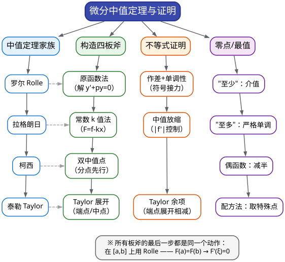
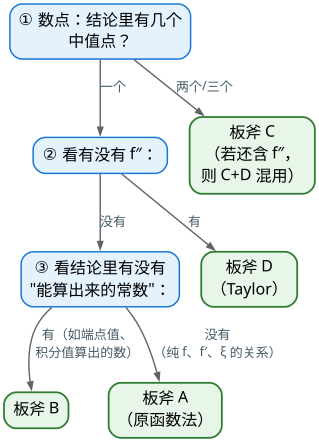

# CMC 手把手精讲
## ——《04 中值定理与微分学证明》：四把板斧，劈开 14 分大题

> 🐱 喵～欢迎来到第四篇。前两篇我们打通了"极限"（01 算、02 证），这一篇要啃下**全卷证明题的最大产区**——中值定理与微分学证明。它有一个好消息和一个坏消息：坏消息是，近 8 届的解答题里**每一届都有它的身影**；好消息是，它的打法高度模板化——**"构造辅助函数"是四把可以背下来的板斧**。
>
> **本篇在考试中的地位**（数据口径：第 10–17 届初赛，共 8 套非数学类/非数学 A 类试卷，逐题核对）：
> - 一元函数微分学**每届必考**，直接分值常年 **14–28 分**（中位约 20 分）；且近 7 届（11–17 届）中有 **5 届**以独立大题考查本板块的证明/应用（11 届三、12 届三、14 届三、14 届补二四、16 届三/五），其余届次以跨板块形态融入（13 届五的 Taylor 误差估计、15 届五的积分不等式、17 届二的导数定义）；
> - 其中"**中值定理存在性证明**"是 S 级考点（00 总纲的 S7）：近 8 届实点为 12 届三（双中值）、14 届三（Lagrange + 构造 $[f']^2-[f]^2$）、14 届补二四（三中值点）、11 届三（最大点 + 中值放缩）、16 届五（导数不等式）——**出场频率约每 1–2 届一次，且方法完全可训练**（更早的 6 届三、3 届三也是同一套路，本篇会一并精讲）；
> - "**单调性 → 极值/最值 + 导数不等式**"是另一个 S 级考点（S8）：16 届三（14 分连续性 + 最值）、16 届五（14 分导数不等式）——16 届一卷连出两道 14 分档。（另：15 届五属积分不等式，已在 06 篇作 S11 主例；本篇精讲 10 从微分学视角给出其完整解答，两篇可对读。）
> - 🎯 一句话定级：**"构造辅助函数"是 14 分大题里投入产出比最高的技能**——写出正确的辅助函数（或第一个 Taylor 展开式）通常就有 4–6 分过程分。
>
> **大纲对应条目**（《全国大学生数学竞赛考试内容》非数学专业类·一元函数微分学原文摘录）：
> - 条目 (5)：**微分中值定理，包括 Rolle 定理、Lagrange 中值定理、Cauchy 中值定理和 Taylor 定理**等；
> - 条目 (7)：函数的极值、函数单调性、函数图形的凹凸性、拐点及渐近线；
> - 条目 (8)：函数最大值和最小值及其简单应用。
>
> （两条范围边界：① **达布定理、导数介值性等数学类专业内容不在非数学类大纲**，学有余力也别在此花时间；② "渐近线、凹凸作图"在纲但近 8 届零命中，本篇只留 10 分钟保底小节。）
>
> **先修提示**：① **01、02 篇**——本篇的每个证明里都有极限，且"介值定理 + 构造 $F$"的套路直接来自 02 篇 §3.6；② **求导基本功**（复合、隐函数、变限积分求导）——03 篇的事，若你还没读，本篇每处该求导的地方都会现场交代怎么算，不影响阅读。
>
> **预计学时**：2–3 天（按每天 1–2 小时折算）。对应 00 总纲行军表：**第 2 周 D11–D12（中值定理四板斧）+ D13（导数不等式与最值）**。建议节奏：第 1 天 §一+§二+§3.1–3.4；第 2 天 §3.5–3.8 + 精讲 1–5；第 3 天精讲 6–10 + 易错点 + 自测题。
>
> 阅读建议：
> 1. 先花 5 分钟把 §1.2 的"**结论长相 → 辅助函数**"速查表读两遍——这张表就是本篇的全部秘密；
> 2. §二 的"构造四板斧"讲的是**为什么这样构造**，不要跳——只会套表的人在题目变体面前会卡壳；
> 3. 每道精讲先自己写"第一句话"（辅助函数是什么 / 在哪展开 Taylor）再看解答；
> 4. ⚠️ 本篇所有题都能"看懂"，但**能默写出来的人不到三成**——请按 §七 的建议真的动笔。
>
> 符号说明：📌 重点 | 💡 直觉/类比 | ⚠️ 易错点 | ✍️ 动笔练一练 | ❓ 自测题 | 🎯 考试定位 | ⏱️ 省时技巧

---

# 一、本篇地图

## 1.1 目录（施工图）

- **§二 知识讲解**：罗尔→拉格朗日→柯西→泰勒的"一环套一环" → 三条定理的条件"三查" → 构造辅助函数的灵魂（把 $\xi$ 的结论翻译成导数的零点）→ 四板斧总览 → 导数不等式为什么能用单调性证 → 零点个数问题的完整逻辑 → 泰勒公式的余项与"二阶可导"的坑
- **§三 方法手册**：3.1 板斧 A 原函数法（含对照表）| 3.2 板斧 B 常数 $k$ 值法 | 3.3 板斧 C 双/三中值点 | 3.4 板斧 D Taylor 展开 | 3.5 导数不等式四招 | 3.6 单调性与极值/最值 | 3.7 零点个数 | 3.8 通用流程与书写纪律 + 凹凸性保底
- **§四 真题精讲**：10 道真题完整精讲（12 届三、14 届补二四、14 届三、16 届五、11 届三、3 届三、6 届三、2 届二、13 届补二、15 届五）
- **§五 易错点清单**：12 条 ❌→✅ 对照
- **§六 自测题**：7 道，附完整答案
- **§七 结语**："中值定理防身六句话" + 学习建议 + 练习清单

## 1.2 方法速查表：**结论长什么样 → 就用哪把板斧**（一屏版）

| 结论长相（信号） | 用的板斧 | 第一动作 |
|---|---|---|
| 只有 $f(\xi)$、$f'(\xi)$、$\xi$（**一个点**，无 $f''$） | **板斧 A：原函数法** | 把 $\xi$ 当 $x$，移项成 $G(x,f,f')=0$，解微分方程 $y'+py=0$ 取 $e^{\int p}$ |
| 结论里有一个**能算出来的常数** $k$ | **板斧 B：常数 k 值法** | 令 $F=f-kx$（或类似），由端点/积分条件定 $k$，再罗尔 |
| 结论要**两个（三个）不同的点** $\xi\ne\eta$ | **板斧 C：双中值** | **先用介值定理在区间内部钉一个分点**，再分段两次套中值定理 |
| 结论含 $f''(\xi)$，或题设"**二阶可导/二阶连续**" | **板斧 D：Taylor** | 在条件最集中的点（端点/中点/极值点）做带 Lagrange 余项的 Taylor |
| 要证 $A\ge B$（含 $f,f',f''$ 的不等式） | **作差构造 + 单调性** | 令 $\Phi=A-B$，求 $\Phi'$ 定号；不够就"符号接力"（$\Phi''$、$\Phi'''$） |
| 要证 $\lvert f'\rvert\le$（$A$、$B$ 型的**一致**估计） | **端点展开相减** | 在 $x$ 处 Taylor，代入 0 和 1，两式**相减**消去 $f(x)$ |
| "证明 $f=0$ 恰有**两个/若干**实根" | **单调性 + 零点定理** | 单调区间上各"至少一根"；"恰"靠每段严格单调；偶函数可减半 |
| 结论含 $\int$（积分不等式/恒等式） | **分部积分 + Cauchy** | 把 $f^2$ 分部成 $ff'$，或把积分条件"平移中值"（$\int xf\to\int(x-\tfrac12)f$） |

## 1.3 知识树：本篇全部内容的骨架



一句话总结：**中值定理题的九成工作不是"用定理"，而是"造那个能用定理的函数"**——造出来之后，罗尔定理只负责收最后一脚。

🎯 **本板块两种题的正确打开方式**：

| 题型 | 目标分 | 策略 |
|---|---|---|
| 中值/介值存在性（造分点、双中值、单点等式） | **12–14/14** | 板斧 A–C 的模板极稳，书写规范即可满分 |
| 导数不等式、一致估计（端点展开、取最优 $h$） | **10–14/14** | 板斧 D + 放缩预算意识：先把"要证的式子"抄下来，看它需要多大的放缩空间 |

---

# 二、知识讲解：中值定理家族是怎么"长"出来的

## 2.1 四个定理，一个链条

微分中值定理不是四个孤立公式，而是**同一件事的四个精度档**。理解这条链，你才能"看结论选工具"。

### （1）罗尔定理：山顶必有平地

> 设 $f$ 在 $[a,b]$ 上**连续**、在 $(a,b)$ 内**可导**、且 $f(a)=f(b)$，则存在 $\xi\in(a,b)$ 使 $f'(\xi)=0$。

💡 **几何直觉**：你从山脚爬到同样高处的另一个山脚（两端等高），路途中**必有某一处的切线是水平的**——要么中间有山顶/山谷（极值点，费马引理），要么整条路都是平的。这就是"罗尔"。

📌 **它的威力不在自身，而在"配合"**：绝大多数中值定理证明题的最后一句都是"**由罗尔定理**"——而用它的前提是**你得自己造出一个满足 $F(a)=F(b)$ 的函数 $F$**。整个"构造辅助函数"的技术，都是在伺候这一脚。

### （2）拉格朗日中值定理：平均速度必被瞬时速度取到

> 设 $f$ 在 $[a,b]$ 上连续、在 $(a,b)$ 内可导，则存在 $\xi\in(a,b)$ 使
> $$f(b)-f(a)=f'(\xi)(b-a)\qquad\text{即}\qquad f'(\xi)=\frac{f(b)-f(a)}{b-a}.$$

💡 **直觉**：区间平均速度 $\dfrac{f(b)-f(a)}{b-a}$ 必然被某个"瞬时速度" $f'(\xi)$ 精确取到（车辆区间平均 60 km/h，则某一瞬间恰好在开 60）。

**它和罗尔的关系**：拉格朗日 = 罗尔 + "**把斜的弦拉平**"。构造 $F(x)=f(x)-\dfrac{f(b)-f(a)}{b-a}(x-a)$，则 $F(a)=F(b)=f(a)$，对 $F$ 用罗尔即得。**这个"减去一条直线、把问题归到罗尔"的动作，就是所有构造辅助函数的原型**——记住它，§2.3 的"原函数法"就是它的升级版。

⚠️ **使用时的两个关键**：① 中值点 $\xi$ 在**开区间** $(a,b)$ 内（题目要"$\exists\xi\in(a,b)$"就必须用中值定理而不是"平均值在端点取到"）；② 定理是"先有区间、后有 $\xi$"——**你不能指定 $\xi$ 在哪**，只能靠"在哪段区间上用它"来间接控制它的位置（双中值题的原理，见 §3.3）。

### （3）柯西中值定理：两个人的平均速度

> 设 $f,g$ 在 $[a,b]$ 上连续、在 $(a,b)$ 内可导，且 $g'(x)\ne0$，则存在 $\xi\in(a,b)$ 使
> $$\frac{f(b)-f(a)}{g(b)-g(a)}=\frac{f'(\xi)}{g'(\xi)}.$$

💡 **直觉**：拉格朗日比较的是"$f$ 的平均变化率"，柯西比较的是"**$f$ 与 $g$ 两个量的变化率之比**"——比如"路程差除以时间差"就是平均速度。在竞赛里它的用法非常固定：**当结论里出现"要凑出 $g$"的痕迹时**，就选一个合适的 $g$ 用柯西。（例：要证"$\exists\xi$ 使 $f(b)-f(a)=\xi f'(\xi)\ln\dfrac ba$"（$a>0$），取 $g(x)=\ln x$——柯西给出 $\dfrac{f(b)-f(a)}{\ln b-\ln a}=\dfrac{f'(\xi)}{1/\xi}=\xi f'(\xi)$，恰好把 $\ln\dfrac ba$ 和 $1/\xi$ 两样都凑出来。）

### （4）泰勒中值定理：用多项式"模仿"函数

> 设 $f$ 在包含 $x_0$ 的区间上有 $n+1$ 阶导数，则对区间内任意 $x$，存在 $\eta$（介于 $x_0$ 与 $x$ 之间）使
> $$f(x)=\sum_{k=0}^{n}\frac{f^{(k)}(x_0)}{k!}(x-x_0)^k+\frac{f^{(n+1)}(\eta)}{(n+1)!}(x-x_0)^{n+1}.$$
> （最后一项叫**拉格朗日余项**。竞赛证明题里**必须用它**——另一种"皮亚诺余项 $o$"只用于求极限，不能用于估计。）

💡 **直觉**：泰勒公式说"**函数 ≈ 多项式 + 一个由最高阶导数控制的误差**"。**误差项里的那个 $f^{(n+1)}(\eta)$ 是竞技场**：题目给你 $f''$ 的界，就是让你把这个"未知位置的导数"用界压住——于是泰勒 + 放缩就能证明"函数被多项式控制"。

📌 **家族关系**：罗尔是拉格朗日的特例（$f(a)=f(b)$）；拉格朗日是柯西的特例（$g(x)=x$）；拉格朗日也是泰勒的特例（展开到 0 阶，余项写成 $f'(\eta)(x-x_0)$）。**会一个，就都通了。**

## 2.2 条件"三查"清单（评分点就在这里）

每次写下定理名字前，**默念这三条**：

| 定理 | 查 1 | 查 2 | 查 3 |
|---|---|---|---|
| 罗尔 | $[a,b]$ 上**连续** | $(a,b)$ 内**可导** | $F(a)=F(b)$ |
| 拉格朗日 | $[a,b]$ 上连续 | $(a,b)$ 内可导 | （无第三条件，但要注意区间方向） |
| 柯西 | $f,g$ 都连续 | 都可导，且 $g'(x)\ne0$ | —— |
| 泰勒 | 在**含 $x_0$ 的区间**上有 $n+1$ 阶导数 | 余项形式选**拉格朗日**（要估计/证明时） | 余项点 $\eta$ 的范围要写清 |

⚠️ **三个高频疏漏**：
1. **"开区间可导"常被默认成"闭区间可导"**——题设写"$(0,1)$ 内可导"，你就不能写"在 $[0,1]$ 上可导"，只能写"在 $[0,1]$ 上连续、$(0,1)$ 内可导"（**可导蕴含连续**，这句翻译要用上）；
2. **构造完 $F$ 要重新验条件**——$F$ 是"$f$ 加别的"，条件通常继承，但 $F(a)=F(b)$ 是你自己必须算的（这是最容易忘、也最容易算错的一步）；
3. **"二阶可导" ≠ "二阶连续可导"**：题设若只说"二阶可导"，那么 $f''$ **可能不连续**——不能对它用洛必达、不能"取极限搬进搬出"，**只能用带 Peano 余项的 Taylor 求极限、用带 Lagrange 余项的 Taylor 做估计**。（第 14 届三专门用这个细节卡人：它的条件恰好让"想对 $f''$ 动歪脑筋"的人无路可走。）

## 2.3 构造辅助函数的灵魂：把"$\xi$ 的结论"翻译成"导数的零点"

这一节是整篇文档的核心，请慢读。

**问题的困难性**：中值定理的结论永远长这样——"存在 $\xi$ 使【某个关于 $f$、$f'$、$\xi$ 的等式】"。它有两个"不受控"：
- $\xi$ 的位置不受控（定理只保证存在）；
- 你要的等式不一定是 $f'(\xi)=0$ 的样子。

**破解的思路分两步**：

**第一步：把 $\xi$ 改写成 $x$，得到一个"方程"**。例如结论是 $f'(\xi)+2\xi f(\xi)=0$——把 $\xi$ 换成 $x$，就是要证"方程 $f'(x)+2xf(x)=0$ 在 $(a,b)$ 内有解"。
**第二步：把这个方程"还原成某个函数的导数为零"**。观察：$f'+2xf$ 长得像什么函数的导数？——乘积求导法则 $(e^{x^2}f)'=e^{x^2}(f'+2xf)$！**乘上因子 $e^{x^2}$ 后，$f'+2xf$ 就成了 $(e^{x^2}f)'$**。于是：
$$\text{想找 } f'(\xi)+2\xi f(\xi)=0\ \Longleftrightarrow\ \text{想找 } \big(e^{x^2}f(x)\big)'\big|_{\xi}=0\ \Longleftarrow\ \text{罗尔定理（若 } e^{a^2}f(a)=e^{b^2}f(b)\text{）}.$$

**为什么乘的那个因子偏偏是 $e^{\int p}$？** 因为要解微分方程 $y'+p(x)y=0$：分离变量 $\dfrac{\mathrm{d}y}{y}=-p\,\mathrm{d}x$，两边积分 $\ln|y|=-\int p\,\mathrm{d}x$，故 $y=Ce^{-\int p}$——也就是说"**$e^{\int p(x)\mathrm{d}x}f(x)$ 在 $f'+pf=0$ 时恰好是常数**"，它的导数恰好把 $f'+pf$ 提出来。**这就是"原函数法"名字的来历：先解方程找原函数。**

💡 **一句话记法**：**"把结论当微分方程解一遍，解出来的那个函数就是辅助函数。"**

**再看两个变体**（都将在 §3.1 的对照表里出现）：
- 结论 $f'(\xi)g(\xi)-f(\xi)g'(\xi)=0$ ⇒ 方程 $\dfrac{f'}{f}=\dfrac{g'}{g}$ ⇒ 解出 $\ln f=\ln g+C$ ⇒ 辅助函数是 $\dfrac{f(x)}{g(x)}$（商法则的分子恰好是 $fg'-f'g$ 的相反数）；
- 结论 $\xi f'(\xi)+kf(\xi)=0$ ⇒ 方程 $y'=-\dfrac{k}{x}y$ ⇒ $y=Cx^{-k}$ ⇒ 辅助函数是 $x^kf(x)$（因为 $(x^kf)'=x^{k-1}(xf'+kf)$）。

**看出来了吗**——所谓"构造辅助函数"的灵感，**其实是可以算出来的**（解微分方程），不是猜的。

## 2.4 四板斧总览与选择流程

有了 §2.3 的思想，四把板斧就是四种"结论长相"对应的四个技术动作：

| 板斧 | 结论信号 | 核心动作 | 记忆锚点 |
|---|---|---|---|
| **A 原函数法** | 只含 $f(\xi),f'(\xi),\xi$ 的**单点等式** | 解 $y'+p(x)y=0$，取 $F=e^{\int p}f$；或商/幂形式的对照表 | "把结论当微分方程解" |
| **B 常数 $k$ 值法** | 结论含**可用已知量算出的常数** $k$ | 移项成 $f'(\xi)-k=0$ 型，令 $F=f-kx$ 之类，用罗尔 | "常数进函数，斜率变水平" |
| **C 双/三中值点** | 结论要**两个以上不同的点** | **介值定理先在内部钉一个分点**，再在两段上分别套中值定理 | "先分家，后开火" |
| **D Taylor 展开** | 结论含 $f''$；题设"二阶可导"；要**一致估计** | 在特殊点做带 Lagrange 余项的 Taylor（端点/中点），两式加减消项 | "多项式模仿 + 余项放缩" |

**选择流程（考场 30 秒版）**：



## 2.5 导数的第二种用法：单调性、极值与最值

中值定理管"存在某点"，**单调性管"整段的比较"**——这是微分学证明的另一条腿。

📌 **核心定理**：若 $f$ 在 $[a,b]$ 上连续、$(a,b)$ 内可导，则
- $f'(x)>0\ (x\in(a,b))$ ⟹ $f$ 在 $[a,b]$ 上**严格递增**；$f'<0$ ⟹ 严格递减；
- 反过来：$f$ 递增 ⟹ $f'\ge0$（注意：**严格递增只能推出 $f'\ge0$，不是 $>0$**——$f(x)=x^3$ 在 $0$ 处导数为 0 但严格递增。这条"方向差"是易错点）。

💡 **为什么它有资格证明不等式**：因为不等式 $A(x)\ge B(x)$ 的左边减右边就是一个函数 $\Phi(x)$，而"$\Phi\ge0$ 恒成立"恰恰是"$\Phi$ 的最小值 $\ge0$"。于是**证明不等式 = 定位一个函数的最低点**——而定位最低点的标准工具就是"求导、看符号、比端点"。**这就是 §3.5 全部内容的思想。**

**符号看不出来怎么办？"符号接力"**：$f'$ 的符号由 $g(x)$ 决定，而 $g$ 的性质又要看 $g'$，$g'$ 又要看 $g''$——这是竞赛题的常规套路（16 届三就是这样：$f'\to g\to g'\to g''$ 四层梯队）。
**【标准书写模板】**（把下面这段背下来，它就是 16 届三(2) 的官方骨架）：
> "因为 $g''(x)=\cdots<0\ (0<x\le1)$，所以 $g'$ 在 $[0,1]$ 上**单调递减**，故 $g'(x)<g'(0)=0$；这又推出 $g$ 在 $[0,1]$ 上单调递减，故 $g(x)<g(0)=0$；从而 $f'(x)<0$（$0<x\le1$）——$f$ 在 $[0,1]$ 上单调递减。"

⚠️ **三个细节**：① 每一层都要**引用上一层在端点处的值**（$g'(0)=0$ 是关键）；② 不等号方向：递减 ⟹ "$x>0$ 时 $g'(x)<g'(0)$"；③ **别把 $<$ 和 $\le$ 用混**——题设给了 $0<x\le1$（不含 0），你就老老实实写在开区间内严格单调。

**极值/最值的工具箱**：
- **费马引理**：可导的极值点必是驻点（$f'=0$）——这是"找候选点"的依据，也是很多证明题的支点（"$f$ 在 $x_0$ 取最大值 ⟹ $f'(x_0)=0$"，**16 届五、11 届三都以它为起点**）；
- **闭区间最值流程**：比较**所有驻点 + 不可导点 + 端点**的函数值（16 届三就是取端点 $f(0),f(1)$）；
- **"最值法"证不等式**：要证 $\Phi(x)\ge0$，就证 $\min\Phi\ge0$——对 $\Phi$ 求导定位最小值即可。

## 2.6 零点个数问题：一条"至少 + 至多"的流水线

**题面信号**："证明方程 $f(x)=0$ 在区间内<strong>恰有（仅有两个）</strong>实根"（2 届二、13 届补二都是这个型）。

**逻辑链只有两环**：
1. **"至少"**——来自**零点定理**：在某个子区间两端找异号（或用极限行为：$x\to\pm\infty$ 时 $f\to\pm\infty$）；
2. **"至多"**——来自**严格单调**：在每段单调区间内至多一个零点。

**标准流程**：
```
① 求 f'，找零点与不可导点 → 把定义域切成若干单调区间
② 在每个单调区间上：用"端点符号 + 零点定理"给一根（至少）
③ "至多"由 ② 的严格单调自动保证 → 合起来"恰有一根"
④ 汇总所有区间 → "恰有 n 根"
```
**三个提速技巧**：
- **偶函数/奇函数减半**：13 届补二里 $f$ 是偶函数，只需在 $(0,1)$ 上证明"恰有一根"，另一侧自动得到——**但"对称性论证"这句话必须写出来**（"因为 $f$ 是偶函数，它在 $(-1,0)$ 内也仅有一个实根"），这是评分点；
- **不可导点单列**：含 $|x-t|$ 型的函数先**拆绝对值化显式**（13 届补二的第一步），把不可导点找出来后按区间讨论；
- **罗尔递降（"至多"的另一条路）**：若"至多 $n$ 根"不便逐段讨论单调性，就**反设 $n+1$ 个根、连续使用罗尔定理**逼出"$f^{(n)}$ 有零点"，与已知的 $f^{(n)}$ 定号矛盾（2 届二的官方解法正是三次罗尔，见精讲 9）——记住原则：**$f$ 有 $k$ 个零点 ⟹ $f'$ 至少有 $k-1$ 个零点**。

⚠️ **高频失分**：只写"由零点定理至少有一根"就宣布"恰有一根"——**缺了"至多"的严格单调论证，按半分扣**。

## 2.7 泰勒公式的三个使用细节（决定成败）

**(1) 展开点怎么选？——"条件最集中的点"**
- 题设给了端点值（$f(0)=0$、$f(1)=1$）⟹ 在**端点**展开（或内部某点展开、代入端点）；
- 题设给了 $f'(0)=0$（3 届三）⟹ 在 $0$ 处展开——**展开点的导数信息越全，一次项/低阶项越容易消**；
- 题设给了"最大值点" ⟹ 在**极值点**展开（那里 $f'=0$）；
- 要估计"$f$ 与中点平均值之差" ⟹ 在**中点**展开（13 届五）。

**(2) 余项形式怎么选？** 用一张表记住：

| 余项形式 | 长相 | 用途 |
|---|---|---|
| 拉格朗日余项 | $\dfrac{f^{(n+1)}(\eta)}{(n+1)!}(x-x_0)^{n+1}$ | **证明/估计**（要用 $f^{(n+1)}$ 的界） |
| 皮亚诺余项 | $o((x-x_0)^n)$ | **求极限**（不关心余项大小，只要"高阶"） |

⚠️ 证明题里如果把余项写成 $o(\cdot)$，**几乎全错**——因为 $o$ 不知道符号也不知道大小，没法估计。

**(3) "先抄结论、再配参数"**——本题型最优雅的一招（16 届五的精髓）：
要证 $(f'(x))^2\le2Mf(x)$。中间过程会得到一族不等式
$$|f'(x)|\le\frac{f(x)}{|h|}+\frac{M|h|}{2}\qquad(\text{对一切 } h\ne0\ \text{成立}),$$
此时**把右端看成关于 $|h|$ 的函数，用均值不等式/求导求出它的最小值**：$\dfrac{f(x)}{t}+\dfrac{Mt}{2}\ge2\sqrt{\dfrac{f(x)}{|h|}\cdot\dfrac{M|h|}{2}}=\sqrt{2Mf(x)}$（取 $t=|h|=\sqrt{\dfrac{2f(x)}{M}}$ 时取等）。**"不等式里带着可自由取值的参数 $h$，就把 $h$ 优化到最优"——这叫配方法/最优参数法**，是 16 届五的官方动作，也是本篇的招牌技巧之一。

⚠️ **"二阶可导"的坑再强调一次**：只给 $f$ 二阶可导时，$f''$ 没有连续性保证——**索引泰勒要么用 Peano 余项（求极限），要么用 Lagrange 余项（做估计）**；绝对不能写"$\lim f''(\xi)=\cdots$"式地"把极限搬进去"。

---

# 三、方法手册：四把板斧 + 四条辅助线

每个方法按统一格式展开：【适用信号】→【步骤】→【关键公式/对照表】→【真题微型例子】。**四板斧是本篇的四件主武器**，3.5–3.7 是本篇的"辅助线"（不等式、单调性、零点），3.8 是总纪律。

## 3.1 板斧 A：原函数法（解微分方程找辅助函数）

**【适用信号】** 结论是**一个点**的等式，只含 $f(\xi)$、$f'(\xi)$、$\xi$（有时含 $f''$ 但没有"两个点"）；整理后能写成 $f'(\xi)+p(\xi)f(\xi)=0$ 的一阶线性形状。

**【步骤】**
1. **把 $\xi$ 看成 $x$**，把结论整理成"某个式子 $=0$"，目标是 $f'(x)+p(x)f(x)=0$；
2. **解这个微分方程**：$y'+p(x)y=0\Rightarrow y=Ce^{-\int p\,\mathrm{d}x}$；
3. **取辅助函数 $F(x)=e^{\int p(x)\mathrm{d}x}f(x)$**（去掉常数 $C$），则 $F'=e^{\int p}(f'+pf)$；
4. **验罗尔条件**：$F(a)=F(b)$（用题设条件验证）→ 罗尔 ⟹ $F'(\xi)=0$ ⟹ 结论。

**【关键对照表（把 $\xi$ 看成 $x$，直接查）】**

| 待证结论 | 辅助函数 $F(x)$ | 校验 |
|---|---|---|
| $f'(\xi)+\lambda f(\xi)=0$ | $e^{\lambda x}f(x)$ | $F'=e^{\lambda x}(f'+\lambda f)$ |
| $f'(\xi)+f(\xi)=0$ | $e^{x}f(x)$ | 上表 $\lambda=1$ |
| $f'(\xi)-f(\xi)=0$（即 $f'=f$） | $e^{-x}f(x)$ | $F'=e^{-x}(f'-f)$ |
| $\xi f'(\xi)+kf(\xi)=0$ | $x^{k}f(x)$ | $F'=x^{k-1}(xf'+kf)$ |
| $\xi f'(\xi)-kf(\xi)=0$ | $\dfrac{f(x)}{x^{k}}$ | 幂商形式 |
| $f'(\xi)g(\xi)-f(\xi)g'(\xi)=0$ | $\dfrac{f(x)}{g(x)}$ | $F'=\dfrac{f'g-fg'}{g^2}$ |
| $f'(\xi)g(\xi)+f(\xi)g'(\xi)=0$ | $f(x)g(x)$ | 乘积形式 |
| $f'(\xi)=f(\xi)+1$ 型（差 $1$） | $e^{-x}(f(x)+1)$ 型（把常数并进函数） | 移项后同型 |

**【真题微型例子】**（**类型题·仿竞赛风格**——此题转引自真题集、未逐字核对原卷，仅作方法示范）$f(a)=f(b)=0$ 且 $\displaystyle\int_a^bf(x)\mathrm{d}x=0$，证明存在互异 $x_1,x_2$ 使 $f'(x_i)=f(x_i)$。
**步骤**：结论 $f'=f$ 对应 $F(x)=e^{-x}f(x)$。（若 $f$ 在 $[a,b]$ 上不变号，则由 $\int_a^bf=0$ 与连续性得 $f\equiv0$，此时 $f'=f$ 处处成立、结论平凡；以下设 $f$ 不恒为 $0$。）于是 $f$ 必在 $(a,b)$ 内变号，由介值定理存在 $c\in(a,b)$ 使 $f(c)=0$——于是 $F(a)=F(c)=F(b)=0$。**两次罗尔**：$[a,c]$ 上得 $x_1$，$[c,b]$ 上得 $x_2$，各自满足 $F'=e^{-x}(f'-f)=0$，即 $f'(x_i)=f(x_i)$。
> 三个教学点：① "原函数法 + 多零点 ⟹ 多次罗尔"连招；② 由积分条件**造零点**（$\int f=0$ + 端点值 ⟹ 内部有零点，这条引理后面 §3.7 还会用）；③ 两次罗尔自然给出**互异**的两个点（一个在 $(a,c)$、一个在 $(c,b)$）。

## 3.2 板斧 B：常数 $k$ 值法

**【适用信号】** 结论里出现一个**能用已知数据算出来的常数**（如 $k=\dfrac{f(b)-f(a)}{b-a}$、$k=\dfrac{\int_a^bf}{b-a}$、或题面直接给出目标常数值），且要证"存在 $\xi$ 使 $f'(\xi)=k$"或含 $k$ 的等式。

**【步骤】**
1. **先把 $k$ 算出来**（用题设：端点值、积分值、已知函数值）；
2. **把等式改写为"$f'(\xi)-k=0$"**，取辅助函数 $F(x)=f(x)-kx$（或按结论形状调整）；
3. **验端点**：$F(a)=F(b)$ 等价于 $f(a)-ka=f(b)-kb$——正好是 $k$ 的定义式；
4. 罗尔 ⟹ $F'(\xi)=f'(\xi)-k=0$ → 结论。

**【关键公式/常见 $k$】**
$$k=\frac{f(b)-f(a)}{b-a}\ \Rightarrow\ F=f(x)-\frac{f(b)-f(a)}{b-a}x;\qquad k=\frac{\displaystyle\int_a^bf}{b-a}\ \Rightarrow\ F=f(x)-kx.$$
**几何解读**：减去斜率为 $k$ 的直线，把"弦"拉平成"水平线"——**这就是拉格朗日定理本身的证法**，板斧 B 无非是把这一个动作反复使用。

**【真题微型例子】**（**类型题·仿竞赛风格**）设 $f$ 在 $[0,1]$ 上连续、$(0,1)$ 内可导，$f(0)=0$、$f(1)=2$。证明存在 $\xi\in(0,1)$ 使 $f'(\xi)=2$。
**板斧 B 的标准动作**：先算常数 $k=2$（由端点数据定出）；令 $F(x)=f(x)-2x$，则
$$F(0)=f(0)-0=0,\qquad F(1)=f(1)-2=0\ \text{——端点自然等高！}$$
对 $F$ 用罗尔：存在 $\xi\in(0,1)$ 使 $F'(\xi)=f'(\xi)-2=0$，即 $f'(\xi)=2$。$\blacksquare$
> **这个"$F=f-kx$"的小机械就是拉格朗日定理的证明本体**——板斧 B 无非把这一招用在"$k$ 更隐蔽"的题上。真正的板斧 B 实战请见 §四 精讲 6（3 届三：$k=3$ 由端点值算出）+ 精讲 3（14 届三：$k$ 藏在结论的 $\sqrt2$ 里）。**要点：$k$ 一定来自题设——你没算出 $k$，就说明还没真正读懂题目。**

## 3.3 板斧 C：双（多）中值点——先分家，后开火

**【适用信号】** 结论要求**两个或三个互异的中值点**（$f'(\xi),f'(\eta)$ 同时出现；或 $f'(\xi_1)f'(\xi_2)$ 型；甚至含 $\xi_3$）。

**【步骤（三段式）】**
1. **造分点**：用**介值定理**（02 篇 §3.6）在区间**内部**钉一个点 $x_0$（构造 $F=f-\text{（目标线）}$，两端异号），使 $f(x_0)$ 恰好等于"你想要的值"（往 2 届四、12 届三里都是 $f(x_0)=2-3x_0$ 或 $f(\xi_3)=2-\xi_3$ 这样的设计）；
2. **分段用中值**：在 $[a,x_0]$、$[x_0,b]$ 上**分别**套拉格朗日（需要两个不同函数之比时用柯西），得到 $f'(\xi)$、$f'(\eta)$ 的两个表达式；
3. **合并**：把 $f(x_0)$ 的表达式代入、相消化简——**通常答案会自动拼出来**（命题人把分点设计成能消项的样子）。

**【关键公式/书写要点】**
"在区间 $[0,x_0]$、$[x_0,1]$ 上分别利用拉格朗日中值定理，存在 $\xi\in(0,x_0)$、$\eta\in(x_0,1)$，使得……"
$$\frac{f(x_0)-f(0)}{x_0-0}=f'(\xi),\qquad\frac{f(x_0)-f(1)}{x_0-1}=f'(\eta),$$
⚠️ **互异性怎么保证**：因为 $\xi$ 与 $\eta$ 分属**两个不相交的开区间**（$(0,x_0)$ 与 $(x_0,1)$），所以自动 $\xi\ne\eta$——**这句话要写出来**（"由于 $\xi<x_0<\eta$，故 $\xi\ne\eta$"），这是"两两互异"的评分点。

**【真题微型例子】**（第 12 届非数学类·解答题三(2)，2020）$f\in C[0,1]$、$(0,1)$ 可导、$f(0)=0$、$f(1)=1$，证明存在 $\xi\ne\eta$ 使 $[1+f'(\xi)][1+f'(\eta)]=4$。
**关键**：分点 $x_0$ 由第 (1) 问给出（$f(x_0)=2-3x_0$）。则
$$1+f'(\xi)=1+\frac{f(x_0)-f(0)}{x_0}=\frac{x_0+f(x_0)}{x_0}=\frac{2-2x_0}{x_0},\qquad 1+f'(\eta)=1+\frac{f(x_0)-f(1)}{x_0-1}=\frac{2x_0}{1-x_0},$$
相乘 $=\dfrac{2(1-x_0)}{x_0}\cdot\dfrac{2x_0}{1-x_0}=4$ ✓（完整版见精讲 1）。**注意 $1+f'$ 要**整体**处理**：别分别算 $f'(\xi)$ 再硬拼——先把 $1+$ 吸收进分式，答案就自己冒出来了。

## 3.4 板斧 D：Taylor 展开（两个模板打天下）

**【适用信号】** 结论含 $f''(\xi)$；题设"二阶（及更高阶）可导"；要证"**一致估计**"型不等式（$|f'|\le\cdots$、$|f|\le\cdots$）；（与板斧 C 混用）三中值点但又出现 $f''$。

**【步骤】**
1. **选展开点**：端点（题设给端点值）/ 中点（要估计平均值误差）/ 极值点（$f'=0$ 白送）/ 内部任意点 $x$（要"逐点"估计时）；
2. **写带拉格朗日余项的 Taylor**（阶数按余项里的导数阶数需求定：要 $f'''$ 就展到 2 阶）；
3. **代入特殊值、两式相加或相减**，消去不想要的项（低阶项）；
4. **放缩余项**（$|f''|\le B$ 之类）→ 得到结论。

**【两个黄金模板】**

**模板 1（两端展开相减——"逐点估计"型）**：要证 $|f'(x)|\le\cdots$（对**每个** $x$ 成立）。
> 在 $x$ 处展开：$f(1)=f(x)+f'(x)(1-x)+\frac{f''(\xi_1)}{2}(1-x)^2$，$f(0)=f(x)-f'(x)x+\frac{f''(\xi_2)}{2}x^2$。
> **两式相减**（$f(x)$ 自动消）：$f'(x)=f(1)-f(0)-\frac{f''(\xi_1)}{2}(1-x)^2+\frac{f''(\xi_2)}{2}x^2$ → 放缩。

**模板 2（中点展开积分——"误差估计"型）**：把区间 $n$ 等分，在每段中点展开后**积分**——一次项因对称自动积掉（13 届五的骨架，见 02 篇精讲 7）。

**【真题微型例子】**（第 3 届非数学类·第三题，2011，15 分）$f$ 在 $[-1,1]$ 上有连续三阶导数，$f(-1)=0$，$f(1)=1$，$f'(0)=0$，求证存在 $x_0\in(-1,1)$ 使 $f'''(x_0)=3$。
**关键**：在 $x_0=0$ 展开（因为 $f'(0)=0$ 这个条件"让一次项消失"），代入 $x=\pm1$ 得两式
$$1=f(0)+\frac{f''(0)}{2}+\frac{f'''(\xi_1)}{6},\qquad 0=f(0)+\frac{f''(0)}{2}-\frac{f'''(\xi_2)}{6},$$
**相减**消去 $f(0)$ 与 $f''(0)$：$f'''(\xi_1)+f'''(\xi_2)=6$，再由 $f'''$ 连续 + 介值定理得 $x_0$（完整版见精讲 6）。
> **"在对称点展开、代入对称端点、相减消偶次项"**——这是模板 1 的变体，也正是 3 届题的官方参考解答思路（与本篇精讲 6 的版本核对一致）。

## 3.5 用导数证不等式：四招流水线

**【适用信号】** 要证含 $f,f',f''$ 的不等式；或"证明 $\Phi(x)\ge0$ 对一切成立"。

**【四招（按试错顺序）】**

**第 1 招：作差 + 单调性（首选）**。令 $\Phi=A-B$，验证 $\Phi(\text{端点})=0$（或 $\ge0$）后，只需 $\Phi'$ 定号。
> 微例：$0<x<1$ 时 $\ln(1+x)>x-\dfrac{x^2}{2}$：令 $\Phi=\ln(1+x)-x+\frac{x^2}2$，$\Phi(0)=0$，$\Phi'(x)=\dfrac{1}{1+x}-1+x=\dfrac{x^2}{1+x}>0$ → 递增 → $\Phi>0$ ✓。

**第 2 招：中值放缩**。把 $f$ 的增量换成 $f'(\xi)\Delta$，再用 $|f'|$ 或 $f$ 本身的界控制 $\xi$ 的不确定性。
> 微例（14 届三的精髓）：$f(x)-f(0)=xf'(\xi)$ ⟹ $f'(\xi)=\dfrac{f(x)-f(0)}{x}$，把 $f(x)\ge0$、$f(0)=1$ 代进去就得到 $-\dfrac1x\le f'(\xi)\le0$——**一个中值定理把"函数值的界"翻译成了"某点导数的界"**。

**第 3 招：最值法**。证 $\Phi\ge0$ ⟺ 证 $\min\Phi\ge0$；有些题的最值点不能显式解出，就用"在驻点处 $\Phi''>0$"或"不等式代回"间接判断。

**第 4 招：Taylor 余项 + 一致估计**（= 板斧 D 的模板 1/2）。

**【关键公式/常见不等式库】**
$$1+t\le e^t;\qquad \ln(1+t)\le t\ (t>-1);\qquad \ln(1+t)\ge t-\frac{t^2}{2}\ (t\ge0);\qquad 1+u\ge2\sqrt u\ (u>0);$$
$$\big[(1-x)^2+x^2\le1\ (0\le x\le1)\big];\qquad \sin x\ge\frac2\pi x\ \big(0\le x\le\tfrac\pi2\big).$$

**【真题微型例子】**（第 16 届非数学 A 类·大题五，2024，14 分）$f\ge0$ 且有连续导数、$|f'(x)-f'(y)|\le M|x-y|$，证明 $(f'(x))^2\le2Mf(x)$。
**关键动作**：写成积分恒等式 $f(x+h)=f(x)+\displaystyle\int_0^h\big[f'(x+t)-f'(x)\big]\mathrm{d}t+f'(x)h$，取 $h$ 使 $hf'(x)\le0$，用 Lipschitz 条件把积分项压成 $\dfrac{Mh^2}{2}$，得 $|f'(x)|\le\dfrac{f(x)}{|h|}+\dfrac{M|h|}{2}$——**然后对 $|h|$ 取最优值** $\sqrt{\dfrac{2f(x)}{M}}$（见 §2.7(3)）。完整版见精讲 4。
> 这就是"第 2 招 + 最优参数"的合体：**把中值型估计做成带参数的族，再让参数替你取到等号**。

## 3.6 单调性与极值/最值（含"符号接力"）

**【适用信号】** "求最小值 $\lambda$、最大值 $\mu$"；"证明 $f$ 在区间上单调"；"求极值/最值"（可能带几何、物理背景的最优化）。

**【步骤】**
1. **求 $f'$ 并因式分解**——目标是让 $f'$ 的符号"由单个因子的符号决定"（16 届三把 $f'$ 通分成 $\dfrac{g(x)}{x^2(1+x)\ln^2(1+x)}$，分母恒正，符号全看 $g$）；
2. **符号接力**：若 $g$ 的符号看不出，对 $g$ 求导得 $g'$；还看不出就再求导得 $g''$——从上往下逐层"定号 → 定单调 → 定号"；
3. **比较候选点**：闭区间最值 = 比较驻点 + 不可导点 + 端点（含"补充定义点"的极限值，如 16 届三的 $f(0)=\frac12$）；
4. **答题句式**："因为 $f$ 在 $[0,1]$ 上单调递减，故 $\min f=f(1)$、$\max f=f(0)$。"

**【关键公式/常用结论】**
- 费马引理（可导极值点 $f'=0$）；单调性判据（$f'>0$ 增、$f'<0$ 减）；
- 二阶判别法：$f'(x_0)=0$、$f''(x_0)>0$ ⟹ 极小；$f''(x_0)<0$ ⟹ 极大；
- 均值不等式、柯西不等式（处理 $\dfrac{x^2+a}{2x}$ 型递推/最值）。

**【真题微型例子】**（第 16 届非数学 A 类·大题三(2)，2024）——"符号接力"的三层梯队 $g''<0\Rightarrow g'\downarrow\Rightarrow g'<g'(0)=0\Rightarrow g\downarrow\Rightarrow g<0\Rightarrow f'<0$（已在 §2.5 给出书写模板，完整版见 02 篇精讲 4）。
> **保底小节（🎯 考试定位：了解一下即可）**：**凹凸性**——$f''>0$ ⟹ 曲线是**凹向上（凸函数）**；$f''<0$ ⟹ 凹向下；$f''$ 变号点为拐点。竞赛里它主要作为"二阶导符号"的语言出现（如"利用 $f$ 的凸性"就是"$f''\ge0$"）；**渐近线**（水平：$\lim_{x\to\infty}f=b$；铅直：$\lim_{x\to x_0}f=\infty$；斜：$k=\lim\frac fx$、$b=\lim(f-kx)$ 两个极限都存在才成立）近 8 届零命中，记公式即可、不深挖。

## 3.7 零点个数（"至少 + 至多"流水线）

**【适用信号】** "证明方程有且仅有两个实根"；"讨论方程根的个数"。

**【步骤】**
1. **化显式**：把含绝对值/变限积分的函数先化开（13 届补二第一步：拆 $|x-t|$）；
2. **找单调区间**：求 $f'$、定号，把区间切成若干段；
3. **每段"至少一根"**：端点异号（或极限行为异号）→ 零点定理；
4. **"至多"**：每段严格单调 ⟹ 每段至多一根；
5. **对称性减半**（若 $f$ 偶/奇）；**汇总**："恰有 $n$ 个"。

**【关键公式/工具】** 零点定理；严格单调；偶函数 $f(-x)=f(x)$、奇函数对称；极限行为 $x\to\pm\infty$ 的符号（用 01 篇的"抓大头"）。

**【真题微型例子】**（第 13 届·补赛·第二题，2021）$f(x)=-\dfrac12\left(1+\dfrac1e\right)+\displaystyle\int_{-1}^1|x-t|e^{-t^2}\mathrm{d}t$ 在 $(-1,1)$ 内恰有两个实根。
**骨架**：化简 $f(x)=-\dfrac12-\dfrac{3}{2e}+e^{-x^2}+2x\displaystyle\int_0^xe^{-t^2}\mathrm{d}t$ → **偶函数** → 只看 $(0,1)$：$f(0)=\dfrac{e-3}{2e}<0$、$f(1)>\dfrac32-\dfrac{5}{2e}>0$，且 $f'(x)=2\displaystyle\int_0^xe^{-t^2}\mathrm{d}t>0$（严格增）→ $(0,1)$ 内**恰有一根** → 偶对称 → 共**恰有两根**（完整版见精讲 8）。

## 3.8 通用流程与书写纪律

**考场 5 步流程**：
1. **抄结论**：把要证的式子抄到草稿纸最上面（后面每一步都要对着它检查）；
2. **数字**：结论里有几个中值点？有没有 $f''$？有没有常数？（→ §2.4 的选择流程图）
3. **造件**：写辅助函数（板斧 A/B）或写下第一个 Taylor 式子（板斧 D）或先做第 (1) 问造分点（板斧 C）；
4. **验证 + 引用**：每次用定理前把条件念一遍（§2.2 三查），并在句子里点名定理；
5. **回抄**：把 $F'(\xi)=0$ 或 $f'''(\xi_1)+f'''(\xi_2)=6$ 这类的式子**整理成题目要求的形式**收尾。

**书写纪律四条**：
1. **定理的名字 + 条件的验证**必须同时出现，缺一扣分；
2. **区间开闭**写对：中值点写在**开区间**，端点用闭区间的值；
3. **"存在"的句式**统一："存在 $\xi\in(a,b)$，使……"（不要写"取 $\xi=\cdots$"，你并没有取到它的权利）；
4. **余项点**（如 $\eta$、$\xi_1$）要**声明所在区间**（"其中 $\xi_1\in(0,1)$"）——这是很多题评分的细节分。

---

# 四、真题精讲（10 道）

> 说明：以下 10 道题的**题面**全部取自 `研究/原始资料/真题/转录/`（逐字校对）。**解答**：10–16 届（含补赛）为官方参考答案的整理版（保留过程分标注意识）；2、3、6 届三道已与转录库《第0X届…-参考解答.md》（公众号参考解答版）逐题核对一致——其中 **2 届二的解答直接采用官方版**（见精讲 9），3 届三、6 届三为同构版本（官方版的排版笔误与端点处理差异已就地注明）。每道题按"**题面 → 思路分析（真实思考过程）→ 完整解答 → 点评**"展开。
>
> 🎯 配置：板斧 C（双/三中值）2 道、板斧 D（Taylor）2 道、导数不等式 4 道（含最优参数、构造 $F$、分部积分）、零点个数 2 道。全部与 `练习/专题练习/04-中值定理与微分学证明-练习.md` 的 A2–A7、B1–B3 对应（第 9、10 道中 15 届五另见专题 06）。

### 精讲 1：双中值点的完整流水线（第 12 届非数学类·解答题三，2020，10 分）

**题面**：设 $f(x)$ 在 $[0,1]$ 上连续，$f(x)$ 在 $(0,1)$ 内可导，且 $f(0)=0$，$f(1)=1$。
证明：(1) 存在 $x_0\in(0,1)$ 使得 $f(x_0)=2-3x_0$；(2) 存在 $\xi,\eta\in(0,1)$，且 $\xi\ne\eta$，使得 $[1+f'(\xi)][1+f'(\eta)]=4$。

**思路分析（真实思考）**：
(1) 是"造分点"的标准件：结论"$f(x_0)=2-3x_0$"把 $3x_0$ 移过来就是"$f(x)+3x-2=0$"，构造 $F(x)=f(x)+3x-2$ 即可。**代入端点**：$F(0)=-2<0$、$F(1)=2>0$——异号，介值定理收工。**为什么命题人要给 $2-3x_0$ 这个奇怪的式子？** 先往下做完 (2) 就懂了：它是精心设计的"能配平"的分点。
(2) 结论是"**两个**中值点"——板斧 C：先在 **$[0,x_0]$ 和 $[x_0,1]$ 两段**上分别用拉格朗日。算出两个导数：
$$f'(\xi)=\frac{f(x_0)-0}{x_0},\qquad f'(\eta)=\frac{f(x_0)-1}{x_0-1}.$$
现在**关键判断：题目要的是 $[1+f'(\xi)][1+f'(\eta)]=4$，所以先算 $1+f'$ 比先算 $f'$ 更聪明**（因为 $1$ 可以并进分式）：
$$1+f'(\xi)=\frac{x_0+f(x_0)}{x_0}\ \xrightarrow{f(x_0)=2-3x_0}\ \frac{2-2x_0}{x_0}=\frac{2(1-x_0)}{x_0},$$
$$1+f'(\eta)=\frac{x_0-1+f(x_0)}{x_0-1}\ \xrightarrow{\text{同上}}\ \frac{2x_0}{1-x_0}.$$
**两者相乘恰好约掉一切** $=\dfrac{2(1-x_0)}{x_0}\cdot\dfrac{2x_0}{1-x_0}=4$——这就是 (1) 问的存在意义：$2-3x_0$ 是能让 $1+f'$ 化成"对偶形式"$a$ 与 $\frac{4}{a}$ 的配方。

**完整解答**：
**(1)** 令 $F(x)=f(x)-2+3x$（即 $f(x)+3x-2$），则 $F(x)$ 在 $[0,1]$ 上连续，且
$$F(0)=f(0)-2=-2<0,\qquad F(1)=f(1)+3-2=2>0.$$
根据连续函数介值定理（零点定理），存在 $x_0\in(0,1)$ 使得 $F(x_0)=0$，即 $f(x_0)=2-3x_0$。
**(2)** 在区间 $[0,x_0]$、$[x_0,1]$ 上分别利用拉格朗日中值定理：存在 $\xi\in(0,x_0)$、$\eta\in(x_0,1)$（**由于 $\xi<x_0<\eta$，故 $\xi\ne\eta$**），使得
$$\frac{f(x_0)-f(0)}{x_0-0}=f'(\xi),\qquad \frac{f(x_0)-f(1)}{x_0-1}=f'(\eta).$$
所以
$$1+f'(\xi)=\frac{x_0+f(x_0)}{x_0}=\frac{x_0+2-3x_0}{x_0}=\frac{2(1-x_0)}{x_0},$$
$$1+f'(\eta)=\frac{(x_0-1)+f(x_0)}{x_0-1}=\frac{x_0-1+2-3x_0}{x_0-1}=\frac{-2x_0}{x_0-1}=\frac{2x_0}{1-x_0},$$
两式相乘得 $[1+f'(\xi)][1+f'(\eta)]=4$。$\blacksquare$

**点评**：官方答案如上。这是**双中值模板的教科书**，三个技术点：① **先造分点、后分段中值**——分点一定要落在开区间内部（用"两端严格异号"实现）；② **变形顺序**：先算 $1+f'$ 而不是 $f'$（把常数 1 并进分式的操作，是本题唯一的"灵感"）；③ **互异性**：因为两个中值点分属两个不相交的开区间，一句话交代即可。⏱️ 目标用时：(1) 3 分钟、(2) 5 分钟——**这道题必须练到条件反射**（它是"多点中值"时代的起点：12 届双点 → 14 届补二三点的中间一站）。

---

### 精讲 2：三中值点 + 均值不等式（第 14 届·第二次补赛·第四题，2023，14 分）

**题面**：设函数 $f(x)$ 在区间 $[0,1]$ 上连续，在 $(0,1)$ 内可导，且 $f(0)=0$，$f(1)=2$。证明：存在两两互异的点 $\xi_1,\xi_2,\xi_3\in(0,1)$，使得
$$f'(\xi_1)f'(\xi_2)\sqrt{1-\xi_3}\ge2.$$

**思路分析（真实思考）**：三个点、三种任务：$\xi_1,\xi_2$ 提供两个导数，$\xi_3$ 出现在 $\sqrt{1-\xi_3}$ 里——**先定 $\xi_3$（分点），再让 $\xi_1,\xi_2$ 分居两侧**。
① **造分点 $\xi_3$**：结论里 $\xi_3$ 只以 $\sqrt{1-\xi_3}$ 出现，说明命题人想要的等式大概是 $f(\xi_3)=2-\xi_3$（因为 $\sqrt{1-\xi_3}$ 的分母感来自 $1-\xi_3$）。验证可行性：令 $F(x)=f(x)+x-2$，$F(0)=-2<0$、$F(1)=1>0$——异号 ✓，介值定理给出 $\xi_3$。
② **两段中值**：在 $[0,\xi_3]$ 上用拉格朗日：$f'(\xi_1)=\dfrac{f(\xi_3)-0}{\xi_3}=\dfrac{2-\xi_3}{\xi_3}$；在 $[\xi_3,1]$ 上：$f'(\xi_2)=\dfrac{f(\xi_3)-2}{\xi_3-1}$——把 $f(\xi_3)=2-\xi_3$ 代入：$f'(\xi_2)=\dfrac{2-\xi_3-2}{\xi_3-1}=\dfrac{-\xi_3}{\xi_3-1}=\dfrac{\xi_3}{1-\xi_3}$。
③ **拼合**：$f'(\xi_1)f'(\xi_2)=\dfrac{2-\xi_3}{\xi_3}\cdot\dfrac{\xi_3}{1-\xi_3}=\dfrac{2-\xi_3}{1-\xi_3}=1+\dfrac{1}{1-\xi_3}$。现在结论要的是"乘积 $\times\sqrt{1-\xi_3}\ge2$"——把 $\sqrt{1-\xi_3}$ 移到右边，成为"$1+u\ge\dfrac{2}{\sqrt u}$"形（$u=\dfrac{1}{1-\xi_3}$）——**这正是 $1+u\ge2\sqrt u$ 的均值不等式**（$\sqrt u = \frac{1}{\sqrt{1-\xi_3}}$，$2\sqrt u=\frac{2}{\sqrt{1-\xi_3}}$）✓。两边同乘回到原式即可。

**完整解答**：
令 $F(x)=f(x)-2+x$，则 $F(x)$ 在 $[0,1]$ 上连续，且 $F(0)=-2$、$F(1)=1$。根据连续函数介值定理，存在 $\xi_3\in(0,1)$ 使得 $F(\xi_3)=0$，即
$$f(\xi_3)=2-\xi_3.$$
在区间 $[0,\xi_3]$、$[\xi_3,1]$ 上分别利用拉格朗日中值定理：存在 $\xi_1\in(0,\xi_3)$、$\xi_2\in(\xi_3,1)$（从而 $\xi_1<\xi_3<\xi_2$，**三个点两两互异**），使得
$$\frac{f(\xi_3)-f(0)}{\xi_3-0}=f'(\xi_1),\qquad \frac{f(\xi_3)-f(1)}{\xi_3-1}=f'(\xi_2),$$
即
$$f'(\xi_1)=\frac{2-\xi_3}{\xi_3},\qquad f'(\xi_2)=\frac{2-\xi_3-2}{\xi_3-1}=\frac{\xi_3}{1-\xi_3}.$$
所以
$$f'(\xi_1)f'(\xi_2)=\frac{2-\xi_3}{1-\xi_3}=\frac{1+(1-\xi_3)}{1-\xi_3}=1+\frac{1}{1-\xi_3}.$$
记 $u=\dfrac{1}{1-\xi_3}>1$，由基本不等式 $1+u\ge2\sqrt u$ 得
$$f'(\xi_1)f'(\xi_2)\ge2\sqrt{\frac{1}{1-\xi_3}}=\frac{2}{\sqrt{1-\xi_3}},$$
两边同乘 $\sqrt{1-\xi_3}>0$ 即得 $f'(\xi_1)f'(\xi_2)\sqrt{1-\xi_3}\ge2$。$\blacksquare$

**点评**：官方答案如上（本题是 2023 年补赛的新题型——"**多点中值 + 均值不等式**"，也是近年来"多点化"趋势的最新一站：12 届 2 点 → 14 届补二 3 点）。三个技术点：① **三个点的分工**要一眼看清（$\xi_3$ 是"配方分点"、$\xi_1,\xi_2$ 是"取值点"）；② 化简到 $1+\dfrac{1}{1-\xi_3}$ 后，**要认出它就是 $1+u$ 的形状**——凡是结论里带 $\sqrt{\ \cdot\ }$ 下界（$\ge2$、$\ge\dfrac2{\sqrt{\ \cdot\ }}$）的，八成都是 $1+u\ge2\sqrt u$；③ 最后"两边同乘 $\sqrt{1-\xi_3}>0$"要把方向交代清楚（乘正数不等号不变）。⏱️ 目标用时：**10 分钟**。

---

### 精讲 3：构造 $F=[f']^2-[f]^2$ 与"取极限逼近"（第 14 届非数学类·第三题，2022，14 分）

**题面**：设函数 $f(x)$ 在 $(-1,1)$ 上二阶可导，$f(0)=1$，且当 $x\ge0$ 时，$f(x)\ge0$，$f'(x)\le0$，$f''(x)\le f(x)$，证明：$f'(0)\ge-\sqrt2$。

**思路分析（真实思考）**：条件全部是**不等式**（$f\ge0$、$f'\le0$、$f''\le f$），结论也是不等式（$f'(0)\ge-\sqrt2$）——"不等式推不等式"，两条路：中值放缩 or 构造单调函数。
① **先从中值定理榨出第一桶信息**：任取 $x\in(0,1)$，在 $[0,x]$ 上拉格朗日：$f(x)-f(0)=xf'(\xi)$，即 $f'(\xi)=\dfrac{f(x)-1}{x}$。用 $f(x)\ge0$ 与 $f(0)=1$：$-\dfrac1x\le f'(\xi)\le0$——**"某点的导数被 $\frac1x$ 夹住"**。
② **怎么把它传导到 $f'(0)$**？观察条件 $f''\le f$ 和 $f'\le0$ 的组合：$f''-f\le0$，$f'\le0$，乘积 $2f'(f''-f)\ge0$——**这恰是 $(f'^2-f^2)'$ 的表达式**！于是 $F=[f']^2-[f]^2$ 单调递增（这是本题唯一需要"灵感"的地方，灵感来源是"**让两个负号相乘变正号**"）。
③ **传导**：$F(\xi)\ge F(0)$ 展开：$[f'(\xi)]^2-[f'(0)]^2\ge[f(\xi)]^2-[f(0)]^2\ge-1$，配合 ① 的 $|f'(\xi)|\le\dfrac1x$：$[f'(0)]^2\le1+\dfrac{1}{x^2}$。
④ **收尾**：这个不等式对**任取**的 $x\in(0,1)$ 都成立，而右端随 $x$ 增大递减——**让 $x\to1^-$ 取到最好的界**：$[f'(0)]^2\le2$。
**注意：这里不能对 $f''$ 用"连续性"或洛必达**——题设只说"二阶可导"，$f''$ 未必连续，所以我们对 $f''$ 只用了"$\le f$"这个不等式信息，一步都没"取极限搬运"。这正是命题人埋的坑。

**完整解答**：
任取 $x\in(0,1)$，对 $f(x)$ 在 $[0,x]$ 上利用拉格朗日中值定理：存在 $\xi\in(0,x)$（$\subset(0,1)$），使得
$$f(x)-f(0)=xf'(\xi).$$
因为 $f(0)=1$，$f(x)\ge0\ (x>0)$，所以
$$f'(\xi)=\frac{f(x)-1}{x}\in\left[-\frac1x,\ 0\right],\qquad\text{即}\qquad [f'(\xi)]^2\le\frac{1}{x^2}.$$
令 $F(x)=[f'(x)]^2-[f(x)]^2$，则 $F$ 在 $(0,1)$ 内可导，且
$$F'(x)=2f'(x)\left[f''(x)-f(x)\right].$$
根据题设条件，当 $x\ge0$ 时 $f'(x)\le0$ 且 $f''(x)-f(x)\le0$，所以 $F'(x)\ge0$。这表明 $F$ 在 $[0,1]$ 上单调增加，从而有 $F(\xi)\ge F(0)$，可得
$$[f'(\xi)]^2-[f'(0)]^2\ge[f(\xi)]^2-[f(0)]^2=[f(\xi)]^2-1\ge-1,$$
因此
$$[f'(0)]^2\le[f'(\xi)]^2+1\le1+\frac{1}{x^2}.$$
由于上式对**一切** $x\in(0,1)$ 成立，而 $\lim\limits_{x\to1^-}\left(1+\dfrac{1}{x^2}\right)=2$，所以
$$[f'(0)]^2\le2,\qquad\text{即}\qquad -\sqrt2\le f'(0)\le\sqrt2.$$
特别地 $f'(0)\ge-\sqrt2$。$\blacksquare$

**点评**：官方答案如上。这是"**不等式条件 → 不等式结论**"的标准打法，四个技术点：① **中值放缩**（把函数值的界翻译成导数的界）；② **构造 $F$ 的方向来自"负×负得正"**（要证递增就把两个负号配成乘积）；③ **"对一切 $x$ 成立 ⟹ 取最好的界"**——注意这里的写法是"令 $x\to1^-$"而不是"取 $x=1$"（因为 $x=1$ 不在开区间内、拉格朗日在中点位置 $\xi$ 会越界）；④ **全程没有对 $f''$ 用连续性**——严格守住"二阶可导"的边界。⏱️ 目标用时：**10 分钟**（思路直线，14 分完全值得拿满）。

---

### 精讲 4：Lipschitz 条件 + 最优参数（第 16 届非数学 A 类·第五题，2024，14 分）

**题面**：设 $f(x)$ 是 $(-\infty,+\infty)$ 上具有连续导数的非负函数，且存在 $M>0$ 使得对任意的 $x,y\in(-\infty,+\infty)$，有 $|f'(x)-f'(y)|\le M|x-y|$。证明：对于任意实数 $x$，恒有 $(f'(x))^2\le2Mf(x)$。

**思路分析（真实思考）**：要证的东西有点反常：**导数被函数值控制**（$f'$ 的平方 $\le2M f$）。$f'\le0$ 时两边都小、$f'\approx0$ 时右边也小——这暗示结论来自"**往 $f'$ 的符号相反方向走一段**"：如果 $f'(x)<0$，函数在 $x$ 处正在下降，那它必须"留足存量"供下降用；走多远？**恰好走到把 $f$ 用完**——这个"多远"就是 $h$。
① **写出"往右走 $h$"的恒等式**：$f(x+h)=f(x)+\displaystyle\int_0^h f'(x+t)\mathrm{d}t$，把 $f'(x)$ 拆出来：$=f(x)+\displaystyle\int_0^h\left[f'(x+t)-f'(x)\right]\mathrm{d}t+f'(x)h$。
② **两个免费礼物**：$f\ge0$ 给"$0\le f(x+h)$"；Lipschitz 条件给"$\left|\displaystyle\int_0^h(f'(x+t)-f'(x))\mathrm{d}t\right|\le\dfrac{Mh^2}{2}$"。
③ **方向选择**：取 $h$ 使 $hf'(x)\le0$（即往"函数上升"的方向走）——这时 $-f'(x)h\ge0$，可以把 $f'(x)h$ 挪到左边放大：$-f'(x)h\le f(x)+\dfrac{Mh^2}{2}$，即 $|f'(x)|\le\dfrac{f(x)}{|h|}+\dfrac{M|h|}{2}$。
④ **配参数**：右端是"$\dfrac{a}{t}+\dfrac{Mt}{2}$"标准型——对 $t=|h|$ 用均值不等式，取 $t=\sqrt{\dfrac{2f(x)}{M}}$ 得最小值 $\sqrt{2Mf(x)}$。**结论自动出现。**

**完整解答**：
任取 $x\in(-\infty,+\infty)$。若 $f(x)=0$：由 $f\ge0$ 知 $x$ 是 $f$ 的最小值点，而 $f$ 可导，由费马引理 $f'(x)=0$，此时 $(f'(x))^2=0\le2Mf(x)=0$ 成立。
以下设 $f(x)>0$。对任意 $h\ne0$，恒有
$$0\le f(x+h)=f(x)+\int_0^hf'(x+t)\,\mathrm{d}t=f(x)+\int_0^h\left[f'(x+t)-f'(x)\right]\mathrm{d}t+f'(x)h.$$
取 $h$ 使得 $hf'(x)\le0$（即 $h$ 与 $f'(x)$ 反号；若 $f'(x)=0$ 任取）。用 Lipschitz 条件估计积分项：
$$\left|\int_0^h\left[f'(x+t)-f'(x)\right]\mathrm{d}t\right|\le\int_0^{|h|}Mt\,\mathrm{d}t=\frac{Mh^2}{2},$$
于是由 $0\le f(x+h)$ 得
$$-f'(x)h\le f(x)+\frac{Mh^2}{2},\qquad\text{即}\qquad |f'(x)|\le\frac{f(x)}{|h|}+\frac{M|h|}{2}.$$
上式对一切满足条件的 $h\ne0$ 成立。取 $|h|=\sqrt{\dfrac{2f(x)}{M}}(>0)$（$h$ 的符号与 $f'(x)$ 相反，条件满足），则
$$|f'(x)|\le\frac{f(x)}{\sqrt{2f(x)/M}}+\frac{M}{2}\sqrt{\frac{2f(x)}{M}}=\sqrt{\frac{Mf(x)}{2}}+\sqrt{\frac{Mf(x)}{2}}=\sqrt{2Mf(x)},$$
两边平方得 $(f'(x))^2\le2Mf(x)$，对任意实数 $x$ 成立。$\blacksquare$
> （等价的"配方法"写法：右端 $\dfrac{f(x)}{t}+\dfrac{Mt}{2}\ge2\sqrt{\dfrac{f(x)}{t}\cdot\dfrac{Mt}{2}}=\sqrt{2Mf(x)}$——对 $t>0$ 恒成立，这正是"取最优 $h$"背后的均值不等式。）

**点评**：官方答案如上。这道题是"**把中值型估计做成参数族、再优化参数**"的代表作，四个技术点：① **恒等式先行**（把 $f(x+h)-f(x)$ 写成积分，$f'(x)h$ 单独拆出）；② **方向意识**（$h$ 与 $f'$ 反号，才能把 $-f'(x)h$ 变成正的 $|f'(x)||h|$）；③ **最优参数**（$\dfrac{a}{t}+bt$ 的最小值在 $t=\sqrt{a/b}$ 处，这个模型要背下来——物理上是"胡克定律/最短时间"同款）；④ **$f(x)=0$ 的边角情形**不能漏（用费马引理一句话解决）。⏱️ 目标用时：**12 分钟**。

---

### 精讲 5：最大值点 + 逐步推进（第 11 届非数学类·第三题，2019，14 分）

**题面**：设 $f(x)$ 在 $[0,+\infty)$ 上可微，$f(0)=0$，且存在常数 $A>0$，使得 $|f'(x)|\le A|f(x)|$ 在 $[0,+\infty)$ 上成立，试证明：在 $(0,+\infty)$ 上有 $f(x)\equiv0$。

**思路分析（真实思考）**：条件说"导数的模被函数值的模控制"——**信息是"局部的"**（某点导数的界只依赖该点的函数值）。要证"整体为 0"，思路是**把局部信息变成"压制"**：
① **先在一个短区间上试**：取 $I=[0,\dfrac{1}{2A}]$（**$\dfrac{1}{2A}$ 是设计出来的**——除以 $2$ 是为了让不等式右端只剩一半，产生"$M\le\frac M2$"的矛盾）。设 $x_0$ 是 $|f|$ 在 $I$ 上的最大值点；
② **用中值定理把 $f(x_0)$ 和 $f'(x_0)$ 挂上钩**：$|f(x_0)|=|f(x_0)-f(0)|=|f'(\xi)|x_0$（$\xi$ 是 $0$ 与 $x_0$ 之间的中值点，$\xi$ 也在 $I$ 里，所以 $|f(\xi)|\le|f(x_0)|$）；
③ **代入条件**：$|f'(x_0\text{ 处取 }\xi)|\le A|f(\xi)|\le A|f(x_0)|$，于是 $|f(x_0)|\le A|f(x_0)|\cdot\dfrac{1}{2A}=\dfrac12|f(x_0)|$ → $|f(x_0)|=0$ → **$f$ 在这一小段上恒为 0**；
④ **"以小推大"**：把 $[\frac{1}{2A},\frac{2}{2A}]$ 当作新起点（那里 $f$ 的起始值已经是 0），重复第 ①②③ 步——**归纳递推**，任何长度的区间都是有限多个这种小区间的并，证毕。
**这就是"局部压制 + 逐段推进"的完整图景**——它也是 ODE 里"唯一性定理"证明的初等版本。

**完整解答**：
设 $x_0\in\left[0,\dfrac{1}{2A}\right]$，使得
$$|f(x_0)|=\max\left\{|f(x)|\ \middle|\ x\in\left[0,\frac{1}{2A}\right]\right\}$$
（$|f|$ 在闭区间上连续，最大值存在）。
对 $f$ 在 $[0,x_0]$ 上用拉格朗日中值定理（若 $x_0=0$ 则结论已立）：存在 $\xi\in(0,x_0)$，使 $f(x_0)-f(0)=f'(\xi)x_0$，于是
$$|f(x_0)|=|f'(\xi)|x_0\le A|f(\xi)|x_0\le A|f(x_0)|\cdot\frac{1}{2A}=\frac12|f(x_0)|,$$
（第二个不等号用了 $\xi\in[0,\frac{1}{2A}]$ 与 $x_0$ 是最大点）。由此只有 $|f(x_0)|=0$。所以当 $x\in\left[0,\dfrac{1}{2A}\right]$ 时，$f(x)\equiv0$。
**递推**：设已证 $f(x)\equiv0$ 于 $\left[0,\dfrac{k}{2A}\right]$（$k\ge1$）。对区间 $\left[\dfrac{k}{2A},\dfrac{k+1}{2A}\right]$ 重复上述论证（把区间起点 $\dfrac{k}{2A}$ 当作新的 "$0$"——注意该点函数值已为 0，中值定理 $|f(x_0)-f(\tfrac k{2A})|=|f'(\xi)|(x_0-\tfrac k{2A})$ 与长度 $\dfrac{1}{2A}$ 完全同上），得 $f\equiv0$ 于该段。由归纳原理，对一切 $k$，$f\equiv0$ 于 $\left[\dfrac{k-1}{2A},\dfrac{k}{2A}\right]$，即 $f(x)\equiv0$ 于 $(0,+\infty)$。$\blacksquare$

**点评**：官方答案如上，评分点 5 / 7 / 2 分（最大值点 + 中值放缩是 12 分的大头）。三个技术点：① **$\dfrac{1}{2A}$ 的来历**——"测度尺度由系数决定"：条件和结论里带参数 $A,M$ 时，区间长度 $1/(2A)$ 这样的设计永远服务于"产生一半的矛盾"；② **最大值点 + 中值定理**的组合拳（"在最大点附近，函数的界可以代替导数"）——这个组合在 02 篇精讲 6 已出现过，是通用武器；③ **递推结构**要写清楚"把上一段的终点当作新起点，因为函数值已经是 0"。⏱️ 目标用时：**10 分钟**。

---

### 精讲 6：对称点 Taylor 展开 + 介值定理（第 3 届非数学类·第三题，2011，15 分）

**题面**：设函数 $f(x)$ 在闭区间 $[-1,1]$ 上具有连续的三阶导数，且 $f(-1)=0$，$f(1)=1$，$f'(0)=0$，求证：在开区间 $(-1,1)$ 内至少存在一点 $x_0$，使得 $f'''(x_0)=3$。
（本解答与官方参考解答核对一致；官方版在收尾处先用最值 $M$、$m$ 夹住 $f'''$ 的均值 $3$、再落介值定理，与本解答"3 介于两数之间"同义。）

**思路分析（真实思考）**：结论要"某点的三阶导数等于 3"，而题设给了两个端点值和一个中点导数——**这分明是发给我们做 Taylor 的材料**：
① **在哪展开**？题设唯一的中点是 $0$，而且 $f'(0)=0$ 这个条件只有在 $0$ 处展开才"值钱"（一次项直接消失）。**在 $0$ 处展开**。
② **展到几阶**？余项里要出现 $f'''$——展到 2 阶（余项是 3 阶）。
③ **给谁用**？两个端点 $\pm1$ 是题设给了值的点——**代入 $x=1$ 和 $x=-1$**，得到两个方程；里面藏着 $f(0)$、$f''(0)$、$f'''(\xi_1)$、$f'''(\xi_2)$ 四个未知量。
④ **怎么消**？两个方程**相减**：偶次项（$f(0)$、$f''(0)$）恰好抵消——毕竟 $f(-1)=0$、$f(1)=1$ 不等（差值 1 是真的信息），奇次项留下。得到 $f'''(\xi_1)+f'''(\xi_2)=6$。
⑤ **怎么收尾**？"两数之和为 6"推不出"某个数为 3"——**除非中间值定理**：$f'''$ 连续，$\dfrac{f'''(\xi_1)+f'''(\xi_2)}{2}=3$，故 3 介于两者之间，由介值定理存在 $x_0$ 使 $f'''(x_0)=3$。（这就是为什么题设特意加了"**三阶导数连续**"——没有连续性，介值定理就用不了。）

**完整解答**：
对 $f(x)$ 在 $x=0$ 处用带拉格朗日余项的泰勒公式（展开到二阶）：存在 $\xi_1\in(0,1)$、$\xi_2\in(-1,0)$，使得
$$f(1)=f(0)+f'(0)\cdot1+\frac{f''(0)}{2}\cdot1^2+\frac{f'''(\xi_1)}{6}\cdot1^3,$$
$$f(-1)=f(0)+f'(0)\cdot(-1)+\frac{f''(0)}{2}\cdot(-1)^2+\frac{f'''(\xi_2)}{6}\cdot(-1)^3.$$
代入 $f(1)=1$、$f(-1)=0$、$f'(0)=0$：
$$1=f(0)+\frac{f''(0)}{2}+\frac{f'''(\xi_1)}{6},\qquad 0=f(0)+\frac{f''(0)}{2}-\frac{f'''(\xi_2)}{6}.$$
两式**相减**（$f(0)$ 与 $f''(0)$ 一并消去）：
$$1=\frac{f'''(\xi_1)+f'''(\xi_2)}{6},\qquad\text{即}\qquad f'''(\xi_1)+f'''(\xi_2)=6.$$
于是 $3$ 恰为 $f'''(\xi_1)$ 与 $f'''(\xi_2)$ 的算术平均，它介于这两个数之间（或等于其一）。由题设 $f'''$ 在 $[-1,1]$ 上连续，据**介值定理**，存在介于 $\xi_2$ 与 $\xi_1$ 之间的 $x_0$（从而 $x_0\in(-1,1)$）使
$$f'''(x_0)=3.\qquad\blacksquare$$

**点评**：三个技术点：① **展开点的选择法则**——"题设给谁的信息最多，就在谁处展开"（这里 $f'(0)=0$ 让一次项消失，$f(\pm1)$ 的值让端点成为代入口）；② **相减消项**——对称展开（在 $0$ 处）+ 对称代入（$\pm1$）+ 相减，三连动作把偶次项清理干净，只剩三阶——**这是"对称性配合 Taylor"的标准审美**；③ **收尾必须走介值定理**（"答案是平均值"型结论的唯一通路），且要交代 $f'''$ 连续（题设里的"连续"不是装饰）。⏱️ 目标用时：**10 分钟**。

---

### 精讲 7：两端 Taylor 相减——一致估计的模板（第 6 届非数学类·第三题，2014，14 分）

**题面**：设函数 $f(x)$ 在 $[0,1]$ 上有二阶导数，且有正常数 $A,B$ 使得
$$|f(x)|\le A,\qquad|f''(x)|\le B,$$
证明：对于任意 $x\in[0,1]$，有 $|f'(x)|\le2A+\dfrac B2$。
（本解答与官方参考解答核对一致；官方版未单独讨论端点 $x=0,1$，本解答补充了端点情形，更完整。）

**思路分析（真实思考）**：要估计 $f'$ 而手上只有 $f$ 和 $f''$ 的界——**$f'$ 夹在中间**，这正是"两端 Taylor 相减"的经典场景：在目标点 $x$ 处展开，分别在**左端 0** 和**右端 1** 代值，两式相减消掉 $f(x)$，剩下 $f'$ 用 $f(1),f(0)$ 和两个余项表示。
**为什么答案里有 $\dfrac B2$**？因为消掉 $f(x)$ 后，两个余项 $\dfrac{f''(\xi_1)}{2}(1-x)^2$ 与 $\dfrac{f''(\xi_2)}{2}x^2$ 的**系数之和**是 $\dfrac12\left[(1-x)^2+x^2\right]\le\dfrac12$（当 $x\in[0,1]$ 时二次式最大值在端点取到 1）。**看到 $\dfrac B2$ 就应该猜到是"系数和 $\le1$ 于是只剩 $\frac12$"的设计。**
⚠️ **别忘了端点**：$x=0$ 和 $x=1$ 无法"左右各展开一次"（没地方展开），必须**单独验证**——这是本题最容易漏的一分。

**完整解答**：
**先设 $x\in(0,1)$**。对 $f$ 在 $x$ 处用带拉格朗日余项的 Taylor 公式：存在 $\xi_1\in(x,1)$、$\xi_2\in(0,x)$，使得
$$f(1)=f(x)+f'(x)(1-x)+\frac{1}{2}f''(\xi_1)(1-x)^2,$$
$$f(0)=f(x)-f'(x)x+\frac{1}{2}f''(\xi_2)x^2.$$
两式**相减**（$f(x)$ 消去）：
$$f(1)-f(0)=f'(x)+\frac{1}{2}f''(\xi_1)(1-x)^2-\frac{1}{2}f''(\xi_2)x^2,$$
即
$$f'(x)=f(1)-f(0)-\frac{1}{2}f''(\xi_1)(1-x)^2+\frac{1}{2}f''(\xi_2)x^2.$$
取绝对值放缩：
$$|f'(x)|\le|f(1)|+|f(0)|+\frac{B}{2}\left[(1-x)^2+x^2\right]\le2A+\frac{B}{2},$$
其中用了 $(1-x)^2+x^2=2x^2-2x+1\le1$（因 $2x(x-1)\le0$，$0\le x\le1$）。
**端点**：$x=0$ 时，对 $f$ 在 $[0,1]$ 上用泰勒（展到一阶）：存在 $\xi\in(0,1)$，$f(1)=f(0)+f'(0)+\dfrac{f''(\xi)}{2}$，故
$$|f'(0)|\le|f(1)|+|f(0)|+\frac{B}{2}\le2A+\frac{B}{2};$$
同理 $x=1$ 时由 $f(0)=f(1)-f'(1)+\dfrac{f''(\eta)}{2}$ 得 $|f'(1)|\le2A+\dfrac B2$。
综上，对一切 $x\in[0,1]$，$|f'(x)|\le2A+\dfrac B2$。$\blacksquare$

**点评**：这就是 §3.4 的**模板 1**：任何"用 $|f|$、$|f''|$ 估计 $|f'|$"的题，都是这个骨架（在 $x$ 处展开 → 代入两个端点 → 相减 → 系数放缩）。三个技术点：① **相减是唯一能消去 $f(x)$ 的动作**（相加只会留 $2f(x)$）；② 系数二次式 $(1-x)^2+x^2\le1$ 的**端点取最大**——考场上要在草稿角落验一行；③ **端点单独处理**（把 $x=0,1$ 拉出来验证）：形式上把 $x=0$ 代入"内部公式"恰好会得到 $f'(0)=f(1)-f(0)-\dfrac{f''(\xi_1)}{2}$，与单列计算一致——**但"在 $x=0$ 处向左展开 Taylor"是不合法的**（左边没有区间），所以卷面上必须把端点单独论证，别指望评卷人替你补这一步。⏱️ 目标用时：**10 分钟**。

---

### 精讲 8：零点个数的完整流水线（第 13 届·补赛·第二题，2021，14 分）

**题面**：设 $f(x)=-\dfrac12\left(1+\dfrac1e\right)+\displaystyle\int_{-1}^1|x-t|e^{-t^2}\,\mathrm{d}t$。证明：在区间 $(-1,1)$ 内，$f(x)$ 有且仅有两个实根。

**思路分析（真实思考）**：
① **第一障碍：$f$ 是"披着积分外套"的**——含绝对值 $|x-t|$，必须先**拆绝对值化显式**：以 $t=x$ 为界分成 $\int_{-1}^x$ 与 $\int_x^1$，然后对 $x$、对 $t$ 各归各（$-t e^{-t^2}$ 是能凑微分积出来的！），把 $x$ 从积分号里解放出来。
② **第二障碍：区间是 $(-1,1)$ 全体**。化完显式立刻发现 $f$ 是**偶函数**——$e^{-x^2}$ 是偶函数；而 $x$ 与 $\displaystyle\int_0^xe^{-t^2}\,\mathrm{d}t$ 都是奇函数（后者换元 $t\to-t$ 可验），奇×奇=偶，故第二项 $2x\int_0^xe^{-t^2}\mathrm{d}t$ 也是偶函数——**偶函数意味着只需在 $(0,1)$ 上找一根**，另一侧"镜像"得到。
③ **第三障碍：怎么证"恰有一根"**——"至少"用零点定理（算 $f(0)<0$、$f(1)>0$），"至多"用单调性（$f'(x)=2\int_0^xe^{-t^2}dt>0$，严格递增）。**"至少 + 至多"双保险**，这就是 §3.7 的全部内容。

**完整解答**：
**第一步（化显式）**：
$$f(x)=-\frac{1}{2}\left(1+\frac{1}{e}\right)+\int_{-1}^{x}(x-t)e^{-t^2}\,\mathrm{d}t+\int_{x}^{1}(t-x)e^{-t^2}\,\mathrm{d}t$$
$$=-\frac{1}{2}\left(1+\frac{1}{e}\right)+x\int_{-1}^{x}e^{-t^2}\,\mathrm{d}t-\int_{-1}^{x}te^{-t^2}\,\mathrm{d}t+\int_{x}^{1}te^{-t^2}\,\mathrm{d}t-x\int_{x}^{1}e^{-t^2}\,\mathrm{d}t.$$
用 $\displaystyle\int te^{-t^2}\mathrm{d}t=-\frac12e^{-t^2}$ 与偶函数 $\displaystyle\int_{-1}^{0}e^{-t^2}\mathrm{d}t=\int_{0}^{1}e^{-t^2}\mathrm{d}t$ 化简（含 $x$ 的两项 $\int_{-1}^0$ 与 $\int_1^0$ 相消）：
$$f(x)=-\frac{1}{2}-\frac{3}{2e}+e^{-x^2}+2x\int_0^{x}e^{-t^2}\,\mathrm{d}t.$$
**第二步（偶函数）**：显然 $f(-x)=f(x)$——**$f$ 是偶函数**，所以只需考察它在 $(0,1)$ 内的零点。
**第三步（$(0,1)$ 内恰有一根）**：
$$f(0)=\frac12-\frac{3}{2e}=\frac{e-3}{2e}<0\quad(\text{因}\ e<3);$$
$$f(1)=-\frac12-\frac{3}{2e}+\frac1e+2\int_0^1e^{-t^2}\,\mathrm{d}t>-\left(\frac12+\frac{1}{2e}\right)+2\int_0^1e^{-t}\,\mathrm{d}t=\frac32-\frac{5}{2e}>0$$
（用了 $e^{-t^2}>e^{-t}$ 对 $t\in(0,1]$ 成立，及 $5<3e$）。又 $f$ 在 $[0,1]$ 上连续，由**零点定理**，存在 $\xi\in(0,1)$ 使 $f(\xi)=0$。
再由
$$f'(x)=-2xe^{-x^2}+2\int_0^xe^{-t^2}\,\mathrm{d}t+2xe^{-x^2}=2\int_0^xe^{-t^2}\,\mathrm{d}t>0\qquad(0<x<1),$$
故 $f$ 在 $(0,1)$ 内**严格单调递增**，零点至多一个。所以 $f$ 在 $(0,1)$ 内**恰有一个**实根。
**第四步（对称翻倍）**：因为 $f$ 是偶函数，它在 $(-1,0)$ 内也**恰有一个**实根（与 $(0,1)$ 内的那个互为相反数）。因此 $f(x)$ 在 $(-1,1)$ 内**恰有两个**实根。$\blacksquare$

**点评**：官方答案如上（6 + 6 + 2 分三段给分）。三个技术点：① **含绝对值的积分先拆区间化显式**——"化到能求导为止"，之后一切都顺（这是"零点个数题"的标准第一动作）；② **偶函数减半**——但"对称性"这句话必须写（最后 2 分就在这）；③ **"至少 + 至多"的完整闭环**：$f(0)<0$、$f(1)>0$ 给存在性，$f'>0$ 给唯一性；注意验证 $f(1)>0$ 用了"$e^{-t^2}>e^{-t}$"这类**粗放缩**——**零点定理只要求符号，不要求精确值**，能省则省。⏱️ 目标用时：**12 分钟**（化显式占一半时间）。

---

### 精讲 9：切线界给出根、三次罗尔封顶（第 2 届非数学类·第二题，2010，15 分）

**题面**：设函数 $f(x)$ 在 $(-\infty,+\infty)$ 上具有二阶导数，并且
$$f''(x)>0,\qquad\lim_{x\to+\infty}f'(x)=\alpha>0,\qquad\lim_{x\to-\infty}f'(x)=\beta<0,$$
且存在一点 $x_0$，使得 $f(x_0)<0$。证明：方程 $f(x)=0$ 在 $(-\infty,+\infty)$ 恰有两个实根。
（本解答整理自官方参考解答，并补注了官方版的一处排印笔误、径改了一处记号问题。）

**思路分析（真实思考）**：
① 结论是"恰有两个实根"——老规矩，**"至少两根"与"至多两根"两头堵**。
② **"至少两根"从哪来**？需要 $f$ 在两端都冲到 $+\infty$。而 $f''>0$ 说明 $f'$ 严格递增，$f'$ 的两端极限一正一负——于是在某点以后 $f'>0$、某点以前 $f'<0$。**怎么把"导数为正"翻译成"函数值变正"？** 用中值定理的"切线版"：$x>a$ 时 $f(x)\ge f(a)+f'(a)(x-a)$（因为 $f(x)-f(a)=f'(\xi)(x-a)$，且 $f'(\xi)\ge f'(a)$）——这正是"切线在图像下方"的凸性不等式，**用中值定理证它只需一行**。有了它，$x\to+\infty$ 时 $f(x)\to+\infty$ 板上钉钉；左边同理。再配上 $f(x_0)<0$，两段区间各用一次零点定理，"至少两根"到手。
③ **"至多两根"怎么堵**？这里有一个漂亮的通用武器——**"零点递减"：$f$ 有几个零点，$f'$ 就至少有"零点数减一"个零点（罗尔定理）**。反设 $f$ 有三个零点 $x_1<x_2<x_3$：两次罗尔给 $f'$ 两个零点，再对 $f'$ 用一次罗尔给 $f''$ 一个零点——**与 $f''>0$ 直接矛盾**，三行解决。
④ 注意官方这套骨架**根本不需要把驻点解出来**、也不讨论单调性——"存在性用切线界、唯一性用罗尔递降"，是本类题最省力的打法。

**完整解答**：
**(1) 两端各取一个"导数带符号"的点**：由 $\lim\limits_{x\to+\infty}f'(x)=\alpha>0$，存在充分大的 $a>x_0$，使 $f'(a)>0$；由 $\lim\limits_{x\to-\infty}f'(x)=\beta<0$，存在充分小的 $c<x_0$，使 $f'(c)<0$。
> 注：官方参考解答此处印为"使得 $f'(c)>0$"，由 $\beta<0$ 及 $f'$ 单调递增，$x$ 充分小处应有 $f'(c)<0$（后文 $f(c)+f'(c)(x-c)\to+\infty$ 也要求 $f'(c)<0$）——照抄+加注。

**(2) 用"切线界"把导数信息传给函数值**：因 $f''(x)>0$，$f'$ 在 $(-\infty,+\infty)$ 上严格递增。
- 当 $x>a$ 时，由拉格朗日中值定理，存在 $\xi\in(a,x)$ 使 $f(x)-f(a)=f'(\xi)(x-a)$；由 $\xi>a$ 得 $f'(\xi)>f'(a)>0$，故
$$f(x)>f(a)+f'(a)(x-a)\ \xrightarrow{\ x\to+\infty\ }\ +\infty;$$
- 当 $x<c$ 时同理，存在 $\xi\in(x,c)$ 使 $f(x)-f(c)=f'(\xi)(x-c)$；由 $\xi<c$ 得 $f'(\xi)<f'(c)<0$，又 $x-c<0$，两边同乘负数翻转方向得 $f'(\xi)(x-c)>f'(c)(x-c)$，故
$$f(x)>f(c)+f'(c)(x-c)\ \xrightarrow{\ x\to-\infty\ }\ +\infty$$
（$f'(c)<0$ 乘上 $x-c\to-\infty$，乘积冲向 $+\infty$）。

**(3) 零点定理给出两根**：由 (2)，存在 $b>a>x_0$ 使 $f(b)>0$，存在 $d<c<x_0$ 使 $f(d)>0$；又 $f(x_0)<0$，且 $f$ 连续。在 $[x_0,b]$ 与 $[d,x_0]$ 上分别用**零点定理**：存在 $x_1\in(x_0,b)$、$x_2\in(d,x_0)$，使
$$f(x_1)=f(x_2)=0.$$

**(4) "至多两根"——罗尔递降**：反设 $f(x)=0$ 有三个实根，记之为 $z_1<z_2<z_3$（这是"若还有第三根"的反设记号，与 (3) 中已找到的两根 $x_1,x_2$ 无关）。
在 $[z_1,z_2]$、$[z_2,z_3]$ 上分别用**罗尔定理**：存在 $\xi_1\in(z_1,z_2)$、$\xi_2\in(z_2,z_3)$ 使
$$f'(\xi_1)=f'(\xi_2)=0;$$
再对 $f'$ 在 $[\xi_1,\xi_2]$ 上用**罗尔定理**：存在 $\eta\in(\xi_1,\xi_2)$ 使 $f''(\eta)=0$——**与 $f''(x)>0$ 矛盾**。故方程**至多**有两个实根。
综合 (3)(4)，$f(x)=0$ 在 $(-\infty,+\infty)$ 上**恰有两个**实根。$\blacksquare$

**点评**：官方解答短而巧，三个技术点：① **"切线界"（凸性不等式）的证明只需一行中值定理**：$f(x)-f(a)=f'(\xi)(x-a)$，再用 $f'$ 的单调性把 $f'(\xi)$ 换成 $f'(a)$——这是"把导数的符号信息传给函数值"的最常用通道（与精讲 5 的"最大点 + 中值"同源）；② **"至少 + 至多"两头堵**：存在性靠零点定理，唯一性靠**罗尔递降**（$f$ 有 $n$ 个零点 ⟹ $f'$ 至少 $n-1$ 个零点 ⟹ $f''$ 至少 $n-2$ 个……）——这个"零点递减"原则是零点计数题的通用武器，比逐段讨论单调性更省字；③ **本题完全不需要求出驻点**——官方解法只用到了"$f'$ 在某点为正、另一点为负"这一丁点信息。⏱️ 目标用时：**10 分钟**。（另解视角：先证 $f'$ 有唯一零点 $a$ 且 $f(a)$ 为最小值，再由 $f$ 在 $(-\infty,a]$、$[a,+\infty)$ 上的严格单调性得"左右各恰一根"——两条路殊途同归，后者更"几何"，本条只作了解。）

---

### 精讲 10：分部积分 + Cauchy 不等式 + 取等条件（第 15 届非数学 A 类·第五题，2023，14 分）

**题面**：设 $f(x)$ 在 $[0,1]$ 上有连续的导数且 $f(0)=0$。求证：
$$\int_0^1f^2(x)\,\mathrm{d}x\le4\int_0^1(1-x)^2|f'(x)|^2\,\mathrm{d}x,$$
并求使上式成为等式的 $f(x)$。

**思路分析（真实思考）**：左边只有 $f$、右边只有 $f'$——**必须有一个动作把 $f$ 和 $f'$ 连起来**。连法只有一种：**分部积分**（$\int f^2 = \int f\cdot f$ 型，把其中一个 $f$ 换成 $\int f'$）。
① 试直接分部：$\int_0^1f^2\mathrm{d}x=\left[xf^2\right]_0^1-\int_0^12xff'\mathrm{d}x=f(1)^2-2\int_0^1xff'$——右端出现的 $xf'$ 权重是 $x$，而题目要的是 $(1-x)^2|f'|^2$。**权重不匹配**——诀窍是**选"方便的原函数"**：把 $f^2$ 写成 $f^2\cdot1$ 不行，改写成 $(f^2)'$ 的配对：$\int f^2\mathrm{d}x = \int f^2\,\mathrm{d}(x-1) = \left[(x-1)f^2\right]_0^1-\int(x-1)2ff'\mathrm{d}x$——**用 $\mathrm{d}(x-1)$ 做分部**，权重从 $x$ 变成 $1-x$，与题目的 $(1-x)^2$ 对上了！（端点项：$(0)f(1)^2-(-1)f(0)^2=f(0)^2=0$——**$f(0)=0$ 这个条件就是给端点项准备的**。）
② 接着用 **Cauchy 积分不等式**处理 $\left(\int(1-x)ff'\right)^2\le\left(\int(1-x)^2f'^2\right)\left(\int f^2\right)$——右端恰好出现目标结构。两边约掉 $\sqrt{\int f^2}$ 就得到 $\int f^2\le4\int(1-x)^2f'^2$。
③ **取等条件**：Cauchy 等号成立要求 $(1-x)f'(x)$ 与 $f(x)$ **线性相关**（成比例），即 $(1-x)f'(x)=cf(x)$——**解这个微分方程**（这就是 07 篇的技能，也是本题"等式成立"部分的答案来源）：解出 $f=d(1-x)^{-c}$，再用 $f(0)=0$ 逼出 $d=0$，即 $f\equiv0$。

**完整解答**：
**第一步（分部积分）**：由分部积分法（取 $\mathrm{d}(x-1)$ 为"$\mathrm{d}v$"）
$$\int_0^1f^2(x)\,\mathrm{d}x=(x-1)f^2(x)\Big|_0^1-\int_0^1(x-1)\cdot2f(x)f'(x)\,\mathrm{d}x=2\int_0^1(1-x)f(x)f'(x)\,\mathrm{d}x$$
（端点项 $=0\cdot f(1)^2-(-1)f(0)^2=f(0)^2=0$，用了 $f(0)=0$）。
**第二步（Cauchy 积分不等式）**：由
$$\int_0^1(1-x)f(x)f'(x)\,\mathrm{d}x\le\left(\int_0^1(1-x)^2(f'(x))^2\,\mathrm{d}x\right)^{1/2}\left(\int_0^1f^2(x)\,\mathrm{d}x\right)^{1/2},$$
得
$$\int_0^1f^2\le2\left(\int_0^1(1-x)^2(f')^2\right)^{1/2}\left(\int_0^1f^2\right)^{1/2}.$$
若 $\displaystyle\int_0^1f^2=0$，则 $f\equiv0$，不等式显然成立；否则两边同除 $\left(\int_0^1f^2\right)^{1/2}$ 得
$$\left(\int_0^1f^2\right)^{1/2}\le2\left(\int_0^1(1-x)^2(f')^2\right)^{1/2},$$
即 $\displaystyle\int_0^1f^2(x)\,\mathrm{d}x\le4\int_0^1(1-x)^2|f'(x)|^2\,\mathrm{d}x$。
**第三步（取等条件）**：等式成立时，Cauchy 不等式中两个函数 $(1-x)f'(x)$ 与 $f(x)$ **线性相关**，故存在常数 $c$ 使
$$(1-x)f'(x)=cf(x)\qquad(0<x<1).$$
于是
$$\left((1-x)^cf(x)\right)'=(1-x)^{c-1}\left[(1-x)f'(x)-cf(x)\right]=0\qquad(0<x<1),$$
即 $(1-x)^cf(x)$ 在 $(0,1)$ 内为常数：存在常数 $d$ 使 $f(x)=d(1-x)^{-c}$。由 $f$ 在 $0$ 处连续及 $f(0)=0$ 得 $\lim\limits_{x\to0^+}d(1-x)^{-c}=d\cdot 1=0$，故 $d=0$，即 $f\equiv0$。
所以使等号成立的函数只有 $f(x)\equiv0$。$\blacksquare$

**点评**：官方答案如上。这道题横跨微分学与积分学（完整框架另见 06 篇"积分不等式四板斧"），三个技术点：① **分部的"配对自由"**——$\mathrm{d}v$ 的选择决定权重（选 $x$ 得 $xf'$、选 $x-1$ 得 $(1-x)f'$）；**结论里的权重长什么样，就选什么原函数**，$f(0)=0$ 恰好在端点服务这一点；② **Cauchy 积分不等式**：$\left(\int gh\right)^2\le\int g^2\int h^2$——"两个函数乘积的积分 ≤ 平方积分之积"；③ **取等条件必须真的解出来**（不要写"当且仅当"就收工）：Cauchy 取等 ⟹ 线性相关 ⟹ 解 ODE ⟹ 结合初值 $f(0)=0$ ⟹ $f\equiv0$。⏱️ 目标用时：**12 分钟**。

---

# 五、易错点清单（每条都是"考场上真丢过分的地方"）

> 用法：每条先看 ❌（错误示范），默想 3 秒"错在哪"，再看 ✅。考前最后一天，只看这张表。

**① 罗尔三条件漏检（尤其"开区间可导"）**
❌ "题设 $f$ 在 $(0,1)$ 内可导，由罗尔定理……"（没说连续、没验端点等值）
✅ 逐条写："$F$ 在 $[0,1]$ 上**连续**、在 $(0,1)$ 内**可导**，且 $F(0)=F(1)$，**由罗尔定理**，存在 $\xi\in(0,1)$ 使 $F'(\xi)=0$。"——三条件一个不落。
🎯 细节："闭区间连续"这半句常被默认，但题设只给"开区间可导"时要补一句"**可导蕴含连续**"。

**② 造了辅助函数，忘记验 $F(a)=F(b)$**
❌ "令 $F(x)=e^{-x}f(x)$，由罗尔定理……"（$F(0)$ 与 $F(1)$ 等不等？没算）
✅ 罗尔的前提就是端点等值——**这一步是你必须自己算的**（常常要用题设条件配平），漏写等于没完成构造。

**③ 双中值不写"互异"论证**
❌ "存在 $\xi,\eta$ 使……"（没说为什么 $\xi\ne\eta$）
✅ "在 $[0,x_0]$、$[x_0,1]$ 上分别用拉格朗日中值定理，存在 $\xi\in(0,x_0)$、$\eta\in(x_0,1)$——**由于 $\xi<x_0<\eta$，故 $\xi\ne\eta$**。"
🎯 这是"两两互异"要求的唯一合法证明方式，官方的 5 分里就有它。

**④ 中值点写在闭区间**
❌ "存在 $\xi\in[a,b]$ 使 $f'(\xi)=\dfrac{f(b)-f(a)}{b-a}$。"
✅ 中值定理保证的是**开区间** $(a,b)$ 内的点——题目要 $(a,b)$ 就写 $(a,b)$；写错区间是概念性失分。

**⑤ 给"二阶可导"的 $f''$ 擅自加连续性**
❌ "因为 $f''$ 连续，所以 $\lim\limits_{\xi\to x}f''(\xi)=f''(x)$"，或对 $f''$ 用洛必达、用介值定理搬极限。
✅ 题设只说"二阶可导"时：$f''$ **可能不连续**。它能被使用的只有"存在性"（Lagrange 余项里的 $\eta$）和"你手上有的不等式"（$f''\le f$ 之类）——**不能对它取极限**。

**⑥ 用定理不点名**
❌ "所以存在 $\xi$ 使 $f'(\xi)=0$。"（凭什么存在？）
✅ 每个"存在"都要有出处："**根据拉格朗日中值定理**""**由罗尔定理**""**由零点定理**"——名字就是分数。

**⑦ 证明题里用皮亚诺余项做估计**
❌ "由 $f(x)=f(0)+f'(0)x+\dfrac{f''(0)}{2}x^2+o(x^2)$，所以 $|f(x)|\le\cdots$"（$o$ 的符号和大小都不知道！）
✅ 要估计就换**拉格朗日余项**："存在 $\eta$ 使 $f(x)=f(0)+f'(0)x+\dfrac{f''(\eta)}{2}x^2$，故 $|f(x)|\le\cdots\le Bx^2/2$。"

**⑧ 拉格朗日的方向与符号搞反**
❌ 用 $f(x_0)-f(1)=f'(\eta)(x_0-1)$ 后直接说"因为 $f'(\eta)\ge0$ 所以 $f(x_0)\ge f(1)$"。
✅ 先把商整理干净再判号：$\dfrac{f(x_0)-f(1)}{x_0-1}=f'(\eta)$，其中**分母是负的**——两边乘分母要**翻转不等号**。（12 届三里 $1+f'(\eta)=\dfrac{2x_0}{1-x_0}$ 的两次变号就是这么来的。）

**⑨ Taylor 展开点选错**
❌ 在对结论毫无信息的位置展开（如既没有端点值、也不是极值点、更不是中点的随便一点）。
✅ 展开点三选一：**端点**（题设给端点值）、**极值点**（$f'=0$ 白送）、**中点/内部点**（要做逐点估计或对称消项）。判据一句话：**"这个点上的已知信息最多"**。

**⑩ 把不等式里"对一切 $x$ 成立"偷偷变成"取 $x=1$"**
❌ 由"$[f'(0)]^2\le1+\dfrac1{x^2}$ 对一切 $x\in(0,1)$ 成立"直接写"取 $x=1$ 得 $[f'(0)]^2\le2$"。
✅ 正确写法："由于上式对一切 $x\in(0,1)$ 成立，而 $\lim\limits_{x\to1^-}\left(1+\dfrac{1}{x^2}\right)=2$，故 $[f'(0)]^2\le2$。"——**$x=1$ 不在允许范围，只能取极限**。

**⑪ 零点个数只证"至少"**
❌ "$f(0)<0$、$f(1)>0$，由零点定理，方程恰有一根。"
✅ "至少"（介值定理）和"至多"（严格单调）**两句话都要写**；证"恰有一根"缺一不可。

**⑫ 取等条件不验证**
❌ "由 Cauchy 不等式，当且仅当 $(1-x)f'=cf$ 时取等，故……"（没解、没检验）
✅ 取等条件必须**真的解出来**：$(1-x)f'(x)=cf(x)$ ⟹ 构造 $\left((1-x)^cf\right)'=0$ ⟹ 解出 $f=d(1-x)^{-c}$ ⟹ 代入 $f(0)=0$ 得 $d=0$ ⟹ $f\equiv0$。

---

# 六、自测题（7 道，附完整答案）

> 规则：**先合上答案，限时做**。1–3 题每题 8 分钟，4–7 题每题 12 分钟。做完对照答案，错题回炉到对应章节。
> （除注明外，均为**类型题·仿竞赛风格**——难度与真题同型；答案里标了对应的"方法出处"。）

❓ **自测 1（板斧 A，§3.1）**：设 $f(x)$ 在 $[0,1]$ 上连续、在 $(0,1)$ 内可导，且 $f(0)=f(1)=0$。证明：存在 $\xi\in(0,1)$，使得 $f'(\xi)=f(\xi)$。

❓ **自测 2（柯西中值定理，§2.1）**：设 $f(x)$ 在 $[a,b]$ 上连续、在 $(a,b)$ 内可导，$0<a<b$。证明：存在 $\xi\in(a,b)$，使得
$$f(b)-f(a)=\xi f'(\xi)\ln\frac ba.$$

❓ **自测 3（板斧 D，§3.4）**：设 $f(x)$ 在 $[0,1]$ 上有二阶导数，$f(0)=f(1)=0$，且 $f$ 不恒为 $0$。证明：存在 $\xi\in(0,1)$，使得
$$|f''(\xi)|\ge8\max_{0\le x\le1}|f(x)|.$$

❓ **自测 4（导数不等式·作差单调，§3.5）**：证明：当 $x>0$ 时，$\ln\left(1+\dfrac1x\right)>\dfrac{1}{1+x}$。

❓ **自测 5（零点个数，§3.7）**：证明方程 $e^x=3x$ 恰有两个实根。

❓ **自测 6（双中值，§3.3）**：设 $f(x)$ 在 $[0,1]$ 上连续、在 $(0,1)$ 内可导，且 $f(0)=0$，$f(1)=1$。证明：存在 $\xi,\eta\in(0,1)$，$\xi\ne\eta$，使得
$$f'(\xi)f'(\eta)=1.$$

❓ **自测 7（中值 + 单调综合，§3.5 / §3.6）**：设 $f(x)$ 在 $[0,+\infty)$ 上可导，$f(0)=0$，且 $f'(x)$ 在 $[0,+\infty)$ 上单调递增。证明：函数 $g(x)=\dfrac{f(x)}{x}$ 在 $(0,+\infty)$ 上单调递增。

---

## 自测题答案与完整解答

**答 1**：见下。
结论是 $f'(\xi)-f(\xi)=0$——**原函数法**：解 $y'-y=0$ 得 $y=Ce^{x}$，取辅助函数
$$F(x)=e^{-x}f(x)$$
（因为 $F'=e^{-x}(f'-f)$，恰好把结论暴露出来）。
**验条件**：$F$ 在 $[0,1]$ 上连续、$(0,1)$ 内可导（$e^{-x}$ 与 $f$ 都可导），且
$$F(0)=e^0f(0)=0,\qquad F(1)=e^{-1}f(1)=0\ \text{——端点等值！}$$
**由罗尔定理**，存在 $\xi\in(0,1)$ 使 $F'(\xi)=0$，即 $e^{-\xi}\left[f'(\xi)-f(\xi)\right]=0$，故 $f'(\xi)=f(\xi)$。$\blacksquare$
> 方法出处：§3.1 对照表第一行（$\lambda=-1$ 版）。这是"原函数法"的最基础款——**把结论当微分方程解一遍**，辅助函数就出来了。

**答 2**：见下。
结论里有 $\xi f'(\xi)$ 与 $\ln\dfrac ba$ ——**这正是"$g(x)=\ln x$ 的柯西中值定理"的签名**（$g'=1/x$，$\xi$ 与 $1/\xi$ 配成 $\xi f'(\xi)$）。
对 $f$ 与 $g(x)=\ln x$ 在 $[a,b]$ 上用**柯西中值定理**：$g$ 在 $[a,b]$ 上连续、$(a,b)$ 内可导，且 $g'(x)=\dfrac1x\ne0\ (x>0)$，故存在 $\xi\in(a,b)$ 使
$$\frac{f(b)-f(a)}{\ln b-\ln a}=\frac{f'(\xi)}{1/\xi}=\xi f'(\xi),$$
即 $f(b)-f(a)=\xi f'(\xi)\ln\dfrac ba$。$\blacksquare$
> 方法出处：§2.1(3)。**识别信号**：结论里出现 $\ln\dfrac ba$、$\dfrac1{b^2-a^2}$、$e^b-e^a$ 这类"某个函数的端点差"——就选那个函数当 $g$ 上柯西。（本题 $g=\ln x$ 的端点差恰是 $\ln\frac ba$。）

**答 3**：见下。
设 $M=\max\limits_{[0,1]}|f(x)|$。因 $f$ 不恒为 $0$，$M>0$；设 $x_0\in[0,1]$ 使 $|f(x_0)|=M$。**由 $f(0)=f(1)=0$ 与 $M>0$ 知 $x_0\in(0,1)$**，且 $f$ 在该点取到最大值或最小值——不妨设 $f(x_0)=M>0$（若 $f(x_0)=-M$，把 $f$ 换成 $-f$ 讨论，结论形式不变）。由**费马引理**，$f'(x_0)=0$。
在 $x_0$ 处对 $f$ 用带拉格朗日余项的 Taylor 公式：
$$f(0)=f(x_0)+f'(x_0)(0-x_0)+\frac{f''(\xi_1)}{2}(0-x_0)^2=M+\frac{f''(\xi_1)}{2}x_0^2,\qquad \xi_1\in(0,x_0),$$
$$f(1)=f(x_0)+f'(x_0)(1-x_0)+\frac{f''(\xi_2)}{2}(1-x_0)^2=M+\frac{f''(\xi_2)}{2}(1-x_0)^2,\qquad \xi_2\in(x_0,1).$$
由 $f(0)=f(1)=0$ 分别解出
$$|f''(\xi_1)|=\frac{2M}{x_0^2},\qquad |f''(\xi_2)|=\frac{2M}{(1-x_0)^2}.$$
因为 $\max\{x_0,\ 1-x_0\}\ge\dfrac12$（无论 $x_0$ 在 $[0,1]$ 的哪一半），所以 $\max\left\{\dfrac{2M}{x_0^2},\dfrac{2M}{(1-x_0)^2}\right\}\ge\dfrac{2M}{(1/2)^2}=8M$。
于是取 $\xi$ 为 $\xi_1,\xi_2$ 中使 $|f''|$ 较大者，即得 $|f''(\xi)|\ge8M=8\max\limits_{0\le x\le1}|f(x)|$。$\blacksquare$
> 方法出处：§3.4 板斧 D（在**极值点**展开——$f'(x_0)=0$ 让一次项消失）。**这道题集齐了板斧 D 的三要素**：展开点选极值点、代入端点、余项放缩。检查：$f=x(1-x)$（$M=1/4$、$f''=-2$）使等号成立——说明常数 8 是最优的。

**答 4**：见下。
令
$$\Phi(x)=\ln\left(1+\frac1x\right)-\frac{1}{1+x},\qquad x>0,$$
则 $\Phi$ 可导（$x>0$），且
$$\Phi'(x)=\frac{1}{1+\frac1x}\cdot\left(-\frac{1}{x^2}\right)+\frac{1}{(1+x)^2}=\frac{-1}{x(1+x)}+\frac{1}{(1+x)^2}=\frac{-(1+x)+x}{x(1+x)^2}=\frac{-1}{x(1+x)^2}<0,$$
故 $\Phi$ 在 $(0,+\infty)$ 上**严格单调递减**。而
$$\lim_{x\to+\infty}\Phi(x)=\ln 1-0=0,$$
所以对一切 $x>0$ 有 $\Phi(x)>\lim\limits_{t\to+\infty}\Phi(t)=0$（递减且极限为 0），即 $\ln\left(1+\dfrac1x\right)>\dfrac{1}{1+x}$。$\blacksquare$
> 方法出处：§3.5 第 1 招。"**递减 + 极限为 0**"是"$x$ 跑到正无穷"型不等式的标准收尾（另一种收尾是"递增 + 左端点值为 0"，就像自测 1/自测答案里常见的）。**注意本题若把 $\Phi$ 单调性算反，方向就全错了——求导后通分、逐项核对，别跳步。**

**答 5**：见下。
令 $F(x)=e^x-3x$（$x\in\mathbb{R}$），则 $F'(x)=e^x-3$，$F'(x)=0\iff x=\ln3$。
- 在 $(-\infty,\ln3)$ 上 $F'<0$，$F$ 严格递减；在 $(\ln3,+\infty)$ 上 $F'>0$，$F$ 严格递增；
- $F(\ln3)=3-3\ln3<0$（因 $\ln3>1$），且 $F(0)=1>0$、$F(2)=e^2-6>0$。
**第一根**：在 $[0,\ln3]$ 上 $F$ 连续，$F(0)=1>0$、$F(\ln3)<0$——由**零点定理**存在 $c_1\in(0,\ln3)$ 使 $F(c_1)=0$；又 $F$ 在 $(0,\ln3)$ 上严格递减，这个根**唯一**。
**第二根**：在 $[\ln3,2]$ 上同理，$F(\ln3)<0$、$F(2)>0$ 给出 $c_2\in(\ln3,2)$，且 $F$ 严格递增保证唯一。
**左侧无根**：当 $x\le0$ 时，$e^x>0$、$-3x\ge0$，故 $F(x)>0$——无根。
所以 $F$ 在 $\mathbb{R}$ 上**恰有两个**零点，即 $e^x=3x$ 恰有两个实根。$\blacksquare$
> 方法出处：§3.7。"至少 + 至多"流水线，外加一条：**区间外也要排除**（$x\le0$ 无根这一步别忘）。

**答 6**：见下。
**第一步（造分点）**：令 $F(x)=f(x)+x-1$，则 $F$ 在 $[0,1]$ 上连续，$F(0)=-1<0$、$F(1)=1>0$。由**零点定理**，存在 $x_0\in(0,1)$ 使 $F(x_0)=0$，即
$$f(x_0)=1-x_0.$$
**第二步（两段中值）**：在 $[0,x_0]$、$[x_0,1]$ 上分别用**拉格朗日中值定理**：存在 $\xi\in(0,x_0)$、$\eta\in(x_0,1)$（故 $\xi\ne\eta$），使
$$f'(\xi)=\frac{f(x_0)-f(0)}{x_0}=\frac{1-x_0}{x_0},\qquad f'(\eta)=\frac{f(x_0)-f(1)}{x_0-1}=\frac{1-x_0-1}{x_0-1}=\frac{-x_0}{x_0-1}=\frac{x_0}{1-x_0}.$$
**第三步（合并）**：
$$f'(\xi)f'(\eta)=\frac{1-x_0}{x_0}\cdot\frac{x_0}{1-x_0}=1.\qquad\blacksquare$$
> 方法出处：§3.3 板斧 C。这是 12 届三"配方分点"手法的近亲（那里分点满足 $f(x_0)=2-3x_0$，这里满足 $f(x_0)=1-x_0$）——**命题人设计的分点方程，都是为了让你算出"互为倒数/互补"的两个导数**。

**答 7**：见下。
对任意 $x>0$，对 $f$ 在 $[0,x]$ 上用**拉格朗日中值定理**：存在 $\xi\in(0,x)$，使
$$f(x)=f(x)-f(0)=f'(\xi)\,x.$$
因为 $f'$ 在 $[0,+\infty)$ 上单调递增，且 $\xi<x$，所以 $f'(\xi)\le f'(x)$，于是
$$f(x)=f'(\xi)\,x\le f'(x)\,x,\qquad\text{即}\qquad xf'(x)-f(x)\ge0.$$
而 $g(x)=\dfrac{f(x)}{x}$ 在 $(0,+\infty)$ 上可导，且
$$g'(x)=\frac{xf'(x)-f(x)}{x^2}\ge0\qquad(x>0),$$
故 $g$ 在 $(0,+\infty)$ 上单调递增。$\blacksquare$
> 方法出处：§3.5 第 2 招（中值放缩）+"商的导数"。**这道题的黄金一步**：把 $f(x)$ 用 $\xi$ 处的中值表示，再用"$f'$ 递增 + $\xi<x$"比较——**"比较两点函数值"的问题，凡遇到单调的导数就想中值定理**。（本题不需要 $f''$ 存在——用中值定理代替了"$g'$ 的分子 $\ge0$ 的求导证明"，这是它比"求二阶导"更省的地方。）

---

# 七、结语：四把板斧，劈开整个证明题产区

回头看一遍你征服过的东西：

```
§二 概念重建    罗尔→拉格朗日→柯西→泰勒（一环套一环）
                        → 三查条件 → 构造辅助函数的灵魂（把结论当微分方程解）
                        → 四板斧选择流程图 → 单调性/零点/泰勒细节
§三 武器库      3.1 原函数法（对照表）| 3.2 常数k值法 | 3.3 双三中值点
                        | 3.4 Taylor 两个黄金模板 | 3.5 不等式四招 | 3.6 单调与最值
                        | 3.7 零点个数 | 3.8 书写纪律
§四 真题实战    10 道：双中值×2、Taylor×2、不等式×4、零点×2（各届 14 分档）
```

**这一篇在整套 14 篇里的位置**：02 篇给了你"存在性证明"的语法（介值 + 构造），04 篇把它升级成完整的"微分学证明兵器库"。往下看：**06 篇**的积分不等式（15 届五型）本质是"分部 + Cauchy + 取等条件"，与精讲 10 同源；**07 篇**的 ODE 解法，与板斧 A 的"解微分方程找辅助函数"是同一个动作的两种用法；**12 篇**的级数证明（放缩 + 单调 + 夹逼）与本篇的估计风格一脉相承。**你可以把这一篇的方法当成"证明题的通用零件库"——后面的每一篇都在调用它。**

**下一篇预告（05 篇）**：到这里，"极限（01/02）+ 求导（03）+ 微分证明（04）"的地基段就打完了一半。05 篇《一元积分计算》进入全卷计算量最大的板块：不定积分三板斧 + 定积分技巧包 + 变限积分 + 广义积分——它是 07 篇 ODE、10 篇重积分、12 篇级数的共同底座。**先把本篇的 10 道真题吃透，再去 05 篇。**

---

## 「中值定理防身六句话」（考前最后一天只看这段）

1. **数点、看导、找常数**：结论里几个中值点？（多个→板斧 C）有没有 $f''$？（有→板斧 D）有没有能算出的常数？（有→板斧 B）其余→板斧 A。
2. **原函数法 = 把结论当微分方程解**：$f'+\lambda f=0\Rightarrow e^{\lambda x}f(x)$；$f'g-fg'=0\Rightarrow \dfrac{f}{g}$；$\xi f'+kf=0\Rightarrow x^kf(x)$。
3. **双中值的顺序是"先分家，后开火"**：先用介值定理在**开区间内部**钉分点，再在两段上分别套中值定理，最后一句交代"因为 $\xi<x_0<\eta$，故互异"。
4. **Taylor 两个模板走天下**：要"逐点估计"就在 $x$ 处展开、代入两端点**相减**；要"误差估计"就在中点展开、**积分**消一次项——余项一律用**拉格朗日**型。
5. **"恰有 $n$ 个根" = 至少 + 至多**：介值定理给存在，严格单调给唯一；偶函数对称要写明、区间外要排除。
6. **证完结论还要回头验条件**：罗尔的三个条件念一遍、中值点在开区间、$f''$ 没被偷偷用连续性、取等条件真的解出来了。

> 💡 **学习建议**（按每天 1–2 小时、3 天节奏）：
> 1. **第 1 天**：把 §2.3 的"构造辅助函数 = 解微分方程"读透 + §3.1 对照表**默写**；独立完成 §3.1 的微型例子（原函数法两次罗尔版）；做完自测 1–2。
> 2. **第 2 天**：真题二刷（限时）：12 届三（10 分钟，必须独立完整书写）、14 届补二四（10 分钟）；重写 14 届三、11 届三（各 12 分钟）。做完自测 3–4。
> 3. **第 3 天**：精讲 6、7（两道 Taylor 题）对照着写——体会"展开点选择"与"相减消项"的差别；精讲 8、9、10 过一遍思路（其中 15 届五与 06 篇共用）；自测 5–7 收尾；易错点清单从 ❌ 到 ✅ 默背。
> 4. ✍️ 配套练习：直接做 `练习/专题练习/04-中值定理与微分学证明-练习.md`——**本篇精讲 1–9 全部收在那册**（对应 A2–A7、B1–B3），另外还有 4 道补充题值得一练：A1（10 届五：多元中值定理化归一元，中值定理的"降维"用法）、B4（7 届三：由 $f'=\alpha f+\beta f''$ 归纳证明无穷次可导——**"书写型证明"的绝佳训练，建议单独抄一页**）、B5（8 届二：两级单调性证积分不等式）、B6（9 届二：方向导数化一元 + 紧性一致估计）。
> 5. 有任何一节没看懂，回来问我——板斧 A–D 的每一把都可以再拆成三倍的细节讲。

最后的最后：中值定理这一块，**别人的差距不在"会不会"，而在"造不造得出那个函数、写不写得完那段证明"**。四把板斧（解方程造 $F$ / 常数进函数 / 分点后两次中值 / 两种 Taylor 模板）+ 一条流水线（至少 + 至多），就是你劈开 14 分大题的整套武器。把它们写到闭眼能默，考场上你会喜欢看到"证明：存在 $\xi$……"这四个字的。加油喵！🐱📚
