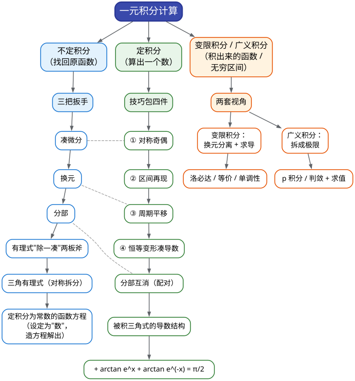

# CMC 手把手精讲
## ——《05 一元积分计算》：从"凑微分"到"定积分为常数"

> 🐱 喵～欢迎来到第 05 篇。03 篇你学会了"把函数拆开求导"，这一篇要做的是**把整件事反过来**：已知导数，倒着找回原函数；再进一步，把"积出来的一整块"当成一个数或一个函数来耍。一句话预告：**积分计算不是"背公式比赛"，而是一场"把不认识的积分变形成认识的积分"的变形游戏**——这一篇就是把全部变形招式交到你手上。
>
> **本篇在考试中的地位**（数据口径：已核对的第 10–17 届非数学类/非数学 A 类官方卷）：
> - 一元函数积分学每套卷直接贡献约 **20–34 分**——近三届 A 卷实点：15 届 28 分、16 届 ≥6 分、17 届 34 分，是名副其实的**第一梯队重仓板块**；
> - **填空**：近 6 届几乎每届 1 道积分小题（16 届 A 卷填空 1 是纯计算 $`\int_0^1\ln(1+x^2)\,\mathrm{d}x`$，17 届 A 卷填空 3 是变限积分求极限）——6 分的"白给题"，目标是零失误；
> - **大题**：17 届 A 卷解答二（14 分）是「**定积分为常数的函数方程**」原题模板（本系列 S10 考点），这类题步骤极度模板化，是"性价比之最"；此外 15 届五、17 届六、13 届五等积分证明大题的第一段都要靠本篇的计算功底起步；
> - **隐藏价值**：积分计算是重积分（10 篇）、曲线曲面积分（11 篇）、级数（12 篇）、微分方程（07 篇）的**共同底座**——这块手生了，卷面后半段会连环漏水。
>
> **大纲对应条目**（《全国大学生数学竞赛考试内容》非数学专业类·一元函数积分学，原文摘录）：
> - 条目 (1)(2)：原函数和不定积分的概念；不定积分的基本性质、基本积分公式；
> - 条目 (3)：定积分的概念和基本性质、**定积分中值定理**、**变上限定积分确定的函数及其导数**、**Newton-Leibniz 公式**；
> - 条目 (4)：不定积分和定积分的**换元积分法与分部积分法**；
> - 条目 (5)：有理函数、三角函数的有理式和简单无理函数的积分；
> - 条目 (6)：**广义积分**。
>
> **先修提示**：本篇默认你已看过 **01 篇**（等价无穷小/泰勒/洛必达——变限积分求极限会直接调用）和 **03 篇**（变限积分求导公式）。如果 03 篇还没看，先把"变限积分求导的链式法则"补上（10 分钟，本系列 03 篇 §3 有专节）。
>
> **预计学时**：2–3 天（对应总纲第 2 周 D8–D10）。第一天：§二 + §3.1–3.6（恢复期，重点练凑微分与技巧包）；第二天：§3.7–3.10 + 精讲 1–5；第三天：精讲 6–10 + 易错点清单 + 自测题，最后把 17 届二（定积分为常数）完整重做两遍。
>
> 阅读建议：
> 1. 先花 3 分钟扫一遍 §1.2 速查表——这张表回答"**看到什么题面，动用什么武器**"，比任何公式都值钱；
> 2. 积分的手感只能"练"出来，不能"看"出来——所有标了 ✍️ 的地方必须真的动笔；
> 3. 每个方法小节按【适用信号】→【步骤】→【关键公式】→【真题微型例子】展开，时间紧就只读【适用信号】；
> 4. §四 的 10 道真题精讲，"思路分析"（真实的试错过程）比解答本身更值得读——先自己卡 2 分钟再看。
>
> 符号说明：📌 重点 | 💡 直觉/类比 | ⚠️ 易错点 | ✍️ 动笔练一练 | ❓ 自测题 | 🎯 考试定位 | ⏱️ 省时技巧

---

# 一、本篇地图

## 1.1 目录（读之前先看这张施工图）

- **§二 知识讲解**：积分是什么（导数表的逆查）→ 基本积分表的正确背法 → 三把扳手是怎么"长"出来的（凑微分=链式法则倒着用、换元=把复合结构拉直、分部=乘积法则倒着用）→ 定积分为什么能"变简单"（对称/周期的面积直觉）→ 变限积分：微积分基本定理两个方向的直觉 → 广义积分：无穷与瑕点的"拆极限"哲学
- **§三 方法手册**：3.1 凑微分 | 3.2 分部积分 | 3.3 换元（根式/三角/隐函数参数化）| 3.4 有理函数"除—凑"两板斧 | 3.5 三角有理式 | 3.6 定积分技巧包（区间再现/对称奇偶/周期平移/恒等变形凑导数）| 3.7 变限积分函数 | 3.8 定积分为常数的函数方程 | 3.9 广义积分 | 3.10 分段、绝对值、取整与积分递推
- **§四 真题精讲**：10 道完整精讲（16 届填 1、10 届填 3、9 届填 5、11 届填 2、13 补填 2、5 届二、6 届二、11 届填 3、4 届二、17 届大二）
- **§五 易错点清单**：13 条 ❌→✅ 对照
- **§六 自测题**：7 道，附完整答案
- **§七 结语**："积分计算防身八句话" + 学习建议 + 06 篇预告

## 1.2 方法速查表：什么题面 → 用什么武器（一屏版）

| 题面长相（信号） | 首选武器 | 说明 / 升级路线 |
|---|---|---|
| 被积式能看成 $`f(u(x))\,u'(x)`$ 的形状（如 $`e^{\sin x}\cos x\,\mathrm{d}x`$、$`\dfrac{2x\,\mathrm{d}x}{1+x^2}`$） | **凑微分** | 把 $`u'(x)\,\mathrm{d}x`$ 圈成 $`\mathrm{d}u`$，再看剩下的部分是谁的原函数；"凑不动"就换元 |
| 根式：$`\sqrt{a^2-x^2}`$、$`\sqrt{x^2+a^2}`$、$`\sqrt{x}`$ 与 $`\sqrt[3]{x}`$ 混排 | **换元**（三角换元 / 根式整体 $`t=\sqrt[6]{x}`$） | 三角换元消根号；混杂根式取根指数最小公倍数 |
| 隐函数给出的 $`y(x)`$（如 $`y^2(x-y)=x^2`$） | **参数化换元**（令 $`y=tx`$） | 把 $`x,y`$ 都写成 $`t`$ 的函数，$`\int f(x,y)\,\mathrm{d}x`$ 化为有理积分 |
| $`\ln`$、$`\arctan`$、反三角单独出现，或与幂函数相乘 | **分部积分** | 选 $`u`$ 顺序"**反、对、幂、指、三**"；单个 $`\ln`$ 单独出现就把 $`\mathrm{d}x`$ 当 $`\mathrm{d}v`$ |
| $`e^{ax}\sin bx`$、$`\sec^3x`$ 这类"求导后还像自己"的积分 | **分部 + 解方程（循环法）** | 分部两次回到原积分，移项除以系数 |
| 定积分区间是 $`[0,\pi/2]`$、$`[0,\pi]`$ 且被积函数含 $`\sin,\cos`$ 对称组合（如分母 $`1+\tan x`$） | **区间再现** | 换元 $`x\to a+b-x`$ 得 $`I`$ 的第二个表达式，两式相加/相减消难点 |
| 积分区间对称 $`[-a,a]`$，式中出现 $`\arctan e^x`$、$`e^x`$、$`x^k\sin x`$ 等 | **对称分解** | $`\int_{-a}^{a}f=\int_0^{a}[f(x)+f(-x)]\,\mathrm{d}x`$；常备恒等式 $`\arctan e^x+\arctan e^{-x}=\dfrac{\pi}{2}`$ |
| 被积含 $`\lvert\sin x\rvert`$、周期因子，或积分限跨多个周期 | **周期平移 / 分段求和** | 每个周期算一遍得公比级数；$`\int_{a}^{a+T}f=\int_{0}^{T}f`$ |
| 被积式看起来"没有初等原函数"，但含 $`e^x`$ 或三角分式（如 $`\dfrac{1+\sin x}{1+\cos x}`$） | **恒等变形凑导数** | 把三角式化成 $`\varphi(x)`$，使 $`[e^x\varphi(x)]'`$ 恰是（或恰能配成）被积函数 |
| 与 $`\ln(x+\sqrt{1+x^2})`$、$`\arctan x`$ 搭配的分式积不出"明显形状" | **配对凑微分**（先把分式凑成某个 $`v`$ 的微分） | 如 $`\dfrac{\mathrm{d}x}{(1+x^2)^{3/2}}=\mathrm{d}\Big(\dfrac{x}{\sqrt{1+x^2}}\Big)`$，再分部 |
| 方程里夹着 $`\int_a^b f`$、$`\lim\dfrac{f(x)}{x}`$ 等**与 $`x`$ 无关的量** | **设常数解方程**（S10 模板） | 把常数设成 $`A,B`$，再取极限/两边积分造方程组解出 |
| $`\int_0^{+\infty}`$、$`\int_{0}^{1}\dfrac{\mathrm{d}x}{\sqrt{x}}`$ 等，或区间内有被积函数的瑕点 | **广义积分三步**（识瑕点→拆极限→判敛/求值） | 先判敛散再求值；$`p`$ 积分两支结论是判敛标尺 |
| 极限式里含变限积分 $`\int_0^{\varphi(x)}f`$ | **变限积分求导 + 01 篇三件套** | 上限是函数先套链式；被积函数含参先换元分离 |
| 积分号内外同时出现 $`n`$（如 $`n\int_1^a\dfrac{\mathrm{d}x}{1+x^n}`$） | **换元把 $`n`$ 挪进参数** | 详见 06 篇 §3.7"积分序列"专节（本篇管计算、06 篇管序列与估计） |

## 1.3 知识树：本篇全部内容的骨架



一句话总结这张图：**不定积分靠"三把扳手"（凑微分、换元、分部），定积分在扳手之上再加"技巧包"（对称、再现、周期、凑导数），变限积分与广义积分则是"把积分当函数、把积分当极限"的两种高级视角。**再补一句考试黑话：**"拆"与"凑"是积分计算的两大母题**——一切化简都在把式子拆成能算的块，或凑成能看出的微分。

---

# 二、知识讲解：积分是"求导的逆运算"，三把扳手从哪来？

## 2.1 积分是什么：导数表的"逆查"

先回忆 03 篇：求导是一门"把函数变简单"的手艺——$`x^3`$ 求导得 $`3x^2`$，$`\sin x`$ 求导得 $`\cos x`$。积分要做的事恰好相反：**给你一个导数，倒着找回它"本来是谁"**。

> 如果 $`F'(x)=f(x)`$，就称 $`F(x)`$ 是 $`f(x)`$ 的一个**原函数**，记
>
> ```math
> \int f(x)\,\mathrm{d}x=F(x)+C.
> ```
>
> 右边那个 $`+C`$ 是**任意常数**，符号 $`\int`$ 和 $`\mathrm{d}x`$ 一起读作"对 $`x`$ 求全部原函数"。

💡 **打比方（还是写给写代码的你）**：求导像**哈希**——信息压缩，多个输入可能撞到同一个输出（$`x^2`$、$`x^2+1`$、$`x^2+\pi`$ 求导全是 $`2x`$）。积分像**反哈希**——只能还原出"等价类"：$`\int 2x\,\mathrm{d}x=x^2+C`$，那个 $`C`$ 就是无法从导数里恢复的"丢失信息"。所以**不定积分的答案永远带着 $`C`$**；而**定积分** $`\int_a^b f(x)\,\mathrm{d}x=F(b)-F(a)`$ 里 $`C`$ 相减抵消，答案是一个**干干净净的数**。这就是"不定"与"定"的分界：一个输出函数族，一个输出数值。

📌 **两条基本事实**（后面天天用）：

1. **求导与积分互相撤销**：$`\dfrac{\mathrm{d}}{\mathrm{d}x}\displaystyle\int_a^x f(t)\,\mathrm{d}t=f(x)`$（先积后导，还原），$`\displaystyle\int_a^x F'(t)\,\mathrm{d}t=F(x)-F(a)`$（先导后积，还原到差一个常数）。
2. **积分是"线性"的**：$`\int[\alpha f+\beta g]\,\mathrm{d}x=\alpha\int f\,\mathrm{d}x+\beta\int g\,\mathrm{d}x`$——**加减可以拆，乘除不能拆**（这是与极限"拆分纪律"同款的警告，见 §五 易错点⑧）。

💡 讲一个几何直觉，后面讲技巧包时全靠它：定积分 $`\int_a^b f(x)\,\mathrm{d}x`$ 就是"曲线与 $`x`$ 轴之间的**带符号面积**"（$`x`$ 轴上方为正、下方为负）。所有"对称性化简"的本质，都是**面积之间的相互抵消或翻倍**。

## 2.2 基本积分表：一条"逆查法则"省一半记忆

很多同学怕积分，是被"积分公式表太长"吓住了。其实**没有一个公式需要单独背**——它们全部是导数公式反着念。比如：

- 导数表里有 $`(\sin x)'=\cos x`$，逆着念：$`\displaystyle\int\cos x\,\mathrm{d}x=\sin x+C`$；
- 有 $`(x^{n+1})'=(n+1)x^n`$，逆着念：$`\displaystyle\int x^n\,\mathrm{d}x=\dfrac{x^{n+1}}{n+1}+C\ (n\ne-1)`$——那个分母 $`n+1`$ 是"配平系数"配出来的；
- 唯一"逆查不到"的是 $`n=-1`$：因为 $`(x^0)'=0`$ 不是 $`x^{-1}`$。它的原函数得另找：$`\displaystyle\int\dfrac{\mathrm{d}x}{x}=\ln\lvert x\rvert+C`$（验证：$`(\ln\lvert x\rvert)'=\dfrac{1}{x}`$）。

📌 **基本积分表（考场默认全部背熟，建议直接默写）**：

```math
\int x^n\,\mathrm{d}x=\frac{x^{n+1}}{n+1}+C\ (n\ne-1),\qquad \int\frac{\mathrm{d}x}{x}=\ln\lvert x\rvert+C,
```

```math
\int e^x\,\mathrm{d}x=e^x+C,\qquad \int a^x\,\mathrm{d}x=\frac{a^x}{\ln a}+C\ (a>0,\ a\ne1),
```

```math
\int\sin x\,\mathrm{d}x=-\cos x+C,\qquad \int\cos x\,\mathrm{d}x=\sin x+C,
```

```math
\int\sec^2x\,\mathrm{d}x=\tan x+C,\qquad \int\frac{\mathrm{d}x}{1+x^2}=\arctan x+C,\qquad \int\frac{\mathrm{d}x}{\sqrt{1-x^2}}=\arcsin x+C,
```

```math
\int\frac{\mathrm{d}x}{\cos x}=\ln\lvert\sec x+\tan x\rvert+C,\qquad \int\frac{\mathrm{d}x}{\sin x}=\ln\lvert\csc x-\cot x\rvert+C,
```

```math
\int\frac{\mathrm{d}x}{a^2+x^2}=\frac{1}{a}\arctan\frac{x}{a}+C,\qquad \int\frac{\mathrm{d}x}{\sqrt{x^2\pm a^2}}=\ln\big\lvert x+\sqrt{x^2\pm a^2}\big\rvert+C,
```

```math
\int\frac{\mathrm{d}x}{x^2-a^2}=\frac{1}{2a}\ln\Big\lvert\frac{x-a}{x+a}\Big\rvert+C,\qquad \int e^{ax}\sin bx\,\mathrm{d}x=\frac{e^{ax}(a\sin bx-b\cos bx)}{a^2+b^2}+C.
```

最后一条不必背——<strong>知道它"必须有这个形状"</strong>就行（它是"循环法"的成品，见 §3.2；考场上现推一遍只要 30 秒）。

📌 **凑微分四式**（把常见导数"倒着念"，是凑微分的最小弹药库）：

```math
\mathrm{d}(ax+b)=a\,\mathrm{d}x,\qquad x\,\mathrm{d}x=\frac{1}{2}\mathrm{d}(x^2),\qquad \frac{\mathrm{d}x}{x}=\mathrm{d}(\ln x),
```

```math
\frac{\mathrm{d}x}{\sqrt{x}}=2\,\mathrm{d}(\sqrt{x}),\qquad \frac{\mathrm{d}x}{x^2}=-\mathrm{d}\Big(\frac{1}{x}\Big),\qquad e^x\,\mathrm{d}x=\mathrm{d}(e^x),
```

```math
\cos x\,\mathrm{d}x=\mathrm{d}(\sin x),\qquad \frac{\mathrm{d}x}{1+x^2}=\mathrm{d}(\arctan x),\qquad \frac{2x\,\mathrm{d}x}{1+x^2}=\mathrm{d}\big(\ln(1+x^2)\big).
```

💡 用法演示：$`\displaystyle\int\frac{2x}{1+x^2}\,\mathrm{d}x`$。你把 $`2x\,\mathrm{d}x`$ 圈成 $`\mathrm{d}(1+x^2)`$，整个积分立刻变成 $`\displaystyle\int\frac{\mathrm{d}u}{u}=\ln\lvert u\rvert+C=\ln(1+x^2)+C`$。**"凑"的全部动作，就是把被积式里的某一块（连同 $`\mathrm{d}x`$）改写成一个整体的微分。**

## 2.3 三把扳手是怎么"长"出来的

课本上"换元法、分部积分法"是分开列的，但它们的来源只有一句话：**求导法则倒着用**。你把 03 篇的三大求导法则（链式、乘积、四则）反过来念，就得到积分的三把扳手：

### （1）凑微分 ← 链式法则倒着用

链式法则说：$`\dfrac{\mathrm{d}}{\mathrm{d}x}F(u(x))=F'(u(x))\,u'(x)`$。两边同时"积分"（撤销求导）：

```math
\int F'(u(x))\,u'(x)\,\mathrm{d}x=F(u(x))+C\quad\Longleftrightarrow\quad \int f(u)\,\mathrm{d}u=F(u)+C\ \ (f=F').
```

翻译成人话：**只要被积式里含有"某个整体 $`u`$ 的微分" $`u'(x)\,\mathrm{d}x`$，就可以把它打包成 $`\mathrm{d}u`$，整个积分变成对 $`u`$ 的、最简单的积分。**这就是凑微分，也是**一切积分技巧里出现频率最高的一招**（真题统计里"换元积分法"与"分部积分法"是出现频率最高的两个解题方法）。

### （2）换元 ← 把"复合结构"拉直

凑微分是"看见 $`u'`$ 才凑"，如果被积式里根本没有现成的 $`u'`$ 呢？那就**主动设一个新变量 $`t`$**，强制把结构拉直。最典型的是根式：$`\sqrt{1-x^2}`$ 里 $`x`$ 和根号纠缠不清，但令 $`x=\sin t`$，根号就化为 $`\cos t`$——**根号消失，只剩下三角函数的整式**。

📌 **定积分换元的铁律**：**换元必须同时换限**。$`\displaystyle\int_a^b f(x)\,\mathrm{d}x\ \xrightarrow{\ x=\varphi(t)\ }\ \int_{\alpha}^{\beta} f(\varphi(t))\,\varphi'(t)\,\mathrm{d}t`$，其中 $`\varphi(\alpha)=a`$，$`\varphi(\beta)=b`$。算出原函数后**直接代入新的限**，永远不要"回代旧变量再代限"。反过来，**不定积分换元后必须回代**（把 $`t`$ 换回 $`x`$，因为你最后要的是 $`x`$ 的函数）。

💡 这个不对称是初学者最大的困惑来源，打个比方：**不定积分换元像"出国旅行但要回老家"**（换出去、玩一圈、换回来）；**定积分换元像"单程票"**（从 $`a,b`$ 直接换成 $`\alpha,\beta`$，一路到底不回头的）。考试里写错这个，一道 6 分填空直接归零。

### （3）分部积分 ← 乘积法则倒着用

乘积法则说：$`(uv)'=u'v+uv'`$。移项并对两边积分：

```math
uv'=(uv)'-u'v\quad\Longrightarrow\quad \int u\,\mathrm{d}v=uv-\int v\,\mathrm{d}u.
```

翻译成人话：**把被积式拆成"$`u`$ 乘 $`\mathrm{d}v`$"，求一次导把 $`u`$ 降级（变 $`\mathrm{d}u`$）、把 $`\mathrm{d}v`$ 升级（变 $`v`$），换到另一个积分里去**。它是"用一个更简单的积分替换原来的积分"。

什么时候值得换？只有两类剧情：

1. **相消型**：$`u`$（如 $`\ln x`$、$`\arctan x`$）求导后"降级"为有理函数，剩下那个积分恰好能算（如 $`\int x^n\ln x\,\mathrm{d}x`$）；
2. **循环型**：$`e^{ax}\sin bx`$ 这类——分部两次后"转回原积分"，得到一个关于 $`I`$ 的一次方程，移项解出。

📌 **选 $`u`$ 的口诀：反、对、幂、指、三**——反三角 > 对数 > 幂函数 > 指数 > 三角。排在前的当 $`u`$（拿来求导降级），排在后的当 $`\mathrm{d}v`$（拿来积分升级）。**为什么这么排**：$`\ln`$、$`\arctan`$ 求导变有理函数（大降级，赚）；$`e^x,\sin x`$ 积分后还是 $`e^x,\sin x`$（不亏）；而幂函数求导次数减一，若干次后归零。排在前面的"更值得被求导"。

✍️ **动笔练一练（类型题·仿竞赛风格）**：$`\displaystyle\int x\ln x\,\mathrm{d}x`$。按"反对幂指三"，$`u=\ln x`$、$`\mathrm{d}v=x\,\mathrm{d}x`$，于是 $`\mathrm{d}u=\dfrac{\mathrm{d}x}{x}`$、$`v=\dfrac{x^2}{2}`$：

```math
\int x\ln x\,\mathrm{d}x=\frac{x^2}{2}\ln x-\int\frac{x^2}{2}\cdot\frac{\mathrm{d}x}{x}=\frac{x^2}{2}\ln x-\frac{x^2}{4}+C.
```

（验算：右边求导 $`=x\ln x+\dfrac{x}{2}-\dfrac{x}{2}=x\ln x`$ ✓。**积分题永远可以用"求导回去"自检，这是你考场上最便宜的安全网。**）

## 2.4 定积分为什么能"变简单"：三种"面积重排"

不定积分是"变形比赛"，定积分比它多一层游戏规则——**积分区间和积分限参与了游戏**。于是出现了三种"不算而算"的魔法，它们的本质全都是**面积的重排**：

**（1）对称性**：区间 $`[-a,a]`$ 上，$`x`$ 轴上下两块面积要不要抵消，就看被积函数的奇偶：

```math
\int_{-a}^{a}f(x)\,\mathrm{d}x=\begin{cases}0, & f\ \text{为奇函数},\\[4pt] 2\displaystyle\int_0^{a}f(x)\,\mathrm{d}x, & f\ \text{为偶函数}.\end{cases}
```

更常用的是"**逐点合并**"版本（区间对称但函数既不奇也不偶时）：

```math
\int_{-a}^{a}f(x)\,\mathrm{d}x=\int_0^{a}\big[f(x)+f(-x)\big]\,\mathrm{d}x.
```

💡 它的威力在于：**"配对"之后经常发生奇迹**。经典例子：$`\arctan e^x+\arctan e^{-x}=\dfrac{\pi}{2}`$——因为 $`e^x\cdot e^{-x}=1`$，而 $`\arctan t+\arctan\dfrac{1}{t}=\dfrac{\pi}{2}\ (t>0)`$。凭空冒出的 $`e^x`$ 因子，被配对一挤就变成了常数 $`\dfrac{\pi}{2}`$（第 5 届第二题整道题就靠这一下翻盘，见精讲 6）。

**（2）区间再现**：对任意区间 $`[a,b]`$ 成立

```math
\int_a^bf(x)\,\mathrm{d}x=\int_a^bf(a+b-x)\,\mathrm{d}x.
```

💡 直觉：换元 $`x=a+b-x`$（关于区间中点做镜像），积分限不动、$`\mathrm{d}x`$ 变号与限的互换恰好抵消，所以**值不变、但被积函数"换了一副面孔"**。于是你可以把同一个 $`I`$ 写成两副面孔，**两式相加或相减**，把题面里最难缠的部分抵消掉。$`[0,\pi/2]`$ 上的三角有理式（分母含 $`1+\tan x`$、$`1+\cot x`$ 之类）是它的主场——第 13 届补赛填空 2 整道题就是这一招（精讲 5）。

**（3）周期平移**：若 $`f`$ 以 $`T`$ 为周期，则

```math
\int_a^{a+T}f(x)\,\mathrm{d}x=\int_0^{T}f(x)\,\mathrm{d}x\quad(\text{与起点 } a \text{ 无关}),\qquad \int_a^{a+nT}f=n\int_0^{T}f.
```

💡 直觉：**每个周期的"面积图案"完全相同**，起点挪到哪都一样。所以遇到 $`|\sin x|`$、$`\{\sin x\}`$、$`e^{-2x}|\sin x|`$ 这种"周期因子"，一律先切成一个个整周期，每个周期算一遍乘上去（精讲 9、精讲 7）。

🎯 **考试定位**：这三种技巧合起来构成 S9"定积分技巧包"，是近 6 届填空的常客（16 届填 1、13 届补填 2、5 届二、11 届填 3）。**判断该用哪一招的信号**：区间对称 → 想对称性；区间是 $`[0,\pi/2]`$ 或 $`[0,\pi]`$ 且被积是三角式 → 想再现；被积带周期或 $`|\cdot|`$ → 想周期平移。

## 2.5 变限积分：把"积分"当一个函数来看

前面两个视角都是"积分 = 一个数"或"积分 = 一族函数（含 $`C`$）"。变限积分打开第三个视角：**上限是变量，积分本身就是一个新函数**：

```math
\Phi(x)=\int_a^xf(t)\,\mathrm{d}t.
```

💡 **打比方**：$`\Phi(x)`$ 像"累积流水账"——$`f(t)`$ 是每时每刻的收入，$`\Phi(x)`$ 是"从 $`a`$ 时刻到 $`x`$ 时刻的累计收入"。收入是正的，账就涨；收入为负，账就跌。所以 $`\Phi'(x)=f(x)`$ 在直觉上毫无悬念：**账本涨得快慢，恰是当下这一刻的收入**。

📌 **微积分基本定理（两个方向，都要刻进肌肉）**：

```math
\text{方向一：}\quad\frac{\mathrm{d}}{\mathrm{d}x}\int_a^{\varphi(x)}f(t)\,\mathrm{d}t=f\big(\varphi(x)\big)\,\varphi'(x);
```

```math
\text{方向二：}\quad\int_a^bF'(x)\,\mathrm{d}x=F(b)-F(a)\quad(\text{Newton-Leibniz 公式}).
```

方向一的三个使用要点：① **上限是函数 $`\varphi(x)`$ 时，链式因子 $`\varphi'(x)`$ 不能丢**（这是失分第一名，17 届填 3 的官方解答里那一项 $`2\sin x\cos x`$ 就是它）；② **上下限都是函数时，= 上限项 − 下限项**（下限也带自己的链式因子）；③ **被积函数里藏着 $`x`$ 时（如 $`\int_0^xf(x-t)\,\mathrm{d}t`$），先换元把 $`x`$ 从被积函数里"请出去"**，再求导。

⚠️ 第 ③ 条是重灾区：$`\displaystyle\int_0^xf(x-t)\,\mathrm{d}t`$ 里的 $`x`$ 是"包裹"在被积函数里的，直接求导什么也得不到。正确动作：换元 $`u=x-t`$，它变成 $`\displaystyle\int_0^xf(u)\,\mathrm{d}u`$——现在 $`x`$ 只在上限里了，求导畅通无阻。**口诀：变量进了被积函数，先换元再求导。**

**变限积分题的三种出场方式**（近 8 届全出现过）：

1. **求导**：得 $`\Phi'(x)`$ 后讨论单调性、极值、零点（13 届补赛第二题就是：把 $`f(x)`$ 里的 $`|x-t|`$ 积分拆开算出显式，再求导判单调、用零点定理数根）；
2. **求极限**：$`\dfrac{0}{0}`$ 型 + 洛必达 + 等价无穷小（17 届填 3、13 届填 3，01 篇已精讲，本篇 §3.7 给完整模板）；
3. **求导后与原函数"合体"**：$`\Phi`$ 满足某个微分方程或恒等式（如 $`\Phi`$ 与 $`f`$ 的混合式）——07 篇 ODE 的"隐藏型"识别素材。

## 2.6 广义积分：无穷与瑕点，都"拆成极限"

```math
\int_a^{+\infty}f(x)\,\mathrm{d}x:=\lim_{b\to+\infty}\int_a^{b}f(x)\,\mathrm{d}x
```

——**定义本身就是"拆成极限"**。同样地，如果被积函数在 $`c`$ 处趋于无穷（瑕点），就把 $`\int_a^bf`$ 拆成 $`\int_a^c+\int_c^b`$，每段各自取极限。**记住这个哲学：广义积分世界里，没有"整体一算"，只有"先拆开、再各自取极限"。**

📌 **两条判敛标尺（$`p`$ 积分）**，比什么都好使：

```math
\int_1^{+\infty}\frac{\mathrm{d}x}{x^p}\ \text{收敛}\iff p>1;\qquad \int_0^{1}\frac{\mathrm{d}x}{x^p}\ \text{收敛}\iff p<1.
```

💡 为什么两头相反？无穷远处要求"衰减足够快"（$`p`$ 大才压得住）；瑕点处要求"爆炸足够慢"（$`p`$ 小才积得起来）。记法：**"大的压小的、小的怕大的"**——不，更顺口的记法是画图：$`\int_1^\infty`$ 是尾巴，尾巴要细（$`p>1`$）；$`\int_0^1`$ 是尖峰，尖峰要钝（$`p<1`$）。

**两个常备结论（考场上可以直接引用，但请顺手核对题面有没有给）**：

```math
\int_0^{+\infty}\frac{\sin x}{x}\,\mathrm{d}x=\frac{\pi}{2}\quad(\text{Dirichlet 积分}),\qquad \int_0^{+\infty}e^{-sx}x^n\,\mathrm{d}x=\frac{n!}{s^{n+1}}\ (s>0).
```

处理广义积分题的**三步套路**：

1. **找端点毛病**：区间有没有无穷？被积函数在端点/内部有没有瑕点？两个都可能是"瑕疵"的来源；
2. **真拆极限**：每个毛病单独拆开写 $`\lim`$，**绝不允许"把无穷直接代进上下限"糊弄过去**（书写规范是评分点）；
3. **判敛 or 求值**：能求原函数的直接求值（如 $`\int_0^{+\infty}e^{-2x}|\sin x|\,\mathrm{d}x`$，先按周期分段求和）；求出不来的用比较判别配 $`p`$ 积分定性。

⚠️ 一个高频陷阱：**收敛 $`\ne`$ 绝对收敛**。$`\int_0^{+\infty}\dfrac{\sin x}{x}\,\mathrm{d}x`$ 收敛但是条件收敛（取绝对值后按周期分段，每段贡献 $`\ge\dfrac{2}{(k+1)\pi}`$，加起来是发散的调和级数——这正是第 5 届一(2) 的证明思路）。题面如果问"敛散性"而答案涉及条件收敛，**必须把"收敛 + 非绝对收敛"两半都写出来**，只写一半扣一半分。

---

# 三、方法手册：十套武器，见招拆招

每个方法按统一格式展开：【适用信号】→【步骤】→【关键公式】→【真题微型例子】。再重复那句老话：**"你缺的不是方法，而是什么时候用它"**——【适用信号】永远比公式更值得花时间。

## 3.1 凑微分

**【适用信号】** 被积式能"看出"某个整体的微分：出现 $`\dfrac{u'(x)}{u(x)}`$（配 $`\ln`$）、$`u'(x)e^{u(x)}`$（配 $`e^u`$）、$`\dfrac{u'(x)}{1+u^2}`$（配 $`\arctan u`$）、$`u'(x)\sin u`$ 等标准形状；被积式与某函数的导数"长得像"（含 $`e^x`$ 与三角分式相乘时，先猜它是不是 $`[e^x\varphi(x)]'`$）。

**【步骤】**
1. 在脑内做填空题：把式子里哪一块写成 $`\mathrm{d}u`$ 后，剩下的部分能变简单？——常见候选：$`2x\,\mathrm{d}x\to\mathrm{d}(x^2)`$、$`\dfrac{\mathrm{d}x}{x}\to\mathrm{d}(\ln x)`$、$`\sec^2x\,\mathrm{d}x\to\mathrm{d}(\tan x)`$；
2. 换掉后得到 $`\int g(u)\,\mathrm{d}u`$ 的干净形式，套基本积分表；
3. 不定积分**回代 $`u\to u(x)`$**；定积分**同步换限**；
4. 卡住时看**导数结构**：被积式如果是 $`A'\cdot B+A\cdot B'`$ 的形状，立刻认出它是 $`(AB)'`$（"凑导数"高级形态，见 3.6 第 4 件）。

**【关键公式】** 凑微分四式（§2.2）+ 连锁凑：$`\dfrac{f'(x)}{f(x)}\mathrm{d}x=\mathrm{d}\big(\ln\lvert f(x)\rvert\big)`$。

**【真题微型例子】**（类型题·仿竞赛风格，与真题同难度）$`\displaystyle\int\frac{\mathrm{d}x}{x\ln x}`$。
信号：$`\dfrac{\mathrm{d}x}{x}`$ 就是 $`\mathrm{d}(\ln x)`$。直接凑：

```math
\int\frac{\mathrm{d}x}{x\ln x}=\int\frac{\mathrm{d}(\ln x)}{\ln x}=\ln\lvert\ln x\rvert+C.
```

> 手感要点：**"看到 $`\dfrac{\mathrm{d}x}{x}`$ 就凑 $`\ln`$"**——这一招穿在 $`\int\dfrac{\mathrm{d}x}{x\ln x\ln\ln x}`$ 等"套娃"题上也一路通吃。第 9 届一(5)（精讲 3）是它的"真题完全体"：被积式含 $`e^{-\sin x}`$ 与 $`\sin 2x`$，换 $`t=\sin x`$ 后恰好凑出 $`\left(\dfrac{e^{-t}}{1-t}\right)'`$。

## 3.2 分部积分

**【适用信号】** 被积式是"两类函数的乘积"且它们的"类型"不同（幂×指、幂×三、幂×反三角、指×三）；单个 $`\ln`$、$`\arctan`$、$`\arcsin`$、$`\mathrm{arcsec}`$ 出现（**单独出现也上分部**：把 $`\mathrm{d}x`$ 当 $`\mathrm{d}v`$）；$`\int f^{2}`$、$`\int xf'(x)`$、$`\int \varphi(x)\psi'(x)`$ 的抽象记号组合（见 06 篇：分部积分是积分恒等式证明的第一板斧）。

**【步骤】**
1. **选 $`u`$ 与 $`\mathrm{d}v`$**：口诀"反、对、幂、指、三"——排前者当 $`u`$（求导降级）；
2. 求 $`\mathrm{d}u`$、$`v`$（$`v`$ 可以**不加常数**，选最简单的原函数）；
3. 代入 $`\int u\,\mathrm{d}v=uv-\int v\,\mathrm{d}u`$，检查新积分是否更简单；
4. **新积分还不行就再来一次**；两次后转回原积分就是"循环型"，移项解出（见下面公式）；与常数项有关的递推（$`I_n`$ 与 $`I_{n-1}`$）则记下递推式逐步下推。

**【关键公式】**

```math
\int u\,\mathrm{d}v=uv-\int v\,\mathrm{d}u,
```

```math
\text{循环型结论：}\quad\int e^{ax}\sin bx\,\mathrm{d}x=\frac{e^{ax}(a\sin bx-b\cos bx)}{a^2+b^2}+C\quad(\text{自己推，别硬背}).
```

**【真题微型例子】**（第 2 届非数学类·填空第 3 题，2010）设 $`s>0`$，求 $`I_n=\displaystyle\int_0^{+\infty}e^{-sx}x^n\,\mathrm{d}x\ (n=1,2,\cdots)`$。
信号：幂 × 指数 → 分部**递推**。官方解法（一次分部完成降幂）：

```math
I_n=-\frac{1}{s}\int_0^{+\infty}x^n\,\mathrm{d}\big(e^{-sx}\big)=-\frac{1}{s}\Big[x^ne^{-sx}\Big|_0^{+\infty}-n\int_0^{+\infty}e^{-sx}x^{n-1}\,\mathrm{d}x\Big]=\frac{n}{s}I_{n-1},
```

（边界项 $`x^ne^{-sx}\to0`$：指数衰减快于幂增长，这正是 $`s>0`$ 的用处。）递推下推到底 $`I_0=\dfrac{1}{s}`$，得

```math
I_n=\frac{n}{s}\cdot\frac{n-1}{s}\cdots\frac{1}{s}\cdot\frac{1}{s}=\frac{n!}{s^{n+1}}.
```

> 这道题的骨架"**分部一次 → 出现 $`I_{n-1}`$ → 递推到底 → 代入初值**"就是**积分递推题**的通用模板（Wallis 型 $`\int_0^{\pi/2}\sin^nx\,\mathrm{d}x`$、$`\int_0^{\pi/4}\tan^nx\,\mathrm{d}x`$ 全是同一套路：分部/区间变换造出 $`I_n`$ 与 $`I_{n-2}`$ 的关系）。⏱️ 目标用时：**3 分钟**。

## 3.3 换元（根式 / 三角 / 隐函数参数化）

**【适用信号】** 被积式含 $`\sqrt{a^2-x^2}`$、$`\sqrt{x^2+a^2}`$、$`\sqrt{x^2-a^2}`$（三角换元消根号）；含 $`\sqrt{x}`$ 与 $`\sqrt[3]{x}`$ 混排（取 $`t=\sqrt[6]{x}`$ 一把清）；函数由**隐函数**给出（$`y^2(x-y)=x^2`$ 之类，令 $`y=tx`$ 参数化）；被积式里有 $`x`$ 与 $`\dfrac{1}{x}`$ 同时出现（试 $`t=x\pm\dfrac{1}{x}`$）。

**【步骤】**
1. **选换元**（三选一）：三角换元 $`x=a\sin t`$ / $`x=a\tan t`$ / $`x=a\sec t`$；根式整体（$`t=\sqrt[6]{x}`$、$`t=\sqrt{1-x}`$）；结构换元（$`t=x\pm\dfrac{1}{x}`$、$`t=\sqrt{\dfrac{x-a}{x-b}}`$）；
2. 全套替换：**被积函数、$`\mathrm{d}x`$、积分限**（定积分）三件套一起换；
3. 化成有理函数或基本三角积分后算；
4. **不定积分记得回代**；定积分直接代新限。

**【关键公式】** 三角换元对照表：

| 根式形状 | 换元 | 换完的根号 |
|---|---|---|
| $`\sqrt{a^2-x^2}`$ | $`x=a\sin t`$ | $`a\cos t`$ |
| $`\sqrt{a^2+x^2}`$ | $`x=a\tan t`$ | $`a\sec t`$ |
| $`\sqrt{x^2-a^2}`$ | $`x=a\sec t`$ | $`a\tan t`$ |

**【真题微型例子 1】**（第 7 届非数学类·填空第 5 题，2015）设区间 $`(0,+\infty)`$ 上的函数 $`u(x)`$ 定义为 $`u(x)=\displaystyle\int_0^{+\infty}e^{-xt^2}\,\mathrm{d}t`$，则 $`u(x)`$ 的初等函数表达式为 ______。
信号：被积函数 $`e^{-xt^2}`$ 里的参数 $`x`$ 让人讨厌——**换元把 $`x`$ 挪出去**。令 $`t=\dfrac{s}{\sqrt{x}}`$（$`x>0`$）：

```math
u(x)=\frac{1}{\sqrt{x}}\int_0^{+\infty}e^{-s^2}\,\mathrm{d}s=\frac{1}{\sqrt{x}}\cdot\frac{\sqrt{\pi}}{2}=\frac{\sqrt{\pi}}{2\sqrt{x}}.
```

（用了 Poisson 积分 $`\int_0^{+\infty}e^{-s^2}\,\mathrm{d}s=\dfrac{\sqrt{\pi}}{2}`$——它的证明在 10 篇重积分里给：平方后转二重积分、极坐标一算就出来。）转录的参考解答（该卷为公众号流传版、非官方发布）则是把 $`u^2(x)`$ 写成二重积分、直接极坐标算出 $`\dfrac{\pi}{4x}`$，与本解同款结论。
> **技巧点："被积函数里含参数 → 换元把它请出去"**——这个动作在变限积分求导（3.7）和含参积分序列（06 篇）里还会反复出现。

**【真题微型例子 2】**（第 1 届非数学类·第三题，2009，原题 15 分）设 $`f`$ 连续，$`g(x)=\displaystyle\int_0^1f(xt)\,\mathrm{d}t`$，且 $`\lim\limits_{x\to 0}\dfrac{f(x)}{x}=A`$，求 $`g'(x)`$ 并讨论 $`g'(x)`$ 在 $`x=0`$ 处的连续性。
信号：$`f(xt)`$ 是"包裹型"（参数 $`x`$ 藏在被积函数里）→ 三步模板。**第一步换元消包裹**：令 $`u=xt`$，

```math
g(x)=\frac{1}{x}\int_0^{x}f(u)\,\mathrm{d}u\quad(x\ne0),\qquad g'(x)=\frac{xf(x)-\int_0^xf(u)\,\mathrm{d}u}{x^2}\ (x\ne0).
```

**第二步用导数定义算 $`g'(0)`$**：由 $`\dfrac{f(x)}{x}\to A`$ 得 $`f(x)=Ax+o(x)`$，故 $`\int_0^xf(u)\,\mathrm{d}u=\dfrac{A}{2}x^2+o(x^2)`$，

```math
g'(0)=\lim_{x\to 0}\frac{g(x)-g(0)}{x}=\lim_{x\to 0}\frac{\int_0^xf(u)\,\mathrm{d}u}{x^2}=\frac{A}{2}.
```

**第三步验证连续性**：$`xf(x)=Ax^2+o(x^2)`$，代入 $`g'(x)`$ 的表达式得 $`g'(x)\to\dfrac{Ax^2-\frac{A}{2}x^2}{x^2}=\dfrac{A}{2}=g'(0)`$，故 $`g'(x)`$ 在 $`x=0`$ 处连续。
> 三步曲"**换元分离 → 定义求特值 → 极限验连续**"是「含参变限积分求导」的标准流水线。本题的官方解答（第 1 届参考解答）与上述完全一致。

## 3.4 有理函数的"除—凑"两板斧

**【适用信号】** 被积式是两个多项式的商（有理函数）：$`\dfrac{P(x)}{Q(x)}`$；或者**伪有理式**（含 $`e^x`$、$`\ln x`$ 但换元后变有理，如 $`t=e^x`$、$`t=\ln x`$）；**偶次对称型** $`\dfrac{x^2\pm1}{x^4+kx^2+1}`$（上下同除 $`x^2`$ 就"凑 $`d(x\pm\frac1x)`$"）。

**【步骤】**
1. **长除**：分子次数 ≥ 分母次数，先做多项式除法分出整式部分；
2. **部分分式**：真分式拆成 $`\dfrac{A}{x-a}+\dfrac{Bx+C}{x^2+px+q}`$ 的简单块（**竞赛题的因式一定拆得动**——拆不动说明你该走"凑"的路线）；
3. **凑 $`d(x\pm\frac1x)`$**（对称型专用）：式子是 $`\dfrac{x^2\pm1}{x^4+kx^2+1}`$ 的格式时，上下同除 $`x^2`$，令 $`u=x\mp\dfrac{1}{x}`$，注意 $`\mathrm{d}\Big(x+\dfrac{1}{x}\Big)=\Big(1-\dfrac{1}{x^2}\Big)\mathrm{d}x`$、$`\mathrm{d}\Big(x-\dfrac{1}{x}\Big)=\Big(1+\dfrac{1}{x^2}\Big)\mathrm{d}x`$——**分子是 $`x^2+1`$ 配 $`x-\dfrac{1}{x}`$；分子是 $`x^2-1`$ 配 $`x+\dfrac{1}{x}`$，方向别记反**；
4. 回代。

**【关键公式】** $`\displaystyle\int\frac{\mathrm{d}u}{u^2+a^2}=\frac{1}{a}\arctan\frac{u}{a}+C`$；长除恒等式 $`\dfrac{P}{Q}=R+\dfrac{P_1}{Q}`$。

**【真题微型例子】**（类型题·仿竞赛风格，经典格式）$`\displaystyle\int\frac{x^2+1}{x^4+1}\,\mathrm{d}x`$。
信号：$`x^4+1`$ 拆不动（有理数域上无一次因式），但它是**偶次对称型**——上下同除 $`x^2`$：

```math
\int\frac{x^2+1}{x^4+1}\,\mathrm{d}x=\int\frac{1+\dfrac{1}{x^2}}{x^2+\dfrac{1}{x^2}}\,\mathrm{d}x=\int\frac{\mathrm{d}\Big(x-\dfrac{1}{x}\Big)}{\Big(x-\dfrac{1}{x}\Big)^2+2}=\frac{1}{\sqrt{2}}\arctan\frac{x-\dfrac{1}{x}}{\sqrt{2}}+C.
```

> 三个动作：**除 $`x^2`$ → 认分子为 $`d\Big(x-\frac1x\Big)`$ → 配方用 $`\arctan`$ 公式**。对照题：把分子换成 $`x^2-1`$，则凑的方向相反（配 $`x+\dfrac{1}{x}`$，答案为 $`-\dfrac{1}{\sqrt2}\arctan\dfrac{x+\frac1x}{\sqrt2}+C`$ 或等价的对数形式）——**这对"孪生题"的设计就是专治方向记反的**。

## 3.5 三角有理式的三种处理

**【适用信号】** 被积式是 $`\sin x,\cos x`$ 的有理式（分子分母都是三角多项式的商）：$`\dfrac{1}{a\sin x+b\cos x}`$、$`\dfrac{1}{1+\sin x}`$、$`\dfrac{\sin x}{(1-\sin x)^2}`$ 等。

**【步骤（按优先级用，别一上来就万能代换）】**
1. **对称拆分 / 凑微分**（首选）：分子是分母的导数就直接凑 $`\ln`$；分子分母同除以 $`\cos^2x`$（或 $`\sin^2x`$）转化出 $`\sec^2x`$、$`\tan x`$ 结构；遇到 $`1\pm\sin x`$、$`1\pm\cos x`$ 用半角公式 $`\dfrac{1+\sin x}{1+\cos x}=\dfrac{1}{2}\sec^2\dfrac{x}{2}+\tan\dfrac{x}{2}`$ 之类的变形；
2. **倍角降幂**：$`\sin^2x=\dfrac{1-\cos 2x}{2}`$，$`\sin x\cos x=\dfrac{\sin 2x}{2}`$，把高次三角式降成一次；
3. **万能代换保底**：令 $`t=\tan\dfrac{x}{2}`$，则 $`\sin x=\dfrac{2t}{1+t^2}`$，$`\cos x=\dfrac{1-t^2}{1+t^2}`$，$`\mathrm{d}x=\dfrac{2\,\mathrm{d}t}{1+t^2}`$——**任何三角有理式都被它"格式化"成有理函数**，一定能算，但经常又长又丑。定位：**考场上别的路全堵死时的最后手段**（近十年 A 卷没有纯万能代换题，不要开局就用它）。

**【关键公式】**

```math
\int\sec x\,\mathrm{d}x=\ln\lvert\sec x+\tan x\rvert+C,\qquad \tan\frac{x}{2}\ \text{代换三件套（见上）}.
```

**【真题微型例子】**（类型题·仿竞赛风格）$`\displaystyle\int\frac{\cos x-\sin x}{\sin x+\cos x}\,\mathrm{d}x`$。
信号：**分子恰是分母的导数** $`(\sin x+\cos x)'=\cos x-\sin x`$——对称拆分的"送分格"：

```math
\int\frac{\cos x-\sin x}{\sin x+\cos x}\,\mathrm{d}x=\int\frac{\mathrm{d}(\sin x+\cos x)}{\sin x+\cos x}=\ln\lvert\sin x+\cos x\rvert+C.
```

> **顺手记住这个手感**：分子分母都是"$`\pm\sin\pm\cos`$"时，先给对方求一次导看看像不像分子。真题里的完全体是第 9 届一(5)（精讲 3）：换元后 $`\dfrac{te^{-t}}{(1-t)^2}`$ 恰好是 $`\left(\dfrac{e^{-t}}{1-t}\right)'`$ 的 2 倍——一模一样的思想。

## 3.6 定积分技巧包（四件套）

**【适用信号】** 被积函数的原函数"求不动"，或求出来巨丑，但**积分区间有特殊结构**（对称、$`[0,\pi/2]`$、跨周期）——题目的分就藏在区间里。

**【四件套清单】**

| 技巧 | 公式 | 触发信号 |
|---|---|---|
| ① 对称奇偶 | $`\int_{-a}^{a}f=\int_0^a[f(x)+f(-x)]\,\mathrm{d}x`$；奇函数项直接扔 | 区间 $`[-a,a]`$ |
| ② 区间再现 | $`\int_a^bf(x)\,\mathrm{d}x=\int_a^bf(a+b-x)\,\mathrm{d}x`$ | 区间 $`[0,\pi/2]`$、$`[0,\pi]`$ + 三角式 |
| ③ 周期平移 | $`\int_a^{a+T}f=\int_0^Tf`$；$`\int_a^{a+nT}f=n\int_0^Tf`$ | 被积带周期因子或 $`\lvert\cdot\rvert`$ |
| ④ 恒等变形凑导数 | 把被积式整理成 $`[e^x\varphi(x)]'`$ 或 $`[x\varphi(x)]'`$ | 含 $`e^x`$\cdot三角分式等"疑似导数" |

**衍生公式（区间再现的两个赠品，直接用）**：

```math
\int_0^{\pi}xf(\sin x)\,\mathrm{d}x=\frac{\pi}{2}\int_0^{\pi}f(\sin x)\,\mathrm{d}x,\qquad \int_0^{\pi/2}f(\sin x)\,\mathrm{d}x=\int_0^{\pi/2}f(\cos x)\,\mathrm{d}x,
```

```math
\int_0^{\pi/2}\frac{f(\tan x)}{f(\tan x)+f(\cot x)}\,\mathrm{d}x=\frac{\pi}{4}\quad(\text{"配对出一半"的最简形态}).
```

**【真题微型例子 1】**（第 5 届非数学类·第二题，2013；完整精讲见精讲 6）$`\displaystyle\int_{-\pi}^{\pi}\frac{x\sin x\arctan e^x}{1+\cos^2x}\,\mathrm{d}x`$。
演示四件套的**组合拳**：① 拆成 $`\int_{-\pi}^0+\int_0^{\pi}`$，前段换元 $`x\to-x`$ "反演"到同一区间：原式 $`=\displaystyle\int_0^{\pi}\frac{x\sin x(\arctan e^x+\arctan e^{-x})}{1+\cos^2x}\,\mathrm{d}x`$；② 用恒等式 $`\arctan e^x+\arctan e^{-x}=\dfrac{\pi}{2}`$ 把"妖怪"消成常数；③ 剩下的 $`\displaystyle\int_0^{\pi}\frac{x\sin x}{1+\cos^2x}\,\mathrm{d}x`$ 用**赠品公式**：$`\int_0^{\pi}xf(\sin x)\,\mathrm{d}x=\dfrac{\pi}{2}\int_0^{\pi}f(\sin x)\,\mathrm{d}x`$；④ 内层积分 $`\int_0^{\pi}\dfrac{\sin x\,\mathrm{d}x}{1+\cos^2x}=-\arctan(\cos x)\Big|_0^{\pi}=\dfrac{\pi}{2}`$，于是第三步的积分为 $`\dfrac{\pi}{2}\cdot\dfrac{\pi}{2}=\dfrac{\pi^2}{4}`$，总答案 $`=\dfrac{\pi}{2}\cdot\dfrac{\pi^2}{4}=\dfrac{\pi^3}{8}`$。
> ⚠️ 注意：这个答案以第 5 届官方参考解答为准（$`\dfrac{\pi^3}{8}`$）；如果你在哪本书上看到 $`\dfrac{\pi^3}{4}`$，那是转录笔误。

**【真题微型例子 2】**（类型题·仿竞赛风格）$`\displaystyle\int_0^{100\pi}\lvert\sin x\rvert\,\mathrm{d}x`$。
周期平移的标准件：$`\lvert\sin x\rvert`$ 以 $`\pi`$ 为周期、单周期积分 $`\int_0^{\pi}\sin x\,\mathrm{d}x=2`$，区间恰含 100 个周期：

```math
\int_0^{100\pi}\lvert\sin x\rvert\,\mathrm{d}x=100\times2=200.
```

> 真题完全体见精讲 7（第 6 届二：$`\int_{e^{-2n\pi}}^{1}\big\lvert\big(\cos\ln\frac1x\big)'\big\rvert\,\mathrm{d}x=4n`$）与精讲 9（第 4 届二：$`e^{-2x}\lvert\sin x\rvert`$ 的无穷积分）。

## 3.7 变限积分函数（求导 / 求极限 / 当函数研究）

**【适用信号】** 表达式里出现 $`\displaystyle\int_a^{x}`$、$`\displaystyle\int_a^{\varphi(x)}`$、$`\displaystyle\int_0^{x}(x-t)f(t)\,\mathrm{d}t`$、$`\displaystyle\int_0^{1}f(xt)\,\mathrm{d}t`$ 等。

**【步骤（"求极限"三行模板）】**
1. **换元分离**：被积函数里含 $`x`$ 的（$`f(x-t)`$、$`f(xt)`$、$`xf(t)`$ 与 $`t`$ 混乘）先换元，把 $`x`$ 请到积分号外面；
2. **分母等价定阶**：把分母（或比值的另一侧）用等价无穷小化成 $`Cx^k`$；
3. **洛必达 + 等价**：分子求导（上限有函数别丢链式因子），再对结果用 01 篇三件套收尾。

**【关键公式】** $`\dfrac{\mathrm{d}}{\mathrm{d}x}\displaystyle\int_{u(x)}^{v(x)}f(t)\,\mathrm{d}t=f(v(x))\,v'(x)-f(u(x))\,u'(x)`$；换元三式：$`\int_0^xf(x-t)\,\mathrm{d}t=\int_0^xf(u)\,\mathrm{d}u`$，$`\int_0^1f(xt)\,\mathrm{d}t=\dfrac{1}{x}\int_0^xf(u)\,\mathrm{d}u\ (x\ne0)`$，$`\int_0^1f(xy)\,\mathrm{d}y=\dfrac{1}{x}\int_0^xf(u)\,\mathrm{d}u`$。

**【真题微型例子 1】**（第 17 届非数学 A 类·填空第 3 题，2025；01 篇精讲 6 已给两解，这里练"模板三行"）$`\lim\limits_{x\to 0}\dfrac{\int_0^{\sin^2x}\ln(1+t)\,\mathrm{d}t}{\big(\sqrt[3]{1+x^3}-1\big)\sin x}`$。
第 1 行（分母定阶）：$`\big(\sqrt[3]{1+x^3}-1\big)\sin x\sim\dfrac{x^3}{3}\cdot x=\dfrac{x^4}{3}`$。第 2 行（洛必达，链式因子 $`2\sin x\cos x`$ 不能丢）：$`\dfrac{\mathrm{d}}{\mathrm{d}x}\int_0^{\sin^2x}\ln(1+t)\,\mathrm{d}t=\ln(1+\sin^2x)\cdot2\sin x\cos x\sim x^2\cdot2x=2x^3`$。第 3 行（代入）：$`\dfrac{2x^3}{4x^3/3}=\dfrac{3}{2}`$ ✓。

**【真题微型例子 2】**（第 13 届补赛·第二题，2021，原题 14 分；"把变限积分当函数研究"的完全体）设 $`f(x)=-\dfrac{1}{2}\Big(1+\dfrac{1}{e}\Big)+\displaystyle\int_{-1}^{1}\lvert x-t\rvert e^{-t^2}\,\mathrm{d}t`$。证明：$`f(x)`$ 在 $`(-1,1)`$ 内有且仅有两个实根。
**第一步（拆绝对值 → 显式）**：按 $`t\le x`$ / $`t>x`$ 分段（被积函数含 $`|x-t|`$，先说清 $`t`$ 在哪一段取哪个符号）：

```math
f(x)=-\frac{1}{2}\Big(1+\frac{1}{e}\Big)+\int_{-1}^{x}(x-t)e^{-t^2}\,\mathrm{d}t+\int_{x}^{1}(t-x)e^{-t^2}\,\mathrm{d}t.
```

把 $`x`$（对 $`t`$ 而言是常数）拆出去、把 $`te^{-t^2}`$ 凑微分（$`t\,\mathrm{d}t=-\dfrac{1}{2}\mathrm{d}(e^{-t^2})`$）、合并同类项，化成**干干净净的显式**：

```math
f(x)=-\frac{1}{2}-\frac{3}{2e}+e^{-x^2}+2x\int_0^{x}e^{-t^2}\,\mathrm{d}t.
```

**第二步（偶函数 + 端点定号）**：由显式判断奇偶性——$`e^{-x^2}`$ 是偶函数；$`x`$ 是奇函数、$`\displaystyle\int_0^{x}e^{-t^2}\,\mathrm{d}t`$ 也是奇函数（换元 $`t=-s`$ 可验），奇×奇=偶，所以第二项 $`2x\int_0^xe^{-t^2}\mathrm{d}t`$ 也是偶函数，$`f`$ 整体为偶。于是只需数 $`(0,1)`$ 内的根。算端点：

```math
f(0)=\frac{1}{2}-\frac{3}{2e}=\frac{e-3}{2e}<0,\qquad f(1)>-\Big(\frac{1}{2}+\frac{1}{2e}\Big)+2\int_0^1e^{-t}\,\mathrm{d}t=\frac{3}{2}-\frac{5}{2e}>0.
```

**第三步（单调 + 零点定理）**：对显式求导（前几步的"拆拆合合"此时全部兑现——变限积分求导把积分号消掉了）：

```math
f'(x)=2\int_0^{x}e^{-t^2}\,\mathrm{d}t>0\quad(0<x<1),
```

故 $`f`$ 在 $`(0,1)`$ 内严格递增。由零点定理存在唯一根 $`\xi\in(0,1)`$；偶函数对称，$`(-1,0)`$ 内另有一根 $`-\xi`$。**共两个实根** ✓。
> 这道题的三个教学点：① $`|x-t|`$ 型被积函数**先分段去绝对值**是天字第一号纪律；② 化出显式后"$`f`$ 是偶函数"才能把工作量砍半（官方解答用 6 分完成化显式、6 分完成单调+零点、2 分完成对称收尾——三个评分档）；③ $`f'(x)=2\int_0^xe^{-t^2}\mathrm{d}t`$ 的符号由**积分自身的符号**判定（$`x>0`$ 时被积为正）。⏱️ 考场上这是一道 10 分钟的大题，但拆不出显式就全盘皆输——口诀：**"绝对值进积分，先分段再谈别的"**。

## 3.8 定积分为常数的函数方程（S10 模板）

**【适用信号】** 题干等式中**夹着"与 $`x`$ 无关的量"**：$`\displaystyle\int_0^1f(x)\,\mathrm{d}x`$、$`\displaystyle\int_0^2f(x)\,\mathrm{d}x`$、$`\lim\limits_{x\to 0}\dfrac{f(x)}{x}`$、$`\lim`$ 下的某个定值——它们外形像函数，本质是**数**。

**【步骤（四步流水线）】**
1. **设常数**：把每个"妖怪"设成 $`A,B,\cdots`$（如 $`A=\int_0^1f`$、$`B=\lim_{x\to0}\frac{f(x)}{x}`$）；
2. **得显式**：原等式立刻变成 $`f`$ 含未知常数的表达式（通常多项式）；
3. **造方程**：把等式两边**积分**（区间跟 $`A`$ 的定义一致）或**取极限**，得到关于 $`A,B`$ 的（线性）方程组；
4. **解 + 回代 + 验证**：解出常数代回，最后把解代回原方程**验一条**（考场上 30 秒的自检）。

**【关键公式】** 无新公式——考的纯粹是"**方程两边同时做同一个整体操作（积分/取极限）**"的思想。⚠️ 千万不要"对等式求导"：$`\int_0^1f`$ 是常数，求导变 0，什么都得不到（这是本题型第一号错误，见 §五 易错点⑨）。

**【真题微型例子】**（第 1 届非数学类·填空第 2 题，2009）设 $`f(x)=3x^2-\displaystyle\int_0^2f(x)\,\mathrm{d}x-2`$，求 $`f(x)`$。
第 1 步设常数：记 $`A=\displaystyle\int_0^2f(x)\,\mathrm{d}x`$，则 $`f(x)=3x^2-2-A`$。第 2 步造方程：两边在 $`[0,2]`$ 上积分——

```math
A=\int_0^2(3x^2-2-A)\,\mathrm{d}x=\big[x^3-2x-Ax\big]_0^2=8-4-2A=4-2A\ \Longrightarrow\ 3A=4,\ A=\frac{4}{3}.
```

第 3 步回代：$`f(x)=3x^2-2-\dfrac{4}{3}=3x^2-\dfrac{10}{3}`$ ✓。
> 这是 S10 的"单手版"；"双手版"（同时设两个常数、造两个方程）就是第 17 届 A 大二（精讲 10）——**那道 14 分大题的完整骨架，在这道 5 分小题里已经全部出现过了**。⏱️ 目标用时：**90 秒**。

## 3.9 广义积分（计算 + 敛散）

**【适用信号】** 积分限含 $`\pm\infty`$；被积函数在积分区间内某点爆炸（分母为零、$`\ln 0`$、$`x^{-p}`$ 在 0 附近）；题面问"敛散性"。

**【步骤】**
1. **找毛病**：瑕点（被积函数的爆炸点）+ 无穷限，每一处都要处理；
2. **真拆极限**：$`\int_a^{+\infty}f=\lim\limits_{b\to+\infty}\int_a^bf`$，瑕点在 $`c`$：$`\int_a^bf=\int_a^cf+\int_c^bf`$ 各自取极限（**书写上把 $`\lim`$ 写出来，这是给分点**）；
3. **求值或判敛**：能凑出原函数的直接代入取极限；凑不出的，用**比较判别法**对到 $`p`$ 积分上（$`|f(x)|\le\dfrac{C}{x^p}`$ 且 $`p>1`$ 则绝对收敛）；
4. **含周期因子**（$`|\sin x|`$ 等）：先按周期分段，得到等比级数求和（精讲 9 的标准流程）。

**【关键公式】** $`p`$ 积分两支结论（$`\int_1^\infty`$ 收敛 $`\iff p>1`$；$`\int_0^1`$ 收敛 $`\iff p<1`$）；比较判别的两支：$`|f|\le\dfrac{C}{x^p}`$（$`p>1`$）$`\Rightarrow`$ 绝对收敛；$`|f|\ge\dfrac{c}{x^p}`$（$`p\le1`$）$`\Rightarrow`$ 非绝对收敛。

**【真题微型例子 1】**（第 5 届非数学类·填空第 2 题，2013）证明广义积分 $`\displaystyle\int_0^{+\infty}\frac{\sin x}{x}\,\mathrm{d}x`$ 不是绝对收敛的。
官方思路（**"按周期切片、下界对到调和级数"**）：

```math
a_n=\int_{n\pi}^{(n+1)\pi}\frac{\lvert\sin x\rvert}{x}\,\mathrm{d}x\ \ge\ \frac{1}{(n+1)\pi}\int_{n\pi}^{(n+1)\pi}\lvert\sin x\rvert\,\mathrm{d}x=\frac{1}{(n+1)\pi}\int_0^{\pi}\sin x\,\mathrm{d}x=\frac{2}{(n+1)\pi}.
```

右边逐项与发散的调和级数同阶，故 $`\sum a_n`$ 发散，即 $`\int_0^{+\infty}\dfrac{\lvert\sin x\rvert}{x}\,\mathrm{d}x=+\infty`$，**绝对值积分发散**。再补一句"原积分本身由 Dirichlet 判别法收敛"（$`\dfrac{1}{x}`$ 单调趋于 0、$`\int\sin x`$ 的部分积分有界），即得"收敛但非绝对收敛"。
> **给分点意识**：这题问"不是绝对收敛"，你必须把**两半都写**——"收敛"那一半一句话也要有（否则逻辑上没证明它是"条件"收敛）。切片估计 + 调和级数是这道题的评分核心。

**【真题微型例子 2】**（第 12 届非数学类·填空第 4 题，2020）已知 $`\displaystyle\int_0^{+\infty}\frac{\sin x}{x}\,\mathrm{d}x=\frac{\pi}{2}`$，求 $`\displaystyle\int_0^{+\infty}\!\!\int_0^{+\infty}\frac{\sin x\sin(x+y)}{x(x+y)}\,\mathrm{d}x\,\mathrm{d}y`$。
形式是二重积分、操作全在一元广义积分：对内层令 $`u=x+y`$（固定 $`x`$），

```math
I=\int_0^{+\infty}\frac{\sin x}{x}\Big(\int_x^{+\infty}\frac{\sin u}{u}\,\mathrm{d}u\Big)\mathrm{d}x.
```

记 $`F(x)=\int_0^x\dfrac{\sin u}{u}\,\mathrm{d}u`$（于是 $`F'(x)=\dfrac{\sin x}{x}`$、$`\lim_{x\to+\infty}F(x)=\dfrac{\pi}{2}`$），则内层括号 $`=\dfrac{\pi}{2}-F(x)`$：

```math
I=\frac{\pi}{2}\int_0^{+\infty}\frac{\sin x}{x}\,\mathrm{d}x-\int_0^{+\infty}F(x)F'(x)\,\mathrm{d}x=\frac{\pi^2}{4}-\frac{1}{2}F^2(x)\Big|_0^{+\infty}=\frac{\pi^2}{4}-\frac{\pi^2}{8}=\frac{\pi^2}{8}.
```

> 两个动作值得抄下来：① **"减半技巧"**——把 $`\int_x^\infty`$ 写成 $`\int_0^\infty-\int_0^x`$，用 Dirichlet 值 + 变限积分；② **$`\int FF'=\dfrac{1}{2}F^2`$** 是"凑导数"的乘型。官方答案 $`\dfrac{\pi^2}{8}`$。⏱️ 目标用时：**4 分钟**。

## 3.10 分段、绝对值、取整与积分递推

**【适用信号】** 被积函数带 $`\lvert\cdot\rvert`$、$`\lfloor\cdot\rfloor`$（取整）、$`\max/\min`$、分段定义；积分项序列 $`I_n`$ 与 $`n`$ 有关（递推）。

**【步骤】**
1. **去符号**：$`\lvert f\rvert`$ 先求 $`f`$ 的零点、按零点分段；$`\lfloor f\rfloor`$ 按 $`f=k`$ 的整数区间分段；
2. **分段算 + 合并**：每段上化为普通积分，最后加总（定积分对区间的可加性）；
3. **递推型**：分部积分或区间变换造出 $`I_n = c_n I_{n-1}+(\cdots)`$ 或 $`I_n+I_{n-2}=\cdots`$ 的关系，逐级下推（先算 $`I_0,I_1`$ 两个初值）。

**【关键公式】** 定积分区间可加性 $`\int_a^bf=\int_a^cf+\int_c^bf`$；递推型的两个样板：分部降幂型（§3.2 微例）与 Wallis 型 $`I_n=\int_0^{\pi/2}\sin^nx\,\mathrm{d}x`$，$`I_n=\dfrac{n-1}{n}I_{n-2}`$。

**【真题微型例子】**（第 12 届非数学类·第六题，2020，12 分）证明 $`f(n)=\displaystyle\sum_{m=1}^{n}\int_0^m\cos\frac{2\pi n\lfloor x+1\rfloor}{m}\,\mathrm{d}x`$ 等于 $`n`$ 的所有因子之和，并计算 $`f(2021)`$。
**第一步（去取整）**：$`\lfloor x+1\rfloor`$ 在每个 $`[k-1,k]`$ 上等于常数 $`k`$，按整数点分段：

```math
\int_0^m\cos\frac{2\pi n\lfloor x+1\rfloor}{m}\,\mathrm{d}x=\sum_{k=1}^{m}\int_{k-1}^{k}\cos\frac{2\pi nk}{m}\,\mathrm{d}x=\sum_{k=1}^{m}\cos\frac{2\pi nk}{m}.
```

**第二步（三角和）**：$`m\mid n`$ 时每项都为 1，和为 $`m`$；否则用三角恒等式

```math
\sum_{k=1}^{m}\cos kt=\cos\frac{(m+1)t}{2}\cdot\frac{\sin\frac{mt}{2}}{\sin\frac{t}{2}}\quad\text{取}\ t=\frac{2\pi n}{m},
```

此时 $`\sin\dfrac{mt}{2}=\sin(n\pi)=0`$ 而分母 $`\sin\dfrac{t}{2}\ne0`$，故和为 0。于是 $`f(n)=\sum_{m\mid n}m`$（因子和）。**第三步（算数）**：$`2021=43\times47`$，因子和 $`=1+43+47+2021=2112`$ ✓。
> 这道题的骨架"**分段去取整 → 剩下的三角和用恒等式一票否决**"是取整积分 + 三角求和的标准件；答案 $`2112`$ 的算出用了质因数分解——命题人把"初等数论"藏在了积分里，见招拆招即可。⏱️ 目标用时：**8 分钟**（12 分题，前两步 10 分）。

---

# 四、真题精讲（10 道）

> 说明：以下 10 道题全部为已核对的真题（第 1–17 届初赛，题面与解答已对转录文件逐字核对；第 1–9 届题目的解答来源为转录目录中的参考解答，个别处标注"另有教学简解"）。每道题按"**题面 → 思路分析（真实思考过程）→ 完整解答（带评分点意识）→ 点评**"展开。标注 ⏱️ 的是这道题**在考场上应该花的时间**。
>
> 🎯 总定位：3 道填空（10、11 届）与 2 道填空（16 届）级别的题目标"**3 分钟内零失误**"；小题（13 补）目标 4 分钟；两道大题（17 届二、13 补二型）目标"**拿满模板分段**"。

### 精讲 1：分部积分的标准件（第 16 届非数学 A 类·填空第 1 题，2024，6 分）

**题面**：$`\displaystyle\int_0^1\ln(1+x^2)\,\mathrm{d}x=\underline{\qquad}`$。

**思路分析（真实思考）**：看到 $`\ln`$——按"反对幂指三"，**对数排第二，必须当 $`u`$**（它求导就"降级"成有理函数）。这里没有第二个因子，于是把 $`\mathrm{d}x`$ 当 $`\mathrm{d}v`$：

```math
\int\ln(1+x^2)\,\mathrm{d}x=x\ln(1+x^2)-\int x\cdot\frac{2x}{1+x^2}\,\mathrm{d}x.
```

剩下来的是 $`\displaystyle\int\frac{2x^2}{1+x^2}\,\mathrm{d}x`$——**假分式（分子次数=分母次数）**，第一动作是"**拆**"：$`\dfrac{2x^2}{1+x^2}=2-\dfrac{2}{1+x^2}`$。第二块是 $`\arctan`$ 的标准形，收工。

**完整解答**：

```math
\int\ln(1+x^2)\,\mathrm{d}x=x\ln(1+x^2)-\int\frac{2x^2}{1+x^2}\,\mathrm{d}x=x\ln(1+x^2)-2\int\Big(1-\frac{1}{1+x^2}\Big)\mathrm{d}x
```

```math
=x\ln(1+x^2)-2x+2\arctan x+C.
```

代入积分限：

```math
\int_0^1\ln(1+x^2)\,\mathrm{d}x=\Big[x\ln(1+x^2)-2x+2\arctan x\Big]_0^1=\ln 2-2+\frac{\pi}{2}.
```

**点评**：这是**最近一届 A 卷的填空第 1 题**，考点纯粹到极致：分部 + 假分式拆项 + $`\int\frac{\mathrm{d}x}{1+x^2}`$。三个细节决定成败：① 分部后**别把 $`x\cdot\frac{2x}{1+x^2}`$ 的系数写丢**；② 假分式先拆再积分；③ 代限时 $`2\arctan1=\frac{\pi}{2}`$ 别算成 $`\frac{\pi}{4}`$。这种题**必须闭卷零卡顿**——它代表"填空命题人对一元积分计算的全部指望"。
⏱️ 目标用时：**90 秒**。

---

### 精讲 2：不定积分的一题两解——"配对凑微分"与三角代换（第 10 届非数学类·填空第 3 题，2018，6 分）

**题面**：$`\displaystyle\int\frac{\ln\big(x+\sqrt{1+x^2}\big)}{(1+x^2)^{3/2}}\,\mathrm{d}x=\underline{\qquad}`$。

**思路分析（真实思考）**：这题的分子是个"反双曲正弦" $`\ln(x+\sqrt{1+x^2})`$——它的导数恰是 $`\dfrac{1}{\sqrt{1+x^2}}`$（记住这个，它是本题的钥匙！）。现在被积式是

```math
\underbrace{\ln(x+\sqrt{1+x^2})}_{u}\cdot\underbrace{\frac{\mathrm{d}x}{(1+x^2)^{3/2}}}_{\mathrm{d}v}.
```

两条路摆面前：

- **路 A（三角代换）**：$`x=\tan t`$，$`1+x^2=\sec^2t`$，$`\mathrm{d}x=\sec^2t\,\mathrm{d}t`$，被积式变成 $`\dfrac{\ln(\tan t+\sec t)}{\sec t}\,\mathrm{d}t=\ln(\tan t+\sec t)\,\mathrm{d}(\sin t)`$——**结构一下子清爽了**（官方解法 1）；
- **路 B（配对凑微分）**：观察 $`\mathrm{d}\Big(\dfrac{x}{\sqrt{1+x^2}}\Big)=\dfrac{\mathrm{d}x}{(1+x^2)^{3/2}}`$（这个恒等式是凑微分的"配对"神来之笔，建议背下来），于是直接分部（官方解法 2）。

两条路都要会；路 B 更快，路 A 更通用。

**完整解答（解法 1，三角代换，官方）**：令 $`x=\tan t`$：

```math
\int\frac{\ln(x+\sqrt{1+x^2})}{(1+x^2)^{3/2}}\,\mathrm{d}x=\int\ln(\tan t+\sec t)\,\mathrm{d}\sin t=\sin t\ln(\tan t+\sec t)-\int\sin t\cdot\frac{\sec^2t+\tan t\sec t}{\tan t+\sec t}\,\mathrm{d}t.
```

括号处化简：$`\dfrac{\sec^2t+\tan t\sec t}{\tan t+\sec t}=\dfrac{\sec t(\sec t+\tan t)}{\sec t+\tan t}=\sec t`$，所以

```math
=\sin t\ln(\tan t+\sec t)-\int\sin t\sec t\,\mathrm{d}t=\sin t\ln(\tan t+\sec t)+\ln\lvert\cos t\rvert+C.
```

回代 $`\sin t=\dfrac{x}{\sqrt{1+x^2}}`$、$`\ln\lvert\cos t\rvert=-\dfrac{1}{2}\ln(1+x^2)`$：

```math
=\frac{x}{\sqrt{1+x^2}}\ln\big(x+\sqrt{1+x^2}\big)-\frac{1}{2}\ln(1+x^2)+C.
```

**完整解答（解法 2，配对凑微分 + 分部，官方）**：利用 $`\mathrm{d}\Big(\dfrac{x}{\sqrt{1+x^2}}\Big)=\dfrac{\mathrm{d}x}{(1+x^2)^{3/2}}`$，

```math
\int\frac{\ln(x+\sqrt{1+x^2})}{(1+x^2)^{3/2}}\,\mathrm{d}x=\int\ln\big(x+\sqrt{1+x^2}\big)\,\mathrm{d}\frac{x}{\sqrt{1+x^2}}=\frac{x}{\sqrt{1+x^2}}\ln\big(x+\sqrt{1+x^2}\big)-\int\frac{x}{\sqrt{1+x^2}}\cdot\frac{\mathrm{d}x}{\sqrt{1+x^2}},
```

（最后一步用了 $`\Big[\ln(x+\sqrt{1+x^2})\Big]'=\dfrac{1+\frac{x}{\sqrt{1+x^2}}}{x+\sqrt{1+x^2}}=\dfrac{1}{\sqrt{1+x^2}}`$ 的化简）

```math
=\frac{x}{\sqrt{1+x^2}}\ln\big(x+\sqrt{1+x^2}\big)-\int\frac{x}{1+x^2}\,\mathrm{d}x=\frac{x}{\sqrt{1+x^2}}\ln\big(x+\sqrt{1+x^2}\big)-\frac{1}{2}\ln(1+x^2)+C.
```

**点评**：官方答案 $`\dfrac{x}{\sqrt{1+x^2}}\ln(x+\sqrt{1+x^2})-\dfrac{1}{2}\ln(1+x^2)+C`$。这道题教两件事：① **"配对凑微分"意识**——当被积式里有一个"看着不顺眼的分式"时，试着找找它是谁的微分（$`\dfrac{\mathrm{d}x}{(1+x^2)^{3/2}}=\mathrm{d}\frac{x}{\sqrt{1+x^2}}`$ 这个恒等式值得进你的武器库）；② **三角代换的自检**——代换后先做"结构侦察"（这里看出可以 $`\mathrm{d}(\sin t)`$），否则四个三角函数的混战会让你迷失。💡 **加分视角**：记 $`f=\ln(x+\sqrt{1+x^2})`$（反双曲正弦），则答案其实是 $`f\cdot\tanh f-\ln\cosh f`$——学有余力可以体会，但考场上用不上。
⏱️ 目标用时：**4 分钟**（不定积分要回代、要验算，比定积分慢）。

---

### 精讲 3：凑微分的"认出商的导数"（第 9 届非数学类·填空第 5 题，2017，7 分）

**题面**：不定积分 $`I=\displaystyle\int\frac{e^{-\sin x}\sin 2x}{(1-\sin x)^2}\,\mathrm{d}x=\underline{\qquad}`$。

**思路分析（真实思考）**：扫结构——出现 $`e^{-\sin x}`$、$`\sin 2x`$、$`(1-\sin x)^2`$，全是 $`\sin x`$ 的"函数"！第一反应：**换元 $`t=\sin x`$**（$`\sin 2x=2\sin x\cos x`$，$`t\,\mathrm{d}t`$ 与 $`t=\sin x`$ 的微分恰好对上）。换元后是 $`\displaystyle 2\int\frac{te^{-t}}{(1-t)^2}\,\mathrm{d}t`$——现在是"$`t`$、$`e^{-t}`$、二次分母"的组合，**像某个商的导数**。试一下 $`\Big(\dfrac{e^{-t}}{1-t}\Big)'`$：

```math
\frac{\mathrm{d}}{\mathrm{d}t}\Big[\frac{e^{-t}}{1-t}\Big]=\frac{-e^{-t}(1-t)+e^{-t}}{(1-t)^2}=\frac{te^{-t}}{(1-t)^2}.
```

**中奖**——被积函数正是它的 2 倍，答案立刻到手。

**完整解答**：令 $`t=\sin x`$（$`\mathrm{d}t=\cos x\,\mathrm{d}x`$，$`\sin 2x=2\sin x\cos x`$）：

```math
I=\int e^{-t}\cdot\frac{2t}{(1-t)^2}\,\mathrm{d}t=2\int\frac{te^{-t}}{(1-t)^2}\,\mathrm{d}t.
```

又 $`\dfrac{\mathrm{d}}{\mathrm{d}t}\Big[\dfrac{e^{-t}}{1-t}\Big]=\dfrac{te^{-t}}{(1-t)^2}`$，故

```math
I=2\int\mathrm{d}\Big[\frac{e^{-t}}{1-t}\Big]=\frac{2e^{-t}}{1-t}+C=\frac{2e^{-\sin x}}{1-\sin x}+C.
```

（**另解（官方）**：不做商导数猜测，而是做代数拆分 $`\dfrac{te^{-t}}{(1-t)^2}=\dfrac{(t-1+1)e^{-t}}{(1-t)^2}=\dfrac{e^{-t}}{t-1}+\dfrac{e^{-t}}{(1-t)^2}`$，然后对第二项分部积分，两个积分互消，殊途同归得同一答案。两种写法都对，**商导数直读更快**。）

**点评**：官方答案 $`\dfrac{2e^{-\sin x}}{1-\sin x}+C`$。这道题的"题眼"是：**被积式是某个 $`(e^{-t}g(t))`$ 形状函数的导数**——"$`e^t`$ 乘有理式"的组合是这种巧合的高发区（因为 $`e^t`$ 求导不变，商法则里的前项会和后项自动合并）。考场上如果 30 秒内"猜不出原函数长什么样"，就换官方路线（拆分 + 分部），也能保证得分。验算方法（不定积分的终极保险）：把答案求导，看是否还原被积函数——本系列建议**每道不定积分题都花 15 秒做这件事**。
⏱️ 目标用时：**3 分钟**。

---

### 精讲 4：隐函数参数化换元（第 11 届非数学类·填空第 2 题，2019，6 分）

**题面**：设隐函数 $`y=y(x)`$ 由方程 $`y^2(x-y)=x^2`$ 所确定，则 $`\displaystyle\int\frac{\mathrm{d}x}{y^2}=\underline{\qquad}`$。

**思路分析（真实思考）**：这道题的特别之处：**没有给 $`y(x)`$ 的显式，积分里却要用它**。常规思路（硬解出 $`y`$）会被 $`y^2(x-y)=x^2`$（关于 $`y`$ 的平凡三次方程）卡死。换个视角：$`y^2(x-y)=x^2`$ 是**齐次方程**——$`x,y`$ 同次，令 $`y=tx`$ 就能把 $`x`$ 解出来：

```math
t^2x^2\cdot x(1-t)=x^2\ \Rightarrow\ x=\frac{1}{t^2(1-t)},\qquad y=tx=\frac{1}{t(1-t)}.
```

于是 $`x,y,\mathrm{d}x`$ 全部是 $`t`$ 的显函数——**积分 $`\int\frac{\mathrm{d}x}{y^2}`$ 变成纯粹的 $`t`$ 积分**。这是"隐函数给出曲线"类积分的通用武器：**参数化**。

**完整解答**：令 $`y=tx`$，代入方程得 $`x=\dfrac{1}{t^2(1-t)}`$，$`y=\dfrac{1}{t(1-t)}`$，且

```math
\mathrm{d}x=\Big[\frac{1}{t^2(1-t)}\Big]'\mathrm{d}t=\frac{3t-2}{t^3(1-t)^2}\,\mathrm{d}t.
```

（求导核验：$`\Big(t^{-2}(1-t)^{-1}\Big)'=-2t^{-3}(1-t)^{-1}+t^{-2}(1-t)^{-2}=\dfrac{-2(1-t)+t}{t^3(1-t)^2}=\dfrac{3t-2}{t^3(1-t)^2}`$ ✓。）
代入（注意 $`\dfrac{1}{y^2}=t^2(1-t)^2`$，与 $`\mathrm{d}x`$ 的分母恰好大面积约分）：

```math
\int\frac{\mathrm{d}x}{y^2}=\int\frac{3t-2}{t^3(1-t)^2}\cdot t^2(1-t)^2\,\mathrm{d}t=\int\frac{3t-2}{t}\,\mathrm{d}t=\int\Big(3-\frac{2}{t}\Big)\mathrm{d}t=3t-2\ln\lvert t\rvert+C.
```

回代 $`t=\dfrac{y}{x}`$：

```math
\int\frac{\mathrm{d}x}{y^2}=\frac{3y}{x}-2\ln\Big\lvert\frac{y}{x}\Big\rvert+C.
```

**点评**：官方答案 $`\dfrac{3y}{x}-2\ln\big\lvert\dfrac{y}{x}\big\rvert+C`$。这道题的教学点有三个：① **"齐次结构 → 令 $`y=tx`$"** 是隐函数积分的万能钥匙（与 03 篇隐函数求导的"参数化"同源）；② 代入后**大面积的约分不是巧合**，是命题人设计好的（$`t^2(1-t)^2`$ 正是两个"分母"的乘积）；③ 回代时 $`t=\frac{y}{x}`$ 要写全——答案里只能出现 $`x`$ 和 $`y`$。⚠️ 如果妄想用 $`y'`$ 硬算 $`\mathrm{d}x=\frac{\mathrm{d}y}{y'}`$，你会在这道 6 分题上耗掉 15 分钟。**信号识别：隐函数 + 齐次式 ⟹ 参数化。**
⏱️ 目标用时：**3 分钟**。

---

### 精讲 5：区间再现——$`1+\tan x`$ 的经典一幕（第 13 届非数学类·初赛补赛填空第 2 题，2021，6 分）

**题面**：积分 $`\displaystyle\int_0^{\frac{\pi}{2}}\frac{\cos x}{1+\tan x}\,\mathrm{d}x=\underline{\qquad}`$。

**思路分析（真实思考）**：先验型：这不是"积分不出来"，而是"原函数很烦"。信号出现了——**区间 $`[0,\pi/2]`$ + 三角式**，几乎就是在邀请你**区间再现**。真做一下镜像换元 $`x\to\dfrac{\pi}{2}-x`$：

```math
I=\int_0^{\pi/2}\frac{\cos x}{1+\tan x}\,\mathrm{d}x\ \xrightarrow{\ x=\frac{\pi}{2}-t\ }\ \int_0^{\pi/2}\frac{\sin t}{1+\cot t}\,\mathrm{d}t.
```

现在 $`I`$ 有两副面孔：分母一个 $`1+\tan x`$、一个 $`1+\cot x`$。**两式相加**，分母竟然合并成同一个：

```math
\frac{\cos x}{1+\tan x}+\frac{\sin x}{1+\cot x}=\cos x\cdot\frac{\cos x}{\cos x+\sin x}+\sin x\cdot\frac{\sin x}{\sin x+\cos x}=\frac{\cos^2x+\sin^2x}{\sin x+\cos x}=\frac{1}{\sin x+\cos x}.
```

"妖怪"消失了，剩下纯正的 $`\dfrac{1}{\sin x+\cos x}`$——辅助角公式归拢成 $`\sin\big(x+\frac{\pi}{4}\big)`$，套 $`\csc`$ 积分公式。

**完整解答**：

```math
I=\frac{1}{2}\Big[\int_0^{\pi/2}\frac{\cos x}{1+\tan x}\,\mathrm{d}x+\int_0^{\pi/2}\frac{\sin x}{1+\cot x}\,\mathrm{d}x\Big]=\frac{1}{2}\int_0^{\pi/2}\frac{\mathrm{d}x}{\sin x+\cos x}
```

```math
=\frac{1}{2\sqrt{2}}\int_0^{\pi/2}\csc\Big(x+\frac{\pi}{4}\Big)\mathrm{d}\Big(x+\frac{\pi}{4}\Big)=\frac{1}{2\sqrt{2}}\ln\Big\lvert\csc\Big(x+\frac{\pi}{4}\Big)-\cot\Big(x+\frac{\pi}{4}\Big)\Big\rvert\Big|_0^{\pi/2}.
```

代入两个限：上限处 $`\csc\dfrac{3\pi}{4}-\cot\dfrac{3\pi}{4}=\sqrt{2}+1`$；下限处 $`\csc\dfrac{\pi}{4}-\cot\dfrac{\pi}{4}=\sqrt{2}-1`$。于是

```math
I=\frac{1}{2\sqrt{2}}\ln\frac{\sqrt{2}+1}{\sqrt{2}-1}=\frac{1}{2\sqrt{2}}\ln(\sqrt{2}+1)^2=\frac{1}{\sqrt{2}}\ln(1+\sqrt{2})
```

（用到了 $`\dfrac{\sqrt{2}+1}{\sqrt{2}-1}=(\sqrt{2}+1)^2`$，即 $`(\sqrt2-1)(\sqrt2+1)=1`$ 的共轭有理化）。**与官方答案一致**；$`\ln(\sqrt2-1)`$ 与 $`-\ln(1+\sqrt2)`$ 是同一个数的两种写法，填空推荐写成官方形式。

**点评**：官方答案 $`\dfrac{1}{\sqrt{2}}\ln(1+\sqrt{2})`$。三个教学点：① **区间再现的触发信号是"区间 $`[0,\pi/2]`$（或 $`[0,\pi]`$）+ 三角式"**，换元后"互换角色"（$`\cos\leftrightarrow\sin`$、$`\tan\leftrightarrow\cot`$）；② **"$`I=\frac12(I+I')`$"的写法**：把两副面孔加起来除以 2——这个"除以 2"是形式上的恒等变形，不是魔法（因为 $`I=I'`$，所以 $`I=\frac{I+I'}{2}`$）；③ 最后 $`\ln(\sqrt2-1)`$ 与 $`-\ln(\sqrt2+1)`$ 互换是填空题的"面子分"——**有理化共轭是它们之间的桥**。
⏱️ 目标用时：**4 分钟**（含验算）。

---

### 精讲 6：对称反演——凭空冒出的 $`\dfrac{\pi}{2}`$（第 5 届非数学类·第二题，2013，12 分）

**题面**：计算定积分 $`\displaystyle I=\int_{-\pi}^{\pi}\frac{x\sin x\cdot\arctan e^x}{1+\cos^2x}\,\mathrm{d}x`$。

**思路分析（真实思考）**：第一眼：$`\dfrac{x\sin x\arctan e^x}{1+\cos^2x}`$——原函数不可能初等积出来（$`\arctan e^x`$ 是著名的"积不动"）。所以出路只有一条：**对称化简**。检查信号：① 区间 $`[-\pi,\pi]`$ 关于原点对称 ✓；② 出现了"$`e^x`$ 型怪物" $`\arctan e^x`$ ✓——这正是"反演配对"的经典目标，因为 $`\arctan e^x+\arctan e^{-x}=\dfrac{\pi}{2}`$。

但 $`f(x)+f(-x)`$ 不能直接套（$`\arctan e^x`$ 既非奇也非偶，整个被积函数不是奇偶型）……**修正动作**：把积分拆成 $`\int_{-\pi}^0+\int_0^{\pi}`$，在前一段换元 $`x\to-x`$ "反演"到 $`[0,\pi]`$，这样两段落在同一个区间上，可以**逐点合并**。

**完整解答**：

```math
I=\int_{-\pi}^{0}\frac{x\sin x\arctan e^x}{1+\cos^2x}\,\mathrm{d}x+\int_{0}^{\pi}\frac{x\sin x\arctan e^x}{1+\cos^2x}\,\mathrm{d}x.
```

第一段换元 $`x\to-x`$（注意 $`(-x)\sin(-x)=x\sin x`$，区间翻成 $`[0,\pi]`$）：

```math
I=\int_{0}^{\pi}\frac{x\sin x\arctan e^{-x}}{1+\cos^2x}\,\mathrm{d}x+\int_{0}^{\pi}\frac{x\sin x\arctan e^{x}}{1+\cos^2x}\,\mathrm{d}x=\int_{0}^{\pi}\frac{x\sin x\big(\arctan e^{-x}+\arctan e^{x}\big)}{1+\cos^2x}\,\mathrm{d}x.
```

用恒等式 $`\arctan e^{-x}+\arctan e^{x}=\dfrac{\pi}{2}`$（$`e^x\cdot e^{-x}=1`$，而 $`\arctan t+\arctan\frac{1}{t}=\frac{\pi}{2}\ (t>0)`$）：

```math
I=\frac{\pi}{2}\int_{0}^{\pi}\frac{x\sin x}{1+\cos^2x}\,\mathrm{d}x.
```

剩下的（记为 $`J`$）用**区间再现赠品** $`\int_0^{\pi}xf(\sin x)\,\mathrm{d}x=\dfrac{\pi}{2}\int_0^{\pi}f(\sin x)\,\mathrm{d}x`$（这里 $`f(\sin x)=\dfrac{\sin x}{1+\cos^2x}`$）：

```math
J=\frac{\pi}{2}\int_{0}^{\pi}\frac{\sin x}{1+\cos^2x}\,\mathrm{d}x=\frac{\pi}{2}\Big[-\arctan(\cos x)\Big]_0^{\pi}=\frac{\pi}{2}\Big[\frac{\pi}{4}-\Big(-\frac{\pi}{4}\Big)\Big]=\frac{\pi^2}{4}.
```

```math
I=\frac{\pi}{2}\cdot\frac{\pi^2}{4}=\frac{\pi^3}{8}.
```

**点评**：官方答案 $`\dfrac{\pi^3}{8}`$。这道题是"**对称反演四步曲**"的教学标本：拆区间 → 换元反演 → 用 $`\arctan e^x+\arctan e^{-x}=\frac{\pi}{2}`$ 消怪 → 赠品公式收尾。$`\arctan e^x`$ 这个"考点怪物"在历年卷里反复出现，**见到 $`e^x`$ 配 $`\arctan`$（或类似的反函数组合），反射性地做反演配对**。⚠️ 小的自查点：$`J`$ 的被积函数 $`\dfrac{x\sin x}{1+\cos^2x}`$ 本身是偶函数，用"偶函数减半区间"也可以辅助验算。⚠️ **数值层面的彩蛋**：$`\dfrac{\pi^3}{8}\approx3.876`$——如果你在别的资料上见到 $`\dfrac{\pi^3}{4}`$，那是错的（$`\approx7.75`$，直接把答案放大了一倍；本题官方参考解答明确印着 $`\dfrac{\pi^3}{8}`$）。
⏱️ 目标用时：**6 分钟**。

---

### 精讲 7：绝对值 + 周期——"数周期"的艺术（第 6 届非数学类·第二题，2014，12 分）

**题面**：设 $`n`$ 为正整数，计算 $`\displaystyle I=\int_{e^{-2n\pi}}^{1}\Big\lvert\frac{\mathrm{d}}{\mathrm{d}x}\cos\Big(\ln\frac{1}{x}\Big)\Big\rvert\,\mathrm{d}x`$。

**思路分析（真实思考）**：三个"雷点"逐一定位：① 被积函数是**导数加绝对值**——先**把导数算出来化简**（绝对值的处理必须知道导数的精确形状）；② 区间 $`[e^{-2n\pi},1]`$ 的端点形状诡异（$`e^{-2n\pi}`$ = "$`2n\pi`$ 的指数式"），强烈暗示换元后会出现**周期区间**；③ $`\cos`$ 里套 $`\ln`$，换元 $`t=\ln x`$ 能把"复合"拉直。

先算导数：$`\cos\big(\ln\frac1x\big)=\cos(\ln x)`$（因为 $`\ln\frac1x=-\ln x`$，而 $`\cos`$ 是偶函数），故导数为 $`-\dfrac{\sin(\ln x)}{x}`$，取绝对值后为 $`\dfrac{\lvert\sin(\ln x)\rvert}{x}`$。注意原来的"减号"被绝对值吃掉了——**这正是命题人用绝对值包装的原因**。

**完整解答**：

```math
I=\int_{e^{-2n\pi}}^{1}\Big\lvert-\frac{\sin(\ln x)}{x}\Big\rvert\,\mathrm{d}x=\int_{e^{-2n\pi}}^{1}\frac{\lvert\sin(\ln x)\rvert}{x}\,\mathrm{d}x.
```

换元 $`t=\ln x`$（$`\mathrm{d}t=\dfrac{\mathrm{d}x}{x}`$；限：$`x=e^{-2n\pi}\to t=-2n\pi`$，$`x=1\to t=0`$）：

```math
I=\int_{-2n\pi}^{0}\lvert\sin t\rvert\,\mathrm{d}t=\int_{0}^{2n\pi}\lvert\sin t\rvert\,\mathrm{d}t=2n\times2=4n.
```

（最后一步：$`\lvert\sin t\rvert`$ 以 $`\pi`$ 为周期、单周期积分 $`\int_0^{\pi}\sin t\,\mathrm{d}t=2`$，区间 $`[0,2n\pi]`$ 恰含 $`2n`$ 个完整周期，故 $`I=2n\times2=4n`$。官方解答写法相同。）

**点评**：官方答案 $`4n`$。这道题的"骗术"设计值得回味：如果你**不化简导数**就硬碰绝对值，会陷入 $`\lvert\sin\ln x\rvert`$ 的分段地狱；而先化简会发现正负号全被吃掉，干净利落。三个教学点：① **绝对值的题目，先算清楚里面是谁**（先化简、再分段、最后积分）；② 端点 $`e^{-2n\pi}`$ 这种"指数的等差数列"是**换元信号**（换完必得周期区间）；③ 周期性配"算总账"：**别一段一段加，先数有几个周期**。同款思路在精讲 9 的无穷积分里再来一遍。
⏱️ 目标用时：**5 分钟**。

---

### 精讲 8：配对分部——两个积分"互相抵消"（第 11 届非数学类·填空第 3 题，2019，6 分）

**题面**：定积分 $`\displaystyle\int_0^{\frac{\pi}{2}}\frac{e^x(1+\sin x)}{1+\cos x}\,\mathrm{d}x=\underline{\qquad}`$。

**思路分析（真实思考）**：扫结构——"$`e^x`$ 乘三角分式"，**优先想"凑导数"**（$`e^x`$ 求导不变，最有希望配成 $`[e^x\varphi(x)]'`$）。但 $`\varphi`$ 不好直接看出，于是用官方骨架：**配对分部**——把原积分拆成"先积 $`\dfrac{e^x}{1+\cos x}`$"与"把 $`\dfrac{\sin x}{1+\cos x}`$ 塞进 $`\mathrm{d}(e^x)`$"两块，分部之后会发现**第二块产生的积分恰好是第一块的相反数**，两下抵消。

**完整解答（官方，配对分部）**：拆项：

```math
\int_0^{\pi/2}\frac{e^x(1+\sin x)}{1+\cos x}\,\mathrm{d}x=\int_0^{\pi/2}\frac{e^x}{1+\cos x}\,\mathrm{d}x+\int_0^{\pi/2}\frac{\sin x}{1+\cos x}\,\mathrm{d}(e^x).
```

第二块分部：

```math
\int_0^{\pi/2}\frac{\sin x}{1+\cos x}\,\mathrm{d}(e^x)=\frac{e^x\sin x}{1+\cos x}\Big|_0^{\pi/2}-\int_0^{\pi/2}e^x\cdot\frac{\cos x(1+\cos x)+\sin^2x}{(1+\cos x)^2}\,\mathrm{d}x.
```

化简导出的分母式子：$`\cos x(1+\cos x)+\sin^2x=1+\cos x`$（用 $`\sin^2x+\cos^2x=1`$），所以

```math
\int_0^{\pi/2}\frac{\sin x}{1+\cos x}\,\mathrm{d}(e^x)=\frac{e^x\sin x}{1+\cos x}\Big|_0^{\pi/2}-\int_0^{\pi/2}\frac{e^x}{1+\cos x}\,\mathrm{d}x.
```

**"抵消时刻"**：代回原式，两个 $`\int\dfrac{e^x}{1+\cos x}\mathrm{d}x`$ 一正一负同归于尽：

```math
\text{原式}=\frac{e^x\sin x}{1+\cos x}\Big|_0^{\pi/2}=\frac{e^{\pi/2}\cdot1}{1}-\frac{e^0\cdot0}{2}=e^{\pi/2}.
```

**完整解答（教学另解，凑导数直读）**：用半角公式 $`\dfrac{1+\sin x}{1+\cos x}=\dfrac{1}{2}\sec^2\dfrac{x}{2}+\tan\dfrac{x}{2}`$（验算：$`\frac12\sec^2\frac x2=\frac{1}{1+\cos x}`$、$`\tan\frac x2=\frac{\sin x}{1+\cos x}`$，两式相加即得），恰好有

```math
\Big(e^x\tan\frac{x}{2}\Big)'=e^x\tan\frac{x}{2}+\frac{1}{2}e^x\sec^2\frac{x}{2}=e^x\cdot\frac{1+\sin x}{1+\cos x},
```

于是

```math
\int_0^{\pi/2}\frac{e^x(1+\sin x)}{1+\cos x}\,\mathrm{d}x=e^x\tan\frac{x}{2}\Big|_0^{\pi/2}=e^{\pi/2}\tan\frac{\pi}{4}=e^{\pi/2}.
```

（两行结束——但前提是你要先"看穿"半角结构。）

**点评**：官方答案 $`e^{\pi/2}`$。**"配对分部"是"$`e^x\times`$ 三角分式"题型的第一解法**（对比：循环法处理 $`e^x\sin x`$ 型，配对互消处理本题这种分式结构）。两个训练动作：① 记住 $`\dfrac{1+\sin x}{1+\cos x}=\dfrac{1}{2}\sec^2\dfrac{x}{2}+\tan\dfrac{x}{2}`$ 这个恒等式——它和 $`\arctan e^x+\arctan e^{-x}=\dfrac{\pi}{2}`$ 一起，是"三角恒等式武器库"的两件常备货；② 分部积分产生的"新积分"要**先化简再看**（本题不减化就看不出抵消）。
⏱️ 目标用时：**4 分钟**。

---

### 精讲 9：广义积分——周期分段 + 等比级数（第 4 届非数学类·第二题，2012，10 分）

**题面**：计算 $`\displaystyle\int_0^{+\infty}e^{-2x}\lvert\sin x\rvert\,\mathrm{d}x`$。

**思路分析（真实思考）**：含无穷上限 + 被积函数带 $`|\sin x|`$——**两件套信号同时出现，路线唯一**：按 $`\lvert\sin x\rvert`$ 的周期（$`T=\pi`$）把 $`[0,+\infty)`$ 切成 $`[(k-1)\pi,k\pi]`$，每段上算一遍"母积分"，由于每段都带着 $`e^{-2x}`$ 的衰减因子 $`e^{-2(k-1)\pi}`$，各段贡献构成**等比级数**。三个动作：① 分段；② 平移把每段归到 $`[0,\pi]`$、算"母积分"；③ 等比求和。

**完整解答（照官方结构）**：先算"母积分"$`\displaystyle\int_0^{\pi}e^{-2t}\sin t\,\mathrm{d}t`$（用公式 $`\int e^{at}\sin bt\,\mathrm{d}t=\dfrac{e^{at}(a\sin bt-b\cos bt)}{a^2+b^2}`$，取 $`a=-2,b=1`$）：

```math
\int_0^{\pi}e^{-2t}\sin t\,\mathrm{d}t=-\frac{e^{-2t}(2\sin t+\cos t)}{5}\Big|_0^{\pi}=\frac{1+e^{-2\pi}}{5}.
```

分段（第 $`k`$ 段上 $`\lvert\sin x\rvert=(-1)^{k-1}\sin x`$，且 $`e^{-2x}=e^{-2(k-1)\pi}e^{-2t}`$，其中 $`x=(k-1)\pi+t`$）：

```math
\int_0^{n\pi}e^{-2x}\lvert\sin x\rvert\,\mathrm{d}x=\sum_{k=1}^{n}\int_{(k-1)\pi}^{k\pi}(-1)^{k-1}e^{-2x}\sin x\,\mathrm{d}x=\frac{1+e^{-2\pi}}{5}\sum_{k=1}^{n}e^{-2(k-1)\pi}
```

```math
=\frac{1+e^{-2\pi}}{5}\cdot\frac{1-e^{-2n\pi}}{1-e^{-2\pi}}\ \xrightarrow{\ n\to\infty\ }\ \frac{1+e^{-2\pi}}{5(1-e^{-2\pi})}=\frac{1}{5}\cdot\frac{e^{2\pi}+1}{e^{2\pi}-1}.
```

（最后一个等号：分子分母同乘 $`e^{2\pi}`$——这就是官方答案的形式。）
**收尾的严谨性（官方「注」提醒的点）**：由 $`\int_0^{n\pi}\le\int_0^{x}\le\int_0^{(n+1)\pi}`$ 对 $`n\pi\le x\le(n+1)\pi`$ **夹逼**，或先说明广义积分收敛再取子列极限，两种写法均可——**这一步是给分点，别省**。

**点评**：官方答案 $`\dfrac{1}{5}\cdot\dfrac{e^{2\pi}+1}{e^{2\pi}-1}`$（与 $`\dfrac{1+e^{-2\pi}}{5(1-e^{-2\pi})}`$ 等价）。这道题把"广义积分"与"级数"焊在一起：**周期切片之后，每个周期是一个等比项**——这是广义积分求值的第一个万能模板（第二个模板是 §3.9 微例里的"换元化归 Dirichlet"）。⚠️ 常见失分：段平移时**符号因子 $`(-1)^{k-1}`$ 写丢**（$`|\sin|`$ 让 $`\sin`$ 逐段翻号），或把 $`e^{-2x}`$ 平移成 $`e^{-2(k-1)\pi}e^{-2t}`$ 时算错指数。写完检查一遍：等比级数的公比必须是 $`e^{-2\pi}<1`$——它同时也是收敛性的判据。
⏱️ 目标用时：**8 分钟**（10 分题）。

---

### 精讲 10：定积分为常数的函数方程（14 分大题模板）（第 17 届非数学 A 类·解答题第二题，2025，14 分）

**题面**：设 $`f(x)`$ 在 $`(-\infty,+\infty)`$ 上连续，在 $`x=0`$ 处可导，且满足

```math
f(x)=x^3+x^2\lim_{x\to 0}\frac{f(x)}{x}-x\int_0^1f(x)\,\mathrm{d}x,
```

求函数 $`f(x)`$ 的表达式。

**思路分析（真实思考）**：式中藏着两个"妖怪"：$`\lim\limits_{x\to 0}\dfrac{f(x)}{x}`$ 和 $`\displaystyle\int_0^1f(x)\,\mathrm{d}x`$。**命门在这里**——它们虽然写在 $`f`$ 的解析式里，但**都是数**（定值）！注意那个 $`\lim`$ 里的 $`x`$ 是"哑变量"，与式子外面的 $`x`$ 毫无关系（命题人故意用同一个字母迷惑人，这是本题最大的坑）。
于是策略变得无比清晰：**先设常数锁定形状，再造两个方程解出它们**。
- 设 $`a=\lim\limits_{x\to0}\dfrac{f(x)}{x}`$——它等于什么？读到"$`x=0`$ 处可导"这个条件就该警觉：若 $`f(0)=0`$，它恰是 $`f'(0)`$！（**题目给的每个条件都有用**）；再设 $`b=\int_0^1f`$；
- 于是 $`f(x)=x^3+ax^2-bx`$——三次多项式，只剩两个未知数；
- **方程 1**：让 $`x\to0`$ 取 $`\frac{f(x)}{x}`$ 的极限，得 $`a`$ 与 $`b`$ 的关系；
- **方程 2**：两边在 $`[0,1]`$ 上积分，得另一个方程。

**完整解答**：
由原式取 $`x\to0`$：右边 $`\to0`$（$`x^3\to0`$、$`x^2\cdot a\to0`$、$`bx\to0`$），而 $`f`$ 连续，故 $`f(0)=0`$。于是

```math
\lim_{x\to 0}\frac{f(x)}{x}=\lim_{x\to 0}\frac{f(x)-f(0)}{x-0}=f'(0)\quad(\text{导数定义}).
```

记 $`a=f'(0)`$，$`b=\displaystyle\int_0^1f(x)\,\mathrm{d}x`$，则原式变成

```math
f(x)=x^3+ax^2-bx.\tag{1}
```

**造第一个方程**（对 (1) 两边取 $`x\to0`$ 的 $`\dfrac{f(x)}{x}`$ 极限）：

```math
a=\lim_{x\to 0}\big(x^2+ax-b\big)=-b.\tag{2}
```

**造第二个方程**（对 (1) 两边在 $`[0,1]`$ 上积分）：

```math
b=\int_0^1x^3\,\mathrm{d}x+a\int_0^1x^2\,\mathrm{d}x-b\int_0^1x\,\mathrm{d}x=\frac{1}{4}+\frac{a}{3}-\frac{b}{2}.\tag{3}
```

联立 (2)(3)：$`a=-b`$ 代入 (3) 得 $`b=\dfrac14-\dfrac{b}{3}-\dfrac{b}{2}=\dfrac14-\dfrac{5b}{6}`$，即 $`\dfrac{11b}{6}=\dfrac14`$，解得 $`b=\dfrac{3}{22}`$，$`a=-\dfrac{3}{22}`$。所以

```math
f(x)=x^3-\frac{3}{22}x^2-\frac{3}{22}x,\qquad -\infty<x<+\infty.
```

**点评**：这是**最新一届（2025）的解答题第一题**，也是本系列 S10 考点的"原题模板"。官方按 **6／10／14 分**三档给分：写出"设 $`a,b`$、$`f=x^3+ax^2-bx`$"并得到 $`a=-b`$ 已进入 6 分档；两个方程齐了到 10 分档；解出答案拿满 14 分。哪怕方程没解完，**前六分是"动笔就有"的**——这就是"模板题"的仁慈之处。
三个易错读数点：① $`\lim\limits_{x\to0}\dfrac{f(x)}{x}`$ 是常数，别试图对它"洛必达到底"（它只是一次数）；② 式子里的 $`x`$ 和 $`\lim`$ 里的 $`x`$ 是两个世界（心里把后者改名 $`t`$ 就不会晕）；③ **考场最后 30 秒做代回自检**：验证 $`f'(0)=-\dfrac{3}{22}`$、$`\displaystyle\int_0^1f=\dfrac{3}{22}`$，代回原方程两边相等 ✓。
🎯 同类变体预警：把 $`\lim`$ 换成 $`\int_0^2f`$（第 1 届一(2)）、换成二重积分、换成"$`f`$ 在若干点的值"——**骨架永远是"设常数 → 取极限/积分造方程 → 解方程组"**。这个模板值 14 分，务必默写到“闭卷心跳不加速”。
⏱️ 目标用时：**8–10 分钟**。（同题另见 01 篇精讲 10。）

---

# 五、易错点清单（每条都是"考场上真丢过分的地方"）

> 用法：每条先看 ❌（错误示范，很多是你"觉得对"的写法），默想 3 秒"错在哪"，再看 ✅。考前最后一天，只看这张表。

**① 定积分换元不换限（头号杀手）**
❌ $`\displaystyle\int_0^{1}\frac{x\,\mathrm{d}x}{\sqrt{1-x^2}}`$ 换元 $`x=\sin t`$ 后，算出原函数回代 $`x=0,1`$ 的老限。
✅ 换元的同时把限一起换：$`x=0\to t=0`$，$`x=1\to t=\dfrac{\pi}{2}`$，写成 $`\displaystyle\int_0^{\pi/2}\sin t\,\mathrm{d}t=1`$。**"换了变量，老限作废"**——不定积分回代、定积分换限，两条路泾渭分明。

**② 不定积分换元后忘了回代**
❌ $`\displaystyle\int\frac{\mathrm{d}x}{x\ln x}=\ln\lvert\ln x\rvert`$（漏 $`+C`$ 是小儿科，真正的坑是把答案写成 $`t`$ 的函数）。
✅ 换元 $`t=\ln x`$ 算出 $`\ln\lvert t\rvert+C`$ 后**必须把 $`t=\ln x`$ 换回来**：$`\ln\lvert\ln x\rvert+C`$——因为题目要的是 $`x`$ 的函数。

**③ 分部积分的系数与符号**
❌ $`\displaystyle\int x\ln x\,\mathrm{d}x=\frac{x^2}{2}\ln x-\int\frac{x}{2}\,\mathrm{d}x`$（把 $`\dfrac{\mathrm{d}u}{u}`$ 写丢）或把 $`uv`$ 前的符号写反。
✅ 选 $`u=\ln x`$、$`\mathrm{d}v=x\,\mathrm{d}x`$ 后 $`\mathrm{d}u=\dfrac{\mathrm{d}x}{x}`$、$`v=\dfrac{x^2}{2}`$，$`\displaystyle\int x\ln x\,\mathrm{d}x=\frac{x^2}{2}\ln x-\frac{x^2}{4}+C`$。**写完花 10 秒求导验算**——不定积分是可验证的，别浪费这个特权。

**④ 幂函数积分公式的"$`-1`$ 特例"**
❌ $`\displaystyle\int\frac{\mathrm{d}x}{x}=\frac{x^0}{0}+C`$（$`n=-1`$ 时公式失效）；或 $`\displaystyle\int x^3\,\mathrm{d}x=3x^2+C`$（把积分当求导）。
✅ $`\displaystyle\int x^n\,\mathrm{d}x=\frac{x^{n+1}}{n+1}+C\ (n\ne-1)`$；$`n=-1`$ 时是 $`\ln\lvert x\rvert+C`$。**"幂次加一除以新幂次"**，念出声再下笔。

**⑤ 变限积分求导漏链式因子**
❌ $`\dfrac{\mathrm{d}}{\mathrm{d}x}\displaystyle\int_0^{x^2}e^{t}\,\mathrm{d}t=e^{x^2}`$。
✅ 上限是函数要乘它的导数：$`=e^{x^2}\cdot2x`$。**上限不是"光板 $`x`$"时，必须多问一句"上限的导数是谁"。**

**⑥ 被积函数含 $`x`$ 的变限积分不换元就求导**
❌ 对 $`\displaystyle\int_0^{x}f(x-t)\,\mathrm{d}t`$ 直接套"求导 $`=f(x-t)\big|_{t=x}`$"。
✅ 先换元 $`u=x-t`$ 分离：$`\displaystyle\int_0^{x}f(x-t)\,\mathrm{d}t=\int_0^{x}f(u)\,\mathrm{d}u`$，再谈求导。**变量进了被积函数，一定是"换元优先于求导"。**

**⑦ 滥用对称性（不验奇偶就直接扔）**
❌ 看到区间 $`[-1,1]`$ 就把 $`\displaystyle\int_{-1}^{1}\frac{\mathrm{d}x}{1+x^2}`$ 写成 0，或对 $`\arctan x`$ 型函数想当然。
✅ 对称化的**合法动作只有两个**：真奇函数直接扔（=0）；中点为对称的区间上用 $`\int_{-a}^{a}f=\int_0^a[f(x)+f(-x)]\mathrm{d}x`$ **逐点合并**。⚠️ 特别注意：**不能把对称区间拆成两个各自发散的广义积分**（如 $`\int_{-1}^1\frac{\mathrm{d}x}{x}`$——按柯西主值可为 0，但按广义积分定义是发散，**两种定义不能混用**）。

**⑧ 加减结构上直接"拆积分"（广义积分版拆分纪律）**
❌ 对 $`\displaystyle\int_1^{+\infty}\Big(\frac{1}{x}-\frac{1}{x+1}\Big)\mathrm{d}x`$ 拆成 $`\int_1^{+\infty}\frac{\mathrm{d}x}{x}-\int_1^{+\infty}\frac{\mathrm{d}x}{x+1}`$ 再算——两块**各自都发散**，"$`\infty-\infty`$"没有任何意义。
✅ 先合并、再算：$`\dfrac{1}{x}-\dfrac{1}{x+1}=\dfrac{1}{x(x+1)}`$，于是 $`\displaystyle\int_1^{N}\frac{\mathrm{d}x}{x(x+1)}=\ln\frac{x}{x+1}\Big|_1^N=\ln\frac{N}{N+1}+\ln 2\to\ln 2`$，**收敛**。**与极限的"拆分纪律"同款：拆开的每一块必须各自收敛/存在——合并能救，拆散会死。**（⚠️ 顺便：本题如果下限改成 $`0`$，则 $`x=0`$ 处是真性瑕点、原积分发散——"下限写 1 还是写 0"是命题人埋的第二个雷。）

**⑨ 对"定积分为常数"的方程求导**
❌ 把 $`f(x)=3x^2-\displaystyle\int_0^2f(x)\,\mathrm{d}x-2`$ 两边求导，得到 $`f'(x)=6x`$，再"积分回来"套常数。
✅ $`\displaystyle\int_0^2f`$ 是**常数**，求导直接变 0（信息全灭）。正确动作是**设常数**：令 $`A=\int_0^2f`$，两边积分造方程（精讲 10 的模板）。**"会变的才配求导，是数的只能设参。"**

**⑩ 广义积分不认瑕点 / 不写极限**
❌ 直接把 $`+\infty`$ 代进 $`\left[-\dfrac{1}{x}\right]_1^{+\infty}`$ 式子里，全程不写 $`\lim`$；或对 $`\displaystyle\int_0^{1}\frac{\mathrm{d}x}{x^2}`$ 硬套公式得 $`-1`$（发散的东西算出了一个数）。
✅ 每一处"毛病"（无穷限、瑕点）都拆开、写 $`\lim`$；先判敛散再谈值。**发散就是发散，写出"发散"两个字也是满分的一部分。**

**⑪ 绝对值 / 取整不化简不分段**
❌ 对 $`\displaystyle\int\lvert x-1\rvert\,\mathrm{d}x`$ 直接"当成正数"积。
✅ 先求零点 $`x=1`$、按零点分段，每段上把绝对值打开成 $`\pm`$ 具体式子（精讲 7 的"先化简导数"是同一纪律的高级版：**能化简的绝对值先化简，化简不了的再分段**）。

**⑫ 有理函数不化真分式、"凑 $`d(x\pm\frac1x)`$"记反方向**
❌ 对 $`\displaystyle\int\frac{x^2}{1+x^2}\mathrm{d}x`$ 直接想万能代换；或对 $`\dfrac{x^2+1}{x^4+1}`$ 去凑 $`x+\dfrac{1}{x}`$。
✅ 假分式先长除：$`\dfrac{x^2}{1+x^2}=1-\dfrac{1}{1+x^2}`$；对称型方向口诀——**分子 $`x^2+1`$ 配 $`x-\dfrac1x`$，分子 $`x^2-1`$ 配 $`x+\dfrac1x`$**（用"求导对消"当场验证：$`\mathrm{d}(x-\frac1x)=(1+\frac{1}{x^2})\mathrm{d}x`$ 会配出 $`x^2+1`$）。

**⑬ 结果形式不检查**
❌ 定积分算完答案里还带着 $`x`$ 或 $`C`$；$`\ln`$ 里套负数不写绝对值；$`1+\sqrt2`$ 与 $`\sqrt2-1`$ 的对数形式来回犹豫。
✅ 三条收尾自检：**定积分结果是数**（不含 $`x`$、不含 $`C`$）；**不定积分必带 $`C`$**；$`\ln\lvert\cdot\rvert`$ 的绝对值能写就写。填空答案化为最简（如 $`\dfrac{1}{\sqrt2}=\dfrac{\sqrt2}{2}`$）。

---

# 六、自测题（7 道，附完整答案）

> 规则：**先合上答案，限时做**。1–4 题每题 3 分钟，5–7 题每题 5 分钟。做完对照答案，错题回炉到对应章节。
> （除注明外，均为**类型题·仿竞赛风格**——难度与填空第 1–3 题对齐；答案里标了对应的"方法出处"。）

❓ **自测 1（分部积分，§3.2）**：$`\displaystyle\int_0^1x\arctan x\,\mathrm{d}x=\underline{\qquad}`$。

❓ **自测 2（区间再现，§3.6）**：$`\displaystyle\int_0^{\frac{\pi}{2}}\frac{\sin x}{\sin x+\cos x}\,\mathrm{d}x=\underline{\qquad}`$。

❓ **自测 3（对称奇偶，§3.6）**：$`\displaystyle\int_{-1}^{1}\Big(x^3e^{x^4}+\sqrt{1-x^2}\Big)\mathrm{d}x=\underline{\qquad}`$。

❓ **自测 4（广义积分，§3.9）**：$`\displaystyle\int_1^{+\infty}\frac{\ln x}{x^2}\,\mathrm{d}x=\underline{\qquad}`$。

❓ **自测 5（变限积分 + 极限，§3.7）**：$`\lim\limits_{x\to 0}\dfrac{\displaystyle\int_0^x\sin(t^2)\,\mathrm{d}t}{x^3}=\underline{\qquad}`$。

❓ **自测 6（定积分为常数，§3.8）**：设连续函数 $`f(x)`$ 满足 $`f(x)=x^2-2\displaystyle\int_0^1f(x)\,\mathrm{d}x`$，求 $`f(x)`$。

❓ **自测 7（换元 + 区间再现综合，§3.3+§3.6）**：证明 $`\displaystyle\int_0^1\frac{\ln(1+x)}{1+x^2}\,\mathrm{d}x=\frac{\pi}{8}\ln 2`$。

---

## 自测题答案与完整解答

**答 1**：$`\dfrac{\pi}{4}-\dfrac{1}{2}`$。
按"反对幂指三"，反三角排第一，$`u=\arctan x`$、$`\mathrm{d}v=x\,\mathrm{d}x`$：

```math
\int_0^1x\arctan x\,\mathrm{d}x=\frac{x^2}{2}\arctan x\Big|_0^1-\frac{1}{2}\int_0^1\frac{x^2}{1+x^2}\,\mathrm{d}x=\frac{\pi}{8}-\frac{1}{2}\int_0^1\Big(1-\frac{1}{1+x^2}\Big)\mathrm{d}x
```

```math
=\frac{\pi}{8}-\frac{1}{2}\Big(1-\frac{\pi}{4}\Big)=\frac{\pi}{8}-\frac{1}{2}+\frac{\pi}{8}=\frac{\pi}{4}-\frac{1}{2}.
```

> 方法出处：§3.2 分部 + §3.4 假分式长除。两个坑：分部后的 $`-\frac12`$ 别丢；$`\int_0^1\frac{\mathrm{d}x}{1+x^2}=\frac{\pi}{4}`$ 别写成 $`\frac{\pi}{2}`$。

**答 2**：$`\dfrac{\pi}{4}`$。
区间 $`[0,\pi/2]`$ + 三角式 → 区间再现。换元 $`x\to\dfrac{\pi}{2}-x`$ 得 $`I=\displaystyle\int_0^{\pi/2}\frac{\cos x}{\cos x+\sin x}\,\mathrm{d}x`$，两式相加：

```math
2I=\int_0^{\pi/2}\frac{\sin x+\cos x}{\sin x+\cos x}\,\mathrm{d}x=\frac{\pi}{2}\ \Longrightarrow\ I=\frac{\pi}{4}.
```

> 方法出处：§3.6 区间再现（这是"配对出一半"的最简形态 $`I=\frac12\int_0^{\pi/2}1\,\mathrm{d}x`$）。**这道题的结论要背下来**：$`\int_0^{\pi/2}\frac{\sin x}{\sin x+\cos x}\mathrm{d}x=\frac{\pi}{4}`$——它是无数"对称分式"题的母版。

**答 3**：$`\dfrac{\pi}{2}`$。
拆两块分别处理：$`x^3e^{x^4}`$ 是**奇函数**（奇×偶），对称区间上积分为 0；$`\sqrt{1-x^2}`$ 是**偶函数**，等于上半单位圆面积的一半翻倍 = 半圆面积：

```math
\int_{-1}^1\sqrt{1-x^2}\,\mathrm{d}x=2\int_0^1\sqrt{1-x^2}\,\mathrm{d}x=2\cdot\frac{\pi}{4}=\frac{\pi}{2}.
```

> 方法出处：§3.6 对称奇偶。**用几何意义验 $`\int_0^1\sqrt{1-x^2}\mathrm{d}x=\frac{\pi}{4}`$**（四分之一圆面积）——比硬算三角换元快 10 倍。

**答 4**：$`1`$。
先算原函数（分部，$`\ln x`$ 当 $`u`$）：

```math
\int\frac{\ln x}{x^2}\,\mathrm{d}x=-\frac{\ln x}{x}+\int\frac{\mathrm{d}x}{x^2}=-\frac{\ln x}{x}-\frac{1}{x}+C.
```

再按定义取极限：

```math
\int_1^{+\infty}\frac{\ln x}{x^2}\,\mathrm{d}x=\lim_{b\to+\infty}\Big[-\frac{\ln x}{x}-\frac{1}{x}\Big]_1^{b}=\lim_{b\to+\infty}\Big(0-0\Big)-\Big(0-1\Big)=1.
```

> 方法出处：§3.9。给了两处细节示范：① **收尾处 $`\lim`$ 必须写出来**（给分点）；② $`\dfrac{\ln x}{x}\to0`$（增长速度序：$`\ln`$ 远慢于任何正幂）与本积分收敛的"量级判断"（$`\frac{\ln x}{x^2}\le\frac{C}{x^{3/2}}`$ 型）一致。

**答 5**：$`\dfrac{1}{3}`$。
验型 $`\dfrac{0}{0}`$；分母定阶 $`x^3`$ 已是三阶；分子洛必达（链式因子：上限的导数 $`=1`$，不额外出现）：

```math
\lim_{x\to 0}\frac{\int_0^x\sin(t^2)\,\mathrm{d}t}{x^3}\overset{\text{洛}}{=}\lim_{x\to 0}\frac{\sin(x^2)}{3x^2}=\lim_{x\to 0}\frac{x^2}{3x^2}=\frac{1}{3}.
```

> 方法出处：§3.7 模板 + 01 篇三件套。**"积分号里的等价"**（$`\sin(t^2)\sim t^2`$）可以在分子上直接做：$`\int_0^x\sin(t^2)\mathrm{d}t\sim\int_0^xt^2\mathrm{d}t=\frac{x^3}{3}`$——两行出答案。

**答 6**：$`f(x)=x^2-\dfrac{2}{9}`$。
设常数 $`A=\displaystyle\int_0^1f(x)\,\mathrm{d}x`$，则 $`f(x)=x^2-2A`$。两边在 $`[0,1]`$ 积分：

```math
A=\int_0^1(x^2-2A)\,\mathrm{d}x=\frac{1}{3}-2A\ \Longrightarrow\ 3A=\frac{1}{3},\ A=\frac{1}{9}.
```

回代：$`f(x)=x^2-\dfrac{2}{9}`$。（自检：$`\int_0^1f=\frac13-\frac29=\frac19=A`$ ✓。）
> 方法出处：§3.8 / 精讲 10。这是"单手版"模板的最小演练。

**答 7**：换元 $`x=\tan t`$（$`\mathrm{d}x=\sec^2t\,\mathrm{d}t`$，限 $`0\to0`$、$`1\to\dfrac{\pi}{4}`$）：

```math
I=\int_0^1\frac{\ln(1+x)}{1+x^2}\,\mathrm{d}x=\int_0^{\pi/4}\ln(1+\tan t)\,\mathrm{d}t.
```

**区间再现**（$`t\to\dfrac{\pi}{4}-t`$），用恒等式 $`1+\tan\Big(\dfrac{\pi}{4}-t\Big)=1+\dfrac{1-\tan t}{1+\tan t}=\dfrac{2}{1+\tan t}`$：

```math
I=\int_0^{\pi/4}\ln\frac{2}{1+\tan t}\,\mathrm{d}t=\frac{\pi}{4}\ln 2-I\ \Longrightarrow\ 2I=\frac{\pi}{4}\ln 2\ \Longrightarrow\ I=\frac{\pi}{8}\ln 2. \qquad\blacksquare
```

> 方法出处：§3.3（三角换元）+ §3.6（区间再现）的组合拳。这道题是"**换元把对数结构露出来、再现把对数结构消掉**"的典范：两个动作缺一不可。💡 记住这个"$`1+\tan`$ 的镜像恒等式"：它是 $`\ln(1+\tan t)`$ 类积分唯一的路。

---

# 七、结语：把积分变成你的"通用货币"

恭喜！走完这一篇，你手里的"积分变形工具箱"已经装满了。回头看一眼你征服过的路线：

```
§二 直觉重建   积分=导数逆查（+C 是丢失信息）→ 基本表=导数表反读
                        → 三把扳手的出身（链式/换元/乘积法则倒着用）
                        → 定积分三魔法（对称/再现/周期）→ 变限积分≠求导细节
                        → 广义积分=拆极限
§三 武器库     3.1 凑微分 → 3.2 分部 → 3.3 换元 → 3.4 有理式"除—凑"
                        → 3.5 三角有理式 → 3.6 定积分技巧包四件套
                        → 3.7 变限积分 → 3.8 定积分为常数（S10）
                        → 3.9 广义积分 → 3.10 分段/取整/递推
§四 真题实战   10 道官方真题：8 道小题（每题 ≤6 分钟）+ 1 道 10 分 + 1 道 14 分模板
```

**这一篇在整套 14 篇里的位置**：它是"计算双雄"的下半场（上半场是 03 篇求导）。从这里往后：**07 篇 ODE** 的每一步求解都要落地到"$`\int`$ 一算"；**10 篇重积分**的定限之后是"两个一元积分接力"；**11 篇曲线曲面积分**的最后一个等号永远是本篇的基本表；**12 篇级数**的积分判别与放缩全靠这里的直觉。一句话：**积分是后半本书的"通用货币"，今天兑换得越透，后面越省力。**

**下一篇预告（06 篇《定积分应用与积分不等式》）**：本篇解决的是"积分怎么**算**"；06 篇要解决"积分怎么**用**、怎么**估**"——几何物理应用（面积/体积/弧长）、**积分不等式四板斧**（15 届五、17 届六连续两年的 14 分压轴）、含参积分序列与黎曼和误差估计。分工一句话：**05 篇管"算得准"，06 篇管"证得住"**。今晚睡前可以先把 15 届五的题干抄一遍（06 篇精讲 5），看看自己现在的"第一步"能写到哪。

---

## 「积分计算防身八句话」（考前最后一天只看这段）

1. **先看结构，再抄扳手**：能凑就凑（凑微分优先），凑不动换元（三角/根式/参数化），都不行上分部——**选 $`u`$ 顺序"反、对、幂、指、三"**。
2. **定积分换限、不定积分回代**：两句话刻死。换了变量，老限作废；不定积分的答案里不许出现新变量。
3. **对称区间先验奇偶**：$`\int_{-a}^af=\int_0^a[f(x)+f(-x)]\mathrm{d}x`$；$`\arctan e^x+\arctan e^{-x}=\dfrac{\pi}{2}`$ 见一次用一次。
4. **三角区间想再现、周期因子数周期**：$`[0,\pi/2]`$、$`[0,\pi]`$ + 三角式 → 换 $`x\to`$ 中点镜像；$`|\sin x|`$ 类 → 数够几个整周期再乘。
5. **"$`e^x\times`$ 三角"两套路**：凑导数（写成 $`[e^x\varphi(x)]'`$）或配对分部（两个积分互消）；被积式疑似某商的导数时，先猜再验（15 秒求导）。
6. **变限积分三纪律**：上限是函数 → 链式因子不能丢；被积函数含参 → 先换元分离；求极限 → 分母定阶 + 洛必达。
7. **定积分为常数（S10）**：设参 → 造方程 → 解方程组；**方程两边积分/取极限，绝不求导**（求导信息全灭）。
8. **广义积分**：拆极限、先判敛；$`p`$ 积分两支是标尺；条件收敛必须"收敛 + 非绝对"两半都写。收尾自检：**定积分是数、不定积分带 $`C`$**。

> 💡 **学习建议**（按每天 1–2 小时、3 天节奏）：
> 1. **第 1 天**：默写基本积分表 + 凑微分四式（错一条罚抄五遍）；做完自测 1–4；把 §3.1–3.6 的【适用信号】栏抄成一张小卡片。
> 2. **第 2 天**：真题二刷（限时）：16 届填 1、10 届填 3、11 届填 2/填 3、9 届填 5、13 补填 2、5 届二、6 届二、4 届二——**具体题目都在 §四 与 §六 里，目标每题 ≤6 分钟、全对**；重写 17 届大二（定积分为常数）两遍，第二遍要闭卷 8 分钟内完成。
> 3. **第 3 天**：自测 5–7 + 错题回炉；把易错点清单从 ❌ 到 ✅ 默背一遍；有余力再看 §3.7 的 13 届补赛第二题（变限积分 + 零点定理，它和 04 篇的零点问题共享思路）。
> 4. ✍️ **配套练习**：学完本篇后，直接做 `练习/专题练习/05-一元积分计算-练习.md`（19 题全真题 + 完整详解：A 组 11 题官方解答、B 组 8 题项目自写解答）。**必做题清单**：A1（10 届·分母带根号的分部）、A2（11 届·隐函数参数化）、A3（11 届·配对互消）、A6（13 补·区间再现）、A9+A10+A11（16/17 届·近三届填空与 S10 大题复用）、B5（5 届二·对称反演）、B6（6 届二·绝对值周期）、B8（9 届·凑微分）。做题时每题先限时、后对答案，错题标记"卡在哪一步"。
> 5. 有任何一节没看懂，回来问我，我可以把任何一页再展开成十倍的细节。

最后的最后：积分计算这件事，和极限一样——**不是"会不会"，是"熟不熟"**。你现在已经见过了"对称反演、区间再现、配对分部、设参解方程、周期切片"这些招式的真题形态；接下来要做的，只是让手比脑先动。当 $`\int_0^{\pi/2}\frac{\cos x}{1+\tan x}\mathrm{d}x`$ 这类题在你眼里变成"两行"的时候，你就知道这一篇已经值回票价了。加油喵！🐱📚
