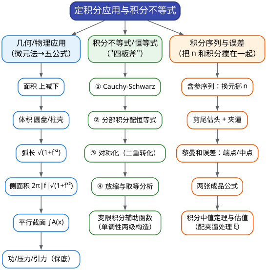

# CMC 手把手精讲
## ——《06 定积分应用与积分不等式》：算完"积分"，学会"用它"

> 🐱 喵～欢迎来到第 06 篇。05 篇你把积分"算"得很溜了；这一篇要回答两个新问题：**积分能拿来做什么**（几何、物理应用——把"面积体积弧长"翻译成积分），以及**怎么不等式地"控制"它**（积分不等式与恒等式证明——近三年的卷末压轴常客）。一句话预告：**这一篇教你两件事——用微元法把几何问题"积"出来，用四板斧把说不出值的积分"夹"住。**
>
> **本篇在考试中的地位**（数据口径：已核对的第 10–17 届非数学类/非数学 A 类官方卷）：
> - **积分证明题是卷末压轴位的常客**：近三届 A 卷中有两届以 **14 分**大题直接考积分不等式/恒等式——15 届第五题（$`\int_0^1f^2\le4\int_0^1(1-x)^2\lvert f'\rvert^2`$，并求取等函数）与 17 届第六题（分部恒等式 + 正性证明）；16 届第五题（用积分表示函数增量做估计）同样要本篇的估值手法。文献统计中"积分不等式"在 2009–2019 证明题里**出现 6 次、居前列**；
> - **同一年能连考两道**：第 10 届一卷连出两道积分不等式（第三题"双向卡"、第六题"对数的 Jensen 版"）——命题人对这块的偏爱是明牌；
> - **积分序列与黎曼和误差**：12、13、15 届**连续三届**出大题（15 届四 14 分原题 $`I_n=n\int_1^a\frac{\mathrm{d}x}{1+x^n}\to\ln2`$）；
> - **几何/物理应用**：近六届 A 卷零出现，但早期卷是经典大题（5 届一(4) 切线与面积、6 届四 球缺公式推导、1 届六 旋转体体积最值），按"铁律七（哪壶不开提哪壶）"——**保底看一眼微元法与五张公式表，各 15 分钟级**。
>
> **大纲对应条目**（《全国大学生数学竞赛考试内容》非数学专业类·一元函数积分学，节选）：
> - 条目 (3)：定积分的概念和基本性质、**定积分中值定理**、变上限定积分确定的函数及其导数、Newton-Leibniz 公式；
> - 条目 (7)：**定积分的应用：平面图形的面积、平面曲线的弧长、旋转体的体积及侧面积、平行截面面积为已知的立体体积、功、引力、压力及函数的平均值等**。
> - （注：积分不等式与积分恒等式证明不在大纲的逐条文字里，但它是历年真题逼出来的"必考增量"——15、17 两届的 14 分压轴就是证据。）
>
> **先修提示**：本篇默认你已看过 **05 篇**（积分计算的全部手法——本篇的每一步证明落地时都在调用它）与 **04 篇**（中值定理与"构造辅助函数"的思路——本篇的 $`\S3.10`$ 会直接沿用）。如果 04 篇还没看，先把"构造函数证单调"的套路补上（15 分钟）。
>
> **预计学时**：2–3 天（对应总纲第 2 周 D14 与第 4 周）。第一天：§二 + §3.1–3.2（应用与直觉，轻松日）；第二天：§3.3–3.6（四板斧——本篇主菜，慢工出细活）+ 精讲 3–6；第三天：§3.7–3.10 + 精讲 1–2、7–10 + 易错点 + 自测题。
>
> 阅读建议：
> 1. 本篇的证明题全是"看懂 ≠ 会写"的类型——每道精讲先自己写**第一行**（"第一步式子"），再对照；
> 2. 四板斧的【适用信号】要背到条件反射级别：考场上写出正确的"第一板斧"＝保底 4–6 分过程分；
> 3. 应用部分（§3.1、§3.2）不要跳过——公式表 + 微元法是一次投入、长期保值的"冷门保险"；
> 4. 所有 ✍️ 处照旧动笔。
>
> 符号说明：📌 重点 | 💡 直觉/类比 | ⚠️ 易错点 | ✍️ 动笔练一练 | ❓ 自测题 | 🎯 考试定位 | ⏱️ 省时技巧

---

# 一、本篇地图

## 1.1 目录（读之前先看这张施工图）

- **§二 知识讲解**：定积分的"平均值"面孔（中值定理的来路）→ 微元法：几何/物理应用题的总脚手架 → 四板斧的直觉（Cauchy-Schwarz 是投影、分部恒等式是"搬家"、对称化是"排序"、放缩是"控制"）→ 黎曼和误差：中点为什么"多赚一阶" → 积分序列的两个母题
- **§三 方法手册**：3.1 几何应用五公式 | 3.2 物理应用保底 | 3.3 板斧一 Cauchy-Schwarz | 3.4 板斧二 分部积分配恒等式 | 3.5 板斧三 对称化/二重积分转化 | 3.6 板斧四 放缩与取等 | 3.7 积分序列与极限 | 3.8 黎曼和误差估计 | 3.9 积分中值定理与估值 | 3.10 变限积分辅助函数
- **§四 真题精讲**：10 道完整精讲（5 届一(4)、1 届六、10 届三、10 届六、15 届五、17 届六、14 届四、15 届四、13 届五、8 届二）
- **§五 易错点清单**：14 条 ❌→✅ 对照
- **§六 自测题**：7 道，附完整答案
- **§七 结语**："积分证明防身八句话" + 学习建议 + 07 篇预告

## 1.2 方法速查表：什么题面 → 用什么武器（一屏版）

| 题面长相（信号） | 首选武器 | 说明 / 升级路线 |
|---|---|---|
| 证 $`\int f^2\le C\int(f')^2`$、$`\int f\cdot\int\frac1f`$ 型、"两块积分的乘积" | **Cauchy-Schwarz** | 先用配对分部把 $`\int f^2`$ 改写成 $`\int(\cdot)ff'`$，再 Cauchy，最后约分 |
| 待证式含 $`\int_a^bf(x)\big(\int_a^xg(s)\,\mathrm{d}s\big)\mathrm{d}x`$，或"两个相似积分相等/相反" | **分部积分配恒等式** | 记 $`F=\int_a^xf`$、$`G=\int_a^xg`$，分部一次让边界项由题设条件消失 |
| 证 $`\int_a^bf(x)G(x)\,\mathrm{d}x>0`$ 型；被积结构能写成 $`f(x)g(s)-f(s)g(x)`$ | **对称化（二重积分转化）** | 写成 $`\frac{1}{2}\iint_D[f(x)g(s)-f(s)g(x)]`$，再分片定号 |
| 待证式含 $`\sin nx`$、高次三角、分数幂 | **放缩** | 常备放缩：$`\lvert\sin nx\rvert\le n\sin x`$、$`\sin x\ge\frac{2}{\pi}x`$、$`\ln(1+t)\le t`$；"分段 + 各自取最优放缩" |
| 求 $`\lim n^k\big[\int_a^bf-\frac{b-a}{n}\sum f(\xi_k)\big]`$ | **黎曼和误差估计** | 逐段写成 $`\int_{x_{k-1}}^{x_k}[f(x)-f(\xi_k)]\mathrm{d}x`$ + 泰勒/中值线性化；两张成品公式见 §3.8 |
| 题式含 $`n\int_1^a\frac{\mathrm{d}x}{1+x^n}`$、$`\int_0^1\frac{\mathrm{d}t}{(1+t^4)^n}`$、$`\int f^n`$ | **含参积分序列** | 换元把 $`n`$ 挪进参数（$`x=1/t`$、$`u=x^n`$）；或"剪尾估头"（留 $`[0,a]`$、弃 $`[a,1]`$） |
| 出现"存在 $`\xi`$ 使 $`\int_a^bf=f(\xi)(b-a)`$"、估计平均值 | **积分中值定理** | 第一中值定理、加权中值（配非负权）、夹逼处理 $`\xi`$ 的位置不确定 |
| 面积/旋转体体积/弧长/侧面积/平行截面 | **微元法五公式** | 先画图、找交点、定"上减下/外减内"；绕 $`y`$ 轴两法（圆盘 vs 柱壳）看哪个顺手 |
| 功/压力/引力 | **微元法建模**（保底） | 取微元 → 写微元贡献 → 积分；坐标系先画再列式 |
| 待证式两端都是 $`a`$（或 $`x`$）的变限积分，或 $`F(x)=\big(\int_0^xf\big)^2-\int_0^xf^3`$ 型 | **变限积分辅助函数** | 构造 $`F`$，验证 $`F(0)=0`$ 后证 $`F'>0`$；$`F'`$ 不够用时"两级单调"（再构造内层 $`g`$） |

## 1.3 知识树：本篇全部内容的骨架



一句话总结这张图：**应用题的引擎是"微元法"（把整体切成无穷小份、每份用初等公式、再加总）；证明题的引擎是"四板斧"（Cauchy 抓平方、分部搬算子、对称化排序、放缩控边界）；序列题的引擎是"把 $`n`$ 挪进参数或者把误差线性化"。**

---

# 二、知识讲解：从"平均值"到"四板斧"的来路

## 2.1 定积分的第二张脸：平均值

05 篇说定积分是"带符号面积"。这一篇先给它换个说法：定积分也是"**平均值 × 长度**"。你把 $`\dfrac{1}{b-a}\displaystyle\int_a^bf(x)\,\mathrm{d}x`$ 看作函数 $`f`$ 在 $`[a,b]`$ 上的"平均高度"，立刻能得到一个"显然"的事实：**平均值介于函数的最小值和最大值之间**——把它写严格，就是大纲条目 (3) 里点名的**积分中值定理**：

> **（第一）积分中值定理**：若 $`f`$ 在 $`[a,b]`$ 上连续，则存在 $`\xi\in[a,b]`$，使
>
> ```math
> \int_a^bf(x)\,\mathrm{d}x=f(\xi)(b-a).
> ```
>

💡 **打比方**：一列起伏的股价图（连续函数），总能找到"某一天的价格"恰好等于这段时期的平均价——因为价格从低点爬到高点的过程中，**每一个中间值都会被经过**（介值定理）。积分中值定理就是"介值定理 × 平均值"的合体。

📌 **加权重磅版（第二积分中值定理的常用特例）**：若 $`f`$ 连续、$`g`$ 在 $`[a,b]`$ **不变号**且可积，则存在 $`\xi`$，使

```math
\int_a^bf(x)g(x)\,\mathrm{d}x=f(\xi)\int_a^bg(x)\,\mathrm{d}x.
```

这个版本比第一版好用得多——它允许你在被积式里"**拿掉一个因子、换成它在某点的值**"，只要另一个因子不变号。真题里凡是出现"$`\int f\cdot\mathrm{exp}`$ 型要放缩"、"$`\int`$ 中含 0 的函数要分解"的地方，它都在幕后（如第 13 届填 3、14 届五的官方解答都在"用中值 + 夹逼"收尾）。

⚠️ 用中值定理的**规范动作**：① 先说清 $`f`$ 连续、$`g`$ 不变号（条件必须验证，这是给分点）；② 记住 $`\xi`$ 的位置**不确定**（只知道在区间内），后续要用"$`\xi\to0`$ 时 $`f(\xi)\to f(0)`$"这类**连续性 + 夹逼**把它控制住；③ 一道题里两次使用中值定理，$`\xi`$ 要换字母（$`\xi,\eta`$），别自欺欺人地"同一个 $`\xi`$"。

## 2.2 微元法：几何物理应用的总脚手架

应用题的公式看着多（面积、体积、弧长、侧面积、功、压力……），其实**只有一个方法：微元法**。它的三步骤：

1. **画图、选坐标轴**（选 $`x`$ 为积分变量的，通常要求图形"竖直方向可描述"）；
2. **切微元**：在 $`x`$ 处切一片宽度 $`\mathrm{d}x`$ 的竖条，用**初等几何**写出这一片对总量的贡献 $`\mathrm{d}Q`$（面积的微元是"高 $`\times\mathrm{d}x`$"；体积的微元是"截面积 $`\times\mathrm{d}x`$"）；
3. **加总**：$`Q=\displaystyle\int_a^b\mathrm{d}Q`$。

💡 **为什么能这么干**：$`\mathrm{d}Q`$ 与真实的一小片的差别是 $`\mathrm{d}x`$ 的高阶小量（你可以把每个竖条看成"非常扁的矩形/圆盘"），积分把 $`n\to\infty`$ 的加总极限一取，误差自动消失。**这就是黎曼和定义背后"无穷小分析"的工程直觉。**

把微元法在每个场景里跑一遍，就得到下面这张**五公式表**（背它，但更要理解每条公式的"微元长什么样"）：

| 几何量 | 公式 | 微元的直觉 |
|---|---|---|
| 曲边梯形面积（上 $`f`$ 下 $`g`$） | $`A=\displaystyle\int_a^b\big[f(x)-g(x)\big]\mathrm{d}x`$ | 竖条：高 $`\times\mathrm{d}x`$ |
| 平行截面体积 | $`V=\displaystyle\int_a^bA(x)\,\mathrm{d}x`$ | 薄片：截面积 $`\times\mathrm{d}x`$ |
| 旋转体（绕 $`x`$ 轴）圆盘法 | $`V=\pi\displaystyle\int_a^bf^2(x)\,\mathrm{d}x`$ | 薄圆盘：$`\pi r^2\times\mathrm{d}x`$ |
| 旋转体（绕 $`y`$ 轴）柱壳法 | $`V=2\pi\displaystyle\int_a^bx\lvert f(x)\rvert\,\mathrm{d}x`$ | 薄圆筒：周长 $`\times`$ 高 $`\times`$ 厚 |
| 弧长（$`y=f(x)`$） | $`s=\displaystyle\int_a^b\sqrt{1+f'^2(x)}\,\mathrm{d}x`$ | 斜边 $`=\sqrt{\mathrm{d}x^2+\mathrm{d}y^2}`$ |
| 旋转面侧面积（绕 $`x`$ 轴） | $`S=2\pi\displaystyle\int_a^b\lvert f(x)\rvert\sqrt{1+f'^2(x)}\,\mathrm{d}x`$ | 圆台侧带：$`2\pi r\times`$ 斜高 |
| 函数平均值 | $`\bar f=\dfrac{1}{b-a}\displaystyle\int_a^bf(x)\,\mathrm{d}x`$ | 与中值定理互为表里 |

⚠️ 三个高频翻车点：**绕 $`y`$ 轴**要看清题目用圆盘法（把曲线解成 $`x=g(y)`$，$`\pi\int g^2\mathrm{d}y`$）还是柱壳法（$`2\pi\int x\lvert f\rvert\mathrm{d}x`$）——哪个顺手用哪个，但要**先画图确认半径是谁**；**侧面积必须带 $`\lvert f(x)\rvert`$ 因子**（否则 $`x`$ 轴下方的弧段会"负面积"）；**弧长公式的三个版本**（直角坐标/参数/极坐标）先认准题目给的形式（本系列只要求直角坐标版，参数版在 03 篇弧微分小节里）。

🎯 **考试定位**：近三届 A 卷应用零出现（属"铁律七"低频区），但 5 届一(4)、6 届四、1 届六等早期经典题目的难度**只有教材例题级**——投入 15 分钟背表 + 30 分钟做两道老题，就能把一个 6–14 分的口子焊死。这是典型的"低投入、高保值"保险。

## 2.3 四板斧的直觉：四个"控制积分"的思路

积分不等式为什么让人头大？因为**积分"吃掉"了函数的细节**——你只知道它的某种整体信息，却要推出关于整体的不等式。破解的思路只有四条（这就是"四板斧"的名字来源）：

**板斧一：Cauchy-Schwarz——"平方的和 ≥ 和的平方"**

```math
\Big(\int_a^bfg\Big)^2\le\int_a^bf^2\cdot\int_a^bg^2.
```

💡 直觉：它是**高维向量内积不等式** $`\langle\mathbf{u},\mathbf{v}\rangle^2\le\lVert\mathbf{u}\rVert^2\lVert\mathbf{v}\rVert^2`$ 的"积分版"——把函数看成"无穷维向量"，求和升级为积分，逐字翻译。等号成立当 $`\mathbf{u}\parallel\mathbf{v}`$，即 $`f=cg`$（或某一个是零）——**"取等分析"是它的一半戏份**。

**什么时候想起它**：待证式里出现"**两个积分的乘积**"（$`\int f\cdot\int g`$）或"**$`\int f^2`$ 与 $`\int(f')^2`$ 的大小比较**"。它的典型用法有个前置动作：**先用分部积分把 $`\int f^2`$ 改写成 $`\int(\text{权重})\cdot f\cdot f'`$ 的形状**，再对 $`f\cdot f'`$ 用 Cauchy——"**配对分部 + Cauchy**"是 15 届五整道题的全部骨架。

**板斧二：分部积分配恒等式——"把算子搬个家"**

```math
\int_a^bf(x)G(x)\,\mathrm{d}x=-\int_a^bF(x)g(x)\,\mathrm{d}x\quad(F'=f,\ G'=g,\ \text{且}\ F(b)G(b)=F(a)G(a)).
```

💡 直觉：$`\int fG`$ 里"$`f`$ 没被积、$`G`$ 被积了"；分部一次，**两人的角色互换**（$`f`$ 进了积分号，$`G`$ 出了积分号），代价是一个边界项 $`[FG]`$——只要题设条件（如 $`\int_a^bf=\int_a^bg=0`$）能让边界项归零，就得到一条**漂亮的恒等式**。记 $`F(x)=\int_a^xf`$、$`G(x)=\int_a^xg`$ 是启动它的标准动作。

**什么时候想起它**：待证式里的积分<strong>"嵌套"着另一个积分</strong>（$`\int f(x)\big(\int_a^xg\big)\mathrm{d}x`$），或题目要求你证明"两个相似积分相等（相反）"。真题锚点：17 届六(1)；另有一道常见的竞赛恒等式 $`2\int_a^bf\big(\int_x^bf\big)=\big(\int_a^bf\big)^2`$（同类结构，见 §3.5 微例）。

**板斧三：对称化——"反对称核 + 二重区域"**

```math
\int_a^bf(x)\Big(\int_a^xg(s)\,\mathrm{d}s\Big)\mathrm{d}x=\frac{1}{2}\iint_D\big[f(x)g(s)-f(s)g(x)\big]\,\mathrm{d}x\,\mathrm{d}s,\qquad D=\{a\le s\le x\le b\}.
```

**（使用前提：边界项为零——题设 $`\int_a^bf=\int_a^bg=0`$ 时成立；这是"翻转版积分 $`M=\iint_Df(s)g(x)`$ 与原积分 $`L`$ 互为相反数"的条件。）**

💡 直觉：右边这个"$`f(x)g(s)-f(s)g(x)`$"结构天生是**反对称**的（交换 $`x,s`$ 变号）——而"反对称核在对称区域上积分为 0"，所以只要在**区域的一部分**上判断符号，整个积分的符号就定了。这是把"一重积分的比较"升级成"**二重积分的逐点比较**"的思路——**乘法交换律是你的朋友**。

**什么时候想起它**：待证结论是"$`\int(\cdots)>0`$"，且被积结构是"$`f`$ 乘 $`g`$ 的积分"型。真题锚点：17 届六(2)（全题最难一步）。

**板斧四：放缩——"上下界控制在可算的量上"**

常用放缩工具箱（顺手背下来）：

```math
\lvert\sin nx\rvert\le n\sin x\ (0\le x\le\tfrac{\pi}{2}),\qquad \sin x\ge\frac{2}{\pi}x\ (0\le x\le\tfrac{\pi}{2}),\qquad \ln(1+t)\le t\ (t>-1),
```

```math
\lvert\sin x\rvert\le1,\qquad e^{-t}\le1,\qquad \frac{a+b}{2}\ge\sqrt{ab}\ (\text{均值}),\qquad \lvert f(x)\rvert\le\max\lvert f\rvert\ (\text{最值控制}).
```

💡 直觉：放缩就是"**控制论**"——我算不出积分的精确值，但我能算出"它一定 ≤ 某个可算的量"。两个纪律：**① 方向一致**（证上界时，每一步都往"大"放，不许中途反向；证下界同理）；**② 记住取等条件**（等号在哪里达到？如果题目要"最佳常数"，取等条件就是"证最优性"的钥匙）。

**什么时候想起它**：含 $`\sin nx`$ 的高次积分（14 届四）、含"分数幂/根式"的估计、需要"分段各自取最优放缩"的场合（14 届四的 $`\frac{\pi}{2n}`$ 分界就是分段艺术）。

## 2.4 黎曼和误差：中点为什么"多赚一阶"

先回忆黎曼和：$`\displaystyle\int_a^bf(x)\,\mathrm{d}x=\lim_{n\to\infty}\frac{b-a}{n}\sum_{k=1}^nf(\xi_k)`$——**用什么点取样，误差阶不同**：

- **右端点** $`(\xi_k=\frac{k}{n})`$：$`n\big(\int_0^1g-\frac1n\sum g(\tfrac kn)\big)\to \dfrac{g(0)-g(1)}{2}`$——误差是 $`O(1/n)`$ 阶（"一阶误差"）；
- **中点** $`(\xi_k=\text{区间中点})`$：$`n^2\big(\int_a^bf-\text{中点和}\big)\to\dfrac{(b-a)^2}{24}\big[f'(b)-f'(a)\big]`$——误差是 $`O(1/n^2)`$ 阶。**比端点公式整整精确一阶。**

💡 **原因（一次项消零）**：把每小段上的差 $`f(x)-f(\xi_k)`$ 泰勒展开，一次项 $`f'(\xi_k)(x-\xi_k)`$ 的积分是 $`f'(\xi_k)\int_{x_{k-1}}^{x_k}(x-\xi_k)\mathrm{d}x`$——**中点恰好是区间中心，对称区间的"一次矩"为 0**，所以一次项整体消失，误差从二次项 $`f''`$ 开始。**"对称部位的一次项自动抵消"这个中学物理式的直觉，就是中点法优于端点法的全部秘密**（也解释了为什么中点和的常数是 $`\frac{1}{24}`$ 而不是 $`\frac12`$ 量级）。

📌 **两类题的成题模板**：
1. 求 $`\lim n\big(\int_0^1f-\frac1n\sum f(k/n)\big)`$ 型 → 答案 $`\dfrac{f(0)-f(1)}{2}`$（先证一般公式，见 §3.8；8 届四取 $`f(0)=0,f(1)=1`$ 得 $`-\frac12`$）；
2. 求 $`\lim n^2\big(\cdots\text{中点}\cdots\big)`$ 型 → 答案 $`\dfrac{(b-a)^2}{24}[f'(b)-f'(a)]`$（13 届五原题）。

## 2.5 积分序列的两个母题

"把 $`n`$ 和积分搅在一起"的题（$`\lim_{n\to\infty}\int(\cdots n\cdots)`$）只有两个母题：

**母题一：换元把 $`n`$ 挪进参数**。$`I_n=n\displaystyle\int_1^a\frac{\mathrm{d}x}{1+x^n}`$：$`n`$ 挂在积分号外和幂次上，换元 $`x=\dfrac{1}{t}`$ 后，$`\dfrac{nt^{n-1}}{1+t^n}`$ 恰好是 $`\big(\ln(1+t^n)\big)'`$——**凑成微分**，再分部 + 夹逼（15 届四全题）。

**母题二：剪尾估头 / 质量集中**。$`\displaystyle\int_0^1\frac{\mathrm{d}t}{(1+t^4)^n}\to0`$：把 $`[0,1]`$ 切成 $`[0,a]+[a,1]`$，$`[a,1]`$ 上的贡献被 $`(1+a^4)^{-n}`$ 指数压死（**"剪掉尾巴"**），$`[0,a]`$ 上的贡献 ≤ $`a`$ 任你小（**"留住头部"**）——两头夹出极限 0（12 届七(1)）。

💡 **"质量集中"直觉**：$`[f]^n`$ 这种写法里，$`n`$ 越大，"积分质量"越向使 $`f`$ 最大的地方集中（就像 $`\int x^n`$ 的质量全往 $`x=1`$ 端挤）。第 6 届五问 $`x_n`$ 的极限（$`[f(x_n)]^n=\frac{1}{b-a}\int_a^b[f]^n`$），答案就是 $`b`$——**"平均值的样本点被迫挤向最大值点"**。

📌 这两个母题之外，所有"积分 × 数列"的题要么是"黎曼和误差"（§2.4），要么是"积分中值 + 夹逼"（§2.1 的三个规范动作），要么是"把积分当数列的项直接放缩"（第 12 届七(2) 的条件收敛就是 "$`u_n\ge\dfrac{1}{n-1}(1-2^{1-n})`$（因 $`1+t^4\le1+t`$）对到调和级数证 $`\sum u_n`$ 发散 + 莱布尼茨（$`u_n`$ 单调趋零）证收敛" 的两头结构）。**没有第五种。**

---

# 三、方法手册：四板斧 + 六套配套工具

## 3.1 几何应用：微元法五公式

**【适用信号】** 题面出现"面积、体积、旋转体、弧长、侧面积、平行截面、最小值/最大值"（应用 + 最值综合）；给曲线求"围成图形"的某量。

**【步骤】**
1. **画图**（草图即可）：标出曲线、交点、对称轴、旋转轴；
2. **求交点定限**：解方程组找曲线交点（积分限的来源）；"切线与曲线围成"的题先求切点、再求切线与坐标轴的交点；
3. **选公式、列微元**：面积"上减下"；体积绕 $`x`$ 轴 $`\pi\int f^2`$、绕 $`y`$ 轴 $`\pi\int g^2(y)\mathrm{d}y`$（圆盘）或 $`2\pi\int x\lvert f\rvert\mathrm{d}x`$（柱壳）——**先判断哪个变量当积分变量更顺**；
4. **积分 + 代限**；若带参数（如切点坐标 $`t`$），先算出"量 = 含 $`t`$ 的函数"，再解方程/求最值。

**【关键公式】** §2.2 五公式表。补充两条"围面积"的常用意识：相减时**搞清楚谁在上面**（不确定就分段）；旋转体体积的两种分解可以互相验算（算完用另一种方法量纲/数量级检查）。

**【真题微型例子】**（第 5 届非数学类·填空第 4 题，2013）过曲线 $`y=\sqrt[3]{x}\ (x\ge0)`$ 上的点 $`A`$ 作切线，使得该切线与曲线及 $`x`$ 轴所围成的平面图形的面积为 $`\dfrac{3}{4}`$，求点 $`A`$ 的坐标。
设 $`A=(t,t^{1/3})`$。由 $`y'=\dfrac{1}{3}x^{-2/3}`$，切线 $`y-t^{1/3}=\dfrac{1}{3t^{2/3}}(x-t)`$；令 $`y=0`$ 得切线与 $`x`$ 轴交点横坐标 $`x_0=-2t`$（**这个"$`2`$ 倍反向"是 $`y=x^{1/3}`$ 的专属性质，验算一遍**）。所围图形 = 三角形（底 $`3t`$、高 $`t^{1/3}`$）减曲边梯形：

```math
S=\frac{1}{2}\cdot3t\cdot t^{1/3}-\int_0^tx^{1/3}\,\mathrm{d}x=\frac{3}{2}t^{4/3}-\frac{3}{4}t^{4/3}=\frac{3}{4}t^{4/3}.
```

由 $`\dfrac{3}{4}t^{4/3}=\dfrac{3}{4}`$ 得 $`t=1`$，即 $`A=(1,1)`$ ✓（官方答案）。
> **"三角形减曲边"是"切线围面积"题的标准分解**（切线是直线，线下是三角形/梯形，减去曲线下的曲边面积）。本题的评分点：切点设参、交点坐标、面积表达式、反解参数。⏱️ 目标用时：**4 分钟**。

## 3.2 物理应用（保底）：微元法建模

**【适用信号】** 题面出现"功、压力、引力、水坝、细杆、圆盘"——🎯 考试定位：**了解一下即可**（非数学 A 类近六届零出现；第 3 届考过一次引力），但看一眼方法，遇到时能拿一半。

**【步骤】**
1. **建坐标系**（把物体放到顺手的轴上），写出关键物理量的分布（密度 $`\rho`$、深度、距离）；
2. **取微元**：在位置 $`x`$ 取长度 $`\mathrm{d}x`$（或薄片），写它受到的**力/做的功/产生的引力的微元**：
 - 变力做功：$`\mathrm{d}W=F(x)\,\mathrm{d}x`$；
 - 液体压力：$`\mathrm{d}P=\rho g\,h(x)\cdot\mathrm{d}A`$（$`h`$ 是微元处的深度）；
 - 引力微元：$`\mathrm{d}F=\dfrac{Gm\,\mathrm{d}M}{r^2}`$，**且要分解到坐标轴方向**（$`\mathrm{d}F_x,\mathrm{d}F_y`$ 分别积分）；
3. **积分 + 取极限带符号**（广义积分收尾是常事）。

**【关键公式】** 万有引力 $`\dfrac{Gm_1m_2}{r^2}`$；压力 $`=\rho g\int h\,\mathrm{d}A`$；以及 $`\displaystyle\int\frac{\mathrm{d}x}{(x^2+h^2)^{3/2}}=\frac{x}{h^2\sqrt{x^2+h^2}}`$（引力题专用积分，10 秒推一遍：令 $`x=h\tan t`$）。

**【真题微型例子】**（第 3 届非数学类·第四题，2011）平面上有一条从点 $`(a,0)`$ 向右的射线，线密度为 $`\rho`$；点 $`(0,h)\ (h>0)`$ 处有质量为 $`m`$ 的质点，求射线对该质点的引力。
取微元 $`[x,x+\mathrm{d}x]`$（质量 $`\mathrm{d}M=\rho\,\mathrm{d}x`$，距离 $`r=\sqrt{x^2+h^2}`$），沿坐标分解：

```math
\mathrm{d}F_x=\frac{Gm\rho\,x}{(x^2+h^2)^{3/2}}\,\mathrm{d}x,\qquad \mathrm{d}F_y=-\frac{Gm\rho\,h}{(x^2+h^2)^{3/2}}\,\mathrm{d}x.
```

积分（$`x\ge a`$）：

```math
F_x=Gm\rho\Big[-\frac{1}{\sqrt{x^2+h^2}}\Big]_a^{+\infty}=\frac{Gm\rho}{\sqrt{a^2+h^2}},\qquad F_y=-\frac{Gm\rho}{h}\Big(1-\frac{a}{\sqrt{a^2+h^2}}\Big).
```

（官方以正值形式给出竖直分量 $`\dfrac{Gm\rho}{h}\Big(1-\dfrac{a}{\sqrt{a^2+h^2}}\Big)`$（方向向下，由题图判断）；本解按 $`y`$ 轴向上为正的约定取负号，两者为同一结果的两种表述——官方用三角换元 $`x=h\tan t`$ 化为 $`\dfrac{Gm\rho}{h}\int\cos t\,\mathrm{d}t`$。）
> 三个规范动作：**"从 $`x`$ 到 $`x+\mathrm{d}x`$ 取微元"、"分量分解"、"无穷限真拆极限"**。$`\blacksquare`$ 若考场上真的遇到物理应用，把这三步写全，即使积分没算完也有过程分。⏱️ 目标用时：**10 分钟**（保底题，独立档）。

## 3.3 板斧一：Cauchy-Schwarz（配权分部）

**【适用信号】** 待证式含"**两个积分的乘积**"（$`\int f^2\cdot\int g^2`$ 的大小关系、$`\int f\cdot\int\frac1f`$ 型）或"**$`\int f^2`$ 被 $`\int(f')^2`$ 控制**"；"$`(\int fg)^2`$"。

**【步骤（"配权分部 + Cauchy"三步流水线）】**
1. **配权改写**：目标是 $`\int f^2\le C\int(f')^2`$ 时，找一个权函数 $`w`$（常取 $`w`$ 使边界项归零，如 $`w(x)=x-1`$、$`w(x)=x`$），分部一次把 $`\int f^2`$ 改写成 $`\int w\cdot2ff'`$（或类似形状）：

```math
\int_a^bf^2\,\mathrm{d}x=\big[wf^2\big]_a^b-\int_a^bw\cdot2ff'\,\mathrm{d}x;
```

2. **Cauchy**：对 $`\int(wf')f`$ 或 $`\int wff'`$ 这类"两块之积"用 $`(\int uv)^2\le\int u^2\int v^2`$；
3. **约分/平方收尾**：两边若出现 $`\big(\int f^2\big)^{1/2}`$，**除过去再平方**（15 届五的原味操作）；必要时先讨论 $`\int f^2=0`$ 的平凡情形。

**【关键公式】** $`(\int_a^bfg)^2\le\int_a^bf^2\int_a^bg^2`$；**取等条件：$`f=cg`$**（分析"取等函数"时从它出发解微分方程）。

**【真题微型例子】**（类型题·仿竞赛风格）设 $`f`$ 在 $`[0,1]`$ 上连续，证明 $`\Big(\displaystyle\int_0^1f(x)\,\mathrm{d}x\Big)^2\le\int_0^1f^2(x)\,\mathrm{d}x`$。
取 $`g\equiv1`$ 直接 Cauchy：$`\big(\int f\cdot1\big)^2\le\int f^2\cdot\int1^2=\int_0^1f^2`$ ✓。取等当 $`f\equiv c`$（常数）。
> 这是 Cauchy 的"零号演练"；**真题完全体是 15 届五**（精讲 5）：那里把"$`g\equiv1`$"换成了"$`g=(1-x)f'`$"，并多了一步"配权分部"把 $`\int f^2`$ 变成能配对的形状——**同一板斧，加了一道配料工序**。

## 3.4 板斧二：分部积分配恒等式

**【适用信号】** 待证式是"**积分套积分**"（$`\int f(x)\big(\int_a^xg(s)\,\mathrm{d}s\big)\mathrm{d}x`$）；或要证"两个相似积分相等/互为相反数"；或要**把积分序列变成可裂项（telescoping）的形状**。

**【步骤】**
1. **起名字**：记 $`F(x)=\displaystyle\int_a^xf(t)\,\mathrm{d}t`$、$`G(x)=\displaystyle\int_a^xg(t)\,\mathrm{d}t`$（$`F'=f`$、$`G'=g`$）；
2. **分部一次**：$`\displaystyle\int_a^bf(x)G(x)\,\mathrm{d}x=\big[F(x)G(x)\big]_a^b-\int_a^bF(x)g(x)\,\mathrm{d}x`$；
3. **洗边界项**：题设条件（$`\int_a^bf=\int_a^bg=0`$，或 $`F(a)=0`$ 等）让 $`\big[FG\big]_a^b=0`$——得到恒等式；
4. **（裂项变体）**：对含参数的积分 $`u_n`$，分部积分配凑出 $`u_n=\text{常数}+c_n(u_n-u_{n+1})`$ 的形状，能直接对级数求和。

**【关键公式】** $`\displaystyle\int_a^bfG=[FG]_a^b-\int_a^bFg`$；分部选 $`u`$ 顺序"反、对、幂、指、三"照旧适用。

**【真题微型例子】**（第 12 届非数学类·解答题第七题(3) 的核心零件，2020）设 $`u_n=\displaystyle\int_0^1\frac{\mathrm{d}t}{(1+t^4)^n}`$，求 $`\displaystyle\sum_{n=1}^{\infty}\frac{u_n}{n}`$ 的"裂项"关键式。
对 $`u_n`$ **分部积分**（把被积函数看成 $`\dfrac{1}{(1+t^4)^n}`$，凑 $`\mathrm{d}v=\mathrm{d}t`$）：

```math
u_n=\frac{t}{(1+t^4)^n}\Big|_0^1+n\int_0^1\frac{4t^4}{(1+t^4)^{n+1}}\,\mathrm{d}t=\frac{1}{2^n}+4n\int_0^1\frac{1+t^4-1}{(1+t^4)^{n+1}}\,\mathrm{d}t=\frac{1}{2^n}+4n\big(u_n-u_{n+1}\big).
```

移项即可"裂项"：$`\dfrac{u_n}{n}=\dfrac{1}{n2^n}+4\big(u_n-u_{n+1}\big)`$，两边对 $`n`$ 求和得

```math
\sum_{n=1}^{\infty}\frac{u_n}{n}=\sum_{n=1}^{\infty}\frac{1}{n2^n}+4u_1=\ln2+4u_1,
```

其中 $`\sum\frac{1}{n2^n}=\ln2`$（展开式 $`\ln(1+x)`$ 取 $`x=-\frac12`$）、$`u_1=\int_0^1\frac{\mathrm{d}t}{1+t^4}=\frac{\sqrt2}{8}\big[\pi+2\ln(1+\sqrt2)\big]`$（官方给出）。
> **"分部一次 → 出现 $`u_n-u_{n+1}`$ → 望远镜求和"是积分序列求和的标准生产线**：关键在于凑出 $`\dfrac{1+t^4-1}{}`$ 这种"**拆出 1 再减回去**"的动作（与经典的 $`\int_0^{\pi/4}\tan^nx\,\mathrm{d}x`$ 递推 $`I_n+I_{n-2}=\frac{1}{n-1}`$ 同族）。⏱️ 若在考场上：写出"$`u_n=\frac{1}{2^n}+4n(u_n-u_{n+1})`$"这行就有大半过程分。

## 3.5 板斧三：对称化（二重积分转化）

**【适用信号】** 要证"$`\displaystyle\int_a^bf(x)G(x)\,\mathrm{d}x>0`$"且被积结构能整理成"$`f`$ 乘 $`g`$ 积分"型；题设给了"$`g`$ 的唯一零点"、"$`f'g-fg'>0`$"这类**比值单调**条件。

**【步骤】**
1. 记 $`L=\displaystyle\int_a^bfG=\iint_Df(x)g(s)\,\mathrm{d}x\,\mathrm{d}s`$（区域 $`D=\{a\le s\le x\le b\}`$）；
2. **用板斧二得到 $`L`$ 的"翻转版"**：交换 $`x,s`$ 的积分 $`M=\iint_Df(s)g(x)`$ 与 $`L`$ 的关系由 $`L+M=F(b)G(b)`$ 决定——题设 $`\int f=\int g=0`$ 时 $`M=-L`$，于是

```math
L=\frac{1}{2}\big(L-M\big)=\frac{1}{2}\iint_D\big[f(x)g(s)-f(s)g(x)\big]\,\mathrm{d}x\,\mathrm{d}s;
```

3. **分片定号**：按 $`g`$ 的零点 $`\xi`$ 把 $`D`$ 分成 $`D_1\cup D_2\cup D_3`$（如 §一 速查表），在每片上用**单调性**（如 $`\frac fg`$ 严格增）判定 $`f(x)g(s)-f(s)g(x)`$ 的符号（把式子提出 $`\dfrac{f(x)}{g(x)}-\dfrac{f(s)}{g(s)}`$ 即可）；
4. **汇总**：大多块 $`\ge0`$、至少一块"$`\ge0`$ 且不恒为 0"（严格性来自"连续 + 非负 + 不恒零 ⟹ 积分 > 0"），交叉块恰好为 0，结论"整体 $`>0`$"。

**【关键公式】** 反对称核恒等式（上面第 2 步）；"$`g(x)g(s)>0`$ 时，$`f(x)g(s)-f(s)g(x)\ge0\iff\dfrac{f(x)}{g(x)}\ge\dfrac{f(s)}{g(s)}`$ 当 $`x\ge s`$"。

**【真题微型例子】**（类型题·经典恒等式——竞赛里的高频结论件）证明 $`\displaystyle\int_a^bf(x)\Big(\int_a^xf(s)\,\mathrm{d}s\Big)\mathrm{d}x=\frac{1}{2}\Big(\int_a^bf(x)\,\mathrm{d}x\Big)^2`$。
记 $`F(x)=\int_a^xf`$，则左边 $`=\int_a^bF F'\,\mathrm{d}x=\dfrac{1}{2}F^2(x)\Big|_a^b=\dfrac{1}{2}\Big(\int_a^bf\Big)^2`$ ✓（三步——**认出一半的 $`(F^2)'`$ 即可**）。
> 这个恒等式值得背：它是"积分套积分"题出现频率最高的**结论件**；17 届六(2)（精讲 6）就是它在"$`g`$ 带符号"场景下的升级版——把"完全平方"升级成"反对称核 + 分片定号"。

## 3.6 板斧四：放缩与取等分析

**【适用信号】** 待证式含 $`\lvert\sin nx\rvert`$、高次幂、分数次幂、根式；要"求最佳常数 $`C`$"；要证某个**估计式**（如 5 届四的 $`\le\frac2m`$、4 届五的最佳 $`C=2`$）。

**【步骤】**
1. **定方向**：证"$`\le`$"就一路向上放缩、证"$`\ge`$"一路向下——中途不许换向；
2. **分段取最优**：一个放缩式不能兼顾全区间时，**把区间切开**（如在 $`(0,\frac{\pi}{2n})`$ 用 $`\lvert\sin nx\rvert\le n\sin x`$、其余用 $`\lvert\sin nx\rvert\le1`$ 配 $`\sin x\ge\frac{2}{\pi}x`$）——每段用它自己的"最优放缩"（14 届四的分段艺术，精讲 7）；
3. **取等分析**：所有放缩的等号能否同时取到？能——"最佳常数"；不能——常数还可改进（这也指导你"为什么这么放"）；
4. **（最佳常数专用）**：证"$`C`$ 可行"用放缩；证"$`C`$ 不可再小"用**构造逼近族**（质量向极值点集中，如 $`f_n=(n+1)x^n`$）。

**【关键公式】** 放缩工具箱（§2.3 板斧四），外加两条实战准则：**"带权放缩"**（$`\lvert f(x)\rvert\le\max\limits_{[a,b]}\lvert f\rvert`$ 但只在需要的子区间用）、**"指数压多项式"**（$`x^ne^{-sx}\to0`$，用于边界项）。

**【真题微型例子 1】**（第 5 届非数学类·第四题，2013，10 分）设 $`\lvert f(x)\rvert\le\pi`$，$`f'(x)\ge m>0\ (a\le x\le b)`$，证明 $`\Big\lvert\displaystyle\int_a^b\sin f(x)\,\mathrm{d}x\Big\rvert\le\dfrac{2}{m}`$。
**思路（换元 + 反函数 + 符号分段）**：$`f'\ge m>0`$ 让 $`f`$ 严格增、存在反函数 $`\varphi`$，且 $`\varphi'(y)=\dfrac{1}{f'(x)}\le\dfrac{1}{m}`$。换元 $`y=f(x)`$（这步要**先声明单调性**——评分点）：

```math
\int_a^b\sin f(x)\,\mathrm{d}x=\int_{A}^{B}\varphi'(y)\sin y\,\mathrm{d}y,\qquad A=f(a),\ B=f(b),\ [A,B]\subseteq[-\pi,\pi].
```

关键的精细之处：把右端按 $`\sin y`$ 的符号**分成两段**——$`\sin y>0`$ 的部分（含于 $`[0,\pi]\cap[A,B]`$）与 $`\sin y<0`$ 的部分（含于 $`[-\pi,0]\cap[A,B]`$）。用 $`0<\varphi'\le\frac1m`$ 逐段放缩：

```math
0\le\int_{[A,B]\cap\{\sin>0\}}\varphi'\sin y\,\mathrm{d}y\le\frac{1}{m}\int_0^{\pi}\sin y\,\mathrm{d}y=\frac{2}{m},\qquad -\frac{2}{m}\le\int_{[A,B]\cap\{\sin<0\}}\varphi'\sin y\,\mathrm{d}y\le0.
```

**两段的贡献符号相反**——所以总和落在 $`\left[-\dfrac{2}{m},\dfrac{2}{m}\right]`$ 内，即 $`\Big\lvert\int_a^b\sin f\Big\rvert\le\dfrac{2}{m}`$ ✓（官方参考解答把这段推理压缩成一行"$`\le\int_0^{\pi}\frac{\sin y}{m}\mathrm{d}y=\frac{2}{m}`$"，其依据正是这里的符号分段）。
> ⚠️ **反面对照**：如果你偷懒直接放成 $`\big\lvert\int\varphi'\sin y\big\rvert\le\frac1m\int_{-\pi}^{\pi}\lvert\sin y\rvert\mathrm{d}y=\frac{4}{m}`$，常数就**松了一倍**——**"符号相反带来的免费折扣"正是本题的全部含金量**。取 $`f(x)=\pi x`$、$`[a,b]=[0,1]`$ 时 $`2/m=2/\pi`$ 达到等号，说明 $`2/m`$ 是最佳常数。

**【真题微型例子 2】**（第 4 届非数学类·第五题，2012，12 分）求最小实数 $`C`$，使满足 $`\displaystyle\int_0^1\lvert f(x)\rvert\,\mathrm{d}x=1`$ 的连续函数都有 $`\displaystyle\int_0^1f(\sqrt{x})\,\mathrm{d}x\le C`$。
**上半场（可行）**：换元 $`t=\sqrt{x}`$：$`\displaystyle\int_0^1f(\sqrt{x})\,\mathrm{d}x=\int_0^1f(t)\cdot2t\,\mathrm{d}t\le2\int_0^1\lvert f(t)\rvert\,\mathrm{d}t=2`$——$`C=2`$ 可行。
**下半场（最优）**：取 $`f_n(x)=(n+1)x^n`$，则 $`\int_0^1\lvert f_n\rvert=1`$，而 $`\int_0^1f_n(\sqrt x)\mathrm{d}x=2\cdot\dfrac{n+1}{n+2}\to2`$——任何 $`C<2`$ 都会被这批函数击穿。
**结论：$`C=2`$**（官方答案，官方正是用 $`f_n=(n+1)x^n`$ 完成最优性）。
> **"最佳常数 = 上半场放缩 + 下半场逼近族"**，这是"求最小/最大常数"题的两段式答卷。逼近族的构造口诀：**把"质量"往让权函数最大的地方挤**（本题权函数 $`2t`$ 在 $`t=1`$ 最大，故取尖峰在 $`1`$ 附近的高台）。

## 3.7 积分序列与极限（换元挪 $`n`$ / 剪尾估头）

**【适用信号】** 题式含 $`n\displaystyle\int(\cdots)`$、$`\displaystyle\int f^n`$、$`[f]^n`$、$`\lim`$ 与 $`\int`$ 纠缠；或"设 $`x_n`$ 满足 $`[f(x_n)]^n=\frac{1}{b-a}\int_a^b[f]^n`$，求 $`\lim x_n`$"型。

**【步骤（三种武器按序试）】**
1. **换元挪 $`n`$**：$`n`$ 出现在幂次上 → 试 $`u=x^n`$（把 $`x^n`$ 变单变量）、$`x=\dfrac{1}{t}`$（把 $`\dfrac{nt^{n-1}}{1+t^n}`$ 凑成 $`\big(\ln(1+t^n)\big)'`$）；
2. **剪尾估头**：被积函数形如 $`g^n(x)`$ 且 $`g<1`$（除端点外）→ 取 $`a\in(0,\text{端点})`$，尾部 $`[a,\cdot]`$ 用 $`(1+a^4)^{-n}\to0`$ **指数压死**，头部 $`[0,a]`$ 的贡献 $`\le a`$ 任你小；两头一夹得极限；
3. **质量集中**：$`[f]^n`$ 的"重心"随 $`n`$ 往 $`f`$ 的最大值点挤（6 届五：$`x_n\to b`$）——证明骨架是"平均值 < 最大值"（给出 $`x_n<b`$）+"任意 $`c<b`$，当 $`n`$ 大时平均值 > $`[f(c)]^n`$"（给出 $`x_n>c`$）。

**【关键公式】** 换元三式：$`u=x^n`$、$`x=\dfrac1t`$、$`t=\dfrac{1}{x}`$；**指数压死**：对 $`0<\lambda<1`$，$`\lambda^n\to0`$；$`\dfrac{\ln(1+t^n)}{t^2}\le t^{n-2}`$（用 $`\ln(1+s)\le s`$）。

**【真题微型例子】**（第 6 届非数学类·第五题，2014）设 $`f`$ 在 $`[a,b]`$ 上非负连续、严格单增，且存在 $`x_n\in[a,b]`$ 使得 $`[f(x_n)]^n=\dfrac{1}{b-a}\displaystyle\int_a^b[f(x)]^n\,\mathrm{d}x`$，求 $`\lim\limits_{n\to\infty}x_n`$。
**第一步（$`x_n<b`$）**：$`f`$ 严格单增 ⟹ $`[f]^n`$ 严格单增 ⟹ 平均值**严格小于**最大值：$`\dfrac{1}{b-a}\int_a^b[f]^n<[f(b)]^n`$，即 $`[f(x_n)]^n<[f(b)]^n`$，故 $`x_n<b`$。
**第二步（任意 $`c\in(a,b)`$，当 $`n`$ 大时 $`x_n>c`$）**：取 $`t=\dfrac{c+b}{2}`$（则 $`f(t)>f(c)>0`$）。在 $`[t,b]`$ 上 $`[f]^n\ge[f(t)]^n`$，于是平均值

```math
\frac{1}{b-a}\int_a^b[f]^n\ge\frac{b-t}{b-a}[f(t)]^n=\frac{b-t}{b-a}\Big[\frac{f(t)}{f(c)}\Big]^n[f(c)]^n.
```

因 $`\dfrac{f(t)}{f(c)}>1`$，当 $`n`$ 充分大时右端 $`>[f(c)]^n`$，故 $`[f(x_n)]^n>[f(c)]^n`$，即 $`x_n>c`$。
**第三步（夹逼）**：对任意 $`c\in(a,b)`$，$`n`$ 大时 $`c<x_n<b`$，故 $`\lim\limits_{n\to\infty}x_n=b`$ ✓（官方结构与此一致——官方证的是特例 $`a=0,b=1`$ 再平移推广）。
> "**最大值点吸引质量**"是本题的直觉内核；技术上靠"**用比值 $`\frac{f(t)}{f(c)}>1`$ 的 $`n`$ 次幂放大任意固定差距**"。⏱️ 目标用时：**8 分钟**。

## 3.8 黎曼和误差估计

**【适用信号】** 求 $`\lim\limits_{n\to\infty}n^k\Big[\displaystyle\int_a^bf(x)\,\mathrm{d}x-\frac{b-a}{n}\sum_{k=1}^nf(\xi_k)\Big]`$（$`\xi_k`$ 为端点或中点）；或"证明某积分与某和的差 $`\sim\dfrac{1}{n}\times`$ 常数"。

**【步骤（五步流水线）】**
1. **搬进积分号**：记 $`x_k=a+\frac{k(b-a)}{n}`$，把方括号改写为 $`\sum_k\int_{x_{k-1}}^{x_k}\big[f(x)-f(\xi_k)\big]\mathrm{d}x`$；
2. **逐段线性化**：对 $`f(x)-f(\xi_k)`$ 用拉格朗日中值定理或泰勒展开，**把一次项主部提出来**（端点法时一次项 $`\int(x-\xi_k)\mathrm{d}x\ne0`$，中点法时 $`=0`$）；
3. **主项变黎曼和**：$`\sum_k`$ 的主部写成 $`\frac{1}{n}\sum g(\eta_k)`$ 的形状 → 极限化归为 $`\int g`$；
4. **余项压零**：用 $`f'`$（或 $`f''`$）**连续 ⟹ 一致连续**（连续模 $`\omega(\delta)\to0`$）把余项压成 $`o(1)`$；
5. **收尾**：主项 $`=`$ 常数 × $`[f'`$ 从 $`a`$ 到 $`b`$ 的增量$`]`$。

**【关键公式（两张成品，考场直接引用再补证）】**

```math
\lim_{n\to\infty}n\Big(\int_0^1g(x)\,\mathrm{d}x-\frac1n\sum_{k=1}^ng\!\Big(\frac kn\Big)\Big)=\frac{g(0)-g(1)}{2}\qquad(\text{右端点和});
```

```math
\lim_{n\to\infty}n^2\Big[\int_a^bf(x)\,\mathrm{d}x-\frac{b-a}{n}\sum_{k=1}^nf\Big(\xi_k^{\text{中点}}\Big)\Big]=\frac{(b-a)^2}{24}\big[f'(b)-f'(a)\big]\qquad(\text{中点公式}).
```

**【真题微型例子】**（第 6 届非数学类·第六题，2014）设 $`A_n=\dfrac{n}{n^2+1}+\dfrac{n}{n^2+2^2}+\cdots+\dfrac{n}{n^2+n^2}`$，求 $`\lim\limits_{n\to\infty}n\Big(\dfrac{\pi}{4}-A_n\Big)`$。
**第一步（认黎曼和）**：$`A_n=\dfrac{1}{n}\sum_{i=1}^{n}g\Big(\dfrac{i}{n}\Big)`$，$`g(x)=\dfrac{1}{1+x^2}`$，故 $`\lim A_n=\int_0^1\dfrac{\mathrm{d}x}{1+x^2}=\dfrac{\pi}{4}`$（评分点：先确认黎曼和极限）。
**第二步（误差线性化）**：记 $`x_i=\dfrac in`$，则 $`A_n=\sum_i\int_{x_{i-1}}^{x_i}g(x_i)\,\mathrm{d}x`$，

```math
J_n:=n\Big(\frac{\pi}{4}-A_n\Big)=n\sum_{i=1}^n\int_{x_{i-1}}^{x_i}\big(g(x)-g(x_i)\big)\mathrm{d}x\overset{\text{中值}}{=}n\sum_i\int_{x_{i-1}}^{x_i}g'(\zeta_i)(x-x_i)\,\mathrm{d}x,
```

（$`g'`$ 连续 ⟹ 逐段可再用"介值型"中值把 $`g'(\zeta_i)`$ 换成 $`g'(\eta_i)`$ 提出）：$`=-\dfrac{n}{2}\sum_i g'(\eta_i)\Delta x_i^2=-\dfrac{1}{2n}\sum_i g'(\eta_i)`$。
**第三步（主项黎曼和）**：

```math
J_n=-\frac{1}{2n}\sum_{i=1}^ng'(\eta_i)\ \longrightarrow\ -\frac{1}{2}\int_0^1g'(x)\,\mathrm{d}x=-\frac{1}{2}\big[g(1)-g(0)\big]=\frac{g(0)-g(1)}{2}=\frac{1}{4}.
```

（$`g(0)=1`$、$`g(1)=\frac12`$。）官方答案：$`\lim n\big(\frac{\pi}{4}-A_n\big)=\dfrac14`$ ✓。
> 官方解答的关键两步是"**拉格朗日中值 + 把 $`g'(\zeta_i)`$ 中值换成 $`g'(\eta_i)`$ 以提出来**"（用 $`g'`$ 连续 + 积分介于最大最小之间），我们上面基本照抄了官方的骨架。**这张"右端点误差公式 $`=\frac{g(0)-g(1)}{2}`$"对照 8 届四（$`g=f`$，$`f(0)=0,f(1)=1`$，答案 $`-\frac12`$）一起记**——两次真题验证了同一公式。⏱️ 目标用时：**8 分钟**（15 分题）。

## 3.9 积分中值定理与估值

**【适用信号】** 极限式里含 $`\int`$ 且需要一个"**存在某点**"的过渡；估计"平均值/积分的量级"；证明"存在性"（存在 $`\xi`$ 使某式成立）。

**【步骤】**
1. 上中值定理把 $`\int_a^bf`$ 换成 $`f(\xi)(b-a)`$（或加权版 $`f(\xi)\int g`$）；
2. 条件齐备性检查：$`f`$ 连续（第一版）/ $`g`$ 不变号（加权版）；
3. **处理 $`\xi`$ 的不确定性**：$`\xi`$ 只知道落在区间内——用夹逼（$`x\to0`$ 时 $`\xi\to0`$）或用 $`f`$ 的连续性把 $`f(\xi)`$ 拽向 $`f(\text{端点})`$；
4. 有参数情形（如 $`\int_0^xf(t)\mathrm{d}t`$）配洛必达/泰勒收尾。

**【关键公式】** 第一中值、加权（第二）中值（§2.1）；"平均值 < 最大值"的严格不等式（配合严格单调）。

**【真题微型例子】**（第 13 届非数学类·填空第 3 题，2021；01 篇精讲 7 已完整展开，这里看"中值收尾"的那一步）$`\lim\limits_{x\to 0}\dfrac{2\int_0^x(x-t)f(t)\,\mathrm{d}t}{x\int_0^xf(x-t)\,\mathrm{d}t}=1`$。
官方解在"分离参数 + 洛必达"之后得到 $`\lim\limits_{x\to0}\dfrac{2\int_0^xf(t)\,\mathrm{d}t}{\int_0^xf(t)\,\mathrm{d}t+xf(x)}`$——**此处用（加权）中值**：$`\int_0^xf(t)\,\mathrm{d}t=f(\xi)x`$（$`\xi`$ 介于 $`0,x`$ 之间），代入：

```math
=\lim_{x\to0}\frac{2xf(\xi)}{xf(\xi)+xf(x)}=\lim_{x\to0}\frac{2f(\xi)}{f(\xi)+f(x)}=\frac{2f(0)}{2f(0)}=1\quad(\xi\to0,\ f\ \text{连续}).
```

> **"中值把积分降成乘法，再用连续性把点值拉回端点"**——这两步是含积分极限的标准收尾。⚠️ 若 $`f(0)=0`$ 就要重新讨论（本题设 $`f(0)\ne0`$ 正是为让分母非零）。

## 3.10 变限积分辅助函数（含"两级单调"）

**【适用信号】** 待证不等式两端**都是变限积分**（或一端是"积分的平方"）；形如 $`F(x)=\big(\int_0^xf\big)^2-\int_0^xf^3`$ 的结构；"对 $`a\in(0,1)`$ 恒成立"型结论。

**【步骤（两级单调模板）】**
1. **构造差函数**：$`F(x)=\text{左端}(x)-\text{右端}(x)`$（把待证的 $`a`$ 换成动点 $`x`$）；验证 $`F(0)=0`$；
2. **求 $`F'`$**：用变限积分求导（上限链式别丢）；此时 $`F'`$ 常写成"**一个已知正因子 × 一个新的辅助式 $`g(x)`$**"；
3. **若 $`g`$ 的符号不显然 → 二级构造**：对 $`g`$ 再重复一遍"$`g(0)=0`$、看 $`g'`$ 符号"；
4. **收尾**：$`F'>0`$ ⟹ $`F`$ 严格增 ⟹ $`F(a)>F(0)=0`$，得证。

**【关键公式】** $`\dfrac{\mathrm{d}}{\mathrm{d}x}\int_0^xf(t)\,\mathrm{d}t=f(x)`$；$`\dfrac{\mathrm{d}}{\mathrm{d}x}\Big[\Big(\int_0^xf\Big)^2\Big]=2f(x)\int_0^xf`$。

**【真题微型例子】**（第 8 届非数学类·第二题，2016）设 $`f`$ 在 $`[0,1]`$ 上可导，$`f(0)=0`$，且当 $`x\in(0,1)`$ 时 $`0<f'(x)<1`$。证明：当 $`a\in(0,1)`$ 时，$`\Big(\displaystyle\int_0^af(x)\,\mathrm{d}x\Big)^2>\displaystyle\int_0^af^3(x)\,\mathrm{d}x`$。
**第零步（$`f>0`$）**：由中值定理 $`f(x)=f'(\xi)x>0\ (x>0)`$。
**构造**：$`F(x)=\Big(\int_0^xf\Big)^2-\int_0^xf^3`$，$`F(0)=0`$，且

```math
F'(x)=2f(x)\int_0^xf(t)\,\mathrm{d}t-f^3(x)=f(x)\Big[2\int_0^xf(t)\,\mathrm{d}t-f^2(x)\Big].
```

**二级构造**：括号里记 $`g(x)=2\int_0^xf-f^2(x)`$，$`g(0)=0`$，且

```math
g'(x)=2f(x)-2f(x)f'(x)=2f(x)\big[1-f'(x)\big]>0\quad(\text{用}\ f>0,\ f'<1).
```

**收尾**：$`g(x)>0\Rightarrow F'(x)=f(x)g(x)>0\Rightarrow F`$ 严格增 $`\Rightarrow F(a)>F(0)=0`$ ✓（官方解答同款：设 $`F`$、设 $`g`$、两次数"$`(\cdot)(0)=0`$ 且导数 $`>0`$"）。
> **"两级单调"的识别要点**：当你求完 $`F'`$、发现"符号要靠一个新不等式"时，**不要慌——把那个新不等式再构造一次差函数即可**（真题里它是两步，最多两步）。$`f'>0`$ 用来保 $`f>0`$；$`f'<1`$ 用来保 $`g'>0`$——**题设的每个条件在链条里都有位置**，这也是你检验证明是否完整的方法。⏱️ 目标用时：**7 分钟**。

---

# 四、真题精讲（10 道）

> 说明：以下 10 道题全部为已核对的真题（第 1–17 届初赛；第 1–9 届题目的解答来源为转录目录中的参考解答，个别处已注明）。每道题按"**题面 → 思路分析（真实思考过程）→ 完整解答 → 点评**"展开。标注 ⏱️ 的是"这道题在考场上应该花的时间"。
>
> 🎯 总定位：2 道应用（第 1、2 题，目标"公式+建模全对"）；6 道证明（第 3–7、10 题，目标"**第一板斧写对、框架完整**"）；2 道序列/误差（第 8、9 题，目标"把 $`n`$ 挪对位置 / 把误差线性化"）。**证明题哪怕证不完，写出正确的"第一步式子"就保底 4–6 分——这是本板块的官方评分惯例。**

### 精讲 1：应用 + 最值——旋转体体积的三参数问题（第 1 届非数学类·第六题，2009，10 分）

**题面**：设抛物线 $`y=ax^2+bx+2\ln c`$ 过原点，当 $`0\le x\le1`$ 时 $`y\ge0`$，又已知该抛物线与 $`x`$ 轴及直线 $`x=1`$ 所围图形的面积为 $`\dfrac{1}{3}`$。试确定 $`a,b,c`$ 使此图形绕 $`x`$ 轴旋转一周而成的旋转体的体积 $`V`$ 最小。

**思路分析（真实思考）**：三个参数、两条约束（过原点、面积为 $`\frac13`$）、一个目标（体积最小）——**先数清楚自由度**：$`c`$ 被"过原点"直接定死；$`a,b`$ 被面积条件绑成**一个**约束；于是体积其实是一元最值问题。这就是应用题最典型的结构：**约束消元 → 目标函数化一元 → 求极值 → 回验原始条件（$`y\ge0`$）**。最后一问"回验"极易被忘，是本题的隐形评分点。

**完整解答**：
**（1）定 $`c`$**：$`y(0)=2\ln c=0`$，且 $`c>0`$ 使 $`\ln c`$ 有意义，故 $`c=1`$。
**（2）面积约束**：$`0\le x\le1`$ 时 $`y\ge0`$，所围面积（曲线、$`x`$ 轴、$`x=1`$ 之间）即 $`\int_0^1(ax^2+bx)\,\mathrm{d}x=\dfrac{a}{3}+\dfrac{b}{2}=\dfrac{1}{3}`$，即 $`b=\dfrac{2}{3}(1-a)`$。
**（3）体积最小化**：绕 $`x`$ 轴旋转的体积

```math
V=\pi\int_0^1(ax^2+bx)^2\,\mathrm{d}x=\pi\Big[\frac{a^2}{5}+\frac{ab}{2}+\frac{b^2}{3}\Big].
```

把 $`b=\dfrac{2}{3}(1-a)`$ 代入，得 $`V`$ 关于 $`a`$ 的函数；求导（官方解法同款）：

```math
\frac{\mathrm{d}V}{\mathrm{d}a}=\pi\Big[\frac{2a}{5}+\frac{1}{3}-\frac{2a}{3}-\frac{8}{27}(1-a)\Big]=0\ \Longrightarrow\ a=-\frac{5}{4},
```

回代 $`b=\dfrac{2}{3}\Big(1+\dfrac54\Big)=\dfrac{3}{2}`$。又 $`\dfrac{\mathrm{d}^2V}{\mathrm{d}a^2}=\pi\Big[\dfrac{2}{5}-\dfrac{2}{3}+\dfrac{8}{27}\Big]=\dfrac{4\pi}{135}>0`$，故该临界点为最小值（与官方"及实际情况"的收尾一致）。
**（4）回验**：$`y=x\Big(-\dfrac54x+\dfrac32\Big)`$，因 $`-\dfrac54x+\dfrac32`$ 在 $`[0,1]`$ 上递减、端点值 $`-\dfrac54+\dfrac32=\dfrac14>0`$，故 $`0\le x\le1`$ 时 $`y\ge0`$ ✓（候选点合法）。
**结论**：$`a=-\dfrac{5}{4}`$，$`b=\dfrac{3}{2}`$，$`c=1`$（此时 $`V_{\min}=\dfrac{\pi}{8}`$）。

**点评**：官方答案与此一致。这道题的骨架是"**约束消元 + 一元最值 + 回验不等式条件**"——注意回验那一步：极值点的合法性不能靠"题目应该有解"糊过去，**必须验证 $`y\ge0`$ 在最优点仍成立**（官方解答也补了这一步：给出 $`a,b`$ 后直接说明"所以 $`y\ge0`$"）。另外，面积条件除了定约束外还有个用途：**它保证图形确实"围得起来"**。⏱️ 目标用时：**10 分钟**（早期 10 分大题）。

---

### 精讲 2：应用（公式推导）——球缺与球冠（第 6 届非数学类·第四题(1)，2014，第一问 6 分）

**题面**：设一球缺高为 $`h`$，所在球半径为 $`R`$。证明该球缺的体积为 $`\dfrac{\pi}{3}(3R-h)h^2`$，球冠的面积为 $`2\pi Rh`$。

**思路分析（真实思考）**：两个公式都出自**微元法**，但要选对"切片方向"：
- **体积**：用"平行截面法"（垂直于对称轴切片）——在每个高度 $`z`$ 处，截面是半径 $`\sqrt{R^2-z^2}`$ 的圆盘，厚 $`\mathrm{d}z`$，于是 $`V=\int\pi(R^2-z^2)\mathrm{d}z`$；
- **面积**：用球面参数化的面积元 $`\mathrm{d}S=R^2\sin\theta\,\mathrm{d}\theta\,\mathrm{d}\varphi`$（$`\theta`$ 为球心角）——球冠对应 $`\theta\in[0,\alpha]`$，而 $`h=R(1-\cos\alpha)`$ 把 $`h`$ 和 $`\alpha`$ 挂钩。

两个公式的"考点"其实是**两套不同维度的微元**（体积切片 vs 曲面面积元）——能各自独立默写出来，才算真会。

**完整解答**：
**体积**：以球心为原点、球缺对称轴为 $`z`$ 轴，球缺为 $`z\in[R-h,R]`$ 与球体之交。垂直于 $`z`$ 轴切片：

```math
V=\int_{R-h}^{R}\pi(R^2-z^2)\,\mathrm{d}z=\pi\Big[R^2z-\frac{z^3}{3}\Big]_{R-h}^{R}=\pi\Big[\Big(R^3-\frac{R^3}{3}\Big)-\Big(R^2(R-h)-\frac{(R-h)^3}{3}\Big)\Big]=\frac{\pi}{3}(3R-h)h^2.
```

（中间展开：进一步化简为 $`\pi\big[Rh^2-\frac{h^3}{3}\big]=\frac{\pi}{3}(3R-h)h^2`$。）
**球冠面积**：设球冠对应的球心角为 $`\alpha`$（自球缺顶点量起），则 $`h=R(1-\cos\alpha)`$。用球面面积元 $`\mathrm{d}S=R^2\sin\theta\,\mathrm{d}\theta\,\mathrm{d}\varphi`$：

```math
S=\int_0^{2\pi}\!\!\int_0^{\alpha}R^2\sin\theta\,\mathrm{d}\theta\,\mathrm{d}\varphi=2\pi R^2(1-\cos\alpha)=2\pi R^2\cdot\frac{h}{R}=2\pi Rh. \qquad\blacksquare
```

**点评**：官方参考解答与上述结构一致（官方原文的面积微元处有一处笔误"$`\mathrm{d}S=R^2\sin\theta\,\mathrm{d}\theta`$"漏了 $`\mathrm{d}\varphi`$，转录已加注；我们的写法已订正）。这道题的两个公式值得**直接背**：
- 球缺体积 $`\frac{\pi}{3}(3R-h)h^2`$（记忆锚：$`h=2R`$ 时退化为整个球 $`\frac{4\pi}{3}R^3`$ ✓；$`h=R`$ 时得半球 $`\frac{2\pi}{3}R^3`$ ✓——**用两个极端情形自检公式**）；
- 球冠面积 $`2\pi Rh`$（记忆锚：$`h=2R`$ 时 $`4\pi R^2`$ 全表面积 ✓——**"球冠面积 = 大圆周长 × 高"**）。
> 🎯 该题第二问（补面用 Gauss 公式算曲面积分）属于 11 篇的战场，这里不展开；但**第一问的公式正是第二问的零件**——这就是"老题改头换面"式的考点复用。⏱️ 目标用时：**8 分钟**。

---

### 精讲 3：不等式（双向卡）——同一年连考两道的第一道（第 10 届非数学类·第三题，2018，14 分）

**题面**：设 $`f(x)`$ 在区间 $`[0,1]`$ 上连续，且 $`1\le f(x)\le 3`$。证明：

```math
1\le\int_0^1f(x)\,\mathrm{d}x\int_0^1\frac{1}{f(x)}\,\mathrm{d}x\le\frac{4}{3}.
```

**思路分析（真实思考）**：待证式是"**两个积分之积**"夹在 $`1`$ 和 $`\frac43`$ 之间——**双向不等式，两个方向用两种武器**：
- **下界**：$`\int f\cdot\int\frac1f`$ 的结构是"同胞兄弟相乘"——写 $`\sqrt{f}\cdot\dfrac{1}{\sqrt f}=1`$，**Cauchy-Schwarz 一击命中**（乘起来恰好是 1，这是命题人送的下界）；
- **上界**：范围条件 $`1\le f\le3`$ 还没用！由它得 $`(f(x)-1)(f(x)-3)\le0`$——展开移项得 $`f+\dfrac{3}{f}\le4`$，**把"积的界"转化为"和的界"**（均值不等式 $`AB\le\big(\frac{A+B}{2}\big)^2`$）。

两半分开写，条理就是分数。

**完整解答**：
**（下界，Cauchy-Schwarz）**：

```math
\int_0^1f(x)\,\mathrm{d}x\int_0^1\frac{1}{f(x)}\,\mathrm{d}x\ge\Big(\int_0^1\sqrt{f(x)}\cdot\frac{1}{\sqrt{f(x)}}\,\mathrm{d}x\Big)^2=\Big(\int_0^11\,\mathrm{d}x\Big)^2=1.\qquad\cdots(4\ \text{分})
```

**（上界）**：由 $`1\le f\le3`$ 知 $`\big(f(x)-1\big)\big(f(x)-3\big)\le0`$，即 $`f^2-4f+3\le0`$；两边除以 $`f>0`$：

```math
f(x)+\frac{3}{f(x)}\le4\ \Longrightarrow\ \int_0^1\Big(f(x)+\frac{3}{f(x)}\Big)\mathrm{d}x\le4.\qquad\cdots(10\ \text{分})
```

对两个正数 $`A=\displaystyle\int_0^1f`$、$`B=\displaystyle\int_0^1\dfrac{3}{f}`$ 用均值不等式 $`AB\le\Big(\dfrac{A+B}{2}\Big)^2`$（官方写法）：

```math
\int_0^1f\cdot\int_0^1\frac{3}{f}\le\frac{1}{4}\Big(\int_0^1f+\int_0^1\frac{3}{f}\Big)^2\le\frac{1}{4}\cdot4^2=4\ \Longrightarrow\ \int_0^1f\cdot\int_0^1\frac{1}{f}\le\frac{4}{3}.\qquad\cdots(14\ \text{分})
```

**点评**：官方答案，评分 4+10 两档（下界 4 分、上界 10 分——**分值分配本身就在明示"上界更难"**）。三个教学点：① 见到 $`\int f\cdot\int\frac1f`$，**第一反应是 Cauchy 的"$`\sqrt f\cdot\frac{1}{\sqrt f}`$ 配对"**（这是固定套路，第 10 届考过同一结构）；② 上界的关键是"**用上下界条件造出 $`f+\frac{3}{f}\le4`$**"——**范围条件的价值不在 $`f`$ 本身，而在它的"倒数型不等式"**；③ "积化和的界、再用均值转回积"这个来回，是"双向卡"题的通用节奏。⏱️ 目标用时：**10 分钟**。

---

### 精讲 4：不等式（Jensen 积分版）——同一年连考两道中的第二道（第 10 届非数学类·第六题，2018，14 分）

**题面**：证明：对于连续函数 $`f(x)>0`$，有

```math
\ln\int_0^1f(x)\,\mathrm{d}x\ge\int_0^1\ln f(x)\,\mathrm{d}x.
```

**思路分析（真实思考）**：这是**凹函数的 Jensen 不等式**的积分形式：凹函数 $`\varphi=\ln`$ 满足 $`\varphi\big(\text{平均}\big)\ge\text{平均的 }\varphi`$。但积分版的 Jensen 不能直接引用（除非你会测度语言），**标准动作是"离散化 → 用均值不等式 → 令 $`n\to\infty`$"**：先对黎曼和用好证的"算术-几何均值"，再把极限移进去（$`\ln`$ 连续）。

**完整解答**：
由 $`f`$ 在 $`[0,1]`$ 连续，黎曼和收敛：

```math
\int_0^1f(x)\,\mathrm{d}x=\lim_{n\to\infty}\frac{1}{n}\sum_{k=1}^nf(x_k),\qquad x_k\in\Big[\frac{k-1}{n},\frac{k}{n}\Big].\qquad\cdots(4\ \text{分})
```

对每个 $`n`$ 用"几何平均 ≤ 算术平均"：$`\big(f(x_1)\cdots f(x_n)\big)^{1/n}\le\dfrac{1}{n}\sum_{k=1}^nf(x_k)`$。由 $`\ln`$ 单调递增：

```math
\frac{1}{n}\sum_{k=1}^n\ln f(x_k)\le\ln\Big(\frac{1}{n}\sum_{k=1}^nf(x_k)\Big).\qquad\cdots(12\ \text{分})
```

左边是 $`\ln f`$ 的黎曼和（$`\ln f`$ 连续可积），$`\ln`$ 连续允许把极限移进函数：

```math
\int_0^1\ln f(x)\,\mathrm{d}x=\lim_{n\to\infty}\frac{1}{n}\sum_{k=1}^n\ln f(x_k)\le\lim_{n\to\infty}\ln\Big(\frac{1}{n}\sum_{k=1}^nf(x_k)\Big)=\ln\int_0^1f(x)\,\mathrm{d}x.\qquad\cdots(14\ \text{分})
```

**点评**：官方答案，给分点 4→12→14（第一步 4 分；第二步后累计 12 分；收尾满分 14 分）。这道题是"**把连续问题离散化再极限化**"的教科书示范——和 01 篇的"夹逼/黎曼和"思路同源，但方向反过来用：**用有限维的初等不等式，去证明无穷维的积分不等式**。三个教学点：① 记住 Jensen 方向——**$`\ln`$、$`\sqrt{\ }`$ 等凹函数："函数值的平均的 $`\varphi`$ ≥ $`\varphi`$ 的平均"**（凸函数反向）；② "$`\ln`$ 连续所以极限可交换"这句话是评分点（官方写明了）；③ 这道题与精讲 3 同卷相连（命题人用两道题把"积分不等式的基本功"钉死）——遇到同卷双不等式，说明这就是当年的"送分+拉分"组合，**基本功扎实的人一年白赚 14 分**。⏱️ 目标用时：**10 分钟**。

---

### 精讲 5：Cauchy-Schwarz + 取等函数（第 15 届非数学 A 类·第五题，2023，14 分）

**题面**：设 $`f(x)`$ 在 $`[0,1]`$ 上有连续的导数且 $`f(0)=0`$。求证：

```math
\int_0^1f^2(x)\,\mathrm{d}x\le4\int_0^1(1-x)^2\lvert f'(x)\rvert^2\,\mathrm{d}x,
```

并求使上式成为等式的 $`f(x)`$。

**思路分析（真实思考）**：目标是"$`\int f^2`$ 被 $`\int(f')^2`$ 控制"——**板斧一的标准信号**。但 Cauchy 不能直接对 $`f`$ 和 $`f'`$ 用（它们是"父子"，不是"两块之积"）——缺一个"把手"：**先把 $`\int f^2`$ 分部改写成含 $`f\cdot f'`$ 的形状**。配什么权？题目右边正好有 $`(1-x)^2`$——**权函数就选 $`(1-x)`$**（分部后平方正好补上）。验证边界项：$`[(x-1)f^2]_0^1`$：$`x=1`$ 处 $`(x-1)=0`$ ✓；$`x=0`$ 处由 $`f(0)=0`$ ✓——**边界项归零，配方成功**。"求取等函数"是 Cauchy 取等条件 $`f=cg`$ 的后续：解一个一阶线性 ODE。

**完整解答**：
**（1）分部改写**：

```math
\int_0^1f^2\,\mathrm{d}x=\int_0^1f^2\,\mathrm{d}(x-1)=(x-1)f^2(x)\Big|_0^1-\int_0^1(x-1)\cdot2f(x)f'(x)\,\mathrm{d}x=2\int_0^1(1-x)f(x)f'(x)\,\mathrm{d}x.
```

（边界项：$`x=1`$ 处因子 $`(x-1)`$ 为零；$`x=0`$ 处 $`f(0)=0`$。）……（4 分）
**（2）Cauchy-Schwarz**：

```math
\int_0^1(1-x)f(x)f'(x)\,\mathrm{d}x\le\Big(\int_0^1(1-x)^2\lvert f'\rvert^2\,\mathrm{d}x\Big)^{1/2}\Big(\int_0^1f^2\,\mathrm{d}x\Big)^{1/2},
```

故 $`\displaystyle\int_0^1f^2\le2\Big(\int_0^1(1-x)^2\lvert f'\rvert^2\Big)^{1/2}\Big(\int_0^1f^2\Big)^{1/2}`$。若 $`\int f^2=0`$ 结论显然；否则两边除以 $`\big(\int f^2\big)^{1/2}`$ 再平方：

```math
\int_0^1f^2(x)\,\mathrm{d}x\le4\int_0^1(1-x)^2\lvert f'(x)\rvert^2\,\mathrm{d}x.\qquad\cdots(10\ \text{分})
```

**（3）取等分析**：Cauchy 取等当 $`\dfrac{(1-x)f'(x)}{}`$ 与 $`f`$ 成比例：存在常数 $`c`$ 使 $`(1-x)f'(x)=cf(x)`$。当 $`x\in(0,1)`$ 时，

```math
\Big((1-x)^cf(x)\Big)'=(1-x)^{c-1}\Big[(1-x)f'(x)-cf(x)\Big]=0,
```

故 $`f(x)=d(1-x)^{-c}`$（$`d`$ 为常数）。由 $`x\to0`$ 时 $`f(x)\to f(0)=0`$ 得 $`d=0`$，即 $`f\equiv0`$。
**结论**：不等式成立；**取等函数只有 $`f(x)\equiv0`$**。……（14 分）

**点评**：官方答案，评分 4+6+4 三档（分部 4 分、Cauchy 6 分、取等 4 分）。**"求取等函数"这一步是 4 分的独立评分点，"忘了写"是本题最常见的失分**——本系列把它列为 S 级警告：**带"并求取等"字样的题，取等分析必须完整写出**。三个技术点：① 配权分部——权函数不是瞎选的，**题目右边的 $`(1-x)^2`$ 已经剧透了 $`(1-x)`$**（命题设计意识）；② Cauchy 前先处理 $`\int f^2=0`$ 的平凡情形（严谨性分）；③ 取等条件"$`f=cg`$"对到本题是 $`(1-x)f'=cf`$，解 ODE 时凑全导数 $`((1-x)^cf)'=0`$。💡 这道题是 15 届的卷末压轴，也是"**分部 + Cauchy + 取等**"三部曲的原型——17 届六、10 届三都能看到它的影子在演化。⏱️ 目标用时：**12 分钟**。（同题另见 04 篇精讲 10。）

---

### 精讲 6：恒等式 + 正性——四边形全部条件各司其职（第 17 届非数学 A 类·第六题，2025，14 分）

**题面**：设函数 $`f(x)`$，$`g(x)`$ 在 $`[a,b]`$ 上连续可导且满足：① $`\displaystyle\int_a^bf(x)\,\mathrm{d}x=\int_a^bg(x)\,\mathrm{d}x=0`$；② $`f'(x)g(x)-f(x)g'(x)>0`$，$`x\in[a,b]`$；③ $`g(x)`$ 在 $`(a,b)`$ 上有唯一零点 $`\xi`$。证明：
**(1)** $`\displaystyle\int_a^bf(x)\Big(\int_a^xg(s)\,\mathrm{d}s\Big)\mathrm{d}x=-\int_a^bg(x)\Big(\int_a^xf(s)\,\mathrm{d}s\Big)\mathrm{d}x`$；
**(2)** $`\displaystyle\int_a^bf(x)\Big(\int_a^xg(s)\,\mathrm{d}s\Big)\mathrm{d}x>0`$。

**思路分析（真实思考）**：
- 第 (1) 问的信号再明显不过：**"积分套积分"**——板斧二（分部积分配恒等式）。记 $`F(x)=\int_a^xf`$、$`G(x)=\int_a^xg`$，分部一次，边界项 $`[FG]_a^b=F(b)G(b)`$——**由条件①恰好为 0**（$`F(b)=\int f=0`$），恒等式到手。**条件①的用途在第 (1) 问就兑现了。**
- 第 (2) 问：待证"$`\int fG>0`$"——板斧三（对称化）。用 (1) 把左边 $`L`$ 与其"翻转版" $`M=\int gF`$ 的关系理清（$`L=-M`$），于是 $`L=\frac12(L-M)=\frac12\iint_D[f(x)g(s)-f(s)g(x)]`$。**接下来是关键观察**：条件② $`f'g-fg'>0`$ 等价于 $`\Big(\dfrac fg\Big)'>0`$（在 $`g\ne0`$ 处），即 $`\frac fg`$ **严格单增**——于是"$`x>s`$ 时 $`\frac{f(x)}{g(x)}>\frac{f(s)}{g(s)}`$"就能判断反对称核的符号；条件③（$`g`$ 的唯一零点 $`\xi`$）给出**分片**的依据：$`g`$ 在 $`[a,\xi)`$ 与 $`(\xi,b]`$ 上各自不变号。三个条件，三条线索，合成一条完整证明。

**完整证明**：
**(1)** 记 $`F(x)=\displaystyle\int_a^xf(s)\,\mathrm{d}s`$、$`G(x)=\displaystyle\int_a^xg(s)\,\mathrm{d}s`$。由分部积分（$`G'=g`$、$`F'=f`$）：

```math
\int_a^bf(x)G(x)\,\mathrm{d}x=\int_a^bG(x)\,\mathrm{d}F(x)=\Big[F(x)G(x)\Big]_a^b-\int_a^bF(x)g(x)\,\mathrm{d}x=-\int_a^bF(x)g(x)\,\mathrm{d}x,
```

其中边界项 $`F(b)G(b)-F(a)G(a)=0`$——$`F(a)=G(a)=0`$（变限积分起点）且 $`F(b)=\displaystyle\int_a^bf=0`$、$`G(b)=\displaystyle\int_a^bg=0`$（**条件①**）。……（4 分）
**(2)** 先看 $`\dfrac fg`$ 的单调性：在 $`g\ne0`$ 的点（依据条件②），

```math
\Big(\frac fg\Big)'=\frac{f'g-fg'}{g^2}>0,
```

故 $`\dfrac fg`$ 在 $`[a,\xi)`$ 与 $`(\xi,b]`$ 上**均严格单增**。不妨设 $`g'(\xi)>0`$（$`g'(\xi)<0`$ 的情形论证完全相同——定号只用到"同侧 $`g`$ 同号"），则由 $`g(\xi)=0`$、$`g'(\xi)\ne0`$ 知：$`[a,\xi)`$ 上 $`g<0`$、$`(\xi,b]`$ 上 $`g>0`$（**条件③**）。
把左边记为 $`L=\displaystyle\int_a^bf(x)G(x)\,\mathrm{d}x=\iint_Df(x)g(s)\,\mathrm{d}x\,\mathrm{d}s`$（$`D=\{a\le s\le x\le b\}`$）。交换 $`x,s`$ 后：$`\iint_Df(s)g(x)\,\mathrm{d}x\,\mathrm{d}s=\int_a^bg(x)F(x)\,\mathrm{d}x\overset{(1)}{=}-L`$，于是 $`L=\dfrac{1}{2}(L-(-L))`$，即

```math
L=\frac{1}{2}\iint_D\Big[f(x)g(s)-f(s)g(x)\Big]\mathrm{d}x\,\mathrm{d}s.\qquad\cdots(8\ \text{分})
```

把 $`D`$ 分成三块：$`D_1=\{a\le s\le x\le\xi\}`$、$`D_2=\{a\le s\le\xi\le x\le b\}`$、$`D_3=\{\xi\le s\le x\le b\}`$。
- **在 $`D_1`$ 上**（两坐标都 $`<\xi`$）：$`g(x)g(s)>0`$ 且 $`x\ge s`$、$`\frac fg`$ 增，故

```math
f(x)g(s)-f(s)g(x)=g(x)g(s)\Big[\frac{f(x)}{g(x)}-\frac{f(s)}{g(s)}\Big]\ge0;
```

- **在 $`D_3`$ 上**（两坐标都 $`>\xi`$）：同理 $`g(x)g(s)>0`$、$`\frac fg`$ 增，仍 $`\ge0`$；
- 两片上都"$`\ge0`$ 且不恒为 $`0`$"（连续性 + 有严格增的区间），故 $`\iint_{D_1\cup D_3}(\cdots)>0`$。……（12 分）
- **在 $`D_2`$ 上**（$`s\le\xi\le x`$，跨越分界）：利用**条件①**再算一次：

```math
\iint_{D_2}\big[f(x)g(s)-f(s)g(x)\big]=\int_\xi^bf(x)\,\mathrm{d}x\int_a^\xi g(s)\,\mathrm{d}s-\int_\xi^bg(x)\,\mathrm{d}x\int_a^\xi f(s)\,\mathrm{d}s=0,
```

 因为 $`\int_\xi^bf=-\int_a^\xi f`$、$`\int_\xi^bg=-\int_a^\xi g`$（条件①：全程积分为 0），两项相等相减为 0。
综上，$`L=\dfrac12\big(\iint_{D_1\cup D_3}+\iint_{D_2}\big)>0`$。……（14 分）

**点评**：这是**最新一届（2025）的卷末压轴**，官方评分 4/8/12/14 四档：恒等式 4 分、"对称化 + $`D_1\cup D_3`$ 定号" 8 分、交叉块 $`D_2`$ 消零 12 分、汇总 14 分。本题的"设计美学"值得反复看：**三个条件，各用一次**——①在第 (1) 问和 $`D_2`$ 消零中用了两处；②提供 $`\frac fg`$ 单调；③提供分片点。**"条件全用上"是好证明的体征**：如果你证完后发现某个条件没用，八成哪里漏了。三个可迁移的动作：① 见"嵌套积分"→ 记 $`F,G`$ 分部；② 见"$`f'g-fg'>0`$"→ 立即改写为 $`\big(\frac fg\big)'>0`$（**"商的导数"条件永远第一时间翻译成单调性**）；③ 见"证 $`>0`$"→ 反对称核 + 二重区域。⏱️ 考场上目标"**前两档（4+8=12 分）稳拿**"：恒等式写出、对称化写出、$`D_1\cup D_3`$ 定号写出——第 (2) 问的 $`D_2`$ 消零是最后的加分项。

---

### 精讲 7：放缩的艺术——$`\lvert\sin nx\rvert`$ 与分段取最优（第 14 届非数学类·第四题，2022，14 分）

**题面**：证明：对任意正整数 $`n`$，恒有

```math
\int_0^{\frac{\pi}{2}}x\Big(\frac{\sin nx}{\sin x}\Big)^4\mathrm{d}x\le\Big(\frac{n^2}{4}-\frac{1}{8}\Big)\pi^2.
```

**思路分析（真实思考）**：被积式里的 $`\Big(\dfrac{\sin nx}{\sin x}\Big)^4`$ 有两副面孔：在**靠近 0** 的地方（$`\sin nx\approx nx`$），它约等于 $`n^4`$——**巨大**；在 $`x`$ 不太小时（$`\sin x`$ 离开端点），$`\lvert\sin nx\rvert\le1`$ 让它约等于 $`\dfrac{1}{\sin^4x}`$——**温和**。既然"一副面孔管不全区间"，正确动作是**分段**：找一个分界点 $`c`$，让两段各用各的最优放缩。分界点怎么选？看题目要的常数 $`\dfrac{n^2}{4}-\dfrac{1}{8}`$——它含 $`\dfrac{n^2}{8}\pi^2`$ 项，正是 $`n^4\int_0^{c}x\,\mathrm{d}x`$ 的量级——**反推 $`c=\dfrac{\pi}{2n}`$**（官方选择）。
第二段的处理用正弦下界 $`\sin x\ge\dfrac{2}{\pi}x`$（它在 $`[0,\frac{\pi}{2}]`$ 上是"最陡"的线性下界）——把分母"顶格缩小"，得到 $`\dfrac{1}{x^3}`$ 型积分（可算！）。

**完整证明**：
**（1）预备不等式**：先用归纳法证明 $`\lvert\sin nx\rvert\le n\sin x\ (0\le x\le\frac{\pi}{2})`$：$`n=1`$ 显然；设 $`n`$ 成立，则 $`\lvert\sin(n+1)x\rvert\le\lvert\sin nx\rvert\lvert\cos x\rvert+\lvert\cos nx\rvert\lvert\sin x\rvert\le n\sin x+\sin x=(n+1)\sin x`$。……（2 分）
又 $`\lvert\sin nx\rvert\le1`$ 且 $`\sin x\ge\dfrac{2}{\pi}x`$（$`0\le x\le\frac{\pi}{2}`$）。……（2 分）
**（2）分段估计**（$`n>1`$）：

```math
\int_0^{\frac{\pi}{2}}x\Big(\frac{\sin nx}{\sin x}\Big)^4\mathrm{d}x=\underbrace{\int_0^{\frac{\pi}{2n}}\cdots}_{I_1}+\underbrace{\int_{\frac{\pi}{2n}}^{\frac{\pi}{2}}\cdots}_{I_2}.
```

- **$`I_1`$**：用 $`\lvert\sin nx\rvert\le n\sin x`$（分母约掉）：$`\Big(\dfrac{\sin nx}{\sin x}\Big)^4\le n^4`$，故

```math
I_1\le n^4\int_0^{\frac{\pi}{2n}}x\,\mathrm{d}x=\frac{n^4}{2}\Big(\frac{\pi}{2n}\Big)^2=\frac{n^2\pi^2}{8};
```

- **$`I_2`$**：用 $`\lvert\sin nx\rvert\le1`$ 与 $`\sin x\ge\dfrac{2}{\pi}x`$：

```math
I_2\le\int_{\frac{\pi}{2n}}^{\frac{\pi}{2}}x\Big(\frac{1}{\frac{2}{\pi}x}\Big)^4\mathrm{d}x=\frac{\pi^4}{16}\int_{\frac{\pi}{2n}}^{\frac{\pi}{2}}\frac{\mathrm{d}x}{x^3}=\frac{\pi^4}{16}\cdot\Big[-\frac{1}{2x^2}\Big]_{\frac{\pi}{2n}}^{\frac{\pi}{2}}=\frac{\pi^4}{16}\cdot\frac{1}{2}\Big(\frac{4n^2}{\pi^2}-\frac{4}{\pi^2}\Big)=\frac{n^2\pi^2}{8}-\frac{\pi^2}{8}.
```

 ……（8 分）
**（3）汇总**：$`I_1+I_2\le\dfrac{n^2\pi^2}{8}+\Big(\dfrac{n^2\pi^2}{8}-\dfrac{\pi^2}{8}\Big)=\Big(\dfrac{n^2}{4}-\dfrac{1}{8}\Big)\pi^2`$ ✓。
**（4）$`n=1`$ 的核对**：$`\int_0^{\pi/2}x\,\mathrm{d}x=\dfrac{\pi^2}{8}=\Big(\dfrac14-\dfrac18\Big)\pi^2`$——**等号成立**（$`n=1`$ 时原式左边就是 $`\int x`$）。……（2 分）

**点评**：官方答案，评分 2+2+8+2 四档。这道题是"**分段放缩**"的最高级示范，两个技术拆解：
1. **分界点 $`\frac{\pi}{2n}`$ 是"反推"出来的**——先算"假如第一段用 $`n^4`$ 会贡献多少"，发现它要匹配目标常数里的 $`\frac{n^2}{8}\pi^2`$，于是分界点只能是 $`\frac{\pi}{2n}`$。**这种"瞄着目标常数设计分段"的思路，就是竞赛放缩题的元技巧**；
2. **两段的放缩"各取最优"**：第一段（贴近原点）分子顶格放大（$`\lvert\sin nx\rvert\le n\sin x`$ 把分母约掉）；第二段分母顶格缩小（$`\sin x\ge\frac{2}{\pi}x`$）。**一个放大分子、一个缩小分母，方向不冲突**。
⚠️ 检查一遍方向：全部是"$`\le`$"链（证上界），符合"方向一致"纪律。💡 $`n=1`$ 是等号情形——**这提示你：目标常数不是随便定的，它在 $`n=1`$ 处"刚好卡住"**。⏱️ 目标用时：**12 分钟**（动手前先在草稿纸上把两段的目标值各算一半，是省时间的秘诀）。

---

### 精讲 8：含参积分序列——把 $`n`$ 挪进参数（第 15 届非数学 A 类·第四题，2023，14 分）

**题面**：设 $`I_n=n\displaystyle\int_1^a\frac{\mathrm{d}x}{1+x^n}`$，其中 $`a>1`$。求极限 $`\lim\limits_{n\to\infty}I_n`$。

**思路分析（真实思考）**：$`n`$ 挂在两个地方：积分号外的因子 + 被积函数的幂次。**母题一（换元挪 $`n`$）**。为什么想到 $`x=\dfrac1t`$？因为积分区间是 $`[1,a]`$（$`a>1`$，"远离原点"），换个元到 $`[b,1]`$（$`b=\frac1a<1`$，"贴着原点"）——而 $`\dfrac{n t^{n-1}}{1+t^n}`$ 这个组合**恰好是 $`\big(\ln(1+t^n)\big)'`$**：凑微分 + 分部，$`n`$ 就"长"到 $`\ln`$ 里面去了，剩下的尾巴用 $`\ln(1+s)\le s`$ 放缩、夹逼到 0。

**完整解答**：
记 $`b=\dfrac{1}{a}\in(0,1)`$。换元 $`x=\dfrac1t`$（$`\mathrm{d}x=-\dfrac{\mathrm{d}t}{t^2}`$；限：$`x=1\to t=1`$，$`x=a\to t=b`$）：

```math
I_n=n\int_b^1\frac{1}{1+t^{-n}}\cdot\frac{\mathrm{d}t}{t^2}=n\int_b^1\frac{t^{n-2}}{1+t^n}\,\mathrm{d}t=\int_b^1\frac{nt^{n-1}}{t(1+t^n)}\,\mathrm{d}t=\int_b^1\frac{\mathrm{d}\big(\ln(1+t^n)\big)}{t}.
```

**分部积分**（$`u=\dfrac1t`$、$`\mathrm{d}v=\mathrm{d}\ln(1+t^n)`$）：

```math
I_n=\frac{\ln(1+t^n)}{t}\Big|_b^1+\int_b^1\frac{\ln(1+t^n)}{t^2}\,\mathrm{d}t=\ln2-\frac{\ln(1+b^n)}{b}+\int_b^1\frac{\ln(1+t^n)}{t^2}\,\mathrm{d}t.\qquad\cdots(8\ \text{分})
```

**尾巴放缩**：$`t\in[b,1]`$ 时 $`\dfrac{\ln(1+t^n)}{t^2}\le t^{n-2}`$（用 $`\ln(1+s)\le s`$ 与 $`t\le1`$），故

```math
0\le\int_b^1\frac{\ln(1+t^n)}{t^2}\,\mathrm{d}t\le\int_b^1t^{n-2}\,\mathrm{d}t=\frac{1-b^{n-1}}{n-1}\longrightarrow0.
```

又 $`\dfrac{\ln(1+b^n)}{b}\to0`$（$`b<1`$），由**夹逼准则** $`\lim\limits_{n\to\infty}I_n=\ln2`$。……（14 分）

**点评**：官方答案 $`\ln2`$，评分 8+6 两档（换元+分部 8 分、放缩+夹逼 6 分）。流程"**换元挪 $`n`$ → 凑 $`\big(\ln(1+x^n)\big)'`$ → 分部 → $`\ln(1+s)\le s`$ 放缩 → 夹逼**"是本类题的完整模板；01 篇 §3.5 曾用同一道题演示过"含积分极限的换元"，本篇的视角是"**序列参数化**"——**同一道题值得在两个板块各看一遍**（这是它被评为 S12 标杆题的原因）。三个易错点：① 换元的**限**别忘同步（$`[1,a]\to[b,1]`$，方向翻转要小心符号——本题换元后限直接从 $`b`$ 到 $`1`$，我上面已把两个负号合并）；② 分部后**边界项**在 $`t=1`$ 处是 $`\ln2`$，$`t=b`$ 处是 $`-\frac{\ln(1+b^n)}{b}`$，别丢；③ 放缩 $`\dfrac{\ln(1+t^n)}{t^2}\le t^{n-2}`$ 的成立需要 $`t\le1`$（请核对）和 $`\ln(1+s)\le s`$ 两个零件。⏱️ 目标用时：**10 分钟**。

---

### 精讲 9：黎曼和误差——中点公式"多赚一阶"（第 13 届非数学类·第五题，2021，14 分）

**题面**：设函数 $`f(x)`$ 在闭区间 $`[a,b]`$ 上有连续的二阶导数，证明：

```math
\lim_{n\to\infty}n^2\Big[\int_a^bf(x)\,\mathrm{d}x-\frac{b-a}{n}\sum_{k=1}^nf\Big(a+\frac{2k-1}{2n}(b-a)\Big)\Big]=\frac{(b-a)^2}{24}\big[f'(b)-f'(a)\big].
```

**思路分析（真实思考）**：方括号是"**积分 − 中点黎曼和**"——§3.8 五步流水线。"搬进积分号"后，每段是 $`\int_{x_{k-1}}^{x_k}[f(x)-f(\xi_k)]\mathrm{d}x`$（$`\xi_k`$ 是中点）。**泰勒展开**：一次项 $`f'(\xi_k)(x-\xi_k)`$ 的积分——**中点对称，一次矩为零**——自动消失！**误差从二次项开始**：$`\dfrac{f''(\eta_k)}{2}(x-\xi_k)^2`$。算一算 $`\int_{x_{k-1}}^{x_k}(x-\xi_k)^2\mathrm{d}x=\dfrac{(x_k-x_{k-1})^3}{12}`$……整理后每段贡献 $`\dfrac{(b-a)^3}{24n^3}f''(\eta_k)`$。最后把这个量乘 $`n^2`$、对 $`k`$ 求和——**$`f''`$ 的和又是黎曼和**，极限化归 $`\int_a^bf''=f'(b)-f'(a)`$。系数一核对：$`n^2\cdot\dfrac{(b-a)^3}{24n^3}=\dfrac{(b-a)^2}{24}\cdot\dfrac{b-a}{n}`$——**严丝合缝**。

**完整证明**：
记 $`x_k=a+\dfrac{k(b-a)}{n}`$、$`\xi_k=a+\dfrac{(2k-1)(b-a)}{2n}`$（**中点**），$`k=1,2,\cdots,n`$。在 $`[x_{k-1},x_k]`$ 上对 $`f`$ 在 $`\xi_k`$ 处作泰勒展开（$`\eta_k`$ 介于 $`\xi_k`$ 与 $`x`$ 之间）：

```math
f(x)=f(\xi_k)+f'(\xi_k)(x-\xi_k)+\frac{f''(\eta_k)}{2}(x-\xi_k)^2.\qquad\cdots(4\ \text{分})
```

把方括号记为 $`B_n`$，搬进积分号并代入：

```math
B_n=\sum_{k=1}^n\int_{x_{k-1}}^{x_k}\big[f(x)-f(\xi_k)\big]\mathrm{d}x=\sum_{k=1}^n\int_{x_{k-1}}^{x_k}\Big[f'(\xi_k)(x-\xi_k)+\frac{f''(\eta_k)}{2}(x-\xi_k)^2\Big]\mathrm{d}x.
```

**一次项消零**（本题的心脏）：$`\int_{x_{k-1}}^{x_k}(x-\xi_k)\,\mathrm{d}x=0`$（$`\xi_k`$ 是中点，对称区间一次矩为 0），故

```math
B_n=\frac{1}{2}\sum_{k=1}^n\int_{x_{k-1}}^{x_k}f''(\eta_k)(x-\xi_k)^2\,\mathrm{d}x.
```

设 $`f''`$ 在 $`[x_{k-1},x_k]`$ 上的最小、最大值分别为 $`m_k,M_k`$，用 $`\int_{x_{k-1}}^{x_k}(x-\xi_k)^2\mathrm{d}x=\dfrac{(b-a)^3}{12n^3}`$ 得：

```math
\frac{(b-a)^2}{24}\sum_{k=1}^nm_k\frac{b-a}{n}\le n^2B_n\le\frac{(b-a)^2}{24}\sum_{k=1}^nM_k\frac{b-a}{n}.\qquad\cdots(6\ \text{分})
```

（核对：$`n^2\cdot\frac12\cdot\frac{(b-a)^3}{12n^3}\cdot f''=\frac{(b-a)^2}{24}\cdot\frac{b-a}{n}f''`$ ✓。）
因为 $`f''`$ 连续、可积，由定积分定义（**$`m_k,M_k`$ 的和都是 $`f''`$ 的黎曼和**）及 Newton-Leibniz：

```math
\lim_{n\to\infty}\sum_{k=1}^nm_k\frac{b-a}{n}=\lim_{n\to\infty}\sum_{k=1}^nM_k\frac{b-a}{n}=\int_a^bf''(x)\,\mathrm{d}x=f'(b)-f'(a).
```

再**夹逼**（正中间夹着 $`n^2B_n`$）：

```math
\lim_{n\to\infty}n^2B_n=\frac{(b-a)^2}{24}\big[f'(b)-f'(a)\big].\qquad\cdots(14\ \text{分})
```

**点评**：官方答案，评分 4+6+4 三档。⚠️ **原卷两处笔误（照实注明）**：① 泰勒余项处原卷印"$`\eta_k`$ 介于 $`0`$ 和 $`x`$ 之间"，按上下文应为"介于 $`\xi_k`$ 和 $`x`$ 之间"；② 后半段原卷印"根据定积分 $`\int_0^1f''(x)\mathrm{d}x`$ 的定义"，应为 $`\int_a^bf''(x)\mathrm{d}x`$（本系列转录已加注订正）。三个教学点：
1. **"中点对称，一次项消零"是本题的灵魂**——它也是"中点法的误差比端点法低一阶"的严格化（对照 §3.8 的两张成品公式：右端点 $`\frac{g(0)-g(1)}{2}`$、中点 $`\frac{(b-a)^2}{24}[f'(b)-f'(a)]`$）；
2. "**逐段夹逼 + 和当黎曼和**"是误差估计题收尾的标准动作：$`m_k\le f''(\eta_k)\le M_k`$ 的松紧无所谓，只要两头的和在 $`n\to\infty`$ 时同极限；
3. 量纲自检：左边 $`n^2\times`$（积分−和）应是 $`O(1)`$；每段误差 $`\sim n^{-3}`$、共 $`n`$ 段、乘 $`n^2`$ ⟹ $`O(1)`$ ✓——**动笔前先用"量级估算"确认目标常数合理，是这类题最便宜的保险**。⏱️ 目标用时：**12 分钟**。

---

### 精讲 10：临界估值 + 反证——"$`4`$ 是恰好达到的界"（第 7 届非数学类·第五题，2015，16 分）

**题面**：设函数 $`f`$ 在 $`[0,1]`$ 上连续，且 $`\displaystyle\int_0^1f(x)\,\mathrm{d}x=0`$，$`\displaystyle\int_0^1xf(x)\,\mathrm{d}x=1`$。试证：
**(1)** $`\exists x_0\in[0,1]`$ 使得 $`\lvert f(x_0)\rvert>4`$；**(2)** $`\exists x_1\in[0,1]`$ 使得 $`\lvert f(x_1)\rvert=4`$。

**思路分析（真实思考）**：两个条件各给了一个积分值，**怎么合起来用**？关键动作是"**中心化**"：把 $`\int xf`$ 里的 $`x`$ 改写成 $`\big(x-\frac12\big)+\frac12`$——由 $`\int f=0`$，第二项消失，于是

```math
1=\int_0^1\Big(x-\frac12\Big)f(x)\,\mathrm{d}x.
```

现在估计链条清楚了：$`1=\big|\int(x-\frac12)f\big|\le\int|x-\frac12||f|`$，而权函数 $`\big|x-\frac12\big|`$ 的总积分是 $`\dfrac14`$——**若 $`\lvert f\rvert\le4`$，右边 $`\le4\cdot\frac14=1`$，恰好在临界点上**。于是"反证 + 取等分析"：等号被迫成立，逼出 $`\lvert f\rvert\equiv4`$，与 $`\int f=0`$ 矛盾——**"$`4`$"就是被这个恰好卡住的临界值逼出来的。**

**完整证明**：
**（1）反证法**：设对一切 $`x`$ 有 $`\lvert f(x)\rvert\le4`$。由 $`\int_0^1f=0`$：

```math
1=\int_0^1xf(x)\,\mathrm{d}x=\int_0^1\Big(x-\frac12\Big)f(x)\,\mathrm{d}x,
```

于是

```math
1=\Big|\int_0^1\Big(x-\frac12\Big)f(x)\,\mathrm{d}x\Big|\le\int_0^1\Big|x-\frac12\Big|\lvert f(x)\rvert\,\mathrm{d}x\le4\int_0^1\Big|x-\frac12\Big|\mathrm{d}x=4\cdot\frac{1}{4}=1.
```

**全链取等**，故 $`\displaystyle\int_0^1\Big|x-\frac12\Big|\big(4-\lvert f(x)\rvert\big)\mathrm{d}x=0`$。被积函数非负连续，故 $`\lvert f(x)\rvert=4`$ 对一切 $`x\ne\frac12`$ 成立，再由连续性 $`\lvert f\rvert\equiv4`$，从而 $`f\equiv4`$ 或 $`f\equiv-4`$——**与 $`\int_0^1f=0`$ 矛盾**。故 $`\exists x_0`$，$`\lvert f(x_0)\rvert>4`$。
**（2）** 先证存在 $`\lvert f\rvert<4`$ 的点（反证）：若一切 $`\lvert f\rvert\ge4`$，则 $`f\ge4`$ 恒成立或 $`f\le-4`$ 恒成立（连续性 + 不变号），同样与 $`\int_0^1f=0`$ 矛盾。于是存在 $`x_2`$ 使 $`\lvert f(x_2)\rvert<4`$；又 (1) 给出 $`\lvert f(x_0)\rvert>4`$。$`\lvert f\rvert`$ 连续，在 $`x_2`$ 与 $`x_0`$ 之间用**介值定理**，得 $`x_1`$ 使 $`\lvert f(x_1)\rvert=4`$。$`\blacksquare`$

**点评**：参考解答（该卷转录件为非官方发布版）与本推导一致；本题 16 分（早期卷分值高）。这道题是"**临界值题**"的标本：为什么答案偏偏是 4？因为 $`\int_0^1\big|x-\frac12\big|\mathrm{d}x=\dfrac14`$ 是一个"免费给定的预算"，而条件说这个预算被用满到边界——**"恰好取等"把"严格大于"逼了出来**。三个教学点：① **"中心化"是第一步的灵魂动作**（把 $`\int xf`$ 塑造成 $`\int(x-\frac12)f`$，中心点 $`\frac12`$ 使权函数的积分最小化到 $`\frac14`$）；② 等号分析依托"**非负连续函数积分为零 ⟹ 恒为零**"这条常用引理；③ 第 (2) 问是典型的"**连续函数 + 两端值 + 介值定理**"，但它需要先证明"下侧存在点"，而那里的反证又回到"$`f`$ 不变号则积分为零逼迫 $`f\equiv0`$"。⚠️ 高频错误：直接把 (1) 的 $`x_0`$ 当 (2) 的答案（$`|f(x_0)|>4\ne4`$）；或忘了说明 $`\lvert f\rvert`$ 连续。⏱️ 目标用时：**10 分钟**。

---

# 五、易错点清单（每条都是"考场上真丢过分的地方"）

> 用法：每条先看 ❌（错误示范，很多是你"觉得对"的写法），默想 3 秒"错在哪"，再看 ✅。考前最后一天，只看这张表。

**① 应用题的"半径/上下界"张冠李戴**
❌ 绕 $`y`$ 轴旋转用了 $`\pi\int_a^bf^2(x)\mathrm{d}x`$（那是绕 $`x`$ 轴的圆盘法）；面积题不判断谁在"上面"。
✅ 绕 $`x`$ 轴：$`\pi\int f^2\mathrm{d}x`$；绕 $`y`$ 轴：解成 $`x=g(y)`$ 用 $`\pi\int g^2\mathrm{d}y`$，或用柱壳 $`2\pi\int x\lvert f\rvert\mathrm{d}x`$。面积 $`\int(\text{上}-\text{下})`$——**画图是唯一保证**。

**② 旋转面侧面积漏 $`\lvert f(x)\rvert`$ 因子**
❌ $`S=2\pi\int_a^b\sqrt{1+f'^2}\,\mathrm{d}x`$。
✅ $`S=2\pi\int_a^b\lvert f(x)\rvert\sqrt{1+f'^2}\,\mathrm{d}x`$——**弧段到转轴的距离是 $`\lvert f\rvert`$**，$`x`$ 轴下方的部分同样贡献正的"面积"。

**③ 面积题不分段（多交点情形）**
❌ 两条曲线交叉两次，却用一个"上减下"的积分算全程。
✅ 先解出**所有交点**（包括端点），按交点分段，每段各判上下再积分；不确定就"$`\int\lvert f-g\rvert`$"分段展开。

**④ Cauchy-Schwarz 用在"父子"上（没先分部改写）**
❌ 对 $`\int f^2`$ 想直接写 $`\le\sqrt{\int f^2}\sqrt{\int f^2}`$（原地打转），或对 $`\int ff'`$ 里的 $`f`$ 和 $`f'`$ 直接放成 $`\sqrt{\int f^2\int(f')^2}`$ 而不看题目要的权。
✅ 路线是"**配权分部 → 让 $`\int f^2`$ 长出 $`\int(\text{权})ff'`$ → 再 Cauchy**"（精讲 5）。Cauchy 的对象永远是"**两块乘积**"，不是"函数和它的导数"。

**⑤ 忘了讨论 $`\int f^2=0`$ 的平凡情形就"约去 $`\sqrt{\int f^2}`$"**
❌ 两边除以 $`\big(\int f^2\big)^{1/2}`$ 时不说明它非零。
✅ 先补一句"若 $`\int f^2=0`$，结论显然（$`f\equiv0`$）；否则…"——**一步话，是严谨性评分点**（官方解答都写了）。

**⑥ "并求取等"不写，或取等分析半途而废**
❌ 证完不等式就收笔；或写"等号当 $`f=cg`$"但不解出具体的 $`f`$。
✅ Cauchy 取等 → 列出成比例关系 → **解出 $`f`$ 的表达式（解 ODE 或直接读出）→ 回代端点条件筛常数**（15 届五的完整流程，官方给了 4 分）。

**⑦ 分部恒等式的边界项"不清洗"**
❌ 分部后直接写 $`[FG]_a^b=0`$ 不说理由。
✅ 明确写出：$`F(a)=G(a)=0`$（变限积分起点）且 $`F(b)=G(b)=0`$（**题设条件 $`\int_a^bf=\int_a^bg=0`$**）——**"哪个条件让边界项消失"必须点名**，这是给分点。

**⑧ 商的导数条件不翻译成单调性**
❌ 看到 $`f'g-fg'>0`$ 就原地放缩，无从下手。
✅ 立即改写：$`\Big(\dfrac fg\Big)'=\dfrac{f'g-fg'}{g^2}>0`$——**在 $`g\ne0`$ 的区间上 $`\frac fg`$ 严格单增**，然后"$`x\ge s`$ 与 $`g(x)g(s)>0`$ ⟹ $`f(x)g(s)-f(s)g(x)\ge0`$"的定号链条打通（精讲 6）。

**⑨ 放缩中途"反向"**
❌ 证上界时前半段往上放、后半段为了"凑一个好看的数"又往下放。
✅ 全程方向一致：证 $`\le`$ 就一路向上；每一处放缩写出**依据**（哪条不等式、在哪个区间可用）。**中途反向 = 逻辑崩塌**。

**⑩ 黎曼和误差：不是中点却按中点"消一次项"**
❌ 用右端点 $`\xi_k=x_k`$ 时也宣布 $`\int(x-\xi_k)\mathrm{d}x=0`$（区间不对称，一次矩不为零！）。
✅ **只有中点（对称取样点）才有一次矩为零**；端点法的一次矩 $`=-\frac{1}{2}\Delta x^2`$ 要老实算，才会得到 $`\frac{g(0)-g(1)}{2}`$ 的常数（§3.8 两张公式对号入座）。

**⑪ 逐段夹逼时忘了"两头的和都是黎曼和"**
❌ 写 $`m_k\le f''(\eta_k)\le M_k`$ 后直接对 $`f''(\eta_k)`$ "取极限"——**说理断裂**（$`\eta_k`$ 的位置不定，没有 $`\lim f''(\eta_k)`$ 一说）。
✅ 正确写法：对**和式**夹逼：$`\sum m_k\Delta x\le\sum f''(\eta_k)\Delta x\le\sum M_k\Delta x`$，而 $`\sum m_k\Delta x`$ 与 $`\sum M_k\Delta x`$ 是 $`f''`$ 的（下/上）黎曼和，两者同极限 $`\int f''`$——再夹逼。

**⑫ 含参序列换元后"限不换"或丢边界项**
❌ $`x=\frac1t`$ 换元后限还是 $`[1,a]`$；分部后 $`\big[\frac{\ln(1+t^n)}{t}\big]_b^1`$ 只写上限。
✅ 换元三件套（被积式、$`\mathrm{d}`$、限）一起换；分部后的边界项**两个端点都要算**（$`t=1`$ 处给 $`\ln2`$，$`t=b`$ 处给 $`-\frac{\ln(1+b^n)}{b}`$，精讲 8）。

**⑬ 中值定理"条件不验、字母不换"**
❌ 对 $`f`$ 连续、$`g`$ 变号的组合硬用加权中值；一道题里两次中值都叫 $`\xi`$。
✅ 第一中值只需 $`f`$ 连续；**加权版必须验证 $`g`$ 不变号**（写在解答里）；两次使用换字母（$`\xi,\eta`$），并记住它们的位置只保证"在区间内"，后续用连续+夹逼定位。

**⑭ 最佳常数只证"可行"不证"最优"**
❌ 放缩证了 $`\le2`$ 就宣布"最小常数是 2"。
✅ 两段式：**上半场放缩证 $`C`$ 可行，下半场构造逼近族证 $`C`$ 不可改进**（4 届五：$`f_n=(n+1)x^n`$，质量向权函数最大点集中）。缺下半场直接扣一半分。

---

# 六、自测题（7 道，附完整答案）

> 规则：**先合上答案，限时做**。1–3 题每题 4 分钟，4–6 题每题 6 分钟，7 题 8 分钟。做完对照答案，错题回炉到对应章节。
> （除注明外，均为**类型题·仿竞赛风格**——难度与解答题中档对齐；答案里标了对应的"方法出处"。）

❓ **自测 1（体积应用，§3.1）**：求由曲线 $`y=x^2`$ 与直线 $`y=x`$ 围成的图形绕 $`x`$ 轴旋转所得旋转体的体积。

❓ **自测 2（Cauchy-Schwarz，§3.3）**：设 $`f`$ 在 $`[0,1]`$ 上连续，证明 $`\Big(\displaystyle\int_0^1xf(x)\,\mathrm{d}x\Big)^2\le\dfrac{1}{3}\displaystyle\int_0^1f^2(x)\,\mathrm{d}x`$。

❓ **自测 3（放缩 + 夹逼，§3.6）**：求 $`\lim\limits_{n\to\infty}n\displaystyle\int_0^1\frac{x^n}{1+x}\,\mathrm{d}x`$。

❓ **自测 4（黎曼和误差，§3.8）**：求 $`\lim\limits_{n\to\infty}n\Big(\displaystyle\int_0^1e^x\,\mathrm{d}x-\frac{1}{n}\sum_{k=1}^ne^{\frac{k}{n}}\Big)`$。

❓ **自测 5（对称化/二重转化，§3.5）**：设 $`f`$ 在 $`[0,1]`$ 上连续、非负且单调不减，证明 $`\displaystyle\int_0^1xf(x)\,\mathrm{d}x\ge\frac{1}{2}\int_0^1f(x)\,\mathrm{d}x`$。

❓ **自测 6（黎曼和中点公式，§3.8）**：设 $`f`$ 在 $`[0,1]`$ 上有连续的二阶导数，求

```math
\lim_{n\to\infty}n^2\Big[\int_0^1f(x)\,\mathrm{d}x-\frac{1}{n}\sum_{k=1}^nf\Big(\frac{2k-1}{2n}\Big)\Big].
```

❓ **自测 7（换元挪 $`n`$，§3.7）**：设 $`f`$ 在 $`[0,1]`$ 上连续，求 $`\lim\limits_{n\to\infty}n\displaystyle\int_0^1x^nf(x)\,\mathrm{d}x`$。

---

## 自测题答案与完整解答

**答 1**：$`\dfrac{2\pi}{15}`$。
两曲线交于 $`x=0`$ 与 $`x=1`$；在 $`(0,1)`$ 上 $`x>x^2`$（先验一句：交点间谁大谁小）。绕 $`x`$ 轴旋转，截面圆环面积微元：

```math
V=\pi\int_0^1\big(x^2-x^4\big)\,\mathrm{d}x=\pi\Big(\frac{1}{3}-\frac{1}{5}\Big)=\frac{2\pi}{15}.
```

> 方法出处：§3.1。⚠️ 易错点①：这里的"外半径"是 $`x`$、内半径是 $`x^2`$，**平方之后再相减**（先用 $`x-x^2`$ 再平方就错了）。

**答 2**：取两块乘积 $`x\cdot f(x)`$ 直接 Cauchy：

```math
\Big(\int_0^1xf(x)\,\mathrm{d}x\Big)^2\le\Big(\int_0^1x^2\,\mathrm{d}x\Big)\Big(\int_0^1f^2(x)\,\mathrm{d}x\Big)=\frac{1}{3}\int_0^1f^2(x)\,\mathrm{d}x. \qquad\blacksquare
```

（取等当 $`f(x)=cx`$：$`f=3x`$ 时两边都等于 1。）
> 方法出处：§3.3。**识别"配对"**：把 $`xf`$ 看成"$`x`$ 与 $`f`$ 两块之积"，权函数 $`x`$ 的平方积分恰好给出 $`\frac13`$——**待证常数 $`\frac13`$ 就是 $`\int x^2`$ 的剧透**（命题信号）。

**答 3**：$`\dfrac{1}{2}`$。
放缩（$`x\in[0,1]`$ 时 $`1\le1+x\le2`$，故 $`\dfrac12\le\dfrac{1}{1+x}\le1`$）：

```math
\frac{x^n}{2}\le\frac{x^n}{1+x}\le x^n\ \Longrightarrow\ \frac{n}{2(n+1)}\le n\int_0^1\frac{x^n}{1+x}\,\mathrm{d}x\le\frac{n}{n+1}.
```

两侧极限都是 $`\dfrac12`$，由**夹逼准则**原式 $`=\dfrac{1}{2}`$。
> 方法出处：§3.6 放缩 + 夹逼。**"$`\frac{1}{1+x}`$ 在 $`[0,1]`$ 上有界"是万能夹板**——同型题（$`\int x^n/(1+x^k)`$ 等）全是这个套路。

**答 4**：$`\dfrac{1-e}{2}`$。
直接套用 §3.8 的右端点误差公式（$`g=e^x`$）：

```math
\lim_{n\to\infty}n\Big(\int_0^1g(x)\,\mathrm{d}x-\frac1n\sum_{k=1}^ng\Big(\frac kn\Big)\Big)=\frac{g(0)-g(1)}{2}=\frac{1-e}{2}.
```

（若用 8 届四的成品结论核对：那里 $`f(0)=0,f(1)=1`$ 给 $`-\frac12=\frac{0-1}{2}`$ ✓ 同一公式。）
> 方法出处：§3.8。考场如不放心公式，重推一遍：把差搬进积分号、逐段中值定理线性化，主项 $`=-\frac{1}{2n}\sum g'(\eta_k)\to-\frac12\int_0^1g'=-\frac12(g(1)-g(0))`$ ✓。

**答 5**：把差写成二重积分（板斧三的"反对称核"手法）：

```math
\int_0^1xf(x)\,\mathrm{d}x-\frac12\int_0^1f(x)\,\mathrm{d}x=\int_0^1\Big(x-\frac12\Big)f(x)\,\mathrm{d}x=\frac{1}{2}\iint_{y<x}\big[f(x)-f(y)\big]\mathrm{d}x\,\mathrm{d}y.
```

（恒等式核验：$`\iint_{y<x}f(x)\,\mathrm{d}x\,\mathrm{d}y=\int_0^1x f(x)\mathrm{d}x`$；$`\iint_{y<x}f(y)\,\mathrm{d}x\,\mathrm{d}y=\int_0^1(1-y)f(y)\mathrm{d}y`$。相减 $`=\int_0^1(2x-1)f(x)\mathrm{d}x=2\int_0^1\big(x-\frac12\big)f(x)\mathrm{d}x`$，两边除以 2 即得 ✓。）
因 $`f`$ **单调不减**，$`y<x`$ 时 $`f(x)-f(y)\ge0`$，故二重积分 $`\ge0`$，即 $`\displaystyle\int_0^1xf(x)\,\mathrm{d}x\ge\frac{1}{2}\int_0^1f(x)\,\mathrm{d}x`$。$`\blacksquare`$
> 方法出处：§3.5 对称化思路的"变奏"。💡 **"$`x-\frac12`$ 的加权矩 ≥ 0"是单调函数的直观**（质量偏右、重心也偏右）——把"一重积分"翻译成"区域内逐点比较"，是它的证明引擎。

**答 6**：$`\dfrac{f'(1)-f'(0)}{24}`$。
直接套用 §3.8 的中点公式（$`a=0`$、$`b=1`$）：

```math
\lim_{n\to\infty}n^2\Big[\int_0^1f(x)\mathrm{d}x-\frac1n\sum_{k=1}^nf\Big(\frac{2k-1}{2n}\Big)\Big]=\frac{(b-a)^2}{24}\big[f'(b)-f'(a)\big]=\frac{f'(1)-f'(0)}{24}.
```

（这就是 13 届五原题在 $`[0,1]`$ 上的特例——考场上如果忘了公式，重新走一遍"搬进积分号 → 泰勒 → 一次项消零 → 夹逼"。）
> 方法出处：§3.8 / 精讲 9。**两个公式必须分得清**：端点 $`(g(0)-g(1))/2`$、中点 $`(b-a)^2[f'(b)-f'(a)]/24`$——**端点一阶、中点二阶**。

**答 7**：$`f(1)`$。
**换元挪 $`n`$**：令 $`u=x^n`$（$`x=u^{1/n}`$，$`\mathrm{d}x=\dfrac{1}{n}u^{\frac1n-1}\mathrm{d}u`$，限仍为 $`0\to1`$）：

```math
n\int_0^1x^nf(x)\,\mathrm{d}x=n\int_0^1u\,f\big(u^{1/n}\big)\cdot\frac{1}{n}u^{\frac1n-1}\,\mathrm{d}u=\int_0^1u^{1/n}f\big(u^{1/n}\big)\,\mathrm{d}u.
```

当 $`n\to\infty`$：对每个 $`u>0`$，$`u^{1/n}\to1`$，由 $`f`$ 连续 $`f(u^{1/n})\to f(1)`$。严格化（分段 + 一致连续）：给定 $`\varepsilon>0`$，取 $`\delta>0`$ 使 $`[1-\delta,1]`$ 邻域内 $`\lvert f-\text{常量}\rvert`$ 受控，把 $`[0,1]`$ 分成 $`[0,\delta]`$ 与 $`[\delta,1]`$：前段贡献 $`\le\delta\max\lvert f\rvert`$，后段上 $`u^{1/n}\ge\delta^{1/n}\to1^{-}`$ 且 $`f(u^{1/n})\to f(1)`$ **一致地**成立，于是

```math
\int_0^1u^{1/n}f(u^{1/n})\,\mathrm{d}u\longrightarrow f(1)\cdot\int_0^1 1\,\mathrm{d}u=f(1).
```

> 方法出处：§3.7 母题一 + §2.5"质量集中到右端点"的直觉。⚠️ 两个细节：① 换元后 $`u^{1/n}`$ **不能写 $`\to1`$**（$`u=0`$ 处恒为 0，但那是零测集，不影响积分——一句话说明或用分段法绕开）；② 结论与 6 届五（$`x_n\to b`$）同源：**$`x^n`$ 把质量全压向 $`x=1`$**，所以答案只能是右端点的函数值。

---

# 七、结语：从"会算"到"会证"，把积分用到刀刃上

恭喜！走完这一篇，你的积分工具箱完成了第二次升级：05 篇教你把积分"**算出来**"，这一篇教你把积分"**用出去**（几何物理）和**夹起来**（不等式与误差）"。回头看一眼你征服过的路线：

```
§二 直觉重构   积分=平均值（中值定理）→ 微元法=应用题唯一引擎
                       → 四板斧的直觉（投影/搬家/排序/控制）
                       → 黎曼误差（中点"多赚一阶"= 对称消一次项）
                       → 序列两母题（挪 n / 剪尾估头）
§三 武器库     3.1 几何五公式 → 3.2 物理保底 → 3.3 Cauchy-Schwarz
                       → 3.4 分部恒等式 → 3.5 对称化 → 3.6 放缩与取等
                       → 3.7 序列极限 → 3.8 黎曼误差 → 3.9 中值估值
                       → 3.10 变限积分辅助函数
§四 真题实战   10 道官方真题：2 道应用 + 6 道证明（含 15、17 两届 14 分压轴）
                       + 2 道序列/误差（13、15 届大题）
```

**这一篇在整套 14 篇里的位置**：它是"积分板块"的收官篇，也是**证明类解题能力的中转站**——04 篇（微分学证明）的"构造辅助函数"思路在这里以"变限积分辅助函数"的面貌复现；10 篇重积分的"对称化"将在二维版里把板斧三原样放大；12 篇级数的"放缩估计"与这里的四板斧共用同一套手法。一句话：**积分不等式是"用初等工具做精细控制"的集大成者，练透它，你对"估计"这件事的手感会全卷受益。**

**下一篇预告（07 篇《常微分方程》）**：从 16 届起，ODE 大题**连续三年**占据解答题前两题的位置（14 分×3）——那是一个"换元-求解-回代"高度套路化的板块，而且它的每一步求解都落脚在**你这两篇练的积分功底**上。给你的预习任务：把 17 届第三题（Bernoulli 方程换元）的题干抄一遍，看看现在的你能把"换元"写到哪一步。分工一句话：**05 管算、06 管证、07 开始"解"。**

---

## 「积分证明防身八句话」（考前最后一天只看这段）

1. **应用题三步走**：画图 → 切微元（初等公式）→ 积分加总。公式表熟记"面积上减下、体积圆盘/柱壳、弧长 $`\sqrt{1+f'^2}`$、侧面积带 $`\lvert f\rvert`$"——**低投入、高保值的冷门保险**。
2. **见"两块积分相乘"或"$`\int f^2`$ 被 $`\int(f')^2`$ 控制"**：配权分部改写 → Cauchy-Schwarz → 约分/平方 → **取等分析（尤其"并求取等函数"，那是独立给分点）**。
3. **见"积分套积分"**：记 $`F(x)=\int_a^xf`$、$`G(x)=\int_a^xg`$，分部一次 → **点名哪个条件让边界项消失**（$`\int_a^bf=\int_a^bg=0`$）。
4. **见"证某个积分 $`>0`$"**：反对称核对称化——$`L=\frac12\iint_D[f(x)g(s)-f(s)g(x)]`$，按零点分片、用 $`\frac fg`$ 的单调性定号，交叉块用条件归零。
5. **放缩三纪律**：方向一致（不许中途反向）、分段各取最优（断点瞄着目标常数设计）、**取等分析收尾**（最佳常数 = 可行放缩 + 逼近族双段答卷）。
6. **黎曼和误差五步**：搬进积分号 → 中值/泰勒线性化（**中点才消一次项**）→ 主项黎曼和 → 余项用一致连续压零 → 收尾。两张成品公式：端点 $`\frac{g(0)-g(1)}{2}`$、中点 $`\frac{(b-a)^2}{24}[f'(b)-f'(a)]`$。
7. **含参积分序列**：$`n`$ 在幂次上 → 换元挪 $`n`$（$`u=x^n`$、$`x=\frac1t`$）；$`g^n`$ 型 → 剪尾估头；$`[f]^n`$ 型 → 质量集中（极限往最大值点跑）。
8. **中值与估值**：条件先验（加权版要求"不变号"）、两次中值换字母、$`\xi`$ 的位置用"连续 + 夹逼"收尾；变限积分辅助函数不行就"两级单调"（再构造一层 $`g`$）。

> 💡 **学习建议**（按每天 1–2 小时、3 天节奏）：
> 1. **第 1 天**：读 §二 + §3.1–3.2，把五公式表和微元直觉**默写一遍**；做自测 1、5（应用 + 对称化的热身）；把四板斧的【适用信号】抄成卡片。
> 2. **第 2 天（主菜日）**：精讲 3–6 独立写"第一行"再对答案（10 届三/六、15 届五、17 届六）——**每道题至少把"第一步式子"亲手写出来**；对照 §五 易错点 ④⑤⑥ 自查。
> 3. **第 3 天**：精讲 7–10（14 届四、15 届四、13 届五、8 届二）+ 精讲 9 的"两张公式"默写；做自测 2–4、6、7；错题回炉。
> 4. ✍️ **配套练习**：学完本篇后，直接做 `练习/专题练习/06-定积分应用与积分不等式-练习.md`（20 题全真题 + 完整详解：A 组 8 题官方解答、B 组 12 题项目自写解答）。**必做题清单**：A1（10 届三·双向卡）、A2（10 届六·Jensen）、A4（13 届五·中点误差）、A5（14 届四·分段放缩）、A6（15 届四·序列）、A7（15 届五·Cauchy 取等）、A8（17 届六·压轴）、B4（5 届一(4)·切线面积）、B5（5 届四·$`2/m`$）、B1（1 届六·旋转体最值）、B10（8 届二·两级单调）。其中 **A7、A8 两道压轴建议各做两遍**（第一遍学、第二遍限时）。
> 5. 有任何一节没看懂，回来问我，我可以把任何一页再展开成十倍的细节。

最后的最后：这一篇和 05 篇合起来，覆盖了一元积分学的全部考法——**"算"是地基、"证"是楼层**。15 届五、17 届六这两道压轴在你手里从"天书"变成"四板斧的排列组合"的那一刻，你就真正拿到了开工前我们说的那句承诺：**高频考点高度稳定，训练方向是确定的，不赌运气。** 07 篇见，加油喵！🐱📚
