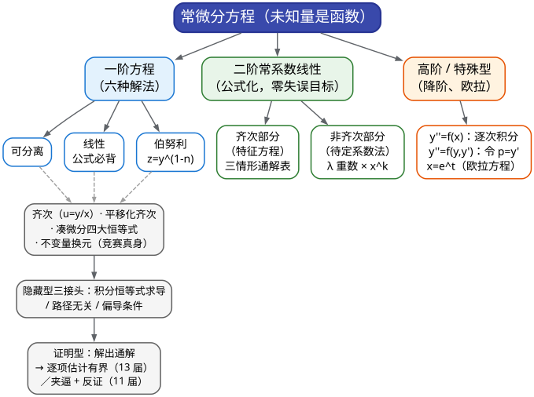
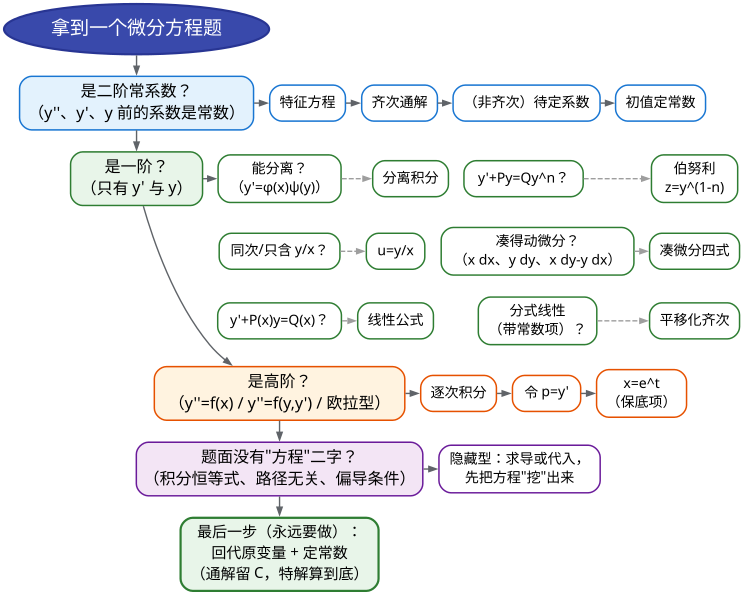

# CMC 手把手精讲
## ——《07 常微分方程》：把"从没学过"变成"必拿 14 分"

> 🐱 喵～欢迎来到 CMC 精讲系列的第七篇。这一篇有个特殊身份：**它是整套资料里唯一一个你"真的没学过"的板块**——华东师大《数学分析》没有常微分方程专章，你的大一课程整章跳过了它（这不是你的问题，数分课程本来就是这么设计的）。所以本篇从"什么是方程的解"讲起，**一行都不预设**。
>
> 好消息有两条：① 去年十七届你"未学微分方程、几乎裸考"都拿了奖，今年补上这块 14 分，等于白捡一个加分项；② 微分方程是全卷**套路最稳定**的板块——近三届的大题是同一个剧本（换元 → 化为可解 → 回代），训练方向完全确定，不赌运气。
>
> **本篇在考试中的地位**（数据口径：2015–2025 年 12 套初赛卷逐卷核对）：
> - 近 12 套卷**没有任何一届完全绕开**微分方程。近 3 届（15/16/17 届 A 类）**连续三年出 14 分独立大题**，位置固定在解答题第二、三题；
> - 官方评分点把大题切成三段：**写对换元约 6 分、解出化归后的方程约 8 分、回代收尾约 2–6 分**（三届官方解答逐字标注）——就算方程解不到底，"设出换元 + 写出化归式"已经站在 6 分上了；
> - 它还会以两种方式埋伏：**填空小题**（14 届一(4)、14 届补二一(3)、13 届补一(5)、9 届一(1)、8 届一(3)，每题 6–7 分）和"**隐藏型**"（藏在曲线积分路径无关条件、积分恒等式、偏导条件里：10 届二、9 届一(1)、8 届一(3)）；
> - 单卷直接分值 6–14 分，**计入隐藏型可达约 20 分**——这是全卷"确定性最高"的一块投入（套路固定、题干明示、按步骤给分）。
>
> **大纲对应条目**（《全国大学生数学竞赛考试内容》非数学专业类·常微分方程，原文摘录）：
> - (1) 常微分方程的基本概念：微分方程及其解、阶、通解、初始条件和特解等；
> - (2) 变量可分离的微分方程、齐次微分方程、一阶线性微分方程、Bernoulli 方程、全微分方程；
> - (3) 可用简单的变量代换求解的某些微分方程、可降阶的高阶微分方程；
> - (4) 线性微分方程解的性质及解的结构定理；
> - (5) 二阶常系数齐次线性微分方程、高于二阶的某些常系数齐次线性微分方程；
> - (6) 简单的二阶常系数非齐次线性微分方程：自由项为多项式、指数函数、正弦函数、余弦函数以及它们的和与积等；
> - (7) Euler 方程；(8) 微分方程的简单应用。
>
> **先修提示**：本篇的一切"求解"最终都落在**不定积分**上。如果你对 05 篇（一元积分计算）的凑微分、换元、分部积分还没恢复手感，建议先把 05 篇的"不定积分三板斧"过一遍再回来。除此之外无先修要求。
>
> **预计学时**：3 天（按每天 1–2 小时折算）。第一天：§二 + §3.1–3.5（一阶方程六解法）；第二天：§3.6–3.11 + 精讲 1–5 题（二阶方程 + 基础真题）；第三天：精讲 6–10 题 + 易错点 + 自测题。
>
> **在冲刺路线中的位置**：本篇对应 00 总纲**第 3 周（D15–17）**——D15–16 攻"一阶方程六解法 + 换元套路"（近三届 ODE 大题 + 14 届填 4 连做两遍），D17 攻"二阶常系数 + 隐藏型识别"；与 08 篇（D18–19）、09 篇（D20–21）同属"确定性板块抱团周"。
>
> 阅读建议：
> 1. 一阶方程的方法有六种，但<strong>"什么时候用哪种"比方法本身更值钱</strong>——先读 §1.2 速查表，把"题面长相"记在脑子里；
> 2. 每讲完一种解法立刻动笔解一道小例题——微分方程是手上的功夫，"看会了"和"会了"差着一道题的距离；
> 3. 真题精讲的"思路分析"里我写了**真实的试错路线**（包括我先试哪个换元、为什么放弃），这是考场上最需要的东西。
>
> 符号说明：📌 重点 | 💡 直觉/类比 | ⚠️ 易错点 | ✍️ 动笔练一练 | ❓ 自测题 | 🎯 考试定位 | ⏱️ 省时技巧

---

# 一、本篇地图

## 1.1 目录（读之前先看这张施工图）

- **§二 知识讲解**：微分方程是什么（解是函数不是数）→ 阶/通解/特解这些词到底在说什么 → 一阶六解法各自"从什么问题里长出来" → 二阶常系数与特征方程 → "隐藏型"ODE 的三种接头 → 有界性证明的骨架
- **§三 方法手册**：3.1 可分离变量 | 3.2 齐次与平移化齐次 | 3.3 一阶线性（公式必背）| 3.4 伯努利方程 | 3.5 凑微分/全微分 | 3.6 二阶常系数齐次 | 3.7 二阶常系数非齐次 | 3.8 解的结构与反推方程 | 3.9 可降阶和欧拉方程（保底）| 3.10 "隐藏型"识别 | 3.11 通用求解流程
- **§四 真题精讲**：10 道真题完整精讲（14 届补二一(3)、14 届一(4)+17 届三（同题复用）、16 届二、15 届二、9 届一(1)、8 届一(3)、10 届二、13 届三、11 届六）
- **§五 易错点清单**：12 条 ❌→✅ 对照
- **§六 自测题**：8 道，附完整答案
- **§七 结语**："微分方程防身七句话" + 学习建议 + 08 篇预告

## 1.2 方法速查表：什么题面 → 用什么武器（一屏版）

| 题面长相（信号） | 首选武器 | 说明 / 升级路线 |
|---|---|---|
| 能整理成 $`y'=\varphi(x)\psi(y)`$（两边的变量分得开） | **可分离变量**：分离 → 两边积分 | $`\int\dfrac{\mathrm{d}y}{\psi(y)}`$ 会出 $`\ln`$，注意定义域与绝对值 |
| $`y'=r\!\left(\dfrac{y}{x}\right)`$（分子分母同次） | **齐次方程**：令 $`u=\dfrac{y}{x}`$ | 化成 $`xu'=r(u)-u`$ 再分离变量 |
| $`y'+P(x)y=Q(x)`$（$`y`$ 与 $`y'`$ 都只出现一次幂） | **一阶线性公式**（必背） | $`y=e^{-\int P}\left(\int Qe^{\int P}\,\mathrm{d}x+C\right)`$，符号连错一处全盘皆错 |
| $`y'+Py=Qy^{n}`$（出现 $`y^2`$、$`\cos^2y`$ 这类"非线性但可配对"的项） | **伯努利**：令 $`z=y^{1-n}`$ | 化为线性；$`n=2`$ 时也可直接令 $`u=\dfrac{1}{y}`$ |
| $`M\,\mathrm{d}x+N\,\mathrm{d}y=0`$，且 $`\dfrac{\partial M}{\partial y}=\dfrac{\partial N}{\partial x}`$ | **全微分/凑微分** | 竞赛实务：不硬算积分因子，先凑四大恒等式（见 3.5） |
| 分式 $`\dfrac{\mathrm{d}v}{\mathrm{d}u}=\dfrac{a_1u+b_1v+c_1}{a_2u+b_2v+c_2}`$（常数项不全为 0） | **平移化齐次**：先解两直线交点，再平移 | 15 届二的完整剧本；行列式为 0 时改用 $`u=cv`$ 型代换 |
| 出现 $`y\,\mathrm{d}y\leftrightarrow x\,\mathrm{d}x`$ 或 $`x\,\mathrm{d}y-y\,\mathrm{d}x`$ 的**配对结构** | **不变量换元**：$`u=y^2`$、$`u=x^2`$、$`u=\dfrac{y}{x}`$ | 16 届二、15 届二全是这一招的变体 |
| 出现 $`\sin y\cdot y'`$、$`\cos y`$ 的"三角配对" | 令 $`u=\cos y`$（或 $`\sin y`$） | 17 届三、14 届一(4) 的真身（同一道题的两次出场） |
| $`y''+py'+qy=0`$（常系数齐次） | **特征方程**，三情形 | 实根/重根/复根三条通解，见 3.6 的表 |
| $`y''+py'+qy=f(x)`$（含初值） | **待定系数法** | 先齐次通解，再试特解：$`\lambda`$ 是（$`k`$ 重）特征根时乘 $`x^k`$ |
| 题给两三个"特解"求方程 | **解的结构定理** | 两特解之差 = 齐次解 → 特征根 → 反推左端，再代入定右端 |
| 积分恒等式 / 路径无关条件 / 偏导条件中含**待求函数** | **隐藏型**：求导或代入，化出 ODE | 识别优先：见到"函数藏在积分号/偏导条件里"就问"能不能化 ODE" |
| $`y''=f(x)`$ 或 $`y''=f(y,y')`$ | **可降阶**：逐次积分 / 令 $`p=y'`$ | 大纲 (3)，两个五分钟级小点 |
| $`x^2y''+pxy'+qy=f(x)`$（$`x^n`$ 配 $`n`$ 阶导） | **欧拉方程**：令 $`x=e^t`$ | 🎯 保底项（10 分钟级），12 套样本未独立考过 |
| "证明每个解都有界 / $`f\equiv0`$" | 先求（隐式）通解，再**逐项估计** | 13 届三骨架；11 届六用夹逼 + 反证 |

## 1.3 知识树：本篇全部内容的骨架



一句话读图：**一阶方程比的是"识别"（六种长相、六把钥匙），二阶常系数比的是"默写"（特征根三情形公式化），而竞赛真正的分数藏在"换元的眼力"（不变量配对、平移化齐次）和"隐藏型识别"里。**

---

# 二、知识讲解：从"什么是解"到"六大解法从哪来"

## 2.1 微分方程是什么：未知量从"数"变成了"函数"

你在中学和数分里解过无数方程，但那些方程求的都是**数**：$`3x+1=7`$ 求 $`x`$，$`x^2-4=0`$ 求 $`x`$。微分方程换了个玩法——**未知量是函数**：

```math
\text{找函数 } y=y(x)\text{，使得 } y'=y.
```

翻译成人话："找一个函数，它在每一点的**变化率**（导数），恰好等于它在该点的**函数值**。"

谁满足这条规则？不用任何公式你也该猜到 $`y=e^x`$：因为 $`(e^x)'=e^x`$，函数值等于变化率，它完美地"自我复制"。再想一步：$`y=2e^x`$ 呢？$`(2e^x)'=2e^x`$ ✓。$`y=Ce^x`$（任意常数 $`C`$）呢？同样成立 ✓。

所以这个微分方程的解**不是一个数，而是一族函数** $`y=Ce^x`$。这就是微分方程的第一个观念转变：

📌 **微分方程的解是函数**；"求解"的意思是**把所有满足方程的（一族）函数写出来**。

💡 **打比方**：代数方程像"找出凶手是谁"——答案是一个名字（数）；微分方程像"描述一条完整的行车路线"——已知的不是位置，而是**每一刻的运动规则**（速度与位置、加速度的关系），让你还原整条路线。GPS 记录的是位置序列；而物理定律给你的永远是"变化率之间的关系"，这正是为什么**自然科学里几乎一切定律都是微分方程**（放射性衰变 $`N'=-\lambda N`$、冷却定律 $`T'=-k(T-T_{\text{环境}})`$、单摆 $`\theta''=-\dfrac{g}{l}\theta`$……）。

那你熟悉的积分运算呢？$`\displaystyle\int f(x)\,\mathrm{d}x`$ 其实就是在解**最简单的微分方程** $`y'=f(x)`$——只不过数分课把"解 $`y'=f(x)`$"包装成了"求不定积分"。换句话说：

📌 **你已经会解最简单的微分方程了**。本篇要教的，是把"解不出来的微分方程"通过**识别 + 换元**，变回"你会积的积分"。

## 2.2 五个词把话说明白：阶、通解、特解、初值、隐式

微分方程的术语很少，但竞赛填空最爱在这几个词上设坑。一次讲清楚：

- **阶**：方程里出现的**最高阶导数**的阶数。$`y'+xy=0`$ 是一阶；$`y''+y=0`$ 是二阶；$`y''y'''+y=0`$ 是三阶。
- **通解**：包含**阶数个独立任意常数**的解族。一阶方程的通解带 1 个常数（如 $`y=Ce^x`$）；二阶带 2 个（如 $`y=C_1e^{x}+C_2e^{-x}`$）。为什么常数个数 = 阶数？直觉地说：每积一次分冒出一个常数，二阶方程本质上是"积两次分"。
- **特解**：把任意常数**确定下来**之后的某一个具体解。
- **初始条件**：用来定住常数的附加条件。一阶方程给一个（如 $`y(0)=1`$），二阶给两个（如 $`y(0)=0,\ y'(0)=1`$）。**二阶的两个条件里通常有一个是关于 $`y'`$ 的**——这是定两个常数的信息量。
- **隐式解**：解是 $`F(x,y)=C`$ 的形式，$`y`$ 没有被显式解出来。竞赛答案**允许隐式**——16 届二的官方答案 $`(1+x)\sqrt{x^2+y^2}=Cx`$、17 届三的 $`(x+C)\cos y=\ln x`$ 都是隐式的，不必强行解出 $`y`$。

⚠️ **填空最大的坑（一句话记住）**：
- 问"**通解**"，答案**必须带任意常数 $`C`$**；
- 问"**解**"（初值问题、或"微分方程 $`\begin{cases}\cdots\\ y(0)=0\end{cases}`$ 的解是"），答案**不能留 $`C`$**，必须算到底。

丢 $`C`$、多 $`C`$ 都是整题 0 分（14 届一(4) 问"通解"、13 届补一(5) 问"（初值问题的）解"，正是这两种问法的真题对照）。

另一个保命习惯：**任何解，代入原方程 30 秒验证**。微分方程不像极限积分那样"答案一望可知"，验证是唯一便宜的保险。验算方法：把 $`y`$、$`y'`$ 代回方程，看是不是恒等式。

## 2.3 一阶方程六解法的生长史：每一把钥匙为谁而生

一阶方程的标准形是 $`y'=f(x,y)`$。这六种解法不是天上掉下来的，而是**为对付六种不同的 $`f`$ 生长出来的**——看清"它长什么样才用谁"，比死记步骤重要一百倍。

### （1）可分离变量：最朴素的一种

如果 $`f(x,y)`$ 能拆成"纯 $`x`$ 的式子 × 纯 $`y`$ 的式子"：

```math
y'=\varphi(x)\,\psi(y)\quad\Longleftrightarrow\quad \frac{\mathrm{d}y}{\psi(y)}=\varphi(x)\,\mathrm{d}x,
```

就把变量"分到两边"，各自积分：$`\displaystyle\int\frac{\mathrm{d}y}{\psi(y)}=\int\varphi(x)\,\mathrm{d}x+C`$，得到隐式通解。

**为什么合法**？设 $`y=y(x)`$ 是解，两边同除 $`\psi(y)`$：$`\dfrac{y'(x)}{\psi(y(x))}=\varphi(x)`$，对 $`x`$ 积分，左端换元 $`y=y(x)`$（$`\mathrm{d}y=y'\,\mathrm{d}x`$）就成了 $`\int\dfrac{\mathrm{d}y}{\psi(y)}`$。**"分家"的合法性来自换元积分法**，莱布尼茨记号 $`\dfrac{\mathrm{d}y}{\mathrm{d}x}`$ 天然支持这种"把 $`\mathrm{d}y`$、$`\mathrm{d}x`$ 当微分看"的操作——这是数学史上最成功的一套记号。

**微例**：$`y'=xy`$ ⟹ $`\dfrac{\mathrm{d}y}{y}=x\,\mathrm{d}x`$ ⟹ $`\ln|y|=\dfrac{x^2}{2}+C_1`$ ⟹ $`y=Ce^{x^2/2}`$（把 $`e^{C_1}`$ 记成 $`C`$）。
⚠️ 注意两点：$`y=0`$ 是不是丢掉的特解？（分离时除了 $`y`$——**$`y\equiv0`$ 恰好被 $`C=0`$ 包含**，没丢）；$`\ln`$ 外面的换写（$`|y|`$ 去掉时符号被 $`C`$ 吸收）要会解释。

### （2）齐次方程：把两个变量"压缩"成一个

信号：$`y'`$ 只依赖 $`\dfrac{y}{x}`$，即 $`y'=r\!\left(\dfrac{y}{x}\right)`$（等价地：方程右边分子分母关于 $`x,y`$ **同次**）。

换元 $`u=\dfrac{y}{x}`$（即 $`y=ux`$），则 $`y'=u+xu'`$，方程变成

```math
u+xu'=r(u)\quad\Longleftrightarrow\quad x\frac{\mathrm{d}u}{\mathrm{d}x}=r(u)-u,
```

**立刻变成可分离方程**（左边纯 $`u`$，右边纯 $`x`$）。解出 $`u(x)`$ 后再回代 $`u=\dfrac{y}{x}`$。

💡 **打比方**：$`f(x,y)`$ 依赖两个变量，难办；但同次性说明它其实只依赖"方向"$`\dfrac{y}{x}`$——把二维信息压成一维，问题就降维了。这正是以后学"极坐标思想""量纲分析"的同一个灵魂。

**微例**：$`y'=\dfrac{y}{x}+\dfrac{x}{y}`$。令 $`u=\dfrac{y}{x}`$：$`u+xu'=u+\dfrac{1}{u}`$ ⟹ $`xu'=\dfrac{1}{u}`$ ⟹ $`u\,\mathrm{d}u=\dfrac{\mathrm{d}x}{x}`$ ⟹ $`\dfrac{u^2}{2}=\ln|x|+C`$ ⟹ 回代得 $`y^2=2x^2(\ln|x|+C)`$。

### （3）一阶线性：积分因子是"配方"手法的化身

标准形：

```math
\boxed{y'+P(x)\,y=Q(x)}
```

把满足它的函数族写全，有一个**必须背到条件反射的公式**：

```math
y=e^{-\int P(x)\,\mathrm{d}x}\left(\int Q(x)\,e^{\int P(x)\,\mathrm{d}x}\,\mathrm{d}x+C\right).
```

**公式怎么来的（你至少要会推一次，这样符号才不会记反）**：目标是把左边凑成"某个乘积的导数"。观察到 $`(ye^{\int P})'=y'e^{\int P}+yPe^{\int P}=e^{\int P}(y'+Py)`$——**乘上 $`e^{\int P(x)\mathrm{d}x}`$ 之后，左边正好变成 $`(ye^{\int P})'`$**！于是方程两边同乘积分因子：

```math
(ye^{\int P})'=Qe^{\int P}\quad\Longrightarrow\quad ye^{\int P}=\int Qe^{\int P}\,\mathrm{d}x+C\quad\Longrightarrow\quad \text{解出 }y.
```

💡 **打比方**：积分因子就像"配成完全平方"：乘法本身不改变方程的解，但选对了乘的那个函数，左边就自动合体成一个导数——这是整个一阶理论里最漂亮的一步。**记忆抓手**：$`e^{\int P}`$ 进去，与 $`y`$ 相乘后整体求导；最后解出 $`y`$ 时那个 $`e^{-\int P}`$ 是"除回去"来的（**一正一负**，就是符号别记反的锚点）。

竞赛里一阶线性几乎**从不裸考**——它总是"换元后的第二站"（伯努利化线性、$`u=y^2`$ 化线性、$`\cos y`$ 化线性……）。所以公式的熟练度直接决定大题后半段的速度。

### （4）伯努利方程：把非线性"捏"回线性

信号：$`y'+P(x)y=Q(x)\,y^{n}`$（$`n\neq0,1`$；出现 $`y^2`$、$`\cos^2y`$ 这类"多余的幂"）。

换元：

```math
\boxed{z=y^{1-n}}\quad\Longrightarrow\quad z'+(1-n)P(x)\,z=(1-n)Q(x)\ \text{（一阶线性）}.
```

**推导一行看穿**：方程两边乘 $`(1-n)y^{-n}`$：$`(1-n)y^{-n}y'+(1-n)Py^{1-n}=(1-n)Q`$。注意 $`z=y^{1-n}`$ 时 $`z'=(1-n)y^{-n}y'`$——**两个含 $`y`$ 的块同时变成了 $`z`$ 与 $`z'`$**，非线性项 $`y^n`$ 被精确吸收。这就是 $`1-n`$ 这个"怪指数"的来历：它是由"配出 $`z'`$"反推出来的，不是灵感。

**微例**：$`y'-\dfrac{y}{x}=-y^2`$（$`n=2`$）。令 $`z=y^{-1}`$：$`z'+\dfrac{z}{x}=1`$（线性）⟹ $`z=\dfrac{1}{x}\left(\dfrac{x^2}{2}+C\right)`$ ⟹ $`\dfrac{1}{y}=\dfrac{x}{2}+\dfrac{C}{x}`$。真题里 17 届三、14 届一(4) 是同一个伯努利方程（$`n=2`$ 的 $`\cos y`$ 版）的两次出场。

### （5）全微分方程与"凑微分"：根本不用积分

若方程写成微分形式 $`M(x,y)\,\mathrm{d}x+N(x,y)\,\mathrm{d}y=0`$，且

```math
\frac{\partial M}{\partial y}=\frac{\partial N}{\partial x},
```

则存在原函数 $`u(x,y)`$ 使 $`\mathrm{d}u=M\,\mathrm{d}x+N\,\mathrm{d}y`$，通解即 $`u(x,y)=C`$。

**竞赛实务：别硬套"求原函数"的流程，先练"凑"**。把四大恒等式背成肌肉记忆：

```math
x\,\mathrm{d}x+y\,\mathrm{d}y=\frac{1}{2}\mathrm{d}(x^2+y^2),\qquad x\,\mathrm{d}y+y\,\mathrm{d}x=\mathrm{d}(xy),
```

```math
\frac{x\,\mathrm{d}y-y\,\mathrm{d}x}{x^2}=\mathrm{d}\!\left(\frac{y}{x}\right),\qquad \frac{x\,\mathrm{d}y-y\,\mathrm{d}x}{x^2+y^2}=\mathrm{d}\!\left(\arctan\frac{y}{x}\right).
```

前两式你其实一直在用（凑 $`x^2+y^2`$、凑 $`xy`$ 的微分）；后两式是"商式"与"角式"的配方——**想凑 $`\dfrac{y}{x}`$ 或 $`\arctan\dfrac{y}{x}`$，先造分子 $`x\,\mathrm{d}y-y\,\mathrm{d}x`$**。16 届二的官方解法 2 就是纯凑微分路线（见精讲 5）。

### （6）换元化可解：竞赛真正考的东西

上面五种是"教材的标准件"。竞赛的做法是：**题目给的方程不属于任何标准件，但做一个代换后就属于了**。两类最高频的换元：

**类型 A：平移化齐次（分式线性代换）**。方程长这样：

```math
\frac{\mathrm{d}v}{\mathrm{d}u}=\frac{a_1u+b_1v+c_1}{a_2u+b_2v+c_2}\qquad(\text{常数项 }c_1,c_2\text{ 不全为 }0).
```

- 若行列式 $`\begin{vmatrix}a_1&b_1\\a_2&b_2\end{vmatrix}\neq0`$：解方程组 $`\begin{cases}a_1u+b_1v+c_1=0\\ a_2u+b_2v+c_2=0\end{cases}`$ 得交点 $`(u_0,v_0)`$，**平移** $`U=u-u_0,\ V=v-v_0`$ ——常数项消失，方程变成齐次，再令 $`W=\dfrac{V}{U}`$ 分离变量。**两步换元，一步都不能省**（15 届二整套流程）。
- 若行列式 $`=0`$：两直线平行（无交点），改用 $`u=cv`$ 型代换直接化可分离。

**类型 B：不变量配对（竞赛的"嗅探术"）**。操作口诀：

> **① 先把方程写成微分形式**（$`\mathrm{d}x`$、$`\mathrm{d}y`$ 各就各位，别留 $`y'`$ 的形式）；
> **② 找配对**：$`x\,\mathrm{d}x`$ 和 $`y\,\mathrm{d}y`$ 配不配？$`x\,\mathrm{d}y`$ 和 $`y\,\mathrm{d}x`$ 配不配（能不能凑 $`\mathrm{d}(xy)`$、$`\mathrm{d}(y/x)`$）？
> **③ 决定换元**：配上了 $`x\,\mathrm{d}x\leftrightarrow y\,\mathrm{d}y`$ 就试 $`u=y^2`$（把 $`y\,\mathrm{d}y`$ 变成 $`\dfrac{1}{2}\mathrm{d}u`$、消灭平方）；出现 $`\sin y\,y'`$ 就试 $`u=\cos y`$（三角配对：$`\mathrm{d}(\cos y)=-\sin y\,\mathrm{d}y`$）。

**微例（竞赛原题的手感）**：$`(x^3-y^2)\mathrm{d}x+(x^2y+xy)\mathrm{d}y=0`$（16 届二）。写成微分形式后侦察：$`x^3\mathrm{d}x`$ 是"$`x`$ 单打"、$`-y^2\mathrm{d}x`$ 嫌 $`y`$ 幂次高——但注意 $`y\,\mathrm{d}y`$ 与 $`x\,\mathrm{d}x`$ 可以配！试 $`u=y^2`$，$`\mathrm{d}u=2y\,\mathrm{d}y`$，代进去 $`y^2`$ 全部升级成 $`u`$、$`y\,\mathrm{d}y`$ 升级成 $`\dfrac{\mathrm{d}u}{2}`$——**配平成功，方程变成 $`u`$ 的一阶线性**。完整过程见精讲 5。

## 2.4 二阶常系数线性：从"猜 $`e^{rx}`$"到特征方程

### （1）齐次方程：为什么要"猜"指数函数

考虑 $`y''+py'+qy=0`$（$`p,q`$ 为常数）。直接积分积不动（$`y''`$ 与 $`y`$ 纠缠在一起），于是用**待定试解法**：什么函数求导后"形态不变"？指数函数 $`e^{rx}`$——求一次导只多一个因子 $`r`$。代入试探：

```math
r^2e^{rx}+pr\,e^{rx}+qe^{rx}=0\ \Longleftrightarrow\ \boxed{r^2+pr+q=0}\quad(\text{特征方程}).
```

只要 $`r`$ 满足这个二次方程，$`e^{rx}`$ 就是一个解。二次方程根有三种情况，对应三条通解——**这张表必须默写**：

| 特征根情形 | 通解 |
|---|---|
| 两实根 $`r_1\neq r_2`$ | $`y=C_1e^{r_1x}+C_2e^{r_2x}`$ |
| 二重实根 $`r`$ | $`y=(C_1+C_2x)e^{rx}`$ |
| 共轭复根 $`\alpha\pm\beta i`$ | $`y=e^{\alpha x}(C_1\cos\beta x+C_2\sin\beta x)`$ |

💡 **三个情形的直觉**：① 两个实根 = 两种"生长率"模式叠加（$`e^{r_1x}`$、$`e^{r_2x}`$）；② 重根时两个模式"撞车"了（只有一种 $`e^{rx}`$），需要第二个线性无关的解——数学上可以验证 $`xe^{rx}`$ 恰好合格（代入即证），**记住"撞车就乘 $`x`$"**；③ 复根时 $`e^{(\alpha+\beta i)x}=e^{\alpha x}(\cos\beta x+i\sin\beta x)`$，实部虚部拆开就是一对实解——**"复根 = 衰减（或增长）+ 振荡"**（阻尼振动、RLC 电路的数学灵魂）。

### （2）非齐次方程：结构定理 + 待定系数

对 $`y''+py'+qy=f(x)`$，**任何解都可以写成**：

```math
\boxed{y=\underbrace{C_1y_1+C_2y_2}_{\text{齐次通解}}+\underbrace{y^*}_{\text{某个特解}}}.
```

（这是大纲条目 (4)"解的结构定理"的核心，下一节 3.8 展开。）

求特解 $`y^*`$ 用**待定系数法**：看右端 $`f(x)`$ 的"形态"，猜 $`y^*`$ 同形态（细节表见 §3.7）。最要命的一条规则先预告：

⚠️ 如果 $`\lambda`$（指数型右端 $`f=P_m(x)e^{\lambda x}`$ 里的 $`\lambda`$，或三角函数型的 $`\alpha\pm\beta i`$）**恰好是特征根**，试解就要**乘 $`x^k`$**（$`k`$ = 它是几重根，0/1/2）。直觉：$`e^{\lambda x}`$ 撞上了齐次解，直接代入会被左端"吃掉"成 0，必须乘 $`x`$ 把它从共振区"挪开"——💡 就像荡秋千：推力频率等于固有频率时会发生共振，普通推法（不乘 $`x`$）无效，得换节奏。

## 2.5 "隐藏型"ODE：三种接头

有一类题，题面里根本没写"微分方程"四个字，但你**做完一步变形后，微分方程自己冒出来**。这是命题组最爱设的伏笔（10 届二、9 届一(1)、8 届一(3) 三道真题），必须专门训练"接头识别"。三种接头：

**接头 1：积分恒等式 → 两边求导。** 题面形如

```math
f(x)\cos x+2\int_0^x f(t)\sin t\,\mathrm{d}t=x+1,
```

待求函数**锁在积分号里**。动作：**两边对 $`x`$ 求导**（变限积分求导法则：$`\dfrac{\mathrm{d}}{\mathrm{d}x}\displaystyle\int_0^x g(t)\,\mathrm{d}t=g(x)`$），积分号当场消失，露出 $`f'(x)\cos x+f(x)\sin x=1`$ —— 一阶线性方程（9 届一(1)，精讲 7）。
💡 直觉：**求导是积分号的天敌**。见到"含未知函数的积分等式"，第一反应永远是"能不能求导"。
⚠️ 求导前先代入 $`x=0`$ 抢一个初值（$`f(0)=1`$），后面定常数就靠它——**先抢初值再求导**是这类题的标准起手式。

**接头 2：路径无关条件 → $`\dfrac{\partial Q}{\partial x}=\dfrac{\partial P}{\partial y}`$。** 题面形如"曲线积分 $`\displaystyle\int_L P\,\mathrm{d}x+Q\,\mathrm{d}y`$ 与路径无关，且 $`P,Q`$ 中含待求函数 $`f`$"。动作：写出路径无关的充要条件，它就是一个含 $`f`$ 与 $`f'`$ 的 ODE（10 届二：整理后 $`tf'(t)+f(t)=1`$——顺手还能凑成 $`(tf(t))'=1`$，两行出答案）。
**接头 3：偏导条件 + 抽象函数 → 链式法则。** 题面形如 $`z=f(e^xy^2)`$，已知 $`\dfrac{\partial z}{\partial x}=z`$（8 届一(3)）。动作：对 $`x`$ 求偏导用链式法则得 $`f'(u)\cdot u=f(u)`$，变成 $`f`$ 的可分离方程。

**给这三种接头一张统一的口号**：

> 🎯 **见到"待求函数 × 积分号 / 路径无关条件 / 偏导条件"，先不求原式，先问"化 ODE 的那一步在哪"。**

## 2.6 证明型：有界性与"恒为零"的骨架

命题组偶尔把 ODE 和证明题杂交（13 届三、11 届六，都是 14 分）。它们看着吓人，骨架完全固定：

**套路 A（13 届三型："证明每一个解都有界"）**：
1. **先解**：把方程的通解写出来（齐次通解 + 一个特解）。特解怎么求？官方用了一手漂亮的"**分组常数变易**"（把 $`y''+14y'+13y`$ 拆成 $`(y'+y)'+13(y'+y)`$，令 $`y_1=y'+y`$ 降成一阶）——见精讲 10；
2. **再估**：设 $`|f(x)|\le M`$，对通解里的每一项（$`|C_1e^{-x}|`$、$`\left|e^{-x}\int_0^xf(t)e^t\,\mathrm{d}t\right|`$ 等）**逐项放缩**；
3. **收尾一句**："对每一个确定的解，$`C_1,C_2`$ 是固定的常数，故有界。"

**套路 B（11 届六型："证明解有界/导出矛盾"）**：
1. 分离变量积分出**隐式通解** $`g(f(x))=\dfrac{2}{3}\displaystyle\int_0^xe^{-t^2}\mathrm{d}t+C`$；
2. 对 $`C`$ 做**双向估计**：一边从初值 $`f(0)\le1`$ 得出 $`C\le g(1)`$；另一边假设 $`f\to+\infty`$ 推出 $`C`$ 的精确值，两者矛盾——**反证**。

💡 两种套路共同的灵魂：**"解出来"只值一半分，"会估计"才是拿分点**。估计的工具箱就是 01/06 篇的老朋友们：$`e^{-x}\le1`$、$`|f|\le M`$、$`\arctan`$ 有界、夹逼。

## 2.7 一张"求解流程图"（考场上照着走）



---

# 三、方法手册：十一件工具，见招拆招

每个方法按统一格式展开：【适用信号】→【步骤】→【关键公式】→【真题微型例子】。再说一次：**你缺的不是方法本身，而是什么时候用它**——【适用信号】比公式更值得花时间。

## 3.1 可分离变量

**【适用信号】** 方程能整理成 $`y'=\varphi(x)\,\psi(y)`$；或者写成微分形式后，"含 $`x`$ 的全在一边、含 $`y`$ 的全在另一边"。

**【步骤】**
1. 把 $`y'`$ 写成 $`\dfrac{\mathrm{d}y}{\mathrm{d}x}`$，**代数整理**成"$`y`$ 的东西 × $`\mathrm{d}y`$ = $`x`$ 的东西 × $`\mathrm{d}x`$"；
2. 两边积分（各加各的常数，合并成一个 $`C`$ 放右边）；
3. 得到隐式通解；题目给初值就代入定 $`C`$；
4. **检查丢解**：分离时若除过某个可能为零的式子，回头看看那些"被除掉的解"是否已被 $`C`$ 的取值覆盖。

**【关键公式】**

```math
\frac{\mathrm{d}y}{\psi(y)}=\varphi(x)\,\mathrm{d}x\ \Longrightarrow\ \int\frac{\mathrm{d}y}{\psi(y)}=\int\varphi(x)\,\mathrm{d}x+C.
```

常用积分：$`\displaystyle\int\frac{\mathrm{d}y}{y}=\ln|y|`$；$`\displaystyle\int\frac{\mathrm{d}y}{1+y^2}=\arctan y`$；$`\displaystyle\int\frac{\mathrm{d}y}{\sqrt{1+y^2}}=\ln\!\left(y+\sqrt{1+y^2}\right)`$。

**【真题微型例子】**（第 13 届非数学类·初赛补赛·填空第 5 题，2021）解初值问题

```math
\begin{cases}(x+1)\dfrac{\mathrm{d}y}{\mathrm{d}x}+1=2e^{-y},\\ y(0)=0.\end{cases}
```

这不是纯可分离（右边有 $`e^{-y}`$、左边有 1），但**乘一个 $`e^y`$ 就分裂了**：$`(x+1)e^y y'=2-e^y`$。更重要的一手是**把 $`e^y`$ 整体看成新未知函数**：$`\dfrac{\mathrm{d}(e^y)}{\mathrm{d}x}=e^y\dfrac{\mathrm{d}y}{\mathrm{d}x}`$，于是方程变成 $`\dfrac{\mathrm{d}(e^y)}{\mathrm{d}x}=-\dfrac{1}{x+1}e^y+\dfrac{2}{x+1}`$ —— 关于 $`e^y`$ 的一阶**线性**方程！套公式得 $`e^y=\dfrac{2x+C}{x+1}`$，代入 $`y(0)=0`$ 得 $`C=1`$，故 $`y=\ln\dfrac{2x+1}{x+1}`$。（完整精讲见精讲 1。）
> ⏱️ 省时技巧：凡是方程里出现 $`e^{ay}`$、$`\ln y`$、$`\cos y`$ 之类的"整块"，先问自己"能不能把这个整块当新未知函数"——这就是下一节（3.3）"换元后接线性"的通用剧本。

## 3.2 齐次方程与平移化齐次

**【适用信号】**
- 标准齐次：$`y'=r\!\left(\dfrac{y}{x}\right)`$，或右边分子分母关于 $`x,y`$ 同次（每项 $`x`$、$`y`$ 幂次和相同）；
- 平移化齐次：$`\dfrac{\mathrm{d}v}{\mathrm{d}u}=\dfrac{a_1u+b_1v+c_1}{a_2u+b_2v+c_2}`$ 且常数项不全为 0。

**【步骤（标准齐次）】** 令 $`u=\dfrac{y}{x}`$（即 $`y=ux`$，$`y'=u+xu'`$）→ 得 $`xu'=r(u)-u`$ → 分离变量 → 回代。

**【步骤（平移化齐次）】**
1. 解 $`\begin{cases}a_1u+b_1v+c_1=0\\ a_2u+b_2v+c_2=0\end{cases}`$ 得交点 $`(u_0,v_0)`$（若两方程代表平行线、无交点，改令 $`u=cv`$ 型代换）；
2. **平移**：$`U=u-u_0`$、$`V=v-v_0`$，则 $`\dfrac{\mathrm{d}V}{\mathrm{d}U}=\dfrac{a_1U+b_1V}{a_2U+b_2V}`$（常数项消失 = 齐次）；
3. 再令 $`W=\dfrac{V}{U}`$ → 分离变量；
4. **两层回代**：$`W\to V/U\to(u,v)\to`$ 原变量。

**【关键公式】** $`y'=u+xu'`$（$`y=ux`$）；$`V=WU`$（$`V=WU`$ 时 $`V'=W+UW'`$）。

**【真题微型例子】**（第 15 届非数学 A 类·解答第二题，2023）解方程 $`(x^2+y^2+3)\dfrac{\mathrm{d}y}{\mathrm{d}x}=2x\!\left(2y-\dfrac{x^2}{y}\right)`$。
先**重新配对变量**：两边乘 $`\dfrac{y}{x}`$ 整理得 $`\dfrac{y\,\mathrm{d}y}{x\,\mathrm{d}x}=\dfrac{2(2y^2-x^2)}{x^2+y^2+3}`$。左右两边分别是 $`\dfrac{1}{2}\mathrm{d}(y^2)`$ 与 $`\dfrac{1}{2}\mathrm{d}(x^2)`$ 的结构，于是**令 $`u=x^2,\ v=y^2`$**，方程变成

```math
\frac{\mathrm{d}v}{\mathrm{d}u}=\frac{2(2v-u)}{u+v+3}\quad(\text{带常数项的"分式线性"！})
```

解 $`\begin{cases}2v-u=0\\ u+v+3=0\end{cases}`$ 得 $`u=-2,\ v=-1`$；**平移** $`U=u+2,\ V=v+1`$ 得 $`\dfrac{\mathrm{d}V}{\mathrm{d}U}=\dfrac{2(2V-U)}{U+V}`$（齐次！）；再令 $`W=\dfrac{V}{U}`$ 分离变量，解得 $`U(W-2)^3=C(W-1)^2`$，**两层回代**得 $`(y^2-2x^2-3)^3=C(y^2-x^2-1)^2`$。整套剧本见精讲 6。
> ⏱️ 省时技巧：平移那一步是给分点（官方 8 分处），**动笔写"令 $`U=u+2,V=v+1`$，则方程化为……"这一句本身就是分**。

## 3.3 一阶线性方程

**【适用信号】** $`y'+P(x)y=Q(x)`$——特征是 $`y`$ 与 $`y'`$ **都只出现一次幂、不相乘**；更常见的信号是"**换元后**变成这个形状"（$`e^y`$ 块、$`u=y^2`$ 块、$`z=\cos y`$ 块……）。

**【步骤】**
1. 化成标准形 $`y'+P(x)y=Q(x)`$（系数归一！$`y`$ 前面不能有因子）；
2. **默写公式**（考场上现推太慢，但推法要会）：先算 $`\displaystyle\int P\,\mathrm{d}x`$（不加常数），再套公式；
3. 计算 $`\displaystyle\int Qe^{\int P}\mathrm{d}x`$ 与外面的 $`e^{-\int P}`$；
4. 代入初值定 $`C`$（初值问题）或保留 $`C`$（通解）。

**【关键公式】**

```math
\boxed{y=e^{-\int P(x)\,\mathrm{d}x}\left(\int Q(x)\,e^{\int P(x)\,\mathrm{d}x}\,\mathrm{d}x+C\right)}
```

（推导记忆：$`(ye^{\int P})'=Qe^{\int P}`$。）

**【真题微型例子】**（第 9 届非数学类·填空第 1 题，2017）已知可导函数 $`f(x)`$ 满足

```math
f(x)\cos x+2\int_0^xf(t)\sin t\,\mathrm{d}t=x+1,
```

求 $`f(x)`$。
**先抢初值**：令 $`x=0`$ 得 $`f(0)=1`$。**两边求导**（接头 1）：$`f'\cos x-f\sin x+2f\sin x=1`$，即 $`f'\cos x+f\sin x=1`$，在 $`\cos x\neq0`$ 处化标准形

```math
f'+f\tan x=\sec x.
```

积分因子 $`e^{\int\tan x\,\mathrm{d}x}=e^{-\ln\cos x}=\sec x`$，于是 $`(f\sec x)'=\sec^2x`$，积分得 $`f\sec x=\tan x+C`$，即 $`f=\sin x+C\cos x`$；由 $`f(0)=1`$ 得 $`C=1`$。故 $`f(x)=\sin x+\cos x`$。（完整精讲见精讲 7。）
> ⚠️ 积分因子 $`e^{\int\tan x\,\mathrm{d}x}=e^{-\ln\cos x}`$ 只差一个常数倍的意义，**不写绝对值不写 $`+C`$**——竞赛标准答案就是这么处理的（官方解答原文：$`e^{-\ln\cos x}`$）。

## 3.4 伯努利方程

**【适用信号】** $`y'+P(x)y=Q(x)y^{n}`$（$`n\ne0,1`$）。题面特征：**$`y`$ 的一次项旁边挂着 $`y`$ 的 $`n`$ 次幂**，或整理后"非线性但可配对"（典型如 17 届三整理后出现 $`\cos^2y`$、14 届一(4) 同款）。

**【步骤】**
1. 先把方程整理成标准形（两边同除 $`y`$ 的系数、必要时同除 $`y^n`$）；
2. 换元 $`z=y^{1-n}`$（**注意是 $`1-n`$，不是 $`n`$、不是 $`n-1`$**——由"配出 $`z'`$"反推的记忆：两边乘 $`(1-n)y^{-n}`$ 后，$`y^{-n}y'`$ 恰好是 $`\dfrac{z'}{1-n}`$）；
3. 得到 $`z`$ 的一阶线性方程，套 3.3 公式；
4. **回代** $`z=y^{1-n}`$，写隐式通解。

**【关键公式】** $`z=y^{1-n}\ \Longrightarrow\ z'+(1-n)Pz=(1-n)Q`$；特例 $`n=2`$ 时 $`z=\dfrac{1}{y}`$。

**【真题微型例子】**（第 17 届非数学 A 类·解答第三题，2025；也是第 14 届一(4) 的同一方程）求微分方程

```math
y'\,x\ln x\,\sin y+(1-x\cos y)\cos y=0
```

的通解。
**第一步整理成伯努利形状**：两边同除 $`x\ln x`$ 得 $`y'\sin y+\dfrac{\cos y}{x\ln x}=\dfrac{\cos^2y}{\ln x}`$。侦察：$`\sin y\cdot y'=-(\cos y)'`$——**三角配对**！令 $`z=\cos y`$，则

```math
z'-\frac{1}{x\ln x}z=-\frac{1}{\ln x}z^2\quad(n=2\text{ 的伯努利}).
```

再令 $`u=z^{-1}`$ 化为线性 $`u'+\dfrac{1}{x\ln x}u=\dfrac{1}{\ln x}`$，套公式（$`\int\dfrac{\mathrm{d}x}{x\ln x}=\ln\ln x`$）得 $`u=\dfrac{x+C}{\ln x}`$，回代 $`\dfrac{1}{\cos y}=\dfrac{x+C}{\ln x}`$。完整精讲——**同一道题在 2022 年以 6 分填空出现、2025 年以 14 分大题重考**——见精讲 3 与精讲 4。
> 🎯 这道题的"两次出场"是最强的复习理由：**真题复用是常态**，"伯努利 + 三角配对"必须练到条件反射。

## 3.5 凑微分与全微分方程

**【适用信号】** 方程能写成 $`M\,\mathrm{d}x+N\,\mathrm{d}y=0`$；出现 $`x\,\mathrm{d}y-y\,\mathrm{d}x`$、$`x\,\mathrm{d}x+y\,\mathrm{d}y`$、$`x\,\mathrm{d}y+y\,\mathrm{d}x`$ 的"配对残影"；或者你**看不出**该用 3.1–3.4 哪一种时。

**【步骤】**
1. **先验证**：算 $`\dfrac{\partial M}{\partial y}`$ 与 $`\dfrac{\partial N}{\partial x}`$，相等 ⟹ 全微分方程，通解为 $`u(x,y)=C`$（原函数 $`u`$ 可通过"凑"或"线积分"求）；
2. **凑微分优先**：拿四大恒等式去"套"——方程里某两块恰好拼成某个 $`\mathrm{d}(\cdot)`$，就把它整块换掉；
3. 剩下的部分继续凑，或改判为可分离/线性；
4. 凑法也需要**除以因子**时（如 16 届二除以 $`\sqrt{x^2+y^2}`$），注意除掉的因子为零的情形。

**【关键公式（四大恒等式，必背）】**

```math
x\,\mathrm{d}x+y\,\mathrm{d}y=\frac{1}{2}\mathrm{d}(x^2+y^2),\qquad x\,\mathrm{d}y+y\,\mathrm{d}x=\mathrm{d}(xy),
```

```math
\frac{x\,\mathrm{d}y-y\,\mathrm{d}x}{x^2}=\mathrm{d}\!\left(\frac{y}{x}\right),\qquad \frac{x\,\mathrm{d}y-y\,\mathrm{d}x}{x^2+y^2}=\mathrm{d}\!\left(\arctan\frac{y}{x}\right).
```

**【真题微型例子】**（第 16 届非数学 A 类·解答第二题，2024，官方解法 2）$`(x^3-y^2)\mathrm{d}x+(x^2y+xy)\mathrm{d}y=0`$。
重写：$`x^3\mathrm{d}x+x^2y\,\mathrm{d}y+xy\,\mathrm{d}y-y^2\mathrm{d}x=0`$。把 $`x^2`$ 提到前面：$`x^2(x\,\mathrm{d}x+y\,\mathrm{d}y)+y(x\,\mathrm{d}y-y\,\mathrm{d}x)=0`$，即

```math
x^2\cdot\frac{1}{2}\mathrm{d}(x^2+y^2)+y\cdot x^2\,\mathrm{d}\!\left(\frac{y}{x}\right)=0.
```

两边除以 $`x^2`$，再除以 $`\sqrt{x^2+y^2}`$ 并逐项识别 $`\dfrac{\mathrm{d}(x^2+y^2)}{2\sqrt{x^2+y^2}}=\mathrm{d}\sqrt{x^2+y^2}`$ 等，得 $`\mathrm{d}\sqrt{x^2+y^2}+\mathrm{d}\sqrt{1+\left(\dfrac{y}{x}\right)^2}=0`$，即

```math
\sqrt{x^2+y^2}+\frac{\sqrt{x^2+y^2}}{x}=C\quad\Longleftrightarrow\quad(1+x)\sqrt{x^2+y^2}=Cx.
```

（官方同题给出三种解法：$`u=y^2`$ 化线性 / 凑微分 / 极坐标换元——完整对比见精讲 5。）

## 3.6 二阶常系数齐次线性方程

**【适用信号】** $`y''+py'+qy=0`$（$`p,q`$ 常数）。竞赛中它很少单独出现——更多是**非齐次题的"前半段"**（先解齐次通解，再找特解）。

**【步骤】**
1. 写特征方程 $`r^2+pr+q=0`$（把 $`y''\to r^2`$、$`y'\to r`$、$`y\to1`$）；
2. 求根，对号入座三情形表；
3. 写通解（两个任意常数 $`C_1,C_2`$）。

**【关键公式（三情形表，必默写）】**

| 特征根 | 通解 |
|---|---|
| $`r_1\neq r_2`$（实） | $`y=C_1e^{r_1x}+C_2e^{r_2x}`$ |
| $`r`$（二重实根） | $`y=(C_1+C_2x)e^{rx}`$ |
| $`\alpha\pm\beta i`$（复） | $`y=e^{\alpha x}(C_1\cos\beta x+C_2\sin\beta x)`$ |

**【真题微型例子】**（第 6 届非数学类·填空第 1 题，2014）已知 $`y_1=e^x`$ 和 $`y_2=xe^x`$ 是齐次二阶常系数线性微分方程的解，则该微分方程是 ______。
这是**反推题**：$`e^x`$ 是解 ⟹ $`r=1`$ 是特征根；$`xe^x`$ 也是解、且与 $`e^x`$ 线性无关 ⟹ $`r=1`$ 是**二重根**（"撞车就乘 $`x`$"的逆用）。故特征方程为 $`(r-1)^2=0`$，即 $`r^2-2r+1=0`$，所求方程为

```math
y''-2y'+y=0.
```

> 反推方程两步走：**由解的结构定左端（特征根 → 系数），代入特解定右端**——完整方法论见 3.8。

## 3.7 二阶常系数非齐次线性方程（待定系数法）

**【适用信号】** $`y''+py'+qy=f(x)`$，$`f`$ 是大纲 (6) 允许的四种形态：多项式、$`e^{\lambda x}`$、$`\sin\omega x/\cos\omega x`$、以及它们的和与积；常配初值条件（填空送分位）或"证明解有界"（大题）。

**【步骤】**
1. **解齐次**：特征方程 → 齐次通解 $`C_1y_1+C_2y_2`$；
2. **猜特解形状**（下表），检查是否"撞根"（$`\lambda`$ 或 $`\alpha\pm\beta i`$ 是特征根时乘 $`x^k`$）；
3. **代入定系数**：把试解代回方程，比较同类项，解出待定系数；
4. 通解 = 齐次通解 + 特解；有初值就代入（用 $`y`$ 与 $`y'`$ 两个条件解 $`C_1,C_2`$）。

**【关键公式（试解形式表）】**

| 右端 $`f(x)`$ | 试解 $`y^*`$（$`k`$ = 撞根重数 0/1/2） |
|---|---|
| $`P_m(x)`$（$`m`$ 次多项式） | $`x^kQ_m(x)`$，$`k=1`$ 当且仅当 0 是特征根 |
| $`P_m(x)e^{\lambda x}`$ | $`x^kQ_m(x)e^{\lambda x}`$，$`k\ge1`$ 当且仅当 $`\lambda`$ 是特征根 |
| $`P\cos\omega x+Q\sin\omega x`$（$`P,Q`$ 为多项式，次数取高者 $`m`$） | $`x^ke^{\alpha x}(R_m\cos\omega x+S_m\sin\omega x)`$，$`\alpha+\omega i`$ 是特征根则 $`k\ge1`$ |

**叠加原理**：$`f=f_1+f_2`$ 时，分别求 $`f_1,f_2`$ 的特解再相加（别硬猜整体）。

**【真题微型例子 1】**（第 14 届非数学类·初赛第二次补赛·填空第 3 题，2023）设 $`y=y(x)`$ 是初值问题

```math
\begin{cases}y''-2y'-3y=1,\\ y(0)=0,\ y'(0)=1\end{cases}
```

的解，则 $`y(x)=`$ ______。
特征方程 $`\lambda^2-2\lambda-3=0`$ 得 $`\lambda_1=3,\ \lambda_2=-1`$，齐次通解 $`y=C_1e^{3x}+C_2e^{-x}`$。右端是常数 1（0 次多项式，0 不是特征根）：试解 $`y^*=A`$，代入得 $`-3A=1`$，$`A=-\dfrac{1}{3}`$。于是 $`y=C_1e^{3x}+C_2e^{-x}-\dfrac{1}{3}`$；由 $`y(0)=0,\ y'(0)=1`$ 解得 $`C_1=\dfrac{1}{3},\ C_2=0`$，故

```math
y(x)=\frac{1}{3}\left(e^{3x}-1\right).
```

（完整精讲见精讲 2。这是**填空送分模板**——30 秒内必须列出特征方程。）

**【真题微型例子 2】**（第 13 届非数学类·初赛补赛·解答第四题，2021，前半段）由高斯公式条件反推出

```math
f''(x)-f'(x)+f(x)=\sin x\quad(\forall x>0),\qquad \lim_{x\to0^+}f(x)=\lim_{x\to0^+}f'(x)=0.
```

特征方程 $`r^2-r+1=0`$ 的根为 $`r=\dfrac{1}{2}\pm\dfrac{\sqrt{3}}{2}i`$（**复根情形**）：$`\alpha=\dfrac{1}{2}`$，$`\beta=\dfrac{\sqrt{3}}{2}`$，齐次通解 $`e^{x/2}\left(c_1\cos\dfrac{\sqrt{3}}{2}x+c_2\sin\dfrac{\sqrt{3}}{2}x\right)`$。右端 $`\sin x`$：试解 $`A\cos x+B\sin x`$（$`i`$ 不是特征根），代入解得特解为 $`\cos x`$（可以自己验证：$`(\cos x)''-(\cos x)'+\cos x=\sin x`$ ✓，所以 $`\cos x`$ 本身就是特解）。再由两个极限条件定出 $`c_1=-1,\ c_2=\dfrac{\sqrt{3}}{3}`$，得

```math
f(x)=e^{x/2}\left(\frac{\sqrt{3}}{3}\sin\frac{\sqrt{3}}{2}x-\cos\frac{\sqrt{3}}{2}x\right)+\cos x.
```

> 🎯 这道题把"Gauss 公式 + 复特征根 + 待定系数 + 极限条件定常数"串成一条链，是**二阶非齐次的完整实战**；同时它也是"隐藏型"的高阶形态（原始条件里根本没有微分方程）。

## 3.8 解的结构定理与"反推方程"

**【适用信号】** 题面给的是**解**而不是方程："已知 $`y_1,y_2,y_3`$ 是某二阶常系数线性非齐次方程的解，求此方程"（第 1 届第五题、第 6 届一(1) 是两道真题）；或证明题里需要说清"某个函数是不是方程的解"。

**【结构定理（大纲条目 (4)，三条都常考）】**
1. 非齐次方程的通解 = 对应齐次方程的通解 + 非齐次方程的**任意一个**特解；
2. 非齐次方程的**任意两解之差**是对应齐次方程的解；
3. 齐次方程解的任意线性组合仍是齐次方程的解。

**【反推方程步骤】**
1. **定左端**：从所给特解里两两作差（或看结构）找出齐次解 → 读出"指数率"= 特征根 → 写出特征方程 → 得左端（如 $`y''-y'-2y`$）；
2. **定右端**：把任一特解代进左端，算出来的函数就是 $`f(x)`$；
3. **验证**：把三个特解都代回去检查（30 秒保险）。

**【真题微型例子】**（第 1 届非数学类·第五题，2009）已知 $`y_1=xe^x+e^{2x}`$，$`y_2=xe^x+e^{-x}`$，$`y_3=xe^x+e^{2x}-e^{-x}`$ 是某二阶常系数线性非齐次微分方程的三个解，试求此微分方程。
**定左端**：$`y_1-y_3=e^{-x}`$，$`y_1-y_2=e^{2x}-e^{-x}`$ —— 两解之差是齐次解，所以 $`e^{-x}`$ 与 $`e^{2x}`$ 都是齐次解，且线性无关（$`\dfrac{e^{2x}}{e^{-x}}=e^{3x}`$ 不是常数）。特征根 $`\lambda_1=2,\ \lambda_2=-1`$，特征方程 $`(\lambda-2)(\lambda+1)=\lambda^2-\lambda-2=0`$，左端为 $`y''-y'-2y`$。
**定右端**：齐次部分已经把 $`e^{2x}`$、$`e^{-x}`$ 吃掉（代入为 0），只需把"剩下的"特解成分 $`xe^x`$ 代入：$`(xe^x)''-(xe^x)'-2xe^x=(x+2)e^x-(x+1)e^x-2xe^x=(1-2x)e^x`$。
故所求方程为

```math
y''-y'-2y=(1-2x)e^x\quad\left(\text{即 } e^x-2xe^x\right).
```

> ⚠️ 两个细节：① 差值不要拿 $`y_2-y_3`$（$`=2e^{-x}`$）就当"两个齐次解"——**要凑出两个线性无关的**；② 官方解答还有一种"解法二"：写出通解 $`y=xe^x+c_1e^{2x}+c_2e^{-x}`$ 后求导两次、消去 $`c_1,c_2`$——两条路都对，但"先作差读特征根"更快。

## 3.9 可降阶的高阶方程与欧拉方程（🎯 保底项：了解一下即可，但要真的看一眼）

**【适用信号】** 出现 $`y''`$ 及更高阶，但**方程"缺胳膊少腿"**：缺 $`y`$、缺 $`x`$、或呈现欧拉形状。近 12 套初赛卷中这三类**没有独立出现过**（只在综合题里以子步骤形式出现），所以投入 15 分钟即可——但"有印象"和"完全没见过"是 6 分和 0 分的差距。

**【三种降阶模型】**
1. **$`y^{(n)}=f(x)`$**：逐次积分 $`n`$ 次，每次多一个常数；
2. **缺 $`y`$ 型 $`y''=f(x,y')`$**：令 $`p=y'`$，则 $`p'=f(x,p)`$ —— 一阶方程；
3. **缺 $`x`$ 型 $`y''=f(y,y')`$**：令 $`p=y'`$（把 $`p`$ 看成 $`y`$ 的函数），则 $`y''=\dfrac{\mathrm{d}p}{\mathrm{d}x}=\dfrac{\mathrm{d}p}{\mathrm{d}y}\cdot\dfrac{\mathrm{d}y}{\mathrm{d}x}=p\dfrac{\mathrm{d}p}{\mathrm{d}y}`$，方程变成 $`p\dfrac{\mathrm{d}p}{\mathrm{d}y}=f(y,p)`$ —— 一阶方程（解完记得回代 $`p=\dfrac{\mathrm{d}y}{\mathrm{d}x}`$ 再积一次）。

**【欧拉方程】** $`x^2y''+pxy'+qy=f(x)`$：令 $`x=e^t`$（$`x>0`$；$`x<0`$ 时 $`x=-e^t`$），则 $`xy'=\dfrac{\mathrm{d}y}{\mathrm{d}t}`$，$`x^2y''=\dfrac{\mathrm{d}^2y}{\mathrm{d}t^2}-\dfrac{\mathrm{d}y}{\mathrm{d}t}`$ —— 变成常系数方程。一句话口诀：**"$`x^n`$ 配 $`n`$ 阶导 → 换 $`x=e^t`$，每换一次降一次幂"**。

**【真题微型例子】**（第 2 届非数学类·第三题，2010）设 $`y=f(x)`$ 由参数方程 $`\begin{cases}x=2t+t^2\\ y=\psi(t)\end{cases}`$（$`t>-1`$）确定，且 $`\dfrac{\mathrm{d}^2y}{\mathrm{d}x^2}=\dfrac{3}{4(1+t)}`$，其中 $`\psi(t)`$ 二阶可导，曲线 $`y=\psi(t)`$ 与 $`y=\displaystyle\int_1^{t^2}e^{-u^2}\mathrm{d}u+\dfrac{3}{2e}`$ 在 $`t=1`$ 处相切，求 $`\psi(t)`$。
**参数方程求二阶导**（03 篇工具）：$`\dfrac{\mathrm{d}y}{\mathrm{d}x}=\dfrac{\psi'(t)}{2(1+t)}`$，再对 $`x`$ 求导得 $`\dfrac{\mathrm{d}^2y}{\mathrm{d}x^2}=\dfrac{(1+t)\psi''(t)-\psi'(t)}{4(1+t)^3}`$。代入已知条件整理得

```math
(1+t)\psi''(t)-\psi'(t)=3(1+t)^2.
```

**降阶**：这是"缺 $`y`$"型（缺 $`\psi`$ 本身），令 $`u=\psi'(t)`$：$`u'-\dfrac{u}{1+t}=3(1+t)`$（一阶线性）⟹ $`u=(3t+C_1)(1+t)`$。
**相切条件给初值**：相切于 $`t=1`$ ⟹ 函数值相等 $`\psi(1)=\dfrac{3}{2e}`$、导数相等 $`\psi'(1)=2t\,e^{-t^4}\big|_{t=1}=\dfrac{2}{e}`$。由 $`\psi'(1)=\dfrac{2}{e}`$ 定出 $`C_1=\dfrac{1}{e}-3`$，再积一次并用 $`\psi(1)`$ 定出 $`C_2=2`$，得

```math
\psi(t)=t^3+\frac{1}{2e}t^2+\left(\frac{1}{e}-3\right)t+2.
```

> 💡 这道题展示了"参数方程 + 相切条件"如何联合生产一个初值问题——**"相切"两个字翻译成数学就两条等式：值相等、导相等**，考场上见到"相切/相切于"，立刻写这两条。

## 3.10 "隐藏型"ODE 的识别训练

**【适用信号（三种接头，倒背如流）】**
- **接头 1**：等式里挂着 $`\displaystyle\int_a^{\varphi(x)}(\cdots f\,\cdots)\mathrm{d}t`$ 且待求函数在积分号内 → **先代特殊点抢初值，再两边求导**；
- **接头 2**：曲线积分"与路径无关"且 $`P,Q`$ 含待求函数 → 写 $`\dfrac{\partial Q}{\partial x}=\dfrac{\partial P}{\partial y}`$ 化 ODE；
- **接头 3**：$`z=f(\text{含 }x,y\text{ 的表达式})`$ 配一个偏导条件 → 链式法则化成 $`f'`$ 与 $`f`$ 的方程。

**【训练法】** 把"10 届二、9 届一(1)、8 届一(3)"三道真题各做一遍（本篇精讲 6–8），做完闭上眼睛默想："它伪装成什么样子？我靠哪个词识破的？"——**识破速度就是分数**。

**【真题微型例子（接头 2 的第二形态：把 $`x`$ 看成 $`u`$ 的函数）】**（第 4 届非数学类·一(4)，2012）设 $`u=u(x)`$ 连续可微，$`u(2)=1`$，且 $`\displaystyle\int_L(x+2y)u\,\mathrm{d}x+(x+u^3)u\,\mathrm{d}y`$ 在右半平面与路径无关，求 $`u(x)`$。
路径无关条件：

```math
\frac{\partial [(x+u^3)u]}{\partial x}=\frac{\partial[(x+2y)u]}{\partial y}\ \Longrightarrow\ u+(x+4u^3)u'=2u\ \Longrightarrow\ (x+4u^3)u'=u.
```

现在关键一手：**把 $`u`$ 当成自变量、$`x`$ 当成未知函数**：$`\dfrac{\mathrm{d}x}{\mathrm{d}u}=\dfrac{x+4u^3}{u}`$，即 $`\dfrac{\mathrm{d}x}{\mathrm{d}u}-\dfrac{1}{u}x=4u^2`$（一阶线性，未知函数是 $`x(u)`$）。公式算得 $`x=u(2u^2+C)`$；代入 $`u(2)=1`$ 得 $`C=0`$，故 $`x=2u^3`$，即

```math
u(x)=\left(\frac{x}{2}\right)^{1/3}.
```

> 💡 **"反过来解"是竞赛的常用伎俩**：$`\dfrac{\mathrm{d}y}{\mathrm{d}x}`$ 难解时，试试 $`\dfrac{\mathrm{d}x}{\mathrm{d}y}`$。伯努利/线性公式对"谁是未知函数"没有偏食。另外注意本题的"高阶表亲"：第 12 届四(2) 给的是 $`\left.\dfrac{\partial^2z}{\partial x\partial y}\right|_{x=a}=-by^2`$ 求 $`f(y)`$——官方用"以 $`\dfrac{1}{u}`$ 换 $`u`$ 造第二个方程、联立消元"再积两次分（练习册 07-A3 有完整解答），套路同源：**函数方程 → 微分方程 → 积分**。

## 3.11 答题书写模板（把"给分点"写进卷面）

微分方程大题是**过程分最密集**的题型（官方解答的评分点密度：15 届二 5/8/11/14、16 届二 6/14、17 届三 6/12/14）。所以书写必须"每一步都独立可辨认"，推荐这个五步骨架：

```
① 识别声明："这是一阶方程。将原方程变形为 ……（写出标准形状）"
      ——让阅卷人 1 秒看到你知道自己在干什么
② 换元声明："令 u = ……，则 du/dx = ……，原方程化为 ……（把化归后的方程完整写出）"
      ——换元这一步值 5–6 分，必须写得像一次"仪式"
③ 求解声明："这是（可分离/一阶线性/伯努利/常系数）方程，其通解为 ……"
      ——用方法名称开头；公式代入过程保留
④ 回代："将 u = …… 回代，得原方程通解 ……"
      ——回代值 2–6 分，千万别省
⑤ 定常数（初值题）："由 y(0)=0 得 C = ……，故 y = ……"
      ——通解留 C，特解算到底
```

**一个书写反面教材**：直接把答案 $`y=\ln\dfrac{2x+1}{x+1}`$ 写上去（13 届补一(5) 如果这样做）——就算答案对，步骤分全丢，大题级别只能拿 0–3 分。**正确姿势**：把"变形 → 换元 → 公式 → 回代 → 定常数"完整走一遍，一行都不省。

> 🎯 考试定位小结：微分方程的答题就像"带着配方做菜"——配料（方法）就那几样，关键是**每放一样都报个菜名**。报菜名 = 拿分。

---

# 四、真题精讲（10 道）

> 说明：以下 10 道题**全部为已核对的官方真题**（第 1–17 届初赛转录逐字核对，其中 1–9 届对照参考解答；第 7 届为流传版、非官方发布）。每道题按"**题面 → 思路分析（真实思考过程，包括试错方向）→ 完整解答（含官方评分点）→ 点评**"展开。标注 ⏱️ 的是"这道题在考场上应该花的时间"。
>
> 🎯 总定位：5 道填空/小解答（每题 6–8 分，其中 9 届、8 届、10 届三道是"隐藏型"，目标"**3 分钟内识破接头、零失误**"）；5 道 14 分大题（**三道一阶换元**：17/16/15 届三道；**两道证明型**：13 届、11 届），目标"**换元写对 + 方程解到底**"。

### 精讲 1：二阶常系数初值问题——送分模板（第 14 届非数学类·初赛第二次补赛·填空第 3 题，2023）

**题面**：设 $`y=y(x)`$ 是初值问题 $`\begin{cases}y''-2y'-3y=1,\\ y(0)=0,\ y'(0)=1\end{cases}`$ 的解，则 $`y(x)=\underline{\qquad}`$。

**思路分析（真实思考）**：看到 $`y''-2y'-3y`$ 系数是常数、右端是常数，直接启动"二阶常系数流水线"：特征方程 → 齐次通解 → 试特解 → 初值定常数。全程没有"要用什么方法"的思考——这类题唯一的敌人是**手速与符号**。三个小决策：① 特解试 $`y^*=A`$（常数），因为右端是常数、且 0 不是特征根；② 初值两个条件正好定两个常数；③ 最后整理时能因式分解就分解（$`\frac{1}{3}(e^{3x}-1)`$ 比 $`\frac{1}{3}e^{3x}-\frac{1}{3}`$ 更"像答案"）。

**完整解答**：
特征方程 $`\lambda^2-2\lambda-3=0`$ 的根为 $`\lambda_1=3,\ \lambda_2=-1`$，故齐次通解 $`y=C_1e^{3x}+C_2e^{-x}`$。
右端为常数 1（0 不是特征根），试 $`y^*=A`$ 代入：$`-3A=1`$，即 $`A=-\dfrac{1}{3}`$。故通解

```math
y=C_1e^{3x}+C_2e^{-x}-\frac{1}{3}.
```

代入 $`y(0)=0`$：$`C_1+C_2=\dfrac{1}{3}`$；由 $`y'=3C_1e^{3x}-C_2e^{-x}`$ 与 $`y'(0)=1`$：$`3C_1-C_2=1`$。联立解得 $`C_1=\dfrac{1}{3},\ C_2=0`$。故

```math
y(x)=\frac{1}{3}\left(e^{3x}-1\right).
```

**点评**：这是官方卷上**评分点最简洁**的 ODE 题（全题只有三行），也是"必须 100% 命中"的题型。三个动作要练成条件反射：**写特征方程 → 试特解 → 两个初值联立**。留一个变式给自己：若右端换成 $`e^{3x}`$，因为 3 是单重特征根，试解必须改成 $`Axe^{3x}`$（撞根乘 $`x`$）——你可以在草稿纸上把这道变式算完（算出后对照：$`C_1=\dfrac{3}{16},\ C_2=-\dfrac{3}{16}`$），检验自己是不是真的掌握了对号入座。
⏱️ 目标用时：**90 秒**。

---

### 精讲 2：伯努利方程（两次换元）· 填空版（第 14 届非数学类·填空第 4 题，2022）

**题面**：微分方程 $`\dfrac{\mathrm{d}y}{\mathrm{d}x}\,x\ln x\,\sin y+\cos y\,(1-x\cos y)=0`$ 的通解为 $`\underline{\qquad}`$。

**思路分析（真实思考）**：先扫一眼结构并发问："这方程里面有 $`x`$ 有 $`y`$，但 $`y`$ 出现的全是 $`\sin y`$、$`\cos y`$ 的整块——**能不能把 $`\cos y`$ 整个当未知函数？**"试一下：两边除以 $`x\ln x`$：

```math
y'\sin y+\frac{\cos y}{x\ln x}=\frac{\cos^2y}{\ln x}.
```

侦察：$`y'\sin y=-(\cos y)'`$——**完美配对**！令 $`z=\cos y`$ 后，方程里 $`z`$、$`z'`$、$`z^2`$ 齐活，是 $`n=2`$ 的伯努利：

```math
z'-\frac{1}{x\ln x}z=-\frac{1}{\ln x}z^2.
```

第二问：伯努利怎么化线性？$`z^{-2}`$ 乘两边……不对，标准动作是 $`u=z^{-1}`$（$`1-n=-1`$ 次方）：

```math
u'+\frac{1}{x\ln x}u=\frac{1}{\ln x}.
```

到这里是标准一阶线性。唯一的小门槛是 $`\displaystyle\int\dfrac{\mathrm{d}x}{x\ln x}=\ln\ln x`$——一个必须认识的凑微分。

**完整解答**：
两边除以 $`x\ln x`$ 得 $`y'\sin y+\dfrac{\cos y}{x\ln x}=\dfrac{\cos^2y}{\ln x}`$。令 $`z=\cos y`$，由 $`z'=-\sin y\cdot y'`$ 得

```math
z'-\frac{1}{x\ln x}z=-\frac{1}{\ln x}z^2\quad(n=2\text{ 的伯努利方程}).
```

再令 $`u=z^{-1}`$，方程化为非齐次线性方程 $`u'+\dfrac{1}{x\ln x}u=\dfrac{1}{\ln x}`$。套公式（$`\int\dfrac{\mathrm{d}x}{x\ln x}=\ln\ln x`$）：

```math
u=e^{-\ln\ln x}\left(\int\frac{1}{\ln x}\,e^{\ln\ln x}\,\mathrm{d}x+C\right)=\frac{1}{\ln x}\left(\int\frac{\ln x}{\ln x}\,\mathrm{d}x+C\right)=\frac{x+C}{\ln x}.
```

将 $`u=z^{-1}=\dfrac{1}{\cos y}`$ 回代，得通解

```math
\frac{1}{\cos y}=\frac{x+C}{\ln x}\quad\Longleftrightarrow\quad (x+C)\cos y=\ln x.
```

**点评**：官方答案 $`(x+C)\cos y=\ln x`$。这道 6 分填空藏着**两个换元**（$`\cos y`$ + $`z^{-1}`$），含金量远超 6 分——事实也证明了：**2025 年它原封不动升格成了 14 分解答题**（下一道题）。请把这个方程当作"母题"练三遍。⚠️ 顺带记一句定义域：题面自带 $`\ln x`$，所以 $`x>0`$ 且 $`x\ne1`$，答案里的 $`\ln x`$ 在分母，隐含这个范围。
⏱️ 目标用时：**3 分钟**。

---

### 精讲 3：同题升格 · 伯努利 14 分大题（第 17 届非数学 A 类·解答第三题，2025）

**题面**：求微分方程 $`y'\,x\ln x\,\sin y+(1-x\cos y)\cos y=0`$ 的通解。

**思路分析（真实思考）**：这就是上一题——**同一个方程**（命题组把 2022 年填 4 原样搬来考大题，只有乘法的书写顺序略有出入）。所以考场上认出它的一瞬间，你已经赢了：整道题的思考量 = 0，剩下的是把 14 分的书写做到滴水不漏。官方评分点结构：**写出伯努利方程（6 分）→ 化成线性并解出 $`u`$（12 分）→ 回代（14 分）**。也就是说：就算你只会"令 $`z=\cos y`$"、写不出后面的线性方程，也已经站在 6 分上——**这就是"台阶分"思维**。

**完整解答（官方评分点逐段）**：
将原方程变形为

```math
y'\sin y+\frac{1}{x\ln x}\cos y=\frac{1}{\ln x}\cos^2y.\quad\cdots\cdots(6\text{ 分})
```

令 $`z=\cos y`$，则方程化为 $`n=2`$ 的伯努利方程

```math
z'-\frac{1}{x\ln x}z=-\frac{1}{\ln x}z^2.
```

令 $`u=z^{-1}`$，原方程进一步化为非齐次线性方程

```math
u'+\frac{1}{x\ln x}u=\frac{1}{\ln x}.
```

利用通解公式，得

```math
u=e^{-\int\frac{\mathrm{d}x}{x\ln x}}\left(\int\frac{1}{\ln x}e^{\int\frac{\mathrm{d}x}{x\ln x}}\,\mathrm{d}x+C\right)=\frac{1}{\ln x}(x+C).\quad\cdots\cdots(12\text{ 分})
```

将 $`u=z^{-1}=\dfrac{1}{\cos y}`$ 回代，得所求通解

```math
\frac{1}{\cos y}=\frac{1}{\ln x}(x+C).\quad\cdots\cdots(14\text{ 分})
```

**点评**：**真题复用铁律的活教材**（00 总纲铁律六：17 届解答三 ≈ 14 届填空 4）。要读出三层信息：① 命题组认为这个方程"有区分度"——两次换元的链条对非数学考生不算简单；② 官方给分点证明"**换元 = 6 分**"不是空话；③ 复习动作：把 15/16/17 届三道一阶大题 + 14 届填 4 + 13 届补赛 5 **连做两遍**（B 卷与 A 卷同题，等于免费的复查卷）。
⏱️ 目标用时：**8 分钟**（含书写）。

---

### 精讲 4：不变量换元 $`u=y^2`$ · 官方三解法（第 16 届非数学 A 类·解答第二题，2024）

**题面**：求微分方程 $`(x^3-y^2)\,\mathrm{d}x+(x^2y+xy)\,\mathrm{d}y=0`$ 的通解。

**思路分析（真实思考）**：拿到手先**写成微分形式**（03 节口诀第一步），然后侦察"配对"：
- $`x^3\mathrm{d}x`$：$`x`$ 的独角戏，先放一边；
- $`-y^2\mathrm{d}x`$：这 $`y^2`$ 幂次碍事，而后面恰好有 $`x^2y\,\mathrm{d}y+xy\,\mathrm{d}y`$——**两个 $`y\,\mathrm{d}y`$ 的配对**！
于是试 $`u=y^2`$：$`\mathrm{d}u=2y\,\mathrm{d}y`$，把方程里所有 $`y\,\mathrm{d}y`$ 换成 $`\dfrac{\mathrm{d}u}{2}`$、所有 $`y^2`$ 换成 $`u`$：

```math
(x^3-u)\mathrm{d}x+\frac{x^2+x}{2}\,\mathrm{d}u=0\ \Longrightarrow\ \frac{\mathrm{d}u}{\mathrm{d}x}=\frac{2u}{x(1+x)}-\frac{2x^2}{x+1}.
```

成了关于 $`u`$ 的一阶线性方程——按部就班套公式。（这条路线是本题的"正路"；官方另外给了两条路：凑微分与极坐标换元，见下。）

**完整解答（解法 1：换元化线性，官方）**：
设 $`u=y^2`$，原方程化为

```math
\frac{\mathrm{d}u}{\mathrm{d}x}=\frac{2u}{x(1+x)}-\frac{2x^2}{x+1},\quad\text{即}\quad u'-\frac{2}{x(1+x)}u=-\frac{2x^2}{1+x}.\quad\cdots\cdots(6\text{ 分})
```

因为 $`\displaystyle\int\frac{2}{x(1+x)}\,\mathrm{d}x=2\ln x-2\ln(1+x)`$，积分因子为 $`e^{-\int P}=\left(\dfrac{1+x}{x}\right)^2`$。于是

```math
\left[\left(\frac{1+x}{x}\right)^2u\right]'=\left(\frac{1+x}{x}\right)^2\cdot\left(-\frac{2x^2}{1+x}\right)=-2(1+x).
```

积分得 $`\left(\dfrac{1+x}{x}\right)^2u=-(1+x)^2+C`$，即

```math
\left(\frac{1+x}{x}\right)^2y^2+(1+x)^2=C.\quad\cdots\cdots(14\text{ 分})
```

**完整解答（解法 2：凑微分，官方）**：原方程可化为

```math
x\,\mathrm{d}x+y\,\mathrm{d}y+y\,\frac{x\,\mathrm{d}y-y\,\mathrm{d}x}{x^2}=0,\quad\text{即}\quad \frac{1}{2}\mathrm{d}\left(x^2+y^2\right)+y\,\mathrm{d}\!\left(\frac{y}{x}\right)=0.
```

两边除以 $`\sqrt{x^2+y^2}`$：第一项变成 $`\mathrm{d}\sqrt{x^2+y^2}`$，第二项因 $`\dfrac{1}{\sqrt{x^2+y^2}}=\dfrac{1}{x\sqrt{1+(y/x)^2}}`$ 变成 $`\dfrac{y/x}{\sqrt{1+(y/x)^2}}\,\mathrm{d}\!\left(\dfrac{y}{x}\right)=\mathrm{d}\sqrt{1+\left(\dfrac{y}{x}\right)^2}`$。故

```math
\mathrm{d}\sqrt{x^2+y^2}+\mathrm{d}\sqrt{1+\left(\frac{y}{x}\right)^2}=0\ \Longrightarrow\ \sqrt{x^2+y^2}+\frac{\sqrt{x^2+y^2}}{x}=C,
```

即 $`(1+x)\sqrt{x^2+y^2}=Cx`$（与解法 1 的解族等价）。

**完整解答（解法 3：极坐标换元，官方）**：令 $`x=r\cos\theta,\ y=r\sin\theta`$，方程化为 $`\dfrac{1}{2}\mathrm{d}r^2+r\sin\theta\,\mathrm{d}\tan\theta=0`$，即 $`\mathrm{d}r+\sec\theta\tan\theta\,\mathrm{d}\theta=0`$，积分得 $`r+\sec\theta=C`$，换回即得同解。

**点评**：官方一口气给出三条独立路线——这在本套真题里极为罕见，说明**命题组自己也在互相检查"哪条路对学生最友好"**。教学结论：① 考试首选**解法 1**（机械、可复制：见到 $`y^2`$ 配 $`y\,\mathrm{d}y`$ 就换 $`u=y^2`$）——它和 15 届二的"$`u=x^2,v=y^2`$"是同一族的火枪；② 解法 2 是"凑微分手感"的天花板，值得抄写一遍进笔记；③ 三种解法的答案形式不同（隐式对隐式），**只要是一个参数 $`C`$ 的等价族都对**。
⏱️ 目标用时：**10 分钟**（解法 1 路线）。

---

### 精讲 5：平移化齐次 · 全卷最难的一阶方程（第 15 届非数学 A 类·解答第二题，2023）

**题面**：解方程 $`(x^2+y^2+3)\dfrac{\mathrm{d}y}{\mathrm{d}x}=2x\!\left(2y-\dfrac{x^2}{y}\right)`$。

**思路分析（真实思考）**：逐个体检六种解法——
① 可分离？不行，右边 $`x`$、$`y`$ 缠在一起；
② 齐次？不行，有常数项 3（同次性被破坏）；
③ 一阶线性？$`y'`$ 里的 $`\dfrac{x^2}{y}`$ 让它彻底非线性的；
④ 伯努利？$`y`$ 与 $`y'`$ 的幂次不构成 $`y'+Py=Qy^n`$ 的形状；
⑤ **凑微分/配对**？——注意两边的结构：左边有 $`y'`$、右边有 $`\dfrac{x^2}{y}`$，把 $`y`$ 乘过去就出现 $`y\,\mathrm{d}y`$；把 $`x`$ 除过来就出现 $`x\,\mathrm{d}x`$。**配对成功**：设 $`u=x^2,\ v=y^2`$，方程变成 $`\dfrac{\mathrm{d}v}{\mathrm{d}u}=\dfrac{2(2v-u)}{u+v+3}`$——这是"**带常数项的分式线性**"，⑤ 号钥匙的第二形态（平移化齐次）登场。
⑥ 注意到 $`u+v+3=0`$ 与 $`2v-u=0`$ 有交点 $`(-2,-1)`$——**常数项的存在不是麻烦，是路标**：它告诉你"先平移，把交点搬到原点"。

**完整解答（官方，含评分点）**：
原方程变形为（两边同乘 $`\dfrac{y}{x}`$ 并整理）

```math
\frac{y\,\mathrm{d}y}{x\,\mathrm{d}x}=\frac{2(2y^2-x^2)}{x^2+y^2+3}.\quad\cdots\cdots(5\text{ 分})
```

令 $`u=x^2,\ v=y^2`$，则原方程化为

```math
\frac{\mathrm{d}v}{\mathrm{d}u}=\frac{2(2v-u)}{u+v+3}.
```

解方程组 $`2v-u=0,\ u+v+3=0`$ 得 $`u=-2,\ v=-1`$；令 $`U=u+2,\ V=v+1`$，方程化为

```math
\frac{\mathrm{d}V}{\mathrm{d}U}=\frac{2(2V-U)}{U+V}.\quad\cdots\cdots(8\text{ 分})
```

作变量替换 $`W=\dfrac{V}{U}`$，得

```math
U\frac{\mathrm{d}W}{\mathrm{d}U}=-\frac{W^2-3W+2}{W+1}.\quad\cdots\cdots(11\text{ 分})
```

这是分离变量方程，解之得 $`U(W-2)^3=C(W-1)^2`$，两层回代（$`W=\dfrac{v+1}{u+2}\to v=y^2,u=x^2`$）得

```math
(y^2-2x^2-3)^3=C(y^2-x^2-1)^2.\quad\cdots\cdots(14\text{ 分})
```

> 分离变量那一步的细节（官方跳过了中间计算，这里补全）：$`\dfrac{(W+1)\,\mathrm{d}W}{(W-1)(W-2)}=-\dfrac{\mathrm{d}U}{U}`$，左端部分分式 $`\dfrac{W+1}{(W-1)(W-2)}=\dfrac{3}{W-2}-\dfrac{2}{W-1}`$，积分得 $`3\ln|W-2|-2\ln|W-1|=-\ln|U|+\text{const}`$，即 $`\ln\dfrac{|W-2|^3|U|}{(W-1)^2}=\text{const}`$，取指数即 $`U(W-2)^3=C(W-1)^2`$。

**点评**：这是近三届一阶大题中**步骤最长的一道**（"缩放换元 → 平移 → 齐次换元 → 分离 → 两层回代"五连），但官方评分点把它切得很清楚：**5 分（第一次换元）、8 分（平移）、11 分（$`W=V/U`$）、14 分（回代）**。请特别注意：**每一层换元都独立给分**——就算你到不了终点，"令 $`u=x^2,v=y^2`$，原方程化为 $`\dfrac{\mathrm{d}v}{\mathrm{d}u}=\dfrac{2(2v-u)}{u+v+3}`$"这一句就值 5 分。考场上写不出全部也不要空白，把能写的换元一层层摞上去。
⏱️ 目标用时：**12–15 分钟**（这道题允许慢，拿满）。

---

### 精讲 6："隐藏型"接头 1：积分恒等式求导（第 9 届非数学类·填空第 1 题，2017）

**题面**：已知可导函数 $`f(x)`$ 满足 $`f(x)\cos x+2\displaystyle\int_0^x f(t)\sin t\,\mathrm{d}t=x+1`$，则 $`f(x)=\underline{\qquad}`$。

**思路分析（真实思考）**：这题题面写着"函数满足某等式"，根本没说"微分方程"——但请启动接头识别：**待求函数 $`f`$ 被锁在积分号里**（接头 1 信号灯亮起）。第一反应：**求导**！因为 $`\dfrac{\mathrm{d}}{\mathrm{d}x}\displaystyle\int_0^x g(t)\,\mathrm{d}t=g(x)`$ 能把积分号整个抹掉。但等一下——求导会把 $`f(0)`$ 这个信息也求没，所以**先代 $`x=0`$ 抢初值，再求导**（顺序颠倒就丢分）。求导后得到 $`f'\cos x+f\sin x=1`$：$`f`$ 与 $`f'`$ 都一次、不相乘 → 一阶线性，除以 $`\cos x`$ 化标准形。

**完整解答**：
**抢初值**：令 $`x=0`$：$`f(0)\cdot1+0=1`$，故 $`f(0)=1`$。
**两边求导**（乘积法则 + 变限积分求导）：

```math
f'(x)\cos x-f(x)\sin x+2f(x)\sin x=1,
```

即 $`f'(x)\cos x+f(x)\sin x=1`$。在 $`\cos x\ne0`$ 处化标准形：

```math
f'(x)+f(x)\tan x=\sec x.
```

积分因子 $`e^{\int\tan x\,\mathrm{d}x}=e^{-\ln\cos x}=\sec x`$（官方解答原文如此，取 $`\cos x>0`$ 的区间）：

```math
(f(x)\sec x)'=\sec^2x\ \Longrightarrow\ f(x)\sec x=\tan x+C\ \Longrightarrow\ f(x)=\sin x+C\cos x.
```

由 $`f(0)=1`$ 得 $`C=1`$，故 $`f(x)=\sin x+\cos x`$。

**点评**：**接头 1 的标准件**。三个复盘要点：① "先抢初值再求导"是流程纪律（本例 $`f(0)=1`$ 就是定常数要用的那个信息）；② 求导后的方程在 $`\cos x=0`$ 处形式上有奇性，但 $`f`$ 可导 ⟹ 连续 ⟹ 由连续延拓等式处处成立——这种"定义域补丁"写一句就够了；③ 验算：把 $`f=\sin x+\cos x`$ 代回原恒等式（$`2\int_0^x(\sin t+\cos t)\sin t\,\mathrm{d}t=x-\sin x\cos x+\sin^2x`$，两式相加 $`=x+1`$ ✓）。同类基因的题目还有 17 届二（自洽积分方程，01 篇精讲 10 已经精讲过——注意区别：那道题里的 $`\lim`$ 与 $`\int`$ 是**常数**，不要求导，要"设常数"；本题的积分号**上限是 $`x`$**，才要"求导消除"。**判断依据看积分号里有没有变量 $`x`$**）。
⏱️ 目标用时：**3 分钟**。

---

### 精讲 7："隐藏型"接头 3：偏导条件 + 链式法则（第 8 届非数学类·填空第 3 题，2016）

**题面**：设 $`f(x)`$ 有连续导数，且 $`f(1)=2`$。记 $`z=f\!\left(e^xy^2\right)`$，若 $`\dfrac{\partial z}{\partial x}=z`$，$`f(x)`$ 在 $`x>0`$ 的表达式为 $`\underline{\qquad}`$。

**思路分析（真实思考）**：待求函数 $`f`$ 藏在一个复合函数 $`z=f(e^xy^2)`$ 里，还配了个偏导条件——接头 3。动作定式：**把偏导算出来**。设 $`u=e^xy^2`$（把整个括号记成 $`u`$，这是最稳的写法），则 $`z=f(u)`$，

```math
\frac{\partial z}{\partial x}=f'(u)\cdot\frac{\partial u}{\partial x}=f'(u)\cdot e^xy^2=f'(u)\cdot u.
```

代入条件 $`\dfrac{\partial z}{\partial x}=z=f(u)`$，得到 $`f`$ 的**可分离方程**：$`uf'(u)=f(u)`$。剩下就是标准的分离变量。
⚠️ 一个原卷细节：这道题官方解答中把中间因子印成了 $`e^xy`$（按链式法则应为 $`e^xy^2`$，即先印漏了平方）——**以题面为准**，题面的 $`z=f(e^xy^2)`$ 才是对的；考场上若遇到印刷歧义，用"量纲/代入验证"自保。

**完整解答**：
设 $`u=e^xy^2`$，由链式法则 $`\dfrac{\partial z}{\partial x}=f'(u)\cdot u`$。代入 $`\dfrac{\partial z}{\partial x}=z`$：

```math
u\,f'(u)=f(u)\ \Longrightarrow\ \frac{f'(u)}{f(u)}=\frac{1}{u}\ \Longrightarrow\ (\ln f(u))'=(\ln u)'.
```

积分得 $`\ln f(u)=\ln u+C_1`$，即 $`f(u)=Cu`$（$`u>0`$；$`f(1)=2\ne0`$ 保证在 $`u=1`$ 附近 $`f\ne0`$，分离合法）。由 $`f(1)=2`$ 得 $`C=2`$，故

```math
f(x)=2x\quad(x>0).
```

（验算：$`z=2e^xy^2`$ 时 $`\dfrac{\partial z}{\partial x}=2e^xy^2=z`$ ✓。）

**点评**：**接头 3 的标准件**，三步曲"设 $`u`$ → 链式法则 → 可分离"要背下来。两个易错点：① 链式法则里的因子 $`e^xy^2`$ **恰好就是 $`u`$ 本身**——这是命题人送的分（如果 $`z=f(x+y)`$ 之类，就得多绕一步）；② "在 $`x>0`$ 的表达式"这个限定提醒你定义域：$`u=e^xy^2`$ 可取到全体正数，所以 $`f`$ 只需在 $`u>0`$ 上确定。
⏱️ 目标用时：**3 分钟**。

---

### 精讲 8："隐藏型"接头 2：路径无关条件（第 10 届非数学类·解答第二题，2018）

**题面**：设函数 $`f(t)`$ 在 $`t\neq0`$ 时一阶连续可导，且 $`f(1)=0`$，求函数 $`f(x^2-y^2)`$，使得曲线积分

```math
\int_L y\left[2-f(x^2-y^2)\right]\mathrm{d}x+xf(x^2-y^2)\,\mathrm{d}y
```

与路径无关，其中 $`L`$ 为任一不与直线 $`y=\pm x`$ 相交的分段光滑曲线。

**思路分析（真实思考）**：题干出现"与路径无关"+ 待求函数 $`f`$——接头 2 信号全亮。动作定式：记 $`P=y[2-f(t)]`$、$`Q=xf(t)`$（其中 $`t=x^2-y^2`$），写充要条件 $`\dfrac{\partial Q}{\partial x}=\dfrac{\partial P}{\partial y}`$。
算偏导时唯一的坑是**链式法则的因子**：$`t=x^2-y^2`$ 对 $`y`$ 求偏导得 $`-2y`$，别忘了：

```math
\frac{\partial P}{\partial y}=\left[2-f(t)\right]+y\cdot\left[-f'(t)\right]\cdot(-2y)=2-f(t)+2y^2f'(t),\qquad \frac{\partial Q}{\partial x}=f(t)+2x^2f'(t).
```

令两者相等并整理：$`(x^2-y^2)f'(x^2-y^2)+f(x^2-y^2)=1`$——看到 $`t`$ 出现在 $`f'`$ 的"乘数"位置上，顺手就能发现**左边是 $`(tf(t))'`$**！这是本题最漂亮的一步：不用换元硬解，直接**凑成导数**。

**完整解答**：
由路径无关条件 $`\dfrac{\partial Q}{\partial x}=\dfrac{\partial P}{\partial y}`$ 得

```math
(x^2-y^2)\,f'(x^2-y^2)+f(x^2-y^2)=1.\quad\cdots\cdots(5\text{ 分})
```

记 $`t=x^2-y^2`$，则得微分方程

```math
t\,f'(t)+f(t)=1,\quad\text{即}\quad (t\,f(t))'=1.
```

积分得 $`t\,f(t)=t+C`$。由 $`f(1)=0`$ 得 $`C=-1`$，故 $`f(t)=1-\dfrac{1}{t}`$，从而

```math
f(x^2-y^2)=1-\frac{1}{x^2-y^2}.\quad\cdots\cdots(8\text{ 分})
```

**点评**：接头 2 的标准件，官方评分点 5 分在"写出条件、化出方程"、3 分在"解方程定常数"。三句叮嘱：① **为什么题设强调"不与 $`y=\pm x`$ 相交"**——因为 $`t=x^2-y^2`$ 一旦为 0，$`f(t)=1-\frac1t`$ 就爆掉，出题人用几何语言（不碰那两条双曲线）替你屏蔽了奇点——**读懂条件的用意，是竞赛读题能力的一部分**；② 偏导的链式因子 $`(-2y)`$、$`(2x)`$ 是高发丢分点；③ "$`(tf(t))'=1`$" 这种"乘 $`t`$ 凑导"的手感和 4 届一(4) 的"反过来解"是同族技巧，都属于**先观察、别硬算**。
⏱️ 目标用时：**4 分钟**。（同题另见 11 篇精讲 4。）

---

### 精讲 9：证明型 · 每一个解都有界（第 13 届非数学类·解答第三题，2021）

**题面**：设 $`f(x)`$ 在 $`[0,+\infty)`$ 上是**有界连续**函数，证明：方程 $`y''+14y'+13y=f(x)`$ 的每一个解在 $`[0,+\infty)`$ 上都是**有界**函数。

**思路分析（真实思考）**：题目要"证明每一个解都有界"——但"解"根本没有具体形式。破题思路只有一条：**先证所有解都能写成同一族表达式（通解），再对表达式做估计**。于是问题拆成两步：
**第一步：求通解**。齐次部分秒解（$`\lambda=-1,-13`$）；麻烦在非齐次的特解——$`f(x)`$ 是抽象的，怎么求特解？官方的技巧值得专门学一手：**把左边"分组"**。注意

```math
y''+14y'+13y=(y'+y)'+13(y'+y)=(y'+13y)'+(y'+13y),
```

同一个左边，**两种分组方式**，各自降成一个一阶线性方程！解出两个一阶方程再"联立消去 $`y'`$"，特解就现形了。
**第二步：估计**。用 $`|f|\le M`$ 和 $`e^{-x}\le1`$，把通解里每个带 $`\int`$ 的项放缩成常数。

**完整证明（官方，含评分点）**：
**① 齐次通解**：$`y''+14y'+13y=0`$ 的特征根为 $`-1,-13`$，通解 $`y=C_1e^{-x}+C_2e^{-13x}`$。$`\cdots\cdots(4\text{ 分})`$
**② 分组求特解**：由方程得 $`(y'+y)'+13(y'+y)=f(x)`$。令 $`y_1=y'+y`$，则 $`y_1'+13y_1=f(x)`$，解得

```math
y_1=e^{-13x}\left(\int_0^xf(t)e^{13t}\,\mathrm{d}t+C_3\right).
```

同理，$`(y'+13y)'+(y'+13y)=f(x)`$；令 $`y_2=y'+13y`$，则 $`y_2'+y_2=f(x)`$，解得

```math
y_2=e^{-x}\left(\int_0^xf(t)e^{t}\,\mathrm{d}t+C_4\right).
```

取 $`C_3=C_4=0`$，得方程组

```math
\begin{cases}y'+y=e^{-13x}\displaystyle\int_0^xf(t)e^{13t}\,\mathrm{d}t,\\[6pt] y'+13y=e^{-x}\displaystyle\int_0^xf(t)e^{t}\,\mathrm{d}t.\end{cases}
```

两式相减（消去 $`y'`$）：$`12y=e^{-x}\int_0^xf(t)e^t\,\mathrm{d}t-e^{-13x}\int_0^xf(t)e^{13t}\,\mathrm{d}t`$，因此原方程的一个特解为

```math
y^*=\frac{1}{12}e^{-x}\int_0^xf(t)e^{t}\,\mathrm{d}t-\frac{1}{12}e^{-13x}\int_0^xf(t)e^{13t}\,\mathrm{d}t,
```

通解 $`y=C_1e^{-x}+C_2e^{-13x}+y^*`$。$`\cdots\cdots(6\text{ 分})`$
**③ 估计**：由 $`f`$ 有界，存在 $`M>0`$ 使 $`|f(x)|\le M`$；注意到 $`0<e^{-x}\le1`$、$`0<e^{-13x}\le1`$（$`x\ge0`$），逐项放缩：

```math
|y|\le|C_1|+|C_2|+\frac{M}{12}e^{-x}\int_0^xe^t\,\mathrm{d}t+\frac{M}{12}e^{-13x}\int_0^xe^{13t}\,\mathrm{d}t\le|C_1|+|C_2|+\frac{M}{12}+\frac{M}{12\times13}=|C_1|+|C_2|+\frac{7M}{78}.
```

（用了 $`e^{-x}\displaystyle\int_0^xe^t\,\mathrm{d}t=1-e^{-x}\le1`$。）对每一个**确定的**解，$`C_1,C_2`$ 是固定的常数，故每个解都有界。$`\cdots\cdots(4\text{ 分})`$

**点评**：官方评分点 4/6/4——**"解出通解"占 10 分，"估计 + 收尾"占 4 分，但真正决定成败的是最后一句"常数固定故有界"**（漏掉这句就是证明链断裂）。三个可复用的零件：① **"分组降阶"**（$`(y'+y)'+13(y'+y)`$ 的两种拆法）是求抽象右端特解的通用招，记住"系数 1 和 13 就是两种拆法"；② 放缩的固定套路：$`|f|\le M`$ 进积分、$`e^{-x}\le1`$ 出门、$`\int_0^xe^t\mathrm{d}t=e^x-1`$；③ 与精讲 10 对照记忆：那道题是"分离变量 + 反证"，本质都是<strong>"解 → 估"两步走</strong>。
⏱️ 目标用时：**12 分钟**。

---

### 精讲 10：证明型 · 分离变量 + 反证有界（第 11 届非数学类·解答第六题，2019）

**题面**：设函数 $`f(x)`$ 在 $`[0,+\infty)`$ 上具有连续导数，满足

```math
3\left[3+f^2(x)\right]f'(x)=2\left[1+f^2(x)\right]^2e^{-x^2},
```

且 $`f(0)\le1`$。证明：存在常数 $`M>0`$，使得 $`x\in[0,+\infty)`$ 时，恒有 $`|f(x)|\le M`$。

**思路分析（真实思考）**：
$`f`$ 全在左、$`x`$ 全在右——**可分离**！分离积分得到隐式通解后怎么走？题目要"有界"——只要证明**极限 $`L=\lim\limits_{x\to+\infty}f(x)`$ 是有限的**（右端 $`>0`$ 说明 $`f'>0`$，$`f`$ 严格增，故极限存在，允许 $`+\infty`$），就有 $`|f(x)|\le\max\{|f(0)|,|L|\}`$。
怎么排除 $`L=+\infty`$？**反证 + 初值条件双向夹**：假设 $`L=+\infty`$，对隐式通解取极限能把常数 $`C`$ **算成具体的数** $`C=\pi-\frac{\sqrt{\pi}}{3}`$；而初值条件 $`f(0)\le1`$ 又给出 $`C\le g(1)`$ 的上界——两个数比大小发现矛盾。这就是全题灵魂：**同一个 $`C`$，一边被极限"钉死"，另一边被初值"封顶"，两头一挤，$`+\infty`$ 不可能**。

**完整证明（官方，含评分点）**：
右端 $`>0`$，故 $`f'(x)>0`$，$`f(x)`$ 是 $`[0,+\infty)`$ 上的严格增函数，$`\lim\limits_{x\to+\infty}f(x)=L`$（有限或 $`+\infty`$）。$`\cdots\cdots(2\text{ 分})`$
记 $`y=f(x)`$，分离变量积分：

```math
\int\frac{3+y^2}{(1+y^2)^2}\,\mathrm{d}y=\frac{2}{3}\int e^{-x^2}\,\mathrm{d}x\ \Longrightarrow\ \frac{y}{1+y^2}+2\arctan y=\frac{2}{3}\int_0^xe^{-t^2}\,\mathrm{d}t+C,\quad\cdots\cdots(6\text{ 分})
```

其中 $`C=\dfrac{f(0)}{1+f^2(0)}+2\arctan f(0)=g(f(0))`$（记 $`g(u)=\dfrac{u}{1+u^2}+2\arctan u`$）。$`\cdots\cdots(8\text{ 分})`$
（左端积分的细节：$`\dfrac{3+y^2}{(1+y^2)^2}=\dfrac{1}{1+y^2}+\dfrac{2}{(1+y^2)^2}`$，而 $`\int\dfrac{2\,\mathrm{d}y}{(1+y^2)^2}=`$ 分部积分可化为 $`\dfrac{y}{1+y^2}+\arctan y`$——两个标准积分的组合。）
设 $`L=+\infty`$：对隐式解取 $`x\to+\infty`$，左端 $`\to\dfrac{y}{1+y^2}\to0`$、$`2\arctan y\to\pi`$，右端用高斯积分 $`\displaystyle\int_0^{+\infty}e^{-t^2}\mathrm{d}t=\frac{\sqrt{\pi}}{2}`$，得

```math
C=\pi-\frac{\sqrt{\pi}}{3}.\quad\cdots\cdots(10\text{ 分})
```

另一方面，$`g'(u)=\dfrac{3+u^2}{(1+u^2)^2}>0`$，故 $`g`$ 严格单增；由 $`f(0)\le1`$ 得

```math
C=g(f(0))\le g(1)=\frac{1+\pi}{2}.
```

但 $`C=\pi-\dfrac{\sqrt{\pi}}{3}>\dfrac{2\pi-\sqrt{\pi}}{2}>\dfrac{\pi+1}{2}=g(1)`$（数值：$`2.55>2.26>2.07`$），矛盾！故 $`L`$ 为有限数。
取 $`M=\max\{|f(0)|,|L|\}`$，则 $`|f(x)|\le M`$ 对一切 $`x\in[0,+\infty)`$ 成立。$`\cdots\cdots(14\text{ 分})`$

**点评**：这道题是<strong>"ODE 求解技术 + 分析学估计"的完美嫁接</strong>，也是全篇难度天花板。拆开看每个零件你都认识：分离变量（3.1）、$`\int\frac{\mathrm{d}y}{(1+y^2)^2}`$ 型积分（05 篇）、单调性 + 极限（01 篇）、高斯积分（10 篇 §3.2）、反证与放缩（04/06 篇）。真正需要学的是<strong>"两头夹一个常数"的证明结构</strong>：极限方程钉死 $`C`$、初值不等式封顶 $`C`$。考场策略：这道题写出"分离变量 + 隐式解"（前 8 分档）是现实目标；反证的最后一击按时间去留。
⏱️ 目标用时：**15 分钟**（能做多远做多远，前两段必须写）。

---

## 补充真题一览（没进精讲、但你必须"认脸"的 ODE 真题）

> 用法：每道题**看一句方法提示 → 自己在草稿纸上走前两步**；有疑难的查对应位置。它们都是历年真题，改头换面重考的概率与你认识它们的程度成正比。

| 届次·年份 | 题号·分值 | 题目要点 | 关键方法 | 详解位置 |
|---|---|---|---|---|
| 13 届·2021（补赛） | 一(5)·6 分 | $`(x+1)y'+1=2e^{-y},\ y(0)=0`$ | $`e^y`$ 换元化线性 + 初值 | §3.1 微例（完整解答） |
| 13 届·2021（补赛） | 四·14 分 | 封闭曲面 Gauss 条件 → $`f''-f'+f=\sin x`$ | 隐藏型（高阶）+ 复特征根 + 极限定常数 | §3.7 微例 2 |
| 2 届·2010 | 三·15 分 | 参数方程二阶导 + 相切条件 → $`\psi(t)`$ | "缺 $`y`$"降阶 + 一阶线性 + 初值 | §3.9 微例（完整解答） |
| 1 届·2009 | 五·10 分 | 三特解反求方程 | 解的结构定理（作差读特征根） | §3.8 微例（完整解答） |
| 1 届·2009 | 七·15 分 | $`u_n'=u_n+x^{n-1}e^x,\ u_n(1)=\dfrac{e}{n}`$，求和 | 一阶线性（积分因子）+ 幂级数（跨级数） | 练习/专题练习/07 之 B2 |
| 6 届·2014 | 一(1)·6 分 | $`y_1=e^x,\ y_2=xe^x`$ 反推方程 | 二重特征根（撞车乘 $`x`$ 的逆用） | §3.6 微例（完整解答） |
| 4 届·2012 | 一(4)·6 分 | 路径无关 + $`u(2)=1`$ 求 $`u(x)`$ | 路径无关 + "反过来解"线性方程 | §3.10 微例（完整解答） |
| 12 届·2020 | 四(2)·12 分 | 由 $`\left.\dfrac{\partial^2z}{\partial x\partial y}\right\vert_{x=a}=-by^2`$ 求 $`f(y)`$ | 联立消元解 $`f''`$ → 积分两次（函数方程变体） | 练习/专题练习/07 之 A3 |
| 7 届·2015 | 三·12 分 | $`f'=\alpha f+\beta f''`$ ⟹ 证 $`f`$ 无穷次可导 | 由 $`f''=\dfrac{f'-\alpha f}{\beta}`$ 逐次求导归纳 | 认识即可（思路一行） |
| 17 届·2025 | 二·14 分 | $`f(x)=x^3+x^2\lim\limits_{x\to0}\dfrac{f(x)}{x}-x\displaystyle\int_0^1f`$ | 自洽积分方程：$`\lim`$、$`\int`$ 都是常数，设参联立 | 01 篇·精讲 10（完整） |
| 16 届·2024 | 二·14 分 | 见精讲 4（本题与 15 届 A/B、17 届三共同构成"近三届 ODE 大题全家福"） | — | 本页精讲 4 |

> 🎯 这张表 + 10 道精讲 = 近 12 套卷里全部独立 ODE 命题的"全家福"。考前最后一天，把本表每行的"关键方法"默想一遍即可。

---

# 五、易错点清单（每条都是"考场上真丢过分的地方"）

> 用法：每条先看 ❌（错误示范，很多是你"觉得对"的写法），默想 3 秒"错在哪"，再看 ✅。考前最后一天，只看这张表。

**① 通解 / 特解混淆：丢 $`C`$ 或留着 $`C`$**
❌ 题目问"通解"，答案写成 $`y=e^{3x}-1`$（丢了任意常数）；或题目是初值问题（问"解"），答案里还挂着 $`C`$。
✅ **问"通解"必须含任意常数；问"（初值问题的）解"必须算到底**。审题时圈出"通解"两个字或两个初值条件。真题对照：14 届一(4) 问通解（留 $`C`$），13 届补一(5) 给 $`y(0)=0`$（不留 $`C`$）。

**② 换元后忘记回代**
❌ 17 届三：解到 $`u=\dfrac{x+C}{\ln x}`$ 就停笔（此时未知量还是 $`u`$，不是 $`y`$）。
✅ 回代 $`u=\dfrac{1}{\cos y}`$，写出 $`(x+C)\cos y=\ln x`$。**回代是官方评分点（值 2–6 分）**：换元、回代各占一段，少一段少一段的分。16 届二解法 1 同样在"回代 $`u=y^2`$"处设分。

**③ 对数积分丢绝对值、定义域不交代**
❌ $`\displaystyle\int\frac{\mathrm{d}y}{y}=\ln y`$（丢绝对值）；17 届三答案写 $`(x+C)\cos y=\ln x`$ 却不提 $`x>0`$ 且 $`x\ne1`$。
✅ 积分时写 $`\ln|y|`$（后续可用 $`C`$ 吸收符号）；解出含 $`\ln x`$ 的答案时，用一句话声明定义域（题面自带 $`\ln x`$ 时通常隐含 $`x>0`$）。分离时若除过可能为零的式子，回头检查被除掉的常数解是否被 $`C`$ 覆盖（如 $`y=0`$ 是否包含在 $`Ce^{x^2/2}`$ 里）。

**④ 一阶线性公式符号记错**
❌ $`y=e^{\int P}\left(\int Qe^{\int P}\mathrm{d}x+C\right)`$——外面忘了负号（或里外都写成 $`+\int P`$）。
✅ 记"**一正一负**"：$`y=e^{-\int P}\left(\int Qe^{+\int P}\,\mathrm{d}x+C\right)`$。自检法：原方程 $`y'+Py=0`$ 的通解应为 $`y=Ce^{-\int P}`$（衰减形式），把 $`Q=0`$ 代进公式立刻能验证符号对错。**这一步错了，整题答案全错**。

**⑤ 伯努利换元指数写错**
❌ 令 $`z=y^{n}`$ 或 $`z=y^{n-1}`$。
✅ $`z=y^{1-n}`$（推导记忆：两边乘 $`(1-n)y^{-n}`$ 后配出 $`z'`$）。$`n=2`$ 时 $`z=\dfrac{1}{y}`$ ——17 届三官方解写的 $`u=z^{-1}`$ 与之等价，两条路都对。

**⑥ "隐藏型"没认出来，对着原式硬解**
❌ 9 届一(1) 对着 $`f(x)\cos x+2\int_0^xf(t)\sin t\,\mathrm{d}t=x+1`$ 想"怎么解这个方程"。
✅ 三个信号灯：**待求函数在积分号里 → 先抢初值再求导**；**路径无关 + 待求函数 → 写 $`\dfrac{\partial Q}{\partial x}=\dfrac{\partial P}{\partial y}`$**；**抽象函数 + 偏导条件 → 链式法则**。识别比求解值钱。

**⑦ 二阶非齐次"撞根"忘记乘 $`x^k`$**
❌ $`y''-2y'-3y=e^{3x}`$，试解 $`y^*=Ae^{3x}`$（3 是特征根，代入后左端为 0，解不出 $`A`$）。
✅ 撞根必须乘 $`x^k`$（$`k`$ = 重数）：这里试 $`y^*=Axe^{3x}`$。**这是二阶非齐次最经典的失分点**——考场上写下试解前，先对一眼特征根。

**⑧ 右端是"和"时忘记叠加原理**
❌ $`y''+y=e^x+\sin 2x`$，硬猜一个混合形状 $`Ae^x+B\sin2x+C\cos2x`$ 然后对着四个未知系数硬解（其实拆开是两次数分钟的小题）。
✅ 分别求 $`e^x`$ 的特解 $`y_1^*`$、$`\sin2x`$ 的特解 $`y_2^*`$，$`y^*=y_1^*+y_2^*`$。**"和的重叠，就是分开加"**。

**⑨ 有界性证明少了"最后一句"**
❌ 13 届三：写完 $`|y|\le|C_1|+|C_2|+\dfrac{7M}{78}`$ 就结束。
✅ 补上"**对每一个确定的解，$`C_1,C_2`$ 是固定的常数**，因此每个解都有界"——这句话是评分点（官方 4 分段的灵魂），漏了它证明链就断在最后一厘米。

**⑩ 分离变量时丢掉"奇异解"分支**
❌ 解 $`y'=xy`$ 时两边除 $`y`$，只留 $`y=Ce^{x^2/2}`$ 却不知道 $`y=0`$ 去哪了。
✅ $`y\equiv0`$ 恰好被 $`C=0`$ 包含（幸运）；但解 $`y'=y^2`$ 时除掉 $`y^2`$，"被除掉"的 $`y\equiv0`$ **不是** $`y=\dfrac{-1}{x+C}`$ 的任何一支——这时要单独声明 $`y=0`$ 也是解（复合函数法：$`y=C`$ 常数是不是解，1 秒验证）。竞赛题通常不深挖，但书写时提一句"及 $`y\equiv0`$"更稳。

**⑪ 书写跳步："蹦答案"**
❌ 大题只写一行 $`y=\ln\dfrac{2x+1}{x+1}`$。
✅ 按 §3.11 五步骨架写全："变形 → 换元 → 求解 → 回代 → 定常数"。**ODE 大题的评分点密度是全卷最高之一**（15 届二 5/8/11/14 四档、16 届二 6/14 两档），跳步 = 主动放弃过程分。哪怕思路卡住，把"设 $`u=\cdots`$，方程化为 $`\cdots`$"写上去都有 5 分级别的收入。

**⑫ 从不验算**
❌ 解完直接收笔，答案对不对全靠运气。
✅ 微分方程**验算成本极低**：把解（或隐式解求导）代回原方程，30 秒检查恒等式。丢常数、符号错、回代错这三类错误都会在验算中原形毕露。考场上每道 ODE 题留 30 秒验算，是回报率最高的动作。

---

# 六、自测题（8 道，附完整答案）

> 规则：**先合上答案，限时做**。1–4 题每题 5 分钟，5–8 题每题 8 分钟。做完对照答案，错题回炉到对应小节。
> （均为**类型题·仿竞赛风格**——仿近三届大题与填空的题型分布；答案里标了对应的"方法出处"。）

❓ **自测 1（可分离 + 初值，§3.1）**：求解初值问题 $`\begin{cases}xy'+y=y^2,\\ y(1)=-1.\end{cases}`$

❓ **自测 2（齐次方程，§3.2）**：求微分方程 $`y'=\dfrac{y^2+2xy}{x^2}`$ 的通解。

❓ **自测 3（一阶线性，§3.3）**：求微分方程 $`y'+\dfrac{y}{x}=\dfrac{\sin x}{x}`$ 的通解。

❓ **自测 4（伯努利，§3.4）**：求微分方程 $`y'+xy=xy^3`$ 的通解。

❓ **自测 5（二阶共振 + 初值，§3.6/3.7）**：求初值问题 $`\begin{cases}y''+y=2\cos x,\\ y(0)=0,\ y'(0)=1\end{cases}`$ 的解。

❓ **自测 6（"隐藏型"：积分恒等式，§3.10）**：设 $`f(x)`$ 可导，满足 $`f(x)+2\displaystyle\int_0^xf(t)\,\mathrm{d}t=x^2`$，求 $`f(x)`$。

❓ **自测 7（解的结构：反推方程，§3.8）**：已知 $`y_1=x+e^{2x}`$，$`y_2=x+e^{2x}+e^{-3x}`$，$`y_3=x+2e^{2x}-e^{-3x}`$ 是某二阶常系数线性非齐次方程的三个解，求此方程。

❓ **自测 8（二阶非齐次共振 + 初值，§3.7）**：求初值问题 $`\begin{cases}y''-y'-2y=e^{2x},\\ y(0)=0,\ y'(0)=1\end{cases}`$ 的解。

---

## 自测题答案与完整解答

**答 1**：$`y=\dfrac{1}{1-2x}`$。
方程即 $`x\dfrac{\mathrm{d}y}{\mathrm{d}x}=y^2-y=y(y-1)`$，是可分离变量方程。分离并部分分式：

```math
\frac{\mathrm{d}y}{y(y-1)}=\frac{\mathrm{d}x}{x}\ \Longrightarrow\ \left(\frac{1}{y-1}-\frac{1}{y}\right)\mathrm{d}y=\frac{\mathrm{d}x}{x}\ \Longrightarrow\ \ln|y-1|-\ln|y|=\ln|x|+C_1.
```

即 $`\dfrac{y-1}{y}=Cx`$，解出 $`y=\dfrac{1}{1-Cx}`$。代入 $`y(1)=-1`$：$`\dfrac{1}{1-C}=-1`$，得 $`C=2`$。故 $`y=\dfrac{1}{1-2x}`$（定义域 $`x<\dfrac{1}{2}`$）。
> 方法出处：§3.1。两个细节：① 部分分式 $`\dfrac{1}{y(y-1)}=\dfrac{1}{y-1}-\dfrac{1}{y}`$ 是裂项基本功；② 验算：$`y=\frac{1}{1-2x}`$ 时 $`xy'+y=?`$ 自己代一遍。⚠️ 别忘 $`y=0,1`$ 这两个常数解的位置（本题初值 $`y(1)=-1`$ 已把解锁定在主支上）。

**答 2**：$`y=\dfrac{Cx^2}{1-Cx}`$（$`C`$ 为任意常数）。
右边分子分母同次——齐次方程。令 $`u=\dfrac{y}{x}`$（$`y=ux`$）：$`u+xu'=u^2+2u`$，即

```math
x\frac{\mathrm{d}u}{\mathrm{d}x}=u^2+u=u(u+1)\ \Longrightarrow\ \left(\frac{1}{u}-\frac{1}{u+1}\right)\mathrm{d}u=\frac{\mathrm{d}x}{x}.
```

积分得 $`\ln\left|\dfrac{u}{u+1}\right|=\ln|x|+C_1`$，即 $`\dfrac{u}{u+1}=Cx`$，解出 $`u=\dfrac{Cx}{1-Cx}`$。回代 $`u=\dfrac{y}{x}`$：

```math
y=\frac{Cx^2}{1-Cx}.
```

> 方法出处：§3.2。齐次方程的唯一门槛是"认出同次"（$`y^2,2xy,x^2`$ 都是二次项）。回代后如觉得形式别扭，可以改为 $`\dfrac{1}{y}=\dfrac{1}{Cx^2}-\dfrac{1}{x}`$ 等其他等价写法。

**答 3**：$`y=\dfrac{C-\cos x}{x}`$。
标准一阶线性（$`P=\dfrac{1}{x}`$，$`Q=\dfrac{\sin x}{x}`$）。更快的观察：左端恰是 $`(xy)'`$——方程两边乘 $`x`$：

```math
xy'+y=\sin x\ \Longrightarrow\ (xy)'=\sin x\ \Longrightarrow\ xy=-\cos x+C.
```

故 $`y=\dfrac{C-\cos x}{x}`$（$`x>0`$ 或 $`x<0`$ 的区间上分别成立）。
> 方法出处：§3.3。**"乘 $`x`$ 凑 $`(xy)'`$"是积分因子的特例**：这就是 $`e^{\int\frac{1}{x}\mathrm{d}x}=x`$。认出"乘积导数"能省掉整套公式——比如见到 $`xy'+y`$、$`xy'-y`$、$`y'+y`$ 都要心跳加速。

**答 4**：$`y^2\left(1+Ce^{x^2}\right)=1`$（即 $`z=\dfrac{1}{y^2}=1+Ce^{x^2}`$）。
$`n=3`$ 的伯努利方程。令 $`z=y^{1-3}=y^{-2}`$：由 $`z'=-2y^{-3}y'`$，方程两边乘 $`-2y^{-3}`$ 得

```math
z'-2xz=-2x.
```

一阶线性，积分因子 $`e^{-x^2}`$：$`\left(ze^{-x^2}\right)'=-2xe^{-x^2}`$，积分得 $`ze^{-x^2}=e^{-x^2}+C`$，即 $`z=1+Ce^{x^2}`$。回代 $`\dfrac{1}{y^2}=1+Ce^{x^2}`$，故 $`y^2\left(1+Ce^{x^2}\right)=1`$。
> 方法出处：§3.4。注意 $`n=3`$ 时 $`1-n=-2`$，不要求根号（$`n=3`$ 得 $`z=y^{-2}`$，回代是 $`\dfrac{1}{y^2}=z`$，清爽）；换个 $`n`$ 就有根号了。验算：$`y=\left(1+Ce^{x^2}\right)^{-1/2}`$ 代入试一下。

**答 5**：$`y=(1+x)\sin x`$。
齐次部分 $`y''+y=0`$：特征根 $`\pm i`$，通解 $`C_1\cos x+C_2\sin x`$。右端 $`2\cos x`$ 与齐次解**撞车**（$`i`$ 是特征根）——试解必须乘 $`x`$：

```math
y^*=x(A\cos x+B\sin x)\ \Longrightarrow\ (y^*)''+y^*=2(-A\sin x+B\cos x)\overset{!}{=}2\cos x,
```

解得 $`B=1,\ A=0`$，即 $`y^*=x\sin x`$。故通解 $`y=C_1\cos x+C_2\sin x+x\sin x`$。
由 $`y(0)=0`$ 得 $`C_1=0`$；$`y'=C_2\cos x+\sin x+x\cos x`$，由 $`y'(0)=1`$ 得 $`C_2=1`$。故 $`y=(1+x)\sin x`$。
> 方法出处：§3.7（撞根检测是本题考点，对应易错点 ⑦）。验算："$`y''+y`$"对 $`x\sin x`$：$`(x\sin x)''=2\cos x-x\sin x`$，加回 $`x\sin x`$ 剩 $`2\cos x`$ ✓。

**答 6**：$`f(x)=x-\dfrac{1}{2}+\dfrac{1}{2}e^{-2x}`$。
**先抢初值**：令 $`x=0`$，得 $`f(0)=0`$。**两边求导**：$`f'(x)+2f(x)=2x`$（一阶线性）。积分因子 $`e^{2x}`$：

```math
\left(fe^{2x}\right)'=2xe^{2x}\ \Longrightarrow\ fe^{2x}=\int 2xe^{2x}\,\mathrm{d}x=xe^{2x}-\frac{1}{2}e^{2x}+C.
```

故 $`f(x)=x-\dfrac{1}{2}+Ce^{-2x}`$；由 $`f(0)=0`$ 得 $`C=\dfrac{1}{2}`$，即 $`f(x)=x-\dfrac{1}{2}+\dfrac{1}{2}e^{-2x}`$。
> 方法出处：§3.10 接头 1（"先抢初值再求导"）。验算：$`f(0)=0`$ ✓；求导 $`f'=1-e^{-2x}`$，$`f'+2f=1-e^{-2x}+2x-1+e^{-2x}=2x`$ ✓。

**答 7**：$`y''+y'-6y=1-6x`$。
**定左端**：两两作差找齐次解：$`y_2-y_1=e^{-3x}`$（齐次解，指数率 $`-3`$）；$`y_3-y_1=e^{2x}-e^{-3x}`$ 也必须是齐次解 ⟹ $`e^{2x}`$ 是齐次解（指数率 $`2`$）。特征根 $`-3,2`$ ⟹ 特征方程 $`(r+3)(r-2)=r^2+r-6=0`$ ⟹ 左端 $`y''+y'-6y`$。
**定右端**：齐次部分已经消化掉两个指数（代入 $`y''+y'-6y`$ 得 0），剩下的"多项式成分"是 $`x`$：$`(x)''+(x)'-6x=1-6x`$。
故所求方程为 $`y''+y'-6y=1-6x`$。
> 方法出处：§3.8 / §3.6。验算：$`y_1=x+e^{2x}`$：左端 $`=(x)''+(x)'-6x+0=1-6x`$ ✓；$`y_3`$ 也过一遍。⚠️ 差值要先凑出两个**线性无关**的齐次解。

**答 8**：$`y=\dfrac{2}{9}e^{2x}-\dfrac{2}{9}e^{-x}+\dfrac{x}{3}e^{2x}`$。
齐次部分：特征根 $`2,-1`$，通解 $`C_1e^{2x}+C_2e^{-x}`$。右端 $`e^{2x}`$ **撞根**（2 是单重特征根）——试解 $`y^*=Axe^{2x}`$。代入：$`(Axe^{2x})''-(Axe^{2x})'-2(Axe^{2x})=Ae^{2x}\left[(4+4x)-(1+2x)-2x\right]=3Ae^{2x}\overset{!}{=}e^{2x}`$，故 $`A=\dfrac{1}{3}`$。通解

```math
y=C_1e^{2x}+C_2e^{-x}+\frac{x}{3}e^{2x}.
```

由 $`y(0)=0`$：$`C_1+C_2=0`$；由 $`y'(0)=1`$（$`y'=2C_1e^{2x}-C_2e^{-x}+\dfrac{1}{3}(1+2x)e^{2x}`$）：$`2C_1-C_2+\dfrac{1}{3}=1`$。联立得 $`C_1=\dfrac{2}{9},\ C_2=-\dfrac{2}{9}`$，故

```math
y=\frac{2}{9}e^{2x}-\frac{2}{9}e^{-x}+\frac{x}{3}e^{2x}.
```

> 方法出处：§3.7（撞根 + 初值）。**本题是 14 届补二填 3 的"高配版"**：把常数右端换成撞根的指数右端——两个考点（撞根、初值联立）合成一道题，正适合作为本篇自测的收官。

---

# 七、结语：把"知识真空"填成"确定性分数"

恭喜！走完这一篇，你完成了整份备考里**心理意义最大的一次补漏**：从"完全没学过微分方程"，到"看见换元大题不再心慌"。回头看一遍你征服过的东西：

```
§二 直觉重建    解是函数不是数 → 阶/通解/特解 → 一阶六解法的生长史 → 特征方程 → 隐藏型接头
§三 武器库      3.1 可分离 → 3.2 齐次/平移 → 3.3 线性（公式必背）→ 3.4 伯努利 → 3.5 凑微分
                → 3.6 二阶齐次 → 3.7 二阶非齐次 → 3.8 解的结构/反推 → 3.9 降阶/欧拉（保底）
                → 3.10 隐藏型识别 → 3.11 书写模板
§四 真题实战    10 道官方真题精讲 + 10 道"认脸"真题表
§五 易错点      12 条 ❌→✅
§六 自测        8 道类型题（含共振、隐藏型、反推方程的覆盖）
```

**这一篇在整套 14 篇里的位置**：它的先修是 05 篇（一元积分计算）——本篇每一次"两边积分"都在调用 05 篇的手艺；它的下游很宽：11 篇（曲线积分）的"路径无关"就是用本篇的接头 2 化方程，13 篇（幂级数）里也有微分方程的影子，而它在考卷上的邻居永远是那道"第二、三题"的 14 分。

**下一篇预告（08 篇）**：接下来是《08 空间解析几何》——全卷唯一的"信心板块"：范围极窄、方法有限、近三届 3/3 命中，6–9 小时即可闭环。和本篇的"多钥匙识别"不同，它的打法是"公式表 + 标准操作"，会让你体验一次"按部就班就得分"的爽感。

---

## 「微分方程防身七句话」（考前最后一天只看这段）

1. **一阶方程先"认脸"**：可分离、齐次、线性、伯努利、凑微分、平移化齐次——六把钥匙对应六种题面长相，1.2 速查表的"信号列"背下来。
2. **两个公式不许错**：一阶线性 $`y=e^{-\int P}\left(\int Qe^{\int P}+C\right)`$（一正一负）；伯努利 $`z=y^{1-n}`$。
3. **二阶常系数流水线**：特征方程 → 三情形通解 → 试特解（**撞根乘 $`x^k`$**）→ 初值联立；右端是"和"就分开算。
4. **换元与回代都是分数**：官方评分点像楼梯（5/8/11/14），每写对一层换元就上一级台阶——不会做完整题，也要把"设什么换元、化到什么方程"写满。
5. **隐藏型三接头**：积分号里藏函数——先抢初值再求导；"与路径无关"——写 $`\dfrac{\partial Q}{\partial x}=\dfrac{\partial P}{\partial y}`$；抽象函数 + 偏导条件——链式法则化成 $`f'`$ 与 $`f`$ 的方程。
6. **证明型两步走**："解出来"（通解/隐式解）+ "估出来"（放缩/反证），最后永远补一句"常数固定，故有界"。
7. **通解留 $`C`$、特解算到底；收笔前 30 秒把解代回去验算**。

> 💡 **学习建议**（按每天 1–2 小时、3 天节奏）：
> 1. **第 1 天**：精读 §二 + §3.1–3.5；**默写**一阶线性公式与凑微分四式（错一项罚抄五遍）；做自测 1–4。
> 2. **第 2 天**：§3.6–3.11 + 精讲 1–5；把 13 届补一(5)、14 届补二填 3、14 届一(4)、17 届三**各做两遍**（第二遍闭卷限时 8 分钟）。
> 3. **第 3 天**：精讲 6–10 + 易错点清单 + 自测 5–8；有余力就把 15 届二 的"两层换元"完整默写一遍（它是全篇最长的流水线）。
> 4. ✍️ **配套练习**：学完本篇后，直接做 `练习/专题练习/07-常微分方程-练习.md`（收录 20 道真题：A 组 13 道近年真题带官方解答、B 组 7 道早期真题带项目自写详解与验算）——其中 A7 与 A13 是同一方程的两次出场、A1 与 B4 同型（路径无关）、B1 与 B5 同型（反求方程），这些"命题人偏爱题型"要做到条件反射。
> 5. 🎯 **B 卷红利**：15、16 届的 B 卷与 A 卷是同一道 ODE 大题——A 卷做完隔一天，用 B 卷题面再默做一遍，等于免费复查。
> 6. 有任何一节没看懂，回来问我，我可以把任何一页再展开成十倍的细节。

最后的最后：微分方程是整份备考里**回报最确定**的一块——题面永远长着"我是一阶换元题"的脸，评分表永远按步骤给分，套路近十年几乎没变过。把它练到"手里有粮"的那一天，考场上第 2–3 题的那 14 分，就不再是彩票，而是存款。加油喵！🐱📚
