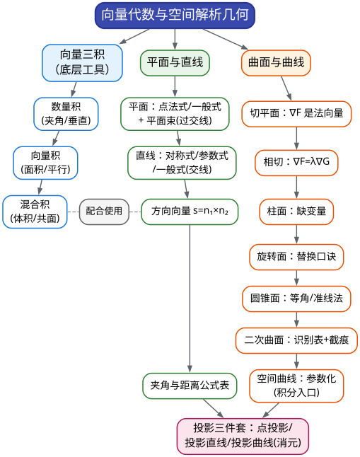

# CMC 手把手精讲
## ——《08 空间解析几何》：全卷确定性最高的"信心板块"

> 🐱 喵～欢迎来到 CMC 精讲系列的第八篇。如果要在整份考纲里选一个"**投入产出比之王**"，就是这个板块：范围极窄（大纲只有七条）、方法有限（一支笔一张公式表）、套路固定（真题十年一个模子），**近三届 A 类 3/3 全中**，而且一旦出成解答题，往往是**全卷最简单的那道大题**（14 届第二大题被多家解析评为"全卷大题中最简单的一题"）。
>
> 还有一个好消息：这个板块和微分方程一样，**你的数分课也没系统教过**——华东师大《数学分析》没有向量代数与空间解析几何的专章（传统上这是《高等数学》/《解析几何》的内容）。但你完全不用怕：本篇按"公式表 + 标准操作"的打法组织，**6–9 小时即可闭环**，是全书唯一敢承诺"学完就会做题"的板块。
>
> **本篇在考试中的地位**（数据口径：11–17 届共 7 套非数学类初赛卷逐卷核对）：
> - 近 7 套卷中 **6 套直接考了本板块**（唯一例外是 12 届，但也以空间曲线为背景出了一道曲线积分）；**近三届 A 类 3/3**：17 届填空第 2 题（6 分·平面方程）、16 届填空第 4 题（6 分·投影直线）、15 届解答第三题（14 分·圆锥面与体积）；
> - 形式上"填空 6 分"或"解答 14 分"二分天下；单卷直接分值 **6–14 分**；此外它还常以"几何背景"寄生于积分题里（17 届填空 5 的球面∩平面交线、15 届填空 5 的平面被柱面所截），**合计影响面约 15–20 分**；
> - 难度定位：**易～中**。直接题以"背公式 + 标准操作"为主；这是"必须全拿分"的板块。
>
> **大纲对应条目**（《全国大学生数学竞赛考试内容》非数学专业类·向量代数和空间解析几何，原文摘录）：
> - (1) 向量的概念、向量的线性运算、向量的数量积和向量积、向量的混合积；
> - (2) 两向量垂直、平行的条件、两向量的夹角；
> - (3) 向量的坐标表达式及其运算、单位向量、方向数与方向余弦；
> - (4) 曲面方程和空间曲线方程的概念、平面方程、直线方程；
> - (5) 平面与平面、平面与直线、直线与直线的夹角以及平行、垂直的条件、点到平面和点到直线的距离；
> - (6) 球面、母线平行于坐标轴的柱面、旋转轴为坐标轴的旋转曲面的方程、常用的二次曲面方程及其图形；
> - (7) 空间曲线的参数方程和一般方程、空间曲线在坐标面上的投影曲线方程。
>
> **边界提示（哪些明确不考）**：(6) 只要求"母线**平行于坐标轴**的柱面、旋转轴**为坐标轴**的旋转曲面"——一般位置的柱面/锥面理论不考；(5) 的距离只列"点到平面、点到直线"——**异面直线公垂线方程不在非数学类大纲里**（那是数学类专业的内容，近 7 届非数学类从未考过，战略放弃）；二次曲线的一般理论（渐近方向、中心、主轴）同样放弃。
>
> **先修提示**：无。你会一点点"三点定平面"的中学印象就够了，其余从零讲起。唯一提醒：本篇的垂直/平行判定会在 11 篇（曲线曲面积分）里反复出现（如"平面被柱面所截"求曲面积分）——现在练熟，后面省力。
>
> **预计学时**：1.5–2 天（3 个学习单元）。第一单元：§二 + §3.1–3.5（向量、平面、直线、投影）；第二单元：§3.6–3.11 + 精讲 1–5（曲面、切平面、相切、参数化）；第三单元：精讲 6–10 + 易错点 + 自测题。
>
> **在冲刺路线中的位置**：本篇对应 00 总纲**第 3 周（D18–19）**——"解析几何闭环"两天：6 题真题（17 填 2、16 填 4、15 届三、14 届二、13 填 4、11 填 5）连做；总投入 6–9 小时，是整份路线里"投入产出比最高"的一块（00 总纲 §4.1 把本篇定位为"信心板块 + 时间缓冲"）。
>
> 阅读建议：
> 1. 本篇的画风和其他篇不同——它不靠"灵光一现"，靠"**公式反射**"。每节的公式表都要**默写**（✍️ 标了默写点）；
> 2. 所有几何题只用**向量法**：能用叉积/点积两行算完的，绝不解三元一次方程组——这是官方解答清一色的选择，也是省时间的唯一正道；
> 3. 真题精讲里的"思路分析"重点是"**我扫了哪几个信号、排除了哪几条路**"——本篇的阅读题面速度可以直接练出来。
>
> 符号说明：📌 重点 | 💡 直觉/类比 | ⚠️ 易错点 | ✍️ 动笔练一练 | ❓ 自测题 | 🎯 考试定位 | ⏱️ 省时技巧

---

# 一、本篇地图

## 1.1 目录（读之前先看这张施工图）

- **§二 知识讲解**：向量三积各自"管什么"（数量积查夹角、叉积造垂直、混合积测体积）→ 为什么一个点 + 一个法向量就能锁死一个平面 → 直线的三种方程与"两平面交线"的方向向量 → 投影的几何直觉（影子 = 垂直光线的落点）→ 切平面、柱面、旋转曲面、圆锥面的"生成语法" → 二次曲面识别表 → 空间曲线参数化的两类模板
- **§三 方法手册**：3.1 向量三积 | 3.2 平面方程六写法与平面束（**重点**）| 3.3 直线方程与方向向量 | 3.4 投影三件套 | 3.5 距离与夹角公式表 | 3.6 曲面切平面 | 3.7 两曲面相切 | 3.8 柱面/旋转面/圆锥面构造 | 3.9 二次曲面识别与截痕法 | 3.10 空间曲线参数化 | 3.11 模长最值（二次函数）
- **§四 真题精讲**：10 道真题完整精讲（17 届一(2)、16 届一(4)、13 届补一(3)、4 届一(2)、11 届一(5)、13 届一(4)、7 届第二题、14 届二、15 届三、7 届一(3)）
- **§五 易错点清单**：12 条 ❌→✅ 对照
- **§六 自测题**：8 道，附完整答案
- **§七 结语**："解析几何防身六句话" + 学习建议 + 09 篇预告

## 1.2 方法速查表：题目要什么 → 用什么武器（一屏版）

| 题目要什么 | 用什么武器 | 关键提醒 |
|---|---|---|
| 面积、三角形面积、平行四边形面积 | $`\dfrac{1}{2}`$ 或 $`1`$ 倍 $`\lvert\vec a\times\vec b\rvert`$ | 叉积的模 = 平行四边形面积 |
| 体积、三向量共面判定 | **混合积**（行列式） | 共面 ⇔ 混合积 = 0（不是"两两平行"！） |
| 夹角、垂直判定 | **数量积** | 垂直 ⇔ $`\vec a\cdot\vec b=0`$ |
| 平行判定 | **向量积**（或坐标成比例） | 平行 ⇔ $`\vec a\times\vec b=\vec 0`$ |
| 平面的法向量、直线的方向向量 | **叉积**（两已知向量一叉，法方向/方向就有了） | 官方解答清一色向量法，别解方程组 |
| 求平面方程（过点/过直线 + 垂直/平行条件） | **点法式 + 平面束** | 平面束 $`\pi_1+\lambda\pi_2=0`$；"垂直"用**法向量点积为 0** 定 $`\lambda`$ |
| 直线在平面上的投影直线 | **平面束** 或 **方向向量投影法** | 投影直线 = "过 $`L`$ 且垂直于 $`\pi`$ 的平面" ∩ $`\pi`$ |
| 空间曲线在坐标面的投影曲线 | **消元法**：消去该坐标得投影柱面，再加坐标面 | 别丢"$`z=0`$"！ |
| 点到平面距离 | $`d=\dfrac{\lvert Ax_0+By_0+Cz_0+D\rvert}{\sqrt{A^2+B^2+C^2}}`$ | 分子绝对值、**分母开方** |
| 点到直线距离 | $`d=\dfrac{\lvert\overrightarrow{AP}\times\vec s\rvert}{\lvert\vec s\rvert}`$ | 分母是一次 $`\lvert\vec s\rvert`$ |
| 曲面切平面（含"平行已知平面"） | 法向量 $`\nabla F`$；平行 ⇔ $`\nabla F\parallel\vec n`$ | **解出 $`x_0,y_0`$ 后务必回代曲面求 $`z_0`$** |
| 两曲面相切 | **法向量平行** $`\nabla F=\lambda\nabla G`$ + 两曲面方程联立 | 三个方程解三个未知数（加比例系数 $`\lambda`$） |
| 柱面（母线平行坐标轴） | 方程缺哪个变量，母线就平行哪根轴 | $`F(x,y)=0`$ 是母线平行 $`z`$ 轴的柱面 |
| 旋转曲面（绕坐标轴） | **替换口诀**：绕哪根轴，哪根不动 | 母线 $`f(y,z)=0`$ 绕 $`z`$ 轴 ⟹ $`f(\pm\sqrt{x^2+y^2},z)=0`$ |
| 圆锥面、直线族生成的曲面 | 母线与轴等角 / 准线 + 母线消参 | 7 届第二题的两条路线 |
| 二次曲面识别（"由……围成"题） | **标准方程对照表 + 截痕法** | $`z=x^2+y^2`$（抛物面）≠ $`z^2=x^2+y^2`$（锥面） |
| 空间曲线参数化（积分题入口） | 球面∩平面、柱面∩平面两类模板 | 12 届五、17 届填 5 的背景都是它 |
| 模长最值（含参向量） | 平方展开成**二次函数** | 配方求顶点 + 检验参数范围 |

## 1.3 知识树：本篇全部内容的骨架



一句话读图：**一切几何题的引擎是"三大积"；平面与直线的一切问题归结为"找法向量/方向向量"；曲面问题归结为"找法向量 + 认标准方程"；而投影与参数化是把几何翻译成代数的两个翻译器。**

---

# 二、知识讲解：三把积、两个方程、一块曲面

## 2.1 向量三积：三把工具，各自"管"一类问题

空间里的一切计算都从三个乘积出发。不要背定义，先记住**它们各自"管什么"**：

```math
\vec a=(a_1,a_2,a_3),\quad \vec b=(b_1,b_2,b_3),\quad \vec c=(c_1,c_2,c_3).
```

**① 数量积（点积）——"管夹角与投影"**：

```math
\vec a\cdot\vec b=a_1b_1+a_2b_2+a_3b_3=\lvert\vec a\rvert\lvert\vec b\rvert\cos\theta.
```

两个读数方式：**代数侧**（坐标直接乘加）与**几何侧**（模长 × 夹角的余弦）。两边对起来，夹角就求出来了；特别地，"垂直"就是 $`\cos\theta=0`$，即

```math
\vec a\perp\vec b\ \Longleftrightarrow\ \vec a\cdot\vec b=a_1b_1+a_2b_2+a_3b_3=0.
```

💡 **打比方**：数量积是"投影测谎仪"——它衡量的是一对向量**同向程度**：完全同向取最大值 $`\lvert\vec a\rvert\lvert\vec b\rvert`$、垂直取 0、反向取负。凡是涉及"**角度、垂直、投影长度**"的问题，第一把钥匙就是它。

**② 向量积（叉积）——"管面积与垂直制造"**：

```math
\vec a\times\vec b=\begin{vmatrix}\vec i&\vec j&\vec k\\ a_1&a_2&a_3\\ b_1&b_2&b_3\end{vmatrix},
```

它的模 $`\lvert\vec a\times\vec b\rvert=\lvert\vec a\rvert\lvert\vec b\rvert\sin\theta`$ = **以 $`\vec a,\vec b`$ 为邻边的平行四边形面积**；方向由**右手法则**确定，且**同时垂直于 $`\vec a`$ 与 $`\vec b`$**。

后一条是它最值钱的用途：**"叉积是垂直制造机"**。你想找一个垂直于某两个方向的向量（平面的法向量、直线的方向向量），就把那两个方向叉乘：

```math
\vec n=\overrightarrow{P_1P_2}\times\overrightarrow{P_1P_3}\ (\text{三点定平面的法向量}),\qquad \vec s=\vec n_1\times\vec n_2\ (\text{两平面交线的方向向量}).
```

这两条公式是全篇出现频率最高的式子，"两平面交线的方向向量 = 两法向量叉乘"请念三遍。

**③ 混合积——"管体积与共面"**：

```math
(\vec a\times\vec b)\cdot\vec c=\begin{vmatrix}a_1&a_2&a_3\\ b_1&b_2&b_3\\ c_1&c_2&c_3\end{vmatrix},
```

其绝对值 = 以三向量为棱的**平行六面体体积**（画个长方体理解：底面积 $`\lvert\vec a\times\vec b\rvert`$ × 高 = 混合积）。

一个推论（竞赛爱考的判定）：

```math
\vec a,\vec b,\vec c\ \text{共面}\ \Longleftrightarrow\ (\vec a\times\vec b)\cdot\vec c=0.
```

⚠️ 注意用词：混合积为 0 是"**三向量共面**"（体积塌成 0），**不是**"两两平行"——三个向量可以谁都不平行却共面（想想一张纸上乱画的三个箭头）。⚠️ 另一个高频错点：叉积**不满足交换律**而是 $`\vec a\times\vec b=-\vec b\times\vec a`$——行列式换两行变号，写的时候按"先写谁"的顺序来，能用一个简单例子（$`\vec i\times\vec j=\vec k`$，$`\vec j\times\vec i=-\vec k`$）随时自检。

✍️ **默写点**：三积的坐标公式 + 两条"叉积制造垂直"的公式 + 共面判定。现在的坐标计算题就是再熟练也不为过——13 届一(4) 的圆柱面题（精讲 6）全靠它。

## 2.2 平面与直线：一个点 + 一个方向，锁死一个对象

### （1）平面：法向量说了算

**直觉先行**：什么能决定一张平面？——**过的一个点** + **"面朝哪儿"（法向量）**。只要这两样定了，平面就唯一：平面上的任意向量 $`\overrightarrow{P_0P}`$ 都必须与法向量 $`\vec n`$ 垂直。

把"垂直"翻译成数量积 = 0，就得到**点法式方程**：

```math
\boxed{A(x-x_0)+B(y-y_0)+C(z-z_0)=0},\qquad \vec n=(A,B,C),\ \text{过点 }P_0(x_0,y_0,z_0).
```

展开即**一般式** $`Ax+By+Cz+D=0`$。两个小读数：
- **过原点** ⇔ $`D=0`$（代 $`(0,0,0)`$）；
- **"缺谁平行谁"**：$`Ax+By+D=0`$（缺 $`z`$）平行于 $`z`$ 轴方向——因为法向量 $`(A,B,0)`$ 与 $`z`$ 轴垂直，平面就"站着"沿 $`z`$ 轴伸展。

### （2）直线：两个方程视角 + 方向向量

直线有三种写法，**按题目给什么选**：

| 形式 | 写法 | 什么时候用 |
|---|---|---|
| 对称式（点向式） | $`\dfrac{x-x_0}{l}=\dfrac{y-y_0}{m}=\dfrac{z-z_0}{n}`$ | 已知一点 + 方向向量 |
| 参数式 | $`x=x_0+lt,\ y=y_0+mt,\ z=z_0+nt`$ | 要和别的方程"代入联立"时（如求交点） |
| 一般式（两平面交线） | $`\begin{cases}A_1x+B_1y+C_1z+D_1=0\\ A_2x+B_2y+C_2z+D_2=0\end{cases}`$ | 题目这么给、或你把对称式"拆"成这样用 |

📌 **核心套路（官方解答反复出现）**：一般式直线的方向向量 = **两法向量叉乘**：

```math
\vec s=\vec n_1\times\vec n_2=\begin{vmatrix}\vec i&\vec j&\vec k\\ A_1&B_1&C_1\\ A_2&B_2&C_2\end{vmatrix}.
```

**微例**：$`L:\begin{cases}x-y-1=0\\ y+z-1=0\end{cases}`$（16 届一(4) 的第一步），$`\vec s=(1,-1,0)\times(0,1,1)=(-1,-1,1)\parallel(1,1,-1)`$。

### （3）位置关系判定（⚠️ 垂直与平行的条件最容易互串，专门列表）

| 关系 | 判定（向量语言） | 记法 |
|---|---|---|
| 平面 ⊥ 平面 | $`\vec n_1\cdot\vec n_2=0`$ | **垂直用点积**（两个法向量互相垂直 ⟹ 两平面互相垂直，想墙角） |
| 平面 ∥ 平面 | $`\vec n_1\times\vec n_2=\vec 0`$（法向量成比例） | 平行用叉积 |
| 直线 ⊥ 平面 | $`\vec s\parallel\vec n`$（方向向量平行于法向量） | 插线垂直钉进纸面 |
| 直线 ∥ 平面 | $`\vec s\cdot\vec n=0`$（且直线不在平面内） | 线躺平在面里 |
| 线 ⊥ 线 | $`\vec s_1\cdot\vec s_2=0`$ | |
| 线 ∥ 线 | $`\vec s_1\times\vec s_2=\vec 0`$ | |
| 两直线共面 | $`(\vec s_1\times\vec s_2)\cdot\overrightarrow{P_1P_2}=0`$ | 混合积 = 0（把两条线的"四点"放进同一张纸） |

⚠️ **记忆锚点**："**垂直 → 点积 = 0；平行 → 叉积 = 0**"——一句话防两串。16 届一(4) 的关键一步恰是"过 $`L`$ 的平面与已知平面**垂直** ⟹ 法向量**点积**为 0"，考场上极容易写反。

## 2.3 距离与夹角公式表（背表即可，考场零推导）

| 对象 | 公式 | 值域 / 提醒 |
|---|---|---|
| 两向量夹角 | $`\cos\theta=\dfrac{\vec a\cdot\vec b}{\lvert\vec a\rvert\lvert\vec b\rvert}`$ | $`[0,\pi]`$ |
| 两直线夹角 | $`\cos\theta=\dfrac{\lvert\vec s_1\cdot\vec s_2\rvert}{\lvert\vec s_1\rvert\lvert\vec s_2\rvert}`$ | $`[0,\frac{\pi}{2}]`$，**带绝对值**（夹角取锐角） |
| 直线与平面夹角 | $`\sin\theta=\dfrac{\lvert\vec s\cdot\vec n\rvert}{\lvert\vec s\rvert\lvert\vec n\rvert}`$ | $`[0,\frac{\pi}{2}]`$，**用 sin 不用 cos** |
| 两平面夹角 | $`\cos\theta=\dfrac{\lvert\vec n_1\cdot\vec n_2\rvert}{\lvert\vec n_1\rvert\lvert\vec n_2\rvert}`$ | $`[0,\frac{\pi}{2}]`$，带绝对值 |
| 点到平面距离 | $`d=\dfrac{\lvert Ax_0+By_0+Cz_0+D\rvert}{\sqrt{A^2+B^2+C^2}}`$ | 分子绝对值、分母**开方** |
| 点到直线距离 | $`d=\dfrac{\lvert\overrightarrow{AP}\times\vec s\rvert}{\lvert\vec s\rvert}`$（$`A`$ 为直线上任一定点，$`\vec s`$ 为方向向量） | 分母是 $`\lvert\vec s\rvert`$（一次） |
| 两平行平面距离 | $`\dfrac{\lvert D_1-D_2\rvert}{\sqrt{A^2+B^2+C^2}}`$ | 先把两平面系数化成一样 |

**为什么线面夹角要用 $`\sin`$？——用直觉一次记住**：直线与平面的夹角 $`\theta`$ 定义为直线与**它在平面上的投影**的夹角；而 $`\vec s`$ 与 $`\vec n`$ 的夹角 $`\varphi`$ **与 $`\theta`$ 互余**（法向量垂直向上，方向向量斜着插进平面：方向向量与法向量的夹角 $`=90^\circ-\theta`$），所以 $`\sin\theta=\cos\varphi`$——直角三角关系一画就清楚，不用死记。

**点到直线距离公式的直觉**：$`\lvert\overrightarrow{AP}\rvert\sin\varphi`$（$`\varphi`$ 为 $`\overrightarrow{AP}`$ 与 $`\vec s`$ 的夹角）正是 $`P`$ 到底边的高；而 $`\lvert\overrightarrow{AP}\times\vec s\rvert=\lvert\overrightarrow{AP}\rvert\lvert\vec s\rvert\sin\varphi`$，除以 $`\lvert\vec s\rvert`$ 正好"还原"这个高。💡 一句话：**点到直线距离 = 平行四边形的"面积除以底边"**——这就是公式的几何真身。

✍️ **默写点**：这张表**整张默写**（考前最后一天默第三遍）。填空题如果考距离/夹角，6 分就是背出来的。

## 2.4 投影：影子是怎么算出来的

### （1）直觉：投影 = 垂直光线的影子

"把直线 $`L`$ 投影到平面 $`\pi`$ 上"——想象一束**垂直于 $`\pi`$ 的光**照下来，$`L`$ 在 $`\pi`$ 上映出一条影子，这就是**投影直线** $`L_0`$。两个基本事实（都可以用"光"想通）：

1. **影子上的每个点，都是原曲线上某点沿"垂直 $`\pi`$ 的方向"撞到 $`\pi`$ 上的落点**；
2. 特殊地，**直线 $`L`$ 与平面 $`\pi`$ 的交点投影后就是它自己**（点落在自己身上）——这个"定点"是画影子直线的锚点。

### （2）投影直线的两条求法（都要会）

**法一（平面束，官方解法）**：影子直线夹在两个平面之间：一个是 $`\pi`$ 本身（影子必须落在 $`\pi`$ 上），另一个是"**过 $`L`$ 且垂直于 $`\pi`$ 的平面**" $`\pi'`$（想象 $`L`$ 和照向它的那束光张成的一张"幕布"，这张幕布垂直于地面 $`\pi`$）。所以：

```math
L_0=\pi\cap\pi'.
```

步骤：① $`L`$ 化一般式；② 写过 $`L`$ 的平面束 $`\pi_1+\lambda\pi_2=0`$；③ 用"垂直于 $`\pi`$"（$`\vec n_\lambda\cdot\vec n_\pi=0`$）定 $`\lambda`$；④ 写交线。

**法二（方向向量投影法，求方向时更快）**：影子的方向 = 原方向 $`\vec s`$ 去掉"垂直地面分量"后剩下的部分——即 $`\vec s`$ 在平面 $`\pi`$ 上的**投影向量**：

```math
\vec s'=\vec s-\frac{\vec s\cdot\vec n_\pi}{\lvert\vec n_\pi\rvert^2}\,\vec n_\pi.
```

💡 **两法关系**：法二只负责"影子朝哪"，法一还管"影子在哪"。**填空题求方向向量用法二（30 秒）；要写完整直线方程用法一**（16 届一(4) 官方走的是法一，我们用两种都验算过，见精讲 2）。

### （3）空间曲线在坐标面上的投影曲线（大纲 (7) 明文）

设 $`C:\begin{cases}F(x,y,z)=0\\ G(x,y,z)=0\end{cases}`$。求它在 $`xOy`$ 面的投影：

- **消元**：从两方程中消去 $`z`$，得 $`H(x,y)=0`$ —— 这是**投影柱面**（一个母线平行 $`z`$ 轴的柱面，它整张"包"着曲线）；
- **投影曲线** $`=\begin{cases}H(x,y)=0\\ z=0\end{cases}`$（⚠️ **别丢 $`z=0`$**！投影曲线躺在地板上，必须声明"地板"）。

💡 **为什么"消去 $`z`$"就能得到影子柱面**？投影就是"把 $`z`$ 坐标抹掉"：曲线上的点 $`(x,y,z)`$ 的影子是 $`(x,y,0)`$；"抹掉 $`z`$"后剩下的关系 $`H(x,y)=0`$ 恰好刻画了全体影子点 $`(x,y)`$ 的轨迹（曲线影子的并集 = 一条"柱状"的影子轨迹）。**消元 = 投影**，这个等价关系请记牢。

**微例**：$`C:\begin{cases}x^2+y^2+z^2=4\\ x+y+z=3\end{cases}`$，由第二式 $`z=3-x-y`$ 代入第一式，得投影柱面 $`2x^2+2y^2+2xy-6x-6y+5=0`$（一个椭圆），投影曲线再加 $`z=0`$。

## 2.5 曲面：四种"生成语法"

### （1）切平面：梯度就是法向量

曲面 $`F(x,y,z)=0`$ 在点 $`P_0`$ 处的**法向量**：

```math
\vec n=\nabla F(P_0)=\big(F_x(P_0),\ F_y(P_0),\ F_z(P_0)\big),
```

切平面就是"过 $`P_0`$、法向量为 $`\nabla F`$"的平面：$`F_x(P_0)(x-x_0)+F_y(P_0)(y-y_0)+F_z(P_0)(z-z_0)=0`$。

**实战变体（三届真题三连考）**："求曲面与已知平面 $`\pi`$ **平行**的切平面"——三步：

> ① 写 $`\nabla F(P_0)`$；② **平行条件** $`\nabla F(P_0)\parallel\vec n_\pi`$（坐标成比例，比例式一联立就解出 $`x_0,y_0`$）；③ **回代曲面方程求 $`z_0`$**，再写点法式。⚠️ 第 ③ 步是"丢常数"事故的重灾区（1 届、6 届、8 届三道真题同型，答案常数各不相同，见 §3.6）。

💡 **为什么梯度是法向量**？沿曲面走任意一条曲线 $`\vec r(t)`$，$`F(\vec r(t))\equiv0`$，求导得 $`\nabla F\cdot\vec r'(t)=0`$——梯度与曲面上一切切向量都垂直。这个证明一行，但结论要背成条件反射。

### （2）两曲面相切：法向量平行

```math
F=0\ \text{与}\ G=0\ \text{在切点处相切}\ \Longleftrightarrow\ \nabla F=\lambda\,\nabla G\ (\text{法向量平行}),
```

再配上"切点在两张曲面上"的两个方程，共三个方程解 $`(x,y,z,\lambda)`$ 中的未知量（11 届一(5) 就是这套流程，见精讲 5）。
💡 **打比方**：两个球面"贴着"（相切）时，接触点处两个球面朝的是同一个方向（公共法线）；任何两张光滑曲面相切都是这个意思——**切点处共享一条法线**。

### （3）柱面：缺谁，母线就平行谁

**判定**：方程里**缺哪个变量，就表示母线平行于哪根坐标轴的柱面**（大纲 (6) 原话）。如 $`F(x,y)=0`$（无 $`z`$）是母线平行 $`z`$ 轴的柱面：把 $`xOy`$ 面上的一条曲线沿 $`z`$ 方向"拔高"成一张无限长的"窗帘"。

**构造法（真题型，13 届一(4)）**：给一族平行的导线，求过它们的圆柱面——
- 先求公共方向 $`\vec s`$（三线平行方向）；
- 在垂直于 $`\vec s`$ 的平面里截三条线得三个点，**三点定圆**（若三点到某点等距，该点即圆心）；
- 过圆心、沿 $`\vec s`$ 的直线就是**轴**；
- 最后用"**到轴距离 = 半径**"写方程：柱面上动点 $`Q`$ 满足 $`\dfrac{\lvert(Q-A)\times\vec s\rvert^2}{\lvert\vec s\rvert^2}=R^2`$（左侧正是 2.3 的表里那条"点到直线距离"的平方——工具复用！）。

### （4）旋转曲面：绕哪根轴，哪根不动

**口诀**：母线 $`f(y,z)=0`$ 绕 $`z`$ 轴旋转 ⟹ $`f(\pm\sqrt{x^2+y^2},\ z)=0`$。三条对照（背下）：

- 直线 $`z=y`$ 绕 $`z`$ 轴 ⟹ $`z^2=x^2+y^2`$（**圆锥面**）；
- 抛物线 $`y^2=z`$ 绕 $`z`$ 轴 ⟹ $`x^2+y^2=z`$（**旋转抛物面**）；
- 半圆绕轴 ⟹ **球面**。

💡 **口诀的道理**：绕 $`z`$ 轴转，点的高度 $`z`$ 不变，而"到轴的距离" $`\sqrt{x^2+y^2}`$ 顶替了母线里的 $`y`$——所以"把 $`y`$ 换成 $`\pm\sqrt{x^2+y^2}`$"。⚠️ **只换两个变量**（垂直于轴的那两个合体），轴变量原样保留。

**圆锥面的第二种生成（7 届第二题）**：顶点在原点、母线与轴成固定夹角 $`\theta`$（半顶角）的锥面——母线上任一点 $`Q`$ 满足"$`\overrightarrow{OQ}`$ 与轴夹角 $`=\theta`$"，用数量积写出来即可（精讲 7 的解法一）；或者用"**准线法**"：母线族与一张准线（平面截口）相交，消参数即得锥面方程（精讲 7 用的即该卷流传版参考解答的准线法）。

### （5）常用二次曲面识别表（"由……围成"题的第一动作）

| 名称 | 标准方程 | 特征记忆 |
|---|---|---|
| 椭球面 | $`\dfrac{x^2}{a^2}+\dfrac{y^2}{b^2}+\dfrac{z^2}{c^2}=1`$ | 有界闭合 |
| 球面 | $`x^2+y^2+z^2=R^2`$ | 椭球特例 |
| 单叶双曲面 | $`\dfrac{x^2}{a^2}+\dfrac{y^2}{b^2}-\dfrac{z^2}{c^2}=1`$ | 一整张、腰口是椭圆 |
| 双叶双曲面 | $`\dfrac{x^2}{a^2}+\dfrac{y^2}{b^2}-\dfrac{z^2}{c^2}=-1`$ | 上下两张 |
| 椭圆抛物面 | $`z=\dfrac{x^2}{a^2}+\dfrac{y^2}{b^2}`$ | 开口向上的"碗" |
| 双曲抛物面（马鞍面） | $`z=\dfrac{x^2}{a^2}-\dfrac{y^2}{b^2}`$ | 鞍形 |
| 圆锥面 | $`\dfrac{x^2}{a^2}+\dfrac{y^2}{b^2}=\dfrac{z^2}{c^2}`$（特例 $`z^2=x^2+y^2`$） | 顶点在原点、两叶 |
| 柱面 | 缺一个变量（如 $`x^2+y^2=R^2`$） | 母线平行"缺的那个"轴 |

⚠️ **致命混淆**：$`z=x^2+y^2`$（抛物面）vs $`z^2=x^2+y^2`$（锥面）——**差一个平方号**，区域的上下边界全变（9 届那道"锥面 ∩ 球面"的三重积分题，识别错就全错）。

**识别动作（"由曲面围成区域"型题）**：先逐个把方程扔进这张表判型 → 再求交线（通常在同一高度 $`z_0`$ 上，或给"平面 $`y=1`$"这种截口）→ 最后一句话说明区域形状，再谈积分。

## 2.6 空间曲线参数化：积分类题的"入口"（大纲 (7)）

曲线积分/曲面积分题的第一步常常是"把空间曲线写成参数方程"。两类模板覆盖真题：

**模板 1：柱面 ∩ 平面**（最好命）——柱面给了 $`x,y`$ 的关系、平面给了 $`z`$：

```math
\begin{cases}x^2+y^2=R^2\\ \pi(x,y,z)=0\end{cases}\ \Longrightarrow\ x=R\cos t,\ y=R\sin t,\ z=\text{由平面解出}.
```

**模板 2：球面 ∩ 平面**——交线是圆：先算**圆心与半径**（球心到平面的垂足 = 圆心，$`R^2_{\text{圆}}=R^2_{\text{球}}-d^2`$），再在平面内取一组正交基写参数；考试更常用"**投影法**"：把交线投影到坐标面（如 $`xOy`$）得椭圆/圆，参数化投影曲线再回代求 $`z`$。**微例（12 届五）**：$`\Gamma:\begin{cases}x^2+y^2+z^2=8\\ x^2+y^2=2z\end{cases}`$ ——把第二式代入第一式消元得 $`z^2+2z-8=0`$，解得 $`z=2`$（$`z=-4`$ 使 $`x^2+y^2=2z<0`$，舍去）——曲线其实躺在平面 $`z=2`$ 上！于是退化为"柱面∩平面"模板：$`x^2+y^2=4`$，即 $`x=2\cos\theta,\ y=2\sin\theta,\ z=2`$。

💡 **"先化简，再参数化"**：$`\Gamma`$ 的一般方程往往能先"消出一个简单平面"（如上面的 $`z=2`$），别急着硬上正交基。17 届填空 5 的球面∩平面交线（球心到平面距离 $`\sqrt3`$、半径 $`\sqrt{4-3}=1`$）也是这套"球心距 → 圆半径"的读法。

---

# 三、方法手册：十一件工具，见招拆招

每个方法按统一格式展开：【适用信号】→【步骤】→【关键公式】→【真题微型例子】。老规矩："**你缺的不是方法本身，而是什么时候用它**"。

## 3.1 向量三积的计算与选型

**【适用信号】** 一切几何题的底层操作；特别地：求面积/体积、判共面/平行/垂直、构造法向量与方向向量。

**【步骤】**
1. 看题目最终要什么（面积？夹角？平行垂直判定？法向量？），对 §1.2 速查表选积；
2. 写坐标（**先明确取哪两个/三个向量**——尤其是"三点定平面"时要先造出两个边向量）；
3. 算：点积=对应坐标乘加；叉积=行列式（$`\vec i`$ 行写第一行，注意 $`\vec j`$ 分量展开时带负号）；混合积=三行行列式；
4. **自检**：$`\vec a\times\vec b`$ 应与 $`\vec a`$、$`\vec b`$ 都垂直（各点乘一次验证）。

**【关键公式】** 见 §2.1；特别强调两条"制造垂直"：

```math
\vec n=\overrightarrow{P_1P_2}\times\overrightarrow{P_1P_3},\qquad \vec s=\vec n_1\times\vec n_2.
```

**【真题微型例子】**（类型题·仿竞赛风格）判断四点 $`A(1,0,0),B(0,1,0),C(0,0,1),D(1,1,1)`$ 是否共面。
思路：四点共面 ⟺ 三个向量 $`\overrightarrow{AB},\overrightarrow{AC},\overrightarrow{AD}`$ 共面 ⟺ 混合积为 0。

```math
\overrightarrow{AB}=(-1,1,0),\quad \overrightarrow{AC}=(-1,0,1),\quad \overrightarrow{AD}=(0,1,1).
```

```math
(\overrightarrow{AB}\times\overrightarrow{AC})\cdot\overrightarrow{AD}=\begin{vmatrix}-1&1&0\\ -1&0&1\\ 0&1&1\end{vmatrix}=-1\cdot(0\cdot1-1\cdot1)-1\cdot(-1\cdot1-0\cdot1)+0=-1\cdot(-1)-1\cdot(-1)=2\ne0.
```

故四点**不共面**（混合积的绝对值 2 还顺便告诉你四面体体积 $`=\dfrac{2}{6}=\dfrac{1}{3}`$）。
> ⏱️ 混合积题 30 秒可完，是填空级的送分操作。⚠️ 行列式展开时第 2 项要带负号（$`-\vec j`$ 的系数），这是叉积/混合积 90% 的算错来源。

## 3.2 平面方程六写法与平面束（**本篇第一重点**）

**【适用信号】** "求平面方程"，题面条件五花八门：过点、过直线、与已知平面垂直/平行、含某个方向、过原点……

**【六种写法对照】**

| 写法 | 方程 | 适用场景 |
|---|---|---|
| 点法式（首选） | $`A(x-x_0)+B(y-y_0)+C(z-z_0)=0`$ | 有一点 + 有法向量（或能造出法向量） |
| 一般式 | $`Ax+By+Cz+D=0`$ | 整理答案、代入条件 |
| 截距式 | $`\dfrac{x}{a}+\dfrac{y}{b}+\dfrac{z}{c}=1`$ | 已知三坐标轴截距 |
| 三点/两方向向量 | $`\vec n=\overrightarrow{P_1P_2}\times\overrightarrow{P_1P_3}`$ | 给三个点 |
| 过两点 + 一个垂直条件 | 待定 $`\vec n`$，列两个正交条件 $`\vec n\cdot\overrightarrow{P_1P_2}=0`$、$`\vec n\cdot\vec n_0=0`$ | 17 届考法（精讲 1） |
| **平面束** | $`\pi_1+\lambda\,\pi_2=0`$（过交线 $`L:\pi_1=0,\pi_2=0`$） | **过一条直线**的一切问题 |

**【平面束的使用套路】**
1. 把所过直线写成两平面交线 $`\pi_1=0,\ \pi_2=0`$（对称式就"拆"成两个一般式）；
2. 写出平面束 $`\pi_1+\lambda\pi_2=0`$，其法向量 $`\vec n(\lambda)`$；
3. 用附加条件定 $`\lambda`$：**与已知平面垂直 ⇔ $`\vec n(\lambda)\cdot\vec n_0=0`$**；过某点 ⇔ 坐标代入；平行 ⇔ 法向量成比例；
4. 回代写方程。

⚠️ 两个细节：① 平面束 $`\pi_1+\lambda\pi_2=0`$ **不含** $`\pi_2`$ 本身（若所求恰是 $`\pi_2`$ 需单独讨论——竞赛题基本不设这个坑，但要知道）；② 官方在 13 届补一(3) 用的是**两参数版** $`\lambda\pi_1+\mu\pi_2=0`$（"全"版本），两种都对，单参数版更快。

**【真题微型例子】**（第 4 届非数学类·一(2)，2012，官方）求通过直线 $`L:\begin{cases}2x+y-3z+2=0\\ 5x+5y-4z+3=0\end{cases}`$ 的两个相互垂直的平面 $`\pi_1,\pi_2`$，使其中一个过点 $`(4,-3,1)`$。
过 $`L`$ 的平面束：$`\lambda(2x+y-3z+2)+\mu(5x+5y-4z+3)=0`$。
**定 $`\pi_1`$（过点）**：把 $`(4,-3,1)`$ 代入得 $`\lambda+\mu=0`$，取 $`\lambda=1,\mu=-1`$，得 $`\pi_1:3x+4y-z+1=0`$（法向量 $`(3,4,-1)`$）。
**定 $`\pi_2`$（垂直）**：设 $`\lambda_2`$ 对应平面与 $`\pi_1`$ 垂直，用**法向量点积为 0**：

```math
3(2\lambda_2+5\mu)+4(\lambda_2+5\mu)+1\cdot\big(-(3\lambda_2+4\mu)\big)=0\ \Longrightarrow\ 13\lambda_2+39\mu=0\ \Longrightarrow\ \lambda_2=-3\mu.
```

取 $`\mu=1,\lambda_2=-3`$：$`\pi_2:\ x-2y-5z+3=0`$。完整精讲见精讲 4。
> 💡 这道 2012 年的题是"平面束 + 垂直条件"的元祖级模板；2024 年的 16 届一(4)（精讲 2）是它的直系后代。

## 3.3 直线方程与"两平面交线"

**【适用信号】** 求直线方程（点 + 方向）；题目给出两平面交线；要判断线线、线面关系。

**【步骤】**
1. 找"一点 + 一个方向向量"：点常来自交点/投影点/已知点；方向向量来自 $`\vec s=\vec n_1\times\vec n_2`$（交线）、两已知点的连线、或"垂直于某两个方向"（再叉一次）；
2. 优先写**对称式**，需要联立时改**参数式**；
3. 位置关系判定查 §2.2 的表（⚠️ 垂直点积、平行叉积）。

**【关键公式】** $`\vec s=\vec n_1\times\vec n_2`$；对称式 $`\dfrac{x-x_0}{l}=\dfrac{y-y_0}{m}=\dfrac{z-z_0}{n}`$；参数式 $`x=x_0+lt,\dots`$。

**【真题微型例子】** 见精讲 2、3（投影直线的求法里，"$`L`$ 化一般式 → 方向 $`=\vec n_\pi\times\vec n_{\pi'}`$"反复使用）。

## 3.4 投影三件套

**【适用信号】** 题面出现"投影"：点的投影、直线在平面上的投影、曲线在坐标面上的投影。

**【步骤】**
- **(a) 点到平面的投影**：过该点沿法向量作直线，与平面求交（联立解 $`t`$）；顺带得点到平面距离。
- **(b) 直线在平面上的投影直线**：
  - 路线 A（平面束）：见 §2.4 法一的四步；
  - 路线 B（方向投影，只求方向时）：$`\vec s'=\vec s-\dfrac{\vec s\cdot\vec n}{\lvert\vec n\rvert^2}\vec n`$。
- **(c) 曲线在坐标面的投影**：消去对应坐标得投影柱面，**再加坐标面方程**（别丢"$`z=0`$"）。

**【关键公式】** 方向投影公式 $`\vec s'=\vec s-\dfrac{\vec s\cdot\vec n}{\lvert\vec n\rvert^2}\vec n`$；消元法示例见 §2.4。

**【真题微型例子】**（第 13 届非数学类·初赛补赛·填空第 3 题，2021，官方）已知直线 $`L:\begin{cases}2x-4y+z=0\\ 3x-y-2z=9\end{cases}`$ 和平面 $`\pi:4x-y+z=1`$，求 $`L`$ 在 $`\pi`$ 上的投影直线。
**（1）写平面束**：$`\lambda(2x-4y+z)+\mu(3x-y-2z-9)=0`$，即 $`(2\lambda+3\mu)x-(4\lambda+\mu)y+(\lambda-2\mu)z-9\mu=0`$。
**（2）垂直条件**：$`(4,-1,1)`$ 点乘法向量 $`(2\lambda+3\mu,\ -4\lambda-\mu,\ \lambda-2\mu)`$ 为 0：

```math
4(2\lambda+3\mu)-1\cdot(-4\lambda-\mu)+1\cdot(\lambda-2\mu)=13\lambda+11\mu=0\ \Longrightarrow\ \frac{\lambda}{\mu}=-\frac{11}{13}.
```

代入得"过 $`L`$ 且垂直于 $`\pi`$"的平面 $`17x+31y-37z-117=0`$。
**（3）投影直线** $`=`$ 它与 $`\pi`$ 的交线：

```math
\begin{cases}17x+31y-37z=117,\\ 4x-y+z=1.\end{cases}
```

完整精讲见精讲 3。
> ⚠️ 官方在这一步的符号细节：$`4(2\lambda+3\mu)+(-1)(-4\lambda-\mu)+1(\lambda-2\mu)=0`$ 与上面的写法一致（注意 $`-4\lambda-\mu`$ 前的负号被 $`(-1)`$ 吃成加号）——**符号错一处，$`\lambda/\mu`$ 就错**，写的时候慢半拍。

## 3.5 距离与夹角：公式表直用 + 一题走通

**【适用信号】** 题面直接问距离（点面/点线/两平行平面）或夹角（线线/线面/面面）；或几何大题中段需要"垂足""高"。

**【步骤】**
1. 对号入座查 §2.3 公式表（⚠️ 线面夹角用 $`\sin`$！）；
2. 需要"定点"的（点线距、异面距离公式），从题面或两直线各取一个方便的点；
3. 算完**化简**（如 $`\dfrac{19}{\sqrt{38}}=\dfrac{\sqrt{38}}{2}`$——官方答案写的是化简后的形式）。

**【关键公式】** §2.3 整张表。

**【真题微型例子】**（第 2 届非数学类·一(5)，2010，官方）求直线 $`l_1:\begin{cases}x-y=0\\ z=0\end{cases}`$ 与直线 $`l_2:\dfrac{x-2}{4}=\dfrac{y-1}{-2}=\dfrac{z-3}{-1}`$ 的距离。
两直线的方向向量与定点：$`l_1`$ 过 $`P_1(0,0,0)`$、$`\vec l_1=(1,1,0)`$；$`l_2`$ 过 $`P_2(2,1,3)`$、$`\vec l_2=(4,-2,-1)`$。
先判位置：$`\overrightarrow{P_1P_2}\cdot(\vec l_1\times\vec l_2)=(2,1,3)\cdot(-1,1,-6)=-2+1-18=-19\ne0`$，两直线**异面**（无交点、不平行时距离公式才有意义）。
异面距离（大纲外，仅作拓展认识）：

```math
d=\frac{\lvert\overrightarrow{P_1P_2}\cdot(\vec l_1\times\vec l_2)\rvert}{\lvert\vec l_1\times\vec l_2\rvert}=\frac{19}{\sqrt{38}}=\frac{\sqrt{38}}{2}.
```

> ⚠️ 提醒：**"异面直线距离"这个公式不在非数学大纲内、近 7 届从未考过**，此处只作"混合积应用"的练习；若考场真遇到综合题里的"两平行平面距离"（大纲内），用表里那条。

## 3.6 曲面切平面（含"平行已知平面"三步模板）

**【适用信号】** 求切平面；"求与已知平面平行的切平面"；判两个曲面是否相切（配套 3.7）。

**【步骤（三步模板）】**
1. **写法向量**：$`\vec n=\nabla F(P_0)=(F_x,F_y,F_z)\big|_{P_0}`$（先把曲面写成 $`F=0`$）；
2. **用条件解切点**：若"平行于已知平面 $`\pi`$"，写 $`\nabla F(P_0)=k\,\vec n_\pi`$ 的坐标比例式，解出 $`x_0,y_0`$；
3. **回代曲面求 $`z_0`$**（⚠️ 高频丢分点），写点法式。

**【关键公式】** 切平面：$`F_x(x-x_0)+F_y(y-y_0)+F_z(z-z_0)=0`$；平行条件 $`\nabla F\parallel\vec n`$。

**【真题微型例子（三连对照——三道真题一个模子）】** 1 届一(3)、6 届一(2)、8 届一(5) 都是"曲面与已知平面平行的切平面"，只有曲面与平面参数不同：

| 真题 | 曲面 | 已知平面 | 切点 | 答案 |
|---|---|---|---|---|
| 1 届一(3)（5 分） | $`z=\dfrac{x^2}{2}+y^2-2`$ | $`2x+2y-z=0`$ | $`(2,1,1)`$ | $`2x+2y-z-5=0`$ |
| 6 届一(2)（6 分） | $`z=x^2+2y^2`$ | $`2x+2y+z=0`$ | $`\left(-1,-\dfrac12,\dfrac32\right)`$ | $`2x+2y+z+\dfrac32=0`$ |
| 8 届一(5)（6 分） | $`z=\dfrac{x^2}{2}+y^2`$ | $`2x+2y-z=0`$ | $`(2,1,3)`$ | $`2x+2y-z=3`$ |

以 1 届为例走流程：$`F=\dfrac{x^2}{2}+y^2-z-2=0`$，$`\nabla F=(x_0,2y_0,-1)\parallel(2,2,-1)`$ ⟹ 由第三分量 $`-1=-k`$ 得 $`k=1`$，故 $`x_0=2,\ y_0=1`$；回代 $`z_0=\dfrac{4}{2}+1-2=1`$；切平面 $`2(x-2)+2(y-1)-(z-1)=0`$，即 $`2x+2y-z=5`$。
> 🎯 三道题的对照价值：① 曲面稍有差异时切点与常数都变（6 届的平面法向量是 $`(2,2,1)`$，比例式解出的是负半平面上的切点）；② **第 3 步"回代求 $`z_0`$"千万别省**——省了就是 0 分与 6 分之差；③ 这类题是"填空第 5 题"级别的常客，必须 2 分钟内完成。

## 3.7 两曲面相切

**【适用信号】** 题面出现"相切"二字（11 届一(5)、15 届三）；或"切点""公切"等字眼。

**【步骤】**
1. 把两曲面都写成 $`F=0`$、$`G=0`$ 的隐式；
2. **相切条件 = 切点处法向量平行**：$`\nabla F=\lambda\,\nabla G`$（三个分量等式）；
3. 加上"切点在两张曲面上"（$`F=0`$、$`G=0`$ 两个方程），共三个方程解未知数；
4. 相切问题常有 $`\pm`$ 两支解（对称），留意说明。

**【关键公式】** $`\nabla F=\lambda\,\nabla G`$。

**【真题微型例子 1（几何直觉版）】**（类型题·仿竞赛风格）当 $`a`$ 为何值时，球面 $`x^2+y^2+z^2=R^2`$ 与平面 $`x+y+z=a`$ 相切？
"球面与平面相切 ⟺ 球心到平面的距离 = 半径"：$`\dfrac{\lvert a\rvert}{\sqrt3}=R`$，故 $`a=\pm\sqrt3R`$。
> 这是相切的最朴素形态——**几何距离 = 半径**。当两张曲面都弯（都不是平面）时，距离法失效，才轮到"法向量平行"上场。

**【真题微型例子 2】**（第 11 届非数学类·填空第 5 题，2019，官方）设 $`a,b,c,\mu>0`$，曲面 $`xyz=\mu`$ 与曲面 $`\dfrac{x^2}{a^2}+\dfrac{y^2}{b^2}+\dfrac{z^2}{c^2}=1`$ 相切，求 $`\mu`$。
相切条件：$`(yz,\ xz,\ xy)=\lambda\left(\dfrac{2x}{a^2},\ \dfrac{2y}{b^2},\ \dfrac{2z}{c^2}\right)`$。三式**分别乘 $`x,y,z`$**：$`3\mu=2\lambda\left(\dfrac{x^2}{a^2}+\dfrac{y^2}{b^2}+\dfrac{z^2}{c^2}\right)=2\lambda`$（用了切点在椭球面上）；再由三式相乘得 $`\mu^2=8\lambda^3/(a^2b^2c^2)`$。联立解得 $`\mu=\dfrac{abc}{3\sqrt3}`$。完整精讲见精讲 5。
> 💡 "**各式分别乘 $`x,y,z`$ 再相加**"是这类题的黄金操作：左边乘出来恰好是 $`xyz=\mu`$ 的倍数、右边乘出来恰好是椭球面方程——**两个曲面方程都被用上**，这正是命题人的设计。

## 3.8 柱面、旋转曲面、圆锥面的构造

**【适用信号】** 13 届一(4)（过平行直线族的柱面）、"绕某轴旋转"、7 届第二题（母线族/准线）。
**【步骤】**
- **柱面（给平行直线族/准线）**：求公共方向 $`\vec s`$ → 垂直截面截出三个点 → 三点定圆（找等距点）→ 轴 = 过圆心沿 $`\vec s`$ → 最后用"到轴距离 = 半径"写方程（$`\lvert(Q-A)\times\vec s\rvert^2/\lvert\vec s\rvert^2=R^2`$）；或"准线 + 母线方向"消参数。
- **旋转曲面（绕坐标轴）**：识别母线与旋转轴 → "绕哪根轴、哪根不动"→ 把垂直于轴的两个变量合成 $`\pm\sqrt{\cdot}`$ 替换。
- **圆锥面（顶点 + 准线/等角）**：两种路线——① 母线族与准线相交消参（7 届参考解答版）；② "母线上任一点与轴夹角恒定"，用数量积写等式（7 届解法一）。

**【关键公式】** 旋转替换口诀（§2.5(4)）；到轴距离公式（复用量级：它就是"点到直线距离"）。

**【真题微型例子】**（类型题·仿竞赛风格）求 $`y^2=2z`$ 绕 $`z`$ 轴旋转所得曲面方程。
绕 $`z`$ 轴：$`z`$ 不动，把 $`y`$ 换成 $`\pm\sqrt{x^2+y^2}`$：$`x^2+y^2=2z`$（旋转抛物面）。
> ⏱️ 旋转面题 30 秒完成，考场上遇到就是白送——但**千万别把 $`z`$ 也换了**（口诀："绕哪根轴，哪根不动"）。

## 3.9 二次曲面识别与截痕法

**【适用信号】** 题面出现"由曲面 $`A`$ 与曲面 $`B`$ 围成"、要求体积/三重积分/积分限；或"讨论曲面形状"。

**【步骤】**
1. **逐个判型**：把每个方程整理成标准形，对照 §2.5(5) 的表；
2. **求交线**：曲面方程联立（通常消元后得一个水平的圆/椭圆——"交线在同一高度"是常见设计）；
3. **画截面草图**（截痕法）：用水平面 $`z=c`$ 截，看截线是圆还是双曲线，确认形状；
4. 说清"区域长什么样"（哪张曲面在上、哪张在下），再谈积分。

**【关键公式】** 识别表（§2.5(5)）；牢记 $`\boxed{z=x^2+y^2}`$（抛物面） vs $`\boxed{z^2=x^2+y^2}`$（锥面）。

**【真题微型例子】**（第 9 届非数学类·填空第 6 题，2017）记曲面 $`z^2=x^2+y^2`$ 与 $`z=\sqrt{4-x^2-y^2}`$ 围成的空间区域为 $`V`$，求 $`\displaystyle\iiint_Vz\,\mathrm{d}x\,\mathrm{d}y\,\mathrm{d}z`$。
**判型**：$`z^2=x^2+y^2`$ 是**锥面**（顶点在原点，取上半叶 $`z\ge0`$）；$`z=\sqrt{4-x^2-y^2}`$ 是**上半球面**（半径 2）。
**求交线**：代入消元 $`2z^2=4`$，$`z=\sqrt2`$（$`z>0`$），交线为高度 $`z=\sqrt2`$ 上的圆 $`x^2+y^2=2`$。
**识别结构**：区域=上半球内部挖去锥面内部的"冰激凌"形（球面为壳、锥面为底托）。
**球坐标计算**（$`\varphi`$ 从 $`z`$ 轴量起）：锥面 $`z^2=x^2+y^2`$ 即 $`\varphi=\dfrac{\pi}{4}`$，球面 Rho 到 2：

```math
\iiint_Vz\,\mathrm{d}V=\int_0^{2\pi}\mathrm{d}\theta\int_0^{\pi/4}\mathrm{d}\varphi\int_0^2(\rho\cos\varphi)\,\rho^2\sin\varphi\,\mathrm{d}\rho=2\pi\cdot\frac{1}{2}\sin^2\varphi\Big|_0^{\pi/4}\cdot\frac{\rho^4}{4}\Big|_0^2=2\pi.
```

> 💡 这类题的**全部难点在"判型"**：认出"锥 + 球"，$`\varphi`$ 的上限 $`\pi/4`$ 直接从锥面读出；认错型，积分限全错。填空题遇见它，先花 20 秒默念识别表。

## 3.10 空间曲线参数化

**【适用信号】** 曲线积分题的入口；题面给"球面∩平面""柱面∩平面"式的交线。
**【步骤】**
1. 先**化简**：两方程消元，能消出"某坐标 = 常数"就先消（曲线可能其实落在一张平面上）；
2. 对号入座两类模板（§2.6）：柱面∩平面直接三角参数；球面∩平面先算圆心半径（或投影法）；
3. 写参数范围（通常 $`0\le\theta\le2\pi`$ 或由"从 $`A`$ 到 $`B`$ 的一段"限定）。
**【关键公式】** 两类模板；"球心距 $`d`$ → 交圆半径 $`\sqrt{R^2-d^2}`$"。

**【真题微型例子】**（第 17 届非数学 A 类·填空第 5 题，2025，背景速读）曲线 $`L`$ 为球面 $`x^2+y^2+z^2=4`$ 与平面 $`x+y+z=3`$ 的交线。
读法：球心到平面距离 $`d=\dfrac{\lvert0+0+0-3\rvert}{\sqrt3}=\sqrt3`$，交圆半径 $`\sqrt{4-3}=1`$，周长 $`2\pi`$——**不需要写出参数方程**，只要这两个读数就能算 $`\int_L`$ 上的对称化积分（那道题的详解在 11 篇，这里是告诉你："**几何读数（圆心/半径）本身就是解题零件**"）。

## 3.11 含参向量与模长最值（二次函数法）

**【适用信号】** 给 $`\lvert\vec{OA}\rvert,\lvert\vec{OB}\rvert`$ 与夹角，含参线性组合问模长最值/参数范围（14 届二型）。
**【步骤】**
1. 目标向量写成基底线性组合（⚠️ 注意减号与顺序：$`\overrightarrow{PQ}=\overrightarrow{OQ}-\overrightarrow{OP}`$）；
2. 平方展开：$`\lvert\overrightarrow{PQ}\rvert^2=A\lambda^2+B\lambda+C`$（$`A>0`$ 的二次函数），一切化为 $`\cos\alpha`$ 的表达式；
3. 配方求顶点 $`\lambda^*=-\dfrac{B}{2A}`$；**检验 $`\lambda^*`$ 是否落在题给范围内**（⚠️ 这一步官方都可能踩坑，见精讲 8 的注释）；
4. 问参数范围：由 $`\lambda^*`$ 反解 $`\cos\alpha`$（反函数单调性）+ $`\cos\alpha`$ 在 $`[0,\pi]`$ 递减。

**【关键公式】** $`\lvert u\vec a+v\vec b\rvert^2=u^2\lvert\vec a\rvert^2+v^2\lvert\vec b\rvert^2+2uv\,\vec a\cdot\vec b`$。

**【真题微型例子】** 完整版见精讲 8（14 届二，14 分）。

---

# 四、真题精讲（10 道）

> 说明：以下 10 道题**全部为已核对的真题**（第 1–17 届初赛转录逐字核对，题面可溯源；1–9 届对照转录目录内参考解答，其中第 7 届为流传版、非官方发布）。每道题按"**题面 → 思路分析（真实思考过程）→ 完整解答 → 点评**"展开。标注 ⏱️ 的是"这道题在考场上应该花的时间"。
>
> 🎯 总定位：7 道填空/简答小题（每题 6 分，"**3 分钟内、零失误**"）+ 3 道解答题（12–14 分，"**先做它、拿满它**"——本板块的大题是全卷最易大题，考场上应该**最先动笔**）。

### 精讲 1：平面方程 · 过原点 + 垂直条件（第 17 届非数学 A 类·填空第 2 题，2025）

**题面**：设平面过原点与点 $`(6,-3,2)`$，且与平面 $`4x-y+2z-8=0`$ 垂直，则此平面方程为 $`\underline{\qquad}`$。

**思路分析（真实思考）**：求平面 = 找"一点 + 法向量"。点有了（过原点），只差法向量。两条线索恰好给两个"法向量必须垂直于的方向"：
① 平面过原点**与点 $`(6,-3,2)`$** ⟹ 向量 $`\overrightarrow{OM}=(6,-3,2)`$ 躺在平面里 ⟹ $`\vec n\perp\overrightarrow{OM}`$；
② 与已知平面**垂直** ⟹ $`\vec n`$ 垂直于已知平面的法向量 $`(4,-1,2)`$（⚠️ 两平面垂直 ⟹ 两法向量垂直——这条用的是**点积**思想，但构造 $`\vec n`$ 时"垂直于两个方向"正是**叉积**的工作）。
所以 $`\vec n=(6,-3,2)\times(4,-1,2)`$——两行完事，不需要设 $`(A,B,C)`$ 解方程。

**完整解答**：
取法向量

```math
\vec n=(6,-3,2)\times(4,-1,2)=\begin{vmatrix}\vec i&\vec j&\vec k\\ 6&-3&2\\ 4&-1&2\end{vmatrix}=(-4,-4,6)\parallel(2,2,-3).
```

（验算：$`(2,2,-3)\cdot(6,-3,2)=12-6-6=0`$ ✓；$`(2,2,-3)\cdot(4,-1,2)=8-2-6=0`$ ✓。）
平面过原点，故方程为

```math
2x+2y-3z=0.
```

（原卷注：答案不唯一，系数差个倍数都对，如 $`-2x-2y+3z=0`$。）

**点评**：最近一届的送分填空，标准得不能再标准："**过两点 + 垂直条件 → 叉积造法向量**"。⚠️ 两个易错点：① 条件读成"与已知平面**平行**"（那就该用 $`\vec n\parallel(4,-1,2)`$，答案完全不同）——**垂直/平行一字之差**要圈出来；② 叉积展开的 $`\vec j`$ 分量负号。原卷还贴心注明"答案不唯一"——考场上看到自己答案与记忆中的标答差个倍数，别慌。
⏱️ 目标用时：**90 秒**。

---

### 精讲 2：投影直线的单位方向向量（第 16 届非数学 A 类·填空第 4 题，2024）

**题面**：直线 $`L:\dfrac{x-1}{1}=\dfrac{y}{1}=\dfrac{z-1}{-1}`$ 在平面 $`\pi:x-y+2z-1=0`$ 上的投影直线 $`L_0`$ 的单位方向向量为 $`\underline{\qquad}`$。

**思路分析（真实思考）**：题面说"投影直线 $`L_0`$ 的**单位方向向量**"——只要方向，不要位置！这提示**方向向量投影法**可能最快：$`\vec s`$ 把"垂直分量"减掉就是影子方向。但为了双重保险（以及学会官方解法），两条路都算一遍：
- **官方路线（平面束）**：$`L`$ 化一般式 → 平面束 → 垂直条件定 $`\lambda`$ → $`\pi'`$ 与 $`\pi`$ 交线的方向 = 叉积 → 单位化；
- **快线（方向投影）**：$`\vec s'=\vec s-\dfrac{\vec s\cdot\vec n}{\lvert\vec n\rvert^2}\vec n`$。
两路线在考场上选一条即可，另一条用来验算。

**完整解答（官方路线）**：
**① $`L`$ 化一般式**：$`\dfrac{x-1}{1}=\dfrac{y}{1}`$ 给 $`x-y-1=0`$；$`\dfrac{y}{1}=\dfrac{z-1}{-1}`$ 给 $`y+z-1=0`$。故 $`L:\begin{cases}x-y-1=0\\ y+z-1=0.\end{cases}`$
**② 写平面束**：$`x-y-1+\lambda(y+z-1)=0`$，即 $`x+(\lambda-1)y+\lambda z-1-\lambda=0`$，法向量 $`(1,\lambda-1,\lambda)`$。
**③ 垂直条件定 $`\lambda`$**（过 $`L`$ 的平面 ⊥ $`\pi`$ ⟺ 法向量点积为 0）：

```math
(1,\lambda-1,\lambda)\cdot(1,-1,2)=1-(\lambda-1)+2\lambda=\lambda+2=0\ \Longrightarrow\ \lambda=-2.
```

得"过 $`L`$ 且垂直于 $`\pi`$"的平面：$`x-3y-2z+1=0`$。
**④ 求 $`L_0`$ 的方向**：$`L_0=\begin{cases}x-3y-2z+1=0\\ x-y+2z-1=0,\end{cases}`$ 方向向量

```math
\vec s'=(1,-3,-2)\times(1,-1,2)=\begin{vmatrix}\vec i&\vec j&\vec k\\ 1&-3&-2\\ 1&-1&2\end{vmatrix}=(-8,-4,2)\parallel(-4,-2,1).
```

**⑤ 单位化**：单位方向向量为

```math
\pm\left(-\frac{4}{\sqrt{21}},\ -\frac{2}{\sqrt{21}},\ \frac{1}{\sqrt{21}}\right).
```

**完整解答（另解：方向投影法，30 秒版）**：$`\vec s=(1,1,-1)`$，$`\vec n=(1,-1,2)`$，$`\vec s\cdot\vec n=1-1-2=-2`$，$`\lvert\vec n\rvert^2=6`$：

```math
\vec s'=\vec s-\frac{-2}{6}\vec n=(1,1,-1)+\frac{1}{3}(1,-1,2)=\left(\frac43,\frac23,-\frac13\right)\parallel(4,2,-1),
```

与官方答案 $`(-4,-2,1)`$ 同一方向（差符号），单位化后一致 ✓。

**点评**：官方评分注："单位方向向量有两个，得到一个即可"。三个要点：① **"单位方向向量"必须做两件事——单位化 + 写 $`\pm`$**（易错点 ①②合体）；② 平面束的 $`\lambda=-2`$ 一步是"垂直条件用法向量点积"的又一次实锤；③ 另解展示了"**只要方向**时不必求整条直线"——考场上首选它，写解答题时可把官方路线展开（有位置信息，更保险）。
⏱️ 目标用时：**3 分钟**。

---

### 精讲 3：投影直线 · 完整方程（第 13 届非数学类·初赛补赛·填空第 3 题，2021）

**题面**：已知直线 $`L:\begin{cases}2x-4y+z=0\\ 3x-y-2z=9\end{cases}`$ 和平面 $`\pi:4x-y+z=1`$，则直线 $`L`$ 在平面 $`\pi`$ 上的投影直线方程为 $`\underline{\qquad}`$。

**思路分析（真实思考）**：和精讲 2 是同一族题（16 届是它的"年轻版"），但这次要求**完整方程**（位置也要）——必须走"平面束"路线。侦察题面：$`L`$ 已经以一般式给出（省了化一般式一步）；$`\pi`$ 的法向量 $`\vec n=(4,-1,1)`$。流程就是 3.4 的四步。一个小选择：平面束用**两参数** $`\lambda\pi_1+\mu\pi_2=0`$（官方写法）还是单参数 $`\pi_1+\lambda\pi_2=0`$？等价，官方这里用两参数——因为要"消 $`\mu`$"更方便（比值 $`\lambda/\mu`$ 一出，平面就定了）。

**完整解答（官方）**：
**① 平面束**：过 $`L`$ 的平面族

```math
\lambda(2x-4y+z)+\mu(3x-y-2z-9)=0,
```

即 $`(2\lambda+3\mu)x-(4\lambda+\mu)y+(\lambda-2\mu)z-9\mu=0`$，法向量 $`\vec n_\lambda=(2\lambda+3\mu,\ -4\lambda-\mu,\ \lambda-2\mu)`$。
**② 垂直条件**：投影幕布"过 $`L`$ 且垂直于 $`\pi`$"，即 $`\vec n_\lambda\cdot(4,-1,1)=0`$：

```math
4(2\lambda+3\mu)+(-1)(-4\lambda-\mu)+1\cdot(\lambda-2\mu)=13\lambda+11\mu=0\ \Longrightarrow\ \frac{\lambda}{\mu}=-\frac{11}{13}.
```

**③ 得垂直平面**：取 $`\lambda=-11,\ \mu=13`$ 代入平面束：

```math
17x+31y-37z-117=0.
```

**④ 投影直线 = 两平面交线**：

```math
\begin{cases}17x+31y-37z=117,\\ 4x-y+z=1.\end{cases}
```

**点评**：本题是"投影直线"的最完整版本（比精讲 2 多了"两参数平面束"与"符号细节"），把它与精讲 2 连做两遍，"**投影 = 过 $`L`$ 且垂直 $`\pi`$ 的平面 ∩ $`\pi`$**"这个套路就刻进肌肉了。⚠️ 两处细节：① 第 ② 步中 $`-4\lambda-\mu`$ 分量前的负号常被漏——写 dot 的时候**逐分量对齐写**；② 答案写成"两平面交线的形式"即两个方程联立，不需要再化成对称式（原卷答案就是联立形式）。
⏱️ 目标用时：**4 分钟**。

---

### 精讲 4：两个相互垂直的平面 · 平面束双镜头（第 4 届非数学类·一(2)，2012）

**题面**：求通过直线 $`L:\begin{cases}2x+y-3z+2=0\\ 5x+5y-4z+3=0\end{cases}`$ 的两个相互垂直的平面 $`\pi_1,\pi_2`$，使其中一个平面过点 $`(4,-3,1)`$。

**思路分析（真实思考）**：一切"过直线"的问题 = 平面束。两个所求平面都是平面束的成员（$`\lambda\pi_1+\mu\pi_2=0`$），只是"$`\lambda:\mu`$"不同——题目给了**两个条件**去定两组参数：条件 A"过一个已知点"；条件 B"两平面垂直"。作战顺序：先用条件 A 定出 $`\pi_1`$（数值具体、好算），再用"$`\vec n_1\cdot\vec n_2=0`$"从平面束里挑出 $`\pi_2`$。

**完整解答（官方）**：
**① 平面束**：$`\lambda(2x+y-3z+2)+\mu(5x+5y-4z+3)=0`$。
**② 过点定 $`\pi_1`$**：把 $`(4,-3,1)`$ 代入：$`\lambda(8-3-3+2)+\mu(20-15-4+3)=4\lambda+4\mu=0`$，即 $`\lambda+\mu=0`$。取 $`\lambda=1,\ \mu=-1`$：

```math
\pi_1:\ (2x+y-3z+2)-(5x+5y-4z+3)=0\ \Longrightarrow\ 3x+4y-z+1=0\quad(\vec n_1=(3,4,-1)).
```

**③ 垂直条件定 $`\pi_2`$**：设 $`\pi_2`$ 对应参数 $`(\lambda_2,\mu_2)`$。由 $`\pi_2\perp\pi_1`$ 得 $`\vec n(\lambda_2,\mu_2)\cdot\vec n_1=0`$，其中 $`\vec n(\lambda,\mu)=(2\lambda+5\mu,\ \lambda+5\mu,\ -(3\lambda+4\mu))`$：

```math
3(2\lambda_2+5\mu_2)+4(\lambda_2+5\mu_2)+(-1)\big(-(3\lambda_2+4\mu_2)\big)=13\lambda_2+39\mu_2=0\ \Longrightarrow\ \lambda_2=-3\mu_2.
```

取 $`\mu_2=1,\ \lambda_2=-3`$：

```math
\pi_2:\ -3(2x+y-3z+2)+(5x+5y-4z+3)=0\ \Longrightarrow\ -x+2y+5z-3=0,
```

即

```math
\pi_2:\ x-2y-5z+3=0.
```

（验证：$`(3,4,-1)\cdot(1,-2,-5)=3-8+5=0`$ ✓ 两平面垂直；点 $`(4,-3,1)`$ 满足 $`\pi_1`$：$`12-12-1+1=0`$ ✓。）

**点评**：本题是"**平面束 + 一个附加条件定参数**"机制的最清楚展示：同一个平面束，条件不同挑出不同的成员。三条经验：① 平面束写成两参数形式时，"过点"条件自然给出 $`\lambda,\mu`$ 的**一次方程**（因为平面束对 $`(\lambda,\mu)`$ 是齐次的）；② "垂直"用**法向量点积=0**——本题如果错用叉积（那是平行的条件），$`\lambda_2`$ 直接解错；③ 答案验证只花 20 秒（点代入 + 点积检查），必做。
⏱️ 目标用时：**5 分钟**。

---

### 精讲 5：两曲面相切（第 11 届非数学类·填空第 5 题，2019）

**题面**：设 $`a,b,c,\mu>0`$，曲面 $`xyz=\mu`$ 与曲面 $`\dfrac{x^2}{a^2}+\dfrac{y^2}{b^2}+\dfrac{z^2}{c^2}=1`$ 相切，则 $`\mu=\underline{\qquad}`$。

**思路分析（真实思考）**："相切"两个字 = "切点处法向量平行"，翻译成方程 $`\nabla F=\lambda\nabla G`$：

```math
(yz,\ xz,\ xy)=\lambda\left(\frac{2x}{a^2},\ \frac{2y}{b^2},\ \frac{2z}{c^2}\right).
```

三个分量等式 + 两个曲面方程——五个方程解 $`(x,y,z,\lambda,\mu)`$。怎么化？观察：左边每个分量都"含两个变量"，**分别乘上缺的那个变量**（第一式乘 $`x`$、第二式乘 $`y`$、第三式乘 $`z`$），左边全变成 $`3xyz=3\mu`$（用第一张曲面方程！），右边全变成 $`2\lambda\dfrac{x^2}{a^2}`$ 等——再用第二张曲面方程（三者之和为 1），$`3\mu=2\lambda`$ 横空出世。接着求 $`x^2/a^2`$ 的值，代回一点，$`\mu`$ 就出来了。

**完整解答（官方）**：
相切条件给出

```math
yz=\frac{2x}{a^2}\lambda,\qquad xz=\frac{2y}{b^2}\lambda,\qquad xy=\frac{2z}{c^2}\lambda.
```

三式**分别乘 $`x,y,z`$**：

```math
\mu=xyz=\frac{2\lambda x^2}{a^2},\qquad \mu=\frac{2\lambda y^2}{b^2},\qquad \mu=\frac{2\lambda z^2}{c^2}\quad(\text{三式右端全部相等}).
```

于是 $`\dfrac{x^2}{a^2}=\dfrac{y^2}{b^2}=\dfrac{z^2}{c^2}`$；又切点在椭球面上，$`3\cdot\dfrac{x^2}{a^2}=1`$，故 $`\dfrac{x^2}{a^2}=\dfrac13`$。代回第一式：$`\mu=2\lambda\cdot\dfrac13=\dfrac{2\lambda}{3}`$，即 $`3\mu=2\lambda`$。
再由三式相乘：$`(xyz)^2=8\lambda^3\dfrac{xyz}{a^2b^2c^2}`$，即 $`\mu=\dfrac{8\lambda^3}{a^2b^2c^2}`$；代入 $`\lambda=\dfrac{3\mu}{2}`$：

```math
\mu=\frac{8}{a^2b^2c^2}\cdot\frac{27\mu^3}{8}\ \Longrightarrow\ \mu^2=\frac{a^2b^2c^2}{27}\ \Longrightarrow\ \mu=\frac{abc}{3\sqrt3}.
```

**点评**：官方答案 $`\dfrac{abc}{3\sqrt3}`$。这道 6 分填空是"**相切 = 法向量平行**"这一句话的全套展开：写出梯度等式（第一步）→ 乘 $`x,y,z`$ 制造两个曲面方程的"回文"（第二步，本题的灵魂）→ 相除消元。请把"乘 $`x,y,z`$"这个动作单独记进笔记：**当法向量等式两侧的项恰好能与曲面方程配对时，乘坐标就是标准动作**。
⏱️ 目标用时：**4 分钟**。（同题另见 09 篇精讲 5。）

---

### 精讲 6：过三条平行直线的圆柱面（第 13 届非数学类·填空第 4 题，2021）

**题面**：过三条直线 $`L_1:\begin{cases}x=0,\\ y-z=2,\end{cases}`$ $`L_2:\begin{cases}x=0,\\ x+y-z+2=0,\end{cases}`$ 与 $`L_3:\begin{cases}x=\sqrt{2},\\ y-z=0\end{cases}`$ 的圆柱面方程为 $`\underline{\qquad}`$。

**思路分析（真实思考）**：要求"过三条直线的圆柱面"——圆柱 = 有轴、有半径。侦察三条线：$`L_1,L_2`$ 都在平面 $`x=0`$ 内、$`L_3`$ 在平面 $`x=\sqrt2`$ 内，先看方向。$`L_1`$ 在 $`x=0`$ 上满足 $`y-z=2`$；$`L_2`$ 的 $`x+y-z+2=0`$ 配上 $`x=0`$ 即 $`y-z=-2`$（注意：与 $`L_1`$ 是**不同的两条平行线**，差在常数）；$`L_3`$ 的 $`y-z=0`$ 是同一方向。三线方向都是 $`\vec s=(0,1,1)`$——**三条线互相平行**。
下一步："圆柱面"的三条母线都平行于轴——所以**轴的方向 = $`\vec s`$**，只差轴的位置与半径。找轴：取一个**垂直于 $`\vec s`$ 的平面**（如 $`y+z=0`$）去截三条线，得三个点；柱面的轴过截面圆心、垂直截面，于是**三点定圆**。官方发现这三点到原点等距（$`O`$ 就是圆心！），于是轴 = 过原点沿 $`(0,1,1)`$ 的直线，半径 = $`\sqrt2`$。最后用"**到轴距离 = 半径**"写方程。

**完整解答（官方）**：
**① 化对称式、确认平行**：

```math
L_1:\ \frac{x}{0}=\frac{y-1}{1}=\frac{z+1}{1},\qquad L_2:\ \frac{x}{0}=\frac{y-0}{1}=\frac{z-2}{1},\qquad L_3:\ \frac{x-\sqrt{2}}{0}=\frac{y-1}{1}=\frac{z-1}{1},
```

三条直线方向都是 $`(0,1,1)`$，互相平行。（原卷注：第三个对称式原卷标签印作 $`L_2`$，按位置应为 $`L_3`$——原卷笔误，此处照注。）
**② 作垂直截面、三点定圆**：在 $`L_1`$ 上取点 $`P_1(0,1,-1)`$，过 $`P_1`$ 作与三线都垂直的平面 $`y+z=0`$（法向量就是 $`(0,1,1)`$），与 $`L_2,L_3`$ 分别交于

```math
P_2(0,-1,1),\qquad P_3(\sqrt2,0,0).
```

三点到原点 $`O`$ 的距离都是 $`\sqrt2`$，故过三点的圆以 $`O`$ 为圆心；圆柱面的**轴**为 $`\dfrac{x}{0}=\dfrac{y}{1}=\dfrac{z}{1}`$，半径 $`R=\sqrt2`$。
**③ "到轴距离 = 半径"写方程**：设柱面上动点 $`Q(x,y,z)`$，则

```math
\frac{\lvert(x,y,z)\times(0,1,1)\rvert}{\sqrt{0^2+1^2+1^2}}=\sqrt2.
```

计算：$`(x,y,z)\times(0,1,1)=(y-z,\ -x,\ x)`$，模平方 $`(y-z)^2+x^2+x^2`$。故

```math
\frac{2x^2+(y-z)^2}{2}=2\ \Longrightarrow\ 2x^2+y^2+z^2-2yz=4.
```

**答案**：$`\boxed{2x^2+y^2+z^2-2yz=4}`$（即 $`\dfrac{(y-z)^2+2x^2}{2}=2`$）。

**点评**：这是本板块近 7 届**最难的一道填空**（当年给 6 分其实偏便宜）。三个可迁移的零件：① "过平行线族"的柱面 → **轴 ∥ 母线方向**，截面法定圆心；② **"三点定圆"只需验证到某点等距**（不需要解圆的方程——官方就是这么找的）；③ "到轴距离 = 半径"的公式 $`\dfrac{\lvert(Q-A)\times\vec s\rvert^2}{\lvert\vec s\rvert^2}=R^2`$ 就是"点到直线距离"的平方版，和 §2.3 的表同源。⚠️ 另外注意原卷标签笔误（第三个对称式应为 $`L_3`$）——竞赛卷也偶有笔误，读题时以几何位置为准。
⏱️ 目标用时：**6 分钟**（难题，允许慢）。

---

### 精讲 7：以三条正半轴为母线的半圆锥面（第 7 届非数学类·第二题，2015）

**题面**：设 $`M`$ 是以三个正半轴为母线的半圆锥面，求其方程。

**思路分析（真实思考）**：先画图定元："三个正半轴"是三条射线，它们都从原点出发——所以**锥顶点在原点**。三条母线的地位完全对等（$`x`$ 轴、$`y`$ 轴、$`z`$ 轴换来换去曲线不变），由对称性猜**锥轴沿着 $`(1,1,1)`$ 方向**——三条母线正好"等距"地围着这条对角线。接下来就是一个标准事实："**直圆锥面上每一点，与轴的夹角恒定（= 母线夹角）**"，用数量积把它写出来即可。
另一条路（7 届参考解答版走的路）：**准线法**——锥面被任何一个不过顶点的平面（如 $`x+y+z=1`$）截出的"口沿"是一条曲线（准线）；母线 $`OP`$ 与准线交点的坐标用参数 $`t`$ 表示，消去 $`t`$ 即得锥面方程。两法都给，考场选一。

**完整解答（解法一：对称性 + 等角条件）**：
三条母线两两夹角为 $`90^\circ`$，由对称性锥轴沿 $`\vec a=(1,1,1)`$。母线与轴的夹角 $`\theta`$ 满足 $`\cos\theta=\dfrac{(1,1,1)\cdot(1,0,0)}{\sqrt3\cdot1}=\dfrac{1}{\sqrt3}`$。
设 $`Q(x,y,z)\neq O`$ 是锥面上任一点，则 $`\overrightarrow{OQ}`$ 与轴夹角为 $`\theta`$：

```math
\frac{\lvert x+y+z\rvert}{\sqrt3\sqrt{x^2+y^2+z^2}}=\frac{1}{\sqrt3}\ \Longrightarrow\ (x+y+z)^2=x^2+y^2+z^2\ \Longrightarrow\ xy+yz+zx=0.
```

取含三条正半轴的一支（即 $`x+y+z\ge0`$）：

```math
M:\quad xy+yz+zx=0\quad(x+y+z\ge0).
```

**完整解答（解法二：准线法，7 届参考解答版）**：
$`A(1,0,0),B(0,1,0),C(0,0,1)`$ 在 $`M`$ 上。过 $`A,B,C`$ 的平面 $`x+y+z=1`$ 截 $`M`$ 得**准线** $`L`$——它是平面与球面 $`x^2+y^2+z^2=1`$ 的交线（因为 $`A,B,C`$ 都在单位球面上，过三点的圆就是这张截圆）。
设 $`P(x,y,z)\in M`$，母线 $`OP`$ 与准线交于 $`(u,v,w)`$，则 $`\dfrac{x}{u}=\dfrac{y}{v}=\dfrac{z}{w}=\dfrac{1}{t}`$，即 $`u=xt,\ v=yt,\ w=zt`$。代入准线方程：

```math
\begin{cases}(x+y+z)t=1,\\ (x^2+y^2+z^2)t^2=1.\end{cases}
```

消去 $`t`$：$`(x+y+z)^2=x^2+y^2+z^2`$，展开得 $`xy+yz+zx=0`$（同样取 $`x+y+z\ge0`$ 的一支）。

**点评**：参考解答版答案 $`xy+yz+zx=0`$（半支）。两道关：① **半圆锥的选取**——方程 $`xy+yz+zx=0`$ 是**一对对顶的完整双圆锥**（关于原点对称、两叶），题目要"以正半轴为母线"的**半**个，所以加限制 $`x+y+z\ge0`$（代入 $`(1,0,0)`$ 检验：$`1>0`$ ✓ 正半轴在保留侧）；② 准线法的关键观察是"**$`A,B,C`$ 恰在单位球上 ⟹ 准线 = 截平面 ∩ 单位球**"——用"过三点定圆"找截口，这一步很漂亮。两种解法都要认识：等角法快（适合小题），准线法是"给准线求锥面"的通用套路。
⏱️ 目标用时：**8 分钟**。

---

### 精讲 8：含参向量模长最值 · 14 分大题（第 14 届非数学类·解答第二题，2022）

**题面**：记向量 $`\overrightarrow{OA}`$ 与 $`\overrightarrow{OB}`$ 的夹角为 $`\alpha`$，$`\lvert\overrightarrow{OA}\rvert=1`$，$`\lvert\overrightarrow{OB}\rvert=2`$，$`\overrightarrow{OP}=(1-\lambda)\overrightarrow{OA}`$，$`\overrightarrow{OQ}=\lambda\overrightarrow{OB}`$，$`0\le\lambda\le1`$。
**(1)** 问当 $`\lambda`$ 为何值时，$`\lvert\overrightarrow{PQ}\rvert`$ 取得最小值；
**(2)** 设 (1) 中的 $`\lambda`$ 满足 $`0<\lambda<\dfrac{1}{5}`$，求夹角 $`\alpha`$ 的取值范围。

**思路分析（真实思考）**：第 (1) 问的本质："$`P,Q`$ 各在一段上滑动，求连线长的最小值"——几何直观可以是"两动点距离"，但**可算性是第一原则**：把 $`\overrightarrow{PQ}`$ 写成基底 $`\{\overrightarrow{OA},\overrightarrow{OB}\}`$ 的线性组合，模长平方一展开，$`\lambda`$ 的**二次函数**就出现了，配方即完事。第 (2) 问是"已知 $`\lambda^*`$ 的取值范围，反推 $`\alpha`$"——从 $`\lambda^*=\dfrac{1+2\cos\alpha}{5+4\cos\alpha}`$ 中**反解出 $`\cos\alpha`$**（反函数），再用 $`\cos\alpha`$ 在 $`[0,\pi]`$ 上递减夹出 $`\alpha`$ 的范围。

**完整解答（官方）**：
**(1)** 由余弦定理（并把 $`\overrightarrow{PQ}=\overrightarrow{OQ}-\overrightarrow{OP}`$ 展开）：

```math
f(\lambda)=\lvert\overrightarrow{PQ}\rvert^2=(1-\lambda)^2+4\lambda^2-4\lambda(1-\lambda)\cos\alpha=(5+4\cos\alpha)\lambda^2-2(1+2\cos\alpha)\lambda+1.
```

（展开验证：$`\lvert(1-\lambda)\overrightarrow{OA}-\lambda\overrightarrow{OB}\rvert^2=(1-\lambda)^2\lvert\overrightarrow{OA}\rvert^2+\lambda^2\lvert\overrightarrow{OB}\rvert^2-2\lambda(1-\lambda)\overrightarrow{OA}\cdot\overrightarrow{OB}`$，其中 $`\overrightarrow{OA}\cdot\overrightarrow{OB}=1\cdot2\cos\alpha=2\cos\alpha`$，故交叉项 $`=-4\lambda(1-\lambda)\cos\alpha`$ ✓。）
注意 $`5+4\cos\alpha\ge1>0`$，配方：

```math
f(\lambda)=(5+4\cos\alpha)\left(\lambda-\frac{1+2\cos\alpha}{5+4\cos\alpha}\right)^2+1-\frac{(1+2\cos\alpha)^2}{5+4\cos\alpha}.
```

因此当

```math
\lambda=\frac{1+2\cos\alpha}{5+4\cos\alpha}
```

时，$`\lvert\overrightarrow{PQ}\rvert`$ 取得最小值。$`\cdots\cdots(6\text{ 分})`$
**(2)** 令 $`y=\cos\alpha`$，由 $`\lambda=\dfrac{1+2y}{5+4y}`$ 解出反函数

```math
y=g(\lambda)=-\frac{1}{2}\cdot\frac{5\lambda-1}{2\lambda-1}\qquad\left(0<\lambda<\frac15\right).
```

$`g(\lambda)`$ 在 $`\left(0,\dfrac15\right)`$ 上单调增加，值域为 $`\left(-\dfrac12,\ 0\right)`$，故 $`-\dfrac12<\cos\alpha<0`$；又 $`\cos\alpha`$ 在 $`[0,\pi]`$ 上单调递减，得

```math
\frac{\pi}{2}<\alpha<\frac{2\pi}{3}.
```

$`\cdots\cdots(8\text{ 分})`$

> 📌 **备考注（官方解答的不完整处，练习册已标注）**：第 (1) 问官方断言 $`\lambda^*=\dfrac{1+2\cos\alpha}{5+4\cos\alpha}`$ 总满足 $`0\le\lambda\le1`$——这话不完全对：当 $`\cos\alpha\in[-1,1]`$ 变化时，$`\lambda^*`$ 的取值范围实为 $`\left[-1,\ \dfrac13\right]`$（对 $`\cos\alpha`$ 单调递增）。当 $`\cos\alpha<-\dfrac12`$（即 $`\alpha>\dfrac{2\pi}{3}`$）时 $`\lambda^*<0`$，落在 $`[0,1]`$ 外，此时 $`f(\lambda)`$ 在 $`[0,1]`$ 上单调递增，最小值在"离顶点最近"的端点 $`\lambda=0`$ 处取得。**完整结论**：$`\cos\alpha\ge-\dfrac12`$ 时取 $`\lambda^*`$；$`\cos\alpha\le-\dfrac12`$ 时取 $`\lambda=0`$。第 (2) 问不受影响（其条件 $`0<\lambda<\dfrac15`$ 自动强制 $`\cos\alpha\in\left(-\dfrac12,0\right)`$）。
>
> 💡 这条注释的教学价值：**配方求出的顶点必须回题给范围里"点名"**——范围外就取端点。这是所有"二次函数求最值"问题的通用纪律（04 篇/09 篇同款）。

**点评**：这道被多家解析评为"全卷最简单大题"的 14 分题，骨架是"**几何翻译成二次函数 + 反函数值域**"两段（6 分 + 8 分），向量只是外壳。三个复用点：① $`\overrightarrow{PQ}=\overrightarrow{OQ}-\overrightarrow{OP}`$ 的**顺序与符号**（写成 $`\overrightarrow{OP}-\overrightarrow{OQ}`$ 方向就反了，虽然模长不变，但展开式会绕弯路）；② "$`-2\lambda(1-\lambda)\cos\alpha`$"的交叉项系数是 $`\lvert OA\rvert\lvert OB\rvert=2`$ 的**两倍**（$`-2\cdot2\cos\alpha=-4\cos\alpha`$）——这是算错高发点；③ 反函数 + 单调性 + $`\cos`$ 递减的三段式求范围，是可以整体背下来的模板。
⏱️ 目标用时：**10 分钟**。

---

### 精讲 9：与椭球相切的圆锥面 + 体积 · 14 分大题（第 15 届非数学 A 类·解答第三题，2023）

**题面**：设 $`\Sigma_1`$ 是以 $`(0,4,0)`$ 为顶点且与曲面 $`\Sigma_2:\dfrac{x^2}{3}+\dfrac{y^2}{4}+\dfrac{z^2}{3}=1\ (y>0)`$ **相切**的圆锥面，求曲面 $`\Sigma_1`$ 与 $`\Sigma_2`$ 所围成的空间区域的体积。

**思路分析（真实思考）**：第一步看对称性：椭球 $`\dfrac{x^2}3+\dfrac{y^2}4+\dfrac{z^2}3=1`$ 的 $`x`$、$`z`$ 系数相同——它是**绕 $`y`$ 轴的旋转椭球**；顶点 $`(0,4,0)`$ 也在 $`y`$ 轴上。两个对象都绕 $`y`$ 轴对称 ⟹ 整个问题可以在 **$`xOy`$ 剖面**上降维成平面问题：**过点 $`(0,4)`$ 作椭圆 $`\dfrac{x^2}{3}+\dfrac{y^2}{4}=1`$ 的切线，再让切线绕 $`y`$ 轴旋转**——切线转出圆锥面，椭圆转出椭球。
切线的求法（平面解析几何）：设切点 $`(x_0,y_0)`$，两个条件——**切点在椭圆上** + **切线过 $`(0,4)`$**（斜率条件 $`\dfrac{y_0-4}{x_0}=`$ 椭圆在该点的切线斜率 $`=-\dfrac{F_x}{F_y}=-\dfrac{4x_0}{3y_0}`$）。解出切点后：交线在平面 $`y=y_0`$ 上（切点高度），体积 = 圆锥体积 − 椭球被截部分体积（截面法算积分）。

**完整解答（官方，含评分点）**：
设 $`L`$ 是 $`xOy`$ 平面上过 $`(0,4)`$ 且与椭圆 $`\dfrac{x^2}{3}+\dfrac{y^2}{4}=1`$ 相切于点 $`(x_0,y_0)`$ 的直线，则

```math
\frac{x_0^2}{3}+\frac{y_0^2}{4}=1,\qquad \text{且切线斜率}\ \frac{y_0-4}{x_0}=-\frac{4x_0}{3y_0},
```

解得 $`x_0=\pm\dfrac32,\ y_0=1`$。$`\cdots\cdots(5\text{ 分})`$
显然，$`\Sigma_1`$ 与 $`\Sigma_2`$ 分别是切线 $`L`$ 和曲线 $`\dfrac{x^2}{3}+\dfrac{y^2}{4}=1`$ 绕 $`y`$ 轴旋转而成的曲面，它们的交线位于平面 $`y=1`$ 上。$`\cdots\cdots(8\text{ 分})`$
记平面 $`y=1`$ 与 $`\Sigma_1,\Sigma_2`$ 围成的区域分别为 $`\Omega_1,\Omega_2`$。$`\Sigma_1`$ 是底面圆半径为 $`\dfrac32`$、高为 $`3`$ 的圆锥体：

```math
V_1=\frac13\cdot\pi\cdot\left(\frac32\right)^2\cdot3=\frac{9\pi}{4}.
```

$`\Omega_2`$ 的体积用截面法：

```math
V_2=\int_1^2\mathrm{d}y\iint_{x^2+z^2\le3\left(1-\frac{y^2}{4}\right)}\mathrm{d}x\,\mathrm{d}z=\pi\int_1^2 3\left(1-\frac{y^2}{4}\right)\mathrm{d}y=\frac{5\pi}{4}.
```

因此所围体积

```math
V=V_1-V_2=\frac{9\pi}{4}-\frac{5\pi}{4}=\pi.\quad\cdots\cdots(14\text{ 分})
```

**点评**：本板块近三届**唯一的解答题**，也是"解析几何 × 重积分"的标准复合题（15 届填空题 5 也是"平面被柱面截"的复合型，可见命题组喜欢让几何与积分联姻）。三个要点：① **旋转对称识别**（$`x,z`$ 系数相同 ⟹ 绕 $`y`$ 轴）是降维的前提；② 切线两条件里，"切线斜率 = 隐函数导数 $`-\dfrac{F_x}{F_y}`$"是 03 篇的求导工具在几何里的应用——写成"$`\dfrac{y_0-4}{x_0}=-\dfrac{4x_0}{3y_0}`$"这一步值 5 分；③ 截面法 $`\iint_{x^2+z^2\le R^2(y)}\mathrm{d}x\mathrm{d}z=\pi R^2(y)`$ 是"先二后一"的甜点应用（10 篇主角，这里先认个脸）。🎯 考场上这类题应当**最先做**：几何部分 5 分钟内可选完，剩下的是机械积分。
⏱️ 目标用时：**12 分钟**。

---

### 精讲 10：切平面与抛物面围成的体积（第 7 届非数学类·填空第 3 题，2015）

**题面**：曲面 $`z=x^2+y^2+1`$ 在点 $`M(1,-1,3)`$ 的切平面与曲面 $`z=x^2+y^2`$ 所围区域的体积为 $`\underline{\qquad}`$。

**思路分析（真实思考）**：三步走模板：**切平面 → 交线投影区域 → 体积 = 两曲面之差的双重积分**。
$`M`$ 在曲面 $`z=x^2+y^2+1`$ 上吗？$`1+1+1=3`$ ✓，确实是切点。切平面用梯度法；围成区域 = "一张斜面在上、一张抛物面在下"，投影区域由交线（两曲面方程联立）圈出——配方后发现是圆，平移 + 极坐标收尾。

**完整解答**：
**① 切平面**：$`F=x^2+y^2+1-z`$，$`\nabla F(M)=(2x,2y,-1)\big|_{(1,-1,3)}=(2,-2,-1)`$，切平面

```math
2(x-1)-2(y+1)-(z-3)=0\ \Longrightarrow\ z=2x-2y-1.
```

**② 交线与投影**：联立 $`2x-2y-1=x^2+y^2`$，配方得 $`(x-1)^2+(y+1)^2=1`$，投影区域为圆域 $`D:(x-1)^2+(y+1)^2\le1`$。在 $`D`$ 上两曲面的高度差

```math
h=(2x-2y-1)-(x^2+y^2)=1-(x-1)^2-(y+1)^2\ge0.
```

**③ 体积**：令 $`u=x-1,\ v=y+1`$（平移），极坐标：

```math
V=\iint_{u^2+v^2\le1}\left(1-u^2-v^2\right)\mathrm{d}u\,\mathrm{d}v=\int_0^{2\pi}\mathrm{d}\theta\int_0^1(1-r^2)r\,\mathrm{d}r=2\pi\left(\frac12-\frac14\right)=\frac{\pi}{2}.
```

**点评**：参考解答版答案 $`\dfrac{\pi}{2}`$。这道 6 分填空把"切平面 + 配方 + 平移 + 极坐标"串成一条 4 步流水线，是**几何与积分交界处的标准件**（同类还有 15 届三，精讲 9）。两个手感：① 看到 $`x^2+y^2-2x+2y`$ 类的式子**先配方**——圆心立现，极坐标的平移就位；② 高度差 $`h`$ 要**验证符号**（$`h\ge0`$ 说明斜面在上，积分方向没取反）——这一步 10 秒钟，能防住"体积算成负数"的事故。
⏱️ 目标用时：**4 分钟**。

---

## 补充真题一览（没进精讲、但你必须"认脸"的本板块真题）

> 本板块的很多真题以"几何背景"形式藏在积分题里（00 总纲铁律五）。下表把它们与本篇的关系一次说清；每行**看一句要点即可**。

| 届次·年份 | 题号·分值 | 题目要点 | 与本篇的关系 | 详解位置 |
|---|---|---|---|---|
| 17 届·2025 | 一(5)·6 分 | 球面 $`x^2+y^2+z^2=4`$ 与平面 $`x+y+z=3`$ 交线上的对弧长积分 | 交线读数：球心距 $`\sqrt3`$ → 交圆半径 1 | 11 篇（本篇 §3.10 已给读数法） |
| 15 届·2023 | 一(5)·6 分 | 平面 $`y+z=5`$ 被柱面 $`x^2+y^2=25`$ 所截的曲面积分 | "缺变量 = 柱面" + 投影法 | 11 篇 |
| 12 届·2020 | 五·12 分 | 两曲面交线 $`\Gamma`$ 上的曲线积分 | 空间曲线参数化：消元得 $`z=2`$ 后退化 | 11 篇（本篇 §2.6 微例） |
| 9 届·2017 | 一(6)·7 分 | 锥面 $`z^2=x^2+y^2`$ 与球面围成区域的 $`\iiint z`$ | 二次曲面识别 + 截痕 | 本篇 §3.9 微例（完整） |
| 9 届·2017 | 三·14 分 | 球面∩平面交线段上的曲线积分 | 空间曲线 + 补线段 + Stokes | 11 篇 |
| 2 届·2010 | 一(5)·5 分 | 两异面直线的距离 | 混合积应用（大纲外，认识即可） | 本篇 §3.5 微例（完整） |
| 1 届·2009 | 一(3)·5 分 | 切平面平行已知平面（$`z=\frac{x^2}{2}+y^2-2`$） | 切平面三步模板 | 本篇 §3.6 三连表 |
| 6 届·2014 | 一(2)·6 分 | 切平面平行已知平面（$`z=x^2+2y^2`$） | 同上（法向量 $`(2,2,1)`$ 变体） | 本篇 §3.6 三连表 |
| 8 届·2016 | 一(5)·6 分 | 切平面平行已知平面（$`z=\frac{x^2}{2}+y^2`$） | 同上 | 本篇 §3.6 三连表 |

> 🎯 这张表 + 10 道精讲 = 11–17 届本板块全部直接命题 + 主要"寄生题"的全家福。考前最后一天把"关系"列默读一遍。

---

# 五、易错点清单（每条都是"考场上真丢过分的地方"）

> 用法：每条先看 ❌（错误示范），默想 3 秒"错在哪"，再看 ✅。考前最后一天，只看这张表。

**① 平面方程"差个倍数"就以为错了**
❌ 算出 $`2x+2y-3z=0`$，瞄一眼担心"标答会不会是 $`4x+4y-6z=0`$"而反复改写、浪费时间（甚至把系数改错）。
✅ **平面方程乘任何非零常数都是同一个平面**（17 届原卷注："答案不唯一，系数差个倍数都对"）。填空题随手化成**最简整系数**（或题设风格）即可，写完就走。⚠️ 反向提醒：如果题目明确要求某种形式（如截距式），才需要整理。

**② "单位方向向量"没单位化，或忘了 $`\pm`$**
❌ 答案写 $`(-4,-2,1)`$（没除 $`\sqrt{21}`$）；或写 $`-\dfrac{1}{\sqrt{21}}(4,2,-1)`$ 却纠结"自己是不是和标答反了"。
✅ 单位方向向量 = **方向向量 $`/\lvert`$方向向量$`\rvert`$**，且**两个符号都对**（16 届原卷注："得到一个即可"，即 $`\pm`$ 任写其一都对）。两步缺一不可：单位化、报 $`\pm`$。

**③ 叉积的 $`\vec j`$ 分量漏负号**
❌ $`(1,-3,-2)\times(1,-1,2)`$ 写成 $`(8,4,2)`$ 之类的符号错误。
✅ 行列式展开时**中间分量取负**：$`(\vec a\times\vec b)_2=-(a_1b_3-a_3b_1)`$。自检法：$`\vec i\times\vec j=\vec k`$（正），$`\vec j\times\vec i=-\vec k`$（负）——用最简单的例子校准手速。查出叉积后还可以点乘验证（应与两个原向量都垂直）。

**④ 直线与平面夹角用了 $`\cos`$**
❌ $`\cos\theta=\dfrac{\lvert\vec s\cdot\vec n\rvert}{\lvert\vec s\rvert\lvert\vec n\rvert}`$ 求"线面角"。
✅ **线面夹角用 $`\sin`$**（因为 $`\vec s`$ 与 $`\vec n`$ 的夹角与线面角互余，§2.3 有图解）。线线夹角、面面夹角用 $`\cos`$ 但**必须带绝对值**（夹角取锐角）。一句话纪律：**"面面线线 cos，线面 sin，全都带绝对值"**。

**⑤ 距离公式的分子分母各错一处**
❌ 点面距 $`d=\dfrac{Ax_0+By_0+Cz_0+D}{A^2+B^2+C^2}`$（丢了绝对值、丢了开方）。
✅ 点面距：分子**绝对值**、分母**开方**：$`\dfrac{\lvert Ax_0+By_0+Cz_0+D\rvert}{\sqrt{A^2+B^2+C^2}}`$。点线距：$`d=\dfrac{\lvert\overrightarrow{AP}\times\vec s\rvert}{\lvert\vec s\rvert}`$，分母是**一次** $`\lvert\vec s\rvert`$（不是平方，因为分子已经是叉积模）。两平行平面距：先把系数化成相同再减常数。

**⑥ "垂直"与"平行"的条件互串（最高频事故）**
❌ 两平面垂直写 $`\vec n_1\times\vec n_2=\vec 0`$；或两平面平行写 $`\vec n_1\cdot\vec n_2=0`$。
✅ **垂直 ⟺ 点积 = 0；平行 ⟺ 叉积 = 0**。16 届一(4) 的关键一步正是"过 $`L`$ 的平面 ⊥ $`\pi`$ ⟹ 法向量**点积**为 0"——写反一个符号，$`\lambda`$ 全错、整题归零。考场口诀默念："**垂直点积，平行叉积**。"

**⑦ 平面束"漏平面"**
❌ 用 $`\pi_1+\lambda\pi_2=0`$ 表示"过交线"的平面族时，声称"这就是全部过交线的平面"。
✅ 单参数版**不含 $`\pi_2`$ 本身**（要完整就写 $`\lambda\pi_1+\mu\pi_2=0`$）。竞赛题一般不会恰好在 $`\pi_2`$ 上设坑，但知道这一点能救"怎么解都差一个"的时刻。另外平面束的 $`\lambda`$ 定出来是个**比值**（如 $`\lambda/\mu=-11/13`$），代回时取整数值即可。

**⑧ 投影曲线丢了"$`z=0`$"**
❌ 求曲线在 $`xOy`$ 面的投影，只写消元结果 $`H(x,y)=0`$。
✅ $`H(x,y)=0`$ 是**投影柱面**（一张立体曲面）；**投影曲线**还要加上地板：$`\begin{cases}H(x,y)=0\\ z=0.\end{cases}`$ 题目问"投影曲线"就必须写两个方程，问"投影柱面"才只写一个。

**⑨ 混合积为零误读成"平行"**
❌ "混合积 $`(\vec a\times\vec b)\cdot\vec c=0`$，所以 $`\vec a\parallel\vec b`$"。
✅ 混合积为 0 是"**三向量共面**"（体积塌零）；两向量平行是叉积为零。三个可以谁都不平行却共面（在同一个平面上的三个箭头）。

**⑩ $`z=x^2+y^2`$ 与 $`z^2=x^2+y^2`$ 看串**
❌ 看到"$`z^2=x^2+y^2`$ 与球面围成"就把区域当成"抛物面碗"。
✅ **带平方的是锥面（$`z^2=x^2+y^2`$），不带平方的是抛物面（$`z=x^2+y^2`$）**——识别错，积分限全错（9 届那种题型直接没分）。识别口诀：**"一次是碗，二次是锥"**（对着识别表默三遍）。

**⑪ 旋转曲面替换不全或全换**
❌ 绕 $`z`$ 轴旋转时把 $`x`$、$`y`$、$`z`$ **全**换成平方和开方；或只换了一个变量。
✅ **绕哪根轴，哪根不动；垂直于轴的那两个变量合并**：母线 $`f(y,z)=0`$ 绕 $`z`$ 轴 ⟹ $`f(\pm\sqrt{x^2+y^2},\ z)=0`$。写完自查："我动的是哪几个变量？轴变量还在原位吗？"

**⑫ 相切问题丢解、或死解三元方程组**
❌ 11 届一(5) 式"相切"条件只写一个分量等式；或对"三条平行线求柱面"硬解三个三元一次方程组。
✅ 相切 = **三个分量等式**（$`\nabla F=\lambda\nabla G`$ 是一个向量等式）+ 两张曲面方程，共五个方程；对称问题常有 $`\pm`$ 两支解（如 15 届的 $`x_0=\pm\frac32`$），旋转对称时两支给出同一张锥面，但**要说明**。以及最省时的纪律：**能用叉积/点积两行算完的，绝不解方程组**——官方解答清一色向量法。

---

# 六、自测题（8 道，附完整答案）

> 规则：**先合上答案，限时做**。1–5 题每题 3 分钟，6–8 题每题 5 分钟。做完对照答案，错题回炉到对应小节。
> （均为**类型题·仿竞赛风格**——难度对齐全板块真题的填空级；答案里标了对应的"方法出处"。）

❓ **自测 1（平面方程，§3.2）**：求过点 $`P(1,-2,3)`$ 且与两平面 $`x+2y-z=0`$、$`3x-y+2z=5`$ 都**垂直**的平面方程。

❓ **自测 2（投影直线，§3.4）**：求直线 $`L:\dfrac{x-1}{2}=\dfrac{y+1}{1}=\dfrac{z}{-1}`$ 在平面 $`\pi:x+y+z=2`$ 上的投影直线方程。

❓ **自测 3（点到直线的距离，§3.5）**：求点 $`P(1,2,3)`$ 到直线 $`\dfrac{x-1}{1}=\dfrac{y}{1}=\dfrac{z-2}{-1}`$ 的距离。

❓ **自测 4（两曲面相切，§3.7）**：当 $`a`$ 为何值时，球面 $`x^2+y^2+z^2=9`$ 与平面 $`2x+y-2z=a`$ 相切？

❓ **自测 5（切平面，§3.6）**：求曲面 $`z=\dfrac{x^2}{4}+y^2`$ 平行于平面 $`x+2y-z=0`$ 的切平面方程。

❓ **自测 6（投影柱面与投影曲线，§3.4）**：求空间曲线 $`C:\begin{cases}x^2+y^2+z^2=5\\ z=1\end{cases}`$ 在 $`xOy`$ 面上的投影柱面方程与投影曲线方程。

❓ **自测 7（旋转曲面，§3.8）**：求曲线 $`\begin{cases}x^2=2z\\ y=0\end{cases}`$ 绕 $`z`$ 轴旋转所得曲面的方程，并指出它是什么曲面。

❓ **自测 8（向量运算，§3.1）**：设 $`\lvert\vec a\rvert=2`$，$`\lvert\vec b\rvert=1`$，$`\vec a`$ 与 $`\vec b`$ 的夹角为 $`\dfrac{2\pi}{3}`$。求 $`\lvert 2\vec a-3\vec b\rvert`$ 以及向量 $`2\vec a-3\vec b`$ 与 $`\vec a`$ 的夹角的余弦。

---

## 自测题答案与完整解答

**答 1**：$`3x-5y-7z+8=0`$。
所求平面的法向量 $`\vec n`$ 同时垂直于两已知平面的法向量（⚠️"都垂直"= 与两个**法向量**垂直）：

```math
\vec n=(1,2,-1)\times(3,-1,2)=\begin{vmatrix}\vec i&\vec j&\vec k\\ 1&2&-1\\ 3&-1&2\end{vmatrix}=(3,-5,-7).
```

过 $`P(1,-2,3)`$ 的点法式：$`3(x-1)-5(y+2)-7(z-3)=0`$，即

```math
3x-5y-7z+8=0.
```

> 方法出处：§3.2（两条件造法向量）。验算：$`3(1)-5(-2)-7(3)+8=3+10-21+8=0`$ ✓；法向量与 $`(1,2,-1)`$、$`(3,-1,2)`$ 的点积分别为 $`3-10+7=0`$、$`9+5-14=0`$ ✓。

**答 2**：$`\begin{cases}2x-3y+z=5,\\ x+y+z=2.\end{cases}`$
**① $`L`$ 化一般式**：由 $`\dfrac{x-1}{2}=\dfrac{y+1}{1}`$ 得 $`x-2y-3=0`$；由 $`\dfrac{y+1}{1}=\dfrac{z}{-1}`$ 得 $`y+z+1=0`$。
**② 平面束**：$`(x-2y-3)+\lambda(y+z+1)=0`$，法向量 $`(1,\lambda-2,\lambda)`$。
**③ 垂直条件**（$`\vec n\cdot(1,1,1)=0`$）：$`1+(\lambda-2)+\lambda=2\lambda-1=0\Longrightarrow\lambda=\dfrac12`$，得平面 $`2x-3y+z-5=0`$。
**④ 投影直线** $`=`$ 它与 $`\pi`$ 的交线：

```math
\begin{cases}2x-3y+z=5,\\ x+y+z=2.\end{cases}
```

> 方法出处：§3.4（精讲 2、3 的同款套路）。**快线验算**：$`\vec s=(2,1,-1)`$，$`\vec s'=\vec s-\dfrac{2}{3}(1,1,1)=\left(\dfrac43,\dfrac13,-\dfrac53\right)\parallel(4,1,-5)`$；而上面两平面交线的方向 $`(2,-3,1)\times(1,1,1)=(-4,-1,5)`$——同方向 ✓。

**答 3**：$`d=\dfrac{\sqrt{42}}{3}`$。
直线过点 $`A(1,0,2)`$、方向 $`\vec s=(1,1,-1)`$。$`\overrightarrow{AP}=(0,2,1)`$：

```math
\overrightarrow{AP}\times\vec s=\begin{vmatrix}\vec i&\vec j&\vec k\\ 0&2&1\\ 1&1&-1\end{vmatrix}=(-3,1,-2),\qquad \lvert\overrightarrow{AP}\times\vec s\rvert=\sqrt{14},
```

```math
d=\frac{\lvert\overrightarrow{AP}\times\vec s\rvert}{\lvert\vec s\rvert}=\frac{\sqrt{14}}{\sqrt3}=\frac{\sqrt{42}}{3}.
```

> 方法出处：§3.5（点到直线距离 = 平行四边形面积 ÷ 底边）。⚠️ 定点取直线上任一点都行，但**取坐标里带 0 的点**（如本题的 $`A`$）能让叉积更好算。

**答 4**：$`a=\pm9`$。
"球面与平面相切 ⟺ 球心到平面的距离 = 半径"：

```math
\frac{\lvert a\rvert}{\sqrt{4+1+4}}=\frac{\lvert a\rvert}{3}=3\ \Longrightarrow\ \lvert a\rvert=9\ \Longrightarrow\ a=\pm9.
```

> 方法出处：§3.7（相切的最朴素形态）。⚠️ 别丢 $`a=-9`$ 那一支（平面在球的两侧各相切一次）。

**答 5**：$`x+2y-z=2`$。
设切点 $`(x_0,y_0,z_0)`$。$`F=\dfrac{x^2}{4}+y^2-z`$，$`\nabla F=\left(\dfrac{x_0}{2},\ 2y_0,\ -1\right)`$ 与 $`(1,2,-1)`$ 平行（成比例）：

```math
\left(\frac{x_0}{2},\ 2y_0,\ -1\right)=k(1,2,-1)\ \Longrightarrow\ k=1,\ x_0=2,\ y_0=1.
```

**回代曲面**：$`z_0=\dfrac{4}{4}+1=2`$。切平面：$`1\cdot(x-2)+2(y-1)-1\cdot(z-2)=0`$，即

```math
x+2y-z=2.
```

> 方法出处：§3.6（三步模板）。⚠️ 这就是"回代求 $`z_0`$"的重要现场——漏了它常数就错。

**答 6**：投影柱面 $`x^2+y^2=4`$；投影曲线 $`\begin{cases}x^2+y^2=4,\\ z=0.\end{cases}`$
曲线 $`C`$ 上 $`z=1`$ 恒成立，代入球面方程得 $`x^2+y^2=4`$——消去 $`z`$ 的结果就是投影柱面（一个母线平行 $`z`$ 轴的圆柱面，半径 2）；投影曲线 = 投影柱面 ∩ 坐标面，即再加上 $`z=0`$。
> 方法出处：§3.4(c)。⚠️ 高频扣分点：**只写柱面不写 $`z=0`$**（问"投影曲线"时是错的）；本题的曲线其实是圆 $`x^2+y^2=4,\ z=1`$，在 $`xOy`$ 面上的投影是**同一个圆**，但方程写法必须带 $`z=0`$。

**答 7**：$`x^2+y^2=2z`$——旋转抛物面。
母线在 $`xOz`$ 面内：$`x^2=2z`$（抛物线，$`y=0`$）。绕 $`z`$ 轴旋转：$`z`$ 不动，$`x\to\pm\sqrt{x^2+y^2}`$，得

```math
x^2+y^2=2z.
```

它是旋转抛物面（碗口向上，顶点在原点）。
> 方法出处：§3.8（"绕哪根轴，哪根不动"）。⚠️ 若误绕 $`x`$ 轴旋转（把 $`z`$ 换掉）会得到完全不同的曲面——**旋转轴看清楚再动手**。

**答 8**：$`\lvert2\vec a-3\vec b\rvert=\sqrt{37}`$；夹角余弦 $`\dfrac{11}{2\sqrt{37}}`$。
先算 $`\vec a\cdot\vec b=2\cdot1\cdot\cos\dfrac{2\pi}{3}=-1`$。

```math
\lvert2\vec a-3\vec b\rvert^2=4\lvert\vec a\rvert^2+9\lvert\vec b\rvert^2-12\,\vec a\cdot\vec b=16+9+12=37\ \Longrightarrow\ \lvert2\vec a-3\vec b\rvert=\sqrt{37}.
```

夹角余弦：

```math
\cos\theta=\frac{(2\vec a-3\vec b)\cdot\vec a}{\lvert2\vec a-3\vec b\rvert\,\lvert\vec a\rvert}=\frac{2\lvert\vec a\rvert^2-3\,\vec a\cdot\vec b}{2\sqrt{37}}=\frac{8+3}{2\sqrt{37}}=\frac{11}{2\sqrt{37}}.
```

> 方法出处：§3.1 + §3.11（模长展开）。⚠️ 两个符号陷阱：$`\vec a\cdot\vec b=-1`$（负的！）导致 $`|2\vec a-3\vec b|^2`$ 里 $`-12\vec a\cdot\vec b=+12`$——负负得正最容易漏；展开式里交叉项系数是 $`-2\times2\times3=-12`$，不是 $`-6`$。

---

# 七、结语：把这 6–14 分"焊死"在卷面上

恭喜！本篇是整套资料里**最快闭环**的一篇——范围窄、方法有限、全部套路都在真题里反复出现过。回头看一遍你装进工具箱的东西：

```
§二 直觉重建    三积各管什么 → 点+法向量锁平面 → 方向向量 → 投影（影子）→ 四种曲面生成语法
§三 武器库      3.1 三积 → 3.2 平面六写法+平面束 → 3.3 交线方向向量 → 3.4 投影三件套
                → 3.5 距离夹角表 → 3.6 切平面三步 → 3.7 相切 = 法向量平行
                → 3.8 柱面/旋转面/锥面 → 3.9 识别表+截痕 → 3.10 参数化 → 3.11 模长最值
§四 真题实战    10 道官方真题 + 9 道"寄生题"认脸表
§五 易错点      12 条（垂直点积、单位化±、z=0、回代 z₀……）
§六 自测        8 道（平面/投影/距离/相切/切平面/投影曲线/旋转面/向量）
```

**这一篇在整套 14 篇里的位置**：它是"独立板块"，不依赖任何其他篇（比极限篇还自含）；但它是后面三篇的"语言课"——09 篇的切平面/法线会用本篇的 $`\nabla F`$，10 篇的"由曲面围成区域"要用本篇的识别表，11 篇的线面积分要以本篇的参数化与投影为入口。**现在练熟，后面三篇都在还这个人情。**

**下一篇预告（09 篇）**：接下来是《09 多元函数微分学》——抽象复合偏导（$`f_1,f_{12}`$ 记号）、隐函数求导、方向导数与梯度、极值与拉格朗日乘数法。你会看到本篇的"法向量"在那里升级成"梯度"，本篇的"两曲面相切"在那里和条件极值胜利会师。

---

## 「解析几何防身六句话」（考前最后一天只看这段）

1. **三积选型一口诀**：面积叉积、体积混合积、夹角垂直点积、平行叉积（"**垂直点积，平行叉积**"念三遍）。
2. **平面找法向量、直线找方向向量**：叉积是"垂直制造机"——三点定平面、两平面交线都是同一个动作。
3. **过直线用平面束** $`\pi_1+\lambda\pi_2=0`$；定 $`\lambda`$ 的条件："垂直"用法向量点积为 0。
4. **投影直线** = 过 $`L`$ 且垂直于 $`\pi`$ 的平面 ∩ $`\pi`$；**投影曲线** = 投影柱面 + 坐标面（**别忘了那个 $`z=0`$**）。
5. **切平面三步**：写 $`\nabla F`$ → 平行条件解 $`(x_0,y_0)`$ → **回代曲面求 $`z_0`$** → 点法式。相切则记"**法向量平行** $`\nabla F=\lambda\nabla G`$"。
6. **曲面识别与生成**："一次是碗（抛物面），二次是锥（锥面）"；旋转曲面"**绕哪根轴、哪根不动**"；"单位方向向量"要**单位化 + 报 $`\pm`$**。

> 💡 **学习建议**（按每天 1–2 小时、3 个单元节奏）：
> 1. **第 1 单元（约 2 小时）**：精读 §二 + §3.1–3.5；**默写**"距离与夹角公式表"（整张）；做真题 17 届一(2)、16 届一(4)、13 届一(4)（精讲 1/2/6 对照）。
> 2. **第 2 单元（约 2 小时）**：§3.6–3.11 + 精讲 5–10；做 11 届一(5)、15 届三（各做两遍：第二遍限时 10 分钟）。
> 3. **第 3 单元（约 1.5 小时）**：真题 14 届二、13 补一(3)、4 届一(2)、7 届第二题 + 自测题 1–8；把易错点清单从 ❌ 到 ✅ 默背一遍。
> 4. ✍️ **配套练习**：学完本篇后，直接做 `练习/专题练习/08-空间解析几何-练习.md`（收录 14 道真题：A 组 7 道近年真题带官方解答、B 组 7 道早期真题带项目自写详解与验算）。其中 A3（13 补一(3) 投影直线）、A6（16 届一(4)）、B1/B4/B7（切平面三连）与 B3（平面束）是"练一遍顶三遍"的核心件。
> 5. 🎯 **B 卷红利**：15、16 届的 B 卷与 A 卷本板块题同题或同模板——A 卷做完隔一天用 B 卷题面复做，等于免费复查。
> 6. 有任何一节没看懂，回来问我，我可以把任何一页再展开成十倍的细节。

最后的最后：这个板块的特点被一句话说尽——**它不难，它只是"不熟"**。公式是死的、套路是旧的、题型十年里就那几副面孔。把速查表和公式表默到"不假思索"，考场上的那 6 分（或 14 分）就是全卷最先落袋为安的分数，也是你面对后面难题时的底气。加油喵！🐱📚
