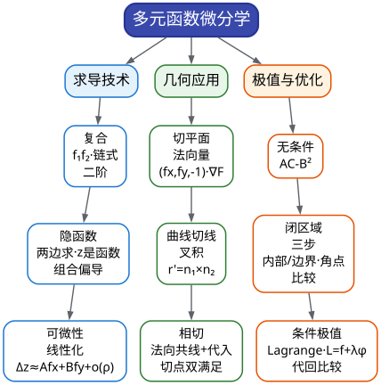

# CMC 手把手精讲
## ——《09 多元函数微分学》：从"冻结变量"到切平面、梯度与拉格朗日

> 🐱 喵～欢迎来到第九篇。如果说 03 篇教你的是"一把刀怎么用"，这一篇教你的是"**同一把刀，同时管两个方向**"——多元微分学的全部秘密，就是"**把多元问题拆成一元问题**"：求偏导时冻结另一个变量、求全微分时把曲面线性化成平面、求条件极值时把约束"折进"目标函数。拆得好，考场上 6 分填空 3 分钟到手；拆得妙，14 分大题也是你的。
>
> **本篇在考试中的地位**（数据口径：第 10–17 届 10 套卷 = 8 场正赛 + 13 届补赛 + 14 届第二次补赛，真题已逐题核对）：
> - 本板块（多元函数微分学）**每届必考**：10 套卷中填空位 7 次、解答位 5 次，单卷贡献约 **6–20 分**（平均约 10 分）；
> - **近三届 A 类的铁律**：填空题必有一道"抽象复合偏导或隐函数求导"——15 届填 2（$`z=f(x^2-y^2,xy)`$）、16 届填 3（$`z=f(xy,e^{x+y})`$）、17 届填 4（$`xz=f(2x-y,xyz)`$），**连续三年，都落在填空位**。这就是你的 **S14 必拿考点包**："每天 15 分钟算 2–3 题，直到闭眼无错"；
> - 解答题多为**综合题**：与几何（15 届三的相切 + 体积）、与积分（13 补三、14 届五）、与证明（10 届五的梯度估计）联袂出场——本板块是"大题工具箱"里出场率最高的工具；
> - 🎯 全板块定位：**算得准、算得快**是主线（填空 6 分不容有失）；证明与估计（10 届五型）属于"写对前几步就是赚"的弹性区。
>
> **大纲对应条目**（《全国大学生数学竞赛考试内容》非数学专业类·多元函数微分学·原文摘录）：
> - 条目 (3)：多元函数**偏导数和全微分**、全微分存在的必要条件和充分条件；
> - 条目 (4)：多元**复合函数、隐函数的求导法**；
> - 条目 (5)：二阶偏导数、**方向导数和梯度**；
> - 条目 (6)：空间曲线的切线和法平面、**曲面的切平面和法线**；
> - 条目 (7)：二元函数的**二阶 Taylor 公式**（保底级，本篇 §2.8）；
> - 条目 (8)：多元函数极值和**条件极值、Lagrange 乘数法**、多元函数的最大值、最小值（低频但大纲明列——**防冷门必练**）。
>
> **先修提示**：本篇默认你已看过 **03 篇**（一元求导的全部手艺）——偏导数本质是一元导数"冻结其他变量"的版本，链式法则、隐函数求导的手法全是 03 篇的老朋友换了个舞台。01 篇的等价无穷小在可微性判定里偶尔客串。
>
> **预计学时**：2 天（对应冲刺路线表**第 3 周 D20–21**）。第一天：§一 + §二 + 精讲 1–5（五道填空）；第二天：§三 + 精讲 6–10（五道几何/证明大题）+ 易错点 + 自测题。
>
> 阅读建议：
> 1. 本篇的"命门"是 §2.3 的 **$`f_1,f_{12}`$ 记号与二阶链式展开**——近三届填空连考的就是它，先把它练熟再往下看；
> 2. 遇到大题别怕：它们都是"填空技术 + 一个几何/积分/证明外壳"，外壳在 04/08/10 篇里各自有主场，本篇只管把**偏导计算**这段做干净；
> 3. 所有标了 ✍️ 的地方真的动笔——多元计算的错大多不是"不会"，而是"漏项"。
>
> 符号说明：📌 重点 | 💡 直觉/类比 | ⚠️ 易错点 | ✍️ 动笔练一练 | ❓ 自测题 | 🎯 考试定位 | ⏱️ 省时技巧

---

# 一、本篇地图

## 1.1 目录（读之前先看这张施工图）

- **§二 知识讲解**：偏导 = 冻结变量的导数 → 全微分与可微性（平面替曲面）→ 链式法则与 $`f_1/f_{12}`$ 记号 → 隐函数求导 → 切平面/法线/曲线切线/两曲面相切 → 方向导数与梯度 → 极值三件套（无条件/闭区域/条件）→ 二元 Taylor 一阶线性化（保底）
- **§三 方法手册**：3.1 抽象复合偏导（一阶/二阶/变量代换）| 3.2 隐函数求导（含"先代值"纪律）| 3.3 全微分与可微性 | 3.4 切平面·法线·空间曲线切线 | 3.5 两曲面相切 | 3.6 方向导数与梯度 | 3.7 极值三件套与 Lagrange | 3.8 偏导综合证明与估计 | 3.9 通用流程与考场纪律
- **§四 真题精讲**：10 道真题完整精讲（16 届填 3、15 届填 2、17 届填 4、13 届填 2、11 届填 5、8 届填 5、12 届大四、10 届大五、9 届大二、15 届大三）
- **§五 易错点清单**：12 条 ❌→✅ 对照
- **§六 自测题**：7 道，附完整答案
- **§七 结语**："多元微分防身七句话" + 学习建议 + 10 篇预告

## 1.2 方法速查表：什么题面 → 用什么武器（一屏版）

| 题面长相（信号） | 首选武器 | 说明 / 升级路线 |
|---|---|---|
| $`z=f(\Box,\triangle)`$，$`\Box,\triangle`$ 是 $`x,y`$ 的显式表达式，求一阶/二阶偏导 | **链式法则 + $`f_1,f_{12}`$ 记号** | 变量树：每条路径相乘、同类项相加；二阶注意"$`f_1`$ 内部还含 $`x,y`$" |
| 抽象 $`f`$，题目"求 $`z_{xy}`$"或"求某点值" | 同上 + **$`f_{12}=f_{21}`$ 合并** | 先算 $`z_x`$，再对 $`y`$ 求；先代值能化简就先代值 |
| 方程 $`F(x,y,z)=0`$（含抽象 $`f`$）确定 $`z(x,y)`$，求 $`z_x`$ 或"某点处值" | **两边直接对 $`x`$ 求导**（$`z`$ 是 $`x,y`$ 的函数！） | 求点值时：**先由方程定出 $`z`$ 的值，再求导代入**（17 届式） |
| 求 $`z_x+z_y`$、$`xz_x+yz_y`$ 这类**组合偏导** | 两边分别对 $`x`$、$`y`$ 求导后**相加减** | 常常答案与函数的形状无关（13 届填 2 型） |
| 做**变量代换**（$`u=x, v=\frac1y-\frac1x,\dots`$）后求新偏导 | 链式法则"倒着写"：旧变量对新变量展开 | 或先求反解再代入（14 补二填 4 式） |
| "曲面切平面、法线、空间曲线切线" | **法向量 $`\nabla F`$** / $`z=f`$ 用 $`(f_x,f_y,-1)`$ | 空间曲线＝两曲面交线时，切线方向＝两法向量叉积 |
| "两曲面相切"求参数 | **法向量共线 + 切点在两曲面上** | 或等价地：用 Lagrange 乘数法求极值（两条路殊途同归） |
| "方向导数 / 最大方向导数" | $`\dfrac{\partial f}{\partial \boldsymbol l}=\nabla f\cdot \boldsymbol e_l`$；最大方向导数 $`=\lVert\nabla f\rVert`$ | **方向向量必须先单位化** |
| "求极值/最值"（二元函数） | **$`AC-B^2`$ 判别 + 闭区域三步（内部+边界+角点）** | 边界上的最值化成一元或上 Lagrange |
| "在约束 $`\varphi=0`$ 下求最值" | **Lagrange 乘数法** $`L=f+\lambda\varphi`$ | 解出候选点后必须**代回比较**；应用题用几何意义判定 |
| 全微分 $`\mathrm{d}z=P\mathrm{d}x+Q\mathrm{d}y`$ 求原函数 | **凑微分** 或"对 $`x`$ 积分再加 $`\varphi(y)`$" | 11 届填 4 型 |
| "证明/$`\lvert f(A)-f(B)\rvert\le M\lvert AB\rvert`$ 型估计" | **构造一元辅助函数 + 中值定理 + Cauchy** | 10 届大五的模板 |

## 1.3 知识树：本篇全部内容的骨架



一句话总结这张图：**求导技术解决"怎么算"（近三届填空 3/3 连考），几何应用解决"算出来的东西长什么样"（历史最高频的几何考点），极值与优化解决"它在哪里最大最小"（大纲明列、防冷门必备）。** 三条线共用同一个内核：**把多元问题拆成一元问题**。

---

# 二、知识讲解：多元的世界，一元的刀

## 2.1 偏导数：把其余变量"用胶带封住"的导数

一元函数 $`f(x)`$ 只有一个变化方向，导数就是"那一个方向的变化率"。二元函数 $`z=f(x,y)`$ 站在一个**平面**上——往哪走？答案是不纠结：**一次只走一个方向**。

**偏导数**的定义就是这么朴素——封住另一个变量：

```math
f_x(x_0,y_0)=\lim_{\Delta x\to 0}\frac{f(x_0+\Delta x,y_0)-f(x_0,y_0)}{\Delta x}\qquad(\text{把 } y \text{ 封在 } y_0),
```

```math
f_y(x_0,y_0)=\lim_{\Delta y\to 0}\frac{f(x_0,y_0+\Delta y)-f(x_0,y_0)}{\Delta y}\qquad(\text{把 } x \text{ 封在 } x_0).
```

📌 **计算层面的含义（最实用的理解）**：**求 $`f_x`$ 时把 $`y`$ 当常数，求 $`f_y`$ 时把 $`x`$ 当常数**——所有一元求导法则（四则、链式、隐函数）原封不动。比如 $`f=x^2y+\sin(xy)`$，则 $`f_x=2xy+y\cos(xy)`$（$`y`$ 全程当常数）。

💡 **打比方（写给写代码的你）**：求偏导就是**把多元函数"投影"成一元函数再求导**——固定 $`y=y_0`$，截面 $`x\mapsto f(x,y_0)`$ 就是一条一元曲线，$`f_x`$ 是这条截线的斜率。就像调参时"只动一个旋钮"：其他旋钮焊死，看这一个旋钮拧动的效果。

⚠️ **记号说明**：$`f_x`$ 与 $`\dfrac{\partial f}{\partial x}`$ 完全同义；但对**抽象函数** $`f(u,v)`$，$`f_1`$（或 $`f_u`$）与 $`f_x`$ **不是一回事**——$`f_1`$ 是"对第一个中间变量 $`u`$ 求导"，$`f_x`$ 是"对整个 $`x`$ 求导"。这个区别是 §2.3 的主角，也是**最高频的失分点**。

**二阶偏导**就是偏导再偏导，共四个：$`f_{xx},f_{xy},f_{yx},f_{yy}`$。📌 **混合偏导的可交换性**：只要 $`f_{xy}`$ 与 $`f_{yx}`$ 都连续，就有

```math
f_{xy}=f_{yx}.
```

竞赛题里抽象函数几乎都给"二阶连续偏导数"，**这条随时要用**（合并同类项时把 $`f_{12}`$ 与 $`f_{21}`$ 并成一项是标准动作）。

## 2.2 全微分与可微性：用一张平面"贴住"曲面

一元的"脸 3"（03 篇 §2.1）：$`f(x_0+\Delta x)\approx f(x_0)+f'(x_0)\Delta x`$——**曲线局部像直线**。多元的推广：曲面局部像**平面**：

```math
\Delta z=f(x_0+\Delta x,y_0+\Delta y)-f(x_0,y_0)=\underbrace{f_x\Delta x+f_y\Delta y}_{\text{线性主部}}+\;o(\rho),\qquad \rho=\sqrt{\Delta x^2+\Delta y^2}.
```

若上式成立，就称函数在 $`(x_0,y_0)`$ **可微**，线性主部叫**全微分** $`\mathrm{d}z=f_x\,\mathrm{d}x+f_y\,\mathrm{d}y`$。

📌 **三条关系（务必分清，这是可微性考题的全部弹药）**：

```math
\text{偏导连续}\;\Longrightarrow\;\text{可微}\;\Longrightarrow\;\text{偏导存在},
```

```math
\text{可微}\;\Longrightarrow\;\text{连续}.
```

（两边的箭头都不能反向！）

⚠️ **著名的"翻车实例"**：$`f(x,y)=\dfrac{xy}{\sqrt{x^2+y^2}}`$（原点补充定义 $`f(0,0)=0`$）。算偏导：$`f_x(0,0)=\lim\limits_{\Delta x\to 0}\frac{f(\Delta x,0)-0}{\Delta x}=0`$，同理 $`f_y(0,0)=0`$——**偏导存在**。但如果可微，按定义应有一阶线性化 $`\dfrac{f(x,y)-0-0}{\sqrt{x^2+y^2}}\to 0`$；实际算：$`\dfrac{f(x,y)}{\rho}=\dfrac{xy}{x^2+y^2}`$，沿 $`y=x`$ 路径它趋于 $`\dfrac12\ne0`$——**不可微**。⚠️ 两个"档位"别记混：本函数**是连续的**（$`\lvert f\rvert\le\dfrac{\rho}{2}\to0`$，沿 $`y=x`$ 也有 $`f\to0`$；趋于 $`\frac12`$ 的是 $`\dfrac{f}{\rho}=\dfrac{xy}{x^2+y^2}`$），所以此例打穿的是"**连续 ⇏ 可微**"与"**偏导存在 ⇏ 可微**"两只反向箭头；若要演示"偏导存在但不连续"，须另用 $`g(x,y)=\dfrac{xy}{x^2+y^2}`$（沿不同路径极限不同）。

💡 **怎么在考场上判可微？** 本板块近年不直接考"判定"，但 **14 届大五**考了"**反用**"：题目给你 $`\mathrm{d}z|_{(0,0)}=3\mathrm{d}x+2\mathrm{d}y`$，意思是"在原点处的一阶线性化系数是 $`3,2`$"——于是

```math
f(t,u)=f(0,0)+3t+2u+o\big(\sqrt{t^2+u^2}\big).
```

**把"已知全微分"当"已知一阶展开"用**，这是可微性概念最高级的考法（完整题目与流水线见 01 篇 §3.7 的【真题微型例子 2】）。

**全微分求原函数**（低频但漂亮）：若已知 $`\mathrm{d}u=P\,\mathrm{d}x+Q\,\mathrm{d}y`$，要还原 $`u`$——两条路：① **凑微分**（把 $`P\mathrm{d}x+Q\mathrm{d}y`$ 凑成某个 $`\mathrm{d}G`$）；② **偏积分**：对 $`x`$ 积分得 $`u=\int P\,\mathrm{d}x+\varphi(y)`$，再对 $`y`$ 求导与原式比对解出 $`\varphi'`$。
✍️ **动笔练一练**（11 届填 4 的骨架）：已知 $`\mathrm{d}u=\dfrac{y\,\mathrm{d}x-x\,\mathrm{d}y}{3x^2-2xy+3y^2}`$，求 $`u`$。提示：分子恰是 $`y^2\,\mathrm{d}\left(\dfrac{x}{y}\right)`$——令 $`t=\dfrac{x}{y}`$ 后分母化为 $`y^2(3t^2-2t+3)`$，得 $`u=\dfrac{1}{2\sqrt2}\arctan\dfrac{3}{2\sqrt2}\left(\dfrac{x}{y}-\dfrac13\right)+C`$。（配方后套 $`\int\frac{\mathrm{d}t}{at^2+bt+c}=\frac{2}{\sqrt{4ac-b^2}}\arctan\frac{2at+b}{\sqrt{4ac-b^2}}`$。）

## 2.3 链式法则与 $`f_1/f_{12}`$ 记号：变量树怎么走

近三届填空 3/3 连考的"抽象复合偏导"，考的就是这一节。把原理讲透，题就没有难度。

**基本格局**：$`z=f(u,v)`$，而 $`u=u(x,y)`$、$`v=v(x,y)`$ 是中间变量（可能显式、可能抽象）。求 $`z`$ 对 $`x`$ 的偏导，就是"**从 $`z`$ 出发走到 $`x`$ 的所有路径，每条路径相乘、所有路径相加**"：

```math
z_x=f_1\,u_x+f_2\,v_x,\qquad z_y=f_1\,u_y+f_2\,v_y.
```

📌 **记号约定（全篇统一）**：$`f_1`$ 表示 $`f`$ 对**第一个中间变量**求偏导，$`f_2`$ 对第二个；$`f_{11}`$ 是先对第一个再对第一个，$`f_{12}`$ 是先对第一再对第二。**$`f_1,f_2,f_{11},f_{12}`$ 这些"偏导块"本身仍是 $`u,v`$ 的函数**——这句话是理解二阶展开的钥匙。

💡 **为什么二阶展开那么长？** 以 $`z_{xy}`$ 为例，老老实实沿"变量树"走：

```math
z_x=f_1u_x+f_2v_x,
```

现在求 $`z_{xy}=\dfrac{\partial}{\partial y}(z_x)`$。注意 $`f_1,f_2`$ 也是 $`x,y`$ 的复合函数（它们是 $`u,v`$ 的函数，$`u,v`$ 又是 $`x,y`$ 的函数）——**对 $`f_1`$ 再走一次链式**：

```math
\frac{\partial}{\partial y}f_1=f_{11}u_y+f_{12}v_y,\qquad \frac{\partial}{\partial y}f_2=f_{21}u_y+f_{22}v_y.
```

代入并用 $`f_{12}=f_{21}`$ 合并：

```math
z_{xy}=f_{11}u_xu_y+f_{12}\big(u_xv_y+u_yv_x\big)+f_{22}v_xv_y+f_1u_{xy}+f_2v_{xy}.
```

📌 **这就是"五项公式"**——考场上不必背：**画变量树，把 $`z_x`$ 的每个因子对 $`y`$ 求导，别漏"$`f_1`$ 自己也要链式"那一层**，公式自动长出来。三个战术要点：
1. **先算 $`z_x`$ 还是 $`z_y`$？看哪个中间变量的导数更简单**（比如 $`u=xy,v=e^{x+y}`$，先对 $`x`$ 和对 $`y`$ 一样轻松；但 $`u=x^2-y^2`$ 求 $`z_x`$ 后再对 $`y`$ 求，另一个中间变量要换号——选顺手的先开工）；
2. **$`f_{12}`$ 与 $`f_{21}`$ 必须合并**（$`2f_{12}`$）——不合并会被判"表达式不最简"（按官方答案扣系数分）；
3. **最后两项 $`f_1u_{xy}+f_2v_{xy}`$ 极易漏**——$`u_{xy}`$ 是"中间变量的混合偏导"，有的题里它非零（16 届的 $`u=xy`$ 给 $`u_{xy}=1`$；同题的 $`v=e^{x+y}`$ 给 $`v_{xy}=e^{x+y}`$，正是 $`f_2`$ 项的来源），有的题里为零（$`u=x^2-y^2`$（15 届）、$`u=2x-y`$（17 届）这类对两个变量"分家"的中间变量）。

**变量代换型**（把偏微分方程换到新坐标系）：设 $`w=w(u,v)`$，题中给变换 $`u=x-cy`$、$`v=x+cy`$，求 $`w_{xx}-\dfrac{1}{c^2}w_{yy}`$——做法是把**旧变量当中间变量**：把 $`w`$ 视作 $`x,y`$ 的复合（经由 $`u,v`$），链式展开：

```math
w_x=w_1\cdot 1+w_2\cdot 1,\qquad w_y=w_1\cdot(-c)+w_2\cdot c,
```

再各求一次导，最后相减时 $`w_{11},w_{22}`$ 项相消、只剩 $`4w_{12}`$（9 届填 3，见 §3.1 微例）。**"换元后交叉项只剩 $`w_{12}`$"是波动方程算子的标志性结果**——记结论，更要会推。

## 2.4 隐函数求导（多元版）：$`z`$ 也是"藏在方程里"的函数

17 届填 4 的格局：**$`z=z(x,y)`$ 由方程 $`F(x,y,z)=0`$（或含抽象 $`f`$ 的方程）确定**，求 $`z_x`$ 或"某点处的 $`z_x`$"。

💡 **心法（03 篇的多元翻版）**：**两边对 $`x`$ 求导时，把 $`z`$ 看成 $`z(x,y)`$——遇到 $`z`$ 的地方，链式拖出一个 $`z_x`$；遇到 $`y`$ 的地方，$`y`$ 和 $`x`$"平级"，当常数。** 例如 $`e^z-xyz=0`$：两边对 $`x`$ 求偏导，$`e^zz_x-yz-xyz_x=0`$，故 $`z_x=\dfrac{yz}{e^z-xy}`$（求 $`z_y`$ 时把 $`x`$ 当常数，同理得 $`z_y=\dfrac{xz}{e^z-xy}`$）。

📌 **公式版**：$`F(x,y,z)=0\Rightarrow z_x=-\dfrac{F_x}{F_z},\ z_y=-\dfrac{F_y}{F_z}`$（$`F_z\ne0`$；其中 $`F_x`$ 求时把 $`y,z`$ 都当常数）。考试推荐"两边直接求导"，公式版用于交叉验算。

**抽象函数混在方程里**（17 届的最新格局）：$`xz=f(2x-y,xyz)`$。此时 $`f`$ 没有表达式，只有**定点数据**（$`f(2,0)=3`$、$`f_u(2,0)=5`$）。策略：
1. 两边对 $`x`$ 求偏导：$`z+xz_x=2f_1+yf_2\left(z+xz_x\right)`$——**$`f`$ 拖出 $`f_1,f_2`$，它们内部包着 $`(2x-y,xyz)`$**；
2. 要求点值 $`(x,y)=(1,0)`$，先由方程**定出 $`z`$ 的值**：$`z=f(2,0)=3`$；
3. 代点解方程：$`3+z_x=2\times5+0`$，得 $`z_x=7`$——注意 $`y=0`$ 让含 $`f_2`$ 的整项"自动蒸发"，**这就是"先代值"纪律的红利**（完整讲解见精讲 3）。

⚠️ 组合偏导问法：若题目要 $`z_x+z_y`$ 或 $`xz_x+yz_y`$，**分别求两个偏导再加**是最稳的；但注意有些方程有"整体结构"（13 届填 2 里 $`\Theta=x+2y-3z`$ 一锅端），**此时要讨论退化情形**（见精讲 4）。

## 2.5 几何应用：切平面、法线、空间曲线切线、两曲面相切

这是本板块**历史上出现频率最高的几何考点**（1、6、8、11、15 届均出手）。全部内容浓缩成两句话：

📌 **曲面 $`F(x,y,z)=0`$ 在点 $`P_0`$ 处的法向量是 $`\nabla F(P_0)=(F_x,F_y,F_z)`$**；写法的三种皮肤：
- $`F(x,y,z)=0`$：法向量 $`(F_x,F_y,F_z)`$，切平面 $`F_x(P_0)(x-x_0)+F_y(P_0)(y-y_0)+F_z(P_0)(z-z_0)=0`$；
- $`z=f(x,y)`$：移项成 $`f(x,y)-z=0`$，法向量 $`(f_x,f_y,-1)`$，切平面

```math
z-z_0=f_x(P_0)(x-x_0)+f_y(P_0)(y-y_0);
```

- 参数曲面：用两个切向量叉积。

**法线**：过 $`P_0`$、方向取 $`\nabla F(P_0)`$（或 $`(f_x,f_y,-1)`$）的直线。

**空间曲线** $`\boldsymbol r(t)=(x(t),y(t),z(t))`$：在 $`t_0`$ 处切向量 $`\boldsymbol r'(t_0)=\big(x'(t_0),y'(t_0),z'(t_0)\big)`$，切线方向就是它；**法平面**是过 $`P_0`$ 以 $`\boldsymbol r'(t_0)`$ 为法向量的平面。
若曲线是**两张曲面的交线**（如球面 ∩ 平面）：切向量 $`=\nabla F_1\times\nabla F_2`$（同时垂直于两个法向量）——**叉积一步到位**。

📌 **"两曲面相切"的翻译**（11 届填 5、15 届三的题眼）：两曲面在切点 $`P_0`$ 处相切 $`\iff`$

- ① 两个法向量共线：$`\nabla F_1(P_0)\parallel\nabla F_2(P_0)`$；
- ② 切点同时在两张曲面上：$`F_1(P_0)=0`$、$`F_2(P_0)=0`$。

把这两条写成方程组（共线关系拆成分量等式），与两张曲面方程联立，参数就解得出来。**等价的另一条路**：把"共线"写成 $`\nabla F_1=\lambda\nabla F_2`$——这正是 **Lagrange 乘数法的方程**（"在曲面 2 上求 $`F_1`$ 的极值/水平集"，最优解处等值面与约束面相切）。**相切问题 ≡ 条件极值问题**，两条路殊途同归，考场上哪条顺走哪条。

⚠️ 15 届那道大题还有一层"降维"智慧：**旋转曲面题可以转到过轴的截平面上做**——三维的相切化成二维曲线与直线相切（见精讲 10），计算量立减。

✍️ **动笔练一练**（8 届填 5 的骨架）：求曲面 $`z=\dfrac{x^2}{2}+y^2`$ 平行于平面 $`2x+2y-z=0`$ 的切平面。切平面法向量 $`(x_0,2y_0,-1)`$ 与给定平面法向量 $`(2,2,-1)`$ 平行：$`\dfrac{x_0}{2}=\dfrac{2y_0}{2}=\dfrac{-1}{-1}`$，得 $`x_0=2,y_0=1,z_0=3`$，切平面 $`2(x-2)+2(y-1)-(z-3)=0`$，即 $`2x+2y-z=3`$。（此题完整精讲见 §四 精讲 6。）

💡 **切平面公式怎么记**：$`z=f(x,y)`$ 的切平面 $`z-z_0=f_x\Delta x+f_y\Delta y`$ 与全微分 $`\mathrm{d}z=f_x\mathrm{d}x+f_y\mathrm{d}y`$ 是**同一个式子**——切平面就是"全微分的几何化身"：可微 = 曲面有切平面。忘公式时从线性化现推。

## 2.6 方向导数与梯度：往哪走上升最快？

偏导只回答了"沿坐标轴走"的变化率。但站在山坡上，"往东走"和"往东北走"的坡度显然不同——**方向导数**回答"沿任意方向走"的变化率：

📌 设 $`\boldsymbol e_l=(\cos\alpha,\cos\beta)`$ 是**单位**方向向量，则

```math
\frac{\partial f}{\partial \boldsymbol l}\Big|_{P_0}=\nabla f(P_0)\cdot \boldsymbol e_l=f_x(P_0)\cos\alpha+f_y(P_0)\cos\beta,
```

其中 $`\nabla f=(f_x,f_y)`$ 叫**梯度**。

💡 **梯度的三句话直觉**（与 2.8 节几何意义配套）：
1. **梯度方向 = 函数上升最快的方向**（由 Cauchy 不等式 $`|\nabla f\cdot e|\le\|\nabla f\|`$ 取等）；
2. **最大方向导数 = $`\|\nabla f\|`$**；最小方向导数 $`=-\|\nabla f\|`$（沿反方向）；
3. **梯度垂直于等值线**（$`f(x,y)=C`$ 的切线），也垂直于等值面——这是"曲面法向量 = 梯度"的来历（§2.5 的全景图在此合拢）。

⚠️ **考试三查**：① 题给的方向向量先**除以模长**再代（"沿 $`\boldsymbol l=(1,1,0)`$ 的方向导数"必须化为 $`\frac{(1,1,0)}{\sqrt2}`$）；② 方向导数的定义式与公式在**可微**时才等价——若题目让用定义算某非光滑点（如原点）的方向导数，老老实实写极限 $`t\to0^+`$；③ "最大方向导数"填 $`\|\nabla f\|`$，别填某个坐标偏导。

**真题锚点**：已核实的 10–17 届真题中方向导数**未直接单独考过**——但 **9 届大题二**把"沿任意方向的方向导数"用出了花：**所有方向的二阶方向导数都 $`>0`$ 且一阶都为 0，则原点是极小值**（正定 Hessian 的语言，见精讲 9）。所以这一节属于"**20 分钟保底 + 为证明题供能**"的双重价值内容。

## 2.7 极值三件套：无条件、闭区域、条件极值

**（1）无条件极值（自由极值）**：
1. 解驻点方程组 $`f_x=0,\ f_y=0`$；
2. 记 $`A=f_{xx},\ B=f_{xy},\ C=f_{yy}`$ 在驻点处取值，算 **$`AC-B^2`$**：
   - $`AC-B^2>0`$：是极值（**$`A>0`$ 极小，$`A<0`$ 极大**）；
   - $`AC-B^2<0`$：非极值（鞍点）；
   - $`AC-B^2=0`$：判别法失效（初赛从未考这种退化型——🎯 放弃）。

💡 **为什么是 $`AC-B^2`$？** 它是二元 Taylor 的二次型 $`Ah^2+2Bhk+Ck^2`$ 的"判别式"：$`AC-B^2>0`$ 时二次型正定（$`A>0`$）或负定（$`A<0`$），增量恒同号——这正是 9 届大题二"正定二次型 ⇒ 极小"的同一件事（§2.8 展开）。

**（2）闭区域最值三步**：内部驻点值 + 边界上的最值 + 角点值，**全部列出来比大小**。
- 边界是最值的主战场：把边界曲线代入 $`f`$ **化成一元函数**求最值（或上 Lagrange）；
- ⚠️ 漏边界是这一题型的头号失分原因——"$`\max`$ 在边界上取到"太常见了。

**（3）条件极值与 Lagrange 乘数法**："在约束 $`\varphi(x,y)=0`$ 下求 $`f`$ 的极值"：
1. 构造 $`L=f+\lambda\varphi`$（两个约束就再加 $`\mu\psi`$）；
2. 解方程组 $`\nabla L=0`$：$`L_x=0,\ L_y=0,\ L_\lambda=0`$（即 $`f_x=\lambda\varphi_x`$ 型 + 约束本身）；
3. **把解出的候选点代回 $`f`$ 比较**，或由实际问题的几何/物理意义直接判定。

📌 **Lagrange 的哲学（值得多读一遍）**：在约束曲线上走时，如果 $`f`$ 还能"顺坡变"，那就不是极值点；最优处 $`f`$ 的等值线与约束曲线**相切**——即 $`\nabla f\parallel\nabla\varphi`$，这就是 $`f_x=\lambda\varphi_x,\ f_y=\lambda\varphi_y`$（即 $`f_x=0`$ 与 $`f_y=0`$ 的"带约束版"）的来源。（"约束曲面上目标函数的水平集与约束相切"——反过来正是 §2.5 的"两曲面相切"。）

⚠️ Lagrange 只给**必要**条件：候选点必须"代回比较"或"说明理由"；应用题（如"体积最大"）可由物理意义断言——但**要写这句话**（例："由几何意义，该点为最大值点"），它值一个评分点。

**历史战绩**：早期届次确有"条件极值"的应用型大题——第 2 届第五题（15 分）求均匀椭球绕任意方向轴转动惯量的最大值与最小值，官方解答用的就是 Lagrange 乘数法；10–17 届未再单独考——🎯 **但大纲白纸黑字列着第 (8) 条，"复习成本低、暴雷代价高"，必须练到会做标准题**（自测 6、7 就是它）。

## 2.8 二元 Taylor 与一阶线性化（🎯 保底 + 供能）

二元函数在 $`P_0(x_0,y_0)`$ 处带二阶项的 Taylor 展开：

```math
f(x_0+h,y_0+k)=f(P_0)+f_xh+f_yk+\frac{1}{2}\big(f_{xx}h^2+2f_{xy}hk+f_{yy}k^2\big)\Big|_{P_0}+o(\rho^2).
```

📌 **复习策略（照抄考点地图的裁决）**：完整展开式**记住形式**即可（初赛 10–17 届零直接命中）；真正要"用肌肉记忆掌握"的是它的**一阶版**：

```math
f(P_0+\Delta)\approx f(P_0)+f_x(P_0)\Delta_1+f_y(P_0)\Delta_2,
```

——这就是**可微性的定义**（2.2 节）换个写法。**14 届大五**全题围绕它转动："已知 $`\mathrm{d}z|_{(0,0)}=3\mathrm{d}x+2\mathrm{d}y`$，求含 $`\iint f`$ 的极限"——把 $`f(\xi,x)=3\xi+2x+o(\rho)`$ 塞进积分中值定理的链条里（完整流程见 01 篇 §3.7 微例 2 与本篇 §3.3 微例 2）。

💡 **一句话贯通**：**偏导 → 全微分 → 切平面 → Taylor 一阶项**，四个概念是同一件事的四件衣服：局部线性化。二阶 Taylor 则是"再补一层曲率信息"（正定 ⇒ 极小，即 $`AC-B^2`$ 判别的原理）。

✍️ **动笔练一练**：$`f(x,y)=\ln(1+x+2y)`$ 在 $`(0,0)`$ 附近的一阶近似是什么？（$`\mathrm{d}f|_{(0,0)}=\mathrm{d}x+2\mathrm{d}y`$，故 $`f\approx x+2y`$。顺手看一眼 14 届大五，你会对"$`3t+2u`$"的出现不再陌生。）

---

# 三、方法手册：九套武器，见招拆招

每个方法按统一格式展开：【适用信号】→【步骤】→【关键公式】→【真题微型例子】。再强调一遍：**你缺的不是方法本身，而是"什么时候用它"**。

## 3.1 抽象复合偏导（一阶 / 二阶 / 变量代换）

**【适用信号】** $`z=f(u,v)`$ 且 $`u,v`$ 是 $`x,y`$ 的表达式（显式或抽象）；求 $`z_x,z_y,z_{xy}`$ 之一；或"做变量代换后求某组合偏导"。**近三届填空 3/3 连考——本节的熟练度直接换 6 分。**

**【步骤】**
1. **画变量树**：$`z\to(u,v)\to(x,y)`$，标出每条边的"边权"（$`u_x,u_y,v_x,v_y`$）；
2. **一阶**：路径相乘再相加，$`z_x=f_1u_x+f_2v_x`$；
3. **二阶**：对一阶式**再求一次偏导**——$`f_1,f_2`$ 内部仍是 $`(u,v)`$，还要链式展开一层（"五项公式"自动生成）；
4. **收尾**：$`f_{12}=f_{21}`$ 合并；代点（如有）。

**【关键公式】**

```math
z_x=f_1u_x+f_2v_x,\qquad z_{xy}=f_{11}u_xu_y+f_{12}(u_xv_y+u_yv_x)+f_{22}v_xv_y+f_1u_{xy}+f_2v_{xy}.
```

**【真题微型例子 1】**（第 9 届非数学类·填空第 3 题，2017；波动方程算子）设 $`w=f(u,v)`$ 有二阶连续偏导，$`u=x-cy,\ v=x+cy`$（$`c\ne0`$），求 $`w_{xx}-\dfrac{1}{c^2}w_{yy}`$。
**方法（把 $`(u,v)`$ 当中间变量，链式两次）**：

```math
w_x=f_1+f_2,\qquad w_y=c(f_2-f_1),
```

```math
w_{xx}=f_{11}+2f_{12}+f_{22},\qquad w_{yy}=c^2(f_{11}-2f_{12}+f_{22}),
```

相减：$`w_{xx}-\dfrac{1}{c^2}w_{yy}=\big(f_{11}+2f_{12}+f_{22}\big)-\big(f_{11}-2f_{12}+f_{22}\big)=4f_{12}`$。官方答案 $`4f_{12}`$ ✓。
> 教学点：① $`w_y`$ 的边权是 $`-c`$ 和 $`c`$（对 $`y`$ 求导时 $`u=x-cy`$ 出 $`-c`$）——**负号别丢**；② 二次求导时交叉项 $`2f_{12}`$ 在两个方向"同号叠加"、$`f_{11},f_{22}`$ 项"相消"——**这就是波动方程换成特征坐标后只剩 $`w_{uv}`$ 的原理**，值得亲手推一遍。

**【真题微型例子 2】**（第 8 届非数学类·填空第 3 题，2016）设 $`f`$ 有连续导数，$`f(1)=2`$，$`z=f(e^xy^2)`$，且 $`\dfrac{\partial z}{\partial x}=z`$，求 $`x>0`$ 时 $`f(x)`$。
链式：$`\dfrac{\partial z}{\partial x}=f'(e^xy^2)\cdot e^xy^2`$。设 $`u=e^xy^2`$，条件 $`\dfrac{\partial z}{\partial x}=z`$ 变成 $`f'(u)\,u=f(u)`$（对一切可取的 $`u>0`$）。于是 $`\dfrac{f'(u)}{f(u)}=\dfrac{1}{u}`$，积分得 $`\ln f(u)=\ln u+C_1`$，即 $`f(u)=Cu`$。由 $`f(1)=2`$ 得 $`C=2`$，故 $`f(x)=2x\ (x>0)`$。（官方参考解答同此；其中原卷解答有一处中间因子印刷笔误 $`e^xy`$，按链式法则应为 $`e^xy^2`$，此处已修正。）
> 教学点：**复合偏导的"条件方程"可以把抽象函数逼成具体函数**——"偏导条件 $`\to`$ 一元微分方程"是本板块与 07 篇（常微分方程）的接头暗号（17 届三、9 届填 1 是它的反向版本）。

## 3.2 隐函数求导（两边求导 + 先代值纪律）

**【适用信号】** 方程确定 $`z=z(x,y)`$（含抽象 $`f`$ 的也归此类）；求 $`z_x`$、组合偏导、或"某点处的偏导值"。

**【步骤】**
1. **两边对 $`x`$（或 $`y`$）求偏导**：$`z`$ 视为 $`x,y`$ 的函数（拖 $`z_x`$），$`f`$ 型抽象函数拖 $`f_1,f_2`$；
2. **解出 $`z_x`$**（一元一次方程）；
3. **求点值 = 先代值纪律**：先用方程把点处 $`z`$ 的值定出来，再（求导前或求导后）代入点值——**哪种省事用哪种，判据是"代点会不会丢信息"**。

**【关键公式】** $`F(x,y,z)=0\Rightarrow z_x=-\dfrac{F_x}{F_z}`$（验算用）；抽象 $`f`$ 拖链式。

**【真题微型例子】**（第 14 届初赛第二次补赛·填空第 4 题，2023；变量代换 + 约束方程）设可微函数 $`z=z(x,y)`$ 满足 $`x^2z_x+y^2z_y=2z^2`$，又设 $`u=x,\ v=\dfrac1y-\dfrac1x,\ w=\dfrac1z-\dfrac1x`$，求 $`\left.\dfrac{\partial w}{\partial u}\right|_{u=2,v=1}`$。
**思路**：$`w=\dfrac1z-\dfrac1u`$，求 $`w_u`$ 就是"把 $`z`$ 用 $`u,v`$ 表示后对 $`u`$ 求偏导"，而 $`z`$ 的偏导又通过 $`x=u,\ y=\dfrac{u}{uv+1}`$ 链式回来。官方一步到位：

```math
\frac{\partial w}{\partial u}=-\frac{1}{z^2}\left(\frac{\partial z}{\partial x}+\frac{\partial z}{\partial y}\cdot\frac{1}{(uv+1)^2}\right)+\frac{1}{u^2}=-\frac{1}{z^2u^2}\Big(x^2z_x+y^2z_y\Big)+\frac{1}{u^2}=-\frac{2z^2}{z^2u^2}+\frac{1}{u^2}=-\frac{1}{u^2}.
```

（第三个等号用了约束方程 $`x^2z_x+y^2z_y=2z^2`$ 与 $`\dfrac{1}{(uv+1)^2}=\dfrac{y^2}{u^2}`$。）故 $`\left.\dfrac{\partial w}{\partial u}\right|_{(2,1)}=-\dfrac14`$。
> 教学点：**约束方程存在的意义就是"替掉一坨偏导"**——看到题目给了一个含 $`z_x,z_y`$ 的恒等式，就要意识到它是用来化简的弹药，最后答案往往与 $`z`$ 无关。

## 3.3 全微分与可微性（判判定、用用看、凑凑看）

**【适用信号】** 判定某点可微性；已知 $`\mathrm{d}z|_{P_0}`$ 求极限/估值的综合题；已知全微分求原函数。

**【步骤（判可微）】** ① 先求 $`f_x(P_0),f_y(P_0)`$；② 验证 $`\dfrac{f(P_0+\Delta)-f(P_0)-f_x\Delta x-f_y\Delta y}{\rho}\to 0`$（$`\rho\to0`$）。**两条快捷判据**：偏导在 $`P_0`$ 附近存在且**在某点连续** ⇒ 可微；若沿某方向该比值不趋于 0 ⇒ 不可微。

**【真题微型例子 1】**（类型题·仿竞赛风格）判定 $`f(x,y)=\dfrac{x^3}{x^2+y^2}`$（$`(0,0)`$ 处定义 $`f=0`$）在原点是否可微。
先求偏导：$`f_x(0,0)=\lim\limits_{t\to0}\dfrac{t^3/t^2}{t}=1`$，$`f_y(0,0)=0`$。验证：

```math
\frac{f(x,y)-x}{\rho}=\frac{\dfrac{x^3}{x^2+y^2}-x}{\sqrt{x^2+y^2}}=\frac{-xy^2}{(x^2+y^2)^{3/2}}.
```

沿 $`x=y=t`$ 路径：$`\dfrac{-t^3}{(2t^2)^{3/2}}=-\dfrac{1}{2\sqrt2}\not\to0`$。故**不可微**。
> 与 2.2 节的反例对照记忆："分子三次、分母二次"（本题）与"分子二次、分母一次"（2.2 节的 $`\frac{xy}{\sqrt{x^2+y^2}}`$）都**连续、偏导存在、但不可微**；真正会"极限都不存在"的是"分子二次、分母二次"型（如 $`\frac{xy}{x^2+y^2}`$）。反例题只需沿一条特殊路径击破。

**【真题微型例子 2】**（第 14 届非数学类·解答五，2022；一阶线性化的实战）设 $`f`$ 在 $`D=[0,1]^2`$ 可微，$`f(0,0)=0`$，$`\mathrm{d}z|_{(0,0)}=3\mathrm{d}x+2\mathrm{d}y`$，求

```math
\lim_{x\to 0^+}\frac{\displaystyle\int_0^{x^2}\!\mathrm{d}t\int_x^{\sqrt{t}}f(t,u)\,\mathrm{d}u}{1-\sqrt[4]{1-x^4}}.
```

**关键步骤（只摘"线性化"一段，完整流水线见 01 篇 §3.7 的微例 2）**：分母 $`\sim\dfrac{x^4}{4}`$；换序 + 洛必达 + 积分中值整理到 $`-\lim\limits_{x\to0^+}\dfrac{f(\xi,x)}{x}`$（$`0<\xi<x^2`$）。此时**用可微性展开**：

```math
f(\xi,x)=f(0,0)+f_x(0,0)\xi+f_y(0,0)x+o\Big(\sqrt{\xi^2+x^2}\Big)=3\xi+2x+o(\rho),
```

再由 $`0<\dfrac{\xi}{x}<x\to0`$ 夹逼得 $`\dfrac{3\xi+2x}{x}\to2`$，零头 $`o(\rho)/x\to0`$，故原式 $`=-2`$。
> 教学点：**"已知全微分"题目里，$`\mathrm{d}z|_{P_0}`$ 的唯一用途就是写出 $`f(P_0+\Delta)`$ 的一阶展开**；$`o(\rho)`$ 的除法合法性由 $`\rho/x\le\sqrt{x^2+x^4}/x\to1`$（有界）保证。这一类"线性化 + 夹逼"是多元微分与极限的交界地带，2018–2022 三度出手。

## 3.4 切平面、法线与空间曲线切线

**【适用信号】** 求曲面切平面/法线；求空间曲线（尤其两曲面交线）的切线/法平面；"平行/垂直某平面的切平面"。

**【步骤】**
1. **认曲面类型**：$`z=f(x,y)`$ 用 $`(f_x,f_y,-1)`$；$`F=0`$ 用 $`\nabla F`$；
2. **求法向量**（代点取值）；
3. **切平面**：$`\boldsymbol n\cdot\big((x,y,z)-P_0\big)=0`$（点法式，一套通吃）；
4. **交线切线**：$`\boldsymbol\tau=\nabla F_1\times\nabla F_2`$（叉积），再写对称式 $`\dfrac{x-x_0}{\tau_x}=\dfrac{y-y_0}{\tau_y}=\dfrac{z-z_0}{\tau_z}`$。

**【真题微型例子】**（类型题·仿竞赛风格；综合了 8 届填 5 与 17 届填 5 的背景）求球面 $`x^2+y^2+z^2=3`$ 与平面 $`x+y+z=1`$ 的交线在点 $`(1,1,-1)`$ 处的切线。
两曲面法向量：$`\nabla F_1=(2x,2y,2z)|_{(1,1,-1)}=(2,2,-2)`$，$`\nabla F_2=(1,1,1)`$。切向量

```math
\boldsymbol\tau=(2,2,-2)\times(1,1,1)=\big(2\cdot1-(-2)\cdot1,\ (-2)\cdot1-2\cdot1,\ 2\cdot1-2\cdot1\big)=(4,-4,0)\sim(1,-1,0).
```

切线：$`x-1=t,\ y-1=-t,\ z=-1`$，即 $`\dfrac{x-1}{1}=\dfrac{y-1}{-1},\ z=-1`$。
> 教学点：**"两曲面交线"的切向量永远用叉积**——比参数化快得多；写出对称式前把方向向量约到最简（$`(4,-4,0)\to(1,-1,0)`$）。

## 3.5 两曲面相切（法向共线 + 合作双方程）

**【适用信号】** "曲面 $`F_1=0`$ 与 $`F_2=0`$ 相切，求参数"；"某曲面与给定曲面在指定点相切"。

**【步骤】**
1. **设切点 $`(x_0,y_0,z_0)`$**（三个未知数）；
2. **列三个方程**：$`\nabla F_1(x_0,y_0,z_0)=\lambda\nabla F_2(x_0,y_0,z_0)`$（三个分量即三个方程，或"分量成比例"写两个）+ $`F_1=0`$、$`F_2=0`$；
3. **消元**：把 $`\lambda`$ 与切点逐个消去，得到要的参数。

**【关键公式】** 相切 ⇔ 法向量共线 **且** 切点同时在两曲面上（**缺一不可**）。

**【真题微型例子】**（第 11 届非数学类·填空第 5 题，2019）设 $`a,b,c,\mu>0`$，曲面 $`xyz=\mu`$ 与椭球面 $`\dfrac{x^2}{a^2}+\dfrac{y^2}{b^2}+\dfrac{z^2}{c^2}=1`$ 相切，求 $`\mu`$。
法向量共线：$`(y_0z_0,x_0z_0,x_0y_0)=\lambda\Big(\dfrac{2x_0}{a^2},\dfrac{2y_0}{b^2},\dfrac{2z_0}{c^2}\Big)`$。三个分量分别乘 $`x_0,y_0,z_0`$ 并利用 $`x_0y_0z_0=\mu`$：

```math
\mu=2\lambda\frac{x_0^2}{a^2}=2\lambda\frac{y_0^2}{b^2}=2\lambda\frac{z_0^2}{c^2}.
```

三式相加，用椭球方程（和为 1）：$`3\mu=2\lambda`$。三式相乘：$`\mu^3=8\lambda^3\cdot\dfrac{\mu^2}{a^2b^2c^2}`$……消元得 $`\mu=\dfrac{abc}{3\sqrt3}`$（完整讲解与另一条 Lagrange 路线见精讲 5）。
> 教学点：**"对称结构"是消元的加速器**——三式相乘、相加各得到一条干净关系；注意题干 $`a,b,c,\mu>0`$ 保证取正根。

## 3.6 方向导数与梯度

**【适用信号】** "沿某方向的方向导数"；"最大方向导数/最速上升方向"；"梯度"字样出现。

**【步骤】**
1. **方向向量单位化**：$`\boldsymbol e_l=\dfrac{\boldsymbol l}{|\boldsymbol l|}`$；
2. **算梯度**：$`\nabla f(P_0)=(f_x,f_y,f_z)\big|_{P_0}`$；
3. **点积**：$`\dfrac{\partial f}{\partial\boldsymbol l}=\nabla f\cdot\boldsymbol e_l`$；最大方向导数 $`=\|\nabla f\|`$，取到方向 $`\dfrac{\nabla f}{\|\nabla f\|}`$。

**【关键公式】** 见上；等值线/面处 $`\nabla f`$ 是法向量。

**【真题微型例子】**（类型题·仿竞赛风格）求 $`f=x^2+y^2+z^2`$ 在 $`P(1,1,1)`$ 沿 $`\boldsymbol l=(1,1,0)`$ 的方向导数与最大方向导数。
$`\nabla f|_P=(2,2,2)`$；$`\boldsymbol e_l=\dfrac{(1,1,0)}{\sqrt2}`$；方向导数 $`=(2,2,2)\cdot\dfrac{(1,1,0)}{\sqrt2}=2\sqrt2`$；最大方向导数 $`=\|(2,2,2)\|=2\sqrt3`$（方向 $`(1,1,1)/\sqrt3`$）。
> 教学点：**"方向导数"与"最大方向导数"是两个问题**——前者依赖给定方向（先单位化！），后者只依赖梯度模长。9 届大题二对"所有方向"提要求（精讲 9），本质上就是在说"$`P_0`$ 处的二次型在所有单位向量上恒正"。

## 3.7 极值三件套与 Lagrange 乘数法

**【适用信号】** "求极值/极值点"；"求闭区域上的最值"；"在约束下求最值/求相切的斜率/求体积最大"。

**【步骤（无条件极值）】** ① 解 $`f_x=f_y=0`$ 得驻点；② 每点算 $`A,B,C`$ 与 $`AC-B^2`$；③ $`A>0`$ 极小、$`A<0`$ 极大；④（含参题）驻点随参数讨论。

**【步骤（闭区域最值）】** 内部驻点值 + **边界化一元**求最值 + 角点值 → 比较。⚠️ 一个都不能少。

**【步骤（Lagrange）】** ① 写"目标 + 约束"：$`L=f+\lambda\varphi`$；② 解 $`\nabla L=0`$（等于解"$`f_x=\lambda\varphi_x`$，$`f_y=\lambda\varphi_y`$，$`\varphi=0`$"）；③ 候选点代回**比较**；④ 应用题写"由实际意义/几何意义"判定最大最小。

**【真题微型例子 1】**（类型题·仿竞赛风格）求 $`f(x,y)=x^3-y^3+3x^2+3y^2-9x`$ 的极值。
$`f_x=3x^2+6x-9=3(x+3)(x-1)`$，$`f_y=-3y^2+6y=-3y(y-2)`$。驻点：(1,0)、(1,2)、(-3,0)、(-3,2)。$`A=f_{xx}=6x+6`$，$`B=f_{xy}=0`$，$`C=f_{yy}=-6y+6`$。
- (1,0)：$`A=12>0`$，$`AC-B^2=72>0`$ → 极小值 $`f(1,0)=1-0+3+0-9=-5`$；
- (-3,2)：$`A=-12<0`$，$`AC-B^2=72>0`$ → 极大值 $`f(-3,2)=-27-8+27+12+27=31`$；
- (1,2) 与 (-3,0)：$`AC-B^2=-72<0`$ → 非极值点。

**【真题微型例子 2】**（类型题·仿竞赛风格）求 $`f=xy`$ 在约束 $`x+y=2`$ 下的最大值。
$`L=xy+\lambda(x+y-2)`$；$`L_x=y+\lambda=0`$，$`L_y=x+\lambda=0`$，$`x+y=2`$，解得 $`x=y=1`$，最大值 $`f=1`$。（先代 $`y=2-x`$ 化一元验证：$`f=x(2-x)\le1`$ ✓。）
> 教学点（1）：$`AC-B^2`$ 的顺序是**先算行列式再谈 $`A`$ 的符号**——$`AC-B^2>0`$ 才有资格用 $`A`$ 定向。
> 教学点（2）：Lagrange 的出题重灾区是"几何包装"——"在椭球面上求 $`xyz`$ 最大"、"圆锥与椭球相切"都是它（精讲 5、10 会看两个真身）。

## 3.8 偏导综合证明与估计（两种框架）

**【适用信号】** 题目给"偏导的界"（如 $`f_x^2+f_y^2\le M`$、$`f_{xx}+f_{yy}=\cdots`$），要证函数值的不等式或求含偏导积分的极限。**这类题是"大题的弹性区"——写对框架就赚。**

**【框架 1：构造一元辅助函数 + 中值定理】**（10 届大五模板）
把"两点之差"压成"一元函数的增量"：

```math
\varphi(t)=f\big(x_1+t(x_2-x_1),\ y_1+t(x_2-y_1)\big),\qquad t\in[0,1],
```

则 $`f(B)-f(A)=\varphi(1)-\varphi(0)=\varphi'(c)`$，而 $`\varphi'(c)=f_x\cdot(x_2-x_1)+f_y\cdot(y_2-y_1)`$——再用 **Cauchy 不等式** $`|f_x\Delta x+f_y\Delta y|\le\sqrt{f_x^2+f_y^2}\sqrt{\Delta x^2+\Delta y^2}`$ 放缩。**"沿直线段走"是它全部的灵魂。**

**【框架 2：Green 公式把偏导组合转成区域积分】**（13 补大三模板）
遇到 $`\displaystyle\iint_D\big(xf_x+yf_y\big)\mathrm{d}x\mathrm{d}y`$ 型：用散度型恒等式

```math
xf_x+yf_y=\frac12\Big[\frac{\partial}{\partial x}\big((x^2+y^2)f_x\big)+\frac{\partial}{\partial y}\big((x^2+y^2)f_y\big)\Big]-\frac{x^2+y^2}{2}\big(f_{xx}+f_{yy}\big)
```

（验证：右边展开正好回归左边），把第一块用 Green 转成**边界上的曲线积分**、第二块用题给的 $`\Delta f`$ 条件直接积出来——扇区/圆盘上做极坐标，一步到位。

**【真题微型例子 1】**（第 13 届初赛补赛·解答三，2021；框架 2 的原型）设 $`f(x,y)`$ 在 $`D:x^2+y^2\le1`$ 上具有二阶连续偏导数，且 $`f_{xx}+f_{yy}=x^2+y^2`$，求

```math
\lim_{r\to 0^+}\frac{\displaystyle\iint_{x^2+y^2\le r^2}\big(xf_x+yf_y\big)\mathrm{d}x\mathrm{d}y}{(\tan r-\sin r)^2}.
```

**三步骨架**：① 对 $`\iint_{D_r}(xf_x+yf_y)`$ 用散度恒等式拆成"边界项 $`-`$ 半 $`\Delta f`$ 项"；② Green 公式把边界项化为 $`\dfrac{r^2}{2}\displaystyle\iint_{D_r}(f_{xx}+f_{yy})`$，与第二项合并；③ 代入 $`f_{xx}+f_{yy}=x^2+y^2`$ 并转极坐标：

```math
\iint_{D_r}(xf_x+yf_y)=\frac{r^2}{2}\iint_{D_r}s^2\,\mathrm{d}\sigma-\frac12\iint_{D_r}s^2\cdot s^2\,\mathrm{d}\sigma=\pi r^2\int_0^rs^3\mathrm{d}s-\pi\int_0^rs^5\mathrm{d}s=\frac{\pi r^6}{12}.
```

分母 $`(\tan r-\sin r)^2\sim\left(\dfrac{r^3}{2}\right)^2=\dfrac{r^6}{4}`$，故原式 $`=\dfrac{\pi/12}{1/4}=\dfrac{\pi}{3}`$。
> 教学点：**见 $`xf_x+yf_y`$ 先想"散度拆分 + Green 转边界"**；分母的 $`r^6`$ 阶用泰勒 $`\tan r=r+\frac{r^3}{3}+\cdots`$、$`\sin r=r-\frac{r^3}{6}+\cdots`$ 一眼算出（$`\frac{r^3}{3}+\frac{r^3}{6}=\frac{r^3}{2}`$）。

**【真题微型例子 2】**（第 10 届非数学类·解答五，2018；完整六行版见精讲 8）
> 设 $`f`$ 在区域 $`D`$ 内可微，$`\sqrt{f_x^2+f_y^2}\le M`$，线段 $`AB\subset D`$，证明 $`|f(A)-f(B)|\le M|AB|`$。

取 $`\varphi(t)=f\big(x_1+t(x_2-x_1),y_1+t(y_2-y_1)\big)`$，由 Lagrange 中值定理与 Cauchy 不等式：

```math
|f(B)-f(A)|=|\varphi'(c)|\le\sqrt{f_x^2+f_y^2}\Big|_{(u,v)}\cdot\sqrt{(x_2-x_1)^2+(y_2-y_1)^2}\le M|AB|.\qquad\blacksquare
```

## 3.9 通用五步流程与考场纪律

任何一道多元微分题，按这个流程走不会乱：

1. **认对象**：是"复合求导 / 隐函数 / 几何 / 极值 / 证明"哪一类？——对照 1.2 速查表；
2. **认变量关系**：谁是自变量、谁是中间变量、谁是隐函数（**画一棵变量树**再动笔，多元题 80% 的错来自"关系没画清"）；
3. **算**：链式一层一层走、$`f_{12}`$ 合并、负号核对；
4. **代值纪律**：求点值时"先定未知、再代点化简、最后解方程"；
5. **验算**：切平面回代点、极值回代函数值、隐函数用公式版交叉验证。

⚠️ **三条考场纪律**：
- **填空零失误优先**：抽象复合偏导与隐函数是近三届送分位，训练量给足（每天 2–3 题滚动）；
- **几何题先画图**：三维想象力不足时，把条件翻译成"法向量平行/垂直"的代数式，代数是你的拐杖；
- **证明题写框架分**：辅助函数写出来、中值定理名字点出来、Cauchy 不等式写出来——每一步都是评分点。

---

# 四、真题精讲（10 道）

> 说明：以下 10 道题**全部为已核对的官方真题**（转录与官方解答逐字核对；原卷笔误处均照录并加注）。每道题按"**题面 → 思路分析（真实思考过程）→ 完整解答 → 点评**"展开。标注 ⏱️ 的是"这道题在考场上应该花的时间"。

### 精讲 1：抽象复合二阶偏导（第 16 届非数学 A 类·填空第 3 题，2024）

**题面**：已知函数 $`z=f(xy,\ \mathrm{e}^{x+y})`$，且 $`f(x,y)`$ 具有二阶连续偏导数，则 $`\dfrac{\partial^2 z}{\partial x\partial y}=\underline{\qquad}`$。

**思路分析（真实思考）**：近三届填空位的标准件。动手前先画树、标边权：
- 中间变量 $`u=xy`$：$`u_x=y`$，$`u_y=x`$，$`u_{xy}=1`$；
- 中间变量 $`v=\mathrm{e}^{x+y}`$：$`v_x=\mathrm{e}^{x+y}=v_y=v`$，$`v_{xy}=\mathrm{e}^{x+y}`$。
先算 $`z_x`$ 还是 $`z_y`$？两个中间变量都关于 $`x,y`$ 对称，选 $`z_x`$ 开局：

```math
z_x=yf_1+\mathrm{e}^{x+y}f_2.
```

现在对 $`y`$ 求导——**关键意识：$`y`$（前面的系数）要四则求导、$`f_1,f_2`$ 要链式求导**，六项等着呢：
- $`yf_1`$ 的导数：$`f_1+y\cdot\big(f_{11}u_y+f_{12}v_y\big)=f_1+y\big(xf_{11}+\mathrm{e}^{x+y}f_{12}\big)`$；
- $`\mathrm{e}^{x+y}f_2`$ 的导数：$`\mathrm{e}^{x+y}f_2+\mathrm{e}^{x+y}\big(f_{21}u_y+f_{22}v_y\big)=\mathrm{e}^{x+y}f_2+\mathrm{e}^{x+y}\big(xf_{21}+\mathrm{e}^{x+y}f_{22}\big)`$。
合并 $`f_{12}=f_{21}`$ 收线。

**完整解答**：

```math
z_x=yf_1+\mathrm{e}^{x+y}f_2.
```

对 $`y`$ 求偏导（$`u_y=x`$，$`v_y=\mathrm{e}^{x+y}`$）：

```math
z_{xy}=\Big[f_1+y\big(f_{11}\cdot x+f_{12}\cdot \mathrm{e}^{x+y}\big)\Big]+\Big[\mathrm{e}^{x+y}f_2+\mathrm{e}^{x+y}\big(f_{21}\cdot x+f_{22}\cdot\mathrm{e}^{x+y}\big)\Big].
```

整理并用 $`f_{12}=f_{21}`$：

```math
z_{xy}=xy\,f_{11}+(x+y)\mathrm{e}^{x+y}f_{12}+\mathrm{e}^{2(x+y)}f_{22}+f_1+\mathrm{e}^{x+y}f_2.
```

**点评**：官方答案完全一致。这道题是"**五项公式**"的教科书式检验（五项一样不少）：两个 $`f_{11},f_{22}`$ 项、一个 $`2f_{12}`$ 合并项、两个 $`f_1u_{xy},f_2v_{xy}`$ 项（这里恰为 $`f_1\cdot1`$ 与 $`f_2\cdot\mathrm{e}^{x+y}`$）。三个自查动作：① 项数对不对（本题应恰有 5 个不同"偏导块"）；② $`f_{12}`$ 的系数 $`(x+y)\mathrm{e}^{x+y}`$ 能否由 $`u_xv_y+u_yv_x=y\mathrm{e}^{x+y}+x\mathrm{e}^{x+y}`$ 得到 ✓；③ 有没有漏"$`f_1`$ 项"（乘积里那个裸系数 $`y`$ 求导的产物）。**每天 15 分钟、连做三天，这类题就能闭眼无错。**
⏱️ 目标用时：**3 分钟**。

---

### 精讲 2：复合二阶偏导（含原卷笔误加注）（第 15 届非数学 A 类·填空第 2 题，2023）

**题面**：设 $`z=f(x^2-y^2,\ xy)`$，且 $`f(u,v)`$ 有连续的二阶偏导数，则 $`\dfrac{\partial^2 z}{\partial y}=`$（原卷印刷）$`\underline{\qquad}`$。
> **⚠️ 原卷笔误说明**：第 15 届 A 卷此题题面分母印作"$`\partial^2 z/\partial y`$"（疑似排版脱漏 $`\partial x`$），同年 B 卷同题印作 $`\dfrac{\partial^2 z}{\partial x\partial y}`$，**两卷官方参考答案均按 $`z_{xy}`$ 给出**。以下按题面本意（求 $`z_{xy}`$）解析，考试若遇类似缺漏，按"题目想考抽象复合二阶偏导"的意图处理。

**思路分析（真实思考）**：同型于精讲 1，树和边权先画好：$`u=x^2-y^2`$：$`u_x=2x`$，$`u_y=-2y`$；$`v=xy`$：$`v_x=y`$，$`v_y=x`$。
先算 $`z_x`$（因为 $`u_x=2x`$ 简单）：

```math
z_x=2xf_1+yf_2.
```

再对 $`y`$ 求导。三个部件的求导任务：系数 $`2x`$（常数，不用管）、系数 $`y`$ 要四则求导、$`f_1,f_2`$ 要链式：
- $`f_1`$ 对 $`y`$：$`f_{11}u_y+f_{12}v_y=-2yf_{11}+xf_{12}`$；
- $`f_2`$ 对 $`y`$：$`f_{21}u_y+f_{22}v_y=-2yf_{12}+xf_{22}`$。

```math
z_{xy}=2x\big(-2yf_{11}+xf_{12}\big)+f_2+y\big(-2yf_{12}+xf_{22}\big),
```

合并 $`f_{12}`$ 的两处贡献：$`2x^2f_{12}-2y^2f_{12}=2(x^2-y^2)f_{12}`$。
⚠️ 陷阱预警：$`u_y=-2y`$ 的**负号**贯穿两项，别丢。

**完整解答**：

```math
z_x=2xf_1+yf_2,
```

```math
z_{xy}=2x\Big[f_{11}\cdot(-2y)+f_{12}\cdot x\Big]+f_2+y\Big[f_{21}\cdot(-2y)+f_{22}\cdot x\Big]
```

```math
=f_2-4xy\,f_{11}+2(x^2-y^2)f_{12}+xy\,f_{22}.
```

**点评**：官方答案 $`f_2-4xyf_{11}+2(x^2-y^2)f_{12}+xyf_{22}`$。与精讲 1 对比着记：**两题都是"系数求导 + 链式"的六项展开，只是 $`u,v`$ 的边权不同**。这道题的三处易错：① $`u_y=-2y`$ 的负号（官方答案里 $`-4xyf_{11}`$ 的负号就来自它）；② $`2(x^2-y^2)f_{12}`$ 是**两项合并**的结果，只写一半会被扣系数分；③ 原卷笔误不要慌——**核对"解答过程在算什么"比纠结题面印刷更重要**（考场上可两问都答，或按 B 卷惯例答 $`z_{xy}`$）。
⏱️ 目标用时：**3 分钟**。

---

### 精讲 3：隐函数求偏导（含抽象 $`f`$）（第 17 届非数学 A 类·填空第 4 题，2025）

**题面**：设函数 $`f(u,v)`$ 具有一阶连续偏导数，$`f(2,0)=3`$，$`f_u(2,0)=5`$，且 $`z=z(x,y)`$ 是由方程 $`xz=f(2x-y,\ xyz)`$ 确定的隐函数，则 $`\left.\dfrac{\partial z}{\partial x}\right|_{\substack{x=1\\ y=0}}=\underline{\qquad}`$。

**思路分析（真实思考）**：**最新一届（2025）的填空位**——"隐函数 + 抽象 $`f`$ + 求点值"，三层任务一次到位：
1. 两边对 $`x`$ 求偏导（**$`z`$ 是 $`x,y`$ 的函数，$`y`$ 当常数**）。左边 $`z+xz_x`$；右边 $`f`$ 拖链式：$`f_1\cdot2+f_2\cdot(yz+xyz_x)`$（第一个中间变量 $`2x-y`$ 对 $`x`$ 求导得 2；第二个 $`xyz`$ 对 $`x`$ 求导得 $`yz+xyz_x`$——**乘积里 $`z`$ 也要拖 $`z_x`$**）。
2. 目标是点 $`(1,0)`$：**先由方程定出该点的 $`z`$**：$`xz=f(2x-y,xyz)`$ 在 $`(1,0)`$ 处给 $`1\cdot z=f(2,0)=3`$，即 $`z=3`$。
3. 把 $`(x,y,z)=(1,0,3)`$ 代进求导式：$`3+z_x=2f_u(2,0)+0`$ ——注意 $`y=0`$ 让含 $`f_2`$ 的整项**蒸发**（系数 $`yz+xyz_x=0`$），而 $`f_1`$ 的自变量 $`(2x-y,xyz)=(2,0)`$ 恰好落在题给数据点！$`3+z_x=10`$，$`z_x=7`$。

**完整解答**：
对方程 $`xz=f(2x-y,\ xyz)`$ 两边关于 $`x`$ 求偏导：

```math
z+x\frac{\partial z}{\partial x}=2f_1+yf_2\left(z+x\frac{\partial z}{\partial x}\right).
```

先定值：$`(x,y)=(1,0)`$ 时，方程给 $`z=f(2,0)=3`$。代入上式（此时 $`f_1=f_u(2,0)=5`$，$`y=0`$）：

```math
3+\frac{\partial z}{\partial x}=2\times5+0,\qquad \left.\frac{\partial z}{\partial x}\right|_{(1,0)}=7.
```

（官方解答先解出一般式 $`z_x=\dfrac{1}{x}\left(\dfrac{2f_1}{1-yf_2}-z\right)`$ 再代值——两条路等价，**考场上直接代点更快**。）

**点评**：官方答案 **7**。这道题是"**先代值纪律**"的最新示范，命题人甚至贴心地把 $`y=0`$ 设为"让 $`f_2`$ 项蒸发"的开关——这是**题目送的省力点**，识别出来能省 1 分钟。三个动作：① 先定 $`z`$ 的值（用方程）；② 求导式里 $`f`$ 的自变量写清楚（$`(2x-y,xyz)`$），代点时对准题给数据；③ 乘积 $`xyz`$ 求导别忘了"$`z`$ 也拖 $`z_x`$"。**近三届填空 3/3 连考本考点，这就是下一届的 6 分。**
⏱️ 目标用时：**2.5 分钟**。

---

### 精讲 4：组合偏导与情形讨论（第 13 届非数学类·填空第 2 题，2021）

**题面**：设 $`z=z(x,y)`$ 是由方程 $`2\sin(x+2y-3z)=x+2y-3z`$ 所确定的二元隐函数，则 $`\dfrac{\partial z}{\partial x}+\dfrac{\partial z}{\partial y}=\underline{\qquad}`$。

**思路分析（真实思考）**：方程两侧都有 $`x+2y-3z`$ 的"整体"$`\Theta`$——**先给这个整体起个名字**：$`\Theta=x+2y-3z`$，方程变成关于 $`\Theta`$ 的一元方程 $`2\sin\Theta=\Theta`$。
- 路线甲（官方）：两边分别对 $`x`$、$`y`$ 求偏导，得到 $`\big(2\cos\Theta-1\big)(1-3z_x)=0`$ 型方程，**讨论 $`\cos\Theta=\frac12`$ 与否**；
- 路线乙（教学版，更快）：注意到 $`2\sin\Theta=\Theta`$ 是**关于 $`\Theta`$ 的一元方程**——它的解是**固定常数**！所以隐函数底下真正的结构是"$`\Theta=`$ 常数 $`c`$"，于是 $`x+2y-3z=c`$ 移项即 $`z=\dfrac{x+2y-c}{3}`$，**一眼看出** $`z_x=\dfrac13`$，$`z_y=\dfrac23`$，和为 1。（连 $`c`$ 等于几都不需要知道！）

**完整解答（官方路线）**：
记 $`\Theta=x+2y-3z`$。分别对 $`x`$、$`y`$ 求偏导：

```math
2\cos\Theta\left(1-3\frac{\partial z}{\partial x}\right)=1-3\frac{\partial z}{\partial x},\qquad 2\cos\Theta\left(2-3\frac{\partial z}{\partial y}\right)=2-3\frac{\partial z}{\partial y}.
```

按 $`\cos\Theta=\dfrac12`$ 和 $`\ne\dfrac12`$ 两种情形讨论，都可解得 $`\dfrac{\partial z}{\partial x}=\dfrac13`$、$`\dfrac{\partial z}{\partial y}=\dfrac23`$（$`\cos\Theta\ne\frac12`$ 时，两式形如 $`(2\cos\Theta-1)(1-3z_x)=0`$，因 $`2\cos\Theta-1\ne0`$ 得 $`1-3z_x=0`$；$`\cos\Theta=\frac12`$ 时求导方程退化为恒等式，须回到原方程层面论证——官方按两种情形给出"都可解得"的结论，细节可自行补足：$`\cos\Theta=\frac12`$ 与 $`2\sin\Theta=\Theta`$ 联立无解，故实际只需 $`\ne\frac12`$ 一支）。故

```math
\frac{\partial z}{\partial x}+\frac{\partial z}{\partial y}=1.
```

**完整解答（教学路线，推荐理解用）**：
$`\Theta=x+2y-3z`$ 是常数（因为 $`2\sin\Theta=\Theta`$ 的解为常数），故 $`z=\dfrac{x+2y-\Theta}{3}`$，立得 $`z_x+z_y=\dfrac13+\dfrac23=1`$。

**点评**：官方答案 **1**。这道题的灵魂是"**整体换元 + 情形讨论**"：① 见到"同一坨式子"反复出现，立刻设 $`\Theta`$ 命名；② 隐函数题一旦求导方程"退化"（系数恒等），不要慌——回到原方程层面思考（这里"$`\Theta`$ 被方程锁定为常数"就是全景视角）；③ **官方解答特意写了两种情形的讨论，这个"讨论意识"就是评分点**——竞赛官方答案喜欢给分情形讨论，写题时"分情况说清楚"永远不会错。
⏱️ 目标用时：**3 分钟**。

---

### 精讲 5：两曲面相切求参数（第 11 届非数学类·填空第 5 题，2019）

**题面**：设 $`a,b,c,\mu>0`$，曲面 $`xyz=\mu`$ 与曲面 $`\dfrac{x^2}{a^2}+\dfrac{y^2}{b^2}+\dfrac{z^2}{c^2}=1`$ 相切，则 $`\mu=\underline{\qquad}`$。

**思路分析（真实思考）**：五字口诀开局："**相切 = 法向量共线 + 切点在双方程上**"。设切点 $`(x_0,y_0,z_0)`$：
- 曲面 1 的法向量：$`(y_0z_0,\ x_0z_0,\ x_0y_0)`$；曲面 2 的法向量：$`\left(\dfrac{2x_0}{a^2},\dfrac{2y_0}{b^2},\dfrac{2z_0}{c^2}\right)`$。共线意味着

```math
(y_0z_0,\ x_0z_0,\ x_0y_0)=\lambda\left(\frac{2x_0}{a^2},\frac{2y_0}{b^2},\frac{2z_0}{c^2}\right);
```

- 观察：三个分量式**分别乘 $`x_0,y_0,z_0`$** 后左边全变成 $`x_0y_0z_0=\mu`$！这是对称结构送的礼物；
- 接下来的消元预期：想求 $`\mu`$，最好把 $`x_0,y_0,z_0`$ 全消掉、只留 $`\mu,\lambda,a,b,c`$——"三式相加"与"三式相乘"是标准动作。

**完整解答**：
设切点 $`(x_0,y_0,z_0)`$（$`x_0,y_0,z_0>0`$）。法向量共线：

```math
y_0z_0=\frac{2x_0}{a^2}\lambda,\qquad x_0z_0=\frac{2y_0}{b^2}\lambda,\qquad x_0y_0=\frac{2z_0}{c^2}\lambda. \tag{1}
```

三式分别乘 $`x_0,y_0,z_0`$，利用 $`x_0y_0z_0=\mu`$：

```math
\mu=2\lambda\frac{x_0^2}{a^2}=2\lambda\frac{y_0^2}{b^2}=2\lambda\frac{z_0^2}{c^2}. \tag{2}
```

**（2）三式相加**，并利用切点满足椭球方程（$`\frac{x_0^2}{a^2}+\frac{y_0^2}{b^2}+\frac{z_0^2}{c^2}=1`$）：

```math
3\mu=2\lambda. \tag{3}
```

**（2）三式相乘**：$`\mu^3=\dfrac{8\lambda^3}{a^2b^2c^2}\cdot(x_0y_0z_0)^2=\dfrac{8\lambda^3\mu^2}{a^2b^2c^2}`$，约去 $`\mu^2`$：

```math
\mu=\frac{8\lambda^3}{a^2b^2c^2}. \tag{4}
```

把 (3) 的 $`\lambda=\dfrac{3\mu}{2}`$ 代入 (4)：$`\mu=\dfrac{8}{a^2b^2c^2}\cdot\dfrac{27\mu^3}{8}`$，即 $`a^2b^2c^2=27\mu^2`$，由 $`\mu>0`$：

```math
\mu=\frac{abc}{3\sqrt3}.
```

（切点位置：由 (2) 与 $`x_0^2=\dfrac{a^2}{2\lambda}\mu=\dfrac{a^2}{3}`$ 得 $`x_0=\dfrac{a}{\sqrt3}`$，同理 $`y_0=\dfrac{b}{\sqrt3},z_0=\dfrac{c}{\sqrt3}`$，回代 $`xyz=\mu`$ 亦验证 ✓。）

**点评**：官方答案 $`\mu=\dfrac{abc}{3\sqrt3}`$。**"两曲面相切"是本板块历史上最高频的几何考点**（1、6、8、11、15 届均出手），套路三条必记：① 设法向量共线的比例式；② 找"乘坐标"的对称结构（本题左乘后全变成 $`\mu`$）；③ 相加/相乘消元。**另一条等价路线**：把问题看成"在椭球面上求 $`xyz`$ 的最大值"——Lagrange 乘数法给出的方程与 (1) 一模一样（$`\nabla(xyz)=\lambda\nabla(\text{椭球})`$ 正是法向量共线）——**相切问题 ≡ 条件极值问题**，两条路殊途同归，考场上任选。
⏱️ 目标用时：**4 分钟**。（同题另见 08 篇精讲 5。）

---

### 精讲 6：切平面平行于已知平面（第 8 届非数学类·填空第 5 题，2016）

**题面**：曲面 $`z=\dfrac{x^2}{2}+y^2`$ 平行于平面 $`2x+2y-z=0`$ 的切平面方程为 $`\underline{\qquad}`$。

**思路分析（真实思考）**：几何题型的最简款。翻译两句话：
- "曲面 $`z=f(x,y)`$ 的切平面" → 法向量 $`(f_x,f_y,-1)=(x_0,2y_0,-1)`$；
- "平行于已知平面 $`2x+2y-z=0`$" → 两法向量成比例：$`(x_0,2y_0,-1)\parallel(2,2,-1)`$。
- 比例式里第三个分量 $`\dfrac{-1}{-1}=1`$ 直接把比例系数钉死为 1，前两个分量立刻给 $`x_0=2,y_0=1`$——**这就是命题人放"$`-1`$ 对 $`-1`$"的善意**。剩下代点求 $`z_0`$、写点法式，收工。

**完整解答**：
设切点 $`(x_0,y_0,z_0)`$。曲面在切点的法向量为 $`(x_0,2y_0,-1)`$，与平面 $`2x+2y-z=0`$ 的法向量 $`(2,2,-1)`$ 平行，故

```math
\frac{x_0}{2}=\frac{2y_0}{2}=\frac{-1}{-1}=1,
```

即 $`x_0=2`$，$`y_0=1`$，于是 $`z_0=\dfrac{x_0^2}{2}+y_0^2=2+1=3`$。切平面（点法式）：

```math
2(x-2)+2(y-1)-(z-3)=0,\qquad \text{即}\quad 2x+2y-z=3.
```

**点评**：官方参考解答同此（答案 $`2x+2y-z=3`$）。三个动作：① $`z=f(x,y)`$ 的法向量写 $`(f_x,f_y,-1)`$——**别丢那个 $`-1`$**（它来自把 $`z=f(x,y)`$ 移项成 $`f(x,y)-z=0`$）；② 平行 = 对应分量成比例（含负号一起化简）；③ 写切平面前**先算 $`z_0`$**。同族题（1 届、6 届都在填空位出过"切平面平行"）说明：**这个考点隔几年就回锅一次，必须练到 3 分钟满分。**
⏱️ 目标用时：**3 分钟**。

---

### 精讲 7：抽象复合偏导 + 函数方程反解（12 分大题）（第 12 届非数学类·解答四，2020）

**题面**：已知 $`z=xf\left(\dfrac{y}{x}\right)+2y\varphi\left(\dfrac{x}{y}\right)`$，其中 $`f,\varphi`$ 均为二次可微函数。
(1) 求 $`\dfrac{\partial z}{\partial x}`$、$`\dfrac{\partial^2 z}{\partial x\partial y}`$；
(2) 当 $`f=\varphi`$，且 $`\left.\dfrac{\partial^2 z}{\partial x\partial y}\right|_{x=a}=-by^2`$ 时，求 $`f(y)`$。

**思路分析（真实思考）**：
(1) 是"链式 + 乘积"的纯计算：注意中间变量是 $`\dfrac{y}{x}`$ 和 $`\dfrac{x}{y}`$——**它们本身也是 $`x`$ 的函数**，链式因子要对。算 $`\dfrac{\partial z}{\partial x}`$ 时：$`x\cdot f(y/x)`$ 是乘积，$`f`$ 的中间变量对 $`x`$ 求导得 $`-\dfrac{y}{x^2}`$（商法则）；再对 $`y`$ 求就是混合偏导，做之前预期"只剩 $`f'',\varphi''`$ 项"（一次项会被求导消掉，这是此类题的标准收束）。
(2) 是本题的杀招：代入 $`x=a`$ 后得到**同时含 $`f''(u)`$ 与 $`f''(1/u)`$（$`u=y/a`$）的方程**——一个方程两个未知函数值，看起来解不出。破局思路：**把 $`u`$ 换成 $`1/u`$ 得到第二个方程，联立消元**（这种"自对偶联立"是全卷最漂亮的技巧之一）。消出 $`f''`$ 后积分两次收尾。

**完整解答**：
**(1)** 记 $`u=\dfrac{y}{x}`$，$`v=\dfrac{x}{y}`$。$`\dfrac{\partial u}{\partial x}=-\dfrac{y}{x^2}`$，$`\dfrac{\partial v}{\partial x}=\dfrac1y`$，$`\dfrac{\partial u}{\partial y}=\dfrac1x`$，$`\dfrac{\partial v}{\partial y}=-\dfrac{x}{y^2}`$。

```math
\frac{\partial z}{\partial x}=f\left(\frac{y}{x}\right)+x\cdot f'\left(\frac{y}{x}\right)\cdot\Big(-\frac{y}{x^2}\Big)+2y\cdot\varphi'\left(\frac{x}{y}\right)\cdot\frac1y=f\left(\frac{y}{x}\right)-\frac{y}{x}f'\left(\frac{y}{x}\right)+2\varphi'\left(\frac{x}{y}\right).
```

再对 $`y`$ 求导（原式三项逐一处理）：

```math
\frac{\partial^2 z}{\partial x\partial y}=-\frac{y}{x^2}f''\left(\frac{y}{x}\right)-\frac{2x}{y^2}\varphi''\left(\frac{x}{y}\right).
```

（第一项：$`\dfrac{\partial}{\partial y}\Big[f-\dfrac{y}{x}f'\Big]=\dfrac{1}{x}f'-\dfrac1xf'-\dfrac{y}{x}f''\cdot\dfrac1x=-\dfrac{y}{x^2}f''`$，两个 $`f'`$ 项**精确相消**；第二项：$`\dfrac{\partial}{\partial y}\Big[2\varphi'\Big]=2\varphi''\cdot\Big(-\dfrac{x}{y^2}\Big)`$。）
**(2)** $`f=\varphi`$ 时，条件 $`\left.\dfrac{\partial^2 z}{\partial x\partial y}\right|_{x=a}=-by^2`$ 成为

```math
-\frac{y}{a^2}f''\left(\frac{y}{a}\right)-\frac{2a}{y^2}f''\left(\frac{a}{y}\right)=-by^2,\qquad \text{即}\quad \frac{y}{a^2}f''\left(\frac{y}{a}\right)+\frac{2a}{y^2}f''\left(\frac{a}{y}\right)=by^2.
```

令 $`y=au`$，整理得

```math
u^3f''(u)+2f''\left(\frac1u\right)=a^3bu^4. \tag{1}
```

在 (1) 中以 $`\dfrac1u`$ 换 $`u`$：

```math
\begin{gathered}
f''\left(\frac1u\right)+2u^3f''(u)=\frac{a^3b}{u^4}\cdot u^3=\frac{a^3b}{u},\\
\text{即}\quad 2f''\left(\frac1u\right)+4u^3f''(u)=\frac{2a^3b}{u}.
\end{gathered}\tag{2}
```

(2) − (1)：$`3u^3f''(u)=\dfrac{2a^3b}{u}-a^3bu^4`$，故

```math
f''(u)=\frac{a^3b}{3}\Big(\frac{2}{u^4}-u\Big).
```

积分两次：

```math
f(u)=\frac{a^3b}{3}\Big(\frac{1}{3u^2}-\frac{u^3}{6}\Big)+C_1u+C_2.
```

（回写自变量 $`y`$ 即得 $`f(y)`$ 的同型表达式。）

**点评**：官方答案与上述一致（(1) 给 3 分、(2) 给 9 分）。本题的价值在 (2) 的"**自对偶联立**"：得到一个含 $`g(u)`$ 与 $`g(1/u)`$ 的方程时，**永远可以再换一次 $`1/u`$ 再造一个方程**——两个方程、两个"未知块"，加减消元。同类手法在解析几何、函数方程题里都会闪现。另外记住 (1) 的"求导一次项相消"现象：**命题人把 $`z`$ 设计成 $`xf(y/x)`$ 这种形状，就是为了让混合偏导只留下二阶导块**——遇到"$`f'`$ 相消"别怀疑算错，那是设计。
⏱️ 目标用时（12 分题）：**10 分钟**。

---

### 精讲 8：梯度估计（14 分大题）（第 10 届非数学类·解答五，2018）

**题面**：设 $`f(x,y)`$ 在区域 $`D`$ 内可微，且

```math
\sqrt{\left(\frac{\partial f}{\partial x}\right)^2+\left(\frac{\partial f}{\partial y}\right)^2}\le M,
```

$`A(x_1,y_1)`$，$`B(x_2,y_2)`$ 是 $`D`$ 内两点，线段 $`AB`$ 包含在 $`D`$ 内。证明：

```math
\big|f(x_1,y_1)-f(x_2,y_2)\big|\le M|AB|,
```

其中 $`|AB|`$ 表示线段 $`AB`$ 的长度。

**思路分析（真实思考）**：证明"两点函数值之差 ≤ 梯度模的上界 × 两点距离"——这不就是多元的**拉格朗日中值定理**吗？问题是一元中值定理的直接推广在多元里不平凡（严格版要沿线段做）。破局方式教科书级：**把线段的参数化写作辅助的一元函数**：

```math
\varphi(t)=f\big(x_1+t(x_2-x_1),\ y_1+t(y_2-y_1)\big),\qquad t\in[0,1].
```

这样 $`f(B)-f(A)=\varphi(1)-\varphi(0)`$，一元中值定理直接可用；而 $`\varphi'(t)`$ 用链式法则展开后正好是"梯度 · 方向向量"——再用 **Cauchy 不等式**把点积拆成"模 × 模"。
- 预判：$`|\varphi'(c)|`$ 中的梯度模 ≤ M（题给），方向向量模 = $`|AB|`$，乘起来就是结论。

**完整证明**：
作辅助函数

```math
\varphi(t)=f\big(x_1+t(x_2-x_1),\ y_1+t(y_2-y_1)\big),\qquad t\in[0,1].
```

由于 $`f`$ 可微、线段 $`AB\subset D`$，$`\varphi`$ 在 $`[0,1]`$ 上连续、$`(0,1)`$ 内可导。由拉格朗日中值定理，存在 $`c\in(0,1)`$ 使

```math
\varphi(1)-\varphi(0)=\varphi'(c).
```

由链式法则（记 $`u=x_1+c(x_2-x_1)`$，$`v=y_1+c(y_2-y_1)`$）：

```math
\varphi'(c)=\frac{\partial f(u,v)}{\partial u}(x_2-x_1)+\frac{\partial f(u,v)}{\partial v}(y_2-y_1).
```

由 Cauchy 不等式：

```math
|f(x_2,y_2)-f(x_1,y_1)|=\left|\frac{\partial f}{\partial u}(x_2-x_1)+\frac{\partial f}{\partial v}(y_2-y_1)\right|
```

```math
\le\sqrt{\left(\frac{\partial f}{\partial u}\right)^2+\left(\frac{\partial f}{\partial v}\right)^2}\cdot\sqrt{(x_2-x_1)^2+(y_2-y_1)^2}\le M|AB|. \qquad\blacksquare
```

**点评**：官方按 2＋6＋6 分三段给分——**写出辅助函数就有 2 分，中值定理 + 链式 6 分，Cauchy 收尾 6 分**。这道题是"偏导证明框架 1"的原型：**任何"两点值之差"的估计，先参数化成 $`\varphi(t)`$**（"沿直线段走"的哲学）。三个提醒：① 辅助函数写出来立刻声明"$`\varphi`$ 在 $`[0,1]`$ 上可导"（评卷看这个）；② 链式的两个偏导要写"在中间点 $`(u,v)`$ 处"；③ Cauchy 不等式的形式 $`\boldsymbol a\cdot\boldsymbol b\le\|\boldsymbol a\|\|\boldsymbol b\|`$——**点积拆模**是估计题最常用的一刀。
⏱️ 目标用时：**8 分钟**。

---

### 精讲 9：方向导数"全方向"证极值（14 分大题）（第 9 届非数学类·解答二，2017）

**题面**：设二元函数 $`f(x,y)`$ 在平面上有连续的二阶偏导数，对任意角度 $`\alpha`$，定义一元函数 $`g_\alpha(t)=f(t\cos\alpha,\ t\sin\alpha)`$。若对任何 $`\alpha`$ 都有 $`\dfrac{\mathrm{d}g_\alpha(0)}{\mathrm{d}t}=0`$ 且 $`\dfrac{\mathrm{d}^2g_\alpha(0)}{\mathrm{d}t^2}>0`$，证明：$`f(0,0)`$ 是 $`f(x,y)`$ 的极小值。

**思路分析（真实思考）**：$`g_\alpha`$ 的几何含义：**沿方向 $`(\cos\alpha,\sin\alpha)`$ 从原点出发的射线**上取样。题目的条件 = "沿每条过原点的直线，$`t=0`$ 处斜率为零、二阶导为正"——要证明的是"原点在二维意义下是极小值"。
- 第一步先拿到"驻点"：$`g_\alpha'(0)`$ 用链式写出就是**梯度 · 单位方向向量**；要求它对一切 $`\alpha`$ 为 0，取 $`\alpha=0,\frac\pi2`$ 就逼出 $`f_x(0,0)=f_y(0,0)=0`$；
- 第二步：$`g_\alpha''(0)`$ 链式两次是**二次型 $`u^{\mathrm T}Hu`$**（$`H`$ 是 Hessian），"对一切单位方向 $`>0`$"=**$`H`$ 正定**；
- 第三步收尾：正定二次型 + 二阶连续 → 用带 Peano 余项的 Taylor：$`f(\Delta)-f(0,0)=\frac12\Delta^{\mathrm T}H\Delta+o(|\Delta|^2)>0`$（正定二次型被最小特征值保护，零头追不上）。
三条线索各占 4 分、6 分、4 分——这就是官方给分节奏。

**完整证明**：
**（1）驻点（4 分）**：由链式法则，

```math
\frac{\mathrm{d}g_\alpha(0)}{\mathrm{d}t}=(f_x,f_y)\Big|_{(0,0)}\cdot(\cos\alpha,\sin\alpha)=f_x(0,0)\cos\alpha+f_y(0,0)\sin\alpha=0
```

对一切 $`\alpha`$ 成立。分别取 $`\alpha=0`$ 与 $`\alpha=\dfrac{\pi}{2}`$，得 $`f_x(0,0)=0`$、$`f_y(0,0)=0`$——即 $`(0,0)`$ 是驻点。
**（2）Hessian 正定（6 分）**：再求一次导（对 $`f_x\cos\alpha+f_y\sin\alpha`$ 关于 $`t`$ 求导，其中 $`f_x,f_y`$ 的自变量是 $`(t\cos\alpha,t\sin\alpha)`$）：

```math
\frac{\mathrm{d}^2g_\alpha(0)}{\mathrm{d}t^2}=(\cos\alpha,\sin\alpha)\begin{pmatrix}f_{xx}&f_{xy}\\ f_{yx}&f_{yy}\end{pmatrix}_{(0,0)}\begin{pmatrix}\cos\alpha\\ \sin\alpha\end{pmatrix}>0
```

对一切 $`\alpha`$ 成立（题设）。即对一切**单位向量** $`\boldsymbol u=(\cos\alpha,\sin\alpha)`$ 有 $`\boldsymbol u^{\mathrm T}H\boldsymbol u>0`$，其中 $`H=H_f(0,0)`$ 对称（$`f`$ 二阶连续，$`f_{xy}=f_{yx}`$）。故 $`H`$ 正定。
**（3）极小值（4 分）**：由带 Peano 余项的 Taylor 公式，

```math
f(\Delta x,\Delta y)-f(0,0)=\frac{1}{2}\big(\Delta x,\Delta y\big)H\big(\Delta x,\Delta y\big)^{\mathrm T}+o\big(\Delta x^2+\Delta y^2\big).
```

$`H`$ 正定时二次型 $`\ge\lambda_{\min}(H)\big(\Delta x^2+\Delta y^2\big)>0`$（$`\lambda_{\min}`$ 为最小特征值，正数），故当 $`\Delta x^2+\Delta y^2`$ 充分小时，$`\dfrac12\big(\Delta\big)H\big(\Delta\big)^{\mathrm T}`$ 压过 $`o(\cdot)`$ 项，$`f(\Delta x,\Delta y)>f(0,0)`$。因此 $`f(0,0)`$ 是 $`f`$ 的极小值。$`\blacksquare`$

**点评**：官方步骤分累计标注 4/10/14（段分 4+6+4）。这道题是<strong>"方向导数 × 极值 × 二次型"三合一的证明样板</strong>：① 用 $`g_\alpha`$ 把"所有方向的局部信息"打包成语言；② "对一切方向的二阶导为正"翻译成"$`H`$ 正定"——**这就是 $`AC-B^2>0,A>0`$ 判别法背后的真相**（正定性！）；③ 收尾的 Taylor + 特征值论证是"正定 ⇒ 极小"的标准收官。考场上即使推不到最后一步，**写出 $`g_\alpha'`$、$`g_\alpha''`$ 的链式表达式**（第一段）就能拿 4–10 分。
⏱️ 目标用时：**10 分钟**。

---

### 精讲 10：圆锥面与椭球面相切 + 体积（14 分大题）（第 15 届非数学 A 类·解答三，2023）

**题面**：设 $`\Sigma_1`$ 是以 $`(0,4,0)`$ 为顶点且与曲面 $`\Sigma_2:\dfrac{x^2}{3}+\dfrac{y^2}{4}+\dfrac{z^2}{3}=1\ (y>0)`$ 相切的圆锥面，求曲面 $`\Sigma_1`$ 与 $`\Sigma_2`$ 所围成的空间区域的体积。

**思路分析（真实思考）**：这是"**相切包装 + 旋转面降维 + 体积差**"的综合大题。逐步拆：
1. **相切条件怎么用**？圆锥面与椭球面都是**旋转曲面**（轴对称：椭球面绕 $`y`$ 轴旋转对称，圆锥顶点在 $`y`$ 轴上）——那就转进 $`xOy`$ 平面：**三维相切 ≡ 二维里"过 $`(0,4)`$ 的直线与半椭圆 $`\frac{x^2}{3}+\frac{y^2}{4}=1`$ 相切"**。这一步把立体几何拉平成平面解析几何。
2. **求切点**：椭圆在 $`(x_0,y_0)`$ 的切线斜率 $`=-\dfrac{4x_0}{3y_0}`$（隐函数求导一笔）；直线斜率 $`=\dfrac{y_0-4}{x_0}`$；斜率相等 + 点在椭圆上，两个方程解 $`(x_0,y_0)`$。
3. **体积怎么算**："所围区域" = 圆锥内部**减去**椭球帽——即 $`V=V_{\text{cone}}-V_{\text{球帽}}`$。圆锥：底面在平面 $`y=1`$，半径 $`=x_0`$，高 $`=4-1=3`$；椭球帽：$`y\in[1,2]`$ 的截面圆面积对 $`y`$ 积分（截面法）。

**完整解答**：
**（1）降维求切点（5 分）**：设过 $`(0,4)`$ 的直线与椭圆 $`\dfrac{x^2}{3}+\dfrac{y^2}{4}=1`$ 相切于 $`(x_0,y_0)`$。切点满足

```math
\frac{x_0^2}{3}+\frac{y_0^2}{4}=1, \tag{1}
```

且切线斜率（对 $`x`$ 隐式求导：$`\frac{2x}{3}+\frac{yy'}{2}=0\Rightarrow y'=-\frac{4x}{3y}`$）与割线斜率相等：

```math
\frac{y_0-4}{x_0}=-\frac{4x_0}{3y_0} \quad\Longrightarrow\quad 3y_0(y_0-4)=-4x_0^2 \quad\Longrightarrow\quad x_0^2=3y_0-\frac{3}{4}y_0^2. \tag{2}
```

（1）给 $`x_0^2=3-\dfrac34y_0^2`$，与（2）比较得 $`y_0=1`$，$`x_0^2=\dfrac94`$，即 $`x_0=\pm\dfrac32`$，$`y_0=1`$。
**（2）几何结构（3 分）**：$`\Sigma_1`$ 与 $`\Sigma_2`$ 分别是该切线与该椭圆绕 $`y`$ 轴旋转所得的曲面，它们的交线在平面 $`y=1`$ 上。记此平面与 $`\Sigma_1,\Sigma_2`$ 围成的区域分别为 $`\Omega_1`$（圆锥内部）、$`\Omega_2`$（椭球在 $`y\ge1`$ 的部分）。
**（3）算体积（6 分）**：圆锥 $`\Omega_1`$：底半径 $`\dfrac32`$、高 $`4-1=3`$（顶点到截面距离）：

```math
V_1=\frac13\pi\Big(\frac32\Big)^2\cdot 3=\frac{9\pi}{4}.
```

椭球帽 $`\Omega_2`$：用**截面法**，平面 $`y=y`$ 与椭球交线是 $`x^2+z^2=3\left(1-\frac{y^2}{4}\right)`$ 的圆：

```math
V_2=\int_1^2\pi\cdot 3\Big(1-\frac{y^2}{4}\Big)\mathrm{d}y=3\pi\Big[y-\frac{y^3}{12}\Big]_1^2=3\pi\Big[\Big(2-\frac{8}{12}\Big)-\Big(1-\frac{1}{12}\Big)\Big]=\frac{5\pi}{4}.
```

**（4）答**：所围体积

```math
V=V_1-V_2=\frac{9\pi}{4}-\frac{5\pi}{4}=\pi.
```

**点评**：官方答案 $`\pi`$。本题的教学点在"**降维**"：三维的相切问题，靠对称性转到二维截面上做——切线、切点全在平面几何里解决，回到三维只是"旋转回去"。三个技术动作：① 旋转曲面绕轴旋转时，"母线相切"等价于"曲面相切"（**前提是两者共轴**，本题椭圆体旋转对称 + 圆锥中心轴同为 $`y`$ 轴 ✓）；② 椭圆切线斜率用隐函数求导（03 篇的手艺在这里兼职）；③ "所围体积"要看清是**差集**（锥减帽）还是并集——画个剖面图（过 $`y`$ 轴的截面）就一目了然。**这道题同时是"相切 = 条件极值"哲学（§2.5）和"截面法求体积"（10 篇主场）的联合作业。**
⏱️ 目标用时：**10–12 分钟**。（同题另见 10 篇精讲 7。）

---

# 五、易错点清单（每条都是"考场上真丢过分的地方"）

> 用法：每条先看 ❌，默想 3 秒"错在哪"，再看 ✅。考前最后一天，只看这张表。

**① 记号混乱：$`f_1`$ 当成"对 $`x`$ 求导"**
❌ 写 $`z_x=f_1+f_2`$ 后，把 $`f_1`$ 理解成 $`f_x`$、直接写成普通函数求导的样子。
✅ $`f_1`$ 是"**对第一个中间变量**求偏导"，$`f_1`$ 本身还是 $`(u,v)`$ 的函数——**它内部继续对 $`x`$ 求导时要再链式一次**。写解答前先声明记号约定（"$`f_1`$ 表示对第一中间变量求偏导"）。

**② 二阶偏导漏"$`f_1`$ 内部的链式"**
❌ $`\dfrac{\partial}{\partial y}\big[f_1\big]=0`$ 或只写 $`f_{11}`$。
✅ $`\dfrac{\partial f_1}{\partial y}=f_{11}u_y+f_{12}v_y`$——**最高频失分点**。自查法：二阶展开的项数应该与"五个块"（$`f_{11},f_{12},f_{22},f_1,f_2`$）对应。

**③ $`f_{12}`$ 与 $`f_{21}`$ 不合并**
❌ 答案里 $`xf_{12}+yf_{21}`$ 并列收尾。
✅ 二阶连续 ⇒ $`f_{12}=f_{21}`$，合并成 $`(x+y)f_{12}`$。**不合并＝表达式不最简，按官方答案对比会被扣分。**

**④ 隐函数求导把 $`z`$ 当常数**
❌ 对 $`e^z-xyz=0`$ 两边对 $`x`$ 求导写 $`-yz-xyz_x+0=0`$（把 $`e^z`$ 当常数）。
✅ $`e^zz_x-yz-xyz_x=0`$。**只要字母是 $`z`$，出来必带 $`z_x`$。**（03 篇同款错误的多元版。）

**⑤ 求点值时"代点顺序"用反**
❌ 17 届填 4 型题目里，上来就把 $`(x,y)=(1,0)`$ 代进"含 $`f_1,f_2`$ 的一般表达式"（$`f_1`$ 的自变量还没确定）。
✅ 纪律：**先由方程定出 $`z`$（或中间变量的值），再把它代进求导后的式子**。判据：代点后信息还够不够解方程。

**⑥ 方向导数忘记单位化**
❌ 沿 $`\boldsymbol l=(1,1,0)`$ 的方向导数写成 $`\nabla f\cdot(1,1,0)`$。
✅ 先归一：$`\boldsymbol e_l=\dfrac{(1,1,0)}{\sqrt2}`$。另外"最大方向导数 $`=\|\nabla f\|`$"，不是任何单个偏导。

**⑦ $`AC-B^2`$ 记反 / 忘谈 $`A`$ 的符号**
❌ 算出 $`AC-B^2>0`$ 就断言"极小值"。
✅ $`AC-B^2>0`$ 只说明"是极值"，**$`A>0`$ 极小、$`A<0`$ 极大**；$`A`$ 的符号不能省。$`AC-B^2<0`$ 才判非极值。

**⑧ 闭区域最值漏边界**
❌ 只算内部驻点就报最值。
✅ "**内部 + 边界 + 角点**"三路全候补；边界上代入化一元（或 Lagrange）。历年真题中"最值恰好在边界取到"是常态。

**⑨ Lagrange 解完不验证**
❌ 解出候选点直接宣布"最大值"。
✅ Lagrange 只给**必要**条件；候选点要代回比较，应用题写一句"由实际意义/几何意义，该点为最大值点"（这半句是评分点）。

**⑩ 相切条件只写法向共线**
❌ "两曲面相切 ⇒ $`\nabla F_1=\lambda\nabla F_2`$"，只列这一组就开算。
✅ 相切 = 法向共线 **且切点同时满足两个曲面方程**（三个条件缺一不可）。丢"点在面上"会多出自由参数、解不出来。

**⑪ 可微判断题拿"偏导存在"当证据**
❌ "$`\nabla f(0,0)`$ 存在，所以可微。"
✅ 偏导存在 ⇏ 可微（$`\frac{xy}{x^2+y^2}`$ 反例）；判可微必须验证 $`\dfrac{\Delta f-f_x\Delta x-f_y\Delta y}{\rho}\to0`$，或找一条路径击破。

**⑫ 情形讨论被"顺势跳过"**
❌ 13 届填 2 型题目，遇到求导方程"退化"就卡壳或随便写个答案。
✅ 官方答案给"$`\cos\Theta=\frac12`$ 与否"两种情形——**退化情形回到原方程层面分析**（整体 $`\Theta`$ 是常数），并把讨论写清楚。**"讨论了什么"本身就是评分点信息。**

---

# 六、自测题（7 道，附完整答案）

> 规则：**先合上答案，限时做**。1–3 题每题 3 分钟，4–7 题每题 5 分钟。做完对照答案，错题回炉到对应章节。
> （除注明外，均为**类型题·仿竞赛风格**——难度与真题对齐；答案里标了"方法出处"。）

❓ **自测 1（复合二阶偏导，§3.1）**：设 $`z=f(x^2y,\ \mathrm{e}^{xy})`$，$`f`$ 具有二阶连续偏导数，求 $`\dfrac{\partial^2 z}{\partial x\partial y}`$。

❓ **自测 2（隐函数求全微分，§3.2）**：设 $`z=z(x,y)`$ 由方程 $`\mathrm{e}^z=xyz`$ 确定，求 $`\mathrm{d}z`$。

❓ **自测 3（切平面与法线，§3.4）**：求曲面 $`x^2+2y^2+3z^2=6`$ 在点 $`(1,1,1)`$ 处的切平面方程与法线方程。

❓ **自测 4（可微性判定，§3.3）**：判定 $`f(x,y)=\sqrt{|xy|}`$（$`(0,0)`$ 处补充定义 $`f=0`$）在原点是否可微。

❓ **自测 5（方向导数与梯度，§3.6）**：求 $`f(x,y)=x^2-xy+y^2`$ 在点 $`(1,1)`$ 沿方向 $`\boldsymbol l=(3,4)`$ 的方向导数，并求该点处的最大方向导数。

❓ **自测 6（无条件极值，§3.7）**：求 $`f(x,y)=x^3-3x+3y^2`$ 的极值。

❓ **自测 7（Lagrange 乘数法，§3.7）**：求椭球面 $`x^2+2y^2+3z^2=6`$ 上的点到原点距离的最大值与最小值。

---

## 自测题答案与完整解答

**答 1**：$`z_{xy}=2x^3y\,f_{11}+3x^2y\,\mathrm{e}^{xy}f_{12}+xy\,\mathrm{e}^{2xy}f_{22}+2x f_1+(1+xy)\mathrm{e}^{xy}f_2`$。
记 $`u=x^2y`$，$`v=\mathrm{e}^{xy}`$，边权：$`u_x=2xy`$、$`u_y=x^2`$、$`u_{xy}=2x`$；$`v_x=\mathrm{e}^{xy}y`$、$`v_y=\mathrm{e}^{xy}x`$、$`v_{xy}=\mathrm{e}^{xy}(1+xy)`$。
先算 $`z_x=2xy\,f_1+y\mathrm{e}^{xy}f_2`$。再对 $`y`$ 求导：

```math
z_{xy}=2x f_1+2xy\big(f_{11}\cdot x^2+f_{12}\cdot x\mathrm{e}^{xy}\big)+(1+xy)\mathrm{e}^{xy}f_2+y\mathrm{e}^{xy}\big(f_{12}\cdot x^2+f_{22}\cdot x\mathrm{e}^{xy}\big).
```

合并 $`f_{12}`$ 两类贡献（$`2x^2y\mathrm{e}^{xy}+x^2y\mathrm{e}^{xy}=3x^2y\mathrm{e}^{xy}`$）即得答案。
> 方法出处：§3.1 / 精讲 1–2。**五个块全在吗？** $`f_{11},f_{12},f_{22},f_1,f_2`$ ✓——项数自查法。容易漏的是 $`2x f_1`$（乘积系数 $`2xy`$ 求导的产物）与 $`(1+xy)\mathrm{e}^{xy}f_2`$（$`v_{xy}`$ 非平凡）。

**答 2**：$`\mathrm{d}z=\dfrac{yz\,\mathrm{d}x+xz\,\mathrm{d}y}{\mathrm{e}^z-xy}`$。
两边分别对 $`x`$、$`y`$ 求偏导。对 $`x`$：$`\mathrm{e}^zz_x=yz+xyz_x`$，故 $`z_x=\dfrac{yz}{\mathrm{e}^z-xy}`$；对 $`y`$ 同理 $`z_y=\dfrac{xz}{\mathrm{e}^z-xy}`$。合并：

```math
\mathrm{d}z=z_x\,\mathrm{d}x+z_y\,\mathrm{d}y=\frac{yz\,\mathrm{d}x+xz\,\mathrm{d}y}{\mathrm{e}^z-xy}.
```

> 方法出处：§3.2。注意（求 $`z_x`$ 时）$`xyz`$ 里的 $`y`$ 是常数、$`z`$ 要拖 $`z_x`$——**"$`y`$ 常数、$`z`$ 是函数"的纪律**；公式版 $`z_x=-\dfrac{F_x}{F_z}`$ 可用于交叉验算（$`F=\mathrm{e}^z-xyz`$：$`F_x=-yz`$，$`F_z=\mathrm{e}^z-xy`$，$`-\dfrac{-yz}{\mathrm{e}^z-xy}`$ ✓）。

**答 3**：切平面 $`x+2y+3z=6`$；法线 $`\dfrac{x-1}{1}=\dfrac{y-1}{2}=\dfrac{z-1}{3}`$。
记 $`F=x^2+2y^2+3z^2-6`$，$`\nabla F=(2x,4y,6z)`$，在 $`(1,1,1)`$ 处为 $`(2,4,6)`$。切平面：

```math
2(x-1)+4(y-1)+6(z-1)=0\quad\Longrightarrow\quad x+2y+3z=6.
```

法线（方向向量 $`(2,4,6)\sim(1,2,3)`$）：$`\dfrac{x-1}{1}=\dfrac{y-1}{2}=\dfrac{z-1}{3}`$。
> 方法出处：§3.4。"$`\nabla F`$ 代点 → 点法式"两步走；**方向向量化到最简**（除以 2）是书写习惯分。

**答 4**：**不可微**。
先求偏导：$`f_x(0,0)=\lim\limits_{t\to0}\dfrac{f(t,0)-0}{t}=\lim\limits_{t\to0}\dfrac{0}{t}=0`$，同理 $`f_y(0,0)=0`$。若可微，应有 $`\dfrac{f(x,y)}{\sqrt{x^2+y^2}}\to0`$；实际沿 $`x=y=t`$：

```math
\frac{\sqrt{|t^2|}}{\sqrt{2t^2}}=\frac{|t|}{\sqrt2|t|}=\frac{1}{\sqrt2}\not\to0,
```

故不可微（且它连在原点连续都不满足？——注意：本题 $`\sqrt{|xy|}\to0`$ 其实**是连续的**，但**不可微**：偏导存在 + 连续 ⇏ 可微的又一颗子弹）。
> 方法出处：§3.3。判定口诀："**偏导先算对，再验比式；一条路径击破，即可判不可微**"。与 §2.2 的 $`\frac{xy}{\sqrt{x^2+y^2}}`$ 对照：两者都**连续、偏导存在、但不可微**（同属"连续但不可微"档）；"连极限都没有"的是另一档（$`g=\frac{xy}{x^2+y^2}`$：偏导存在、但不连续）——两档反例都要认识。

**答 5**：方向导数 $`=\dfrac{7}{5}`$；最大方向导数 $`=\sqrt{2}`$。
$`\nabla f=(2x-y,\ -x+2y)`$，在 $`(1,1)`$ 处为 $`(1,1)`$。$`\boldsymbol e_l=\dfrac{(3,4)}{5}`$，故

```math
\frac{\partial f}{\partial\boldsymbol l}=(1,1)\cdot\Big(\frac35,\frac45\Big)=\frac35+\frac45=\frac75.
```

最大方向导数 $`=\|\nabla f\|=\sqrt{1^2+1^2}=\sqrt2`$（方向 $`(1,1)`$）。
> 方法出处：§3.6。**两个问题分开答**：给定方向要先单位化；最大方向导数只看梯度模。

**答 6**：极小值 $`f(1,0)=-2`$；极大值 $`f(-1,0)=2`$。
$`f_x=3x^2-3=0\Rightarrow x=\pm1`$；$`f_y=6y=0\Rightarrow y=0`$。驻点 $`(1,0)`$ 与 $`(-1,0)`$。
$`A=f_{xx}=6x`$，$`B=f_{xy}=0`$，$`C=f_{yy}=6`$。
- $`(1,0)`$：$`A=6>0`$，$`AC-B^2=36>0`$ → 极小值 $`f=1-3+0=-2`$；
- $`(-1,0)`$：$`A=-6<0`$，$`AC-B^2=36>0`$ → 极大值 $`f=-1+3+0=2`$。
> 方法出处：§3.7。流程自查："解驻点 → 算 $`A,B,C`$ → 先看 $`AC-B^2`$ 再看 $`A`$ 的符号 → 回代函数值"。

**答 7**：最大距离 $`\sqrt6`$（在 $`(\pm\sqrt6,0,0)`$ 取到）；最小距离 $`\sqrt2`$（在 $`(0,0,\pm\sqrt2)`$ 取到）。
求 $`f=x^2+y^2+z^2`$ 在约束 $`x^2+2y^2+3z^2=6`$ 下的极值。$`L=x^2+y^2+z^2+\lambda(x^2+2y^2+3z^2-6)`$：

```math
L_x=2x(1+\lambda)=0,\qquad L_y=2y(1+2\lambda)=0,\qquad L_z=2z(1+3\lambda)=0.
```

分类讨论（注意不能取 $`x=y=z=0`$，否则约束不成立）：
- $`\lambda=-1`$：$`y=z=0`$，$`x^2=6`$，$`f=6`$；
- $`\lambda=-\dfrac12`$：$`x=z=0`$，$`2y^2=6`$，$`f=3`$；
- $`\lambda=-\dfrac13`$：$`x=y=0`$，$`3z^2=6`$，$`f=2`$；
- 其余情形迫使 $`x=y=z=0`$，舍弃。
比较得 $`f_{\max}=6`$、$`f_{\min}=2`$，即距离最大值 $`\sqrt6`$、最小值 $`\sqrt2`$。
> 方法出处：§3.7（条件极值的"分类讨论"版）。**关键动作：三个方程"每组至多一个因子非零"，按 $`\lambda`$ 的取值分三种情形穷举**——漏情形是本题唯一失分点。验证：椭球半轴 $`\sqrt6>\sqrt3>\sqrt2`$，答案与"半轴长即极值距离"的几何直觉一致 ✓。

---

# 七、结语：多元微分——填空的提款机、大题的起跑器

复盘一下你征服过的东西：

```
§二 直觉重建    偏导=冻结变量 → 可微=平面贴曲面 → 链式树 → 隐函数 → 几何四件套
                → 方向导数/梯度 → 极值三件套 → 一阶线性化
§三 武器库      复合（五项公式）→ 隐函数（先代值）→ 可微性 → 切平面/相切
                → 方向导数 → Lagrange → 偏导证明两框架 → 五步流程
§四 真题实战    10 道官方真题：6 道填空（近三届 3/3 连考的复合/隐函数在内）
                + 4 道大题（相切体积、函数方程、梯度估计、方向导数证极值）
```

**这一篇在整套 14 篇里的位置**：它与 03 篇构成"求导双子星"——03 篇管一条轴，本篇管一个平面。往后看：**08 篇**（空间解析几何）的切平面、法线将与今天完全接轨；**10 篇**（重积分）的极坐标换元与截面法在本篇精讲 10 里预演过；**13 补三**（Green + 偏导）昭示了多元微分与 11 篇积分定理的联姻。**一句话：本篇的每一把手艺，都会在卷面的第 3、4 大题里再见。**

**下一篇预告（10 篇）**：《重积分》——把"截面法、极坐标、轮换对称、先二后一"练成肌肉记忆。今天精讲 10 的"椭球帽体积"就是它的开胃小菜。

---

## 「多元微分防身七句话」（考前最后一天只看这段）

1. **偏导就是冻结变量**：求 $`f_x`$ 时 $`y`$ 是常数；但**隐函数题里 $`z`$ 永远是函数**（两边求导必拖 $`z_x`$）。
2. **$`f_1`$ 不是 $`f_x`$**：$`f_1`$ 是"对第一中间变量"求导，它的自变量是 $`(u,v)`$——二阶展开时 **$`f_1,f_2`$ 内部要继续链式**（五项公式），$`f_{12}=f_{21}`$ 必合并。
3. **求点值先定值**：隐函数/抽象函数题，**先用方程把 $`z`$（或中间变量值）定出来，再代点解方程**——顺序反了信息就丢了。
4. **切平面法向量**：$`z=f(x,y)`$ 用 $`(f_x,f_y,-1)`$；$`F=0`$ 用 $`\nabla F`$；**两曲面交线切线用两法向量叉积**。
5. **相切 = 法向共线 + 点在两曲面上**（三条件缺一不可）；等价视角是 Lagrange 条件极值。
6. **极值三件套**：$`AC-B^2>0`$ 再谈 $`A`$ 定号；闭区域最值"内部+边界+角点"一个不漏；Lagrange 解完必须代回比较。
7. **可微是"平面贴住曲面"**：偏导存在 ⇏ 可微；已知 $`\mathrm{d}z|_{P_0}`$ 就写出一阶展开 $`f(P_0)+f_x\Delta x+f_y\Delta y+o(\rho)`$——这是综合题里它唯一的出场方式。

> 💡 **学习建议**（按每天 1–2 小时、2 天节奏）：
> 1. **第 1 天**：§2.3 的变量树 + 五项公式**手推两遍**（别背，推）；精讲 1–5 限时（每题 3 分钟）；把 15 届填 2 与 16 届填 3 放在一起对比着做（同型不同边权）。
> 2. **第 2 天**：自测 1–7 全做（重点 4、7）；精讲 8–10 三道大题**完整书写一遍**（写出评分点：辅助函数/降维/讨论）；易错点清单默背。
> 3. ✍️ **配套练习**：做完本篇后，直接做 `练习/专题练习/09-多元函数微分学-练习.md`——那里有 20 道题（A 组近年真题 8 道 + B 组早期真题 9 道 + C 组综合 3 道，含完整详解），覆盖本专题全部考法；**B 卷同题**（15B、16B）是与 A 卷同模板的免费加练。
> 4. **与本篇呼应的路线安排**：本篇对应冲刺路线第 3 周 D20–21；本篇的切平面公式与 D18–19 的解析几何（08 篇）互为表里，连着练效果最好。
> 5. 有任何一节没看懂，回来问我，我可以把任何一页再展开成十倍的细节。

最后的最后：多元微分是**性价比之王**——填空位近三年连考、套路完全固定、6 分一拿一个准；大题位它永远是"起跑器"（把偏导算对，后面交给几何/积分/中值定理）。把"先定值、后求导、再合并"刻成条件反射，考场上你会感谢今天练过它的自己。加油喵！🐱📚
