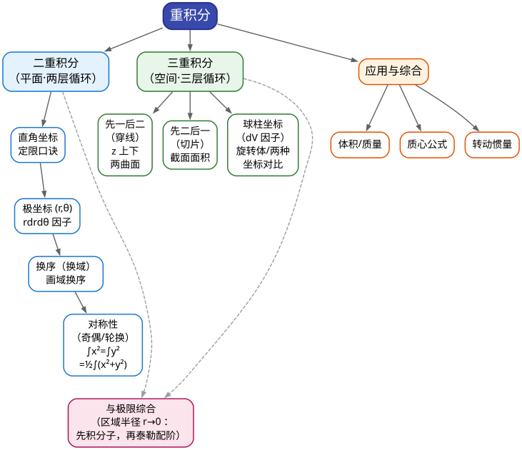

# CMC 手把手精讲
## ——《10 重积分》：坐标变换三板斧，20 分主阵地的攻法

> 🐱 喵～欢迎来到 CMC 精讲系列的第十篇。这一篇写给"一年没碰数学、积分号一多就眼晕"的你：从"为什么积分可以套两层"讲起，一路把二重、三重积分的定限口诀、坐标变换、对称性全部焊死成条件反射。
>
> **本篇在考试中的地位**（数据口径：第 10–17 届初赛共 8 套非数学类/非数学 A 类试卷 + 早期 1–3、9 届，真题逐卷核对）：
> - 多元函数积分学是**必考级主干板块**：近 6 届（第 12–17 届）每届稳定贡献 **18–26 分（约 20%）**，格式几乎固定——**一道 6 分填空 + 一道 14 分解答大题**（16 届加强到 26 分）；重积分（二重 + 三重）正是这一板块的"发动机"；
> - 二重积分填空是 12–16 届的高频戏码（**12、13、14、16 届各出一次**：换元、轮换对称、斜域对称、极坐标+极限）；三重积分大题**近 3 届考了 2 次**（17 届"先二后一"、15 届"体积与截面法"），另有 10、11 届球坐标大题坐镇；
> - 更关键的是它的"后勤地位"：11 篇的 Gauss 公式要把曲面积分化成**三重积分**、Green 公式要把曲线积分化成**二重积分**——重积分算不熟，后面两章直接塌方；
> - 🎯 铁律二（见 00 总纲）：**填空第 5 题近三届连续被"多元积分技巧题"占据**（15 届第一类曲面积分 → 16 届格林挖洞 → 17 届对弧长曲线积分）——重积分系列技巧就是这 6 分的原型库。
>
> **大纲对应条目**（《全国大学生数学竞赛考试内容》非数学专业类·7. 多元函数积分学，原文摘录）：
> - 条目 (1)：二重积分和三重积分的概念及性质、**二重积分的计算（直角坐标、极坐标）**、**三重积分的计算（直角坐标、柱面坐标、球面坐标）**；
> - 条目 (6)：重积分、曲线积分和曲面积分的应用（平面图形的面积、立体图形的体积、曲面面积、弧长、质量、质心、转动惯量、引力、功及流量等）。
>
> （注：换序、换元、对称性、先二后一（截面法）都不在原文条目里，但它们全是历年真题的实际考点——"坐标变换 + 对称性 + 换序"是命题组三大常用技术，本篇按真题口径写，不按大纲字面写。）
>
> **先修提示**：本篇依赖 05 篇《一元积分计算》的"定限手感"——把一维的"从 $a$ 到 $b$"推广成二维区域的"先穿哪条线、后扫哪条边"、三维立体的"怎么切层"。另外有一道变域求导题会用到 03 篇的求导技术。没看过 05 篇也能直接学，但建议先把"定积分怎么定限、怎么换元"回忆起来。
>
> **本篇对应第 4 周（D22–24）**：00 总纲冲刺路线里的"拉分板块主攻周"——二重积分（极坐标/奇偶/换序）+ 三重积分（球柱坐标/截面法/对称），验收标准是**16 届四、17 届四两道 14 分压舱大题独立复现**。
>
> **预计学时**：2–3 天（按每天 1–2 小时折算）。第一天：§一 + §二（概念与直觉）+ §三前四条方法；第二天：§三后四条 + 精讲第 1–5 题；第三天：精讲 6–10 题 + 易错点 + 自测题。
>
> 阅读建议：
> 1. 先花 3 分钟扫一遍 §一的两张表，建立"什么题面用什么武器"的直觉——本篇的胜负手全在**选坐标系**这一念之间；
> 2. §二不要跳读：你"感觉记得"的二重积分，很可能只记得公式不记得**为什么**——直觉断了，考场上就会在定限上卡壳；
> 3. 所有标了 ✍️ 的地方真的动笔（尤其是"画区域图"——本篇文档里画给你看，考场你不画就错）；
> 4. 真题精讲里的"思路分析"比解答本身更值钱：先自己卡 1 分钟，想清楚"我会选哪条路线"再看。
>
> 符号说明：📌 重点 | 💡 直觉/类比 | ⚠️ 易错点 | ✍️ 动笔练一练 | ❓ 自测题 | 🎯 考试定位 | ⏱️ 省时技巧

---

# 一、本篇地图

## 1.1 目录（读之前先看这张施工图）

- **§二 知识讲解**：重积分的直觉（从"数豆子"到嵌套循环）→ 二重积分的两条定限路线（穿线法怎么来的）→ 极坐标换元（$r\,\mathrm{d}r\,\mathrm{d}\theta$ 里那个 $r$ 是哪来的）→ 三重积分三大武器（先一后二 / 先二后一 / 球柱坐标）→ 对称性两板斧（奇偶 + 轮换）→ 换元与雅可比（什么时候值得换）→ 重积分的应用（体积/质量/质心/转动惯量）→ 重积分与极限综合
- **§三 方法手册**：3.1 直角坐标与交换次序 | 3.2 极坐标 | 3.3 一般换元与雅可比 | 3.4 对称性两板斧 | 3.5 先一后二（投影穿线） | 3.6 先二后一（截面/切片） | 3.7 柱坐标与球坐标 | 3.8 几何应用四件套 | 3.9 重积分与极限综合
- **§四 真题精讲**：10 道真题完整精讲（17 届四、16 届一(2)、13 届一(5)、12 届一(4)、10 届四、9 届一(6)、15 届三、14 届一(5)、2 届第五题、4 届第六题）
- **§五 易错点清单**：10 条 ❌→✅ 对照
- **§六 自测题**：7 道，附完整答案
- **§七 结语**："重积分防身七句话" + 学习建议 + 11 篇预告

## 1.2 方法速查表：什么题面 → 用什么武器（一屏版）

| 题面长相（信号） | 首选武器 | 说明 / 升级路线 |
|---|---|---|
| 二重积分，区域是矩形/三角形/曲线与直线围成，被积函数是多项式或简单函数 | **直角坐标（先 $y$ 后 $x$）** | 画域 → 穿线法定限；先对内层变量积 |
| 区域是**带角区域/斜边四边形**（如 $x\pm y$ 的范围） | **换元 $u=x+y,\ v=x-y$** | 雅可比 $\lvert J\rvert=\dfrac{1}{2}$，把斜域"拉直"成矩形 |
| 累次积分、内层"积不出来"（如 $e^{-y^2}$、$\dfrac{\sin y}{y}$） | **交换积分次序** | 画域 → 先对能积的变量积；换序口诀"横看成岭侧成峰" |
| 区域是圆盘/圆环/扇形/圆与直线围成；被积函数含 $x^2+y^2$、$\dfrac{y}{x}$、$\arctan\dfrac{y}{x}$ | **极坐标** | $\mathrm{d}x\mathrm{d}y=r\,\mathrm{d}r\,\mathrm{d}\theta$；先 $r$ 后 $\theta$ |
| 被积函数含奇函数项（如 $x$、$xy$、$x\sqrt{x^2+y^2}$）+ 区域关于坐标轴/原点对称 | **奇偶性直接砍项** | 前提：区域对称 + 函数奇偶**同时**成立 |
| 区域本身在 $x\leftrightarrow y$（或 $x\leftrightarrow y\leftrightarrow z$）下不变 | **轮换对称** | $\iint x^2=\iint y^2=\dfrac{1}{2}\iint(x^2+y^2)$；三重同理 |
| 三重积分，区域是"上下两曲面夹着"（$z_1\le z\le z_2$），被积函数含 $z$ | **先一后二（投影穿线）** | 投影到 $xOy$ 面，$z$ 从下曲面穿到上曲面 |
| 三重积分，被积函数**不含某个变量**，或截面面积好算（圆、椭圆、三角形） | **先二后一（截面法）** | 用 $z=\text{常数}$ 切层，每层做个二重积分；17 届四的结构密码 |
| 区域含柱面（$x^2+y^2$ 关系）+ $z$ 方向是直线段 | **柱坐标**（$r,\theta,z$） | $\mathrm{d}V=r\,\mathrm{d}r\,\mathrm{d}\theta\,\mathrm{d}z$ |
| 区域是球体/球壳/锥面与球面围成；被积函数含 $x^2+y^2+z^2$ | **球坐标**（$\rho,\varphi,\theta$） | $\mathrm{d}V=\rho^2\sin\varphi\,\mathrm{d}\rho\,\mathrm{d}\varphi\,\mathrm{d}\theta$；锥面半顶角定 $\varphi$ 上限 |
| 求旋转体/两曲面围成区域的**体积** | 体积 $V=\iiint\mathrm{d}V$ 或 $V=\int A(z)\,\mathrm{d}z$ | 能直接用圆锥/球体积公式就先现成公式，剩下的部分再积 |
| 变域积分 $\Phi(t)=\iiint_{\Omega_t}f\,\mathrm{d}V$ 求 $\Phi'(t)$ | **球壳增量法 / 先二后一 + 变限求导** | 找到"新增薄壳"的几何描述，两种方法互相验证 |
| $\lim\limits_{r\to 0^+}\dfrac{\iint_{D_r}f\,\mathrm{d}x\mathrm{d}y}{r^k}$（区域半径趋于 0 的极限） | **先把分子积出来**（极坐标/凑微分）**再泰勒定阶** | 16 届一(2) 的原型；分子主阶与分母配平 |

## 1.3 知识树：本篇全部内容的骨架



一句话总结这张图：**二重积分的关键是"换坐标系"（直角↔极坐标↔一般换元），三重积分的关键是"选切开方向"（穿线 / 切片 / 球柱坐标），而全篇的性价比之王是"对称性"——它不改变任何计算，只是让你少算一半。**

---

# 二、知识讲解：积分套积分，"数豆子"数两遍

## 2.1 重积分是什么：把"数豆子"数出两层循环

先回忆一下你已经学过（或假装学过）的一维定积分：$\displaystyle\int_a^b f(x)\,\mathrm{d}x$。它的原始面目是**黎曼和**——把区间 $[a,b]$ 切成 $n$ 个小段，每段用"高 $f(\xi_i)$ × 宽 $\Delta x_i$"拼出一堆小竖条，所有小竖条面积加起来，取极限就是这个积分。物理上想：$f$ 是线密度，积分就是**总质量**。

现在把场景升级：桌上摊着一块**平板** $D$（二维区域），板上每点有个面密度 $f(x,y)$（单位面积上有多少克），问总质量是多少？办法和数豆子一模一样：

1. 把平板切成很多很多小方块 $\Delta\sigma_i$（面积元素）；
2. 每个小方块里的质量约 $f(x_i,y_i)\,\Delta\sigma_i$（密度 × 面积）；
3. 全部加起来：$\displaystyle\sum_i f(x_i,y_i)\,\Delta\sigma_i$；让切分越来越细取极限，就记作
$$\iint_D f(x,y)\,\mathrm{d}x\,\mathrm{d}y .$$

再看几何意义：把 $z=f(x,y)$ 理解成"覆盖在 $D$ 上方的一张曲面"，那么 $\iint_D f\,\mathrm{d}\sigma$ 就是**曲顶柱体的体积**——底面是 $D$，顶面是曲面 $z=f(x,y)$，侧面竖直。特别地，$\iint_D 1\,\mathrm{d}\sigma$ 就是这个区域的**面积**。三重积分是完全一样的剧情，只是"平板"换成了"立体" $\Omega$、密度换成体密度：$\iiint_\Omega f\,\mathrm{d}V$，而 $\iiint_\Omega 1\,\mathrm{d}V$ 就是**体积**。

💡 **打比方（写给会写代码的你）**：一维定积分就是**一重循环**：

```
S = 0
for x in 区间切分:        # 外层
    S += f(x) * dx
```

二重积分是**双重循环**（外层扫 $x$，内层扫 $y$），三重积分是**三重循环**。所谓"计算重积分"，99% 的场合就是把双重/三重循环**写成嵌套的一维积分**——先跑内层循环（别的变量当常数），再跑外层循环：

$$\iint_D f\,\mathrm{d}x\,\mathrm{d}y=\int_a^b\left(\int_{y_1(x)}^{y_2(x)}f(x,y)\,\mathrm{d}y\right)\mathrm{d}x .$$

看出来了吗？**重积分不是新东西，它就是"一维积分做两遍"**。你唯一要学会的新技能，是**每层循环的起止范围怎么填**——这就是下面两节的"定限"。

## 2.2 二重积分的第一条路线：直角坐标（穿线法）

公式人人会抄，难的是**上下限**。我们用一个具体区域把定限逻辑讲透。设
$$D=\{(x,y)\mid 0\le x\le 1,\ 0\le y\le x\}$$
（就是直线 $y=x$、$y=0$、$x=1$ 围的三角形）。要算 $\iint_D f\,\mathrm{d}x\mathrm{d}y$，先把它画出来——**画图是重积分的第一动作，考场上不画图定限，九成要错。**

💡 **穿线法（一招记住一辈子）**：把外层变量（先记 $x$）想成"一个竖直扫描条"，从区域最左端扫到最右端；每扫到一个位置 $x$，你就沿着竖直方向**从下往上穿一根线**，穿进区域的点（下边界）是内层积分的下限，穿出区域的点（上边界）是上限：

$$\iint_D f\,\mathrm{d}x\,\mathrm{d}y=\int_{x_{\min}}^{x_{\max}}\left(\int_{y_{\text{下边界}}(x)}^{y_{\text{上边界}}(x)}f(x,y)\,\mathrm{d}y\right)\mathrm{d}x .$$

对本例：竖线左端从 $x=0$ 进、右端从 $x=1$ 出；固定 $x$ 时，竖线从 $y=0$（下边）穿到 $y=x$（斜边）。所以
$$\iint_D f\,\mathrm{d}x\,\mathrm{d}y=\int_0^1\mathrm{d}x\int_0^x f(x,y)\,\mathrm{d}y .$$

📌 **定限三问（每次默念）**：
1. **画域**：边界曲线全部画清楚（直线、抛物线、圆、双曲线）；
2. **外层定界**：区域在外层坐标轴上的投影范围，是**常数**（$a$ 到 $b$）——这一步和 $y$ 无关；
3. **内层定界**：用"穿线"找上下边界函数——**只含外层变量**，不能出现内层变量自己。

同样的区域也可以反过来做（先 $x$ 后 $y$：水平扫描条从左边界穿到右边界）：
$$\iint_D f\,\mathrm{d}x\,\mathrm{d}y=\int_0^1\mathrm{d}y\int_y^1 f(x,y)\,\mathrm{d}x .$$
两条路都合法，**选哪条？选内层积分更简单的**。比如被积函数含 $e^{-y^2}$，内层对 $x$ 积就出得来（$e^{-y^2}$ 当常数），内层对 $y$ 积就积不出来——于是毫不犹豫选"先 $x$ 后 $y$"。这个手感就是 3.1 节"换序"的全部动机。

⚠️ **穿线穿不过去怎么办**：如果一根竖线穿进区域后，边界曲线中途换了一家（比如区域是"上下两个圆盘拼的葫芦"），就必须**按 $x$ 分块**：$D=D_1\cup D_2$，积分也拆成两块加。真题里 10 届四（精讲第 5 题）就是要先做区域分解的大例子。

## 2.3 极坐标是怎么"长"出来的

先问一个朴实的问题：算
$$\iint_{x^2+y^2\le R^2}(x^2+y^2)\,\mathrm{d}x\,\mathrm{d}y$$
——圆域上、被积函数是 $x^2+y^2$。硬用直角坐标：$\displaystyle\int_{-R}^{R}\mathrm{d}x\int_{-\sqrt{R^2-x^2}}^{\sqrt{R^2-x^2}}(x^2+y^2)\,\mathrm{d}y$，内层会出现 $\sqrt{R^2-x^2}$ 的立方，惨不忍睹。换极坐标一试，答案会漂亮得像假的。极坐标不是天上掉下来的，它是**为了让"圆"变成"方"而生**的：

- 直角坐标的"格子"是**小方块**，天然适配矩形域；
- 极坐标的"格子"是**小扇形环**：半径从 $r$ 到 $r+\mathrm{d}r$、角度从 $\theta$ 到 $\theta+\mathrm{d}\theta$。

小扇形环的面积是多少？大扇形减小扇形：
$$\mathrm{d}\sigma=\frac{1}{2}(r+\mathrm{d}r)^2\mathrm{d}\theta-\frac{1}{2}r^2\mathrm{d}\theta=r\,\mathrm{d}r\,\mathrm{d}\theta+\frac{1}{2}(\mathrm{d}r)^2\mathrm{d}\theta\approx r\,\mathrm{d}r\,\mathrm{d}\theta .$$
丢掉高阶小量 $\frac{1}{2}(\mathrm{d}r)^2\mathrm{d}\theta$（它比 $\mathrm{d}r\,\mathrm{d}\theta$ 还小一阶），得到极坐标三件套：

📌 **极坐标换元（必背）**：
$$\begin{cases}x=r\cos\theta,\quad y=r\sin\theta,\\[2pt] \mathrm{d}x\,\mathrm{d}y=r\,\mathrm{d}r\,\mathrm{d}\theta.\end{cases}$$
其中**那个多出来的 $r$ 就是"扇形环比小方块多出来的周长因子"**——圆的周长 $2\pi r$ 随着 $r$ 变大而变长，同样角度的一块扇形环，离原点越远面积越大。**这是全场最高频的丢分点：忘了乘 $r$。**

💡 **把 $r$ 记牢的物理版本**：密度均匀的圆盘，把角度切成 $n$ 份、半径切成 $m$ 份，每一小块更像"梯形"而不是"矩形"——外弧比内弧长，所以面积不是 $\mathrm{d}r\,\mathrm{d}\theta$ 而是 $\approx r\,\mathrm{d}r\,\mathrm{d}\theta$（$r$ 取该环的中半径）。

极坐标下的定限同样是"扫描+穿线"，只是扫描的是**角度**：

- 射线 $\theta=$ 常数从 $\alpha$ 转到 $\beta$（外层定界）；
- 每条射线上，$r$ 从原点方向的"入点"穿到"出点"。

三个要背的常见域的极坐标描述：

| 区域 | 极坐标描述 |
|---|---|
| 圆盘 $x^2+y^2\le R^2$ | $0\le\theta\le 2\pi,\ 0\le r\le R$ |
| 圆环 $a^2\le x^2+y^2\le b^2$ | $0\le\theta\le 2\pi,\ a\le r\le b$ |
| 上半圆盘 + 第一象限扇形 | 圆心在原点时 $r$ 的范围不变，$\theta$ 只取一部分 |

📌 **极坐标的四条适用信号**（见到就想它）：① 区域是**圆、环、扇形**或圆与直线围成；② 被积函数含 $x^2+y^2$；③ 被积函数含 $\dfrac{y}{x}$ 或 $\arctan\dfrac{y}{x}$；④ 题目出现"半径 $r\to 0$""半径 $r\to\infty$"的**极限**（16 届一(2)、13 届补赛第三题都是这样把半径当变量的）。

## 2.4 三重积分的三条路线：切与穿的两个顺序 + 两组新坐标

三重积分 $\iiint_\Omega f\,\mathrm{d}V$ 比二重多一个变量、多一份定限的活。但在直角坐标下，套路仍然只是"**把三重循环写成嵌套三重积分**"，而嵌套顺序本质只有两种思考方式：

**路线一：先一后二（投影穿线）**。把立体 $\Omega$ 拍扁投影到 $xOy$ 面得到平面区域 $D_{xy}$，然后在 $D_{xy}$ 上每点竖一根线，$z$ 从**下曲面**穿到**上曲面**：
$$\iiint_\Omega f\,\mathrm{d}V=\iint_{D_{xy}}\left(\int_{z_1(x,y)}^{z_2(x,y)}f(x,y,z)\,\mathrm{d}z\right)\mathrm{d}x\,\mathrm{d}y .$$
直觉：**先站到天上往下看**（看清投影长什么样），**再竖着穿**（$z$ 的上下界）。这就是二重积分"穿线法"往三维的直接升级，"先一后二"的名字意思是"先做一个一元积分（$z$），后做一个二重积分"。

**路线二：先二后一（截面法/切片法）**。反过来：拿刀**横着切**，让 $z$ 从 $c$ 走到 $d$，每个高度切出一张平面截面 $D_z$，先在截面上做二重积分，再把所有"层"沿 $z$ 叠起来：
$$\iiint_\Omega f\,\mathrm{d}V=\int_c^d\left(\iint_{D_z}f(x,y,z)\,\mathrm{d}x\,\mathrm{d}y\right)\mathrm{d}z .$$
直觉：**像切片扫描的 CT 机**——一层一层扫，每层扫出一个二重积分，最后沿层号积分。什么时候选它？**当你发现被积函数不含某个变量、或者截面形状比投影形状简单得多的时候**（17 届四、15 届三、8 届三都是这么选的——见 §三 3.6 的适用信号）。

**路线三：直接换坐标系**。当区域的"天然坐标"不是直角坐标时，与其硬着头皮定限，不如换成适配的坐标：

- **柱坐标（$r,\theta,z$）**：$x=r\cos\theta,\ y=r\sin\theta,\ z=z$。它就是"平面用极坐标、高度照旧"：
$$\mathrm{d}V=r\,\mathrm{d}r\,\mathrm{d}\theta\,\mathrm{d}z .$$
- **球坐标（$\rho,\varphi,\theta$）**：$\rho$ 是到原点的距离，$\varphi$ 是与 $z$ 轴的夹角（极角，$0\le\varphi\le\pi$），$\theta$ 是方位角：
$$x=\rho\sin\varphi\cos\theta,\qquad y=\rho\sin\varphi\sin\theta,\qquad z=\rho\cos\varphi,$$
$$\mathrm{d}V=\rho^2\sin\varphi\,\mathrm{d}\rho\,\mathrm{d}\varphi\,\mathrm{d}\theta .$$

球坐标的体积元是怎么来的？把球壳切成"薄壳 × 小扇形"：半径 $\rho$ 处一层厚度 $\mathrm{d}\rho$ 的薄壳，它与 $z$ 轴夹角在 $[\varphi,\varphi+\mathrm{d}\varphi]$ 之间的环带，面积约 $(\rho\,\mathrm{d}\varphi)\cdot(\rho\sin\varphi\,\mathrm{d}\theta)$——第一个因子是"沿经线方向的弧长"，第二个是"纬圈方向的弧长"（**纬圈半径是 $\rho\sin\varphi$，不是 $\rho$！** 这就是 $\sin\varphi$ 的来源），乘上厚度 $\mathrm{d}\rho$：
$$\mathrm{d}V=(\rho\,\mathrm{d}\varphi)(\rho\sin\varphi\,\mathrm{d}\theta)\,\mathrm{d}\rho=\rho^2\sin\varphi\,\mathrm{d}\rho\,\mathrm{d}\varphi\,\mathrm{d}\theta .$$

💡 **球坐标的"三问定位"**（后文 3.7 还会给流程图）：皮是球面 → $\rho$ 的界；锥面 → $\varphi$ 的界（半顶角！）；半平面/投影象限 → $\theta$ 的界。另外记一个坐标对应关系：**球面 $x^2+y^2+z^2=R^2$ 在球坐标下就是 $\rho=R$**——被积函数含 $x^2+y^2+z^2$ 时，换成 $\rho^2$ 一笔写出，这就是球坐标的最大卖点。

选路线的决策，总结成一张表（§三会展开）：

| 你观察到的信号 | 该走的路线 |
|---|---|
| 被积函数/区域对 $z$ 特别友好（上下界是显式曲面） | 先一后二（投影穿线） |
| 被积函数**不含 $z$**（或只含 $z$），截面是圆/椭圆/三角形 | 先二后一（切片） |
| 区域带 $x^2+y^2$（柱面、圆锥面、旋转抛物面）+ $z$ 是直线段 | 柱坐标 |
| 区域是球、球壳、球缺、锥与球围成 | 球坐标 |

---

## 2.5 对称性两板斧：奇偶砍项 + 轮换配对（性价比之王）

重积分有两个"不改计算、只砍工作量"的外挂，历年真题里几乎每道题都能用：

### 板斧一：奇偶性（"负号自动抵消"）

一维积分的结论你还记得：奇函数在对称区间上积分为 0，$\displaystyle\int_{-a}^{a}x^3\,\mathrm{d}x=0$。重积分把它原封不动升级成二维/三维版本：

📌 **奇偶性定理（二重）**：若区域 $D$ 关于 $x$ 轴对称（即 $(x,y)\in D\Leftrightarrow(x,-y)\in D$），且 $f(x,-y)=-f(x,y)$（对 $y$ 为奇函数），则
$$\iint_D f(x,y)\,\mathrm{d}x\,\mathrm{d}y=0 .$$
若 $f(x,-y)=f(x,y)$（对 $y$ 为偶函数），则 $\iint_D f=2\iint_{D_{\text{上半}}}$。

💡 **打比方**：区域像个"照镜子"的图形，函数在镜子里"上下一对照，正负相消"——每一份正的都能找到对应的一份负的，只有"不参与抵消"的项留下来。**三维版本同理**：区域关于 $xOy$ 面对称 + $f$ 对 $z$ 为奇 → 积分为 0（16 届四、10 届四全靠它删项）。

### 板斧二：轮换对称（"三个变量地位平等"）

📌 **轮换对称**：若把 $x,y$ 互换后区域 $D$ 不变，则
$$\iint_D x^2\,\mathrm{d}x\,\mathrm{d}y=\iint_D y^2\,\mathrm{d}x\,\mathrm{d}y=\frac{1}{2}\iint_D(x^2+y^2)\,\mathrm{d}x\,\mathrm{d}y .$$
三重版本：区域在 $x\to y\to z\to x$ 轮换下不变时（如球体、正方体、八分之一球），
$$\iiint_\Omega x^2\,\mathrm{d}V=\iiint_\Omega y^2\,\mathrm{d}V=\iiint_\Omega z^2\,\mathrm{d}V=\frac{1}{3}\iiint_\Omega(x^2+y^2+z^2)\,\mathrm{d}V .$$

💡 **打比方**：圆盘在 $x$ 方向和 $y$ 方向长得一模一样，凭什么 $\iint x^2$ 和 $\iint y^2$ 会不等？它俩必须相等；而总和 $\iint(x^2+y^2)$ 往往好算（换极坐标），于是各自等于总和的一半。**这就是"用容易算的整体，换难算的个体"。**

⚠️ **两个前提别丢**：用奇偶性要"**区域对称 + 函数奇偶**"两个条件同时成立；用轮换对称要"**区域方程本身在轮换下不变**"（圆、球、椭圆盘 $x^2/4+y^2\le 1$ 都可以；三角形 $\{0\le y\le x\le 1\}$ 不行——它自己对调后变了样）。

这两把斧子单独考就是一道 6 分填空（13 届一(5) 就是"奇偶 + 轮换"的组合拳），融进大题里就是 14 分题的"前期清场"动作。**先对称、后计算**要成为肌肉记忆。

## 2.6 换元与雅可比：为什么换元要"乘一个 $|J|$"

极坐标其实就是换元的特例。一般地，设换元
$$u=u(x,y),\qquad v=v(x,y)$$
把 $xy$ 平面上的区域 $D$ 一一对应地映成 $uv$ 平面的区域 $D'$，则

📌 **二重积分换元公式**：
$$\iint_{D}f(x,y)\,\mathrm{d}x\,\mathrm{d}y=\iint_{D'}f\big(x(u,v),\,y(u,v)\big)\,\left|J\right|\,\mathrm{d}u\,\mathrm{d}v,\qquad J=\frac{\partial(x,y)}{\partial(u,v)}=\begin{vmatrix}\dfrac{\partial x}{\partial u}&\dfrac{\partial x}{\partial v}\\[6pt]\dfrac{\partial y}{\partial u}&\dfrac{\partial y}{\partial v}\end{vmatrix}.$$
三重积分同款：乘 $\left|\dfrac{\partial(x,y,z)}{\partial(u,v,w)}\right|$（三阶行列式）。

💡 **打比方（矩阵变换的缩放因子）**：换元就像对平面做一次**坐标重映射**（写代码的人可以想成"把数组的索引体系整体换掉"）。雅可比行列式 $J$ 就是这次重映射的**局部缩放因子**：$uv$ 平面上一小块 $\mathrm{d}u\mathrm{d}v$，拉回 $xy$ 平面后面积被放大了 $\left|J\right|$ 倍。验证一下极坐标：$x=r\cos\theta,\ y=r\sin\theta$，
$$J=\begin{vmatrix}\cos\theta&-r\sin\theta\\ \sin\theta& r\cos\theta\end{vmatrix}=r\cos^2\theta+r\sin^2\theta=r\ \Rightarrow\ \mathrm{d}x\,\mathrm{d}y=r\,\mathrm{d}r\,\mathrm{d}\theta\ \checkmark$$
——那个"凭空多出来的 $r$"，正是雅可比因子。**极坐标不是特例待遇，它就是最常用的一次换元。**

竞赛里两大换元套路：

1. **直线型换元**（斜域拉直）：区域边界是 $x+y=$ 常数、$x-y=$ 常数（斜的平行四边形）时，令
$$u=x+y,\qquad v=x-y,\qquad \left|J\right|=\frac{1}{2}$$
（求法：先把 $x=\dfrac{u+v}{2},\ y=\dfrac{u-v}{2}$ 解出来，再算行列式）。14 届一(5) 就是原型题。
2. **"配方+平移伸缩"换元**（椭球拉圆）：区域是 $(x-x_0)^2/a^2+\cdots\le 1$ 这种"中心不在原点"的椭球时，令 $u=(x-x_0)/a,\ v=(y-y_0)/b(\cdots)$ 把它拉成单位球。8 届三（椭球体质量）就是原型题。

🎯 **考试定位**：换元法是本板块的第一生产力（【二手】外部文献统计），但考场上要克制——**只有"不换做不动"时才换**：斜域、椭球、被积函数与区域"配套设计"（如 1 届一(1) 的 $\sqrt{1-x-y}$ 配 $u=x+y$）。普通圆域、矩形域老老实实直角/极坐标。

## 2.7 重积分的应用：体积、质量、质心、转动惯量

大纲第 (6) 条列了一串应用，非数学竞赛实际只考四件套（其余如引力、功、流量要么超低频、要么归 11 篇）。

| 应用 | 公式 | 一句话理解 |
|---|---|---|
| 平面图形面积 | $A=\iint_D\mathrm{d}x\,\mathrm{d}y$ | 数"有多少个单位的面积" |
| 立体体积 | $V=\iiint_\Omega\mathrm{d}V$（或切片 $V=\int A(z)\,\mathrm{d}z$） | 数"有多少个单位的体积" |
| 质量 | $m=\iiint_\Omega\rho\,\mathrm{d}V$（$\rho$ 为密度） | 密度 × 体积的加权和 |
| 质心（重心） | $\bar x=\dfrac{1}{m}\iiint_\Omega x\rho\,\mathrm{d}V$（$\bar y,\bar z$ 同理） | "加权平均位置"：把每个小块的坐标按质量加权平均 |
| 转动惯量（绕 $z$ 轴） | $I_z=\iiint_\Omega(x^2+y^2)\rho\,\mathrm{d}V$ | **到轴距离平方** × 质量；绕任意直线 $l$：$I_l=\iiint_\Omega d^2\rho\,\mathrm{d}V$，$d$ 为点到 $l$ 的距离 |

📌 **转动惯量三句话**（2 届第五题的命门）：
1. **绕谁转，就用"到谁的距离平方"做权重**：绕 $z$ 轴用 $x^2+y^2$；绕直线 $l$（过原点、单位方向 $\mathbf{n}=(a,b,c)$）用
$$d^2=x^2+y^2+z^2-(ax+by+cz)^2$$
（点到直线的距离平方 = 到原点距离平方 − 沿轴投影的平方，这是向量版的"勾股定理"）；
2. 展开后**交叉项（$xy,yz,zx$）由对称性全灭**，只剩 $x^2,y^2,z^2$ 三块；
3. 三块再用**轮换对称/伸缩变换**统一换算：椭球（伸缩变换拉成球）上 $\iiint_\Omega x^2\,\mathrm{d}V=\dfrac{a^2}{a^2+b^2+c^2}\iiint_\Omega\left(x^2+y^2+z^2\right)\mathrm{d}V$（即按 $a^2:b^2:c^2$ 的比例分配）——具体见精讲第 9 题（2 届第五题就是这套三连招的完整版）。

🎯 **边界说明**：真题里"质心/重心"出现过一次——第 14 届第二次补赛·填空第 5 题（均匀球面第一卦限部分的重心），但它的载体是**第一类曲面积分**，归 11 篇处理；本篇要你焊死的是**公式骨架**（质心 = 坐标的质量加权平均、转动惯量 = 距离平方加权），载体换成本篇的体区域还是 11 篇的面/曲线，公式原样迁移。

## 2.8 重积分与极限综合：区域"缩到 0"的题怎么出

近几届最爱的填空款式：一个**以 $r$ 为参数的区域**上的重积分，除以 $r$ 的某次幂，求 $r\to 0^+$ 的极限。原型是 16 届一(2)：
$$\lim_{r\to 0^+}\frac{\displaystyle\iint_{x^2+y^2\le r^2}\left(e^{x^2+y^2}-1\right)\mathrm{d}x\,\mathrm{d}y}{r^4}.$$

处理流水线（三步，背下来）：

1. **把分子"积出来"**：别怕——区域小、被积函数通常只含 $x^2+y^2$，极坐标一换，内层对 $r$ 是一元积分，积出来是一个**只含 $r$ 的表达式**（如 $\pi(e^{r^2}-1-r^2)$）；
2. **泰勒定阶**：把表达式在 $r\to 0$ 展开（$e^{r^2}-1-r^2=\dfrac{r^4}{2}+o(r^4)$——注意 $r^2$ 项**必须消掉**才是对题目的尊重，否则分母的 $r^4$ 就配不上）；
3. **配阶相除**：分子主阶 ÷ 分母，得数。

💡 **为什么低阶项会消掉？**因为"区域缩到 0 时积分的自然阶数"由**面积 × 函数在原点附近的主部**决定：面积 $\sim\pi r^2$，若被积函数原点附近 $\sim c(x^2+y^2)$，则分子 $\sim c\cdot\pi r^2\cdot r^2$ 的量级 → $r^4$。分母是 $r^4$ 说明命题人**已经替你消好了低阶项**，你只要把展开算对。反过来，若你算出来 $r^2$ 阶没消掉，一定是积分算错了。

⚠️ 变体提醒：13 届补赛第三题把"被积函数"换成含抽象 $f$ 的结构（用 Green 公式转化后再积），14 届五把重积分换成累次积分再换序，流程仍是"**化简积分 → 泰勒配阶**"。这两道跨板块题细节归 11 篇与 09 篇，但骨架在本篇这里。

---

# 三、方法手册：九套武器，见招拆招

每个方法按统一格式展开：【适用信号】→【步骤】→【关键公式】→【真题微型例子】。再强调一遍：报考场上最缺的不是"方法本身"，而是"**什么时候用它**"——所以【适用信号】比公式更值得花时间。

## 3.1 直角坐标与交换积分次序

**【适用信号】** 二重积分，区域为矩形/三角形/曲线围成的"非圆"形状；被积函数不含 $x^2+y^2$ 型结构；**累次积分内层"积不出来"**（出现 $\dfrac{\sin y}{y}$、$e^{-y^2}$、$\dfrac{1}{\ln y}$ 这类没有初等原函数的因子）——这是换序的经典触发器。

**【步骤】**
1. **画域**（必须）：把积分域用阴影标出，边界线画全；
2. **判型**：看"竖线穿域"顺不顺（X 型）或"横线穿域"顺不顺（Y 型）；哪边"一线到底"就优先哪边；
3. **换序**（若需要）：换序**不改变积分值，只改变扫描方向**——原式的域图重画一遍，反着定限；
4. **计算**：内层把外层变量当常数，积完再积外层。

**【关键公式】**
$$\iint_D f\,\mathrm{d}x\,\mathrm{d}y=\int_a^b\!\mathrm{d}x\int_{y_1(x)}^{y_2(x)}f\,\mathrm{d}y\ \xleftrightarrow{\ \text{换序}\ }\ \int_c^d\!\mathrm{d}y\int_{x_1(y)}^{x_2(y)}f\,\mathrm{d}x .$$
换序口诀：**"横看成岭侧成峰"**——同一片区域，横着扫和竖着扫是两种写法；把域写成"不等式组"$\{a\le x\le b,\ y_1(x)\le y\le y_2(x)\}$，再改写成以 $y$ 为主序的不等式组，就是换序。

**【真题微型例子】**（第 14 届非数学类·解答题五，2022；这里只看它的第一步）交换
$$\int_0^{x^2}\mathrm{d}t\int_x^{\sqrt{t}}f(t,u)\,\mathrm{d}u$$
的次序。内层对 $u$ 积（被积函数是抽象 $f$，积不出来）——必换序。先把域画出来：$0\le t\le x^2$，$u$ 从 $x$ 到 $\sqrt{t}$；注意当 $t$ 小时 $\sqrt{t}<x$，所以**先倒正方向**：$u$ 从 $\sqrt{t}$ 到 $x$ 的写法是 $\int_{\sqrt{t}}^{x}$，题面给的是 $\int_x^{\sqrt{t}}=\underline{\ \ }-(\text{倒过来的积分})$。整理后按 $u$ 为主序重扫：$0\le u\le x$，$t$ 从 $0$ 到 $u^2$，得
$$\int_0^{x^2}\mathrm{d}t\int_x^{\sqrt{t}}f(t,u)\,\mathrm{d}u=-\int_0^{x}\mathrm{d}u\int_0^{u^2}f(t,u)\,\mathrm{d}t .$$
> 完整版（加上分母等价、洛必达、积分中值、可微展开）见 01 篇 §3.7 微型例子 2；这一步的价值在于演示"**抽象函数内层积不动 → 画域换序**"的条件反射，以及**积分方向翻转的符号**（$\int_x^{\sqrt t}$ 与 $\int_{\sqrt t}^{x}$ 差一个负号）。

## 3.2 极坐标

**【适用信号】** 区域是圆盘/圆环/扇形/圆与直线围成；被积函数含 $x^2+y^2$、$\dfrac{y}{x}$、$\arctan\dfrac{y}{x}$、$\sqrt{x^2+y^2}$；题目出现半径参数 $r\to 0$ 或 $r\to\infty$ 的极限。

**【步骤】**
1. **画出区域并改写边界**：把区域的边界曲线换成极坐标方程（圆 $x^2+y^2=R^2$ 变成 $r=R$；直线 $y=x$ 变成 $\theta=\dfrac{\pi}{4}$ 等）；
2. **定 $\theta$ 范围**：从区域张开的**最小角**到**最大角**——画一条过原点的射线从区域一边转到另一边；
3. **定 $r$ 范围**：对固定 $\theta$，射线从"入点"穿到"出点"（入点常是原点或内圆，出点是外圆/直线）；
4. **换面积元** $\mathrm{d}x\mathrm{d}y=r\,\mathrm{d}r\,\mathrm{d}\theta$（**别忘了 $r$**），把被积函数中 $x,y$ 全换成 $r\cos\theta,r\sin\theta$。

**【关键公式】**
$$\mathrm{d}x\,\mathrm{d}y=r\,\mathrm{d}r\,\mathrm{d}\theta,\qquad x^2+y^2=r^2 .$$

**【真题微型例子】**（类型题·仿竞赛风格）计算 $\displaystyle\iint_{x^2+y^2\le R^2}e^{-(x^2+y^2)}\,\mathrm{d}x\,\mathrm{d}y$。
区域是整圆：$\theta$ 从 $0$ 到 $2\pi$，$r$ 从 $0$ 到 $R$：
$$\iint_D e^{-(x^2+y^2)}\mathrm{d}x\mathrm{d}y=\int_0^{2\pi}\!\mathrm{d}\theta\int_0^R e^{-r^2}r\,\mathrm{d}r=2\pi\cdot\left[-\frac{1}{2}e^{-r^2}\right]_0^R=\pi\left(1-e^{-R^2}\right).$$
> 注意内层积分的"凑微分"：$e^{-r^2}r\,\mathrm{d}r=-\dfrac{1}{2}\mathrm{d}(e^{-r^2})$——**极坐标负责把"二维难题"化成"一维正常题"，最后这一锤子买卖靠的是 05 篇的凑微分手感**。顺带记住：令 $R\to+\infty$ 得 $\displaystyle\int_0^{+\infty}e^{-t^2}\mathrm{d}t=\frac{\sqrt{\pi}}{2}$（把二重积分当"一维积分的平方"算，是概率积分的经典玩法）。

## 3.3 一般换元与雅可比

**【适用信号】** 区域是**斜的**平行四边形（边界 $x+y$ 常数、$x-y$ 常数）；区域是**中心不在原点的椭球**；被积函数与区域"配套设计"（如 $\sqrt{1-x-y}$ 配 $u=x+y$、$\ln\big(1+\dfrac{y}{x}\big)$ 配 $v=\dfrac{y}{x}$）——换了之后区域变规整、被积函数"掉包袱"。

**【步骤】**
1. **选换元**：从两个地方找线索——**区域的边界方程**（让每条边界都变成 $u=$ 常数或 $v=$ 常数）和**被积函数里的"打包结构"**（$\dfrac{y}{x}$ 整体令成 $v$）；
2. **解出逆变换** $x=x(u,v),\ y=y(u,v)$，写出 $uv$ 平面上的新区域 $D'$；
3. **算雅可比** $J=\dfrac{\partial(x,y)}{\partial(u,v)}$（行列式，算完取**绝对值**）；
4. **代入**：$\mathrm{d}x\mathrm{d}y=|J|\,\mathrm{d}u\mathrm{d}v$，在 $D'$ 上重新积分（此时区域往往已是矩形，直接两层定积分）。

**【关键公式】**
$$\iint_{D}f\,\mathrm{d}x\,\mathrm{d}y=\iint_{D'}f\big(x(u,v),y(u,v)\big)\,|J|\,\mathrm{d}u\,\mathrm{d}v .$$

**【真题微型例子】**（第 1 届非数学类·填空第 1 题，2009）计算
$$\iint_D\frac{(x+y)\ln\left(1+\dfrac{y}{x}\right)}{\sqrt{1-x-y}}\,\mathrm{d}x\,\mathrm{d}y,$$
其中 $D$ 是 $x+y=1$ 与两坐标轴围成的三角形。
**换元设计两条线索**：① $\sqrt{1-x-y}$ 指着 $u=x+y$；② $\ln\big(1+\dfrac{y}{x}\big)$ 指着 $v=\dfrac{y}{x}$。于是令 $u=x+y,\ v=\dfrac{y}{x}$，逆变换 $x=\dfrac{u}{1+v},\ y=\dfrac{uv}{1+v}$；区域 $D$ 变成**矩形** $D'=\{0\le u\le 1,\ 0\le v<+\infty\}$；雅可比
$$\left|\frac{\partial(x,y)}{\partial(u,v)}\right|=\left|\begin{vmatrix}\dfrac{1}{1+v}&-\dfrac{u}{(1+v)^2}\\[6pt]\dfrac{v}{1+v}&\dfrac{u}{(1+v)^2}\end{vmatrix}\right|=\frac{u}{(1+v)^2}.$$
代入后整个积分**裂成两个一元积分的乘积**：
$$I=\left(\int_0^1\frac{u^2}{\sqrt{1-u}}\,\mathrm{d}u\right)\left(\int_0^{+\infty}\frac{\ln(1+v)}{(1+v)^2}\,\mathrm{d}v\right)=\frac{16}{15}\times 1=\frac{16}{15}.$$
> 这个换元的威力：斜三角形 → 矩形、被积函数中的 $x+y$、$\dfrac{y}{x}$、$1-x-y$ 三块**全部变成单变量**（$u$、$\ln(1+v)$、$1-u$），二重积分直接分解为"两个一维积分的乘积"。**"分解成两个一维积分"就是换元设计的最高目标。**

## 3.4 对称性两板斧

**【适用信号】** 被积函数里有**奇函数项**（$x$、$y$、$xy$、$x^3$、$x\sqrt{x^2+y^2}$ 等），或区域是圆/球/椭球等**轮换不变**形状——**任何重积分题做完画域后的第二动作都是查对称性**（第一动作是画域）。

**【步骤】**
1. **查奇偶**：区域关于 $y$ 轴对称（$x$ 换成 $-x$ 区域不变）且被积函数对 $x$ 为奇 → 该项直接砍成 0；若函数对 $x$ 为偶 → 化成 $2\times$（半个区域）；
2. **查轮换**：区域方程在 $x\leftrightarrow y$（三重是 $x\to y\to z$ 循环）下不变 → $\iint x^2=\iint y^2=\dfrac{1}{2}\iint(x^2+y^2)$；
3. **验收**：把剩下的项合并——"能配对成 $x^2+y^2$"的项转极坐标/球坐标一网打尽。

**【关键公式】**（二重版）
$$\iint_D x^2\,\mathrm{d}x\mathrm{d}y=\iint_D y^2\,\mathrm{d}x\mathrm{d}y=\frac{1}{2}\iint_D(x^2+y^2)\,\mathrm{d}x\mathrm{d}y\quad(\text{区域轮换不变}),$$
$$\iint_D(\text{奇函数})\,\mathrm{d}x\mathrm{d}y=0\quad(\text{区域对称}).$$

**【真题微型例子】**（类型题·仿竞赛风格）计算 $\displaystyle\iint_D\left(x^3+3x^2+2y\right)\mathrm{d}x\mathrm{d}y$，其中 $D=\{|x|+|y|\le 1\}$。
**第一步查对称**：$D$ 关于 $x$ 轴、$y$ 轴都对称；$x^3$ 对 $x$ 为奇（砍）、$2y$ 对 $y$ 为奇（砍）。**第二步轮换**：$D$ 在 $x\leftrightarrow y$ 下不变、$3x^2$ 保留：$3x^2\to\dfrac{3}{2}(x^2+y^2)$。**第三步计算**：化简为
$$\frac{3}{2}\iint_D(x^2+y^2)\,\mathrm{d}x\mathrm{d}y=\frac{3}{2}\cdot 4\int_0^1\!\mathrm{d}x\int_0^{1-x}(x^2+y^2)\,\mathrm{d}y=\frac{3}{2}\cdot 4\cdot\frac{1}{6}=1 .$$
（内层一元积分：$\int_0^{1-x}(x^2+y^2)\,\mathrm{d}y=x^2(1-x)+\dfrac{(1-x)^3}{3}$，再对 $x$ 从 $0$ 到 $1$ 积分得 $\dfrac{1}{6}$。）
> 三次"砍半"：两次奇偶 + 一次轮换，把四项化简成一项。这道小题就是 13 届一(5)（精讲第 3 题）的同款骨架。

## 3.5 先一后二（投影穿线）

**【适用信号】** 三重积分，区域由"上下两张曲面 + 侧面"围成，且**下曲面、上曲面有显式表达式** $z_1(x,y)\le z\le z_2(x,y)$；被积函数对 $z$ 的积分是简单的一元积分。

**【步骤】**
1. **投影**：把 $\Omega$ 投影到 $xOy$ 面得平面区域 $D_{xy}$（找投影的方法：消去 $z$、或找区域的"影子边界"）；
2. **定 $z$ 的界**：竖线从**下曲面**穿到**上曲面**——$z_1(x,y)$ 到 $z_2(x,y)$；
3. **化二重**：变成 $D_{xy}$ 上的二重积分，再按 3.1/3.2 处理。

**【关键公式】**
$$\iiint_\Omega f\,\mathrm{d}V=\iint_{D_{xy}}\left(\int_{z_1(x,y)}^{z_2(x,y)}f(x,y,z)\,\mathrm{d}z\right)\mathrm{d}x\,\mathrm{d}y .$$

**【真题微型例子】**（类型题·仿竞赛风格）计算 $\displaystyle\iiint_\Omega z\,\mathrm{d}V$，$\Omega$ 由旋转抛物面 $z=x^2+y^2$ 与平面 $z=1$ 围成。
投影：两曲面交于 $x^2+y^2=1$，故 $D_{xy}$ 是单位圆盘；穿线：$z$ 从 $x^2+y^2$ 穿到 $1$。
$$\iiint_\Omega z\,\mathrm{d}V=\iint_{x^2+y^2\le 1}\left(\int_{x^2+y^2}^{1}z\,\mathrm{d}z\right)\mathrm{d}x\mathrm{d}y=\iint_{x^2+y^2\le 1}\frac{1-(x^2+y^2)^2}{2}\,\mathrm{d}x\mathrm{d}y .$$
内层积完只剩 $r$ 的函数，转极坐标：
$$=\frac{1}{2}\cdot 2\pi\int_0^1\left(1-r^4\right)r\,\mathrm{d}r=\pi\left[\frac{r^2}{2}-\frac{r^6}{6}\right]_0^1=\pi\left(\frac{1}{2}-\frac{1}{6}\right)=\frac{\pi}{3}.$$
> 模板感："**穿线 → 内层一元积分 → 剩下的二重转极坐标**"是本路线的标准三段。判断该不该走这条路，就看"上曲面减下曲面"能不能让 $z$ 积得又短又干净。

## 3.6 先二后一（截面法/切片法）

**【适用信号】** 三重积分，**被积函数不含某个变量**（如 $f=1/\sqrt{y^2+z^2}$ 不含 $x$、$f=z^2$ 只含 $z$），或**截面形状比投影简单**（截面是圆/椭圆/三角形，而投影很丑）；又或者区域本身就是"一层层叠出来"的（旋转体、17 届四的平面围域）。

**【步骤】**
1. **选切片方向**：看被积函数"缺哪个变量"或"哪个变量好当层号"——通常切 $z$（也可以切 $x$、$y$）；
2. **定 $z$ 的范围**：$\Omega$ 在 $z$ 轴上的投影 $[c,d]$；
3. **对每个 $z$ 求截面** $D_z=\{(x,y):(x,y,z)\in\Omega\}$，把积分写成 $\displaystyle\int_c^d\left(\iint_{D_z}f\,\mathrm{d}x\mathrm{d}y\right)\mathrm{d}z$；
4. **先算内层二重**（此时 $z$ 当常数，截面常是圆/椭圆，面积瞬间可写），再对 $z$ 积一元。

**【关键公式】**
$$\iiint_\Omega f\,\mathrm{d}V=\int_c^d\!\left(\iint_{D_z}f(x,y,z)\,\mathrm{d}x\mathrm{d}y\right)\mathrm{d}z .$$

**【真题微型例子】**（类型题·仿竞赛风格）计算 $\displaystyle\iiint_\Omega z^2\,\mathrm{d}V$，$\Omega$ 由圆锥面 $z=\sqrt{x^2+y^2}$ 与平面 $z=1$ 围成。
被积函数只含 $z$、截面好算——**切片**。对 $0\le z\le 1$，平面 $z=$ 常数截 $\Omega$ 得圆盘 $D_z: x^2+y^2\le z^2$，面积 $\pi z^2$：
$$\iiint_\Omega z^2\,\mathrm{d}V=\int_0^1 z^2\cdot\left(\iint_{D_z}\mathrm{d}x\mathrm{d}y\right)\mathrm{d}z=\int_0^1 z^2\cdot\pi z^2\,\mathrm{d}z=\frac{\pi}{5}.$$
> 对照：同一道题用先一后二，$z$ 从 $\sqrt{x^2+y^2}$ 穿到 $1$、投影是圆盘，也能做——但切片法**一行内层变出 $\pi z^2$**，这就是"截面积能口算"的快感。17 届四（精讲第 1 题）是切片法最高级的应用：连"截面积"都是现算的三角形。

## 3.7 柱坐标与球坐标

**【适用信号】**
- **柱坐标**：区域含柱面 $x^2+y^2=R^2$、旋转抛物面、圆锥面，$z$ 方向是直线段；被积函数含 $x^2+y^2$。
- **球坐标**：区域是球体/球壳/球缺/锥与球围成；被积函数含 $x^2+y^2+z^2$；旋转抛物面与球面也可以（用 $\rho$、$\varphi$ 描述）。

**【步骤（球坐标的"三问定位"）】**
1. **问 $\rho$**：从原点出发的射线"出去"时碰到哪张曲面——那就是 $\rho$ 的上界（若入点是内球面则是下界）；
2. **问 $\varphi$**：区域与 $z$ 轴的最大张角由**锥面**决定——锥面 $z=k\sqrt{x^2+y^2}$ 的半顶角 $\varphi_0=\arctan\dfrac{1}{k}$（如 $z=\sqrt{x^2+y^2}$ 即 $\varphi_0=\dfrac{\pi}{4}$）；整球 $\varphi\in[0,\pi]$，上半球 $[0,\dfrac{\pi}{2}]$；
3. **问 $\theta$**：投影到 $xOy$ 面看方位角范围（整圈 $[0,2\pi]$、第一卦限 $[0,\dfrac{\pi}{2}]$；注意曲面 $xy$ 型（如 $\rho^2=2xy$）会限制 $\theta$ 到 $[0,\dfrac{\pi}{2}]$ 甚至更小）。
4. **换体积元** $\mathrm{d}V=\rho^2\sin\varphi\,\mathrm{d}\rho\,\mathrm{d}\varphi\,\mathrm{d}\theta$（柱坐标是 $\mathrm{d}V=r\,\mathrm{d}r\,\mathrm{d}\theta\,\mathrm{d}z$）。

**【关键公式】**
$$\mathrm{d}V_{\text{柱}}=r\,\mathrm{d}r\,\mathrm{d}\theta\,\mathrm{d}z,\qquad \mathrm{d}V_{\text{球}}=\rho^2\sin\varphi\,\mathrm{d}\rho\,\mathrm{d}\varphi\,\mathrm{d}\theta .$$

**【真题微型例子 1（柱坐标）】**（类型题·仿竞赛风格）计算 $\displaystyle\iiint_\Omega\sqrt{x^2+y^2}\,\mathrm{d}V$，$\Omega$ 是 $z=\sqrt{x^2+y^2}$ 与 $z=1$ 围成的锥体。
柱坐标：$0\le\theta\le 2\pi$，$0\le r\le 1$，$r\le z\le 1$：
$$\iiint_\Omega\sqrt{x^2+y^2}\,\mathrm{d}V=\int_0^{2\pi}\!\mathrm{d}\theta\int_0^1 r\,\mathrm{d}r\int_r^1 r\,\mathrm{d}z=2\pi\int_0^1 r^2(1-r)\,\mathrm{d}r=2\pi\cdot\frac{1}{12}=\frac{\pi}{6}.$$

**【真题微型例子 2（球坐标）】**（类型题·仿竞赛风格）计算 $\displaystyle\iiint_{x^2+y^2+z^2\le 1}(x^2+y^2)\,\mathrm{d}V$。
被积函数 $(x^2+y^2)=(\rho\sin\varphi)^2$，区域是单位球：
$$\iiint\left(x^2+y^2\right)\mathrm{d}V=\int_0^{2\pi}\!\mathrm{d}\theta\int_0^{\pi}\!\mathrm{d}\varphi\int_0^1\rho^2\sin^2\varphi\cdot\rho^2\sin\varphi\,\mathrm{d}\rho=\frac{2\pi}{5}\cdot\frac{4}{3}=\frac{8\pi}{15}.$$
（用了 $\int_0^\pi\sin^3\varphi\,\mathrm{d}\varphi=\dfrac{4}{3}$。）
> 对照记忆：$\iiint(x^2+y^2+z^2)\,\mathrm{d}V$（整球）= $\dfrac{4\pi}{5}$（球的"四维类比体积"），$x^2$ 单变量 = $\dfrac{4\pi}{15}$（轮换三等分）。这组数是填空题常客，值得背。

## 3.8 几何应用四件套（体积/质量/质心/转动惯量）

**【适用信号】** 题干出现"体积""质量""密度""重心/质心""转动惯量"；体积题还常与空间解析几何联动（旋转曲面、切平面）。

**【步骤】**
1. **建式先于计算**：先把所求量写成积分（$V=\iiint_F\mathrm{d}V$、$m=\iiint\rho\,\mathrm{d}V$、$I_l=\iiint d^2\rho\,\mathrm{d}V$、$\bar z=\frac{1}{m}\iiint z\rho\,\mathrm{d}V$），**这一步就是评分点**；
2. **能用初等几何公式的先用**（圆锥 $\frac{1}{3}\pi r^2h$、球 $\frac{4}{3}\pi R^3$），把难算的部分留给积分——15 届三就是这么把 14 分题砍成一半的；
3. **配对称性**：质心题先拿对称性——若区域关于平面 $x=x_0$ 对称且密度均匀，则 $\bar x=x_0$ 白送；
4. **转动惯量**：绕轴用"到轴距离平方"权重；绕任意直线用 $d^2=|\mathbf r|^2-(\mathbf r\cdot\mathbf n)^2$，展开后交叉项由对称性归零、平方项由轮换对称统一。

**【关键公式】**
$$V=\iiint_\Omega\mathrm{d}V,\qquad m=\iiint_\Omega\rho\,\mathrm{d}V,\qquad I_z=\iiint_\Omega(x^2+y^2)\rho\,\mathrm{d}V,\qquad \bar z=\frac{1}{m}\iiint_\Omega z\rho\,\mathrm{d}V .$$

**【真题微型例子】**（第 7 届非数学类·填空第 3 题，2015）曲面 $z=x^2+y^2+1$ 在点 $M(1,-1,3)$ 的切平面与曲面 $z=x^2+y^2$ 所围区域的体积为多少？
**切平面**：$z_{1x}=2x,\ z_{1y}=2y$ 在 $M$ 处为 $2,-2$，切平面 $z-3=2(x-1)-2(y+1)$，即 $z=2x-2y-1$。**交线投影**：两曲面交线满足 $x^2+y^2=2x-2y-1$，即 $(x-1)^2+(y+1)^2=1$——单位圆盘 $D$（圆心 $(1,-1)$）。**在 $D$ 上**，切平面减抛物面 $=2x-2y-1-(x^2+y^2)=1-(x-1)^2-(y+1)^2\ge 0$，切平面在上，于是
$$V=\iint_D\left[1-(x-1)^2-(y+1)^2\right]\mathrm{d}x\mathrm{d}y\ \xrightarrow{u=x-1,\ v=y+1}\ \iint_{u^2+v^2\le 1}(1-u^2-v^2)\,\mathrm{d}u\mathrm{d}v .$$
平移换元（雅可比 = 1）后转极坐标：
$$V=\int_0^{2\pi}\!\mathrm{d}\theta\int_0^1(1-r^2)r\,\mathrm{d}r=2\pi\left(\frac{1}{2}-\frac{1}{4}\right)=\frac{\pi}{2}.$$
> 三段模板：**切平面 → 交线投影（永远是圆/椭圆）→ 在投影上积"高差"**。这道题的送分彩蛋：结果 $\frac{\pi}{2}$ 与"抛物面帽"的标准体积一致（可心算自检）。

## 3.9 重积分与极限综合

**【适用信号】** 极限的分子是"以 $r$ 为半径的区域上的二重积分"或"变域三重积分"；分母是 $r^k$ 或 $(\tan r-\sin r)^2$ 这类"展开后才能配平"的表达式。

**【步骤】**
1. **化简积分**：极坐标/凑微分把分子变成**只含 $r$ 的显式函数** $G(r)$（这是主战场，通常占 8 成分数）；
2. **泰勒配阶**：把 $G(r)$ 与分母各展开到配平阶数（分子低阶项必须消掉——不消就是算错了信号）；
3. **变域求导情形**：若分子写成 $\Phi(t)=\iiint_{\Omega_t}f\,\mathrm{d}V$ 要求 $\Phi'(t)$，用"**新增薄壳**"的几何描述做增量分析（球坐标下的球壳法），或先二后一写成含参变限积分再求导——两条路互相验证（精讲第 10 题，4 届六）。

**【关键公式/模板】**
$$\lim_{r\to 0^+}\frac{\iint_{x^2+y^2\le r^2}f\,\mathrm{d}x\mathrm{d}y}{r^k}:\quad \text{极坐标}\Rightarrow\ \text{一元积分}\ G(r)\ \Rightarrow\ \text{泰勒}\ \frac{G(r)}{r^k}.$$

**【真题微型例子】**（类型题·仿竞赛风格）求 $\displaystyle\lim_{r\to 0^+}\frac{\displaystyle\iint_{x^2+y^2\le r^2}\sin(x^2+y^2)\,\mathrm{d}x\mathrm{d}y}{r^4}$。
极坐标化简（内层凑微分 $t=\rho^2$）：
$$\iint_{x^2+y^2\le r^2}\sin(x^2+y^2)\,\mathrm{d}x\mathrm{d}y=2\pi\int_0^r\sin(\rho^2)\rho\,\mathrm{d}\rho=\pi\int_0^{r^2}\sin t\,\mathrm{d}t=\pi\left(1-\cos r^2\right).$$
泰勒：$1-\cos r^2=\dfrac{r^4}{2}+o(r^4)$，故原式 $=\dfrac{\pi}{2}$。
> **自检小技巧**：分子还能用"面积 × 原点附近平均值"口算——面积 $\approx\pi r^2$、$\sin(x^2+y^2)\approx x^2+y^2\approx$（圆盘上平均值 $r^2/2$），乘积 $\approx\dfrac{\pi r^4}{2}$ ✓。考场上算完在心里用这个量级法扫一眼，能筛掉大部分粗心错。

---

# 四、真题精讲（10 道）

> 说明：以下 10 道题**全部为已核对的官方真题**（转录与官方扫描件逐字核对；2 届、4 届用《-参考解答》官方版核对）。每道题按"**题面 → 思路分析（真实思考过程，包括试错方向）→ 完整解答 → 点评**"展开。标 ⏱️ 的是"这道题在考场上应该花的时间"。
>
> 🎯 总定位：其中 4 道是填空（每题 6–7 分，目标"3 分钟内、零失误"）、6 道是大题（12–15 分，目标"框架分全拿、压轴点尽量啃"）。方法覆盖：先二后一 ×1、极坐标+极限 ×1、对称性 ×1、换元 ×2、球坐标 ×1、体积应用 ×1、转动惯量 ×1、变域求导 ×1、锥球截面 ×1。

### 精讲 1：先二后一（第 17 届非数学 A 类·解答题四，2025）

**题面**：设 $\Omega$ 是由平面 $\Pi_1:x=0$，$\Pi_2:x=y$，$\Pi_3:y=z$，$\Pi_4:z=1$，$\Pi_5:z=2$ 围成的空间区域，求三重积分
$$\iiint_\Omega\frac{\mathrm{d}x\,\mathrm{d}y\,\mathrm{d}z}{\sqrt{y^2+z^2}} .$$

**思路分析（真实思考）**：五张平面围域——**第一动作画图**。先把确定的信息读出来：$z$ 被 $z=1$、$z=2$ 两张端面夹住；截面（固定 $z$）由 $x=0$、$x=y$、$y=z$ 三张平面的痕迹围成。接下来判方向是本题最容易翻车的地方：三张平面各取哪一侧才能围出**有界**区域？试错一遍：若取 $x\ge 0,\ y\le x,\ y\le z$，则 $x$ 可以一路增大（无界，✗）；正确的组合是
$$0\le x\le y\le z$$
——此时 $x=0$、$x=y$、$y=z$ 每张平面都贡献一条**真实的边界边**，围出的多面体有界。
（注：原卷参考答案把截面 $D_z$ 的第二个约束印作 $0\le y\le x$，它与随后的积分限 $\int_0^z\mathrm{d}y\int_0^y\mathrm{d}x$ 矛盾，且会让 $x=0$ 退化成一条线段——系排印时字母颠倒；本讲按几何与积分限写作 $0\le x\le y\le z$。）

**两个方向的选择**：
- **先一后二**（投影 $xOy$）：$z$ 的上、下界要按"$x$ 与 $1$、$2$ 的大小关系"分几块讨论——投影分块复杂，**退**；
- **先二后一**（按 $z$ 切片）：被积函数 $1/\sqrt{y^2+z^2}$ **不含 $x$**，截面上先对 $x$ 积分只贡献一个"长度因子"（$x$ 从 $0$ 到 $y$），剩下 $y/\sqrt{y^2+z^2}$ 恰好能**凑微分**——这正是切片法的信号，**走它**。

**完整解答**：
对 $1\le z\le 2$，用平面 $Z=z$ 截 $\Omega$ 得三角形 $D_z=\{(x,y)\mid 0\le x\le y\le z\}$。于是
$$\iiint_\Omega\frac{\mathrm{d}x\,\mathrm{d}y\,\mathrm{d}z}{\sqrt{y^2+z^2}}=\int_1^2\mathrm{d}z\iint_{D_z}\frac{\mathrm{d}x\,\mathrm{d}y}{\sqrt{y^2+z^2}}\quad\cdots\cdots\text{（5 分）}$$
$$=\int_1^2\mathrm{d}z\int_0^z\mathrm{d}y\int_0^y\frac{\mathrm{d}x}{\sqrt{y^2+z^2}}=\int_1^2\mathrm{d}z\int_0^z\frac{y}{\sqrt{y^2+z^2}}\,\mathrm{d}y\quad\cdots\cdots\text{（10 分）}$$
$$=\int_1^2\left.\sqrt{y^2+z^2}\right|_{y=0}^{y=z}\mathrm{d}z=(\sqrt{2}-1)\int_1^2 z\,\mathrm{d}z=\frac{3(\sqrt{2}-1)}{2}\quad\cdots\cdots\text{（14 分）}$$
（凑微分：$\mathrm{d}\sqrt{y^2+z^2}=\dfrac{y\,\mathrm{d}y}{\sqrt{y^2+z^2}}$；在 $y=z$ 处 $\sqrt{y^2+z^2}=\sqrt{2}z$，在 $y=0$ 处 $=z$。）

**点评**：**最新一届（2025）的三重积分大题，官方明写"采用先二后一法"**。三个教学点：① 切片方向的信号 = "被积函数缺某个变量 + 先积它只贡献长度因子"；② 平面围域题**画图定界是最大门槛**，练它；③ 得数 $\dfrac{3(\sqrt{2}-1)}{2}$ 里保留根式，别强行化小数。
⏱️ 目标用时：**10 分钟**（画图 3 分钟 + 计算 7 分钟）。

---

### 精讲 2：极坐标 + 泰勒（第 16 届非数学 A 类·填空第 2 题，2024）

**题面**：设 $D:x^2+y^2\le r^2$，其中 $r>0$。则
$$\lim_{r\to 0^+}\frac{\displaystyle\iint_D\left(\mathrm{e}^{x^2+y^2}-1\right)\mathrm{d}x\,\mathrm{d}y}{r^4}=\underline{\qquad}.$$

**思路分析（真实思考）**：区域是"半径 $r$ 的圆盘"、被积函数含 $x^2+y^2$、分母是 $r^k$——**三个信号凑齐，直奔极坐标**。分子积出来后是只含 $r$ 的式子，再用泰勒和 $r^4$ 配阶。试错方向提醒：不要试图对 $r$ "洛必达"（分子是二重积分、对 $r$ 求导要变域求导公式，比直接积出来麻烦得多）；也不要只看到 $e^{x^2+y^2}-1\sim x^2+y^2$ 就写答案——那还得把 $\iint(x^2+y^2)$ 算出来，其实也行（$\iint_D(x^2+y^2)=\frac{\pi r^4}{2}$——咦，这不就是答案 $\frac{\pi}{2}$ 嘛！），但**标准路线是"积出来、再展开"**，两条路互相印证。

**完整解答**：
极坐标 $x=\rho\cos\theta,\ y=\rho\sin\theta$，$\mathrm{d}x\mathrm{d}y=\rho\,\mathrm{d}\rho\,\mathrm{d}\theta$：
$$\iint_D\left(\mathrm{e}^{x^2+y^2}-1\right)\mathrm{d}x\,\mathrm{d}y=2\pi\int_0^r\left(\mathrm{e}^{\rho^2}-1\right)\rho\,\mathrm{d}\rho\ \xrightarrow{\ t=\rho^2\ }\ \pi\int_0^{r^2}\left(\mathrm{e}^{t}-1\right)\mathrm{d}t=\pi\left(\mathrm{e}^{r^2}-1-r^2\right).$$
泰勒展开：$r\to 0$ 时 $\mathrm{e}^{r^2}-1-r^2=\dfrac{r^4}{2}+o(r^4)$（$e^u=1+u+\dfrac{u^2}{2}+o(u^2)$，$u=r^2$），故
$$\text{原式}=\lim_{r\to 0^+}\frac{\pi\left(\dfrac{r^4}{2}+o(r^4)\right)}{r^4}=\frac{\pi}{2}.$$

**点评**：**"区域半径 $\to0$ 的极限"是近年填空的固定戏码**（16 届、13 届补赛第三题、14 届五三连），流水线"**极坐标 → 凑微分 → 泰勒**"必须闭卷默写。两个易错：① 面积元漏 $r$；② $t=\rho^2$ 换元后上限是 $r^2$，展 $e^t$ 时别漏 $\dfrac{t^2}{2}$ 项（低阶项 $1+t$ 会被减掉，能活下来的只有它）。
⏱️ 目标用时：**2 分钟**。

---

### 精讲 3：奇偶 + 轮换配对（第 13 届非数学类·填空第 5 题，2021）

**题面**：记 $D=\{(x,y)\,|\,x^2+y^2\le\pi\}$，则
$$\iint_D\left(\sin x^2\cos y^2+x\sqrt{x^2+y^2}\right)\mathrm{d}x\,\mathrm{d}y=\underline{\qquad}.$$

**思路分析（真实思考）**：**第一步查对称性**（本板块的肌肉记忆）：
- 第二项 $x\sqrt{x^2+y^2}$：对 $x$ 是奇函数，$D$ 关于 $y$ 轴对称 → 积分为 0，**砍**；
- 第一项 $\sin x^2\cos y^2$：直接积？没原函数。但注意 $D$ 在 $x\leftrightarrow y$ 互换下不变！于是它和"互换后的自己" $\sin y^2\cos x^2$ 积分相等——**两者相加**：
$$\sin x^2\cos y^2+\sin y^2\cos x^2$$
咦，这是 $\sin A\cos B+\sin B\cos A=\sin(A+B)$ 的和角公式（$A=x^2,B=y^2$）！合体成 $\sin(x^2+y^2)$——**极坐标立即终结战斗**。

**完整解答**：由对称性，第二项为 0；第一项由轮换对称：
$$\iint_D\sin x^2\cos y^2\,\mathrm{d}x\mathrm{d}y=\frac{1}{2}\iint_D\left(\sin x^2\cos y^2+\sin y^2\cos x^2\right)\mathrm{d}x\mathrm{d}y=\frac{1}{2}\iint_D\sin\left(x^2+y^2\right)\mathrm{d}x\mathrm{d}y .$$
转极坐标（注意 $D$ 的半径是 $\sqrt{\pi}$）：
$$\frac{1}{2}\int_0^{2\pi}\!\mathrm{d}\theta\int_0^{\sqrt{\pi}}r\sin r^2\,\mathrm{d}r=\frac{1}{2}\cdot 2\pi\cdot\left[-\frac{1}{2}\cos r^2\right]_0^{\sqrt{\pi}}=\frac{\pi}{2}\left(1+1\right)=\pi .$$
（$\cos\pi=-1,\ \cos 0=1$，故 $-\frac{1}{2}(\cos\pi-\cos 0)=-\frac{1}{2}(-2)=1$。）

**点评**：官方答案 $\pi$。这题是"**奇偶砍项 + 轮换配对 + 和角合体**"三连的模板。⚠️ 最大的坑：$r$ 的上限是 $\sqrt{\pi}$（因为 $x^2+y^2\le\pi$）——若顺手写成 $\pi$，$\sin r^2$ 在 $r=\pi$ 处取 0，答案会诡异地变成 0。**"区域半径是 $\sqrt{R}$"警报**值得抄在错题本上。
⏱️ 目标用时：**3 分钟**。

---

### 精讲 4：换元 + $F\,F'$ 凑微分（第 12 届非数学类·填空第 4 题，2020）

**题面**：已知 $\displaystyle\int_0^{+\infty}\frac{\sin x}{x}\,\mathrm{d}x=\frac{\pi}{2}$，则
$$\int_0^{+\infty}\!\!\int_0^{+\infty}\frac{\sin x\,\sin(x+y)}{x(x+y)}\,\mathrm{d}x\,\mathrm{d}y=\underline{\qquad}.$$

**思路分析（真实思考）**：被积函数是两个"$\dfrac{\sin\Box}{\Box}$"的乘积：$\dfrac{\sin x}{x}\cdot\dfrac{\sin(x+y)}{x+y}$。第一时间要反应：**已知条件里的 $\dfrac{\sin x}{x}$ 家族登场了**，处理套路是"把 $\dfrac{\sin u}{u}$ 凑成积分上限函数"。内层对 $y$ 换元 $u=x+y$ 试试：$\mathrm{d}u=\mathrm{d}y$，$y$ 从 $0$ 到 $\infty$ 即 $u$ 从 $x$ 到 $\infty$：
$$\text{内层}=\int_x^{+\infty}\frac{\sin u}{u}\,\mathrm{d}u=\frac{\pi}{2}-F(x),\qquad F(x)=\int_0^x\frac{\sin u}{u}\,\mathrm{d}u .$$
于是原式 $=\displaystyle\int_0^{+\infty}\frac{\sin x}{x}\left(\frac{\pi}{2}-F(x)\right)\mathrm{d}x$。拆开：第一块 $\dfrac{\pi}{2}\cdot\dfrac{\pi}{2}=\dfrac{\pi^2}{4}$；第二块 $\displaystyle\int_0^{+\infty}F(x)\cdot\frac{\sin x}{x}\,\mathrm{d}x=\int_0^{+\infty}F(x)F'(x)\,\mathrm{d}x$——**凑成 $FF'$，原函数就是 $\dfrac{F^2}{2}$**！

**完整解答**（官方）：
$$I=\int_0^{+\infty}\frac{\sin x}{x}\,\mathrm{d}x\int_x^{+\infty}\frac{\sin u}{u}\,\mathrm{d}u=\left(\int_0^{+\infty}\frac{\sin x}{x}\mathrm{d}x\right)^2-\int_0^{+\infty}\frac{\sin x}{x}\,F(x)\,\mathrm{d}x .$$
记 $F(x)=\displaystyle\int_0^x\dfrac{\sin u}{u}\mathrm{d}u$，则 $F'(x)=\dfrac{\sin x}{x}$，$\lim\limits_{x\to+\infty}F(x)=\dfrac{\pi}{2}$，$F(0)=0$，所以
$$I=\frac{\pi^2}{4}-\int_0^{+\infty}F(x)F'(x)\,\mathrm{d}x=\frac{\pi^2}{4}-\left.\frac{1}{2}[F(x)]^2\right|_0^{+\infty}=\frac{\pi^2}{4}-\frac{1}{2}\left(\frac{\pi}{2}\right)^2=\frac{\pi^2}{8}.$$

**点评**：官方答案 $\dfrac{\pi^2}{8}$。三个动作：① **内层换元 $u=x+y$** 把被积函数拉成"已知积分的形状"；② 拆项 $\int_x^\infty=\int_0^\infty-\int_0^x$，让抽象函数 $F(x)$ 现身；③ **$F(x)F'(x)$ 型凑微分**（"原函数的导数"这种结构在积分里就是 $\frac{1}{2}F^2$ 的导数）。命题信号：**无穷区域 + 已知广义积分 + $\frac{\sin u}{u}$ 结构** → 换元拉直 + 拆项 + 凑微分。
⏱️ 目标用时：**4 分钟**（这是"填空中的轻大题"，值得多给一分钟）。

---

### 精讲 5：区域相减 + 双坐标混用（第 10 届非数学类·解答题四，2018）

**题面**：计算三重积分 $\displaystyle\iiint_{(V)}\left(x^2+y^2\right)\mathrm{d}V$，其中 $(V)$ 是由
$$x^2+y^2+(z-2)^2\ge 4,\qquad x^2+y^2+(z-1)^2\le 9$$
及 $z\ge 0$ 所围成的空间图形。

**思路分析（真实思考）**：**先把三句话翻译成几何**：
- $x^2+y^2+(z-1)^2\le 9$：球心 $(0,0,1)$、半径 $3$ 的大球（记 $V_1$）——**在一个大球里**；
- $x^2+y^2+(z-2)^2\ge 4$：球心 $(0,0,2)$、半径 $2$ 的小球**外面**——**挖掉一个小球**（记 $V_2$）；注意小球恰好与平面 $z=0$ 相切于原点（$z=0$ 时小球方程退化为 $x^2+y^2\le 0$）——**这是命题人埋的机关**；
- $z\ge 0$：切掉下半空间——**大球在 $z<0$ 的部分也要挖掉**（记 $V_3$，一个"球缺"）。

所以 $(V)=V_1-V_2-V_3$（区域相减）。被积函数 $x^2+y^2$ 自带旋转对称，三段各自"配上最顺的坐标"：
- $V_1$、$V_2$ 是完整球体、球心在 $z$ 轴上——**球坐标**（把原点平移到各自球心，$x^2+y^2=(\rho\sin\varphi)^2$）；
- $V_3$ 是大球在 $z\le 0$ 的"底部球冠"，投影是个圆盘、$z$ 的上下界是球面——**柱坐标**（先对 $z$ 积，一步过半）。

**完整解答**（官方三段）：
**(1) 大球 $V_1$**（球心 $(0,0,1)$，半径 3，球坐标 $x=r\sin\varphi\cos\theta,\ y=r\sin\varphi\sin\theta,\ z-1=r\cos\varphi$，$0\le r\le 3,\ 0\le\varphi\le\pi,\ 0\le\theta\le 2\pi$）：
$$\iiint_{V_1}\left(x^2+y^2\right)\mathrm{d}V=\int_0^{2\pi}\!\mathrm{d}\theta\int_0^{\pi}\!\mathrm{d}\varphi\int_0^3 r^2\sin^2\varphi\cdot r^2\sin\varphi\,\mathrm{d}r=\frac{8}{15}\cdot 3^5\cdot\pi\quad\cdots\cdots\text{（4 分）}$$
（三个一元积分之积：$2\pi\times\dfrac{4}{3}\times\dfrac{243}{5}=\dfrac{648\pi}{5}$。）
**(2) 小球 $V_2$**（球心 $(0,0,2)$，半径 2）：
$$\iiint_{V_2}\left(x^2+y^2\right)\mathrm{d}V=\int_0^{2\pi}\!\mathrm{d}\theta\int_0^{\pi}\!\mathrm{d}\varphi\int_0^2 r^2\sin^2\varphi\cdot r^2\sin\varphi\,\mathrm{d}r=\frac{8}{15}\cdot 2^5\cdot\pi\quad\cdots\cdots\text{（8 分）}$$
**(3) 球缺 $V_3$**（大球的 $z\le 0$ 部分，柱坐标 $\ 0\le r\le 2\sqrt{2},\ 1-\sqrt{9-r^2}\le z\le 0$）：
$$\iiint_{V_3}\left(x^2+y^2\right)\mathrm{d}V=\int_0^{2\pi}\!\mathrm{d}\theta\int_0^{2\sqrt{2}} r^3\left(\sqrt{9-r^2}-1\right)\mathrm{d}r=\left(124-\frac{2}{5}\cdot 3^5+\frac{2}{5}\right)\pi\quad\cdots\cdots\text{（12 分）}$$
（内层：$\displaystyle\iint_{r\le 2\sqrt{2}}r\,\mathrm{d}r\,\mathrm{d}\theta\int_{1-\sqrt{9-r^2}}^{0}r^2\,\mathrm{d}z$——$z$ 的上界是平面 $z=0$、下界是**大球面**解出的 $z=1-\sqrt{9-r^2}$。）
**合体**：
$$\iiint_{(V)}\left(x^2+y^2\right)\mathrm{d}V=V_1-V_2-V_3=\frac{256}{3}\pi .$$

**点评**：官方答案 $\dfrac{256\pi}{3}$。这是全篇**难度最高的一题**，也是"区域分解"的天花板：① 三句话 → 三个几何体（大球、挖掉的小球、挖掉的球缺）的翻译是核心；② "小球与 $z=0$ 相切"这个细节决定第三段长什么样；③ **同一道题里球坐标两段 + 柱坐标一段**，谁顺手用谁——不要迷恋单一坐标系。评分按 $(4,8,12)$ 三段给分：**前两段（两个完整球）是保底分，第三段球缺是区分度**。考场策略：把 $V_1,V_2$ 写对就有 8 分；$V_3$ 即使积不完，写出"大球 $z<0$ 部分 + 柱坐标上下限"也是有效步骤。
⏱️ 目标用时：**18 分钟**（真正的压轴强度）。

---

### 精讲 6：锥面与球面（第 9 届非数学类·填空第 6 题，2017）

**题面**：记曲面 $z^2=x^2+y^2$ 和 $z=\sqrt{4-x^2-y^2}$ 围成的空间区域为 $V$，则三重积分 $\displaystyle\iiint_V z\,\mathrm{d}x\,\mathrm{d}y\,\mathrm{d}z=\underline{\qquad}$。

**思路分析（真实思考）**：**先找交线定区域**：锥面 $z^2=x^2+y^2$ 与半球面 $z=\sqrt{4-x^2-y^2}$ 联立——代入消 $x^2+y^2$：$z^2=4-z^2$，得 $z=\sqrt{2}$，交线是平面 $z=\sqrt{2}$ 上的圆 $x^2+y^2=2$。区域是"**倒扣的冰淇淋**"：锥面在下、球面在上——"锥面 + 球面围域"是竞赛该题型的标准造景，近年模拟卷里反复出现。
被积函数是 $z$——正中球坐标下怀（$z=\rho\cos\varphi$），而且锥面 $z=\sqrt{x^2+y^2}$ 的半顶角是 $\dfrac{\pi}{4}$，所以 $\varphi\in\left[0,\dfrac{\pi}{4}\right]$、$\rho\in[0,2]$、$\theta\in[0,2\pi]$——**三界全部是常数，球坐标系完胜**。

**完整解答**（官方，球坐标）：
$$I=\iiint_V z\,\mathrm{d}x\mathrm{d}y\mathrm{d}z=\int_0^{2\pi}\!\mathrm{d}\theta\int_0^{\pi/4}\!\mathrm{d}\varphi\int_0^2\rho\cos\varphi\cdot\rho^2\sin\varphi\,\mathrm{d}\rho$$
$$=2\pi\cdot\left.\frac{1}{2}\sin^2\varphi\right|_0^{\pi/4}\cdot\left.\frac{1}{4}\rho^4\right|_0^2=2\pi\cdot\frac{1}{4}\cdot 4=2\pi .$$
**另解（柱坐标，验证用）**：$0\le r\le\sqrt{2}$，$r\le z\le\sqrt{4-r^2}$：
$$I=2\pi\int_0^{\sqrt{2}} r\cdot\frac{1}{2}\left[(4-r^2)-r^2\right]\mathrm{d}r=\pi\int_0^{\sqrt{2}}\left(4r-2r^3\right)\mathrm{d}r=\pi\left[2r^2-\frac{r^4}{2}\right]_0^{\sqrt{2}}=2\pi .$$

**点评**：官方答案 $2\pi$。**两套坐标各演一遍**是本篇的基本功：球坐标下"锥面管 $\varphi$、球面管 $\rho$"一行写尽；柱坐标下"内层 $\int z\,\mathrm{d}z$ 一步造出平方差"也很痛快。识别信号背下来：**"锥面 + 球面围域"**——锥半顶角决定 $\varphi$ 的上限（$45°$ 就写 $\dfrac{\pi}{4}$），球半径决定 $\rho$ 的上限，交线高度帮你在柱坐标下划 $r$ 的范围（$r=\sqrt{2}$）。
⏱️ 目标用时：**3 分钟**（填空第 6 题，7 分位）。

---

### 精讲 7：旋转体体积 + 切片法（第 15 届非数学 A 类·解答题三，2023）

**题面**：设 $\Sigma_1$ 是以 $(0,4,0)$ 为顶点且与曲面 $\Sigma_2:\dfrac{x^2}{3}+\dfrac{y^2}{4}+\dfrac{z^2}{3}=1\ (y>0)$ 相切的圆锥面，求曲面 $\Sigma_1$ 与 $\Sigma_2$ 所围成的空间区域的体积。

**思路分析（真实思考）**：先"降维看图"——两个曲面都是**绕 $y$ 轴的旋转曲面**（椭球面 $\dfrac{x^2}{3}+\dfrac{y^2}{4}+\dfrac{z^2}{3}=1$ 的 $x,z$ 系数相同，圆锥也是旋转的），所以在 $xOy$ 平面上全是"二维图形"：椭圆 $\dfrac{x^2}{3}+\dfrac{y^2}{4}=1$ 与它的一条过 $(0,4)$ 的切线。**切线怎么找**：设切点 $(x_0,y_0)$，双条件联立（在椭圆上 + 切线斜率），或者用切线方程 $\dfrac{x_0x}{3}+\dfrac{y_0y}{4}=1$ 过顶点 $(0,4)$ 一步得 $y_0=1$——**第二种快**。
切点出来（$y_0=1$），两曲面的交线就在平面 $y=1$ 上；体积 = 圆锥段（$y$ 从 1 到 4）减椭球段（$y$ 从 1 到 2）：
- 圆锥段：底面半径 $\dfrac{3}{2}$、高 $3$ 的**现成圆锥体积公式**：$V_1=\dfrac{1}{3}\pi\left(\dfrac{3}{2}\right)^2\cdot 3=\dfrac{9\pi}{4}$；
- 椭球段：**切片法**（对 $y$ 切片，截面是圆 $x^2+z^2\le 3\left(1-\dfrac{y^2}{4}\right)$）。

**完整解答**（官方）：
设 $L$ 是 $xOy$ 平面上过点 $(0,4)$ 且与 $\dfrac{x^2}{3}+\dfrac{y^2}{4}=1$ 相切于点 $(x_0,y_0)$ 的直线，则
$$\frac{x_0^2}{3}+\frac{y_0^2}{4}=1,\qquad \text{切线斜率}\ \frac{y_0-4}{x_0}=-\frac{4x_0}{3y_0},$$
解得 $x_0=\pm\dfrac{3}{2},\ y_0=1$。$\cdots\cdots\text{（5 分）}$
$\Sigma_1$、$\Sigma_2$ 分别是切线 $L$ 和椭圆弧绕 $y$ 轴旋转而成的曲面，交线在平面 $y=1$ 上。$\cdots\cdots\text{（8 分）}$
圆锥体（底面半径 $\dfrac{3}{2}$、高 $3$）：$V_1=\dfrac{1}{3}\pi\left(\dfrac{3}{2}\right)^2\cdot 3=\dfrac{9\pi}{4}$。椭球段用切片法：
$$V_2=\iiint_{\Omega_2}\mathrm{d}V=\int_1^2\mathrm{d}y\iint_{x^2+z^2\le 3\left(1-\frac{y^2}{4}\right)}\mathrm{d}x\,\mathrm{d}z=\pi\int_1^2 3\left(1-\frac{y^2}{4}\right)\mathrm{d}y=\frac{5\pi}{4} .$$
所求体积 $=V_1-V_2=\dfrac{9\pi}{4}-\dfrac{5\pi}{4}=\pi$。$\cdots\cdots\text{（14 分）}$

**点评**：官方答案 $\pi$。三个教学点：① **"旋转体先降维"**——三维问题在 $xOy$ 平面里做（切点、交线平面都在二维解决），这是与 08 篇解析几何的联动点；② **能抄公式就抄公式**（圆锥体积直接写），把积分留给真正难的部分——这就是 3.8 节"建式先于计算、现成公式优先"的实例；③ 切片法的信号再次出现：**被积函数是 1（求体积）、截面是圆**——$\iint\mathrm{d}x\mathrm{d}z=\pi\left(3-\dfrac{3y^2}{4}\right)$ 一步出。
⏱️ 目标用时：**12 分钟**（前 8 分是切点 + 几何关系，后 6 分是切片计算）。（同题另见 09 篇精讲 10。）

---

### 精讲 8：斜带形域的换元与对称（第 14 届非数学类·填空第 5 题，2022）

**题面**：记 $D=\left\{(x,y)\,\middle|\,0\le x+y\le\dfrac{\pi}{2},\,0\le x-y\le\dfrac{\pi}{2}\right\}$，则
$$\iint_D y\sin(x+y)\,\mathrm{d}x\mathrm{d}y=\underline{\qquad}.$$

**思路分析（真实思考）**：看到 $x+y$、$x-y$ 成对出现，**第一反应是换元 $u=x+y,\ v=x-y$**——把斜域拉直成正方形 $[0,\tfrac{\pi}{2}]^2$（方法 2）。但先等等，再看一眼区域和函数：区域的四条边是 $x\pm y=0,\ \dfrac{\pi}{2}$，它**关于 $x$ 轴对称**（$(x,y)\to(x,-y)$ 后两条不等式互换、区域不变）！于是先试用对称性砍项（方法 1，官方主推）：
被积函数拆开 $y\sin(x+y)=y\sin x\cos y+y\cos x\sin y$——
- $y\sin x\cos y$ 关于 $y$ 是**奇函数**（$y$ 奇、$\cos y$ 偶、$\sin x$ 不动）→ 由 $x$ 轴对称直接**砍成 0**；
- $y\cos x\sin y$ 关于 $y$ 是**偶函数** → 化成 $2\times$（区域取上半块 $y\in\left[0,\tfrac{\pi}{4}\right]$，$x$ 从 $y$ 到 $\dfrac{\pi}{2}-y$）。

**完整解答（方法 1：对称性 + 三角公式）**：
$$\text{原式}=2\int_0^{\pi/4}y\sin y\,\mathrm{d}y\int_y^{\pi/2-y}\cos x\,\mathrm{d}x=2\int_0^{\pi/4}y\sin y\left(\cos y-\sin y\right)\mathrm{d}y$$
$$=\int_0^{\pi/4}y\sin 2y\,\mathrm{d}y+\int_0^{\pi/4}y\cos 2y\,\mathrm{d}y-\int_0^{\pi/4}y\,\mathrm{d}y=\frac{1}{4}+\left(\frac{\pi}{8}-\frac{1}{4}\right)-\frac{\pi^2}{32}=\frac{\pi}{8}-\frac{\pi^2}{32}.$$
（三个一元积分：$\int_0^{\pi/4}y\sin 2y\,\mathrm{d}y=\dfrac{1}{4}$，$\int_0^{\pi/4}y\cos 2y\,\mathrm{d}y=\dfrac{\pi}{8}-\dfrac{1}{4}$，$\int_0^{\pi/4}y\,\mathrm{d}y=\dfrac{\pi^2}{32}$。）
**完整解答（方法 2：换元 $u=x+y,\ v=x-y$）**：逆变换 $x=\dfrac{u+v}{2},\ y=\dfrac{u-v}{2}$，雅可比
$$J=\begin{vmatrix}\dfrac{\partial x}{\partial u}&\dfrac{\partial x}{\partial v}\\[6pt]\dfrac{\partial y}{\partial u}&\dfrac{\partial y}{\partial v}\end{vmatrix}=\begin{vmatrix}\dfrac{1}{2}&\dfrac{1}{2}\\[6pt]\dfrac{1}{2}&-\dfrac{1}{2}\end{vmatrix}=-\frac{1}{2},\qquad |J|=\frac{1}{2},$$
$$\text{原式}=|J|\int_0^{\pi/2}\!\!\int_0^{\pi/2}\frac{1}{2}(u-v)\sin u\,\mathrm{d}u\mathrm{d}v=\frac{1}{4}\left(\frac{\pi}{2}\cdot 1-\frac{\pi^2}{8}\cdot 1\right)=\frac{\pi}{8}-\frac{\pi^2}{32}.$$
（拆成两个一维积分：$\int_0^{\pi/2}\!u\sin u\,\mathrm{d}u=1$，$\int_0^{\pi/2}\!v\,\mathrm{d}v=\dfrac{\pi^2}{8}$。）

**点评**：官方答案 $\dfrac{\pi}{8}-\dfrac{\pi^2}{32}$。这题是"**斜域**"的双解法模板：方法 2（换元拉直）是通用武器，无脑可靠；方法 1（对称砍半 + 三角公式）更见功力，官方选它是因为区域"藏着 $x$ 轴对称"这层结构。**两个都要会**——考场上先用 3 秒钟检查对称性（又省力又防错），没有便宜可占再上换元。⚠️ 官方解答在方法 1 里略去了"$y\sin x\cos y$ 因奇对称归零"这一句，你自己做时**要把这句写出来**（评分点）。
⏱️ 目标用时：**4 分钟**。

---

### 精讲 9：转动惯量 + 条件极值（第 2 届非数学类·第五题，2010）

**题面**：设 $l$ 是过原点、方向为 $(\alpha,\beta,\gamma)$（其中 $\alpha^2+\beta^2+\gamma^2=1$）的直线，均匀椭球
$$\frac{x^2}{a^2}+\frac{y^2}{b^2}+\frac{z^2}{c^2}\le 1$$
（其中 $0<c<b<a$，密度为 $1$）绕 $l$ 旋转。**(1)** 求其转动惯量；**(2)** 求其转动惯量关于方向 $(\alpha,\beta,\gamma)$ 的最大值和最小值。

**思路分析（真实思考）**：转动惯量的定义是"**每块质量 × 到转轴距离平方**"之和，写成积分：
$$I_l=\iiint_\Omega d^2\,\mathrm{d}V,\qquad d^2=|\mathbf r|^2-(\mathbf r\cdot\mathbf n)^2=x^2+y^2+z^2-(\alpha x+\beta y+\gamma z)^2 .$$
（点到过原点直线的距离平方：**总距离平方减去沿轴分量平方**——向量版勾股定理。）展开后有两类项：**交叉项** $xy,yz,zx$（系数 $-2\alpha\beta$ 等）与**平方项**。椭球关于三个坐标面都对称 → **交叉项全灭**（每个交叉项对某个变量是奇的）。剩下的平方项需要算 $\iiint_\Omega x^2\,\mathrm{d}V$（$y^2,z^2$ 同理）——这就是本题的硬核步骤，官方给了两条路（切片法 / 拉成单位球），都会讲。
第 (2) 问是约束 $\alpha^2+\beta^2+\gamma^2=1$ 下的条件极值——**而且不必上 Lagrange 乘子法**：把 $F=\alpha^2a^2+\beta^2b^2+\gamma^2c^2$ 配方成 $c^2+(a^2-c^2)\alpha^2+(b^2-c^2)\beta^2$，一眼看出极值在坐标方向上（"哪一维的系数大，就把权重全给它"）。

**完整解答**：
**(1)** 记 $\Omega$ 为椭球体。先算三个基本积分（切片法）：对固定 $x\in[-a,a]$，截面是椭圆 $\dfrac{y^2}{b^2}+\dfrac{z^2}{c^2}\le 1-\dfrac{x^2}{a^2}$，面积 $\pi bc\left(1-\dfrac{x^2}{a^2}\right)$，于是
$$\iiint_\Omega x^2\,\mathrm{d}V=\int_{-a}^{a}x^2\cdot\pi bc\left(1-\frac{x^2}{a^2}\right)\mathrm{d}x=\pi bc\left[\frac{x^3}{3}-\frac{x^5}{5a^2}\right]_{-a}^{a}=\frac{4a^3bc\pi}{15}.$$
（另解：换元 $x=au,\ y=bv,\ z=cw$ 拉成单位球，$\iiint_\Omega x^2=a^2\cdot abc\iiint_Bu^2=\dfrac{4\pi abc}{15}a^2$。）同理 $\iiint y^2=\dfrac{4ab^3c\pi}{15}$、$\iiint z^2=\dfrac{4abc^3\pi}{15}$。
展开 $d^2$ 并逐项积分（交叉项为 0）：
$$I_l=\iiint_\Omega\left[x^2+y^2+z^2-(\alpha x+\beta y+\gamma z)^2\right]\mathrm{d}V=\frac{4abc\pi}{15}\left[(a^2+b^2+c^2)-\left(a^2\alpha^2+b^2\beta^2+c^2\gamma^2\right)\right].$$
**(2)** 记 $F=a^2\alpha^2+b^2\beta^2+c^2\gamma^2$，配方（用 $\gamma^2=1-\alpha^2-\beta^2$）：
$$F=c^2+(a^2-c^2)\alpha^2+(b^2-c^2)\beta^2 .$$
由 $a^2>c^2,\ b^2>c^2$ 与约束 $0\le\alpha^2+\beta^2\le 1$：$F$ 最小为 $c^2$（方向 $(0,0,\pm 1)$）、最大为 $a^2$（方向 $(\pm 1,0,0)$）。**注意 $I$ 与 $F$ 反向**（$I=\frac{4abc\pi}{15}\left[(a^2+b^2+c^2)-F\right]$）：$F$ 最小时 $I$ 最大，于是
$$I_{\max}=\frac{4abc\pi}{15}\left(a^2+b^2\right)\quad(\text{绕短轴——}z\text{轴}),\qquad I_{\min}=\frac{4abc\pi}{15}\left(b^2+c^2\right)\quad(\text{绕长轴——}x\text{轴}).$$
> 原文注记其中最主要的两处笔误（转录时已照抄加注）：官方解答末句把最小值处印作 "$I_{\max}$"，应为 $I_{\min}$；极值点第三个写成了 $Q_1$，应为 $Q_3$。考场上以**物理直觉**校正：**质量离轴越远，转动惯量越大**——所以绕"最短的轴"（$z$ 轴）转，惯量最大。

**点评**：(1) 的三个动作：**定义式 $d^2$ → 对称性杀交叉项 → 切片法算 $\iiint x^2$**。快速自检：绕坐标轴的经典结论 $I_x=\dfrac{m}{5}(b^2+c^2)$（$m=\dfrac{4abc\pi}{3}$ 为椭球体积）应与你算的 $I_{\min}$ 一致——$\dfrac{4abc\pi}{3}\cdot\dfrac{b^2+c^2}{5}=\dfrac{4abc\pi}{15}(b^2+c^2)$ ✓。(2) 的条件极值利用"系数大小"直接配平，比 Lagrange 省 5 分钟。这道 15 分老题是"**重积分应用 + 向量 + 极值**"的三合一，值得完整重做两遍。
⏱️ 目标用时：**15 分钟**（建模 8 分钟 + 计算 7 分钟）。

---

### 精讲 10：变域积分求导（第 4 届非数学类·第六题，2012）

**题面**：设 $f(x)$ 为连续函数，$t>0$。$\Omega$ 是由抛物面 $z=x^2+y^2$ 和球面 $x^2+y^2+z^2=t^2\ (t>0)$ 所围成起来的部分（原卷表述如此，读作"所围成的部分"）。定义
$$F(t)=\iiint_\Omega f\left(x^2+y^2+z^2\right)\mathrm{d}V,$$
求 $F'(t)$。

**思路分析（真实思考）**：积分区域**随 $t$ 在长**（球面撑大，"冰淇淋"整体变大），对 $t$ 求导要分析"新长出来的那层"。两条路：
- **路线 A（球壳增量法）**：$F(t+\Delta t)-F(t)$ 等于"夹在半径 $t$ 与 $t+\Delta t$ 两层球面之间、且在抛物面上方的那圈薄壳"上的积分。**难点是要找出薄壳的张角**：抛物面 $z=x^2+y^2$ 在球坐标下是 $\rho\cos\varphi=\rho^2\sin^2\varphi$，即 $\rho\sin^2\varphi=\cos\varphi$——在薄壳上 $\rho\approx t$，临界角由 $t\sin^2\varphi=\cos\varphi$ 决定（还能换成 $z_0^2+z_0=t^2$ 形式的交线高度 $z_0$）；
- **路线 B（柱坐标 + 含参变限求导）**：先把 $F(t)$ 写成"定积分套变限积分"，再直接对 $t$ 求导。两个关键量：**投影半径 $a=\sqrt{z_0}$**（$z_0=\dfrac{\sqrt{1+4t^2}-1}{2}$ 是两曲面的交线高度，满足 $z_0^2+z_0=t^2$）和**内层上限 $\sqrt{t^2-r^2}$**。

**完整解答（路线 B，先二后一 + 变限求导）**：
记 $z_0=\dfrac{\sqrt{1+4t^2}-1}{2}$（由交线 $z=r^2$ 与 $r^2+z^2=t^2$ 联立：$z_0^2+z_0=t^2$），则 $\Omega$ 在 $xOy$ 面的投影为 $r^2\le z_0$。柱坐标下
$$F(t)=2\pi\int_0^{\sqrt{z_0}}r\,\mathrm{d}r\int_{r^2}^{\sqrt{t^2-r^2}}f\left(r^2+z^2\right)\mathrm{d}z .$$
对 $t$ 求导——**外层上限 $r=\sqrt{z_0}$ 处的"边界项"为零**：因为当 $r=\sqrt{z_0}$ 时，$z_0^2+z_0=t^2$ 恰好使内层积分上下限相等（$r^2=z_0=\sqrt{t^2-z_0}$），积分为 0，无贡献；只剩内层上限 $z=\sqrt{t^2-r^2}$ 的贡献（上限求导得 $\dfrac{t}{\sqrt{t^2-r^2}}$）：
$$F'(t)=2\pi\int_0^{\sqrt{z_0}}r\cdot f\left(t^2\right)\cdot\frac{t}{\sqrt{t^2-r^2}}\,\mathrm{d}r=2\pi t f\left(t^2\right)\int_0^{\sqrt{z_0}}\frac{r\,\mathrm{d}r}{\sqrt{t^2-r^2}} .$$
凑微分：$\displaystyle\int_0^{\sqrt{z_0}}\frac{r\,\mathrm{d}r}{\sqrt{t^2-r^2}}=\left[-\sqrt{t^2-r^2}\right]_0^{\sqrt{z_0}}=t-\sqrt{t^2-z_0}=t-z_0$（用了 $\sqrt{t^2-z_0}=z_0$）。所以
$$F'(t)=2\pi t\left(t-z_0\right)f\left(t^2\right)=\pi t\left(2t+1-\sqrt{1+4t^2}\right)f\left(t^2\right).$$
**路线 A（球壳增量法，验证）**：薄壳张角临界由 $t\sin^2\alpha=\cos\alpha$ 定（即 $\cos\alpha=\dfrac{z_0}{t}$），
$$F(t+\Delta t)-F(t)=2\pi(1-\cos\alpha)\int_t^{t+\Delta t}f\left(\rho^2\right)\rho^2\,\mathrm{d}\rho,$$
除以 $\Delta t$ 令 $\Delta t\to 0$：$F'(t)=2\pi\left(1-\dfrac{z_0}{t}\right)t^2f\left(t^2\right)$——与路线 B 完全一致。

**点评**：这是"**变域三重积分求导**"的唯一真题（12 分），骨架是"**找出新增薄壳的几何描述**"。路线 B 的技术细节值得背：① 先二后一化到"含参变限积分"；② **边界项为零的判断**（$r=\sqrt{z_0}$ 处内层积分退化为 0）——这是本题最漂亮的机关，考场上要写出理由；③ $\sqrt{t^2-z_0}=z_0$ 的化简来自 $z_0^2+z_0=t^2$。⚠️ 自检神器：令 $f\equiv 1$，$F(t)$ 就是区域体积，$F'(t)=2\pi t(t-z_0)$ 可与几何直接对照——**网络流传的某些解答漏乘一个因子 $t$，用这个自检一眼识破**。
⏱️ 目标用时：**15 分钟**（本题是 12 分大题中的难档）。

---

# 五、易错点清单（每条都是"考场上真丢过分的地方"）

> 用法：每条先看 ❌（错误示范，很多是你"觉得对"的写法），默想 3 秒"错在哪"，再看 ✅。考前最后一天，只看这张表。

**① 极坐标忘乘 $r$**
❌ $\displaystyle\iint_{x^2+y^2\le R^2}f\,\mathrm{d}r\,\mathrm{d}\theta$。
✅ $\mathrm{d}x\,\mathrm{d}y=r\,\mathrm{d}r\,\mathrm{d}\theta$——那个 $r$ 是"扇形环比小方块多出来的面积因子"。写完极坐标式先回头看一眼"$r$ 在不在"。

**② 球坐标漏 $\sin\varphi$、柱坐标漏 $r$**
❌ 球坐标写 $\mathrm{d}V=\rho^2\,\mathrm{d}\rho\,\mathrm{d}\varphi\,\mathrm{d}\theta$。
✅ $\mathrm{d}V=\rho^2\sin\varphi\,\mathrm{d}\rho\,\mathrm{d}\varphi\,\mathrm{d}\theta$；柱坐标 $\mathrm{d}V=r\,\mathrm{d}r\,\mathrm{d}\theta\,\mathrm{d}z$。三张换元因子表：极坐标 $r$、柱坐标 $r$、球坐标 $\rho^2\sin\varphi$——**每个都有，一个都不能少**。

**③ 对称性只用一半的前提**
❌ "被积函数里有 $x$，所以积分为 0"。
✅ 必须"**区域对称 + 函数奇偶**"同时成立：$D$ 关于 $y$ 轴对称**且** $f$ 对 $x$ 为奇，才能砍。区域不对称就闭嘴别砍。

**④ 轮换对称用在"不轮换"的域上**
❌ 在三角形 $D=\{0\le y\le x\le 1\}$ 上写 $\iint_D x^2=\iint_D y^2$。
✅ 轮换对称的前提是**区域方程在互换下不变**（圆盘、球体、对称扇形）。三角形的 $x\leftrightarrow y$ 换完是"另一个三角形"，值并不相等。检查动作：把区域不等式里的 $x,y$ 互换，还是原来那组不等式吗？

**⑤ 切片法定限"把参数当常数"**
❌ 先二后一时把截面面积当成与 $z$ 无关的常数提到外面。
✅ 切片三步：$z$ 的范围（常数）→ 对每个 $z$ 求截面 → 截面上做二重积分（**上下限可以含 $z$**，$z$ 在此是参数）。17 届四的截面 $\{0\le x\le y\le z\}$ 里 $z$ 出现在上限，是"参数"不是"常数"。

**⑥ 换元忘乘雅可比（或乘错）**
❌ 换元 $u=x+y,\ v=x-y$ 后直接写 $\iint f\,\mathrm{d}u\,\mathrm{d}v$；或把 $|J|=\dfrac{1}{2}$ 写成 $2$。
✅ 换元后必乘 $|J|$；$J$ 是"面积缩放因子"，**先算行列式再取绝对值**。速查：二维斜换元 $u=x\pm y$ 常得 $\dfrac{1}{2}$；三维拉成单位球的伸缩换元得 $abc$。

**⑦ 定限时"内层变量混进内层界"**
❌ $\displaystyle\int_0^x\mathrm{d}x\int_0^{x+y}f\,\mathrm{d}y$（内层上限带 $y$）。
✅ 定限三问：外层界是**常数**，内层界**只含外层变量**。内层变量出现在内层界 = 必然错。

**⑧ 极限综合：没把分子积出来就硬上洛必达**
❌ 对 $\lim\limits_{r\to 0^+}\dfrac{\iint_{D_r}f\,\mathrm{d}x\mathrm{d}y}{r^4}$ 直接"洛必达"。
✅ 先极坐标把分子**积成显式 $G(r)$**（主战场），再与分母泰勒配阶。这里 $r$ 同时是"区域参数"和"极限变量"，对 $r$ 求导要动用变域求导公式（4 届六同款）——别硬来。

**⑨ 体积题不画图、上下符号随手写**
❌ 写 $V=\iint_D(z_1-z_2)$ 时不验证"谁在上"，投影域（交线的投影）也不画。
✅ 在投影域里取个测试点（如原点）比一下两个曲面的高低再决定减法方向；投影域必须画出来（7 届一(3) 类题，投影圆找错 = 全题崩）。

**⑩ 变域求导："边界项"想当然**
❌ 对含参变限积分求导时不检查外层上限的边界项，或想当然认为它为零。
✅ 莱布尼茨公式每一项都要过一遍：4 届六里外层上限的边界项**恰好为 0**（内层积分在 $r=\sqrt{z_0}$ 处上下限重合）——**"恰好为 0"需要写出理由**；漏项和"张口就 0"都扣分。

---

# 六、自测题（7 道，附完整答案）

> 规则：**先合上答案，限时做**。1–5 题每题 4 分钟，6–7 题每题 6 分钟。做完对照答案，错题回炉到对应章节。
> （除注明外，均为**类型题·仿竞赛风格**——难度与近年真题对齐；答案里标了对应的"方法出处"。）

❓ **自测 1（极坐标 + 极限，§3.9）**：$\lim\limits_{r\to 0^+}\dfrac{\displaystyle\iint_{x^2+y^2\le r^2}\left(1-\cos\sqrt{x^2+y^2}\right)\mathrm{d}x\,\mathrm{d}y}{r^4}=\underline{\qquad}$。

❓ **自测 2（对称性两板斧，§3.4）**：$\displaystyle\iint_D\left(x^2+2xy+y^2+3x+5y\right)\mathrm{d}x\,\mathrm{d}y=\underline{\qquad}$，其中 $D:x^2+y^2\le R^2$。

❓ **自测 3（交换次序，§3.1）**：$\displaystyle\int_0^1\mathrm{d}x\int_x^1 e^{-y^2}\,\mathrm{d}y=\underline{\qquad}$。

❓ **自测 4（球坐标，§3.7）**：$\displaystyle\iiint_{x^2+y^2+z^2\le R^2}\sqrt{x^2+y^2+z^2}\,\mathrm{d}V=\underline{\qquad}$。

❓ **自测 5（切片法，§3.6）**：$\displaystyle\iiint_\Omega z\,\mathrm{d}V=\underline{\qquad}$，其中 $\Omega$ 由 $z=x^2+y^2$ 与 $z=1$ 围成。

❓ **自测 6（斜域换元，§3.3）**：设 $D=\{0\le x+y\le 1,\ 0\le x-y\le 1\}$，则 $\displaystyle\iint_D(x+y)^2\,\mathrm{d}x\,\mathrm{d}y=\underline{\qquad}$。

❓ **自测 7（体积应用，§3.8）**：曲面 $z=x^2+y^2$ 与 $z=2-x^2-y^2$ 所围立体的体积为 $\underline{\qquad}$。

---

## 自测题答案与完整解答

**答 1**：$\dfrac{\pi}{4}$。
极坐标（别忘 $\rho$ 因子）：
$$\begin{aligned}
\iint_{x^2+y^2\le r^2}\left(1-\cos\sqrt{x^2+y^2}\right)\mathrm{d}x\mathrm{d}y
&=2\pi\int_0^r\left(1-\cos\rho\right)\rho\,\mathrm{d}\rho\\
&=2\pi\left[\frac{\rho^2}{2}-\rho\sin\rho-\cos\rho\right]_0^{r}\\
&=2\pi\left(\frac{r^2}{2}-r\sin r-\cos r+1\right).
\end{aligned}$$
泰勒展开 $r\sin r=r^2-\dfrac{r^4}{6}+o(r^4)$、$\cos r=1-\dfrac{r^2}{2}+\dfrac{r^4}{24}+o(r^4)$：
$$\frac{r^2}{2}-r\sin r-\cos r+1=\frac{r^2}{2}-r^2+\frac{r^4}{6}-1+\frac{r^2}{2}-\frac{r^4}{24}+1+o(r^4)=\frac{r^4}{8}+o(r^4).$$
故原式 $=\dfrac{2\pi\cdot\frac{r^4}{8}}{r^4}=\dfrac{\pi}{4}$。
（快捷验证：$\rho\to0$ 时 $1-\cos\rho\sim\dfrac{\rho^2}{2}$，分子 $\sim\dfrac{1}{2}\displaystyle\iint_{x^2+y^2\le r^2}(x^2+y^2)\,\mathrm{d}x\mathrm{d}y=\dfrac{1}{2}\cdot\dfrac{\pi r^4}{2}=\dfrac{\pi r^4}{4}$ ✓。）
> 方法出处：精讲 2 / §3.9。低阶项 $r^2$ 必须消掉（这里三块 $r^2$ 系数 $\frac12-1+\frac12=0$ 恰好抵消），低阶不消 = 算错信号。

**答 2**：$\dfrac{\pi R^4}{2}$。
$2xy$ 关于 $x$ 为奇（固定 $y$ 看）、圆盘关于 $y$ 轴对称 → 砍；$3x$ 关于 $x$ 为奇 → 砍；$5y$ 关于 $y$ 为奇（圆盘关于 $x$ 轴对称）→ 砍。剩 $x^2+y^2$（本就是轮换不变的"好项"）：
$$\iint_D\left(x^2+y^2\right)\mathrm{d}x\mathrm{d}y=\int_0^{2\pi}\!\mathrm{d}\theta\int_0^R r^2\cdot r\,\mathrm{d}r=2\pi\cdot\frac{R^4}{4}=\frac{\pi R^4}{2}.$$
> 方法出处：§3.4。五个项砍掉三个，是"对称性先行"的典型。

**答 3**：$\dfrac{1}{2}\left(1-e^{-1}\right)$。
内层 $\displaystyle\int e^{-y^2}\mathrm{d}y$ 没有初等原函数 → **换序**。原域为 $\{0\le x\le 1,\ x\le y\le 1\}$，画图重扫：$0\le y\le 1$，$x$ 从 $0$ 到 $y$：
$$\int_0^1\mathrm{d}x\int_x^1 e^{-y^2}\mathrm{d}y=\int_0^1\mathrm{d}y\int_0^y e^{-y^2}\mathrm{d}x=\int_0^1 ye^{-y^2}\mathrm{d}y=\left[-\frac{1}{2}e^{-y^2}\right]_0^1=\frac{1}{2}\left(1-e^{-1}\right).$$
> 方法出处：§3.1。换序后内层先对 $x$ 积出一个因子 $y$，恰好与 $e^{-y^2}$ 凑微分——"换序打开新世界"的标准剧情。

**答 4**：$\pi R^4$。
被积函数 $\sqrt{x^2+y^2+z^2}=\rho$，区域是球，球坐标 $x=\rho\sin\varphi\cos\theta,\ y=\rho\sin\varphi\sin\theta,\ z=\rho\cos\varphi$：
$$\iiint\sqrt{x^2+y^2+z^2}\,\mathrm{d}V=\int_0^{2\pi}\!\mathrm{d}\theta\int_0^{\pi}\!\mathrm{d}\varphi\int_0^R\rho\cdot\rho^2\sin\varphi\,\mathrm{d}\rho=2\pi\cdot 2\cdot\frac{R^4}{4}=\pi R^4 .$$
（两个常数因子：$\int_0^{2\pi}\mathrm{d}\theta=2\pi$、$\int_0^{\pi}\sin\varphi\,\mathrm{d}\varphi=2$。）
> 方法出处：§3.7。"$\sqrt{x^2+y^2+z^2}$ 在球坐标下就是 $\rho$"——被积函数含 $x^2+y^2+z^2$ 的题全部优先球坐标。

**答 5**：$\dfrac{\pi}{3}$。
被积函数只含 $z$、截面是圆——**切片法**。$0\le z\le 1$，横截得圆盘 $D_z:x^2+y^2\le z$（半径 $\sqrt{z}$，面积 $\pi z$）：
$$\iiint_\Omega z\,\mathrm{d}V=\int_0^1 z\cdot\left(\iint_{D_z}\mathrm{d}x\mathrm{d}y\right)\mathrm{d}z=\int_0^1 z\cdot\pi z\,\mathrm{d}z=\frac{\pi}{3}.$$
（互验：先一后二 $\dfrac{1}{2}\iint_{r\le 1}\left(1-(x^2+y^2)^2\right)\mathrm{d}x\mathrm{d}y=\dfrac{1}{2}\cdot 2\pi\cdot\dfrac{1}{3}=\dfrac{\pi}{3}$ ✓。）
> 方法出处：§3.6。

**答 6**：$\dfrac{1}{6}$。
令 $u=x+y,\ v=x-y$，则 $x=\dfrac{u+v}{2},\ y=\dfrac{u-v}{2}$，$|J|=\dfrac{1}{2}$，域变成正方形 $\{0\le u\le 1,\ 0\le v\le 1\}$：
$$\iint_D(x+y)^2\,\mathrm{d}x\mathrm{d}y=\frac{1}{2}\int_0^1\!\!\int_0^1 u^2\,\mathrm{d}u\,\mathrm{d}v=\frac{1}{2}\cdot\frac{1}{3}=\frac{1}{6}.$$
> 方法出处：§3.3。换元的回报：斜域变正方形、被积函数只剩单变量——两个一维积分相乘。

**答 7**：$\pi$。
交线：由 $x^2+y^2=2-x^2-y^2$ 得 $x^2+y^2=1$，投影为单位圆盘。盘内高差 $z_{\text{上}}-z_{\text{下}}=(2-r^2)-r^2=2-2r^2\ge 0$，故
$$V=\iint_{r\le 1}\left(2-2r^2\right)\mathrm{d}x\,\mathrm{d}y=2\pi\int_0^1\left(2r-2r^3\right)\mathrm{d}r=2\pi\left(1-\frac{1}{2}\right)=\pi .$$
> 方法出处：§3.8。量级自检：正负抛物面盖成的"双帽橄榄"应比球体积 $\dfrac{4\pi}{3}\approx 4.19$ 小，$\pi\approx 3.14$ 合理。

---

# 七、结语：把"重积分"焊成 20 分的地基

恭喜！走完这一篇，你已经把多元积分学的"发动机"装好了。回头看一眼你征服过的东西：

```
§二 直觉重建    数豆子 → 双重/三重循环 → 穿线定限 → 极坐标的 r 从哪来
                              → 三重三路线（穿线/切片/球柱）→ 对称两板斧 → 雅可比
§三 武器库      3.1 直角+换序 → 3.2 极坐标 → 3.3 换元 → 3.4 对称性
                → 3.5 先一后二 → 3.6 先二后一 → 3.7 柱/球坐标 → 3.8 应用 → 3.9 极限综合
§四 真题实战    10 道官方真题：4 道填空（≤4 分钟）+ 6 道大题（框架分全拿）
```

**这一篇在整套 14 篇里的位置**：它向下接 05 篇《一元积分计算》（定限与凑微分的手感是真地基），向上开 11 篇《曲线曲面积分》——**Green 公式把平面闭曲线换成二重积分、Gauss 公式把闭曲面换成三重积分，两道大公式的"落地区"全在本篇**。本篇算得越熟，11 篇的大题就能把全部脑力花在"识别曲面 / 补面 / 定方向"上。另外两处跨篇彩蛋：15 届三用到的"切线 + 旋转曲面"来自 08 篇解析几何；14 届五的"换序 + 全微分展开"与 09 篇多元微分联动。

**下一篇预告（11 篇）**：《曲线曲面积分》。Green 公式（含奇点挖洞）、Gauss 公式（补面法）、Stokes 基本款、两类曲线/曲面积分的计算与关系、路径无关与全微分求原函数——那是近 6 届每届 18–26 分里"另一半点"的主场。一句话分工：**本篇管"体"（把区域里的量积出来），11 篇管"边"（把边界的量换算成体/面上的量）**。

---

## 「重积分防身七句话」（考前最后一天只看这段）

1. **画域第一**：任何重积分，先画区域图再谈定限；立体画不出三视图，就至少画出投影和截面草图。
2. **先对称、后计算**：奇偶砍项（区域对称 + 函数奇偶）、轮换配对（区域轮换不变）；省一半工作量，还防错。
3. **坐标适配口诀**：圆域极坐标、球域球坐标、柱域柱坐标；因子表"极 $r$ / 柱 $r$ / 球 $\rho^2\sin\varphi$"一个都不能漏。
4. **定限三问**：外层界是常数；内层界只含外层变量；穿线看"入点下限、出点上限"。
5. **切片的信号**：被积函数缺某个变量、或截面面积能口算——先二后一（17 届四、15 届三、8 届三全是它）。
6. **换元两条线索**：边界方程（把斜域拉直）+ 打包结构（$\frac{y}{x}$、$x+y$ 整体令名）；雅可比必乘、取绝对值。
7. **极限综合**：先把分子积成显式 $G(r)$，再泰勒配阶——低阶项不消就是算错了。

> 💡 **学习建议**（按每天 1–2 小时、2–3 天节奏）：
> 1. **第 1 天**：§一 + §二通读一遍，把速查表抄到错题本首页；动笔做 §三的微型例子（每道 5 分钟内），对答案。
> 2. **第 2 天**：真题二刷（限时）：16 届一(2)、13 届一(5)、12 届一(4)、9 届一(6)、14 届一(5)——**五道填空每题 ≤4 分钟**；再独立重做 17 届四、15 届三（两道 14 分大题，各限时 12 分钟）。
> 3. **第 3 天**：啃 10 届四、2 届五、4 届六（三道难档，允许 15–18 分钟/道）；随后自测 1–7 + 易错点清单默背。
> 4. ✍️ **配套练习**：学完本篇后，直接做 `练习/专题练习/10-重积分-练习.md`（收录本专题 18 道真题、含完整详解与参考解答对照）；有余力再加练该册 B 组的 8 届三、7 届一(3)、3 届一(3)、1 届一(1)（本篇方法手册中已各给入口）。
> 5. 有任何一节没看懂，回来问我，我可以把任何一页再展开成十倍的细节。

🐱 重积分这一关过完，多元积分板块 20 分里你已经站住了半壁江山——下一站，11 篇曲线曲面积分，Green 与 Gauss 在等你。冲喵！(◕ᴗ◕✿)
