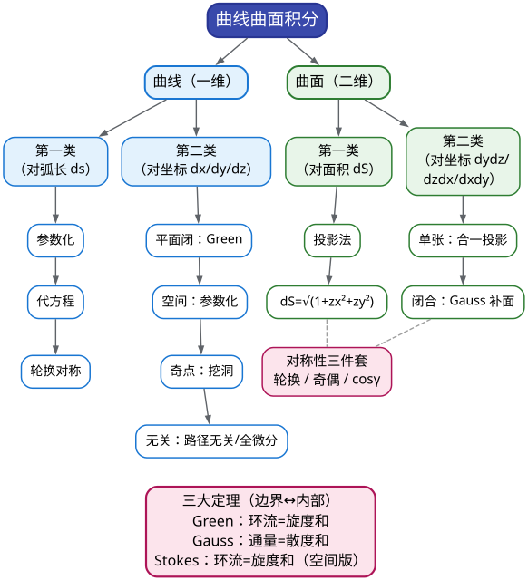

# CMC 手把手精讲
## ——《11 曲线曲面积分》：六张公式表 + 三大定理，拿下多元积分"压舱 20 分"

> 🐱 喵～欢迎来到 CMC 精讲系列第十一篇。这一篇的江湖地位，一句话就说清：**它是"从会算到会拿分"的分水岭**——前面的重积分（10 篇）是"把区域上的东西加起来"，而这一篇教你把"曲线上的""曲面上的"东西加起来，还要用三大公式（Green、Gauss、Stokes）把"边界"和"内部"互相翻译。翻译对了，20 分；翻译错了，一道 14 分大题能从天而降变成 0 分。
>
> **本篇在考试中的地位**（数据口径：第 1–17 届初赛逐卷核对；近年以 12–17 届为准）：
> - 本板块（多元函数积分学，含重积分）近 6 届**连续每卷贡献 18–26 分（约 20%）**，是分值第三高的板块（仅次于极限、一元积分）——其中**曲线曲面积分**与重积分各占半壁；
> - 命题组有个"连续三年不改的习惯"：**填空第 5 题留给多元积分技巧题**（15 届第一类曲面积分 → 16 届 Green 公式挖洞 → 17 届对弧长曲线积分，3/3 命中）——也就是说，这一篇直接对应**一道必考的 6 分填空**；
> - 解答题位置也高度稳定：12 届大题五（空间曲线积分）、13 届大题四（第一类曲面积分+Gauss）、14 届补赛二大题五（曲线积分参数化）、16 届大题四（第二类曲面积分+Gauss）——**14 分的完整大题几乎是"年货"**；
> - 16 届是加强版：**2 填空 + 1 大题 = 26 分**，说明命题组随时可能加码。
> - ⚠️ 命题组还爱"哪壶不开提哪壶"：9 届突然考斯托克斯公式（此前从未考过）、17 届首次考"对弧长的曲线积分"——所以低频考点不能全弃（本篇 §3.10、§3.11 就是给它们准备的）。
>
> **大纲对应条目**（《全国大学生数学竞赛考试内容》非数学专业类·多元函数积分学，逐条摘录）：
> - (2) 两类曲线积分的概念、性质及计算、两类曲线积分的关系；
> - (3) Green 公式、平面曲线积分与路径无关的条件、已知二元函数全微分求原函数；
> - (4) 两类曲面积分的概念、性质及计算、两类曲面积分的关系；
> - (5) Gauss 公式、Stokes 公式、散度和旋度的概念及计算。
> - （注：条目 (1) 二重/三重积分、条目 (6) 几何物理应用属 10 篇与本篇共用，本篇只讲"曲线曲面"侧的应用——质心、流量、功。）
>
> **先修提示**：本篇默认你已看过 **10 篇（重积分：极坐标/球坐标/对称性）**、**05 篇（定积分的分部积分与定限）**，并对 **09 篇的"全微分"概念**有印象。如果"全微分"三个字让你一脸茫然，先回去翻 09 篇的 §3——本篇 §3.5 会大量用到它。
>
> **预计学时**：2–3 天（按每天 1–2 小时折算；对应 00 总纲的**第 4 周 D25–26**）。第一天：§一 + §二 + §3.1–3.5（曲线积分全家族）；第二天：§3.6–3.11（曲面积分 + Stokes）+ 真题精讲 1–6；第三天：精讲 7–10 + 易错点 + 自测题。
>
> 阅读建议：
> 1. 先花 3 分钟扫 §1.2 的方法速查表——本篇的全部考点就是那张表上的一行行"信号→武器"；
> 2. §二别跳：三大公式（Green/Gauss/Stokes）是一个"裂项相消"的故事，理解了故事，公式**不用背也不会写错**；
> 3. 凡是标 ✍️ 的地方真的动笔；凡标 ⏱️ 的地方掐表；
> 4. 真题精讲的"思路分析"里藏着我"卡壳→换路"的真实过程，比解答本身更值钱。
>
> 符号说明：📌 重点 | 💡 直觉/类比 | ⚠️ 易错点 | ✍️ 动笔练一练 | ❓ 自测题 | 🎯 考试定位 | ⏱️ 省时技巧

---

# 一、本篇地图

## 1.1 目录（读之前先看这张施工图）

- **§二 知识讲解**：两类曲线积分（对弧长 / 对坐标）→ 两类曲面积分（对面积 / 对坐标）→ 三大公式的"裂项相消生长史"（Green→Gauss→Stokes）→ 三大对称性武器 → 奇点是什么
- **§三 方法手册**：3.1 对弧长（参数化+代方程+轮换）| 3.2 对坐标参数化 | 3.3 Green 公式 | 3.4 奇点挖洞 | 3.5 路径无关与全微分求原函数 | 3.6 对面积（投影法）| 3.7 对面积（对称性+方向余弦）| 3.8 对坐标（合一投影）| 3.9 Gauss 补面 | 3.10 Stokes 基本款 | 3.11 散度旋度 | 3.12 应用速查
- **§四 真题精讲**：10 道官方真题完整精讲（17 届填 5、16 届填 5、12 届大五、10 届大二、11 届填 4、15 届填 5、14 届补二填 5、16 届大四、13 届大四、9 届大三）
- **§五 易错点清单**：12 条 ❌→✅ 对照
- **§六 自测题**：7 道，附完整答案
- **§七 结语**："曲线曲面积分防身七句话" + 学习建议 + 12 篇预告

## 1.2 方法速查表：什么题面 → 用什么武器（一屏版）

| 题面长相（信号） | 首选武器 | 说明 / 升级路线 |
|---|---|---|
| $`\displaystyle\int_L f(x,y,z)\,\mathrm{d}s`$（出现 $`\mathrm ds`$，对弧长） | **参数化** $`\mathrm ds=\sqrt{x'^2+y'^2+z'^2}\,\mathrm dt`$ | 与方向无关；曲线在球面/平面上先**代方程+轮换对称** |
| 球面 $`\cap`$ 平面交线上的 $`\int_L x^2\,\mathrm ds`$ 型 | $`x^2\to\frac13(x^2+y^2+z^2)=\frac{R^2}{3}`$ | 17 届填空 5 的两板斧之一 |
| $`\displaystyle\oint_L P\,\mathrm dx+Q\,\mathrm dy`$（平面闭曲线，对坐标） | **Green 公式** | 先算 $`\frac{\partial Q}{\partial x}-\frac{\partial P}{\partial y}`$：为常数/简单式就走通 |
| $`\frac{\partial Q}{\partial x}=\frac{\partial P}{\partial y}`$ 但**奇点在内部** | **挖洞换路径** | 换同形小曲线使分母为常数（16 届填 5） |
| 非闭曲线 $`\int_L P\,\mathrm dx+Q\,\mathrm dy`$ | 补线段+Green（再减补线积分）或直接参数化 | 空间曲线优先参数化 |
| "与路径无关"/"任意闭曲线上积分值为常数" | **路径无关条件** $`\frac{\partial Q}{\partial x}=\frac{\partial P}{\partial y}`$ → 求 $`f`$ | 10 届大二：导出 ODE $`tf'+f=1`$ |
| $`\mathrm du=P\,\mathrm dx+Q\,\mathrm dy`$，求 $`u(x,y)`$ | **凑全微分 / 折线积分** | 11 届填 4：分组凑 $`\mathrm d(\ )`$ |
| 空间闭曲线 $`\oint_\Gamma P\,\mathrm dx+Q\,\mathrm dy+R\,\mathrm dz`$ | **Stokes**（基本款）或参数化 | 算旋度→取平面张成→右手定则→点积×面积 |
| $`\displaystyle\iint_\Sigma f\,\mathrm dS`$（对面积） | **投影法** $`\mathrm dS=\sqrt{1+z_x^2+z_y^2}\,\mathrm dx\mathrm dy`$ | 平面斜切（15 届填 5）；先查奇偶/轮换 |
| 球面上的 $`\iint_\Sigma x^2\,\mathrm dS`$ 型 | **轮换对称** $`x^2\to\frac{R^2}{3}`$ | 秒杀 |
| 球面上的 $`\iint_\Sigma z\,\mathrm dS`$ / 重心 | **方向余弦** $`\cos\gamma=\frac zR`$ 转投影 | 14 届补二填 5：重心 $`a/2`$ 秒出 |
| 第二类曲面积分、曲面是**单张** $`z=z(x,y)`$ | **合一投影** $`\iint_{D_{xy}}\big(-Pz_x-Qz_y+R\big)\mathrm dx\mathrm dy`$ | 一投二代三定号 |
| 第二类曲面积分、曲面**可补成闭合** | **Gauss 补面** | 补面选得让补面积分为 0 最佳（16 届大四） |
| 闭曲面流量 / $`\iint\,`$含 $`\partial_x+\partial_y+\partial_z`$ 结构 | **Gauss 公式** | 注意奇点（含 $`1/r^k`$ 的）不能直接套 |
| 求质量/质心/转动惯量/流量/功 | 套 §3.12 应用公式 + 对称性 | 保底项，公式直接背 |

## 1.3 知识树：本篇全部内容的骨架



一句话总结这张图：**曲线积分两兄弟（对弧长/对坐标）靠"参数化"，曲面积分两兄弟（对面积/对坐标）靠"投影"；三大定理则是"把边界上的账，换算成内部每一点的账本"——换算的方向由你来选，哪边好算往哪边换。**

## 1.4 考场速查：六张公式表（默写级）

> 这一节是全篇唯一的"背诵清单"。**考前一天，把下面六张表默写一遍**；写不全的，回 §二 重看对应出处。

**表① 第一类曲线积分（对弧长）**

```math
\int_L f\,\mathrm{d}s=\int_\alpha^\beta f\big(x(t),y(t),z(t)\big)\sqrt{x'^2(t)+y'^2(t)+z'^2(t)}\,\mathrm{d}t\quad(\alpha<\beta).
```

**表② 两类曲线积分的关系**（$`\cos\alpha,\cos\beta,\cos\gamma`$ 为**有向**切线的方向余弦）

```math
\int_L P\,\mathrm dx+Q\,\mathrm dy+R\,\mathrm dz=\int_L\big(P\cos\alpha+Q\cos\beta+R\cos\gamma\big)\mathrm ds .
```

**表③ 第一类曲面积分（对面积）**（$`\Sigma:z=z(x,y)`$，投影 $`D_{xy}`$）

```math
\iint_\Sigma f\,\mathrm dS=\iint_{D_{xy}}f\big(x,y,z(x,y)\big)\sqrt{1+z_x^2+z_y^2}\,\mathrm dx\mathrm dy .
```

**表④ 两类曲面积分的关系**（$`\cos\alpha,\cos\beta,\cos\gamma`$ 为**定向**法向的方向余弦）

```math
\iint_\Sigma P\,\mathrm dy\mathrm dz+Q\,\mathrm dz\mathrm dx+R\,\mathrm dx\mathrm dy=\iint_\Sigma\big(P\cos\alpha+Q\cos\beta+R\cos\gamma\big)\mathrm dS .
```

**表⑤ 三大定理**

```math
\oint_L P\,\mathrm dx+Q\,\mathrm dy=\iint_D\Big(\frac{\partial Q}{\partial x}-\frac{\partial P}{\partial y}\Big)\mathrm dx\mathrm dy \qquad\text{(Green，$L$ 取正向)},
```

```math
\oiint_{\Sigma_{\text{外}}} P\,\mathrm dy\mathrm dz+Q\,\mathrm dz\mathrm dx+R\,\mathrm dx\mathrm dy=\iiint_\Omega\Big(\frac{\partial P}{\partial x}+\frac{\partial Q}{\partial y}+\frac{\partial R}{\partial z}\Big)\mathrm dV \qquad\text{(Gauss)},
```

```math
\oint_\Gamma P\,\mathrm dx+Q\,\mathrm dy+R\,\mathrm dz=\iint_\Sigma\Big[\Big(\frac{\partial R}{\partial y}-\frac{\partial Q}{\partial z}\Big)\mathrm dy\mathrm dz+\Big(\frac{\partial P}{\partial z}-\frac{\partial R}{\partial x}\Big)\mathrm dz\mathrm dx+\Big(\frac{\partial Q}{\partial x}-\frac{\partial P}{\partial y}\Big)\mathrm dx\mathrm dy\Big]\qquad\text{(Stokes)}.
```

**表⑥ 方向余弦对照（单张曲面 $`z=z(x,y)`$，取上侧）**

```math
\big(\cos\alpha,\cos\beta,\cos\gamma\big)=\frac{(-z_x,\ -z_y,\ 1)}{\sqrt{1+z_x^2+z_y^2}} .
```

> 💡 用法说明：表⑥ 是把"第二类曲面积分"与"第一类曲面积分"互相翻译的字典；表②④ 是"对坐标"与"对弧长/对面积"的兑换率。三大定理（表⑤）则是"降维"工具——把曲线问题降成区域、把曲面问题降成体积。**你手上真正的新武器就这六张表，其余全是决定"往哪算"的判断力。**

---

# 二、知识讲解：从"弯铁丝的重量"到"边界的守恒律"

## 2.1 第一类曲线积分（对弧长）：沿着路径"无向"地累积

想象你手里有一根**弯弯曲曲的铁丝**，粗细不均匀。你想知道它的总质量——做法朴素得不能再朴素：把铁丝掰成 $`n`$ 小段，每小段长 $`\Delta s_i`$，在每段上取一点估计线密度 $`\rho`$，然后

```math
m\approx \sum_{i=1}^n \rho(\xi_i)\,\Delta s_i .
```

当分割越来越细，这个和的极限就是**第一类曲线积分**：

```math
\int_L \rho\,\mathrm ds \quad(\text{读作"$\rho$ 沿 }L\text{ 对弧长的积分"}).
```

💡 **写给会写代码的你**：第一类曲线积分就像 `reduce`——沿路径逐点采样、加权（权是弧长微元 $`\mathrm ds`$）求和。**遍历方向无关**：从 A 走到 B，还是从 B 走到 A，$`\int_L f\,\mathrm ds`$ 一模一样（因为 $`\mathrm ds>0`$，只管道"有多长"，不管"往哪走"）。

📌 **计算公式（参数化）**：设 $`L:\ x=x(t),\ y=y(t),\ z=z(t)`$（$`\alpha\le t\le\beta`$），则

```math
\int_L f\,\mathrm ds=\int_\alpha^\beta f\big(x(t),y(t),z(t)\big)\sqrt{x'^2(t)+y'^2(t)+z'^2(t)}\,\mathrm dt .
```

根号里的东西就是"速度"大小 $`|\mathbf r'(t)|`$：**参数跑得快的地方，对应更长的弧**——这就是 $`\mathrm ds`$ 的全部秘密。

**竞赛专用两板斧（17 届填空 5 的引擎，务必记牢）**：

- **代方程第一斧**：积分曲线在球面 $`x^2+y^2+z^2=R^2`$ 上时，被积表达式里的 $`x^2+y^2+z^2`$ 可以直接换成 $`R^2`$——**曲线方程就是曲线上的"恒等式"，可以随时代入被积函数**（这一点和重积分完全不同：重积分里的区域不等式**不能**代入！原因留给你想 5 秒钟：曲线积分是在**曲线上**取点，每个点都精确满足方程；重积分是在**区域内部**取点，内部点多数不满足边界方程。）；
- **轮换对称第二斧**：把 $`x^2`$ 换成 $`\frac13(x^2+y^2+z^2)`$ 的合法性，来自三个变量在球面方程里的"平权"：

```math
\int_L x^2\,\mathrm ds=\int_L y^2\,\mathrm ds=\int_L z^2\,\mathrm ds=\frac13\int_L(x^2+y^2+z^2)\,\mathrm ds.
```

若 $`L`$ 还在球面 $`x^2+y^2+z^2=R^2`$ 上，最后一式 $`=\frac{R^2}{3}\int_L\mathrm ds=\frac{R^2}{3}\cdot(\text{曲线弧长})`$——**一个积不出来的积分，三步变成一个乘法**。

## 2.2 第二类曲线积分（对坐标）：带符号的"做功"

换一副眼镜看同一根铁丝：这次它躺在**力场**里，一个质点沿曲线 $`L`$ 从 A 走到 B，力 $`\mathbf F=(P,Q)`$ 做功。物理课告诉我们：把路径切成小段，每小段用直线近似，功 $`\approx\sum \mathbf F\cdot\Delta\mathbf r=\sum\big(P\Delta x+Q\Delta y\big)`$。取极限：

```math
W=\int_L P\,\mathrm dx+Q\,\mathrm dy
```

这就是**第二类曲线积分**（对坐标的曲线积分）。注意它和第一类的三个本质区别：

1. **有方向**：从 A 到 B 与从 B 到 A，差一个负号（$`\int_{-L}=-\int_L`$）——就像把数组**逆序**遍历，每个 $`\mathrm dx`$ 都翻了符号；
2. **$`\mathrm dx`$ 可正可负**：往右走 $`\mathrm dx>0`$，往左走 $`\mathrm dx<0`$——这就是"符号"的全部来源；
3. **"代方程"这件事，两类规则一样**：第二类同样可以代曲线方程（只要在曲线上取值），只是 $`\mathrm dx,\mathrm dy`$ 要**按参数化正确算出来**，符号全在 $`\mathrm dx,\mathrm dy`$ 里。这一点在 12 届大题五（真题精讲 3）里会展现得淋漓尽致。

💡 **把两者串起来的桥梁**（表②）：$`\mathrm dx=\cos\alpha\,\mathrm ds`$，其中 $`\cos\alpha`$ 是**有向切线**的方向余弦。方向一翻，$`\cos\alpha`$ 变号——两类积分就差在这。

**一个 5 秒钟的小例子**：单位圆 $`L:x^2+y^2=1`$，计算 $`\oint_L x\,\mathrm dy`$。
参数化 $`x=\cos t,\ y=\sin t`$（逆时针）。

```math
\oint_L x\,\mathrm dy=\int_0^{2\pi}\cos t\cdot\cos t\,\mathrm dt=\int_0^{2\pi}\cos^2t\,\mathrm dt=\pi .
```

若改取顺时针方向，答案变 $`-\pi`$。**同一个几何圈、同两个函数，方向决定符号**——这就是第二类的性格。

> 🎯 考试定位：真题里"第二类曲线积分"是**最高频考点**（核实到的 8 届出现）——平面闭曲线用 Green、空间曲线参数化、奇点挖洞、路径无关，四种款式本篇全讲。

## 2.3 两类曲面积分（对面积、对坐标）：给曲面"刷漆"与"量流量"

同理升维。

**第一类曲面积分（对面积）**：一片**弯曲的铁皮** $`\Sigma`$，面密度 $`\rho(x,y,z)`$，总质量

```math
m=\iint_\Sigma \rho\,\mathrm dS .
```

$`\mathrm dS`$ 是面积微元，恒正；积分与曲面的"朝向"无关。计算时"投影法"上阵：把 $`\Sigma`$ 投影到 $`xOy`$ 面得区域 $`D_{xy}`$，则

```math
\mathrm dS=\sqrt{1+z_x^2+z_y^2}\,\mathrm dx\mathrm dy
```

（$`\sqrt{1+z_x^2+z_y^2}`$ 是"斜面比平面多出来的那部分"：曲面越陡，同样的投影对应越大的实际面积——就像把一张纸斜着投影到桌面，纸越陡、投影越扁、比值越大）。

**第二类曲面积分（对坐标）**：想象流体以速度 $`\mathbf v=(P,Q,R)`$ 穿过曲面 $`\Sigma`$，单位时间通过的体积（**流量**）

```math
\Phi=\iint_\Sigma P\,\mathrm dy\mathrm dz+Q\,\mathrm dz\mathrm dx+R\,\mathrm dx\mathrm dy .
```

这里的 $`\mathrm dy\mathrm dz`$ 是**带符号的投影面积元**：法向朝前（与 $`x`$ 轴正方向成锐角）为正，朝后为负。所以第二类曲面积分**对方向敏感**：上侧/下侧、外侧/内侧都决定符号。桥梁（表④）：

```math
\mathrm dy\mathrm dz=\cos\alpha\,\mathrm dS,\qquad \mathrm dz\mathrm dx=\cos\beta\,\mathrm dS,\qquad \mathrm dx\mathrm dy=\cos\gamma\,\mathrm dS .
```

💡 **打比方**：第一类是"给曲面刷漆，量油漆用量"（不分里外）；第二类是"把曲面当网兜，量穿过它的水流"（里外决定正负）。真题里 16 届大题四求的 $`I=\iint_S(x^2-x)\mathrm dy\mathrm dz+(y^2-y)\mathrm dz\mathrm dx+(z^2-z)\mathrm dx\mathrm dy`$ 本质上就是一道"流量题"。

## 2.4 三大公式的"生长史"：一场二维到三维的裂项相消

> 这一节是本篇的**灵魂**。三个公式别背——看懂下面的故事，公式会自己从脑子里长出来。

**第 0 幕：一切的源头，牛顿-莱布尼茨公式。**

```math
\int_a^b f'(x)\,\mathrm dx=f(b)-f(a).
```

一句话：**"内部的导数在区间上累积，等于边界上的值之差"**。左边是"里面"（整个区间），右边是"边界"（两个端点）。这个"内部↔边界"的翻译，就是接下来所有公式的母版。

**第 1 幕：Green 公式（二维版）。** 把平面区域 $`D`$ 用网格切成许多小方块，对每个小方块用"微积分基本定理的二维版"——你会发现每个小方块上的"边界环流"等于它内部的"旋转强度"（旋度 $`\frac{\partial Q}{\partial x}-\frac{\partial P}{\partial y}`$）乘面积。**关键在下一步**：把所有小方块加起来。两个相邻小方块**公共边**上的环流——左边方块逆时针走、右边方块逆时针走——公共边上方向**恰好相反**，互相抵消！

💡 **这就是裂项相消（telescoping）**：$`\sum_{k}(a_{k+1}-a_k)=a_n-a_1`$，中间的项全部配对抵消，只剩"最外层"。网格内部的边全部抵消，只剩**最外面的一圈** $`L`$：

```math
\oint_L P\,\mathrm dx+Q\,\mathrm dy=\iint_D\Big(\frac{\partial Q}{\partial x}-\frac{\partial P}{\partial y}\Big)\mathrm dx\mathrm dy .
```

计算机味道的解释：这是一个"分治归并"——把大区域的环流拆成小块的环流之和，归并时内部边界互相抵消，边界项"浮"到最外层。**判方向的口诀**：让区域始终在你的**左侧**（=逆时针=正方向）时才对；反过来差负号。

**第 2 幕：Gauss 公式（三维版）。** 完全相同的剧本：把空间区域切成小立方体，内部公共面上的通量互相抵消（相邻小体在公共面上的外法向正好相反），只剩外表面：

```math
\oiint_{\Sigma_{\text{外}}} P\,\mathrm dy\mathrm dz+Q\,\mathrm dz\mathrm dx+R\,\mathrm dx\mathrm dy=\iiint_\Omega\Big(\frac{\partial P}{\partial x}+\frac{\partial Q}{\partial y}+\frac{\partial R}{\partial z}\Big)\mathrm dV .
```

被翻译的对象从"环流↔旋度"换成了"通量↔散度"：**散度** $`\frac{\partial P}{\partial x}+\frac{\partial Q}{\partial y}+\frac{\partial R}{\partial z}`$ 是"这一点往外冒的源强度"（正=源、负=汇）。Gauss 公式的物理一句话：**从闭曲面流出的净流量 = 里面所有源头的总产出**。

**第 3 幕：Stokes 公式（曲面的边界版）。** 同样的剧本再来一遍，这次把曲面切成小片，内部小片公共边界上环流方向相反、互相抵消，只剩最外边界曲线 $`\Gamma`$：

```math
\oint_\Gamma P\,\mathrm dx+Q\,\mathrm dy+R\,\mathrm dz=\iint_\Sigma\big(\operatorname{rot}\mathbf F\cdot\mathbf n\big)\mathrm dS .
```

即"沿边界曲线的环流 = 穿过曲面的旋度通量"。展开写法见表⑤。**Green 公式其实是 Stokes 的特例**（取 $`\Sigma`$ 为 $`xOy`$ 平面上的区域）。

**三幕合起来的记忆**：
```
一维   ：∫ f' dx = f(b) − f(a)          内部导数 ↔ 边界值差
二维   ：Green  ：环流 ∮ = ∬ 旋度        内部旋度 ↔ 边界环流
三维   ：Gauss  ：通量 ∯ = ∭ 散度        内部源汇 ↔ 边界通量
        Stokes ：环流 ∮ = ∬ 旋度·n       内部旋度 ↔ 边界环流（空间版）
```

📌 **考场判断法（最重要的应用直觉）**：遇到一个曲线/曲面积分，你的问题永远只有一个——"**算边界容易，还是算内部容易？**"哪边好算，就用公式往哪边翻。三大公式就是把"边界问题"与"内部问题"互翻的字典：**看到闭合的东西（闭曲线、闭曲面），第一反应就是翻字典**。

## 2.5 三大对称性武器（跨题型通用的"提款密码"）

**武器一：轮换对称。** 若积分对象（曲线/曲面/区域）的方程在 $`x\to y\to z\to x`$ 的轮换下不变，则三个变量的地位完全平权，于是

```math
\int x^2=\int y^2=\int z^2=\frac13\int(x^2+y^2+z^2).
```

球面、球体、以及一切"轮换不变"的对象上都成立。**这是本板块性价比最高的技巧**：17 届填 5、16 届大四、13 届大四、13 届填 5 全靠它。

**武器二：奇偶性删项。** 若积分对象关于某个坐标面对称，且被积函数对相应变量为奇函数，则该项积分直接为 0。例如 $`D`$ 关于 $`y`$ 轴对称时，$`\iint_D x\cdot g(x^2,y)\,\mathrm dx\mathrm dy=0`$。

**武器三：代入方程。** 曲线（面）上的方程是恒等式，可以代入被积函数（第一类、第二类都行，重积分不行）。

⚠️ **注意武器二的前提是"对象对称 + 函数奇偶"同时成立**——只有对象对称而函数不奇偶，什么都删不掉。这是本板块第一号"想当然丢分点"。

## 2.6 奇点：Green/Gauss 的"输入前提"

三大公式与所有换算都有个共同前提：**被积函数在整个内部区域上连续可微**。

但真题偏偏爱出这种：$`P=\frac{-y}{4x^2+y^2}`$，$`Q=\frac{x}{4x^2+y^2}`$——在原点，分母为 0，函数"爆炸"。这时 $`\frac{\partial Q}{\partial x}-\frac{\partial P}{\partial y}\equiv 0`$ 看起来很美，但**原点这颗"钉子"卡在区域里，Green 公式的输入前提被破坏了**。

💡 **打比方**：这就是算法里的"前置条件（precondition）不满足"——函数在调用公式前必须先检查输入合法性，否则结果不可信。处理办法也不是绕过，而是**工程手段**：在奇点周围挖一个"隔离区"（一条小闭曲线或一张小曲面），把它隔离出去，剩下的环形区域就可以合法调用公式了——具体操作见 §3.4（挖洞）与 §3.9（挖球）。

好了，工具箱齐了：六张表 + 三幕故事 + 三件对称武器 + 一个奇点警告。下面逐个讲"什么时候用、怎么用"。

---

# 三、方法手册：十一件武器，见招拆招

> 每个方法按【适用信号】→【步骤】→【关键公式】→【真题微型例子】展开。再唠叨一遍："**你缺的不是公式，是何时扣扳机的判断力**"——所以【适用信号】永远比公式重要。

## 3.1 第一类曲线积分（对弧长）

**【适用信号】** 被积式里出现 $`\mathrm ds`$；或题干说"对弧长的曲线积分"；曲线是圆、椭圆、球面与平面的交线、空间参数曲线。

**【步骤】**
1. **先看能不能"不动积分"**：曲线在球面 $`x^2+y^2+z^2=R^2`$ 上 → 两板斧（代方程 + 轮换对称）先招呼；曲线在平面 $`x+y+z=c`$ 上 → 用 $`(x+y+z)^2=c^2`$ 把 $`xy+yz+zx`$ 换成 $`\frac{c^2-(x^2+y^2+z^2)}{2}`$；
2. 否则**参数化**：写出 $`x(t),y(t),z(t)`$（圆的参数化 $`x=a\cos t,\ y=a\sin t`$ 是最高频配置）；
3. 算 $`\mathrm ds=\sqrt{x'^2+y'^2+z'^2}\,\mathrm dt`$，代 $`f`$，按 $`t`$ 的下限到上限积分（**注意 $`t`$ 从下往上，保证 $`\mathrm ds>0`$**）。

**【关键公式】**

```math
\int_L f\,\mathrm ds=\int_\alpha^\beta f\big(x(t),y(t),z(t)\big)\sqrt{x'^2+y'^2+z'^2}\,\mathrm dt .
```

**【真题微型例子 1】**（第 17 届非数学 A 类·填空第 5 题，2025）$`L`$：球面 $`x^2+y^2+z^2=4`$ 与平面 $`x+y+z=3`$ 的交线，求 $`\int_L(x^2+2xy)\,\mathrm ds`$。
三步秒杀：① 轮换：$`\int_L x^2\,\mathrm ds=\frac13\int_L(x^2+y^2+z^2)\mathrm ds=\frac43\int_L\mathrm ds`$；② 代方程 + 平方差：$`\int_L2xy\,\mathrm ds=\frac23\int_L(xy+yz+zx)\mathrm ds=\frac13\int_L\big[(x+y+z)^2-(x^2+y^2+z^2)\big]\mathrm ds=\frac53\int_L\mathrm ds`$；③ 交线是半径 $`\sqrt{4-3}=1`$ 的圆，$`\int_L\mathrm ds=2\pi`$。合计 $`3\cdot2\pi=6\pi`$。（完整过程见精讲 1。）

✍️ **动笔练一练**（类型题·仿竞赛风格）：$`L:x^2+y^2=a^2`$，求 $`\int_L x^2\,\mathrm ds`$。提示：平面圆上同样平权（$`x^2+y^2=a^2`$），$`\int_L x^2\,\mathrm ds=\frac12\int_L(x^2+y^2)\mathrm ds=\frac{a^2}{2}\cdot2\pi a=\pi a^3`$。

## 3.2 第二类曲线积分：参数化直接算

**【适用信号】** $`\displaystyle\int_L P\,\mathrm dx+Q\,\mathrm dy+R\,\mathrm dz`$；$`L`$ 是**非闭**曲线、或空间曲线，参数化顺手（圆、椭圆、直线段、球面∩平面的交线）；被积函数里有绝对值、抽象函数等"Green 伺候不了"的结构。

**【步骤】**
1. 写参数方程（空间曲线常常先用两个曲面方程联立"凑"出参数）；
2. 微分出 $`\mathrm dx,\mathrm dy,\mathrm dz`$，代入被积式；
3. **方向管理**：参数 $`t`$ 的取向必须与题目给定的起点→终点一致（起点对应下限、终点对应上限——总之"从起点积到终点"）；
4. 剩下的就是一元定积分（遇到绝对值**按零点分段**，遇到抽象函数**用奇偶性/周期性消项**）。

**【关键公式】** 无新公式：$`\mathrm dx=x'(t)\,\mathrm dt`$，逐项换。（这正是第二类与第一类在计算上唯一的差别：$`\mathrm ds`$ 要开根号，$`\mathrm dx,\mathrm dy`$ 不用。）

**【真题微型例子】**（第 14 届非数学类·初赛第二次补赛·大题五，2023）设 $`f`$ 是 $`[-1,1]`$ 上的连续**偶**函数，$`L`$：正向圆周 $`x^2+y^2=-2y`$，求 $`I=\oint_L\frac{x^2+y^2}{2\sqrt{1-x^2}}\,\mathrm dx+f(x)\,\mathrm dy`$。
为什么不用 Green？被积函数在 $`x=\pm1`$ 处有奇性，Green 的输入前提不满足——**参数化是唯一稳妥出路**。取 $`x=\cos\theta,\ y+1=\sin\theta,\ 0\le\theta\le2\pi`$，则 $`x^2+y^2=2(1-\sin\theta)`$，$`\sqrt{1-x^2}=|\sin\theta|`$：

```math
I=\underbrace{\int_0^{2\pi}\frac{1-\sin\theta}{|\sin\theta|}(-\sin\theta)\,\mathrm d\theta}_{I_1}+\underbrace{\int_0^{2\pi}f(\cos\theta)\cos\theta\,\mathrm d\theta}_{I_2}.
```

$`I_1`$ **按 $`\sin\theta=0`$ 分段**：$`I_1=-\int_0^\pi(1-\sin\theta)\mathrm d\theta+\int_\pi^{2\pi}(1-\sin\theta)\mathrm d\theta=-(\pi-2)+(\pi+2)=4`$；
$`I_2`$ 用**偶函数消项**：把 $`[\pi,2\pi]`$ 段换元 $`\theta=t+\pi`$，得 $`\int_0^\pi f(-\cos t)\cos t\,\mathrm dt=-\int_0^\pi f(\cos t)\cos t\,\mathrm dt`$……两段恰好抵消，$`I_2=0`$。
**答案 $`I=4`$。** 这道题教会你：闭曲线 + 抽象函数 ≠ 无脑 Green——**先检查前提，再谈武器**。

## 3.3 Green 公式

**【适用信号】** 平面**闭**曲线（或可补成闭）的第二类曲线积分 $`\oint_L P\,\mathrm dx+Q\,\mathrm dy`$；被积函数在整个围成区域上连续可微（无奇点）。

**【步骤】**
1. **验前提**：$`L`$ 是正向（逆时针，"区域在左手边"）吗？$`P,Q`$ 在 $`D`$ 上处处可微吗（有奇点→转 §3.4）？$`L`$ 不闭→补线（补一段好算的线段，算完**记得减掉**）；
2. **算旋度** $`\frac{\partial Q}{\partial x}-\frac{\partial P}{\partial y}`$：结果若是常数或简单表达式，Green 这条路就通了；若复杂，回头看看是不是该参数化；
3. **化二重积分**：用 10 篇的功夫（极坐标/对称性）算出 $`\iint_D\big(\frac{\partial Q}{\partial x}-\frac{\partial P}{\partial y}\big)\mathrm dx\mathrm dy`$。

**【关键公式】**

```math
\oint_{L_{\text{正}}} P\,\mathrm dx+Q\,\mathrm dy=\iint_D\Big(\frac{\partial Q}{\partial x}-\frac{\partial P}{\partial y}\Big)\mathrm dx\mathrm dy .
```

**【真题微型例子】**（第 1 届非数学类·大题四，2009，证明题用法）$`D=[0,\pi]\times[0,\pi]`$，$`L`$ 为 $`D`$ 的正向边界。
(1) 证 $`\oint_L xe^{\sin y}\mathrm dy-ye^{-\sin x}\mathrm dx=\oint_L xe^{-\sin y}\mathrm dy-ye^{\sin x}\mathrm dx`$；(2) 证左端 $`\ge\frac52\pi^2`$。
**思路**：两边各自 Green 化——左边 $`=\iint_D(e^{\sin y}+e^{-\sin x})\mathrm d\sigma`$，右边 $`=\iint_D(e^{-\sin y}+e^{\sin x})\mathrm d\sigma`$；由正方形关于对角线 $`y=x`$ 对称（交换 $`x,y`$ 区域不变），两个二重积分相等，(1) 证毕。(2) 把结论一的左边再 Green 化到 $`\iint_D(e^{\sin x}+e^{-\sin x})\mathrm d\sigma`$，用 $`e^t+e^{-t}=2\sum\frac{t^{2n}}{(2n)!}\ge2+t^2`$ 放缩：

```math
\ge\iint_D(2+\sin^2x)\mathrm d\sigma=2\pi^2+\frac{\pi^2}{2}=\frac52\pi^2 .
```

> 🎯 这道题揭示 Green 的第二种用法：**证明题**。Green 把"边界积分等式/不等式"翻译成"二重积分",再用对称性与估值解决——CMC 早年（1–3 届）爱考这种"公式+对称性"的证明题型，近三届转向计算，但**思路本身在填空里天天见**。

## 3.4 奇点挖洞：当"旋度为 0"骗了你

**【适用信号】** 平面闭曲线；算出来 $`\frac{\partial Q}{\partial x}-\frac{\partial P}{\partial y}\equiv0`$（或形式很美），**但** $`P,Q`$ 在某点（通常在原点）没有定义——"分母含 $`x,y`$ 的二次型"是经典长相（如 $`\frac{-y}{4x^2+y^2}`$、$`\frac{x}{x^2+y^2}`$、$`\frac{2xy}{x^4+y^2}`$）。

**【步骤】**（挖洞四步）
1. **确认奇点**：找 $`P,Q`$ 的未定义点，判断它是否落在 $`L`$ 围成的区域内部；
2. **造洞**：找一条位于 $`L`$ 内部、包围奇点的小闭曲线 $`L_1`$，选**同形**的（让分母在 $`L_1`$ 上变成常数）——16 届填 5 的奇点分母是 $`4x^2+y^2`$，洞就取椭圆 $`4x^2+y^2=4`$；
3. **环域 Green**：在 $`L`$ 与 $`L_1`$ 围成的环状区域上 $`P,Q`$ 处处可微且旋度为 0，Green 给

```math
\oint_{L}+\oint_{L_1}=0\qquad(\text{外圈逆时针、内圈顺时针——让环域始终在行走方向的左侧}),
```

于是 $`\oint_L=-\oint_{L_1}`$；
4. **在洞上算值**：$`L_1`$ 上分母是常数，直接参数化（或用 $`\oint-y\mathrm dx+x\mathrm dy=2\sigma(D)`$ 再补一步 Green）。

**【关键公式】** 16 届官方同款：把 $`\oint_L`$ 换成 $`\oint_{L_1\text{（反向）}}`$，$`\frac{-y\mathrm dx+x\mathrm dy}{4x^2+y^2}\to\frac14(-y\mathrm dx+x\mathrm dy)`$，再 $`\frac14\cdot2\sigma(D)`$。

**【真题微型例子】**（第 2 届非数学类·大题六，2010，反求型）设 $`\varphi`$ 有连续导数，在围绕原点的任意光滑简单闭曲线 $`C`$ 上，$`\oint_C\frac{2xy\,\mathrm dx+\varphi(x)\,\mathrm dy}{x^4+y^2}`$ 的值为**常数**。
(2) 求 $`\varphi(x)`$：设 $`P=\frac{2xy}{x^4+y^2}`$，$`Q=\frac{\varphi(x)}{x^4+y^2}`$。"任意闭曲线上积分为常数"意味着在奇点之外**与路径无关**，于是 $`\frac{\partial P}{\partial y}=\frac{\partial Q}{\partial x}`$：

```math
\frac{2x^5-2xy^2}{(x^4+y^2)^2}=\frac{\varphi'(x)(x^4+y^2)-4x^3\varphi(x)}{(x^4+y^2)^2}\ \Longrightarrow\ \varphi(x)=-x^2 .
```

(3) 取洞 $`C_a: x^4+y^2=1`$，环域 Green 得 $`\oint_C=\oint_{C_a}\frac{2xy\mathrm dx-x^2\mathrm dy}{1}`$，再 Green：$`=\iint_D(-4x)\mathrm dx\mathrm dy=0`$（$`D`$ 关于 $`y`$ 轴对称，$`-4x`$ 奇函数）。
> 💡 顺手提醒：该题参考解答的扫描件个别符号排印不清（以推导为准即可），但思路骨架完好——**读老卷解答时关注结构，不要被排版细节吓退**。

## 3.5 路径无关与全微分求原函数

**【适用信号】** ①题干出现"**与路径无关**""积分值只与起终点有关""在任意围绕原点的闭曲线上积分为常数"；②"求 $`f`$ 使积分与路径无关"；③"已知 $`\mathrm du=P\,\mathrm dx+Q\,\mathrm dy`$，求 $`u`$"。

**【步骤】**
1. **判据**：在**单连通**区域上（无洞），

```math
\frac{\partial Q}{\partial x}=\frac{\partial P}{\partial y}\ \Longleftrightarrow\ \text{积分与路径无关}\ \Longleftrightarrow\ \exists\,u,\ \mathrm du=P\,\mathrm dx+Q\,\mathrm dy .
```

2. **求 $`u`$ 的两条路线**：
   - **凑微分**（首选）：把 $`P\,\mathrm dx+Q\,\mathrm dy`$ 分组凑成 $`\mathrm d(\ )`$ 的形式（常用：$`\mathrm d\frac yx=\frac{x\mathrm dy-y\mathrm dx}{x^2}`$、$`\mathrm d\arctan\frac yx`$、$`\mathrm d\ln(x^2+y^2)`$）；
   - **折线积分**（保底）：$`u(x,y)=\int_{x_0}^{x}P(t,y_0)\,\mathrm dt+\int_{y_0}^{y}Q(x,t)\,\mathrm dt`$（先水平后垂直，避开复杂结构）；
3. **求 $`f`$ 型题目**：把判据 $`\frac{\partial Q}{\partial x}=\frac{\partial P}{\partial y}`$ 展开，消元成关于新变量 $`t`$ 的**微分方程**，解出来即为所求。

**【关键公式】**

```math
u(x,y)=\int_{(x_0,y_0)}^{(x,y)}P\,\mathrm dx+Q\,\mathrm dy\ (\text{与路径无关，可选折线}),\qquad \int_{(x_0,y_0)}^{(x_1,y_1)}=u(x_1,y_1)-u(x_0,y_0).
```

**【真题微型例子】**（自编演示，凑微分手法）：$`\mathrm du=(y+3x^2)\,\mathrm dx+(x-2y)\,\mathrm dy`$，求 $`u`$。
分组：$`(y\,\mathrm dx+x\,\mathrm dy)+3x^2\mathrm dx-2y\,\mathrm dy=\mathrm d(xy)+\mathrm d(x^3)-\mathrm d(y^2)`$，所以 $`u=xy+x^3-y^2+C`$。
**顺手秒杀积分**：$`\int_{(0,0)}^{(1,1)}(y+3x^2)\mathrm dx+(x-2y)\mathrm dy=u(1,1)-u(0,0)=1+1-1=1`$——与路径无关的题，**原函数一出，积分就是两个端点值相减**，一道"曲线积分"变成"查表"。
> 两个官方真题微型例：10 届大题二（路径无关导出 ODE $`tf'(t)+f(t)=1`$）见精讲 4；11 届填空 4（凑 $`\mathrm d(x/y)`$）见精讲 5。

## 3.6 第一类曲面积分（对面积）：投影法

**【适用信号】** $`\displaystyle\iint_\Sigma f\,\mathrm dS`$；$`\Sigma`$ 是平面块、球面块、锥面块、柱面块；题干"被某柱面截得的部分"。

**【步骤】**
1. **先做"侦查"**：$`\Sigma`$ 的方程轮换对称吗？被积函数有奇偶项吗？（很多题侦查完就不用算了）
2. **选显式投影方向**：$`\Sigma:z=z(x,y)`$ → 投影到 $`xOy`$（也可以投影到其他面，选"不会被挡住"的方向）；
3. **定投影区域**：把 $`\Sigma`$ 的边界投影到 $`xOy`$ 面上画出 $`D_{xy}`$（15 届填 5 的投影是圆盘 $`x^2+y^2\le25`$）；
4. **换 $`\mathrm dS`$**：$`\mathrm dS=\sqrt{1+z_x^2+z_y^2}\,\mathrm dx\mathrm dy`$，把 $`z=z(x,y)`$ 代入 $`f`$，化二重积分。

**【关键公式】**

```math
\iint_\Sigma f\,\mathrm dS=\iint_{D_{xy}}f\big(x,y,z(x,y)\big)\sqrt{1+z_x^2+z_y^2}\,\mathrm dx\mathrm dy .
```

**【真题微型例子】**（第 15 届非数学 A 类·填空第 5 题，2023）$`\Sigma`$：平面 $`y+z=5`$ 被柱面 $`x^2+y^2=25`$ 所截得的部分，求 $`\iint_\Sigma(x+y+z)\,\mathrm dS`$。
$`\Sigma`$ 写成 $`z=5-y`$，$`\mathrm dS=\sqrt{1+0^2+(-1)^2}\,\mathrm dx\mathrm dy=\sqrt2\,\mathrm dx\mathrm dy`$；投影 $`D_{xy}: x^2+y^2\le25`$；被积函数 $`x+y+z=x+5`$：

```math
I=\sqrt2\iint_{D_{xy}}(x+5)\,\mathrm dx\mathrm dy\xlongequal{\text{对称性删 }x}5\sqrt2\cdot\pi\cdot25=125\sqrt2\,\pi .
```

> ⏱️ 全程 90 秒。三个知识点：$`\mathrm dS`$ 的因子是**常数** $`\sqrt2`$（平面块的标志）；投影区域是**柱面的底圆**；圆盘上的 $`x`$ 项**一删了之**。（完整过程见精讲 6。）

## 3.7 第一类曲面积分：对称性与"方向余弦"技巧（球面专属）

**【适用信号】** $`\Sigma`$ 是<strong>球面（或其一块）</strong>上的第一类曲面积分，被积函数含 $`x^2,y^2,z^2`$ 或 $`x,y,z`$ 的一次/混合项。

**【步骤】**
1. **轮换对称**：$`\iint x^2\,\mathrm dS=\iint y^2\,\mathrm dS=\iint z^2\,\mathrm dS=\frac13\iint(x^2+y^2+z^2)\,\mathrm dS=\frac{R^2}{3}\iint\mathrm dS`$；
2. **奇偶删项**：球面关于三个坐标面都对称，含 $`x,y,z`$ 的**奇次**项（如 $`xyz`$、$`x`$、$`yz`$ 的一次）在**整个球面**上积分直接为 0（注意：只对整球面/对称半球面成立，验证对称性前提！）；
3. **方向余弦技巧（重头戏）**：球面 $`x^2+y^2+z^2=a^2`$ 上的**外法向**方向余弦恰为 $`\cos\gamma=\frac za`$，于是

```math
\iint_\Sigma z\,\mathrm dS=a\iint_\Sigma\cos\gamma\,\mathrm dS=a\iint_\Sigma \mathrm dx\mathrm dy=a\cdot(\Sigma\text{ 的投影面积}) .
```

**技巧的灵魂**：把"积不动的 $`\iint z\,\mathrm dS`$"翻译成"投影面积"——一个乘法。

**【真题微型例子】**（第 14 届非数学类·初赛第二次补赛·填空第 5 题，2023）均匀曲面 $`x^2+y^2+z^2=a^2`$（$`x,y,z\ge0`$）的重心。
$`\bar z=\frac{1}{M}\iint_\Sigma z\mu\,\mathrm dS=\frac1M\iint_\Sigma z\,\mathrm dS`$，$`M=\frac18\cdot4\pi a^2\mu=\frac{\pi a^2\mu}{2}`$。用方向余弦技巧：

```math
\bar z=\frac{2}{\pi a^2}\iint_\Sigma z\,\mathrm dS=\frac{2}{\pi a}\iint_\Sigma\cos\gamma\,\mathrm dS=\frac{2}{\pi a}\iint_\Sigma\mathrm dx\mathrm dy=\frac{2}{\pi a}\cdot\frac14\pi a^2=\frac a2 .
```

由对称性 $`\bar x=\bar y=\frac a2`$。**答案 $`\big(\frac a2,\frac a2,\frac a2\big)`$。**
> 💡 直觉检查：整个卦限球面的"平均位置"在三等分点 $`a/2`$ 处——为什么不是别的数？因为球的表面积在 $`\theta`$ 方向均匀分布（球带面积只依赖高度）——这正是 $`\iint\mathrm dS\Rightarrow\iint\mathrm dx\mathrm dy`$ 的几何本质。（完整过程见精讲 7。）

## 3.8 第二类曲面积分：合一投影（一投二代三定号）

**【适用信号】** $`\displaystyle\iint_\Sigma P\,\mathrm dy\mathrm dz+Q\,\mathrm dz\mathrm dx+R\,\mathrm dx\mathrm dy`$，且 $`\Sigma`$ 是**单张**曲面（能写成 $`z=z(x,y)`$ 或类似显式），不适合补面（或者补了反而麻烦）。

**【步骤】**
1. **投影**：把 $`\Sigma`$ 投影到 $`xOy`$ 面（写成 $`z=z(x,y)`$ 时天然选这个方向）得到 $`D_{xy}`$；
2. **二代**：用两类曲面积分关系 + $`\mathrm dS=\sqrt{1+z_x^2+z_y^2}\,\mathrm dx\mathrm dy`$ 把三项**合并成一项**：

```math
\iint_\Sigma P\,\mathrm dy\mathrm dz+Q\,\mathrm dz\mathrm dx+R\,\mathrm dx\mathrm dy=\iint_{D_{xy}}\big(-Pz_x-Qz_y+R\big)\mathrm dx\mathrm dy\quad(\Sigma\ \text{取上侧});
```

3. **定号**：上侧（法向与 $`z`$ 轴夹角为锐角）取 $`+`$，下侧取 $`-`$。**记法口诀："一投二代三定号"**——投到平面上、把 $`z`$ 及 $`\mathrm dy\mathrm dz`$ 等全部"代"成 $`x,y`$ 的语言、最后按朝向"定"正负。

**【关键公式的来历】**（30 秒推导，懂了就不会写错）：上侧时 $`\mathbf n\,\mathrm dS=(-z_x,-z_y,1)\mathrm dx\mathrm dy`$，于是

```math
P\cos\alpha\,\mathrm dS+Q\cos\beta\,\mathrm dS+R\cos\gamma\,\mathrm dS=\big(P(-z_x)+Q(-z_y)+R\cdot1\big)\mathrm dx\mathrm dy .
```

**【真题微型例子】**（类型题·仿竞赛风格）$`\Sigma`$ 为平面 $`x+y+z=1`$ 在第一卦限的部分，取**上侧**，求 $`I=\iint_\Sigma x\,\mathrm dy\mathrm dz+y\,\mathrm dz\mathrm dx+z\,\mathrm dx\mathrm dy`$。
写 $`z=1-x-y`$，$`z_x=z_y=-1`$，合一投影：

```math
I=\iint_{D_{xy}}\big(-x(-1)-y(-1)+z\big)\mathrm dx\mathrm dy=\iint_{D_{xy}}(x+y+1-x-y)\,\mathrm dx\mathrm dy=\iint_{D_{xy}}1\,\mathrm dx\mathrm dy=\frac12 .
```

（几何验证：$`I=\iint_\Sigma(x,y,z)\cdot\frac{(1,1,1)}{\sqrt3}\,\mathrm dS=\frac1{\sqrt3}\iint_\Sigma(x+y+z)\mathrm dS=\frac{\sqrt3}{2}\cdot\frac1{\sqrt3}=\frac12`$ ✓）

## 3.9 Gauss 公式与"补面法"（曲面积分大题的绝对主武器）

**【适用信号】** 第二类曲面积分 + 曲面**可以补成闭合**（哪怕只给出半个球面、一个球冠、几块拼面）；被积式散度好算；题面出现"外侧"。

**【步骤】**
1. **看闭合**：$`\Sigma`$ 闭合吗？不闭——**补一张(或几张)辅助面** $`\Sigma_0`$ 使 $`\Sigma+\Sigma_0`$ 围成立体 $`\Omega`$，且取到**外侧**；
2. **想清楚补面方向**：目标是"$`\Sigma+\Sigma_0`$ 的整体外法向"——16 届官方解答里上半球面 $`S`$ 的"上侧"配上底面 $`\Sigma_0`$（$`z=0`$）的"下侧"，才构成整个立体的外侧；**这一步方向搞反，全题白做**；
3. **算散度积分**：$`\iiint_\Omega\big(P_x+Q_y+R_z\big)\mathrm dV`$（10 篇的功夫：球坐标/对称性）；
4. **减补面**：$`\iint_\Sigma=\iiint_\Omega-\iint_{\Sigma_0}`$。**补面的选择标准**：让 $`\iint_{\Sigma_0}`$ 尽可能为 0（16 届补 $`z=0`$，被积式 $`z^2-z`$ 在 $`z=0`$ 上恰好为 0——这不是巧合，是命题人的设计）或至少好算；
5. **奇点安检**：$`P,Q,R`$ 在 $`\Omega`$ 内有奇异点（如 $`1/r^k`$）时 Gauss 不合法，要在奇点周围**挖小球**（手法与 §3.4 挖洞同构：小球面上分母为常数）。

**【关键公式】**

```math
\iint_{\Sigma+\Sigma_0}P\,\mathrm dy\mathrm dz+Q\,\mathrm dz\mathrm dx+R\,\mathrm dx\mathrm dy=\iiint_\Omega\Big(\frac{\partial P}{\partial x}+\frac{\partial Q}{\partial y}+\frac{\partial R}{\partial z}\Big)\mathrm dV .
```

**【真题微型例子】**（第 5 届非数学类·大题五，2013，进阶用法：求"使积分最小的曲面"）$`\Sigma`$ 是光滑**封闭**曲面，方向朝外，

```math
I=\iint_\Sigma(x^3-x)\mathrm dy\mathrm dz+(2y^3-y)\mathrm dz\mathrm dx+(3z^3-z)\mathrm dx\mathrm dy ,
```

确定 $`\Sigma`$ 使 $`I`$ 最小，并求最小值。
**思路**：先用 Gauss 把 $`I`$ 翻译成"内部问题的累积"：

```math
I=\iiint_V(3x^2+6y^2+9z^2-3)\mathrm dV=3\iiint_V(x^2+2y^2+3z^2-1)\mathrm dV .
```

**关键观察**：被积函数 $`x^2+2y^2+3z^2-1`$ 在椭球 $`x^2+2y^2+3z^2\le1`$ **内部为负、外部为正**——要让积分最小，就应该把全部"负贡献"收进来、一点"正贡献"都不要：取 $`\Sigma`$ 为椭球面 $`x^2+2y^2+3z^2=1`$ 时最小。最小值换元 $`x=u,\ y=\frac{v}{\sqrt2},\ z=\frac{w}{\sqrt3}`$（雅可比 $`\frac{1}{\sqrt6}`$）后球坐标算出：

```math
I_{\min}=\frac{3}{\sqrt6}\iiint_{u^2+v^2+w^2\le1}(u^2+v^2+w^2-1)\,\mathrm dV=-\frac{4\sqrt6}{15}\pi .
```

> 💡 这道题是"三大公式 = 升降维字典"的最戏剧化展示：一个**闭曲面**上的积分被翻译成**体积**上的"密度函数"，然后问题变成纯粹的"密度函数正负区间"最优化——曲线曲面板块的"结构题"长这样。（该题型仅此一见，了解结构即可。）

## 3.10 Stokes 公式（基本款）

**【适用信号】** 空间闭曲线 $`\displaystyle\oint_\Gamma P\,\mathrm dx+Q\,\mathrm dy+R\,\mathrm dz`$；$`\Gamma`$ 是**平面截球面/柱面**得到的交线；直接参数化三角函数繁琐，或题面暗示"用公式"。

**【步骤】**（四步基本款）
1. **算旋度** $`\operatorname{rot}\mathbf F=(R_y-Q_z,\ P_z-R_x,\ Q_x-P_y)`$——考试配置里它**通常是一个常向量**；
2. **取张成曲面** $`\Sigma`$：选以 $`\Gamma`$ 为边界的**平面块**（法向是常向量、面积好算——这是"基本款"的精髓，别跟自己较劲）；
3. **定方向**：右手定则——右手拇指指法向 $`\mathbf n`$，四指弯曲方向就是 $`\Gamma`$ 的**正方向**。题给方向与它相反就整体添负号；
4. **算积分**：旋度是常向量时，$`\iint_\Sigma\operatorname{rot}\mathbf F\cdot\mathbf n\,\mathrm dS=(\operatorname{rot}\mathbf F\cdot\mathbf n)\times(\Sigma\text{ 的面积})`$——点积乘面积，一步出结果。

**【关键公式】** 见表⑤；常旋度速算：$`(\operatorname{rot}\mathbf F\cdot\mathbf n)\cdot S_\Sigma`$。

**【真题微型例子】**（类型题·仿竞赛风格，教科书经典配置）$`\Gamma`$：平面 $`x+y+z=1`$ 与三个坐标面相交成的三角形边界，取与 $`\mathbf n=\frac{(1,1,1)}{\sqrt3}`$ 右手匹配的方向，求 $`\oint_\Gamma z\,\mathrm dx+x\,\mathrm dy+y\,\mathrm dz`$。
旋度：$`\operatorname{rot}\mathbf F=(R_y-Q_z,P_z-R_x,Q_x-P_y)=(1,1,1)`$（常向量 ✓）。$`\operatorname{rot}\cdot\mathbf n=\frac{3}{\sqrt3}=\sqrt3`$；三角形面积 $`=\frac{\sqrt3}{2}`$。故积分 $`=\sqrt3\cdot\frac{\sqrt3}{2}=\frac32`$。
> 🎯 考试定位：Stokes 在初赛**只考过 1 次**（9 届，且当年是从未考过的新点——"哪壶不开提哪壶"的铁证），但它是大纲明列项、且**参数化也算得出**，属于"必须会基本款、不必刷难题"的 B 级保底项。9 届原题见精讲 10。

## 3.11 散度与旋度（🎯 考试定位：了解一下即可）

**【适用信号】** 单独叫你算散度/旋度——**从未独立命题过**；实际考场上是作为 Stokes/Gauss 的**中间步骤**出现（算 $`\operatorname{rot}\mathbf F`$ 再点积）。

**【关键公式】**

```math
\operatorname{div}\mathbf F=\nabla\cdot\mathbf F=\frac{\partial P}{\partial x}+\frac{\partial Q}{\partial y}+\frac{\partial R}{\partial z},\qquad
\operatorname{rot}\mathbf F=\nabla\times\mathbf F=\begin{vmatrix}\mathbf i&\mathbf j&\mathbf k\\[2pt]\dfrac{\partial}{\partial x}&\dfrac{\partial}{\partial y}&\dfrac{\partial}{\partial z}\\[4pt]P&Q&R\end{vmatrix}=\Big(R_y-Q_z,\ P_z-R_x,\ Q_x-P_y\Big).
```

**【微型例】** $`\mathbf F=(xz,\ yz,\ xy)`$：$`\operatorname{div}\mathbf F=z+z+0=2z`$；$`\operatorname{rot}\mathbf F=(x-y,\ x-y,\ 0)`$（旋度不为零）。另对照一个"**无旋场**"样本：$`\mathbf G=(yz,\ xz,\ xy)=\nabla(xyz)`$，则 $`\operatorname{div}\mathbf G=0+0+0=0`$、$`\operatorname{rot}\mathbf G=(x-x,\ y-y,\ z-z)=(0,0,0)`$——**梯度场必无旋**，这也正是它的第二类曲线积分常常路径无关的微分学原因。
> 💡 记忆锚点：**散度配 Gauss（都是"往外冒"），旋度配 Stokes（都是"转圈圈"）**。

## 3.12 应用速查（大纲第 (6) 条的"曲线曲面侧"）

| 应用 | 公式 | 真题证据 |
|---|---|---|
| 弧长 | $`s=\int_L\mathrm ds`$ | 17 届填 5（隐含用圆周长 $`2\pi`$） |
| 曲面面积 | $`S=\iint_\Sigma\mathrm dS`$ | 6 届四(1)（球冠面积 $`2\pi Rh`$） |
| 曲线质量 | $`m=\int_L\rho\,\mathrm ds`$ | — |
| 曲面质量/质心 | $`m=\iint_\Sigma\rho\,\mathrm dS`$；$`\bar z=\frac1m\iint_\Sigma z\rho\,\mathrm dS`$ | 14 届补二填 5（重心 $`a/2`$） |
| 转动惯量（空间体） | $`I_l=\iiint_\Omega d^2\,\mathrm dV`$，$`d^2=\lvert\mathbf r\rvert^2-(\mathbf r\cdot\mathbf l)^2`$ | 2 届大五（椭球绕任意轴） |
| 功 | $`W=\int_L P\,\mathrm dx+Q\,\mathrm dy+R\,\mathrm dz`$ | 12 届大五（本质是功） |
| 流量 | $`\Phi=\iint_\Sigma P\,\mathrm dy\mathrm dz+Q\,\mathrm dz\mathrm dx+R\,\mathrm dx\mathrm dy`$ | 16 届大四（本质是流量） |

> 🎯 **考试定位**：引力、压力等复杂物理应用历年罕见（大纲列了但真题基本没考），**公式看一眼、不留专项时间**；"弧长/曲面面积/质心/流量/功"这五个与真题直接挂钩，必须熟。

---

# 四、真题精讲（10 道）

> 说明：以下 10 道题**全部为已核对的官方真题**（第 1–17 届初赛；题面、解答与官方参考答案逐字核对）。每道题按"**题面 → 思路分析（真实思考过程，含试错）→ 完整解答 → 点评**"展开；⏱️ 标注的是"这道题在考场上的目标用时"。
>
> 🎯 总定位：6 道填空级（每题 6 分，目标 2–4 分钟零失误）+ 4 道大题级（12–15 分，目标把方法骨架写足、拿满步骤分）。

### 精讲 1：球面交线上的对弧长积分（第 17 届非数学 A 类·填空第 5 题，2025）

**题面**：设曲线 $`L`$ 为球面 $`x^2+y^2+z^2=4`$ 与平面 $`x+y+z=3`$ 的交线，则 $`\displaystyle\int_L(x^2+2xy)\,\mathrm ds=\underline{\qquad}`$。

**思路分析（真实思考）**：看到 $`\mathrm ds`$，第一反应是"要对弧长积分了"。再扫一眼被积函数 $`x^2+2xy`$ 和曲线：球面 + 平面 → 交线是**圆**。
① 硬参数化行不行？——$`L`$ 是空间斜圆，参数方程能写但三角函数会爆炸（要正交分解找圆心、找正交基），**绝不选**；
② 有没有不做积分就出答案的路？——曲线在**球面**上：轮换对称的第一板斧可以直接把 $`x^2`$ 变成常数！$`2xy`$ 怎么办？交叉项 $`xy`$ 没有直接对称，但注意到曲线还在**平面** $`x+y+z=3`$ 上：用平方差把 $`xy+yz+zx`$ 整体换出来——这是"代方程"技巧组合拳。意识到 $`(x+y+z)^2`$ 能整体代成 $`9`$ 的那一刻，这题就结束了。
③ 还剩最后一步"收尾"：$`\int_L\mathrm ds`$ 是多少？把圆心定出来：原点到平面距离 $`\sqrt3`$，圆的半径 $`\sqrt{4-3}=1`$，周长 $`2\pi`$。

**完整解答**：
$`L`$ 的方程在 $`x,y,z`$ 轮换下不变（球面和平面都是轮换对称的），故 $`\int_L x^2\,\mathrm ds=\int_L y^2\,\mathrm ds=\int_L z^2\,\mathrm ds`$，进而

```math
\int_L(x^2+2xy)\,\mathrm ds=\frac13\int_L(x^2+y^2+z^2)\,\mathrm ds+\frac23\int_L(xy+yz+zx)\,\mathrm ds .
```

代球面方程：$`x^2+y^2+z^2=4`$；代平面方程：$`xy+yz+zx=\frac12\big[(x+y+z)^2-(x^2+y^2+z^2)\big]=\frac12(9-4)=\frac52`$。于是

```math
\text{原式}=\frac13\cdot4\int_L\mathrm ds+\frac23\cdot\frac52\int_L\mathrm ds=\frac{4+5}{3}\int_L\mathrm ds=3\int_L\mathrm ds .
```

$`L`$ 是圆：圆心到平面距离 $`\frac{|0+0+0-3|}{\sqrt3}=\sqrt3`$，半径 $`r=\sqrt{2^2-(\sqrt3)^2}=1`$，周长 $`\int_L\mathrm ds=2\pi`$。故**答案 $`3\cdot2\pi=6\pi`$**。

**点评**：这是**最近一届的填空压轴技巧题**（命题组把填空第 5 题留给"多元积分技巧"的第三年），值得逐字记住两个"武器组合"：① 球面交线 → 轮换对称把二次项变常数；② 平面上的交叉项 → 平方差 $`\to`$ 二次型常数化。全场**零积分运算**——这就是 6 分填空题该有的"智商税"收法。
⏱️ 目标用时：**3 分钟**。这道题如果硬算参数化，10 分钟都算不出来——**信号识别就是分数本身**。

---

### 精讲 2：Green 公式 + 奇点挖洞（第 16 届非数学 A 类·填空第 5 题，2024）

**题面**：设 $`L`$ 为圆周 $`x^2+y^2=9`$，取逆时针方向，则第二型曲线积分

```math
\oint_L\frac{-y}{4x^2+y^2}\,\mathrm dx+\frac{x}{4x^2+y^2}\,\mathrm dy=\underline{\qquad}.
```

**思路分析（真实思考）**：看到平面闭曲线 + 第二类曲线积分，条件反射 Green。先算旋度：

```math
\frac{\partial Q}{\partial x}=\frac{(4x^2+y^2)-x\cdot8x}{(4x^2+y^2)^2}=\frac{y^2-4x^2}{(4x^2+y^2)^2},\qquad
\frac{\partial P}{\partial y}=\frac{-(4x^2+y^2)+y\cdot2y}{(4x^2+y^2)^2}=\frac{y^2-4x^2}{(4x^2+y^2)^2},
```

两个相等——**旋度为 0**！如果你此刻写下"所以积分 = 0"，就掉进了命题组今年挖好的坑：**检查原点的合法性！** $`P,Q`$ 在 $`(0,0)`$ 处分母为 0、根本没定义，而原点**在圆 $`x^2+y^2=9`$ 内部**——Green 的输入前提不满足，"旋度为 0 ⇒ 积分为 0"的推理链在奇点处**断裂**（这是整个初赛历史里反复出现的陷阱，2 届、16 届都在这里设伏）。
正解：**挖洞**。洞要选得聪明：分母是 $`4x^2+y^2`$，就选椭圆 $`4x^2+y^2=4`$ 作洞——这样洞上的分母是**常数 4**，积分立刻化简。

**完整解答**：
记 $`P=\frac{-y}{4x^2+y^2}`$，$`Q=\frac{x}{4x^2+y^2}`$。取椭圆 $`L_1:4x^2+y^2=4`$，取**顺时针**方向（与 $`L`$ 一起围成"环域"的边界方向）。
在 $`L`$ 与 $`L_1`$ 围成的环状区域内，$`P,Q`$ 处处连续可微且 $`\frac{\partial Q}{\partial x}-\frac{\partial P}{\partial y}\equiv0`$，由 Green 公式

```math
\oint_{L+L_1}P\,\mathrm dx+Q\,\mathrm dy=0\ \Longrightarrow\ \oint_L=-\oint_{L_1}=\oint_{-L_1},
```

其中 $`-L_1`$ 表示与 $`L_1`$ 反向（即逆时针）的椭圆。在椭圆 $`4x^2+y^2=4`$ 上，

```math
\oint_L=\oint_{-L_1}\frac{-y\,\mathrm dx+x\,\mathrm dy}{4x^2+y^2}=\frac14\oint_{-L_1}\big(-y\,\mathrm dx+x\,\mathrm dy\big) .
```

括号里的积分再用 Green：$`\frac{\partial}{\partial x}(x)-\frac{\partial}{\partial y}(-y)=2`$，故

```math
=\frac14\iint_D2\,\mathrm dx\mathrm dy=\frac12\sigma(D),\qquad D:\ 4x^2+y^2\le4 .
```

椭圆 $`D`$ 的半轴为 $`1`$ 与 $`2`$，面积 $`\sigma(D)=\pi\cdot1\cdot2=2\pi`$。故**答案 $`\frac12\cdot2\pi=\pi`$**。

**点评**：挖洞三件套——"**确认奇点 → 同形小曲线作洞 → 常数分母 + Green**"。三个易错细节：① 洞的方向（环域边界 = 外圈逆 + 内圈顺，"站在环域里走、区域在左手边"）；② 别忘最后一步 $`\frac14`$ 的系数；③ 椭圆面积 $`\pi ab`$ 别算成 $`\pi r^2`$。这题是"填空第 5 题"的原型，**会者 2 分钟，不会者 0 分**——区分度极强。
⏱️ 目标用时：**3 分钟**。

---

### 精讲 3：空间曲线参数化 + 绝对值 + 周期平移（第 12 届非数学类·解答题五，2020）

**题面**：计算 $`I=\displaystyle\oint_\Gamma\left|\sqrt{3}y-x\right|\mathrm dx-5z\,\mathrm dz`$，其中曲线 $`\Gamma:\begin{cases}x^2+y^2+z^2=8,\\ x^2+y^2=2z,\end{cases}`$ 从 $`z`$ 轴正向往坐标原点看去取**逆时针**方向。

**思路分析（真实思考）**：空间闭曲线 + 第二类曲线积分，脑子里第一个候选是 Stokes。试一下：旋度 $`\operatorname{rot}\mathbf F=(R_y-Q_z,P_z-R_x,Q_x-P_y)`$，$`\mathbf F=(|\sqrt3y-x|,\ 0,\ -5z)`$——含绝对值的那项**求导没法进行**，Stokes 直接被否掉。
第二条路：**参数化**。联立两方程把曲线"驯服"：由 $`x^2+y^2=2z`$ 与 $`x^2+y^2+z^2=8`$ 消去 $`x^2+y^2`$：$`z^2+2z=8`$，即 $`(z+4)(z-2)=0`$。由于 $`x^2+y^2=2z\ge0`$，$`z\ge0`$，取 $`z=2`$。**曲线就是平面 $`z=2`$ 上的圆 $`x^2+y^2=4`$**——一个空间曲线被"降维"成平面圆，参数化 $`{x=2\cos\theta,\ y=2\sin\theta,\ z=2}`$ 手到擒来。
绝对值处理：$`|\sqrt3y-x|=2|\sqrt3\sin\theta-\cos\theta|`$，一个三角函数的绝对值——**按零点分段**或者**和差化积 + 平移化简**（官方走的是后者，更优雅）。方向：从 $`z`$ 轴正向往原点看逆时针 = 标准参数化 $`\theta:0\to2\pi`$，不用添负号。

**完整解答**：
曲线 $`\Gamma`$ 也可表示为 $`\begin{cases}z=2,\\ x^2+y^2=4,\end{cases}`$ 参数方程 $`x=2\cos\theta,\ y=2\sin\theta,\ z=2`$（$`0\le\theta\le2\pi`$）。在 $`\Gamma`$ 上 $`\mathrm dz=0`$，于是

```math
I=\int_0^{2\pi}\left|2\sqrt3\sin\theta-2\cos\theta\right|\cdot(-2\sin\theta)\,\mathrm d\theta=-8\int_0^{2\pi}\left|\frac{\sqrt3}{2}\sin\theta-\frac12\cos\theta\right|\sin\theta\,\mathrm d\theta .
```

利用 $`\frac12\cos\theta-\frac{\sqrt3}{2}\sin\theta=\cos\Big(\theta+\frac{\pi}{3}\Big)`$：

```math
I=-8\int_0^{2\pi}\left|\cos\Big(\theta+\frac{\pi}{3}\Big)\right|\sin\theta\,\mathrm d\theta\xlongequal{t=\theta+\pi/3}-8\int_{\pi/3}^{2\pi+\pi/3}|\cos t|\sin\Big(t-\frac{\pi}{3}\Big)\mathrm dt .
```

由周期函数的积分性质（区间长正好一个周期，可平移到 $`[-\pi,\pi]`$）：

```math
I=-8\int_{-\pi}^{\pi}|\cos t|\sin\Big(t-\frac{\pi}{3}\Big)\mathrm dt=-8\int_{-\pi}^{\pi}|\cos t|\Big(\frac12\sin t-\frac{\sqrt3}{2}\cos t\Big)\mathrm dt .
```

第一项 $`|\cos t|\sin t`$ 是**奇函数**（$`[-\pi,\pi]`$ 上积分为 0），第二项偶函数翻倍：

```math
I=8\cdot\frac{\sqrt3}{2}\cdot2\int_0^{\pi}|\cos t|\cos t\,\mathrm dt=8\sqrt3\int_0^{\pi}|\cos t|\cos t\,\mathrm dt .
```

再令 $`u=t-\frac{\pi}{2}`$：

```math
I=-8\sqrt3\int_{-\pi/2}^{\pi/2}|\sin u|\sin u\,\mathrm du=0 .
```

（最后一个积分被积函数为奇函数，直接为 0。）**答案 $`I=0`$。**

**点评**：一题集齐四件武器——**联立降维**（空间曲线 $`\to`$ 平面圆）、**参数化**、**绝对值**（和差化积 + 平移）、**周期/奇偶性消项**。官方解答在周期与奇偶的两步"四两拨千斤"，是这道 12 分大题的全部精髓。⚠️ 最容易死的两处：绝对值不分段硬算（算错符号）、方向判断错（多一个负号）。
⏱️ 目标用时：**12 分钟**（大题前列；若卡在周期化简，先把参数化和 $`\mathrm dz=0`$ 写上去，步骤分已过半）。

---

### 精讲 4：路径无关条件 ⇔ 微分方程（第 10 届非数学类·解答题二，2018）

**题面**：设函数 $`f(t)`$ 在 $`t\ne0`$ 时一阶连续可导，且 $`f(1)=0`$，求函数 $`f(x^2-y^2)`$，使得曲线积分

```math
\int_L y\big[2-f(x^2-y^2)\big]\mathrm dx+xf(x^2-y^2)\,\mathrm dy
```

与路径无关，其中 $`L`$ 为任一不与直线 $`y=\pm x`$ 相交的分段光滑曲线。

**思路分析（真实思考）**：题干"**与路径无关**"四个字就是全部密钥——路径无关的标准判据是 $`\frac{\partial Q}{\partial x}=\frac{\partial P}{\partial y}`$。按部就班设 $`P,Q`$ 求偏导。
试错提示：$`f`$ 是抽象函数，但对 $`x`$ 求导时链式法则要小心——$`f(x^2-y^2)`$ 对 $`x`$ 求导是 $`f'\cdot2x`$，对 $`y`$ 求导是 $`f'\cdot(-2y)`$。第一次写这一步时特别容易把 $`2y`$ 的符号丢掉。
两个偏导相等后，会得到一个含 $`f`$、$`f'`$ 的关系式。**关键观察**：把 $`x^2-y^2`$ 整体记为 $`t`$，式子立刻现出原形 $`f(t)+tf'(t)=1`$——而这正是 $`(tf(t))'`$ 的展开式！**"看到 $`f+tf'`$ 就要想到 $`(tf)'`$"**，这个套路和 07 篇（微分方程）里的"凑导"手法同源。最后用 $`f(1)=0`$ 定常数。

**完整解答**：
设 $`P=y\big[2-f(x^2-y^2)\big]`$，$`Q=xf(x^2-y^2)`$。路径无关要求

```math
\frac{\partial Q}{\partial x}=\frac{\partial P}{\partial y}.
```

分别求偏导：

```math
\frac{\partial Q}{\partial x}=f(x^2-y^2)+2x^2f'(x^2-y^2),
```

```math
\frac{\partial P}{\partial y}=2-f(x^2-y^2)+2y^2f'(x^2-y^2).
```

令两者相等并整理：

```math
f(x^2-y^2)+(x^2-y^2)f'(x^2-y^2)=1 .
```

记 $`t=x^2-y^2`$，得 $`f(t)+tf'(t)=1`$，即 $`\big(tf(t)\big)'=1`$。积分得 $`tf(t)=t+C`$，$`f(t)=1+\frac Ct`$。由 $`f(1)=0`$ 得 $`C=-1`$，故

```math
f(t)=1-\frac1t,\qquad\text{即所求}\quad f(x^2-y^2)=1-\frac{1}{x^2-y^2} .
```

（$`L`$ 不与 $`y=\pm x`$ 相交，正是为了避开 $`t=0`$ 处 $`f`$ 的无定义点——题目条件从来不是装饰。）

**点评**：路径无关的三种考法（判判据、求原函数、**求未知函数**），这道是第三种。全题的结构是"**曲线积分条件 → 偏导等式 → 常微分方程**"——一条把 11 篇（曲线积分）与 07 篇（ODE）缝合起来的主干题型（铁律五"跨板块综合"的活标本）。⚠️ 两个扣分点：链式法则符号（前面提过）；只写出 $`f+tf'=1`$ 而不解方程（后一半的分数就没了）。
⏱️ 目标用时：**10 分钟**。（同题另见 07 篇精讲 8。）

---

### 精讲 5：全微分求原函数（第 11 届非数学类·填空第 4 题，2019）

**题面**：已知 $`\mathrm du(x,y)=\dfrac{y\,\mathrm dx-x\,\mathrm dy}{3x^2-2xy+3y^2}`$，则 $`u(x,y)=\underline{\qquad}`$。

**思路分析（真实思考）**：见到 $`\mathrm du=\frac{y\mathrm dx-x\mathrm dy}{\text{二次型}}`$，先在心里"相面"：分子 $`y\,\mathrm dx-x\,\mathrm dy`$ 太眼熟了——它是 $`y^2\,\mathrm d\big(\frac xy\big)`$ 的展开（因为 $`\mathrm d\frac xy=\frac{y\mathrm dx-x\mathrm dy}{y^2}`$）。分母 $`3x^2-2xy+3y^2`$ 是 $`x,y`$ 的**齐二次型**，恰好可以提出 $`y^2\big[3\big(\frac xy\big)^2-2\big(\frac xy\big)+3\big]`$。$`y^2`$ 上下约掉，整个式子变成**只含 $`t=\frac xy`$ 的一元问题**——"分组凑微分 + 化一元"。
剩下一元积分 $`\int\frac{\mathrm dt}{3t^2-2t+3}`$：配方法 $`(t-\frac13)^2+\frac89`$，标准 $`\arctan`$ 公式收尾。

**完整解答**：
注意到 $`\mathrm d\Big(\dfrac xy\Big)=\dfrac{y\,\mathrm dx-x\,\mathrm dy}{y^2}`$，于是

```math
\mathrm du=\frac{1}{3x^2-2xy+3y^2}\cdot y^2\,\mathrm d\Big(\frac xy\Big)=\frac{\mathrm d\big(\frac xy\big)}{3\big(\frac xy\big)^2-2\big(\frac xy\big)+3}
=\frac{\mathrm dt}{3t^2-2t+3}\quad\Big(t=\frac xy\Big).
```

配方：$`3t^2-2t+3=3\Big[\Big(t-\dfrac13\Big)^2+\dfrac89\Big]`$，故

```math
\int\frac{\mathrm dt}{3t^2-2t+3}=\frac{1}{3}\cdot\frac{1}{\sqrt{8}/3}\arctan\frac{t-\frac13}{\sqrt{8}/3}=\frac{1}{2\sqrt2}\arctan\frac{3}{2\sqrt2}\Big(t-\frac13\Big)+C .
```

因此

```math
u(x,y)=\frac{1}{2\sqrt2}\arctan\left[\frac{3}{2\sqrt2}\Big(\frac xy-\frac13\Big)\right]+C .
```

**点评**：全微分求原函数的**黄金法则**——"**分子凑微分、分母齐次化**"。看到 $`\frac{x\mathrm dy-y\mathrm dx}{(\quad)}`$ 结构的第一反应永远是 $`\mathrm d(y/x)`$ 或 $`\mathrm d(x/y)`$；看到齐二次型分母就提公因子化一元。这类题的答案**不唯一**（差一个常数），考试写出标准形式即可。顺带记住三个常用微分：$`\mathrm d\frac yx=\frac{x\mathrm dy-y\mathrm dx}{x^2}`$、$`\mathrm d\frac xy=\frac{y\mathrm dx-x\mathrm dy}{y^2}`$、$`\mathrm d\ln\frac yx=\frac{x\mathrm dy-y\mathrm dx}{xy}`$。
⏱️ 目标用时：**2.5 分钟**。填空 4 的"常客位"，必须练到下意识。

---

### 精讲 6：平面块上的第一类曲面积分（第 15 届非数学 A 类·填空第 5 题，2023）

**题面**：设曲面 $`\Sigma`$ 是平面 $`y+z=5`$ 被柱面 $`x^2+y^2=25`$ 所截得的部分，则 $`\displaystyle\iint_\Sigma(x+y+z)\,\mathrm dS=\underline{\qquad}`$。

**思路分析（真实思考）**：看到 $`\mathrm dS`$、看到"平面被柱面截得"——**投影法**的条件反射。三步走预案：写 $`\Sigma`$ 的显式；算 $`\mathrm dS`$ 的因子；定投影区域。
具体执行：$`\Sigma`$ 写成 $`z=5-y`$（对 $`x,y`$ 显式，天然投到 $`xOy`$）→ $`z_x=0,\ z_y=-1`$ → $`\mathrm dS=\sqrt{1+0+1}\,\mathrm dx\mathrm dy=\sqrt2\,\mathrm dx\mathrm dy`$（**平面块的 $`\mathrm dS`$ 因子永远是常数**——斜平面投影的放大率固定）。投影区域：$`\Sigma`$ 被柱面 $`x^2+y^2=25`$ 截出，投影恰好是圆盘 $`x^2+y^2\le25`$。
被积函数 $`x+y+z`$ 里的 $`z`$ 要用 $`\Sigma`$ 的方程代成 $`5-y`$：$`x+y+z=x+5`$。**最后侦查一眼对称性**：圆盘关于 $`y`$ 轴对称，$`x`$ 是奇函数——$`x`$ 项直接删。剩 $`5\sqrt2\iint_{D}\mathrm dx\mathrm dy=5\sqrt2\cdot(\text{圆盘面积})`$。

**完整解答**：
$`\Sigma`$ 的方程为 $`z=5-y`$，故 $`\mathrm dS=\sqrt{1+z_x^2+z_y^2}\,\mathrm dx\mathrm dy=\sqrt2\,\mathrm dx\mathrm dy`$；$`\Sigma`$ 在 $`xOy`$ 平面的投影为 $`D_{xy}: x^2+y^2\le25`$。于是

```math
I=\sqrt2\iint_{D_{xy}}\big(x+y+(5-y)\big)\mathrm dx\mathrm dy=\sqrt2\iint_{D_{xy}}(x+5)\,\mathrm dx\mathrm dy
\xlongequal{\iint_Dx=0}5\sqrt2\iint_{D_{xy}}\mathrm dx\mathrm dy=5\sqrt2\cdot25\pi=125\sqrt2\,\pi .
```

**答案 $`125\sqrt2\,\pi`$。**

**点评**：这就是"命题组把填空第 5 题留给多元积分技巧"三连击的第一年，纯"套路熟练度"考试。三个关卡各值 2 分：$`\mathrm dS=\sqrt2\,\mathrm dx\mathrm dy`$（忘了平方和开根号）；投影区域是 $`x^2+y^2\le25`$（画图）；代 $`z=5-y`$ 后 $`y`$ 精确抵消、$`x`$ 对称删——**如不化简硬算，三角函数积分立刻变地狱**。
⏱️ 目标用时：**90 秒**。

---

### 精讲 7：球面上的重心 + "方向余弦"技巧（第 14 届非数学类·初赛第二次补赛·填空第 5 题，2023）

**题面**：设 $`a>0`$，则均匀曲面 $`x^2+y^2+z^2=a^2`$（$`x\ge0`$，$`y\ge0`$，$`z\ge0`$）的重心坐标为 $`\underline{\qquad}`$。

**思路分析（真实思考）**：重心公式 $`\bar z=\frac1M\iint_\Sigma z\mu\,\mathrm dS`$——先算质量 $`M`$：球面面积 $`4\pi a^2`$ 的八分之一，$`M=\frac{\pi a^2\mu}{2}`$。
卡点立即出现：$`\iint_\Sigma z\,\mathrm dS`$ 怎么算？硬投影：$`\mathrm dS=\frac{a}{z}\mathrm dx\mathrm dy`$（球面 $`z=\sqrt{a^2-x^2-y^2}`$，$`\sqrt{1+z_x^2+z_y^2}=\frac{a}{z}`$），于是 $`z\,\mathrm dS=a\,\mathrm dx\mathrm dy`$——诶，根式的麻烦被 $`z`$ **正好约掉**！这不是巧合：$`z\,\mathrm dS`$ 恰好等于 $`a`$ 乘以投影面积元。把它升华为公式语言：$`\frac za=\cos\gamma`$（球面外法向的方向余弦），即

```math
\iint_\Sigma z\,\mathrm dS=a\iint_\Sigma\cos\gamma\,\mathrm dS=a\iint_{D_{xy}}\mathrm dx\mathrm dy=a\cdot(\text{投影面积}).
```

投影 $`D_{xy}`$ 是四分之一圆盘（$`x,y\ge0`$），面积 $`\frac{\pi a^2}{4}`$。剩下的全是乘法。

**完整解答**：
记 $`\Sigma`$ 为所给曲面，面密度为常数 $`\mu`$。质量为 $`M=\frac18\cdot4\pi a^2\mu=\frac{\pi a^2\mu}{2}`$。由

```math
\bar z=\frac{1}{M}\iint_\Sigma z\mu\,\mathrm dS=\frac{2}{\pi a^2}\iint_\Sigma z\,\mathrm dS,
```

设 $`\Sigma`$ 的外法向量与 $`z`$ 轴正向夹角为 $`\gamma`$，则 $`\cos\gamma=\frac za`$，于是

```math
\bar z=\frac{2}{\pi a^2}\iint_\Sigma z\,\mathrm dS=\frac{2}{\pi a}\iint_\Sigma\cos\gamma\,\mathrm dS=\frac{2}{\pi a}\iint_\Sigma \mathrm dx\mathrm dy=\frac{2}{\pi a}\cdot\frac{\pi a^2}{4}=\frac a2 .
```

由对称性（$`x,y,z`$ 地位相同）$`\bar x=\bar y=\frac a2`$。**答案 $`\left(\frac a2,\ \frac a2,\ \frac a2\right)`$。**

**点评**：这道填空的"题眼"是一个**转化**：$`\iint z\,\mathrm dS=a\iint\cos\gamma\,\mathrm dS=a\cdot(\text{投影面积})`$——把"曲面积分"直接换成"平面面积乘法"。要讲透背后两件事：① $`\cos\gamma\,\mathrm dS=\mathrm dx\mathrm dy`$ 是两类曲面积分关系的直接推论（表④）；② 球面上 $`z=a\cos\gamma`$ 是因为**外法向恰与径向量同向**。此技巧的适用范围：球面（及球面块）上被积函数带 $`x,y,z`$ 一次方的情形。顺带验算直觉：$`\bar z=\frac a2`$ 说明"面积按高度均匀分布"（球带面积只依赖高度差）——凡是球面求重心/形心的题，先想这条。
⏱️ 目标用时：**2.5 分钟**。

---

### 精讲 8：第二类曲面积分 + Gauss 补面（第 16 届非数学 A 类·解答题四，2024）

**题面**：求曲面积分

```math
I=\iint_S(x^2-x)\,\mathrm dy\mathrm dz+(y^2-y)\,\mathrm dz\mathrm dx+(z^2-z)\,\mathrm dx\mathrm dy,
```

其中 $`S`$ 是上半球面 $`x^2+y^2+z^2=R^2\ (z\ge0)`$ 的**上侧**。

**思路分析（真实思考）**：第二类曲面积分、单张曲面。两条路先各自预判：
① **合一投影**行不行？$`S: z=\sqrt{R^2-x^2-y^2}`$，我们需要 $`-Pz_x-Qz_y+R`$，其中 $`z_x=-\frac xz,\ z_y=-\frac yz`$。代入一算：$`-(x^2-x)\cdot(-\frac xz)-(y^2-y)\cdot(-\frac yz)+(z^2-z)=\frac{x^3-x^2+y^3-y^2}{z}+z^2-z`$——一堆 $`\frac{1}{z}`$ 的根式，投影后极坐标下也难受。**否决**；
② **补面 + Gauss**行不行？上半球面 + 底面圆盘 $`z=0`$ = 闭合半球体（**外侧** = 上半球面取"上侧"+ 底面取"下侧"）——方向能对上；再看散度：$`P_x+Q_y+R_z=2x-1+2y-1+2z-1=2(x+y+z)-3`$，**球体上绝对可积且对称性可用**。而且补面 $`z=0`$ 上被积式 $`z^2-z`$ 恰好是 0——**补面贡献天然为零**（命题人的礼包）。选路 ②！
过程中的两个执行细节：球坐标算出 $`\iiint(2z-3)\mathrm dV`$ 时，$`2x,2y`$ 被对称性删掉（半球体关于 $`xOz`$、$`yOz`$ 面对称）；球坐标 $`\mathrm dV=\rho^2\sin\varphi\,\mathrm d\rho\mathrm d\varphi\mathrm d\theta`$ 不要漏 $`\sin\varphi`$。

**完整解答（解法一：补面 + Gauss，官方主推）**：
记 $`\Sigma=\{(x,y,z)\mid z=0,\ x^2+y^2\le R^2\}`$，取**下侧**（与外半球面相配成外侧）。由 Gauss 公式，

```math
\iint_{S+\Sigma}(x^2-x)\mathrm dy\mathrm dz+(y^2-y)\mathrm dz\mathrm dx+(z^2-z)\mathrm dx\mathrm dy=\iiint_\Omega\big(2(x+y+z)-3\big)\mathrm dV,
```

其中 $`\Omega=\{z\ge0,\ x^2+y^2+z^2\le R^2\}`$。在 $`\Sigma`$ 上 $`z=0`$，被积式为 $`z^2-z=0`$，故补面积分为 0：

```math
I=\iiint_\Omega\big(2(x+y+z)-3\big)\mathrm dV\xlongequal{\text{对称性}}\iiint_\Omega(2z-3)\,\mathrm dV .
```

用球坐标（$`x=r\cos\theta\sin\varphi`$ 等，$`\mathrm dV=r^2\sin\varphi\,\mathrm dr\mathrm d\varphi\mathrm d\theta`$）：

```math
I=\int_0^{2\pi}\!\!\mathrm d\theta\int_0^{\frac{\pi}{2}}\!\!\mathrm d\varphi\int_0^R(2r\cos\varphi-3)r^2\sin\varphi\,\mathrm dr
=2\pi\Big(\frac{R^4}{4}-R^3\Big).
```

**答案 $`I=2\pi\left(\dfrac{R^4}{4}-R^3\right)`$。**

**参考：解法二（参数化 + 两类关系，官方另解）**：$`S`$ 上单位法向为 $`\frac{(x,y,z)}{R}`$，把第二类翻译成第一类：

```math
I=\iint_S(x^2-x,\ y^2-y,\ z^2-z)\cdot\frac{(x,y,z)}{R}\,\mathrm dS=\frac1R\iint_S\big(x^3+y^3+z^3-R^2\big)\mathrm dS,
```

对称性删去 $`\iint x^3=\iint y^3=0`$，得 $`I=\frac1R\iint_S z^3\,\mathrm dS-2\pi R^3=2\pi R^4\!\!\int_0^{\pi/2}\!\!\cos^3\varphi\sin\varphi\,\mathrm d\varphi-2\pi R^3=\frac{\pi R^4}{2}-2\pi R^3`$。两种解法答案一致（$`\frac{\pi R^4}{2}-2\pi R^3=2\pi(\frac{R^4}{4}-R^3)`$）。

**点评**：这是**曲面积分大题的教科书样本**（14 分），一题串起"补面、方向、散度、对称性、球坐标、两类关系"六个知识点。三个反思路标：① 补面的方向（上半球面"上侧"配底面"下侧"= 半球体"外侧"——建议画个侧视图，箭头朝外）；② 补面选得好坏（选 $`z=0`$ 使补面积分为 0，这是"命题人留的暗门"，考场上要主动找这种暗门）；③ 对称性删 $`2x+2y`$ 的前提（区域关于坐标面对称 + 半球面对称都满足）。
⏱️ 目标用时：**15 分钟**（压轴级大题，写完解法一即可；写出"补面 + 高斯 + 减补面"框架就有 8 分级步骤分）。

---

### 精讲 9：齐次函数 + Gauss 的高级组合（第 13 届非数学类·解答题四，2021）

**题面**：对于 4 次齐次函数

```math
f(x,y,z)=a_1x^4+a_2y^4+a_3z^4+3a_4x^2y^2+3a_5y^2z^2+3a_6x^2z^2,
```

计算曲面积分 $`\displaystyle\iint_\Sigma f(x,y,z)\,\mathrm dS`$，其中 $`\Sigma:\ x^2+y^2+z^2=1`$。

**思路分析（真实思考）**：看到"抽象系数 + 单位球面"，直接展开硬算是不可能的（六个系数、四个变量的交叉结构）。**观察结构**：
① 单位球面上外法向的方向余弦就是 $`(\cos\alpha,\cos\beta,\cos\gamma)=(x,y,z)`$——"法向与坐标同构"，这是球面的独门特征；
② 若能把 $`\iint_\Sigma f\,\mathrm dS`$ 写成 $`\iint_\Sigma\big(P\cos\alpha+Q\cos\beta+R\cos\gamma\big)\mathrm dS`$ 的形式，就能翻成第二类曲面积分、进而 Gauss 化成体积分——但 $`P,Q,R`$ 该取什么？需要 $`xP+yQ+zR=f`$ 的分解；
③ **4 次齐次**是钥匙：欧拉定理说 $`xf_x'+yf_y'+zf_z'=4f`$，于是 $`f=\frac14(xf_x'+yf_y'+zf_z')`$，恰好是 ② 要的分解（取 $`P=f_x',\ Q=f_y',\ R=f_z'`$）！
路线打通：$`\iint_\Sigma f\,\mathrm dS=\frac14\iint_\Sigma(f_x'\mathrm dy\mathrm dz+f_y'\mathrm dz\mathrm dx+f_z'\mathrm dx\mathrm dy)\xlongequal{\text{Gauss}}\frac14\iiint_{B}\Delta f\,\mathrm dV`$——最后 $`\Delta f`$ 虽然系数多，但每一项都是 $`x^2,y^2,z^2`$，用**轮换对称**一秒钟合并。

**完整解答**：
$`f`$ 为 4 次齐次函数，故对 $`f(tx,ty,tz)=t^4f(x,y,z)`$ 两边关于 $`t`$ 求导并取 $`t=1`$，得欧拉定理

```math
xf_x'+yf_y'+zf_z'=4f\ \Longrightarrow\ f=\frac14\big(xf_x'+yf_y'+zf_z'\big).
```

单位球面上 $`(\cos\alpha,\cos\beta,\cos\gamma)=(x,y,z)`$，于是

```math
\iint_\Sigma f\,\mathrm dS=\frac14\iint_\Sigma\big(\cos\alpha f_x'+\cos\beta f_y'+\cos\gamma f_z'\big)\mathrm dS=\frac14\iint_\Sigma\big(f_x'\mathrm dy\mathrm dz+f_y'\mathrm dz\mathrm dx+f_z'\mathrm dx\mathrm dy\big).
```

由 Gauss 公式（把单位球面写成闭曲面）：

```math
=\frac14\iiint_{x^2+y^2+z^2\le1}\big(f_{xx}''+f_{yy}''+f_{zz}''\big)\mathrm dV .
```

直接算拉普拉斯：

```math
\Delta f=12\big(a_1x^2+a_2y^2+a_3z^2\big)+6a_4\big(x^2+y^2\big)+6a_5\big(y^2+z^2\big)+6a_6\big(x^2+z^2\big),
```

三个二次项的系数之和为 $`12(a_1+a_2+a_3)+12(a_4+a_5+a_6)=12\sum a_i`$。由**轮换对称** $`\iiint x^2\mathrm dV=\iiint y^2\mathrm dV=\iiint z^2\mathrm dV=\frac13\iiint(x^2+y^2+z^2)\,\mathrm dV`$，三个二次项"平权合并"：

```math
\frac14\iiint\Delta f\,\mathrm dV=\frac14\cdot\frac{12\sum a_i}{3}\iiint_{B}(x^2+y^2+z^2)\,\mathrm dV=\Big(\sum_{i=1}^{6}a_i\Big)\iiint_B r^2\,\mathrm dV .
```

用球坐标：$`\iiint_B r^2\,\mathrm dV=\int_0^{2\pi}\!\!\mathrm d\theta\int_0^{\pi}\!\!\sin\varphi\,\mathrm d\varphi\int_0^1\rho^4\,\mathrm d\rho=2\pi\cdot2\cdot\frac15=\frac{4\pi}{5}`$。
**答案 $`\dfrac{4\pi}{5}\big(a_1+a_2+\cdots+a_6\big)`$。**

**点评**：本板块的"天花板题"，也是**最美的一道**：把"抽象系数曲面积分"通过"欧拉定理 → 两类关系 → Gauss → 轮换对称"四步机器，化归成 $`\iiint r^2\mathrm dV\times(\text{系数和})`$——**全程没有展开任何一项**。你不需要在考场上"发明"这条路，但必须**看懂它的结构**：凡是"球面 + 齐次多项式"的组合，方向就是对函数求梯度/拉普拉斯、再用轮换对称合并。此题还附带一个教训：遇到"看起来不可能算"的题，先问"题目给了什么特殊结构"（这里是齐次性与单位球面），结构就是捷径。
⏱️ 目标用时：**15 分钟**（若当年在考场上，写出"欧拉定理 + 两类关系"这两步就是 7 分步骤分）。

---

### 精讲 10：Stokes 公式基本款（第 9 届非数学类·解答题三，2017）

**题面**：设曲线 $`\Gamma`$ 为 $`x^2+y^2+z^2=1`$、$`x+z=1`$、$`x\ge0`$、$`y\ge0`$、$`z\ge0`$ 上从点 $`A(1,0,0)`$ 到点 $`B(0,0,1)`$ 的一段。求曲线积分 $`I=\displaystyle\int_\Gamma y\,\mathrm dx+z\,\mathrm dy+x\,\mathrm dz`$。

**思路分析（真实思考）**：空间曲线、非闭、第二类。三条路摆在面前：
① **直接参数化**：$`\Gamma`$ 是球面与平面的交线（大圆的一部分，$`x+z=1`$ 过球心，是直径平面 → 大圆），参数化要选正交基，三角函数不友好——备选；
② **Stokes**：算旋度 $`\operatorname{rot}\mathbf F=(R_y-Q_z,\ P_z-R_x,\ Q_x-P_y)=(-1,-1,-1)`$——**常向量**！基本款的理想配置。但 Stokes 需要**闭**曲线，$`\Gamma`$ 是从 A 到 B 的一段弧——**补线段**凑闭合：补上直线段 $`\Gamma_1`$（B→A，在平面 $`z=1-x,\ y=0`$ 上，直线段积分一算就出）。选定路线 ②；
③ 张成曲面：就取 $`\Gamma`$ 与 $`\Gamma_1`$ 围成的**半椭圆盘** $`\Sigma`$（在平面 $`x+z=1`$ 上）。方向按右手法则。投影面积：$`zx`$ 面投影为 0（$`\Sigma`$ 整个在平面 $`x+z=1`$ 上，投影缩成线段）；$`xy`$、$`yz`$ 投影各为半个椭圆，面积 $`\frac{\pi}{4\sqrt2}`$。
这道题是斯托克斯公式在初赛历史上的**首次考查**（前八届从未出现）——"哪壶不开提哪壶"的经典案例。

**完整解答**：
记 $`\Gamma_1`$ 为从 $`B`$ 到 $`A`$ 的直线段：$`x=t,\ y=0,\ z=1-t,\ 0\le t\le1`$（方向 B→A，与 $`\Gamma`$ 首尾相接成闭曲线）。则

```math
\int_{\Gamma_1}y\,\mathrm dx+z\,\mathrm dy+x\,\mathrm dz=\int_0^1 t\,\mathrm d(1-t)=-\frac12 .
```

设 $`\Gamma`$ 与 $`\Gamma_1`$ 围成的平面区域为 $`\Sigma`$，方向按右手法则。由 Stokes 公式，

```math
\Big(\int_\Gamma+\int_{\Gamma_1}\Big)y\,\mathrm dx+z\,\mathrm dy+x\,\mathrm dz=\iint_\Sigma\begin{vmatrix}\mathrm dy\mathrm dz&\mathrm dz\mathrm dx&\mathrm dx\mathrm dy\\[2pt]\dfrac{\partial}{\partial x}&\dfrac{\partial}{\partial y}&\dfrac{\partial}{\partial z}\\[4pt]y&z&x\end{vmatrix}=-\iint_\Sigma\big(\mathrm dy\mathrm dz+\mathrm dz\mathrm dx+\mathrm dx\mathrm dy\big).
```

$`\Sigma`$ 在 $`zx`$ 面上的投影面积为零，故 $`\iint_\Sigma\mathrm dz\mathrm dx=0`$；$`\Gamma`$ 在 $`xy`$ 面上投影的方程为

```math
\frac{(x-1/2)^2}{(1/2)^2}+\frac{y^2}{(1/\sqrt2)^2}=1,
```

是半个椭圆，面积 $`\frac{\pi}{4\sqrt2}`$，故 $`\iint_\Sigma\mathrm dx\mathrm dy=\frac{\pi}{4\sqrt2}`$；由对称性（平面 $`x+z=1`$ 在 $`x\leftrightarrow z`$ 交换下不变）同理 $`\iint_\Sigma\mathrm dy\mathrm dz=\frac{\pi}{4\sqrt2}`$。于是

```math
I+\int_{\Gamma_1}=-\Big(\frac{\pi}{4\sqrt2}+0+\frac{\pi}{4\sqrt2}\Big)=-\frac{\pi}{2\sqrt2},\qquad
I=\frac12-\frac{\pi}{2\sqrt2}=\frac12-\frac{\sqrt2\,\pi}{4}.
```

**答案 $`I=\dfrac12-\dfrac{\sqrt2}{4}\pi`$。**

**点评**：Stokes"四步基本款"（算旋度 → 补线/取平面 → 右手定则定方向 → 投影面积收尾）的完整示范。三个技术点：① 补线的方向（新线段必须与 $`\Gamma`$ 拼成"首尾相接"的闭路，方向错了差号——补完先算线段积分，用它当"参照物"）；② 常旋度：$`\iint_\Sigma(\operatorname{rot}\cdot\mathbf n)\mathrm dS`$ 直接化"点积 × 面积"；③ 投影面积要**按定向**取符号，$`zx`$ 面投影为 0 是最省事的一刀。这道题当年虽是"突发冷门"，但配置温和（常旋度 + 平面 + 直补线）——**基本款练熟，冷门也不冷**。
⏱️ 目标用时：**12 分钟**。（同题另见 08 篇“补充真题一览”表；“球面 ∩ 平面交线”的读数法见 08 篇 §2.6。）

---

### 真题补给站：其余已核实真题（没讲到的全在这，照着练）

> 下面这些题都在 `练习/专题练习/11-曲线积分与曲面积分-练习.md` 里有完整版本；这里给出"方法坐标"，方便你学完对应章节后对号入座。

| 届·题 | 题面速记 | 方法坐标 | 一句话思路 | 答案 |
|---|---|---|---|---|
| 1 届·大题四 | 正方形区域边界上 $`\oint_L`$ 两式相等且 $`\ge\frac52\pi^2`$ (15 分) | Green 做证明题 | 两边 Green 化后用对角线对称 + $`e^t+e^{-t}\ge2+t^2`$ | 证明题（见 §3.3） |
| 2 届·大题六 | 绕原点闭曲线积分恒为常值，求 $`\varphi(x)`$ 并算积分 (15 分) | 奇点 + 路径无关 + 挖洞 | 偏导相等定 $`\varphi=-x^2`$；挖洞到 $`x^4+y^2=1`$ 再 Green 得 0 | $`\varphi=-x^2`$；积分 $`=0`$ |
| 5 届·大题五 | 求 $`\Sigma`$ 使 $`\iint_\Sigma(\cdots)`$ 最小 (14 分) | Gauss + 最优化 | $`I=3\iiint(x^2+2y^2+3z^2-1)\mathrm dV`$，取 $`\Sigma`$ 为椭球面 | $`-\frac{4\sqrt6}{15}\pi`$ |
| 5 届·大题六 | $`I_a(r)=\int_{x^2+xy+y^2=r^2}\frac{y\mathrm dx-x\mathrm dy}{(x^2+y^2)^a}`$，求 $`\lim\limits_{r\to+\infty}I_a(r)`$ (14 分) | 换元 + 参数化 + 含参讨论 | 先转轴 $`u,v`$ 再椭圆参数化，$`I_a(r)=-\frac{2r^{2(1-a)}}{\sqrt3}J_a`$ | $`a>1`$: $`0`$；$`a<1`$: $`-\infty`$；$`a=1`$: $`-2\pi`$ |
| 3 届·大题六 | $`\iint_\Sigma f(ax+by+cz)\mathrm dS=2\pi\int_{-1}^1f(\sqrt{a^2+b^2+c^2}\,u)\mathrm du`$，$`\Sigma`$ 单位球面 (15 分) | 正交变换 + 球带切片 | 把 $`ax+by+cz`$ 化为 $`\sqrt{a^2+b^2+c^2}\,u`$，按平面族切片得 $`\mathrm dS=2\pi\mathrm du`$ | 证明题 |
| 6 届·大题四(2) | 球冠（方向朝外）上 $`\iint_\Sigma x\mathrm dy\mathrm dz+y\mathrm dz\mathrm dx+z\mathrm dx\mathrm dy`$ (14 分) | Gauss 补面 | 补平面圆盘成球缺闭曲面，外侧；散度=3 | 用 §3.9 流程自练 |
| 16 届·填空 2 | 二重积分 + 极限（见 10 篇） | 极坐标 + Taylor | $`\iint_D(e^{x^2+y^2}-1)\mathrm dx\mathrm dy=\pi(e^{r^2}-1-r^2)`$ | $`\frac{\pi}{2}`$ |
| 12 届·填空 4 | 广义二重积分 / 换元（见 10 篇） | $`u=x+y`$ 换元 | 凑 $`F(x)F'(x)`$ 积分 | $`\frac{\pi^2}{8}`$ |

> ⚠️ **诚信备注**：上表中的 1、2、3、5、6 届题面与参考解答均已与转录目录逐字核对（1–9 届参考解答文件均已在库，第 7 届为流传版、非官方发布；6 届的官方参考解答为 2026-10 补录）。**绝无编造题目**。

---

# 五、易错点清单（每条都是"考场上真丢过分的地方"）

> 用法：每条先看 ❌（错误示范，很多是你"觉得对"的写法），默想 3 秒"错在哪"，再看 ✅。考前最后一天，只看这张表。

**① 方向符号错（本板块第一号杀手）**
❌ 对 $`\oint_L P\mathrm dx+Q\mathrm dy`$ 直接用 Green，没验证 $`L`$ 是不是**正向**（逆时针）；第二类曲面积分忘了"上侧/下侧"。
✅ 做题第一步先画方向：Green 要"区域永远在左手边"；曲面积分先标朝向。⚠️ "从 $`z`$ 轴正向往原点看逆时针"这种绕口令式定向，**画图再判**。

**② 奇点不设防（16 届填 5 同款陷阱）**
❌ 算出 $`\frac{\partial Q}{\partial x}-\frac{\partial P}{\partial y}=0`$ 就写"积分为 0"——没检查 $`P,Q`$ 在区域内部是否处处有定义。
✅ 先扫一眼分母：含 $`x^2+y^2`$、$`4x^2+y^2`$、$`x^4+y^2`$ 之类的**在原点无定义** → 原点在内部就必须**挖洞**。**"旋度为 0" ≠ "积分为 0"，差一个奇点的距离。**

**③ Gauss 补面"三连错"**
❌ 补面方向反（上半球面"上侧"配底面"上侧"，两个朝同一侧 → 不是外侧，Gauss 不能用）；补完忘了减 $`\iint_{\Sigma_0}`$；补面后奇点没处理。
✅ 画侧视图把外法向箭头标出来再动手；恒等式是 $`\iint_\Sigma=\iiint_\Omega-\iint_{\Sigma_0}`$（**减号别丢**）；补面时顺便验证"补面贡献是否为 0"（能凑 0 是命题人的暗门）。

**④ $`\mathrm dS`$ 因子算错 / 漏开根号**
❌ 对 $`\Sigma: z=z(x,y)`$ 写 $`\mathrm dS=\mathrm dx\mathrm dy`$ 或漏项写成 $`\sqrt{1+z_x^2}\,\mathrm dx\mathrm dy`$。
✅ $`\mathrm dS=\sqrt{1+z_x^2+z_y^2}\,\mathrm dx\mathrm dy`$。常用值背下来：平面 $`z=ax+by+c`$ 的因子是 $`\sqrt{1+a^2+b^2}`$（15 届填 5 是 $`\sqrt2`$）；球面上 $`\mathrm dS=\frac{R}{z}\mathrm dx\mathrm dy`$。

**⑤ 对称性"双前提"只满足一半**
❌ 在**上半**球面 $`z\ge0`$ 上做题时，顺手把含 $`z`$ 的项也"对称删掉"——上半球面关于 $`xOy`$ 面**并不对称**（只有上半部分），$`z`$ 的奇次项根本删不掉。（14 届重心题的 $`\iint_\Sigma z\,\mathrm dS\ne0`$ 就是活生生的证据。）
✅ 删项需要"**对象（曲线/曲面/区域）关于某坐标面对称 + 被积函数对相应变量为奇函数**"两条同时成立：**整**球面关于三个坐标面都对称 → $`x,y,z`$ 的奇次项全能删；<strong>上（半）</strong>球面只关于 $`xOz`$、$`yOz`$ 面对称 → 只能删 $`x,y`$ 的奇次项。删之前逐项核对前提。⚠️ 轮换对称 $`\int x^2=\int y^2`$ 的前提是"方程在轮换下不变"，也不是"长得像球面"。

**⑥ 参数化后丢方向 / 上下限反了**
❌ $`\int_L`$ 从 A 到 B，参数化时 $`t`$ 从大跑到小（或漏掉负号）。
✅ 参数 $`t`$ 的积分限 = "起点参数 → 终点参数"，方向天然含在里面；**取逆序参数化必须整体添负号**。第一类（$`\mathrm ds`$）除外——它永远从下往上。

**⑦ 绝对值不分段**
❌ 12 届大五里 $`|\cos(\theta+\pi/3)|`$ 当 $`\cos(\theta+\pi/3)`$ 直接积。
✅ 绝对值先找零点分区间；能整体平移/配成周期结构就利用周期性（12 届官方解答的"周期平移 + 奇偶性"是标准操作）。

**⑧ "代方程"用错了地方**
❌ 用 10 篇的思维做题时，把区域**边界**的方程代进重积分被积函数。
✅ 记住独门规则：**曲线/曲面积分在曲线上取值 → 曲线方程可代；重积分在区域内部取值 → 边界方程不可代**。这条区分每年都在坑人。

**⑨ Stokes 的右手定则没练过**
❌ 随手取个法向就开算，没有检查"曲线方向与法向匹配"。
✅ 右手拇指指 $`\mathbf n`$、四指绕向 = 曲线正向；补线段凑闭合时，方向要"首尾相接"（$`\Gamma`$ 从 A 到 B，补线就从 B 回到 A）。

**⑩ 投影区域定错**
❌ 第一/第二类曲面积分算得飞起，$`D_{xy}`$ 的边界却写错——15 届的投影是圆盘 $`x^2+y^2\le25`$（不是 $`\le5`$）；16 届的底面圆盘是 $`x^2+y^2\le R^2`$（$`R`$ 与 $`R^2`$ 别混）。
✅ 投影区域永远来自"$`\Sigma`$ 的边界曲线在坐标面上的投影"——**动手画图**，写下边界方程再积分。

**⑪ 两类积分混淆**
❌ 对弧长积分里出现"方向"（$`\int_{-L}f\mathrm ds=-\int_Lf\mathrm ds`$ 式思维）；对坐标积分里用 $`\sqrt{\ }`$ 开根号。
✅ 口诀：**$`\mathrm ds,\mathrm dS`$ 恒正、与方向无关；$`\mathrm dx,\mathrm dy,\mathrm dydz,\ldots`$ 带符号、看方向**。两者用"方向余弦"兑换（表②④）。

**⑫ 步骤分意识缺失（最冤的丢分）**
❌ 大题思路卡壳就整题空着。
✅ 官方按步骤给分（16 届大四：补面+Gauss 写对即 8 分档；14 届大五：参数化写出即 4 分）。**把"要用的公式、要补的面、参数方程"先写上去**——空题是唯一 0 分的答案。

---

# 六、自测题（7 道，附完整答案）

> 规则：**先合上答案，限时做**。1–4 题每题 4 分钟，5–7 题每题 6 分钟。做完对照答案，错题回炉到对应章节。
> （除注明外，均为**类型题·仿竞赛风格**——难度与填空第 5 题/大题前段对齐；答案里标了对应的"方法出处"。）

❓ **自测 1（对弧长 + 轮换，§3.1）**：设 $`L`$ 为球面 $`x^2+y^2+z^2=a^2`$ 与平面 $`x+y+z=0`$ 的交线，求 $`\displaystyle\int_L(x^2+y^2)\,\mathrm ds`$。

❓ **自测 2（Green 挖洞，§3.4）**：计算 $`\displaystyle\oint_L\frac{(x-y)\,\mathrm dx+(x+y)\,\mathrm dy}{x^2+y^2}`$，其中 $`L`$ 为圆周 $`x^2+y^2=4`$，取逆时针方向。

❓ **自测 3（路径无关求值，§3.5）**：计算 $`\displaystyle\int_{(0,0)}^{(1,2)}(2xy+3x^2)\,\mathrm dx+(x^2+4y^3)\,\mathrm dy`$。

❓ **自测 4（全微分求原函数，§3.5）**：已知 $`\mathrm du=\dfrac{(x-y)\,\mathrm dx+(x+y)\,\mathrm dy}{x^2+y^2}`$，求 $`u(x,y)`$。

❓ **自测 5（第一类曲面积分投影法，§3.6）**：设 $`\Sigma`$ 为锥面 $`z=\sqrt{x^2+y^2}`$ 被平面 $`z=1`$ 所截得的部分，求 $`\displaystyle\iint_\Sigma(x^2+y^2+z^2)\,\mathrm dS`$。

❓ **自测 6（第二类曲面积分，§3.8/3.9）**：设 $`\Sigma`$ 为上半球面 $`z=\sqrt{1-x^2-y^2}`$ 的**上侧**，求 $`\displaystyle\iint_\Sigma x\,\mathrm dy\mathrm dz+y\,\mathrm dz\mathrm dx+z\,\mathrm dx\mathrm dy`$。

❓ **自测 7（Stokes，§3.10）**：设 $`\Gamma`$ 为球面 $`x^2+y^2+z^2=1`$ 与平面 $`x+y+z=0`$ 的交线，取与平面法向量 $`\mathbf n=(1,1,1)`$ 成右手法则的方向，求 $`\displaystyle\oint_\Gamma y\,\mathrm dx+z\,\mathrm dy+x\,\mathrm dz`$。

---

## 自测题答案与完整解答

**答 1**：$`\dfrac{4}{3}\pi a^3`$。
球心 $`(0,0,0)`$ 到平面 $`x+y+z=0`$ 的距离为 0——交线是**大圆**，半径 $`a`$，周长 $`\int_L\mathrm ds=2\pi a`$。
由轮换对称 $`\int_Lx^2\,\mathrm ds=\int_Ly^2\,\mathrm ds=\int_Lz^2\,\mathrm ds=\frac13\int_L(x^2+y^2+z^2)\,\mathrm ds`$，故

```math
\int_L(x^2+y^2)\,\mathrm ds=\frac23\int_L(x^2+y^2+z^2)\,\mathrm ds=\frac23 a^2\int_L\mathrm ds=\frac23 a^2\cdot2\pi a=\frac{4\pi a^3}{3}.
```

> 方法出处：精讲 1 同款"轮换 + 代方程"两板斧；对比自测 1 与精讲 1——**交线过不过球心，只影响"周长"这一项的算法**，两次板斧的用法完全相同。

**答 2**：$`2\pi`$。
记 $`P=\frac{x-y}{x^2+y^2}`$，$`Q=\frac{x+y}{x^2+y^2}`$。直接计算：

```math
\frac{\partial Q}{\partial x}=\frac{(x^2+y^2)-2x(x+y)}{(x^2+y^2)^2}=\frac{y^2-x^2-2xy}{(x^2+y^2)^2},\qquad
\frac{\partial P}{\partial y}=\frac{-(x^2+y^2)-2y(x-y)}{(x^2+y^2)^2}=\frac{-x^2+y^2-2xy}{(x^2+y^2)^2},
```

两者相等——但**原点 $`(0,0)`$ 是奇点且在圆 $`x^2+y^2=4`$ 内部**，不能直接下结论"积分为 0"。
**挖洞**：取 $`L_1:x^2+y^2=1`$ 取顺时针方向，环域 Green 得 $`\oint_L=-\oint_{L_1}=\oint_{-L_1}`$（$`-L_1`$ 为逆时针的单位圆）。在 $`L_1`$ 上分母 $`x^2+y^2=1`$，于是

```math
\oint_L=\oint_{-L_1}\big[(x-y)\,\mathrm dx+(x+y)\,\mathrm dy\big]\xlongequal{\text{Green}}\iint_{x^2+y^2\le1}\big(1-(-1)\big)\mathrm dx\mathrm dy=2\pi .
```

（参数化验证：$`x=\cos t,\ y=\sin t`$，被积式 $`=(x-y)\mathrm dx+(x+y)\mathrm dy=(1)\,\mathrm dt`$，$`\int_0^{2\pi}\mathrm dt=2\pi`$ ✓）
> 方法出处：§3.4 挖洞四步 + 精讲 2。⚠️ 对照练习：若把曲线换成 $`L:(x-1)^2+y^2=1`$（圆心 $`(1,0)`$ 到原点的距离 $`\sqrt2>1`$，原点落在圆**外**）——则 $`P,Q`$ 在整个圆盘上可微、旋度为 0，直接 Green 得 **0**。**先判奇点在内还是在外，再动手。**

**答 3**：$`19`$。
$`P=2xy+3x^2`$，$`Q=x^2+4y^3`$：$`\frac{\partial Q}{\partial x}=2x=\frac{\partial P}{\partial y}`$——积分与路径无关。
凑全微分：$`(2xy\,\mathrm dx+x^2\,\mathrm dy)+3x^2\,\mathrm dx+4y^3\,\mathrm dy=\mathrm d(x^2y)+\mathrm d(x^3)+\mathrm d(y^4)`$，故

```math
u(x,y)=x^2y+x^3+y^4\ \Longrightarrow\ \int_{(0,0)}^{(1,2)}=u(1,2)-u(0,0)=2+1+16=19 .
```

> 方法出处：§3.5——"与路径无关"的题**永远先判判据、再凑原函数**，两步之后曲线积分秒变"端点做减法"。

**答 4**：$`u(x,y)=\dfrac12\ln(x^2+y^2)+\arctan\dfrac yx+C`$。
分子拆成两组：

```math
(x-y)\,\mathrm dx+(x+y)\,\mathrm dy=\underbrace{(x\,\mathrm dx+y\,\mathrm dy)}_{=\frac12\mathrm d(x^2+y^2)}+\underbrace{(x\,\mathrm dy-y\,\mathrm dx)}_{=x^2\,\mathrm d(y/x)} .
```

分别除以 $`x^2+y^2`$：

```math
\mathrm du=\frac{\mathrm d(x^2+y^2)}{2(x^2+y^2)}+\mathrm d\Big(\arctan\frac yx\Big)\ \Longrightarrow\ u=\frac12\ln(x^2+y^2)+\arctan\frac yx+C .
```

（验证：$`\partial_x\big[\frac12\ln r^2\big]=\frac{x}{r^2}`$，$`\partial_x\arctan\frac yx=\frac{-y/x^2}{1+y^2/x^2}=\frac{-y}{r^2}`$，相加 $`=\frac{x-y}{r^2}`$ ✓；对 $`y`$ 同理得 $`\frac{x+y}{r^2}`$ ✓。）
> 方法出处：§3.5 与精讲 5。这题是"分母为 $`x^2+y^2`$"的标准配置——$`\frac12\ln r^2`$ 与 $`\arctan\frac yx`$ 是这类题的"原函数双雄"。

**答 5**：$`\sqrt2\,\pi`$。
锥面 $`z=\sqrt{x^2+y^2}`$：$`z_x=\frac{x}{\sqrt{x^2+y^2}}`$，$`z_y=\frac{y}{\sqrt{x^2+y^2}}`$，故

```math
\mathrm dS=\sqrt{1+\frac{x^2+y^2}{x^2+y^2}}\,\mathrm dx\mathrm dy=\sqrt2\,\mathrm dx\mathrm dy .
```

投影 $`D: x^2+y^2\le1`$（由 $`z\le1`$ 截得）。被积函数 $`x^2+y^2+z^2=2(x^2+y^2)`$，故

```math
I=\sqrt2\iint_D2(x^2+y^2)\,\mathrm dx\mathrm dy=2\sqrt2\int_0^{2\pi}\!\!\mathrm d\theta\int_0^1 r^3\,\mathrm dr=2\sqrt2\cdot2\pi\cdot\frac14=\sqrt2\,\pi .
```

> 方法出处：§3.6。锥面的 $`\mathrm dS`$ 因子是常数 $`\sqrt2`$（和 15 届填 5 的平面同款——"锥面/平面 → 常数因子"是识别信号）。

**答 6**：$`2\pi`$。
**解法一（合一投影）**：$`z=\sqrt{1-r^2}`$，$`z_x=-\frac xz`$，$`z_y=-\frac yz`$，上侧：

```math
I=\iint_{D}\big(-x z_x-y z_y+z\big)\mathrm dx\mathrm dy=\iint_D\Big(\frac{x^2+y^2}{z}+z\Big)\mathrm dx\mathrm dy=\iint_D\frac{r^2+z^2}{z}\mathrm dx\mathrm dy=\iint_D\frac{\mathrm dx\mathrm dy}{\sqrt{1-r^2}} .
```

```math
I=2\pi\int_0^1\frac{r\,\mathrm dr}{\sqrt{1-r^2}}=2\pi\Big[-\sqrt{1-r^2}\Big]_0^1=2\pi .
```

**解法二（Gauss 补面）**：补 $`\Sigma_0: z=0,\ x^2+y^2\le1`$ 取**下侧**，与上半球面构成半球体的**外侧**。$`\operatorname{div}\mathbf F=1+1+1=3`$。在水平补面上 $`\mathrm dy\mathrm dz=\mathrm dz\mathrm dx=0`$（法向竖直），第三项又含因子 $`z=0`$——补面积分为 0。故

```math
I=3\iiint_{\text{半球}}\mathrm dV=3\cdot\frac{2\pi}{3}=2\pi .
```

> 方法出处：§3.8 合一投影 + §3.9 补面。**两条路都要会**：考场上哪条快走哪条；这题合一投影两步完事，比补面更快。

**答 7**：$`-\sqrt3\,\pi`$。
旋度：$`\operatorname{rot}\mathbf F=(R_y-Q_z,\ P_z-R_x,\ Q_x-P_y)=(-1,-1,-1)`$（常向量）。
张成曲面 $`\Sigma`$：平面 $`x+y+z=0`$ 上以 $`\Gamma`$ 为边界的大圆盘（过球心，半径 1，面积 $`\pi`$）。由 $`\mathbf n=\frac{(1,1,1)}{\sqrt3}`$ 与右手法则匹配：

```math
\operatorname{rot}\mathbf F\cdot\mathbf n=\frac{-3}{\sqrt3}=-\sqrt3\ \Longrightarrow\ \oint_\Gamma=(\operatorname{rot}\cdot\mathbf n)\times S_\Sigma=-\sqrt3\,\pi .
```

> 方法出处：§3.10 四步基本款（算旋度 → 取平面张成 → 右手定则 → 点积 × 面积），与精讲 10 同款。⚠️ 若把方向取反，答案变 $`+\sqrt3\pi`$——**方向是这道题的一半**。

---

# 七、结语：把"多元积分"的最后一块拼图放好

走完这一篇，你征服的版图是这样的：

```
§二 直觉重建   两类曲线积分 → 两类曲面积分 → 三大公式的"裂项相消"生长史 → 对称三件套 → 奇点
§三 武器库     3.1 弧长参数化 → 3.2 坐标参数化 → 3.3 Green → 3.4 挖洞 → 3.5 路径无关/全微分
               → 3.6 投影法 → 3.7 方向余弦 → 3.8 合一投影 → 3.9 Gauss 补面 → 3.10 Stokes → 3.11 散度旋度
§四 真题实战   10 道官方真题（6 填空 + 4 大题）＋ 8 道补给站真题
§五 易错点     12 条"真丢过分"的对照清单
§六 自测       7 道限时题，全部附完整解答
```

**这一篇在整套 14 篇里的位置**：它和 10 篇（重积分）合起来就是**多元积分的完整版图**——10 篇教你"在平面/立体上累加"，本篇教你"沿曲线/曲面累加"，而三大公式把两者**互相翻译**。往前看，本篇的每个零件都是旧朋友的升级：Green 公式是 05 篇"分部积分"的二维化身；挖洞与补面是 09 篇"全微分/奇点"意识的延续；路径无关导出的 ODE 直接串到 07 篇。往后看，12 篇（级数）的放缩估计、13 篇（幂级数）的和函数，都会在"积分号与极限交换"的场景里回用到今天练的判断力。

**下一篇预告（12 篇·级数敛散性与求和）**：从这一篇的"翻译思维"切换到另一场大戏——级数。那里有全卷最稳的 14 分（近 19 份卷 18 次出现在卷末），工具是"放缩估阶 + 五件套"。本篇留下的一个伏笔在那里会发芽：**含参积分序列的极限**（如 5 届大六的 $`I_a(r)`$）——那种"先算定值、再取极限"的两段式，正是级数部分和估计的同款节奏。

---

## 「曲线曲面积分防身七句话」（考前最后一天只看这段）

1. **两兄弟口诀**：$`\mathrm ds,\mathrm dS`$ 恒正、不管方向；$`\mathrm dx,\mathrm dydz`$ 带符号、方向定生死。方向余弦是兑换率。
2. **闭合就翻字典**：平面闭曲线 → Green；闭曲面 → Gauss；空间闭曲线 → Stokes。翻之前想清楚："算边界容易还是算内部容易？"
3. **翻字典先安检**：① 方向对不对（正向/外侧/右手定则）；② 有没有奇点（分母为零的点在不在里面）；③ 函数可不可微。**安检不过，公式免谈**。
4. **球面三板斧**：轮换对称（$`x^2\to\frac13 r^2`$）、奇偶删项、$`\cos\gamma=\frac zR`$ 转投影面积。
5. **挖洞与补面是亲兄弟**：都靠"同形辅助对象 + 常数化"——挖洞挑同形小曲线（分母变常数），补面挑让积分归零的辅助面。
6. **路径无关三连**：$`\frac{\partial Q}{\partial x}=\frac{\partial P}{\partial y}\ \Longleftrightarrow`$ 积分与路径无关 $`\Longleftrightarrow\ \exists u,\ \mathrm du=P\mathrm dx+Q\mathrm dy`$；求 $`u`$ 先凑微分、后折线。
7. **大题写台阶**：公式名 + 第一行式子先落笔（"补面、用高斯公式"就是分）；空题是唯一 0 分的答案。

> 💡 **学习建议**（按每天 1–2 小时、3 天节奏）：
> 1. **第 1 天**：默写 §1.4 六张表（错一条罚抄三遍）→ 精读 §二 的"三幕故事" → 方法手册 §3.1–3.5 → 做精讲 1–5（每题先自己卡 5 分钟）。
> 2. **第 2 天**：方法手册 §3.6–3.11 → 精讲 6–10（16 届大四、13 届大四各限时 15 分钟完整书写）。
> 3. **第 3 天**：易错点清单从 ❌ 到 ✅ 默背一遍 → 自测题 7 道限时全做 → 真题补给站里的 1、2、5 届题挑两道加练。
> 4. ✍️ **配套练习**：学完本篇后，直接做 `练习/专题练习/11-曲线积分与曲面积分-练习.md`（专题练习册收录本专题真题 + 同型训练，附完整详解）；在那之前，先把本文的 10 道精讲 + 7 道自测做到"闭卷零卡顿"。
> 5. 任何时候有一节没看懂，回来问我——我可以把任何一页再展开成十倍的细节。

最后的最后，把这一篇的分量再掂一遍：**填空第 5 题的 6 分（几乎年年有）+ 一道 14 分大题的前半段 + 若干交叉题**。它的知识量不大（六张表 + 三幕故事），但**判断力的密度极高**——"翻字典"的方向、"安检"的警觉、"辅助对象"的挑选，都是练出来的手感。多刷两遍历年真题，让"看到闭合就想公式、看到奇点就想挖洞"变成第二天性。到那时，这 20 分就不再是"压舱"（要稳住的重物），而是你的**推进器**。加油喵！🐱📚
