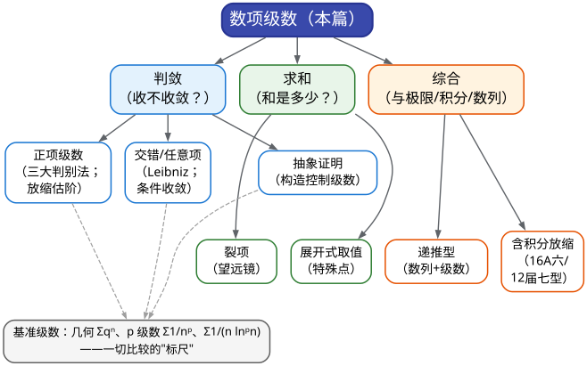

# CMC 手把手精讲
## ——《12 级数敛散性与求和》：判敛的标尺与求和的望远镜

> 🐱 喵～欢迎来到第 12 篇。01 篇你练熟了极限，05 篇打通了积分——这一篇，我们把两者**拧成一股绳**：级数题的每一步，要么在比"增长速度"（极限的手感），要么在"把无穷和折起来"（积分式的放缩）。写给一年没碰数学、要从零捡起的你：不预设记忆，一切从"为什么"讲起。
>
> **本篇在考试中的地位**（数据口径：第 1–17 届初赛，共 19 份卷含两场补赛，真题已逐题核对）：
> - 出现率约 **95%**：19 份卷里 **18 份**有级数题，唯一例外是第 9 届（2017）；
> - 形态高度固定：自第 10 届起，级数稳定是**一道 14 分的解答大题**，位置在卷末（倒数第一或第二题，压轴位）；另在填空位出现过 6 分小题（第 7、15 届）；
> - 分值占比 **14%～20%**（只算大题 14 分 = 14%；再配一道填空就是 20%）——它是全卷"最重、最可预测"的单一板块之一。00 总纲的**铁律四**说的就是它：**级数大题几乎每年在卷末等你**。
> - 00 总纲原话："第一问（判敛/求收敛域）通常不难，先把第一问的 7 分拿稳。"
>
> **大纲对应条目**（《全国大学生数学竞赛考试内容》非数学专业类·无穷级数部分原文摘录）：
> - 条目 8.1：常数项级数的收敛与发散、收敛级数的和、级数的基本性质与收敛的必要条件；
> - 条目 8.2：几何级数与 $`p`$ 级数及其收敛性、正项级数收敛性的判别法、交错级数与 Leibniz 判别法；
> - 条目 8.3：任意项级数的绝对收敛与条件收敛。
>
> （注：大纲条目 8.4–8.8——函数项级数收敛域、幂级数、傅里叶——全部归 13 篇《幂级数与傅里叶》处理，本篇只做"回指"；数学专业类大纲里的 Abel/Dirichlet 判别法、一致收敛、积分判别法的精细版本，**非数学类不要求**，看到直接跳过。）
>
> **先修提示**：本篇依赖两篇已学内容——① **01 篇**的"数列两把尺"（夹逼准则、单调有界准则）与递推数列三步走；② **05 篇**的积分技能（凑微分、分部积分、积分放缩）。这两块手感还在的话，本篇会非常顺；如果虚了，先回炉 01 篇 §3.5–3.6。
>
> **预计学时**：2–3 天（按每天 1–2 小时折算；对应 00 总纲的**第 4 周 D27–D28 + 第 5 周 D29**）。第一天：§二 + 真题精讲 1–3；第二天：§三 方法手册 + 精讲 4–7；第三天：精讲 8–10 + 易错点 + 自测题。
>
> 阅读建议：
> 1. 先花 3 分钟扫 §一的方法速查表——"什么题面→用什么武器"是考场上唯一来得及调用的大脑索引；
> 2. §二不要跳读：级数的定义你"记得"，但"部分和怎么折起来""放缩为什么合法"这些手感，正是竞赛要考的；
> 3. 所有标了 ✍️ 的地方，真的动笔；
> 4. 真题精讲里的"思路分析"比解答本身更值钱，先自己卡 1 分钟再看。
>
> 符号说明：📌 重点 | 💡 直觉/类比 | ⚠️ 易错点 | ✍️ 动笔练一练 | ❓ 自测题 | 🎯 考试定位 | ⏱️ 省时技巧

---

# 一、本篇地图

## 1.1 目录（读之前先看这张施工图）

- **§二 知识讲解**：级数是什么（部分和视角）→ 收敛的必要条件 → 基准级数（一切判敛的"标尺"）→ 三大判别法的生长史 → 放缩估阶的哲学 → 交错级数与条件收敛 → 求和的三条道路 → 递推型级数
- **§三 方法手册**：3.1 基准级数 + 极限比较判别法 | 3.2 比值/根值判别法 | 3.3 放缩估阶工具箱 | 3.4 Leibniz 与条件收敛三段式 | 3.5 裂项 + 部分和 | 3.6 展开式取值求和 | 3.7 递推型级数一条龙 | 3.8 抽象级数证明 | 3.9 考场流程与台阶分纪律
- **§四 真题精讲**：10 道真题完整精讲（17 届五、16 届六、15 届六、13 届六、12 届七、5 届三、4 届七、2 届四、10 届七、5 届七）
- **§五 易错点清单**：12 条 ❌→✅ 对照
- **§六 自测题**：8 道，附完整答案
- **§七 结语**："级数防身七句话" + 学习建议 + 13 篇预告

## 1.2 方法速查表：什么题面 → 用什么武器（一屏版）

| 题面长相（信号） | 首选武器 | 说明 / 升级路线 |
|---|---|---|
| 通项是 $`n`$ 的幂、指数、阶乘的有理组合（如 $`\frac{2^n n!}{n^n}`$） | **比值 / 根值判别法** | 自比探测"每步缩水率"；算出 $`\rho=1`$ 就立刻换武器 |
| 通项 $`\sim \frac{c}{n^p}`$ 或含 $`\ln n`$（$`\frac{c}{n(\ln n)^p}`$） | **基准级数 + 极限比较** | 先估阶：把通项写成"常数 × 基准量" |
| 通项含**积分、递推式、连乘、取整、绝对值** | **放缩估阶**（夹逼 + 基准级数） | 先控制到 $`\lvert a_n\rvert\le \frac{C}{n^p}`$ 或 $`\le q^n`$，再比 |
| 通项含 $`(-1)^n`$，问"条件收敛" | **Leibniz + 绝对值发散** | 三段式：单调递减、趋于 0、去掉符号后发散 |
| 含参数 $`\alpha`$，问"何时收敛/发散" | **分情形 + 基准级数比较** | 2 届四型：$`S_n^{\alpha}`$ 一出现就当 $`\alpha=1`$ 是分界 |
| "若 $`\sum a_n`$ 收敛，证明 $`\sum(\cdots)`$ 收敛"（抽象） | **构造控制级数 / 分部求和** | 4 届七、10 届七型：把陌生量归约到已知量 |
| 求 $`\sum`$ 的和，通项是 $`\frac{1}{n(n+k)}`$、$`\frac{k}{(k+1)!}`$ 型 | **裂项 + 部分和**（望远镜） | 写成 $`b_n-b_{n+1}`$，$`S_N`$ 中间项全部相消 |
| 求 $`\sum`$ 的和，通项含 $`n!`$、$`2^n`$、$`\frac{(-1)^{n-1}}{n}`$ | **展开式在特殊点取值** | 常见点 $`x=\frac12,-\frac12,1,-1`$；细节回指 13 篇 |
| 递推数列 + "证明 $`\sum`$ 收敛并求和" | **先证 $`x_n\downarrow 0`$ + 凑裂项恒等式** | 15A 六、13 届六型；恒等式可直接验证 |
| 级数与积分综合（含 $`\int`$ 的通项、估值型） | **积分放缩 / 分部积分造递推** | 单调函数夹逼：$`\int_n^{n+1}f\le f(n)\le\int_{n-1}^{n}f`$ |
| 通项里出现 $`\frac{1}{n2^n}`$、$`\frac{(-1)^{n-1}}{2n-1}`$ 这类"眼熟"的块 | 直接搬**已知展开值**（$`\ln 2`$、$`\frac{\pi}{4}`$） | 见 §3.6 的"特殊点取值表" |
| 幂级数收敛域/和函数（含 $`x`$ 的级数） | **归 13 篇**（本篇只到"数项"为止） | 15A 填 4、7 届四都是 13 篇的主场 |

## 1.3 知识树：本篇全部内容的骨架



一句话总结这张图：**判敛 = 拿"标尺"量通项（量不动就先放缩估阶）；求和 = 把无穷和"折起来"（裂项相消，或搬到已知展开式上）；综合题 = 前两招 × 极限/积分的接力。**

🎯 **本篇章法预告**：10 道真题精讲里，判敛/证明类 6 道（17A 五、16A 六、5 届三、4 届七、2 届四、10 届七，主打"找到标尺"）、求和/综合类 4 道（15A 六、13 届六、12 届七、5 届七，主打"把和折起来"）。你会发现压轴题永远是"两步走"：**第一步找标尺（判敛/控制），第二步折起来（求和/估计）**——这就是命题组留给你的台阶分结构。

---

# 二、知识讲解：级数是怎么"长"出来的

## 2.1 级数是什么：一个"加不完的加法"

先回忆一个你从小就会、但从未想清楚的问题：

```math
1+\frac{1}{2}+\frac{1}{4}+\frac{1}{8}+\cdots=?
```

你脱口而出"等于 2"。好，可"**无穷多项相加**"这件事本身是没有任何直接定义的——加法只对有限个数有定义。数学家是怎么绕过这个困难的？只有一招，而且这一招你天天在用：

> 先加前 $`N`$ 项，得到一个普通的数 $`S_N`$，再让 $`N\to\infty`$ 看 $`S_N`$ 的极限。

```math
S_N=\frac{1-\left(\frac{1}{2}\right)^N}{1-\frac{1}{2}}=2\left(1-\frac{1}{2^N}\right)\longrightarrow 2.
```

于是我们**定义**：无穷级数 $`\sum_{n=1}^{\infty}a_n`$ 收敛，就是说它的**部分和数列** $`\{S_N\}`$（$`S_N=a_1+a_2+\cdots+a_N`$）收敛；此时称极限值为级数的**和**。

💡 **打比方（写给会写代码的你）**：级数就像一个**累加器循环**：

```
S = 0
for n = 1, 2, 3, ...:   S = S + a[n]
```

"级数收敛"说的不是"这个循环跑完了"（它永远跑不完），而是"这个迭代过程**有归宿**"——$`S_N`$ 的取值安定到某个数附近。判断一个循环会不会安定，你靠的从来不是真的跑无穷多轮，而是看**通项 $`a_n`$ 的结构**。整篇级数理论，本质上就是"不看过程看结构"的技术。

📌 **从定义直接长出来的三条基本性质**（大纲 8.1，大题里随手要用）：
1. **线性**：$`\sum(a_n\pm b_n)=\sum a_n\pm\sum b_n`$（两边都收敛时成立）；$`\sum ca_n=c\sum a_n`$。
2. **有限项无关**：级数的敛散性与**前有限项**无关（只影响和的值）——所以"判断尾部"永远合法（14 届六就考"构造更慢收敛的级数"）。
3. **收敛的必要条件**：若 $`\sum a_n`$ 收敛，则 $`a_n\to 0`$。

还有一个"备用武器"**Cauchy 准则**（知道它管什么就行）：$`\sum a_n`$ 收敛 $`\iff`$ 对任意 $`\varepsilon>0`$，都存在 $`N`$，使得任意一段"尾巴"的和满足 $`\bigl|\sum_{k=n+1}^{n+p}a_k\bigr|<\varepsilon`$。它在竞赛里的拿手好戏是**证发散**：只要找到一段尾巴、其和的绝对值恒 $`\ge`$ 某个正数，就发散（第 2 届四(2) 官方解答的最后一枪就是它）。

## 2.2 收敛的"入场券"：$`a_n\to 0`$ 为什么不够

必要条件最大的用途是**快速证发散**：若 $`a_n\not\to 0`$，立刻发散（比如 $`\sum (-1)^n`$、$`\sum\frac{n}{2n+1}`$、$`\sum\left(1+\frac{1}{n}\right)^n`$）。但反过来**远不成立**——最著名的反例就是**调和级数**：

```math
\sum_{n=1}^{\infty}\frac{1}{n}=1+\frac{1}{2}+\frac{1}{3}+\frac{1}{4}+\cdots=+\infty.
```

怎么看出它发散的？**分组放缩**（这个动作请刻进肌肉记忆，后面 16 届六、5 届一(2) 都在用它）：

```math
S_{2^m}=1+\frac{1}{2}+\Bigl(\frac{1}{3}+\frac{1}{4}\Bigr)+\Bigl(\frac{1}{5}+\cdots+\frac{1}{8}\Bigr)+\cdots+\Bigl(\frac{1}{2^{m-1}+1}+\cdots+\frac{1}{2^{m}}\Bigr).
```

从第 3 项起，每一组有 $`2^{k-1}`$ 项、每项都不小于该组最后一项 $`\frac{1}{2^k}`$，所以每组之和 $`\ge \frac{1}{2}`$：

```math
S_{2^m}\ \ge\ 1+\underbrace{\frac{1}{2}+\frac{1}{2}+\cdots+\frac{1}{2}}_{m\ \text{个}}\ =\ 1+\frac{m}{2}\ \longrightarrow\ +\infty.
```

💡 **直觉校准**：$`a_n\to 0`$ 只是"入场券"（步伐越来越小），完全不保证"走得完"（调和级数的步伐足够小，但**小得太慢**）。级数判敛的全部技术，就是分辨"小得够不够快"。

## 2.3 基准级数：一切判敛的"标尺"

既然要分辨"快慢"，就得先有**刻度**。级数板块的刻度只有三把，背熟它们比背任何判别法都重要：

📌 **基准级数（标尺）三件套**：

| 标尺 | 级数 | 收敛条件 | 和 / 说明 |
|---|---|---|---|
| ① 几何级数 | $`\sum\limits_{n=0}^{\infty}q^n`$ | $`\lvert q\rvert<1`$ | 和 $`=\dfrac{1}{1-q}`$；$`q`$ 就是"每项缩水率" |
| ② $`p`$ 级数 | $`\sum\limits_{n=1}^{\infty}\dfrac{1}{n^p}`$ | $`p>1`$ | $`p\le 1`$ 发散（$`p=1`$ 即调和级数） |
| ③ 对数标尺 | $`\sum\limits_{n=2}^{\infty}\dfrac{1}{n(\ln n)^p}`$ | $`p>1`$ | $`p=1`$ 发散——**别与 ② 混淆** |

它们为什么正好是"标尺"？因为**收敛与发散的分界线恰好落在它们身上**：几何级数管"指数级缩水"的世界，$`p`$ 级数管"多项式级缩水"的世界，而对数标尺管"介于两者之间"的世界。

<strong>&ZeroWidthSpace;$`p`$ 级数的分界怎么来的？</strong>一行积分放缩就够了。设 $`f`$ 单调递减、非负，则

```math
\int_n^{n+1}f(x)\,\mathrm{d}x\ \le\ f(n)\ \le\ \int_{n-1}^{n}f(x)\,\mathrm{d}x.
```

（左半：$`f`$ 在第 $`n`$ 段的最小值是 $`f(n+1)`$、最大值是 $`f(n)`$；右半同款。这就是 16 届六官方解答第一步用的不等式——**积分是级数的连续化，级数是积分的离散化**。）取 $`f(x)=\frac{1}{x^p}`$：$`p>1`$ 时

```math
\sum_{n=1}^{N}\frac{1}{n^p}\ \le\ 1+\int_1^{N}\frac{\mathrm{d}x}{x^p}\ =\ 1+\frac{1}{p-1}\Bigl(1-\frac{1}{N^{p-1}}\Bigr)\ <\ \frac{p}{p-1},
```

部分和有界故收敛；$`p\le 1`$ 时反向

```math
\sum_{n=1}^{N}\frac{1}{n^p}\ \ge\ \int_1^{N+1}\frac{\mathrm{d}x}{x^p}\ \longrightarrow\ +\infty\quad(p\le 1),
```

发散。第三把标尺同理：换元 $`u=\ln x`$ 把 $`\int\frac{\mathrm{d}x}{x\ln^p x}`$ 化为 $`\int u^{-p}\,\mathrm{d}u`$——所以依然是"$`p>1`$ 收敛、$`p\le 1`$ 发散"，与 $`p`$ 级数是同一套剧本。

⚠️ 三把标尺**错的频率极高**的两个点：$`\sum\frac{1}{n}`$ 发散（不是"看起来收敛"）；$`\sum\frac{1}{n\ln^2 n}`$ 收敛而 $`\sum\frac{1}{n\ln n}`$ 发散（对数的幂指数 $`p`$ 与 $`p`$ 级数的 $`p`$ **同一判据、不同标尺**）。

## 2.4 三大判别法的生长史

现在进入正题：拿到一个正项级数 $`\sum a_n`$，怎么判它落在标尺的哪一侧？教材给了三大判别法——不是三个孤立的"公式"，而是同一个念头（**找熟人**）的三级进化。

### （1）比较判别法：直接找熟人

**核心念头**：如果通项 $`a_n`$ 和某个基准级数的通项 $`b_n`$"同阶"（比值趋向正常数），那么它们的待遇（敛散性）完全一样。极限形式最好用：

> 设 $`a_n,b_n>0`$，$`\lim\limits_{n\to\infty}\dfrac{a_n}{b_n}=c`$。
> - 若 $`0<c<+\infty`$：两级数**同敛散**；
> - 若 $`c=0`$：$`a_n`$ 是"小字辈"——$`\sum b_n`$ 收敛则 $`\sum a_n`$ 收敛；
> - 若 $`c=+\infty`$：$`a_n`$ 是"大字辈"——$`\sum b_n`$ 发散则 $`\sum a_n`$ 发散。

它其实是"**估阶**"的书面形式：$`\lim\frac{a_n}{b_n}=c>0`$ 就是在说 $`a_n\sim cb_n`$——"$`a_n`$ 大约是基准量的 $`c`$ 倍"。所以用它之前要先**目测通项的量级**：看到 $`\frac{3n+1}{n^3+2}`$ 要能秒答"$`\sim\frac{3}{n^2}`$，收敛"。

### （2）比值判别法：跟"昨天的自己"比

问题来了：通项里如果带着 $`n!`$、$`a^n`$ 这种"增长性"极强的因子，往往找不到能直接比较的熟人（$`n!`$ 和任何 $`n^p`$、$`q^n`$ 都不同阶）。这时候换个思路——**自己跟自己比**：

> 设 $`a_n>0`$，$`\lim\limits_{n\to\infty}\dfrac{a_{n+1}}{a_n}=\rho`$，则 $`\rho<1`$ 时收敛，$`\rho>1`$ 时发散，$`\rho=1`$ 时**失效**。

为什么 $`\rho<1`$ 就收敛？**因为它被几何级数控制了**：取 $`q`$ 满足 $`\rho<q<1`$，则从某项起 $`a_{n+1}\le q a_n`$，一路串下去 $`a_n\le C q^{n}`$——通项被"缩水率固定为 $`q`$ 的几何级数"压住，这就回到第一把标尺 $`\sum q^n`$。（$`\rho>1`$ 时 $`a_n`$ 递增、不可能趋于 0，必发散。）

**微型示例**：$`\sum\limits_{n=1}^{\infty}\dfrac{2^n n!}{n^n}`$。

```math
\frac{a_{n+1}}{a_n}=2\cdot\frac{n^n}{(n+1)^n}=2\Bigl(\frac{n}{n+1}\Bigr)^n\longrightarrow\frac{2}{e}<1\ \Rightarrow\ \text{收敛}.
```

（这里用了 01 篇的老朋友 $`\bigl(1+\frac{1}{n}\bigr)^n\to e`$。注意答案 $`2/e\approx 0.736`$ 只比 1 小一点——**能算，但绝不是"一眼看穿"**，这就是比值法的价值。）

### （3）根值判别法：探测"平均缩水率"

另一个自然想法：不看相邻两项，看"第 $`n`$ 项的 $`n`$ 次方根"——它测的是**前 $`n`$ 项的几何平均缩水率**：

> 设 $`a_n>0`$，$`\lim\limits_{n\to\infty}\sqrt[n]{a_n}=\rho`$，结论与比值法完全相同（$`\rho<1`$ 收敛、$`\rho>1`$ 发散、$`\rho=1`$ 失效）。

它对"整体幂结构"的通项最灵：$`\sum\left(\frac{n}{2n+1}\right)^n`$ 直接开方得 $`\frac{n}{2n+1}\to\frac{1}{2}<1`$，收敛。对连乘积也常用（17 届五就是这么把 $`\left(\frac{3\sqrt{3}}{8}\right)^n`$ 转成 $`\left(\frac{3}{4}\right)^n`$ 的——见精讲 1）。

### （4）为什么 $`\rho=1`$ 时双双"失效"？

这是命题人最爱设的陷阱，必须从根上理解。拿两个级数试：

```math
\sum\frac{1}{n}:\quad \frac{a_{n+1}}{a_n}=\frac{n}{n+1}\to 1,\quad \sqrt[n]{a_n}=\frac{1}{\sqrt[n]{n}}\to 1;\qquad \sum\frac{1}{n^2}:\quad \frac{a_{n+1}}{a_n}=\Bigl(\frac{n}{n+1}\Bigr)^2\to 1,\quad \sqrt[n]{a_n}\to 1.
```

一个发散、一个收敛，可是两个判别法给出的都是 $`\rho=1`$！原因：$`\rho`$ 测的是"**缩水率的极限**"，而 $`\frac{1}{n}`$ 与 $`\frac{1}{n^2}`$ 的缩水率**都趋向 1**——临界地带，一阶信息（相邻比 / 平均比）分不出胜负，必须去看**更高阶的信息**：$`\sum\frac{1}{n^p}`$ 的胜负由 $`p`$ 与 1 的大小决定，而 $`p`$ 是"隐藏的指数"——于是我们**换回比较判别法/积分估计**（它们直接度量"通项与 $`n^{-1}`$ 的幂差"）。

💡 **计算机类比**：比值/根值法像判断一个递推式收敛的**收缩系数**。收缩系数 $`<1`$ 稳稳收敛；系数恰好 $`=1`$（临界情况）时，一次项分析失效，要看二阶项——正如比较 $`n\log n`$ 与 $`n^{1.001}`$ 的关系，必须展开到更细的尺度。**"失效"≠"没办法"，只是这个工具的词表里没有"临界"这个词。**

🎯 **考试定位**：三大判别法在近 10 届真题里很少**单独**作为答案出现（更多是第一步的预处理），但它们决定了你能否在 30 秒内"猜中"通项的阶——这是所有放缩的起点。**押注优先级**：比较/比较极限 > 比值 > 根值。

## 2.5 放缩估阶：本板块最高频的硬功夫

第 17 届五、16 届六、14 届六、14 届补六、10 届七、5 届三……历年压轴级数题，**一半以上的第一步都是"找到一个可比的量"**。为什么？因为命题人总爱把通项伪装起来：塞进积分里、藏进递推式、混进连乘积、加上取整函数。这时候"直接比较"无从下手，唯一的出路是——**放缩**：先用不等式把 $`a_n`$ 夹在"好量"与"好量"之间，再用基准级数收官。

先立一条**方向纪律**（违反它 = 全题报废）：

- **证收敛**：要找到 $`\lvert a_n\rvert\le b_n`$，其中 $`\sum b_n`$ **收敛**（往大放，放到能收敛为止）；
- **证发散**：要找到 $`a_n\ge b_n`$，其中 $`\sum b_n`$ **发散**（往小缩，缩到还能发散为止）。

📌 **放缩工具箱（按使用频率排序，考场常客）**：

| # | 工具 | 长相 | 真题出处 |
|---|---|---|---|
| 1 | **积分放缩** | $`f\downarrow`$ 时 $`\int_n^{n+1}f\le f(n)\le\int_{n-1}^{n}f`$ | 16 届六（$`\frac{1}{n^2+k^2}`$ 夹到 $`\arctan`$）、5 届七（$`H_n<1+\ln n`$） |
| 2 | **均值不等式/几何平均** | $`\sqrt[k]{x_1\cdots x_k}\le\frac{x_1+\cdots+x_k}{k}`$，即 $`k\sqrt[k]{x_1\cdots x_k}\le x_1+\cdots+x_k`$ | 10 届七（把 $`k\sqrt[k]{\cdots}`$ 压到 $`S_k`$） |
| 3 | **Taylor 定阶** | $`\lim\limits_{x\to 0}\frac{f(x)}{x^2}=\frac{f''(0)}{2}`$（先证 $`f(0)=f'(0)=0`$） | 5 届三（$`\lvert f(\frac{1}{n})\rvert\le\frac{C}{n^2}`$ 的来源） |
| 4 | **化为几何级数** | 找到 $`\lvert f\rvert\le\frac{3\sqrt{3}}{8}`$ 后**开方**（$`\left(\frac{3\sqrt{3}}{8}\right)^{2/3}=\frac{3}{4}`$）得到缩水率 $`q`$ | 17 届五（本技巧的登峰之作） |
| 5 | **不等式链** | $`x-\frac{x^2}{2}\le\ln(1+x)\le x`$；$`\sin x\le x`$；$`1-\cos x\le\frac{x^2}{2}`$；$`\lvert\sin\Box\rvert\le 1`$ | 14 届二次补赛六、5 届七、自测题常客 |

💡 **计算机类比**：放缩就是给通项**做渐近分析**。你不需要精确知道 $`a_n`$ 等于多少（那不可能），只需要一个"复杂度上界"：$`a_n=O(n^{-2})`$ 或 $`a_n=O(q^n)`$（$`q<1`$）——前者搭 $`p`$ 级数的车、后者搭几何级数的车，立刻到站。"**放缩的方向感 = 你想要的终点站**"：想上 $`p`$ 级数（$`p>1`$）的车，就把通项往上界压到 $`O(n^{-1-\varepsilon})`$。

⚠️ **放缩要"刚刚好"，不能凭感觉乱放**。两个真实教训：17 届五里 $`\lvert f\rvert\le\frac{3\sqrt{3}}{8}`$ 得到的是 $`\frac{3\sqrt{3}}{8}\approx 0.65<1`$——看着像几何级数了，但**直接对 $`a_n`$ 用这个界放的是 $`a_n\le\frac{3\sqrt{3}}{8}`$，这不是缩水**（右边是常数，不是 $`q^n`$）！官方解答的解法是搭一座桥：对 $`\frac 32`$ 次方后的量用界，得到 $`\left(\frac{3\sqrt{3}}{8}\right)^n`$，再开 $`\frac 32`$ 次方回收。**"放"的中间环节可以迂回，终点必须是能收敛的标尺**。另一个教训是 5 届七：$`H_n<1+\ln n`$ 还不够，要再放一步到 $`<\sqrt{n}`$ 才能与 $`\sum\frac{1}{n^{3/2}}`$ 对接——**放完一次要检查：能不能接上标尺？接不上就继续放。**

## 2.6 交错级数与条件收敛

通项带 $`(-1)^{n-1}`$ 的级数叫**交错级数**。正负相间带来了一个免费的礼物——**抵消**：

```math
S_N=u_1-u_2+u_3-u_4+\cdots.
```

**Leibniz 判别法**：若 $`u_n`$ **单调递减**且 $`u_n\to 0`$，则 $`\sum(-1)^{n-1}u_n`$ 收敛。

💡 **直觉**：部分和像一个"衰减的钟摆"——向右走过 $`u_1`$，向左回 $`u_2`$，再向右走 $`u_3`$……每段行程都更短，钟摆必然安定到某个位置。而且还能顺手得到**余项估计**：$`\lvert R_N\rvert\le u_{N+1}`$（后面的行程总长度不超过下一段）。

由此得到级数世界最重要的一个"二分法"：

📌 **绝对收敛 vs 条件收敛**：
- $`\sum\lvert a_n\rvert`$ 收敛 ⟹ $`\sum a_n`$ 收敛（绝对值更强），此时称**绝对收敛**；
- $`\sum a_n`$ 收敛但 $`\sum\lvert a_n\rvert`$ 发散，称**条件收敛**。

**条件收敛的样板**（必须背熟它的两个身份）：

```math
\sum_{n=1}^{\infty}\frac{(-1)^{n-1}}{n}=1-\frac{1}{2}+\frac{1}{3}-\frac{1}{4}+\cdots=\ln 2\quad(\text{收敛}),\qquad \sum_{n=1}^{\infty}\frac{1}{n}=+\infty\quad(\text{去绝对值后发散}).
```

⚠️ 用 Leibniz 时**单调性最容易被跳过**——真题评分里它常占 1–2 分。好消息是：竞赛题里的单调性通常"免费"——从积分式直接读（$`u_{n+1}=\int_0^1\frac{\mathrm{d}t}{(1+t^4)^{n+1}}\le\int_0^1\frac{\mathrm{d}t}{(1+t^4)^{n}}=u_n`$，见 12 届七）或从递推式直接读。**但你必须把这个不等式写出来**。

## 2.7 求数的和：三条道路

"求 $`\sum a_n`$ 的和"类题目，走法只有三条（外加它们的混合体）：

**道路一：裂项（望远镜）**——适用通项是"差分结构"时。若 $`a_n=b_n-b_{n+1}`$，则

```math
S_N=(b_1-b_2)+(b_2-b_3)+\cdots+(b_N-b_{N+1})=b_1-b_{N+1}\ \xrightarrow{N\to\infty}\ b_1-\lim b_{N+1}.
```

中间项全部"折叠"消失，只剩头尾——所以叫**望远镜（telescoping）**。常见零件：$`\frac{1}{n(n+1)}=\frac{1}{n}-\frac{1}{n+1}`$；$`\frac{k}{(k+1)!}=\frac{1}{k!}-\frac{1}{(k+1)!}`$；$`\frac{1}{n(n+2)}=\frac{1}{2}\bigl(\frac{1}{n}-\frac{1}{n+2}\bigr)`$。

**道路二：把数项级数认成"展开式在特殊点取值"**。比如看到 $`\sum\frac{1}{n2^n}`$，要瞬间想起

```math
\ln(1+x)=\sum_{n=1}^{\infty}\frac{(-1)^{n-1}}{n}x^n\quad\Rightarrow\quad x=-\frac{1}{2}\ \text{代入}:\ \sum_{n=1}^{\infty}\frac{1}{n2^n}=\ln 2.
```

常用"特殊点取值表"（提前背）：

```math
\sum_{n=0}^{\infty}\frac{1}{n!}=e;\qquad \sum_{n=1}^{\infty}\frac{1}{n2^n}=\ln 2;\qquad \sum_{n=1}^{\infty}\frac{(-1)^{n-1}}{n}=\ln 2;\qquad 1-\frac{1}{3}+\frac{1}{5}-\frac{1}{7}+\cdots=\frac{\pi}{4}.
```

**道路三：自己造幂级数**——把数项级数 $`\sum a_n`$ 看成 $`\sum a_n x^n`$ 在 $`x=x_0`$ 的取值，先求和函数再代入（这就是 13 篇的主战场，第 3 届一(4) 是标准件：先求 $`\sum\frac{2n-1}{2^n}x^{2n-2}`$ 的和函数，再代 $`x=\frac{1}{\sqrt{2}}`$ 得 $`\frac{10}{9}`$——细节回指 13 篇）。

🎯 三条道路里，**道路一（裂项）是 CMC 卷末题出现率最高的一条**：5 届七、6 届一(4)、12 届七(3)、13 届六、15 届六——五道真题全部靠它收尾。它没有公式可套，靠的是**对"差分结构"的眼力**。

## 2.8 递推型级数：判敛与求和"一条龙"

最后一类主角：题目给一个递推数列 $`x_{n+1}=f(x_n)`$，要求"证明 $`\sum x_n`$ 收敛并求和"（15 届六、13 届六都是这个形态）。套路是**三段流水线**：

1. **控制数列**：用 01 篇的"单调有界三步走"证明 $`x_n\downarrow 0`$，顺手拿一个**衰减速率**（如 $`x_{n+1}\le\frac{4}{9}x_n`$）——收敛性就此拿下；
2. **凑裂项恒等式**：找到"桥函数" $`g`$，使得

```math
x_n=g(x_n)-g(x_{n+1}),
```

于是 $`\sum x_n`$ 化为望远镜。两大流派：
- **直接验证型**（15 届六方法二）：$`x_n=\dfrac{x_n}{1-x_n}-\dfrac{x_{n+1}}{1-x_{n+1}}`$——不用解释怎么想到的，**代入递推式直接验证**即可（考场上推荐）；
- **反函数型**（15 届六方法一）：令 $`f(x)=\frac{x}{1+x}`$，反函数 $`f^{-1}(x)=\frac{x}{1-x}`$，则恰好 $`x_{n+1}=f\bigl(f^{-1}(x_n)-x_n\bigr)`$，故 $`x_n=f^{-1}(x_n)-f^{-1}(x_{n+1})`$——"桥"就是反函数；
3. **部分和取极限**：$`\sum_{i=0}^{\infty}x_i=g(x_0)-\lim g(x_{n+1})=g(x_0)-g(0)`$。

💡 **命题人是倒着出题的**：先想好一个漂亮的裂项恒等式（比如 $`x_n=\frac{x_n}{1-x_n}-\frac{x_{n+1}}{1-x_{n+1}}`$），再反解出递推式 $`x_{n+1}=\frac{x_n^2}{1-x_n+x_n^2}`$ 当题面。你的任务就是"把命题人的藏宝图找回来"——**验证恒等式永远是你的权利**。

**与 01 篇的分工**：12 届二、13 届二那种"只求极限"的递推题属于 01 篇；本篇的递推题是"**求极限 + 裂项求和**"的合体（13 届六除了裂项还加了"递推积"的处理）。这正是 00 总纲铁律五说的：一道题横跨两三个板块，训练时要习惯"接力"。

---

# 三、方法手册：九套武器，见招拆招

每个方法按统一格式展开：【适用信号】→【步骤】→【关键公式】→【真题微型例子】。再强调："**你缺的不是方法本身，而是什么时候用它**"。

## 3.1 基准级数 + 极限比较判别法

**【适用信号】** 通项能"估阶"成 $`\frac{c}{n^p}`$ 或 $`\frac{c}{n(\ln n)^p}`$ 的形状；含 $`\sin\frac{1}{n^\alpha}`$、$`\ln(1+\frac{1}{n^\alpha})`$、$`1-\cos\frac{1}{n^\alpha}`$ 这类"等价无穷小包裹"的通项。

**【步骤】**
1. **估阶**：用 01 篇的等价无穷小表把通项的主部"扒"出来（$`\sin\frac{1}{n^2}\sim\frac{1}{n^2}`$、$`\ln\left(1+\frac{1}{n^{3/2}}\right)\sim\frac{1}{n^{3/2}}`$）；
2. **选标尺**：主部形如 $`\frac{c}{n^p}`$ → 比 $`p`$ 级数；带对数 → 比第三把标尺或直接与 $`p`$ 级数"多要一档"（如 $`\sum\frac{1}{n\ln^2 n}`$ 比不了 $`p`$ 级数，直接积分判别）；
3. **写极限**：$`\lim\frac{a_n}{b_n}=c\in(0,\infty)`$ → 同敛散；写完收工。

**【关键公式】**

```math
\lim_{n\to\infty}\frac{a_n}{b_n}=c\ (0<c<+\infty)\ \Longrightarrow\ \sum a_n\ \text{与}\ \sum b_n\ \text{同敛散}.
```

**【真题微型例子】**（第 5 届非数学类·第三题，2013；官方解法的第一步）$`f`$ 在 $`x=0`$ 处二阶可导、$`\lim\limits_{x\to 0}\frac{f(x)}{x}=0`$，官方先算出

```math
\lim_{x\to 0}\frac{\lvert f(x)\rvert}{x^2}=\frac{1}{2}\lvert f''(0)\rvert\quad\Longrightarrow\quad \frac{\lvert f(\frac{1}{n})\rvert}{\frac{1}{n^2}}\to\frac{1}{2}\lvert f''(0)\rvert,
```

即 $`\lvert f(\frac{1}{n})\rvert`$ 与 $`\frac{C}{n^2}`$ 同阶——收敛性立刻搭上 $`p`$ 级数（完整精讲见第 6 题）。**这道题示范了"估阶"的全流程：先定阶、再比较。**

## 3.2 比值 / 根值判别法

**【适用信号】** 通项含 $`n!`$、$`a^n`$、$`n^n`$、连乘积、或整体 $`n`$ 次幂结构；题目只问"敛散"不要求值。

**【步骤】**
1. 写相邻比 $`\frac{a_{n+1}}{a_n}`$，约分到最简（阶乘、幂次全部对消），求极限；
2. 或对 $`a_n`$ 开 $`n`$ 次方求极限（幂结构、连乘结构优先）；
3. 判 $`\rho`$ 与 1 的大小；**算出 $`\rho=1`$ 不要恋战**，立即转 3.1/3.3。

**【关键公式与常备极限】**

```math
\lim_{n\to\infty}\Bigl(1+\frac{1}{n}\Bigr)^n=e,\qquad \lim_{n\to\infty}\sqrt[n]{n}=1,\qquad \sqrt[n]{n!}\ \text{与}\ n\ \text{同阶}\ \Bigl(\frac{\sqrt[n]{n!}}{n}\to\frac{1}{e}\Bigr).
```

**【真题微型例子】**（类型题·仿竞赛风格）：判 $`\sum\frac{n^n}{(2n)!}`$ 的敛散。写相邻比并逐块约分：

```math
\frac{a_{n+1}}{a_n}=\frac{(n+1)^{n+1}}{n^n}\cdot\frac{(2n)!}{(2n+2)!}=(n+1)\Bigl(1+\frac{1}{n}\Bigr)^n\cdot\frac{1}{(2n+1)(2n+2)}\sim\frac{n\cdot e}{4n^2}=\frac{e}{4n}\to 0<1,
```

故收敛。（**顺手牢记**：凡是 $`n!`$ 压过 $`a^n`$、$`n^n`$ 的世界里，比值法几乎永远一行结束——$`\rho=0`$ 就意味着"比几何级数收敛得还快"。）

## 3.3 放缩估阶工具箱（压轴题第一问的生产车间）

**【适用信号】** 通项含**积分**（$`\int_0^1\frac{\mathrm{d}t}{(1+t^4)^n}`$）、**递推式**、**连乘**（$`\sin^2x\sin^2 2x\cdots`$）、**取整**（$`(-1)^{[\sqrt{n}]}`$）、**绝对值**；题面说"证明收敛"而不要求值。

**【步骤】**
1. **侦察**：问自己两个问题——"这个量最大能有多大？""和哪个熟量最像？"；
2. **选工具**（对照 §2.5 工具箱表）：含积分 → 积分放缩/夹逼；含连乘 → 取最值 + 开方造几何级数；含递推 → 归纳 + 作商；含取整 → 分段（把不规则的台阶切成规则块）；
3. **接标尺**：把放缩结果写成 $`O(n^{-1-\varepsilon})`$ 或 $`O(q^n)`$ 或"与某个已知收敛级数同阶"的形式；
4. **写"由比较判别法"**（评分点）。

**【关键公式】** 五个放缩链（必背）：

```math
\int_n^{n+1}f\le f(n)\le\int_{n-1}^{n}f\quad(f\downarrow);\qquad \sqrt[k]{x_1\cdots x_k}\le\frac{x_1+\cdots+x_k}{k};
```

```math
x-\frac{x^2}{2}\le\ln(1+x)\le x\ (x>-1);\qquad \sin x\le x\ (x\ge0);\qquad 1-\cos x\le\frac{x^2}{2}.
```

**【真题微型例子】**（第 14 届非数学类·第六题，2022；构造型）设 $`\sum a_n`$ 为正项收敛级数，构造一个"收敛得更慢"的级数 $`\sum b_n`$（使 $`\lim\limits_{n\to\infty}\dfrac{a_n}{b_n}=0`$）。构造思想一句话：**给通项乘一个"随 $`n`$ 缓慢增长、但增长不足以破坏收敛"的因子 $`2^k`$**；关键在于**分块边界由"尾和"动态选定**——对 $`k=1,2,\cdots`$，先取 $`n_k`$ 使

```math
\sum_{l=n_k}^{\infty}a_l<\frac{1}{3^k}\qquad(n_1<n_2<\cdots),
```

（收敛级数的尾和趋于 0，这样的 $`n_k`$ 一定存在）；再令

```math
b_n=a_n\quad(1\le n<n_1),\qquad b_n=2^k a_n\quad(n_k\le n<n_{k+1}).
```

此时块和按 $`3^{-k}`$ 几何衰减、乘上 $`2^k`$ 后仍按 $`\left(\frac23\right)^k`$ 收敛：

```math
\sum_{n=1}^{\infty}b_n\ \le\ \sum_{n=1}^{n_1-1}a_n+\sum_{k=1}^{\infty}2^k\cdot\frac{1}{3^k}\ <\ +\infty,
```

而 $`\dfrac{a_n}{b_n}=2^{-k}\to 0`$——**收敛更慢的级数造好了**。这类题的通用心法：**把 $`n`$ 轴分块、块内"乘因子摊平"，且分块时机由尾和把控**——与调和级数分组放缩同一个分区思想。⚠️ **反面教材**：若图省事改成"固定按 $`2^{k-1}\le n<2^k`$ 分块"，收敛性会**失效**——例如 $`a_n=\dfrac{1}{n\ln^2 n}`$（正项收敛）时块和 $`A_k\approx\dfrac{1}{\ln2\cdot k(k-1)}`$，于是 $`\sum_k 2^kA_k\approx\sum_k\dfrac{2^k}{\ln2\cdot k^2}=+\infty`$。**"块和衰减得比 $`2^{-k}`$ 快"是被设计出来的，不是天上掉的。**

（本方法完整实战：精讲 1（连乘取最值）、精讲 2（积分夹逼）、精讲 6（Taylor 定阶）——三道题分别是工具箱的第 4、1、3 号工具。）

## 3.4 Leibniz 与条件收敛三段式

**【适用信号】** 通项含 $`(-1)^n`$ 或 $`(-1)^{n-1}`$；题面出现"条件收敛"三个字；或大题的第二问接力第一问的递推估计。

**【步骤（固定三段 + 收尾句）】**
1. **单调递减**：从积分式或递推式**读出**不等式（$`0<u_{n+1}\le u_n`$）——不要试图求导验证，直接引用结构；
2. **趋于 0**：可由第 1 步 + 收敛性推出，或直接计算 $`\lim u_n=0`$；
3. **去符号证发散**：对 $`\sum u_n`$ 找下界（放大到 $`\frac{C}{n}`$ 型或直接算出与调和级数同阶）；
4. **收尾句**："由 Leibniz 判别法，原级数收敛；又去绝对值后发散，故条件收敛。"——这句话本身就是分。

**【关键公式】** 余项估计 $`\lvert R_N\rvert\le u_{N+1}`$；样板 $`\sum_{n=1}^{\infty}\frac{(-1)^{n-1}}{n}=\ln 2`$。

**【真题微型例子】**（第 12 届非数学类·第七题(2)，2020；骨架）证 $`\sum(-1)^nu_n`$ 条件收敛，其中 $`u_n=\int_0^1\frac{\mathrm{d}t}{(1+t^4)^n}`$。
- 单调性（免费）：$`0<u_{n+1}=\int_0^1\frac{\mathrm{d}t}{(1+t^4)^{n+1}}\le\int_0^1\frac{\mathrm{d}t}{(1+t^4)^n}=u_n`$；
- 趋于 0：由 (1) 问已证 $`\lim u_n=0`$，Leibniz 给出收敛；
- **发散的关键一放**（方向别搞反）：证发散要把通项往**小**估计——即把分母放**大**。在 $`[0,1]`$ 上 $`t^4\le t`$，故 $`1+t^4\le 1+t`$，从而 $`\frac{1}{(1+t^4)^n}\ge\frac{1}{(1+t)^n}`$，于是

```math
u_n\ \ge\ \int_0^1\frac{\mathrm{d}t}{(1+t)^n}=\frac{1}{n-1}\bigl(1-2^{1-n}\bigr)\ \ge\ \frac{1}{2(n-1)}\quad(n\ \text{充分大}),
```

与调和级数同阶 ⟹ $`\sum u_n`$ 发散。**首尾两句就是完整的条件收敛证明。**

（完整精讲见第 5 题。方向纪律再念一遍：**证发散要把通项往小估计**——这里把被积函数换成更小的 $`\frac{1}{(1+t)^n}`$，恰好是"缩到还能发散"的标准动作。）

## 3.5 裂项 + 部分和（求和第一利器）

**【适用信号】** 通项形如 $`\frac{1}{n(n+k)}`$、$`\frac{1}{\sqrt{n}+\sqrt{n+1}}`$、连乘积的倒数、含递推积的倒数；题面要求"求和"。

**【步骤】**
1. **拆**：把通项写成 $`b_n-b_{n+1}`$（先猜 $`b_n`$ 的长相，再验证）；
2. **折**：$`S_N=b_1-b_{N+1}`$（中间项自动相消）；
3. **取极限**：$`\sum=b_1-\lim\limits_{N\to\infty}b_{N+1}`$。若 $`b_{N+1}`$ 的极限不是 0，先单独交代它的收敛性（13 届六里 $`\frac{b_n}{a_1\cdots a_n}\to 0`$ 就是为这一步服务的）。

**【关键变形表】**

```math
\frac{1}{n(n+1)}=\frac{1}{n}-\frac{1}{n+1};\qquad \frac{k}{(k+1)!}=\frac{1}{k!}-\frac{1}{(k+1)!};\qquad \frac{1}{n(n+2)}=\frac{1}{2}\Bigl(\frac{1}{n}-\frac{1}{n+2}\Bigr);
```

```math
\frac{1}{\sqrt{n}+\sqrt{n+1}}=\sqrt{n+1}-\sqrt{n};\qquad \arctan\frac{1}{n^2+n+1}=\arctan(n+1)-\arctan n.
```

**【真题微型例子】**（第 6 届非数学类·填空第 4 题，2014）设 $`x_n=\sum_{k=1}^{n}\frac{k}{(k+1)!}`$，求 $`\lim\limits_{n\to\infty}x_n`$。

先裂项再折叠：$`\frac{k}{(k+1)!}=\frac{k+1-1}{(k+1)!}=\frac{1}{k!}-\frac{1}{(k+1)!}`$，故

```math
x_n=\Bigl(\frac{1}{1!}-\frac{1}{2!}\Bigr)+\Bigl(\frac{1}{2!}-\frac{1}{3!}\Bigr)+\cdots+\Bigl(\frac{1}{n!}-\frac{1}{(n+1)!}\Bigr)=1-\frac{1}{(n+1)!}\ \longrightarrow\ 1.
```

（答案 1。这道 6 分填空题 60 秒应拿下；它 2024 年换了个面孔又出现在 16 届卷上——"老题改头换面"的铁律六。第 13 届补赛一(4) 的 arctan 差角裂项也是同一台望远镜，见练习册 A4。）

## 3.6 展开式取值求和

**【适用信号】** 通项含 $`n!`$、$`2^n`$、$`\frac{(-1)^{n-1}}{n}`$ 等"眼熟"因子，直接裂项不成；或要求把和写成"含 $`\ln`$、$`\pi`$ 的封闭值"。

**【步骤】**
1. **认脸**：把通项和"五个基本展开式"对照（$`e^x`$、$`\sin x`$、$`\cos x`$、$`\ln(1+x)`$、$`\frac{1}{1-x}`$）；
2. **对点**：找特殊点使展式右边长得最像待求和式（常用 $`x=\pm 1,\ \pm\frac{1}{2},\ \frac{1}{3}`$）；
3. **必要时先变形**：比如要把 $`\sum\frac{1}{n2^n}`$ 认出来，就用 $`\ln(1+x)`$ 在 $`x=-\frac{1}{2}`$ 取值；要凑 $`\sum\frac{1}{(2n+1)2^n}`$ 型，往往要回 13 篇把幂级数求和函数的手艺抬出来。

**【关键公式（特殊点取值卡）】**

```math
e=\sum_{n=0}^{\infty}\frac{1}{n!};\qquad \ln 2=\sum_{n=1}^{\infty}\frac{1}{n2^n};\qquad \ln 2=\sum_{n=1}^{\infty}\frac{(-1)^{n-1}}{n};\qquad \frac{\pi}{4}=\sum_{n=1}^{\infty}\frac{(-1)^{n-1}}{2n-1}.
```

**【真题微型例子】**（第 12 届非数学类·第七题(3)，2020；官方解答关键一步）求 $`\sum\frac{u_n}{n}`$ 时，官方先把分部积分恒等式 $`u_n=\frac{1}{2^n}+4n(u_n-u_{n+1})`$ 两边除以 $`n`$ 求和：

```math
\sum_{n=1}^{\infty}\frac{u_n}{n}=\sum_{n=1}^{\infty}\frac{1}{n2^n}+4\sum_{n=1}^{\infty}(u_n-u_{n+1})=\ln 2+4u_1.
```

**整个压轴题的最后一步，就是把 $`\sum\frac{1}{n2^n}`$ 一眼认成 $`\ln 2`$。** 若没有这张"取值卡"，这道 14 分题就断在这里了。（$`\ln(1+x)=\sum\frac{(-1)^{n-1}}{n}x^n`$ 中取 $`x=-\frac{1}{2}`$ 即得。）

## 3.7 递推型级数（判敛 + 求和一条龙）

**【适用信号】** 给 $`x_{n+1}=f(x_n)`$，或给 $`a_n,b_n`$ 的递推关系；题面"证明级数 $`\sum\cdots`$ 收敛，并求其和"。

**【步骤】**
1. **控制**：归纳法证同号 → 作差/作商证单调 → 得 $`x_n\downarrow 0`$（或 $`x_n\le q^n`$ 型速率）；
2. **凑桥**：找一个 $`g`$ 使 $`x_n=g(x_n)-g(x_{n+1})`$——**考场推荐路线：直接代入验证**（反函数法可以帮你理解"桥"的来历，但考场上直接验证最快）；
3. **折叠取极限**：$`\sum_{i=0}^{n}x_i=g(x_0)-g(x_{n+1})\to g(x_0)-g(0)`$。

**【关键公式/技巧】** 直接验证恒等式的样本（15 届六）：$`x_n=\dfrac{x_n}{1-x_n}-\dfrac{x_{n+1}}{1-x_{n+1}}`$；递推积型（13 届六）：先反解 $`a_n`$ 成乘积式，再证"辅助比 $`\frac{b_n}{a_1\cdots a_n}\to 0`$"，然后裂项 $`\frac{1}{a_1\cdots a_k}=\frac{1}{2}\Bigl(\frac{b_{k-1}}{a_1\cdots a_{k-1}}-\frac{b_k}{a_1\cdots a_k}\Bigr)`$。

**【真题微型例子】**（第 15 届非数学 A 类·第六题，2023；骨架）$`x_0=\frac{1}{3}`$，$`x_{n+1}=\frac{x_n^2}{1-x_n+x_n^2}`$，求 $`\sum x_n`$。官方方法二的两行：

```math
x_n=\frac{x_n}{1-x_n}-\frac{x_{n+1}}{1-x_{n+1}}\ \Longrightarrow\ \sum_{i=0}^{n}x_i=\frac{x_0}{1-x_0}-\frac{x_{n+1}}{1-x_{n+1}}\ \xrightarrow{n\to\infty}\ \frac{1/3}{2/3}=\frac{1}{2}.
```

（完整精讲见第 3 题。这类题的层次感：**证收敛 6 分、裂项求和 8 分**——两段之间几乎没有技术依赖，先拿稳第一段。）

## 3.8 抽象级数证明（"若 $`\sum a_n`$ 收敛，则 $`\sum(\cdots)`$ 收敛"）

**【适用信号】** 题面没有具体通项，只有抽象条件（$`a_n>0`$、$`\sum a_n`$ 收敛、$`\{b_n\}`$ 有界或单调），要求证明另一个级数收敛/发散。早期卷里它出现 3 次（第 2 届四、第 4 届七、第 10 届七），是级数板块的"证明天花板"。

**【三条主思路】**
1. **构造控制**：把要证收敛的量"压"到一个已知收敛的量上——常用 AM-GM、$`ab\le\frac{a^2+b^2}{2}`$、$`\sqrt{xy}\le\frac{x+y}{2}`$（10 届七）；
2. **分部求和（Abel 型差分）**：把 $`\sum`$ 变形为"差分的和"或"部分和×差分"的和，让望远镜结构浮现——4 届七、2 届四都是这个流派；
3. **证发散**：要么找 $`\ge`$ 已知发散量（2 届四的最后一段），要么用 Cauchy 段和估计（找到恒 $`\ge\frac{1}{2}`$ 的一段尾巴）。

**【关键公式（Abel 分部求和的记账式）】** 记 $`S_k=\sum_{i=1}^{k}a_ib_i`$，则

```math
\sum_{k=1}^{N}a_k=\sum_{k=1}^{N}\frac{S_k-S_{k-1}}{b_k}=\sum_{k=1}^{N-1}\Bigl(\frac{1}{b_k}-\frac{1}{b_{k+1}}\Bigr)S_k+\frac{S_N}{b_N}\quad(S_0=0).
```

（10 届七官方解答的第一行。）它把"$`\sum a_k`$ 有界"翻译成"$`\sum\left(\frac{1}{b_k}-\frac{1}{b_{k+1}}\right)S_k`$ 有界"——差分 $`\frac{1}{b_k}-\frac{1}{b_{k+1}}`$ 恰好挂着条件 $`b_{k+1}-b_k\ge\delta`$。

**【真题微型例子】**（第 4 届非数学类·第七题，2012；骨架）若 $`\lim\left(\frac{a_n}{a_{n+1}b_n}-\frac{1}{b_{n+1}}\right)>0`$ 且 $`a_n,b_n>0`$，证 $`\sum a_n`$ 收敛。官方第一行就乘开成差分：

```math
\frac{a_n}{a_{n+1}b_n}-\frac{1}{b_{n+1}}>\delta\ \Longrightarrow\ a_{n+1}<\frac{1}{\delta}\Bigl(\frac{a_n}{b_n}-\frac{a_{n+1}}{b_{n+1}}\Bigr),
```

右边是**望远镜的零件**，求和得 $`\sum a_{n+1}\le\frac{1}{\delta}\cdot\frac{a_N}{b_N}`$——部分和有界。（完整精讲见第 7 题。）

## 3.9 考场流程与台阶分纪律

**拿到一道级数题的通用五步**：

1. **验身份**：正项？（只有正项才谈三大判别法）交错？（上 Leibniz）任意项？（先问绝对收敛）；
2. **估阶/侦察**：目测通项的量级（$`n^{-p}`$？$`q^n`$？含积分/递推？）；
3. **选武器**：对照 §1.2 速查表；优先"比较法 + 基准级数"，其次放缩，最后比/根值；
4. **判敛书写**：每一步都**点名引用**所用工具（"由比较判别法""由 Leibniz 判别法""由夹逼准则"）；
5. **若要求值**：上望远镜（裂项）或搬展开式（特殊点）。

🎯 **台阶分纪律**（近三届官方给分实测）：
- 16 届六设置 4/8/12/14 四档：**写出积分夹逼的第一步就有 4 分**；"拆成可绝对收敛的差 + $`\frac{\pi}{2}\sum\frac{(-1)^{[\sqrt n]}}{n}`$"到 8 分；剩余给最后一段分组论证。
- 12 届七按小问给分（4+3+3+4）：**三问独立计分，第一问不会做也可以直接做第二问**——因为 (2) 只需要"$`u_n`$ 单调递减 + $`u_n\to 0`$"（题目自带的叙述），(1) 的结论可以顺手引用。
- 15 届六分 6+8：**先证收敛（6 分）再裂项（8 分）**，证不出收敛时，直接写恒等式也能保住 8 分的一大半。
- 考场时间：压轴级数题预算 **20–25 分钟**；卡过 8 分钟先跳走，写完别的题回来再啃——"**先存款（填空 + 前几题），再买彩票（压轴）**"（00 总纲纪律）。

---

# 四、真题精讲（10 道）

> 说明：以下 10 道题**全部为已核对的官方真题**（转录与原卷逐字核对，官方解答标注"官方"）。每道题按"**题面 → 思路分析（真实思考过程，包括试错方向）→ 完整解答 → 点评**"展开。标 ⏱️ 的是"这道题在考场上应该花的时间"。
>
> 🎯 总定位：判敛/证明 6 道（精讲 1、2、6、7、8、9）+ 求和/含参 4 道（精讲 3、4、5、10）。目标：判敛题"**第一问必拿**"、求和题"**裂项到手**"。

### 精讲 1：连乘型级数的放缩（第 17 届非数学 A 类·第五题，2025；14 分）

**题面**：判断级数 $`\displaystyle\sum_{n=1}^{\infty}a_n`$ 的收敛性，其中

```math
a_n=\sin^2 x\,\sin^2 2x\,\cdots\,\sin^2 2^n x,\qquad x\in(-\infty,+\infty).
```

**思路分析（真实思考）**：第一眼——好吓人：通项是 $`n+1`$ 个 $`\sin^2`$ 连乘，还有一个自由参数 $`x`$。冷静下来问三个问题：
① 这是正项级数（$`\sin^2\ge 0`$），靠什么收敛？——连乘结构让人想到"每乘一层就变小一点"，最理想的结局是**几何级数**：$`a_n\le q^n`$；
② 每层 $`\sin^2 2^k x`$ 最大到 1，一个平凡的上界是 $`a_n\le 1`$——没用（常数不能缩水）。要的是"**平均下来每层的贡献 $`\le q<1`$**"；
③ 怎么得到统一的 $`q`$？观察"层与层之间的耦合"：第 $`k`$ 层的因子 $`\sin^2(2^kx)`$ 和第 $`k+1`$ 层的 $`\sin(2^{k+1}x)`$ 恰好拼成 $`f(2^kx)=\sin^2(2^kx)\sin(2^{k+1}x)`$——**每一个 $`f`$ 值都"吃掉"一层 $`\sin^2`$，外借下一层的一个 $`\sin`$**。如果我们能证明 $`\lvert f\rvert\le c`$，那么"每层缩水率"就是 $`c`$ 的某次方根。问题是：$`a_n`$ 里是 $`\sin^2`$（平方），而 $`f`$ 里只含一个 $`\sin`$（一次方）——**次数对不上**，所以要先给 $`a_n`$ 升幂：取 $`a_n^{3/2}`$，每层变成 $`\lvert\sin(2^kx)\rvert^3=\sin^2(2^kx)\cdot\lvert\sin(2^kx)\rvert`$，这下"一个 $`\sin^2`$ + 一个 $`\lvert\sin\rvert`$"的结构就和 $`f`$ 对齐了。

**完整解答**（官方）：
**(1) 求最值**：令 $`f(x)=\sin^2x\sin 2x`$，求导并因式分解：

```math
f'(x)=2\sin^2x\,(3-4\sin^2x)=-8\sin^2x\Bigl(\sin x-\frac{\sqrt{3}}{2}\Bigr)\Bigl(\sin x+\frac{\sqrt{3}}{2}\Bigr).
```

在 $`(0,\pi)`$ 内 $`f'=0`$ 的根为 $`x_1=\frac{\pi}{3}`$、$`x_2=\frac{2\pi}{3}`$；且 $`f`$ 在 $`\left(0,\frac{\pi}{3}\right)\cup\left(\frac{2\pi}{3},\pi\right)`$ 上单调增加、在 $`\left(\frac{\pi}{3},\frac{2\pi}{3}\right)`$ 上单调减少。
**(2) 取到最优界**：$`f`$ 以 $`\pi`$ 为周期，$`f(0)=f(\pi)=0`$，故在 $`[0,\pi]`$ 上最大值、最小值分别为

```math
f\Bigl(\frac{\pi}{3}\Bigr)=\frac{3\sqrt{3}}{8},\qquad f\Bigl(\frac{2\pi}{3}\Bigr)=-\frac{3\sqrt{3}}{8}\ \Longrightarrow\ \lvert f(x)\rvert\le\frac{3\sqrt{3}}{8}.
```

**(3) 拆层打包**：把 $`a_n^{3/2}`$ 按"头 + $`n`$ 个 $`f`$ 块 + 尾巴"重排：

```math
a_n^{3/2}=\lvert\sin x\rvert\cdot\bigl\lvert f(x)f(2x)\cdots f(2^{n-1}x)\bigr\rvert\cdot\bigl\lvert\sin^2 2^nx\bigr\rvert\le\Bigl(\frac{3\sqrt{3}}{8}\Bigr)^{n},
```

（指数账：左边每层 $`\lvert\sin 2^kx\rvert^3`$ 与右边"$`\sin^2(2^kx)\cdot\lvert\sin 2^{k+1}x\rvert`$"逐块对账：头部的 $`\lvert\sin x\rvert`$ 补上 $`k=0`$ 层的亏欠，尾巴的 $`\lvert\sin^2 2^nx\rvert`$ 收走 $`k=n`$ 层的盈余——两边都是 $`\prod_{k=0}^{n}\lvert\sin 2^kx\rvert^3`$。**逐因子对账，一个不多一个不少。**）于是

```math
a_n\le\Bigl(\frac{3\sqrt{3}}{8}\Bigr)^{\frac{2n}{3}}=\Bigl[\Bigl(\frac{3\sqrt{3}}{8}\Bigr)^{2/3}\Bigr]^{n}=\Bigl(\frac{3}{4}\Bigr)^{n}
```

（关键一步：$`\left(\frac{3\sqrt{3}}{8}\right)^{2/3}=\frac{3^{(3/2)(2/3)}}{2^{3\cdot(2/3)}}=\frac{3}{4}`$，**缩水率 $`q=\frac34<1`$ 到手**）。由比较判别法，级数 $`\sum a_n`$ 收敛。∎

**点评**：本题是"连乘型 → 几何级数"的教科书级示范：**"求最值 → 拆层打包 → 开方调指数"三步**。三个教学点：① 凭什么想到 $`f=\sin^2x\sin2x`$？因为把 $`a_n`$ 升到 $`\frac32`$ 次方后，每层 $`\lvert\sin 2^kx\rvert^3=\sin^2(2^kx)\cdot\lvert\sin 2^kx\rvert`$ 恰好是"一个完整 $`\sin^2`$ + 一个外借的 $`\lvert\sin\rvert`$"——**连乘题先找层与层之间的"耦合块"**；② 指数账要数清楚：$`\lvert\sin x\rvert`$（头）与 $`\lvert\sin^2 2^nx\rvert`$（尾）都是 $`\le 1`$ 的配角，真正贡献缩水率的是 $`n`$ 个 $`f`$ 块，每块 $`\le\frac{3\sqrt{3}}{8}`$；③ 常数 $`\frac{3\sqrt{3}}{8}\approx 0.65`$ 直接当 $`q`$ 用**不合法**——它是"每层 $`\frac32`$ 次方"的界，必须开方成 $`\frac34`$ 才是"每层一次方"的缩水率——这正是易错点清单第 7 条。
⏱️ 目标用时：**15 分钟**（求最值 6 分钟 + 打包放缩 9 分钟）。

---

### 精讲 2：二重级数与"先控制、后拆解"（第 16 届非数学 A 类·第六题，2024；14 分）

**题面**：证明：级数 $`\displaystyle\sum_{n=1}^{\infty}\sum_{k=1}^{\infty}\frac{(-1)^{[\sqrt{n}]}}{n^2+k^2}`$ 收敛，其中 $`[x]`$ 表示不超过 $`x`$ 的最大整数。

**思路分析（真实思考）**：第一眼：二重级数 + 取整符号 + 不规则交错——三个障碍叠满，这是近十年最难的级数题。但**压轴题的第一动作永远是"拆"**，按顺序问自己：
① 二重级数怎么处理？——正项（绝对值）的时候，"先内后外"逐层求和是合法顺序；所以先把**内层** $`\sum_k\frac{1}{n^2+k^2}`$ 当成一个 $`n`$ 的函数研究；
② 内层像什么？——对每个固定的 $`n`$，$`\sum_k\frac{1}{k^2+n^2}`$ 是"分母带平移的平方和"——它的近亲在第 6 届非数学类·第六题露过脸（$`\sum_{k=1}^{n}\frac{n}{n^2+k^2}\to\frac{\pi}{4}`$ 的黎曼和型极限），标准估计是**积分夹逼**：$`\sum_k\frac{1}{k^2+n^2}\approx\frac{1}{n}\arctan\frac{N}{n}\to\frac{\pi}{2n}`$；
③ 关键战术浮出水面：把内层和拆成 $`\left[\text{内层和}-\frac{\pi}{2n}\right]+\frac{\pi}{2n}`$——**误差项**（含 $`\frac{1}{n^2}`$ 级衰减，绝对收敛）和**主项** $`\frac{\pi}{2}\cdot\frac{(-1)^{[\sqrt n]}}{n}`$ 分头处理。于是本题降级为：证 $`\sum\frac{(-1)^{[\sqrt n]}}{n}`$ 收敛；
④ 最后这个级数的符号"按 $`\sqrt{n}`$ 的整数部分分段翻转"，不是标准的交错级数。怎么破？**分段打包**：把 $`m^2\le n<(m+1)^2`$ 的所有项攥成一块，块和 $`(-1)^m C_m`$——只要 $`C_m`$ 单调递减趋于 0，就归 Leibniz 管了。
（试错提示：不要试图精确算出内层和——$`\frac{\pi}{2n}`$ 是它的**极限**不是值；也不要直接对二重级数写 Cauchy 准则——先降维。）

**完整解答**（官方四段）：
**第一段（内层积分夹逼）**：对任意固定的 $`n`$ 和 $`N`$，由 $`\frac{1}{y^2+n^2}`$ 关于 $`y`$ 递减，

```math
\sum_{k=1}^{N}\frac{1}{k^2+n^2}\ \le\ \sum_{k=1}^{N}\int_{k-1}^{k}\frac{\mathrm{d}y}{y^2+n^2}=\int_0^{N}\frac{\mathrm{d}y}{y^2+n^2}=\frac{1}{n}\arctan\frac{N}{n},
```

```math
\sum_{k=1}^{N}\frac{1}{k^2+n^2}\ \ge\ \sum_{k=1}^{N}\int_{k}^{k+1}\frac{\mathrm{d}y}{y^2+n^2}=\int_1^{N+1}\frac{\mathrm{d}y}{y^2+n^2}=\frac{1}{n}\Bigl(\arctan\frac{N+1}{n}-\arctan\frac{1}{n}\Bigr).
```

两式合起来给出误差控制：$`\Bigl|\sum_{k=1}^{N}\frac{1}{k^2+n^2}-\frac{\pi}{2n}\Bigr|\le\frac{\pi}{2n}-\frac{1}{n}\Bigl(\arctan\frac{N+1}{n}-\arctan\frac{1}{n}\Bigr)`$。令 $`N\to\infty`$（$`\arctan\frac{N+1}{n}\to\frac{\pi}{2}`$）：

```math
\Bigl|\sum_{k=1}^{\infty}\frac{1}{k^2+n^2}-\frac{\pi}{2n}\Bigr|\ \le\ \frac{1}{n}\arctan\frac{1}{n}.\tag{$*$}
```

**第二段（拆解降维）**：记内层和 $`T_n=\sum_{k=1}^{\infty}\frac{1}{n^2+k^2}`$，把通项按"**主项 + 误差**"拆开：

```math
\sum_{n=1}^{\infty}\sum_{k=1}^{\infty}\frac{(-1)^{[\sqrt n]}}{n^2+k^2}=\sum_{n=1}^{\infty}(-1)^{[\sqrt n]}\Bigl[\Bigl(T_n-\frac{\pi}{2n}\Bigr)+\frac{\pi}{2n}\Bigr]=\underbrace{\sum_{n=1}^{\infty}\Bigl(T_n-\frac{\pi}{2n}\Bigr)(-1)^{[\sqrt n]}}_{\text{误差项}}+\underbrace{\frac{\pi}{2}\sum_{n=1}^{\infty}\frac{(-1)^{[\sqrt n]}}{n}}_{\text{主项}}.
```

由 $`(*)`$ 与 $`\arctan\frac{1}{n}\le\frac{1}{n}`$：$`\sum_n\bigl|T_n-\frac{\pi}{2n}\bigr|\le\sum_n\frac{1}{n}\arctan\frac{1}{n}\le\sum_n\frac{1}{n^2}<+\infty`$，故误差项**绝对收敛**，从而收敛。于是只需证主项 $`\sum\frac{(-1)^{[\sqrt n]}}{n}`$ 收敛。
**第三段（主项的分段打包）**：记 $`S_n`$ 为 $`\sum_{n=1}^{\infty}\frac{(-1)^{[\sqrt n]}}{n}`$ 的前 $`n`$ 项和。按"块"求和：

```math
S_{n^2}=\sum_{m=1}^{n-1}\sum_{k=m^2}^{(m+1)^2-1}\frac{(-1)^{[\sqrt k]}}{k}+\frac{(-1)^n}{n^2}=\sum_{m=1}^{n-1}(-1)^mC_m+\frac{(-1)^n}{n^2},\qquad C_m=\sum_{k=m^2}^{(m+1)^2-1}\frac{1}{k}.
```

**第四段（验证 $`C_m\downarrow 0`$）**：先放上界：块内前 $`m`$ 项每项 $`\le\frac{1}{m^2}`$、后 $`m+1`$ 项每项 $`\le\frac{1}{m^2+m}`$，故

```math
C_m<\frac{1}{m}+\frac{1}{m}=\frac{2}{m}\to 0.
```

再证单调递减（同样"分两半夹"）：

```math
C_m>\frac{m+1}{m^2+m}+\frac{m}{m^2+2m}>\frac{2}{m+1}>C_{m+1},
```

（第一个不等号：块的前 $`m+1`$ 项每项 $`\ge\frac{1}{m^2+m}`$、后 $`m`$ 项每项 $`\ge\frac{1}{m^2+2m}`$；第二个不等号是代数验证 $`\frac{1}{m}+\frac{1}{m+2}>\frac{2}{m+1}`$）。于是 $`\{C_m\}`$ 单调递减且趋于 0，由 **Leibniz 判别法** $`\sum(-1)^mC_m`$ 收敛，故 $`\{S_{n^2}\}`$ 收敛。对一般的 $`N`$，取 $`n`$ 使 $`n^2\le N<(n+1)^2`$，则

```math
|S_N-S_{n^2}|\le C_n<\frac{2}{n}\to 0,
```

由 Cauchy 准则，$`\sum\frac{(-1)^{[\sqrt n]}}{n}`$ 收敛。综上，原二重级数收敛。∎

**点评**：这是近十年"最高难度样本"，教你一套**复合战术**："**先控制（积分夹逼把内层变成 $`\frac{\pi}{2n}`$ 附近）、后拆解（主项 + 绝对收敛的误差）、再判敛（分组 + Leibniz）**"。四个教学点：① 内层积分夹逼（§2.3 的夹逼公式）是全题发动机；② "**减去主项、证明差收敛**"是处理"近似已知"的级数的万能手术刀；③ 取整符号的破法永远是"**按块分段**"；④ 证明收敛的两种收尾——**特殊子列 + 尾部控制**（这里 $`S_{n^2}`$ 是"抽稀的列车"，一般项靠 $`C_n\to 0`$ 追赶）。
🎯 台阶分结构（官方 4/8/12/14）：只写出内层夹逼 $`(*)`$ 就有 4 分；拆出"误差+主项"结构到 8 分；分组估计 $`C_m`$ 的框架再拿 4 分。**考场上争取前两段**，把"$`\frac{\pi}{2n}`$ 的拆解"写足。⏱️ 目标用时：**25 分钟**（全场最难，写两段保底）。

---

### 精讲 3：递推数列型级数求和（第 15 届非数学 A 类·第六题，2023；14 分）

**题面**：设数列 $`\{x_n\}`$ 满足 $`x_0=\dfrac{1}{3}`$，$`x_{n+1}=\dfrac{x_n^2}{1-x_n+x_n^2}`$，$`n\ge 0`$。证明：无穷级数 $`\sum\limits_{n=0}^{\infty}x_n`$ 收敛并求和。

**思路分析（真实思考）**：
① 先看"身世"：递推式 $`x_{n+1}=\frac{x_n^2}{1-x_n+x_n^2}`$——分子 $`x_n^2`$、分母 $`1-x_n+x_n^2`$。分母的判别式 $`1-4=-3<0`$，恒正，所以 $`x_n>0`$ 自动保持——**正项级数**，可以放心用各种判敛工具；
② 收敛怎么证？——按 §2.8 流水线第一步：作差

```math
x_{n+1}-x_n=\frac{x_n^2-x_n(1-x_n+x_n^2)}{1-x_n+x_n^2}=\frac{-x_n(1-x_n)^2}{1-x_n+x_n^2}<0,
```

**单调递减**、有下界 0，故收敛（极限 $`L`$ 满足 $`L=\frac{L^2}{1-L+L^2}`$，解得 $`L(L-1)^2=0`$——因为 $`x_n\le\frac13`$，只能 $`L=0`$）。其实还能拿到更强的结论：$`x_{n+1}=x_n\cdot\frac{x_n}{1-x_n+x_n^2}\le\frac{4}{9}x_n`$（在 $`x\le\frac13`$ 上 $`\frac{x}{1-x+x^2}\le\frac49`$），所以 $`x_n\le\left(\frac49\right)^nx_0`$——**几何式衰减**，$`\sum x_n`$ 收敛性一锤定音；
③ 和怎么求？——递推题的"藏宝图"是一个恒等式。官方给了两条路：反函数法（$`f(x)=\frac{x}{1+x}`$ 的反函数）和**直接验证恒等式**。考场上选后者：

```math
x_n\ \overset{?}{=}\ \frac{x_n}{1-x_n}-\frac{x_{n+1}}{1-x_{n+1}}.
```

别问怎么想到的——**代入递推式验证**（右边 $`=\frac{x_n}{1-x_n}-\frac{x_n^2}{1-x_n+x_n^2}\cdot\frac{1}{1-\frac{x_n^2}{1-x_n+x_n^2}}=\frac{x_n}{1-x_n}-\frac{x_n^2}{1-x_n}=x_n`$ ✓）。然后部分和折叠，令 $`n\to\infty`$ 收工。

**完整解答**（官方方法二为主线，方法一注明）：
**第一步（控制数列）**：归纳证 $`x_n>0`$（$`x_0=\frac13`$，递推式分母恒正）；作差得 $`x_{n+1}-x_n=-\frac{x_n(1-x_n)^2}{1-x_n+x_n^2}<0`$，故 $`\{x_n\}`$ 单调递减且 $`0<x_n\le\frac13`$。于是

```math
x_{n+1}=x_n\cdot\frac{x_n}{1-x_n+x_n^2}\le\frac{4}{9}\,x_n\ \Longrightarrow\ x_n\le\Bigl(\frac{4}{9}\Bigr)^{n}x_0\to 0,
```

即级数 $`\sum x_n`$ 收敛（也可说：由图腾不等式直接比较几何级数）。
**第二步（恒等式折叠）**：直接验证

```math
x_n=\frac{x_n}{1-x_n}-\frac{x_{n+1}}{1-x_{n+1}}.
```

对部分和折叠：

```math
\sum_{i=0}^{n}x_i=\Bigl(\frac{x_0}{1-x_0}-\frac{x_1}{1-x_1}\Bigr)+\Bigl(\frac{x_1}{1-x_1}-\frac{x_2}{1-x_2}\Bigr)+\cdots+\Bigl(\frac{x_n}{1-x_n}-\frac{x_{n+1}}{1-x_{n+1}}\Bigr)=\frac{x_0}{1-x_0}-\frac{x_{n+1}}{1-x_{n+1}}.
```

**第三步（取极限）**：由 $`x_n\to 0`$ 得 $`\frac{x_{n+1}}{1-x_{n+1}}\to 0`$，故

```math
\sum_{n=0}^{\infty}x_n=\frac{x_0}{1-x_0}=\frac{\frac13}{\frac23}=\frac{1}{2}.
```

（官方方法一"反函数法"：令 $`f(x)=\frac{x}{1+x}`$，则 $`f^{-1}(x)=\frac{x}{1-x}`$，验证 $`x_{n+1}=f\bigl(f^{-1}(x_n)-x_n\bigr)`$，于是 $`x_n=f^{-1}(x_n)-f^{-1}(x_{n+1})`$——同一座桥换了个搭法。）∎

**点评**：这道题是**递推型级数的标准模板**：**"先单调有界降为 0（拿 6 分），再凑恒等式折叠（拿 8 分）"**。三个教学点：① 作差时不要怕分母那坨 $`1-x_n+x_n^2`$——它的正性（判别式 $`<0`$）恰好保证不等式方向；② 想要 $`x_n`$ 的**衰减速率**时，用"提出 $`x_n`$、把剩下的因子控制住"（$`\frac{x}{1-x+x^2}\le\frac49`$）；③ 恒等式不用推导来历，**代入验证**是竞赛允许的合法动作（评分点："直接验证恒等式"）。
⏱️ 目标用时：**12 分钟**（收敛 5 + 恒等式 4 + 折叠书写 3）。

---

### 精讲 4：递推"积"型级数求和（第 13 届非数学类·第六题，2021；14 分）

**题面**：设 $`\{a_n\}`$ 与 $`\{b_n\}`$ 均为正实数列，满足：$`a_1=b_1=1`$，且 $`b_n=a_nb_{n-1}-2`$，$`n=2,3,\cdots`$。又设 $`\{b_n\}`$ 为有界数列，证明级数 $`\displaystyle\sum_{n=1}^{\infty}\frac{1}{a_1a_2\cdots a_n}`$ 收敛，并求该级数的和。

**思路分析（真实思考）**：
① 先解读三个条件的"分工"：递推式 $`b_n=a_nb_{n-1}-2`$ 里有 $`a_n`$ 和 $`b_n`$ 两个变量、方向是 $`b`$ 递推——**反解出 $`a_n`$**：$`a_n=\frac{b_n+2}{b_{n-1}}=\left(1+\frac{2}{b_n}\right)\frac{b_n}{b_{n-1}}`$——出现 $`\left(1+\frac{2}{b_n}\right)`$ 乘以比值 $`\frac{b_n}{b_{n-1}}`$ 的结构，这是**连乘可以折叠**的信号；
② 目标通项是 $`\frac{1}{a_1\cdots a_n}`$——$`a_k`$ 连乘时 $`\frac{b_k}{b_{k-1}}`$ 逐项抵消（望远镜！），只剩 $`b_n`$ 和 $`\prod\left(1+\frac{2}{b_k}\right)`$；
③ "有界"条件往哪里用？——给乘积 $`\prod\left(1+\frac{2}{b_k}\right)`$ 一个**指数增速**的下界：$`b_k\le M\Rightarrow 1+\frac{2}{b_k}\ge 1+\frac{2}{M}>1\Rightarrow`$ 乘积 $`\ge\left(1+\frac{2}{M}\right)^{n-1}`$——**倒数的衰减是几何式的**，收敛性到手；
④ 求和还是要靠折叠。既然 $`1/(a_1\cdots a_n)`$ 的分母里藏着 $`b_n`$，试试把**分母带 $`b`$ 的量**做差分：由 $`2=a_kb_{k-1}-b_k`$，

```math
\frac{1}{a_1\cdots a_k}=\frac{a_kb_{k-1}-b_k}{2a_1\cdots a_k}=\frac{1}{2}\Bigl(\frac{b_{k-1}}{a_1\cdots a_{k-1}}-\frac{b_k}{a_1\cdots a_k}\Bigr)
```

——**完美的望远镜零件**！第 ③ 步证的 $`\frac{b_n}{a_1\cdots a_n}\to 0`$ 正好在这里收尾（不然折叠完取极限时不知道尾巴去哪了）。

**完整解答**（官方分段给分）：
**第一步（反解 + 折叠连乘）**：由 $`b_n=a_nb_{n-1}-2`$ 得

```math
a_n=\Bigl(1+\frac{2}{b_n}\Bigr)\frac{b_n}{b_{n-1}}\ \Longrightarrow\ a_1a_2\cdots a_n=\Bigl(1+\frac{2}{b_2}\Bigr)\Bigl(1+\frac{2}{b_3}\Bigr)\cdots\Bigl(1+\frac{2}{b_n}\Bigr)b_n\quad(n\ge 2).
```

**第二步（辅助比趋于 0）**：由 $`\{b_n\}`$ 有界，存在 $`M>0`$ 使 $`0<b_n\le M`$。于是

```math
0<\frac{b_n}{a_1a_2\cdots a_n}=\Bigl(1+\frac{2}{b_2}\Bigr)^{-1}\cdots\Bigl(1+\frac{2}{b_n}\Bigr)^{-1}\le\Bigl(1+\frac{2}{M}\Bigr)^{-(n-1)}\to 0,
```

由夹逼准则 $`\lim\limits_{n\to\infty}\frac{b_n}{a_1a_2\cdots a_n}=0`$。
**第三步（裂项折叠求和）**：利用 $`a_kb_{k-1}-b_k=2`$ 构造差分，

```math
S_n=\sum_{k=1}^{n}\frac{1}{a_1\cdots a_k}=1+\sum_{k=2}^{n}\frac{1}{a_1\cdots a_k}\cdot\frac{a_kb_{k-1}-b_k}{2}=1+\frac{1}{2}\sum_{k=2}^{n}\Bigl(\frac{b_{k-1}}{a_1\cdots a_{k-1}}-\frac{b_k}{a_1\cdots a_k}\Bigr)
```

```math
=1+\frac{1}{2}\Bigl(b_1-\frac{b_n}{a_1\cdots a_n}\Bigr)=\frac{3}{2}-\frac{b_n}{2a_1a_2\cdots a_n}\ \xrightarrow{n\to\infty}\ \frac{3}{2}.
```

所以级数收敛，且和为 $`\dfrac{3}{2}`$。∎

**点评**：本题是"**递推积 + 望远镜**"的代表作，与精讲 3 是"同族不同招"：精讲 3 的桥是直接验证的恒等式，本题的桥是"**乘出一个 2 再折叠**"（$`2=a_kb_{k-1}-b_k`$ 这个条件就是为它设计的）。三个教学点：① 递推关系先**反解**，看哪个变量能让连乘折叠；② "有界"条件的用法 = 给乘积一个指数下界（几何衰减），这一步同时服务判敛和最后取极限；③ 折叠后**尾巴的去向**必须交代（$`\frac{b_n}{a_1\cdots a_n}\to 0`$）——评分点。
⏱️ 目标用时：**15 分钟**。

---

### 精讲 5：含参积分序列的三连问（第 12 届非数学类·第七题，2020；14 分）

**题面**：设 $`u_n=\displaystyle\int_0^1\frac{\mathrm{d}t}{(1+t^4)^n}`$（$`n\ge 1`$）。
（1）证明数列 $`\{u_n\}`$ 收敛，并求极限 $`\lim\limits_{n\to\infty}u_n`$；
（2）证明级数 $`\sum\limits_{n=1}^{\infty}(-1)^nu_n`$ 条件收敛；
（3）证明当 $`p\ge 1`$ 时级数 $`\sum\limits_{n=1}^{\infty}\frac{u_n}{n^p}`$ 收敛，并求级数 $`\sum\limits_{n=1}^{\infty}\frac{u_n}{n}`$ 的和。

**思路分析（真实思考）**：
① 这是"大题拆三小问"的结构——**三问的难度是递进的：求极限 → 判敛 → 求和**，每问各拿各的分；
② (1) 想直接说"被积函数 $`(1+t^4)^{-n}\to 0`$（除 $`t=0`$），所以积分 $`\to 0`$"——**严格说不行**：逐点收敛的积分不一定收敛到积分的极限（这是一致收敛的活，大纲不要求）。官方的破法是**把区间切成两段**："坏段" $`[0,a]`$ 长度小（积分 $`\le a`$）、"好段" $`[a,1]`$ 上被积函数被 $`\frac{1}{(1+a^4)^n}`$ 一致压住（几何衰减到 0）。**让 $`\varepsilon`$ 说话，两段各自小于 $`\frac{\varepsilon}{2}`$**；
③ (2) 有了单调性（积分式直接读）和 $`u_n\to 0`$，Leibniz 给出收敛；**不绝对收敛**要用下界——把分母换小：$`t\in[0,1]`$ 时 $`t^4\le t`$，故 $`1+t^4\le 1+t`$，所以 $`\frac{1}{(1+t^4)^n}\ge\frac{1}{(1+t)^n}`$——右边能积出来 $`=\frac{1}{n-1}(1-2^{1-n})`$，与 $`\frac{1}{n}`$ 同阶；
④ (3) 求 $`\sum\frac{u_n}{n}`$ 要"造递推"：对 $`u_n=\int_0^1(1+t^4)^{-n}\mathrm{d}t`$ **分部积分**（把 $`\mathrm{d}t`$ 配成 $`(t)'`$ 被积出来、$`(1+t^4)^{-n}`$ 当"送去求导的那一半"），得到 $`u_n=\frac{1}{2^n}+4n(u_n-u_{n+1})`$。除 $`n`$ 求和——右边第二块是**望远镜** $`\sum(u_n-u_{n+1})=u_1`$，第一块是"老朋友" $`\sum\frac{1}{n2^n}=\ln 2`$。最后 $`u_1=\int_0^1\frac{\mathrm{d}t}{1+t^4}`$ 是标准积分，配方/部分分式算出 $`\frac{\sqrt2}{8}[\pi+2\ln(1+\sqrt2)]`$。

**完整解答**（官方）：
**（1）** 对任意 $`\varepsilon>0`$，取 $`0<a<\frac{\varepsilon}{2}`$，把积分拆成两段：

```math
u_n=\int_0^a\frac{\mathrm{d}t}{(1+t^4)^n}+\int_a^1\frac{\mathrm{d}t}{(1+t^4)^n}.
```

第一段 $`\le a<\frac{\varepsilon}{2}`$；第二段 $`\le\frac{1-a}{(1+a^4)^n}<\frac{1}{(1+a^4)^n}\to 0`$（当 $`n\to\infty`$），故存在 $`N`$，当 $`n>N`$ 时第二段 $`<\frac{\varepsilon}{2}`$。于是 $`0\le u_n<\frac{\varepsilon}{2}+\frac{\varepsilon}{2}=\varepsilon`$，所以 $`\lim\limits_{n\to\infty}u_n=0`$。
**（2）** 单调性（免费）：

```math
0<u_{n+1}=\int_0^1\frac{\mathrm{d}t}{(1+t^4)^{n+1}}\le\int_0^1\frac{\mathrm{d}t}{(1+t^4)^n}=u_n,
```

又 $`u_n\to 0`$，由 **Leibniz 判别法**，$`\sum(-1)^nu_n`$ 收敛。
再看绝对值的和：当 $`n\ge 2`$ 时，在 $`[0,1]`$ 上 $`t^4\le t`$ 给出 $`1+t^4\le 1+t`$，故

```math
u_n=\int_0^1\frac{\mathrm{d}t}{(1+t^4)^n}\ge\int_0^1\frac{\mathrm{d}t}{(1+t)^n}=\frac{1}{n-1}\bigl(1-2^{1-n}\bigr).
```

由于 $`\sum\frac{1}{n-1}`$ 发散、$`\sum\frac{1}{n-1}\cdot\frac{1}{2^{n-1}}`$ 收敛，故 $`\sum\frac{1}{n-1}\left(1-2^{1-n}\right)`$ 发散，比较判别法得 $`\sum u_n`$ 发散。所以 $`\sum(-1)^nu_n`$ **条件收敛**。
**（3）** 先分部积分造递推（把被积式写成 $`t'\cdot(1+t^4)^{-n}`$：$`t`$ 那一半负责被积出来，$`(1+t^4)^{-n}`$ 那一半送去求导）：

```math
u_n=\Bigl.\frac{t}{(1+t^4)^n}\Bigr|_0^1+n\int_0^1\frac{4t^4}{(1+t^4)^{n+1}}\,\mathrm{d}t=\frac{1}{2^n}+4n\int_0^1\frac{t^4}{(1+t^4)^{n+1}}\,\mathrm{d}t=\frac{1}{2^n}+4n(u_n-u_{n+1}),
```

（末步用了 $`\frac{t^4}{(1+t^4)^{n+1}}=\frac{1+t^4-1}{(1+t^4)^{n+1}}=\frac{1}{(1+t^4)^n}-\frac{1}{(1+t^4)^{n+1}}`$。）两边除以 $`n`$ 再求和：

```math
\sum_{n=1}^{\infty}\frac{u_n}{n}=\sum_{n=1}^{\infty}\frac{1}{n2^n}+4\sum_{n=1}^{\infty}(u_n-u_{n+1})=\sum_{n=1}^{\infty}\frac{1}{n2^n}+4u_1.
```

在展开式 $`\ln(1+x)=\sum_{n=1}^{\infty}\frac{(-1)^{n-1}}{n}x^n`$ 中取 $`x=-\frac{1}{2}`$，得 $`\sum\frac{1}{n2^n}=\ln 2`$。而标准积分

```math
u_1=\int_0^1\frac{\mathrm{d}t}{1+t^4}=\frac{\sqrt{2}}{8}\bigl[\pi+2\ln(1+\sqrt{2})\bigr].
```

所以 $`\sum\limits_{n=1}^{\infty}\frac{u_n}{n}=\ln 2+\frac{\sqrt{2}}{2}\bigl[\pi+2\ln(1+\sqrt{2})\bigr]`$。
最后，当 $`p\ge 1`$ 时 $`\frac{u_n}{n^p}\le\frac{u_n}{n}`$，由比较判别法（及 $`p=1`$ 已证收敛）知 $`\sum\frac{u_n}{n^p}`$ 收敛。∎

**点评**：一道题打包了**四种武器**：ε 分段论证（化归含参积分极限）、Leibniz、放缩找下界、分部积分造递推 + 望远镜 + 展开值。四个教学点：① 含参积分求极限的"切两段"模板（$`\varepsilon`$ 的写法照抄官方，步骤分很实在）；② 证"不绝对收敛"的方向纪律——**放小分母**（$`1+t^4\le 1+t`$）；③ 递推恒等式 $`u_n=\frac{1}{2^n}+4n(u_n-u_{n+1})`$ 是全题的"眼"，见到 $`\int_0^1`$ 与 $`n`$ 次幂的组合就要条件反射地分部积分；④ 最后一步的 $`\sum\frac{1}{n2^n}=\ln 2`$ ——**取值卡**（§3.6）。
🎯 判分实测（官方 4+3+3+4）：(1) 4 分、(2) 6 分（3+3）、(3) 4 分。**第 (1) 问写不出也可以直接做 (2)(3)**——因为 (2) 只需要"单调 + 趋于 0"，(1) 的结论可以引用。⏱️ 目标用时：**20 分钟**。

---

### 精讲 6：二阶可导定阶（第 5 届非数学类·第三题，2013；12 分）

**题面**：设 $`f(x)`$ 在 $`x=0`$ 处存在二阶导数 $`f''(0)`$，且 $`\lim\limits_{x\to 0}\dfrac{f(x)}{x}=0`$。证明：级数

```math
\sum_{n=1}^{\infty}\Bigl|f\Bigl(\frac{1}{n}\Bigr)\Bigr|
```

收敛。

**思路分析（真实思考）**：
① 这类"抽象函数 + 级数判敛"题，唯一目标是**拿到 $`f`$ 在 $`0`$ 附近的阶**——只要证明 $`\bigl|f(\frac{1}{n})\bigr|\le\frac{C}{n^2}`$，就搭上 $`p`$ 级数（$`p=2>1`$）的车；
② 条件只有两条："$`f''(0)`$ 存在"和"$`\lim\frac{f(x)}{x}=0`$"。先**榨干**已知极限：

```math
f(0)=\lim_{x\to 0}f(x)=\lim_{x\to 0}\frac{f(x)}{x}\cdot x=0,\qquad f'(0)=\lim_{x\to 0}\frac{f(x)-f(0)}{x}=\lim_{x\to 0}\frac{f(x)}{x}=0.
```

（注意写 $`f(0)=\lim f(x)`$ 用到了连续——$`f''(0)`$ 存在蕴含 $`f`$ 在 $`0`$ 附近可导，可导必连续。）
③ 现在 $`f(0)=f'(0)=0`$，且 $`\lim\frac{f(x)}{x^2}`$ 存在吗？——**用一次洛必达 + 导数定义**：

```math
\lim_{x\to 0}\frac{f(x)}{x^2}=\lim_{x\to 0}\frac{f'(x)}{2x}=\frac{1}{2}\lim_{x\to 0}\frac{f'(x)-f'(0)}{x-0}=\frac{1}{2}f''(0).
```

（第二等号：分子 $`f'(x)\to f'(0)=0`$、分母 $`\to 0`$，是 $`\frac{0}{0}`$；第三等号就是 $`f''(0)`$ 的定义。）
④ 于是 $`\bigl|f(\frac{1}{n})\bigr|\big/\frac{1}{n^2}\to\frac{|f''(0)|}{2}<+\infty`$，比较判别法收官。**全程没有用到 $`f`$ 的任何具体信息——这就是"抽象函数题"的威力：条件把阶锁死，答案与 $`f`$ 无关。**

**完整解答**（官方）：
由 $`f`$ 在 $`x=0`$ 连续（二阶可导蕴含连续）及 $`\lim\limits_{x\to 0}\frac{f(x)}{x}=0`$：

```math
f(0)=\lim_{x\to 0}f(x)=\lim_{x\to 0}\frac{f(x)}{x}\cdot x=0,\qquad f'(0)=\lim_{x\to 0}\frac{f(x)-f(0)}{x-0}=\lim_{x\to 0}\frac{f(x)}{x}=0.
```

应用洛必达法则并凑导数定义：

```math
\lim_{x\to 0}\frac{f(x)}{x^2}=\lim_{x\to 0}\frac{f'(x)}{2x}=\lim_{x\to 0}\frac{f'(x)-f'(0)}{2(x-0)}=\frac{1}{2}f''(0).
```

把 $`x=\frac{1}{n}`$ 代入（$`n\to\infty`$ 时 $`\frac{1}{n}\to 0`$）：

```math
\lim_{n\to\infty}\frac{\bigl|f(\frac{1}{n})\bigr|}{\frac{1}{n^2}}=\frac{1}{2}\bigl|f''(0)\bigr|.
```

即 $`\bigl|f(\frac{1}{n})\bigr|`$ 与 $`\frac{1}{n^2}`$ 同阶。由 $`\sum\frac{1}{n^2}`$ 收敛及**比较判别法**，$`\sum\limits_{n=1}^{\infty}\bigl|f(\frac{1}{n})\bigr|`$ 收敛。∎

**点评**：老题里的"Taylor 定阶"标准件（放缩工具箱第 3 号工具的真题出处）。三个教学点：① **榨条件**：给了一个极限，就要把它榨成所有能用的点值（$`f(0)`$、$`f'(0)`$）；② 洛必达一次后**不要继续洛**（$`f''`$ 只存在不连续，二次洛必达不合法）——转用**导数定义**，这是"条件最小化"的细节，也是本题唯一的技术含量；③ 结论的形态：$`\frac{|f(1/n)|}{1/n^2}\to c`$ 是"同阶"的书面写法，比写"$`\le\frac{C}{n^2}`$"更精确（评分点）。
> ✍️ 顺手对照：如果题目换成"$`f''(x)`$ 在 $`0`$ 附近连续"，那可以直接泰勒展开 $`f(x)=\frac{f''(0)}{2}x^2+o(x^2)`$——两条路线在考场上等价，但**只给 $`f''(0)`$ 存在时走洛必达 + 导数定义**是最保险的。
⏱️ 目标用时：**10 分钟**。

---

### 精讲 7：抽象级数证明（第 4 届非数学类·第七题，2012；14 分）

**题面**：设 $`\displaystyle\sum_{n=1}^{\infty}a_n`$ 和 $`\displaystyle\sum_{n=1}^{\infty}b_n`$ 为正项级数，
（1）若 $`\lim\limits_{n\to\infty}\Bigl(\dfrac{a_n}{a_{n+1}b_n}-\dfrac{1}{b_{n+1}}\Bigr)>0`$，则 $`\displaystyle\sum_{n=1}^{\infty}a_n`$ 收敛；
（2）若 $`\lim\limits_{n\to\infty}\Bigl(\dfrac{a_n}{a_{n+1}b_n}-\dfrac{1}{b_{n+1}}\Bigr)<0`$ 且 $`\displaystyle\sum_{n=1}^{\infty}b_n`$ 发散，则 $`\displaystyle\sum_{n=1}^{\infty}a_n`$ 发散。

**思路分析（真实思考）**：
① 题面全是抽象符号，第一步**把陌生的表达式翻译成熟悉的结构**。条件里的组合 $`\frac{a_n}{a_{n+1}b_n}-\frac{1}{b_{n+1}}`$ 通分看看：

```math
\frac{a_n}{a_{n+1}b_n}-\frac{1}{b_{n+1}}=\frac{a_nb_{n+1}-a_{n+1}b_n}{a_{n+1}b_nb_{n+1}}=\frac{1}{a_{n+1}}\Bigl(\frac{a_n}{b_n}-\frac{a_{n+1}}{b_{n+1}}\Bigr).
```

（分子恰好是"交叉乘积差"——这就是 Kummer 判别法的经典构造。）
② 翻译后条件变成"$`\frac{1}{a_{n+1}}(u_n-u_{n+1})>\delta`$"（记 $`u_n=\frac{a_n}{b_n}`$）：也就是"**$`u`$ 的相对降幅有正下界**"。变形：

```math
a_{n+1}<\frac{1}{\delta}\left(u_n-u_{n+1}\right)\ \Longrightarrow\ \sum a_{n+1}<\frac{1}{\delta}\sum(u_n-u_{n+1})\ \text{（望远镜！）}\le\frac{u_N}{\delta}.
```

③ 于是 (1) 的证明就是"**差分折叠**"：右边是望远镜，部分和被 $`\frac{u_N}{\delta}`$ 卡住；顺便注意到 $`u_n>0`$ 保证望远镜每项非负。
④ (2) 条件 $`<0`$ 意味着 $`a_{n+1}>\frac{b_{n+1}}{b_n}a_n`$——**比值形式的增长下界**，一路串乘：$`a_n\ge\frac{a_N}{b_N}b_n`$——$`a`$ 至少按 $`b`$ 的速率增长，而 $`\sum b_n`$ 发散，故 $`\sum a_n`$ 发散。**这就是"比较判别法的抽象版"：找 $`a_n`$ 的下界是 $`b_n`$ 的常数倍。**

**完整解答**（官方）：
**（1）** 设 $`\lim\left(\frac{a_n}{a_{n+1}b_n}-\frac{1}{b_{n+1}}\right)=2\delta>\delta>0`$（若极限为 $`\lambda>0`$，取 $`\delta\in(0,\lambda)`$ 即可），则存在 $`N`$，当 $`n\ge N`$ 时

```math
\frac{a_n}{a_{n+1}b_n}-\frac{1}{b_{n+1}}>\delta.
```

通分并整理：

```math
\frac{a_n}{b_n}-\frac{a_{n+1}}{b_{n+1}}>\delta a_{n+1}\ \Longrightarrow\ a_{n+1}<\frac{1}{\delta}\Bigl(\frac{a_n}{b_n}-\frac{a_{n+1}}{b_{n+1}}\Bigr).
```

对 $`n=N,\dots,m-1`$ 求和（望远镜）：

```math
\sum_{n=N}^{m}a_{n+1}<\frac{1}{\delta}\sum_{n=N}^{m-1}\Bigl(\frac{a_n}{b_n}-\frac{a_{n+1}}{b_{n+1}}\Bigr)\le\frac{1}{\delta}\Bigl(\frac{a_N}{b_N}-\frac{a_{m+1}}{b_{m+1}}\Bigr)\le\frac{1}{\delta}\cdot\frac{a_N}{b_N}.
```

（末步用了 $`\frac{a_{m+1}}{b_{m+1}}>0`$。）故部分和有上界，$`\sum a_n`$ 收敛。
**（2）** 若极限 $`<0`$，取 $`\delta<0`$ 使 $`\frac{a_n}{a_{n+1}b_n}-\frac{1}{b_{n+1}}<\delta<0`$ 对 $`n\ge N`$ 成立。变形得

```math
\frac{a_n}{a_{n+1}}<\frac{b_n}{b_{n+1}}\ \Longrightarrow\ a_{n+1}>\frac{b_{n+1}}{b_n}a_n\ \Longrightarrow\ a_{n+1}>\frac{b_{n+1}}{b_n}\cdot\frac{b_n}{b_{n-1}}\cdots\frac{b_{N+1}}{b_N}a_N=\frac{a_N}{b_N}b_{n+1}.
```

（逐项串乘、中间项全部相消。）由 $`\sum b_n`$ 发散及比较判别法，$`\sum a_n`$ 发散。∎

**点评**：这是"**抽象级数证明**"专题的教科书（本题是 Kummer 判别法的骨架）。三个教学点：① 看到"分式差"先**通分**——$`\frac{a_n}{a_{n+1}b_n}-\frac{1}{b_{n+1}}`$ 通分后自动露出 $`\frac{a_n}{b_n}-\frac{a_{n+1}}{b_{n+1}}`$ 的差分结构；(2) 的变形是"比值形式"，串乘是它对应的望远镜——**差分与比值是一对孪生兄弟**；② "取 $`2\delta>\delta>0`$"是极限严格化的标准话术（极限 $`>0`$ 意味着"离 0 有正距离"，取一半）；③ 两问的证明各只用了"部分和有界 ⇒ 收敛"和"同阶发散 ⇒ 发散"两条基本功——**抽象题的武器反而最基础，全靠结构洞察**。
> 🎯 交叉指引：想再练"抽象级数证明"的手感，做练习册 B2、B1（同为该题型）；它与 13 篇的"由收敛性构造估计"也有相通的结构洞察。
⏱️ 目标用时：**15 分钟**。

---

### 精讲 8：含参数 $`S_n`$ 型级数（第 2 届非数学类·第四题，2010；15 分）

**题面**：设 $`a_n>0`$，$`S_n=\sum\limits_{k=1}^{n}a_k`$，证明：
（1）当 $`\alpha>1`$ 时，级数 $`\sum\limits_{n=1}^{+\infty}\dfrac{a_n}{S_n^{\alpha}}`$ 收敛；
（2）当 $`\alpha\le 1`$，且 $`S_n\to\infty\ (n\to\infty)`$ 时，$`\sum\limits_{n=1}^{+\infty}\dfrac{a_n}{S_n^{\alpha}}`$ 发散。

**思路分析（真实思考）**：
① 先看**通项该用什么尺度**：$`a_n`$ 是 $`S_n`$ 的增量，所以 $`a_n/S_n^\alpha`$ 像是"函数 $`x^{1-\alpha}`$ 的增量"：

```math
a_n=S_n-S_{n-1}\ \sim\ \mathrm{d}S,\qquad \frac{a_n}{S_n^{\alpha}}\ \sim\ \frac{\mathrm{d}S}{S^\alpha}=\mathrm{d}\Bigl(\frac{S^{1-\alpha}}{1-\alpha}\Bigr).
```

连续化的直觉一秒钟给出答案：$`\alpha>1`$ 时 $`S^{1-\alpha}`$ 递减有界 → 增量之和收敛；$`\alpha=1`$ 时 $`\frac{\mathrm{d}S}{S}=\mathrm{d}\ln S\to\infty`$ → 发散；$`\alpha<1`$ 时原级数比 $`\alpha=1`$ 时更大 → 发散。**判敛题先看"连续化直觉"，再想怎么严格化**；
② 严格化工具：**拉格朗日中值定理**（在 $`[S_{n-1},S_n]`$ 上用，把增量写成导数 × 增量）——这正是 04 篇的"中值定理"，也是本题的题眼；
③ $`\alpha=1`$ 怎么办？增量写成 $`\ln S_n - \ln S_{n-1}`$ 也行，但**发散**要拿"下界"，更好的武器是 **Cauchy 段和**：截一般尾巴 $`\sum_{k=n+1}^{n+p}\frac{a_k}{S_k}\ge\frac{S_{n+p}-S_n}{S_{n+p}}=1-\frac{S_n}{S_{n+p}}`$，取 $`p`$ 充分大就让这段和 $`\ge\frac{1}{2}`$——恒正下界 = 发散；
④ $`\alpha<1`$：$`\frac{a_n}{S_n^\alpha}\ge\frac{a_n}{S_n}`$，搭 $`\alpha=1`$ 的发散结论。

**完整解答**（官方）：
记 $`f(x)=x^{1-\alpha}`$，对 $`n\ge 1`$ 在 $`[S_{n-1},S_n]`$ 上用**拉格朗日中值定理**（$`f`$ 在正半轴可导）：

```math
S_n^{1-\alpha}-S_{n-1}^{1-\alpha}=f'(\xi)(S_n-S_{n-1})=(1-\alpha)\xi^{-\alpha}a_n,\qquad \xi\in(S_{n-1},S_n).
```

**（1）** $`\alpha>1`$ 时，$`\xi\le S_n`$ 给出 $`\xi^{-\alpha}\ge S_n^{-\alpha}`$，故

```math
\frac{1}{S_{n-1}^{\alpha-1}}-\frac{1}{S_n^{\alpha-1}}=(\alpha-1)\frac{a_n}{\xi^{\alpha}}\ge(\alpha-1)\frac{a_n}{S_n^{\alpha}}\ \Longrightarrow\ \sum_{n=2}^{N}\frac{a_n}{S_n^\alpha}\le\frac{1}{\alpha-1}\Bigl(\frac{1}{S_1^{\alpha-1}}-\frac{1}{S_N^{\alpha-1}}\Bigr)\le\frac{1}{(\alpha-1)S_1^{\alpha-1}}.
```

右端与 $`N`$ 无关（望远镜有界），故 $`\sum\frac{a_n}{S_n^\alpha}`$ 收敛。
**（2）** $`\alpha=1`$ 时，用 **Cauchy 准则的反面**。对任意 $`n,p`$，

```math
\sum_{k=n+1}^{n+p}\frac{a_k}{S_k}\ \ge\ \frac{1}{S_{n+p}}\sum_{k=n+1}^{n+p}a_k=\frac{S_{n+p}-S_n}{S_{n+p}}=1-\frac{S_n}{S_{n+p}}.
```

由 $`S_n\to+\infty`$ 知对固定的大 $`n`$，可选取 $`p`$ 充分大使 $`\frac{S_n}{S_{n+p}}<\frac{1}{2}`$，于是 $`\sum_{k=n+1}^{n+p}\frac{a_k}{S_k}\ge\frac{1}{2}>0`$——不满足 Cauchy 准则，故 $`\sum\frac{a_n}{S_n}`$ 发散。
$`\alpha<1`$ 时 $`\frac{a_n}{S_n^\alpha}\ge\frac{a_n}{S_n}`$，由比较判别法及 $`\alpha=1`$ 已证发散的结论，$`\sum\frac{a_n}{S_n^\alpha}`$ 发散。∎

**点评**：本题是"**$`S_n`$ 型级数**"的母题——只要通项里出现部分和 $`S_n`$，就自动触发两个动作：**① 中值定理把增量翻译成 $`S`$ 的差分；② 找"临界指数"试 $`\alpha=1`$**。三个教学点：① "连续化直觉"先行（$`\frac{\mathrm{d}S}{S^\alpha}`$），严格化随后——这是竞赛证明题的正确思考顺序；② Cauchy 段和证发散的标准模板，$`\ge\frac{1}{2}`$ 的写法值得背诵；③ 参数题的答案结构："$`\alpha`$ 与 1 比较"必然来自 $`\int_1^\infty\frac{\mathrm{d}x}{x^\alpha}`$ 的临界性——**参数题先问"临界值是多少"**。
> 🎯 交叉指引：若把 $`\frac{a_n}{S_n^\alpha}`$ 换成 $`\frac{a_n}{S_n(\ln S_n)^\alpha}`$，则结论变为 $`\alpha>1`$ 收敛、$`\alpha\le 1`$ 发散——即 §2.3 第三把标尺的同款思想（换元 $`u=\ln S`$ 后还是 $`\int\frac{\mathrm{d}u}{u^\alpha}`$）。
⏱️ 目标用时：**18 分钟**。

---

### 精讲 9：几何平均 + 分部求和（第 10 届非数学类·第七题，2018；14 分）

**题面**：已知 $`\{a_k\}`$，$`\{b_k\}`$ 是正数数列，且 $`b_{k+1}-b_k\ge\delta>0`$，$`k=1,2,\cdots`$，$`\delta`$ 为一常数。证明：若级数 $`\displaystyle\sum_{k=1}^{+\infty}a_k`$ 收敛，则级数

```math
\sum_{k=1}^{+\infty}\frac{k\sqrt[k]{(a_1a_2\cdots a_k)(b_1b_2\cdots b_k)}}{b_{k+1}b_k}
```

收敛。

**思路分析（真实思考）**：
① 目标通项里那个 $`k`$ 次根号下的"双连乘积"是最扎眼的信号——**"$`k`$ 项几何平均 × $`k`$"**，这是**均值不等式**（AM-GM）的标准接线：

```math
\sqrt[k]{(a_1a_2\cdots a_k)\cdot(b_1b_2\cdots b_k)}=\sqrt[k]{(a_1b_1)(a_2b_2)\cdots(a_kb_k)}\le\frac{a_1b_1+a_2b_2+\cdots+a_kb_k}{k}.
```

乘上前面的 $`k`$，根号连乘被"抬平"成**普通部分和** $`S_k=\sum_{i=1}^{k}a_ib_i`$——目标是证 $`\sum\frac{S_k}{b_kb_{k+1}}`$ 收敛；
② 现在手里有两件武器："$`\sum a_k`$ 收敛"和"$`b`$ 的差分 $`\ge\delta`$"。怎么把 $`S_k`$ 和 $`a_k`$ 挂上钩？——**分部求和**：把 $`a_k`$ 写成 $`S`$ 的差分 $`a_k=\frac{S_k-S_{k-1}}{b_k}`$，然后交换求和顺序让差分 $`b_{k+1}-b_k`$ 出场（这正是 Abel 记账式：$`\sum a_k=\sum\left(\frac{1}{b_k}-\frac{1}{b_{k+1}}\right)S_k+\frac{S_N}{b_N}`$）；
③ 差分条件 $`\frac{1}{b_k}-\frac{1}{b_{k+1}}=\frac{b_{k+1}-b_k}{b_kb_{k+1}}\ge\frac{\delta}{b_kb_{k+1}}`$ 把 $`\sum\frac{S_k}{b_kb_{k+1}}`$ 与 $`\sum a_k`$ 栓在一起——$`a`$ 的收敛（部分和有界）传递给了 $`S`$ 的加权和。**双条件各司其职：收敛条件给上界、差分条件给系数下界。**

**完整解答**（官方）：
令 $`S_k=\sum_{i=1}^{k}a_ib_i`$（$`S_0=0`$），则 $`a_kb_k=S_k-S_{k-1}`$，即 $`a_k=\dfrac{S_k-S_{k-1}}{b_k}`$。
**第一步（把 $`\sum a_k`$ 重排成 Abel 形式）**：对任意 $`N`$，

```math
\sum_{k=1}^{N}a_k=\sum_{k=1}^{N}\frac{S_k-S_{k-1}}{b_k}=\sum_{k=1}^{N}\frac{S_k}{b_k}-\sum_{k=0}^{N-1}\frac{S_k}{b_{k+1}}=\sum_{k=1}^{N-1}\Bigl(\frac{1}{b_k}-\frac{1}{b_{k+1}}\Bigr)S_k+\frac{S_N}{b_N}.
```

**第二步（用差分条件压出下界）**：由 $`b_{k+1}-b_k\ge\delta`$ 得 $`\frac{1}{b_k}-\frac{1}{b_{k+1}}=\frac{b_{k+1}-b_k}{b_kb_{k+1}}\ge\frac{\delta}{b_kb_{k+1}}`$，故

```math
\sum_{k=1}^{N}a_k\ \ge\ \delta\sum_{k=1}^{N-1}\frac{S_k}{b_kb_{k+1}}\ \Longrightarrow\ \sum_{k=1}^{\infty}\frac{S_k}{b_kb_{k+1}}\le\frac{1}{\delta}\sum_{k=1}^{\infty}a_k<+\infty.
```

（$`\sum a_k`$ 收敛给出左端有界，$`S_N/b_N>0`$ 丢弃不影响方向。）
**第三步（AM-GM 收官）**：由均值不等式

```math
k\sqrt[k]{(a_1a_2\cdots a_k)(b_1b_2\cdots b_k)}\le k\cdot\frac{a_1b_1+\cdots+a_kb_k}{k}=S_k,
```

故目标级数

```math
\sum_{k=1}^{\infty}\frac{k\sqrt[k]{(a_1a_2\cdots a_k)(b_1b_2\cdots b_k)}}{b_{k+1}b_k}\le\sum_{k=1}^{\infty}\frac{S_k}{b_kb_{k+1}}<+\infty.
```

由比较判别法，原级数收敛。∎

**点评**：本题是"抽象级数证明"的**集大成者**（官方描述为"Abel 分部求和 + 均值不等式"）。三个教学点：① **几何平均 = AM-GM 的信号**："$`k`$ 次根号 × $`k`$ 个因子的积"几乎永远归结为 $`S_k`$；② Abel 记账式的"换序"要点：把 $`\sum_k a_k`$ 写成 $`\sum_k\frac{S_k-S_{k-1}}{b_k}`$，再按 $`S_k`$ 重新归并同类项；③ 双条件的**分工意识**——数据条件（$`a`$ 收敛）负责"上界"，结构条件（$`b`$ 差分下界）负责"比较系数的方向"。
🎯 台阶分（官方 4/10/14）：写出 $`S_k`$ 与 $`a_k`$ 的关系得 4 分；Abel 重排 + 差分下界 10 分；AM-GM 收官 14 分。⏱️ 目标用时：**20 分钟**。

---

### 精讲 10：调和数的裂项求和（第 5 届非数学类·第七题，2013；14 分）

**题面**：判断级数

```math
\sum_{n=1}^{\infty}\frac{1+\frac{1}{2}+\cdots+\frac{1}{n}}{(n+1)(n+2)}
```

的敛散性，若收敛，求其和。

**思路分析（真实思考）**：
① 先认结构：分子是调和数 $`H_n=1+\frac{1}{2}+\cdots+\frac{1}{n}`$，分母是 $`(n+1)(n+2)`$——**"慢增长因子 × 裂项因子"**。裂项天线立刻竖起；
② 判敛先行（答卷的规范动作：先交代收敛，再谈求和）。$`H_n`$ 怎么办？——**放缩两次**：$`H_n<1+\ln n`$（**积分放缩**：$`\sum_{k=1}^{n}\frac{1}{k}<1+\int_1^{n}\frac{\mathrm{d}x}{x}`$）再 $`1+\ln n<\sqrt{n}`$（对数增长慢于任何正幂，大 $`n`$ 起成立），于是

```math
u_n=\frac{H_n}{(n+1)(n+2)}<\frac{\sqrt{n}}{(n+1)(n+2)}<\frac{\sqrt{n}}{n^2}=\frac{1}{n^{3/2}};
```

③ 求和：目标是望远镜。把 $`\frac{1}{(n+1)(n+2)}=\frac{1}{n+1}-\frac{1}{n+2}`$ 拆开，再**按 $`\frac{1}{k+1}`$ 错位归并同类项**：

```math
S_n=\sum_{k=1}^{n}H_k\Bigl(\frac{1}{k+1}-\frac{1}{k+2}\Bigr)=\sum_{k=1}^{n}\frac{H_k}{k+1}-\sum_{k=1}^{n}\frac{H_k}{k+2},
```

第二块索引平移（$`k\to k-1`$）后与第一块对齐：只剩头尾 + 中间是 $`H_k-H_{k-1}=\frac{1}{k}`$ 的差分——又一台望远镜。收尾 $`\to`$ 答案 1。

**完整解答**（官方）：
**（1）收敛性**：记 $`a_n=H_n`$……官方写法：$`n`$ 充分大时，

```math
0<a_n=1+\frac{1}{2}+\cdots+\frac{1}{n}<1+\int_1^{n}\frac{1}{x}\,\mathrm{d}x=1+\ln n<\sqrt{n},
```

所以 $`u_n\le\frac{\sqrt{n}}{(n+1)(n+2)}<\frac{1}{n^{3/2}}`$，而 $`\sum\frac{1}{n^{3/2}}`$ 收敛，故原级数收敛。
**（2）求和**：记 $`a_k=H_k`$，部分和

```math
S_n=\sum_{k=1}^{n}\frac{a_k}{(k+1)(k+2)}=\sum_{k=1}^{n}\Bigl(\frac{a_k}{k+1}-\frac{a_k}{k+2}\Bigr).
```

把两块分别"错位"：

```math
S_n=\frac{a_1}{2}+\sum_{k=2}^{n}\frac{a_k-a_{k-1}}{k+1}-\frac{a_n}{n+2}\qquad(\text{第二块平移 }k\to k-1\ \text{后重新归并}),
```

验证一下再往下（写卷面时展开到三项即见规律）：

```math
S_n=\Bigl(\frac{a_1}{2}-\frac{a_1}{3}\Bigr)+\Bigl(\frac{a_2}{3}-\frac{a_2}{4}\Bigr)+\cdots+\Bigl(\frac{a_n}{n+1}-\frac{a_n}{n+2}\Bigr)=\frac{a_1}{2}+\frac{a_2-a_1}{3}+\cdots+\frac{a_n-a_{n-1}}{n+1}-\frac{a_n}{n+2}.
```

代入 $`a_k-a_{k-1}=\frac{1}{k}`$：

```math
S_n=\frac{1}{2}+\sum_{k=2}^{n}\frac{1}{k(k+1)}-\frac{a_n}{n+2}=\frac{1}{2}+\Bigl(\frac{1}{2}-\frac{1}{n+1}\Bigr)-\frac{a_n}{n+2}=1-\frac{1}{n+1}-\frac{a_n}{n+2}.
```

由 $`0<a_n<1+\ln n`$ 得 $`\frac{a_n}{n+2}\to 0`$，故

```math
S=\lim_{n\to\infty}S_n=1.
```

（注：原卷参考答案末段有两处排印笔误——末项分母与括号内末项下标，转录时已加注；按上文正确推导，极限值不受影响。）∎

**点评**：最经典的一道"裂项 + 部分和"老题（和 = 1）。三个教学点：① 判敛时的"双重放缩"：$`H_n<1+\ln n`$（**积分放缩**）再 $`<\sqrt{n}`$（**对数慢于幂**）——两次都放完才能接上 $`\frac{1}{n^{3/2}}`$；② 求和的"**错位归并**"手法：$`\frac{a_k}{k+1}-\frac{a_k}{k+2}`$ 两块索引差一位，归并后自动出现 $`a_k-a_{k-1}`$ 的差分——这是"乘积型裂项"（离散分部积分）的标准动作；③ 别忘交代 $`\frac{a_n}{n+2}\to 0`$（$`n`$ 倍对数除以 $`n`$ 的量级）。
> ✍️ 对照练习：练习册 B4 同题；做完可以顺手练 13 届补赛一(4)（arctan 裂项）与 6 届一(4)（阶乘裂项）。
⏱️ 目标用时：**15 分钟**。

---

# 五、易错点清单（每条都是"考场上真丢过分的地方"）

> 用法：每条先看 ❌（错误示范，很多是你"觉得对"的写法），默想 3 秒"错在哪"，再看 ✅。考前最后一天，只看这张表。

**① 比值/根值法算出 $`\rho=1`$ 还硬用**
❌ 判 $`\sum\frac{1}{n}`$：算出 $`\frac{a_{n+1}}{a_n}=\frac{n}{n+1}\to 1`$，然后"$`\rho=1`$……所以不确定"就卡死（或错误地判收敛/发散）。
✅ $`\rho=1`$ 是**工具失效**的信号，不是结论：立即转比较判别法/积分估计（$`\sum\frac{1}{n}`$ 与调和级数同阶，发散）。

**② 把"$`a_n\to 0`$"当收敛的充分条件**
❌ "$`\frac{1}{n}\to 0`$，所以 $`\sum\frac{1}{n}`$ 收敛。"
✅ $`a_n\to 0`$ 只是入场券（调和级数就是反例）；收敛必须找到 $`\sum\lvert a_n\rvert\le`$ 某个收敛级数。

**③ 放缩方向反转**
❌ 证收敛时写 $`\lvert a_n\rvert\ge\frac{1}{n^2}`$（下界对证收敛毫无用处）；证发散时写 $`a_n\le\frac{1}{n}`$（上界对证发散毫无用处）。
✅ 口诀：**"证收往大放（放到能收敛），证发往小缩（缩到还发散）"**。12 届七 (2) 用 $`u_n\ge\frac{1}{2(n-1)}`$ 证发散、17 届五用 $`a_n\le(\frac34)^n`$ 证收敛——两条方向各就各位。

**④ Leibniz 前不验证单调递减**
❌ "交错级数、通项趋于 0，故收敛。"（漏掉单调性——单调性不成立时交错级数可以发散！）
✅ 必须写出 $`\{u_n\}`$ 单调递减的**来路**：积分式 $`u_{n+1}\le u_n`$、递推式或作差。这步常占 1–2 分。

**⑤ 条件收敛只证一半**
❌ 证完 $`\sum(-1)^nu_n`$ 收敛就收笔（漏"去绝对值后发散"）；或证完 $`\sum u_n`$ 发散就断言条件收敛（其实原级数可能连收敛都没有）。
✅ 三段齐全：**收敛（Leibniz）+ 绝对值发散（比较/放缩）+ 结论句**。

**⑥ 放缩的"指数账"算错（放过头）**
❌ 17 届五：得到 $`\lvert f\rvert\le\frac{3\sqrt{3}}{8}\approx 0.65<1`$，就直接写 $`a_n\le\left(\frac{3\sqrt{3}}{8}\right)^n`$。
✅ 数清楚层数与**每块对应的指数**：$`a_n^{3/2}`$ 才配得上"$`n`$ 个 $`f`$ 块"的界，回收时要开 $`\frac32`$ 次方：$`q=\left(\frac{3\sqrt{3}}{8}\right)^{2/3}=\frac34`$。**放缩的指数是一笔必须平账的流水。**

**⑦ 裂项后首尾项对不上**
❌ 求 $`\sum_{n=1}^{\infty}\frac{1}{n(n+2)}`$ 时直接写"$`=1`$"（把首尾当成与 $`\frac{1}{n(n+1)}`$ 同款）。
✅ 展开到 $`S_N`$ 再看：$`S_N=\frac12\left(1+\frac12-\frac{1}{N+1}-\frac{1}{N+2}\right)\to\frac34`$。**裂项后必须把 $`S_N`$ 显式写开，首尾各留几项。**

**⑧ 递推型：没证"尾巴趋于 0"就取极限**
❌ 13 届六折叠得 $`S_n=\frac32-\frac{b_n}{2a_1\cdots a_n}`$，不说 $`\frac{b_n}{a_1\cdots a_n}\to 0`$ 就直接写"所以和为 $`\frac32`$"。
✅ 先证辅助比 $`\to 0`$（那里是评分点 4 分），再取极限。**望远镜的两端都要有归宿。**

**⑨ 求和题不先交代收敛性**
❌ 直接算 $`\lim S_N`$ 就交卷（题面"判断敛散性，若收敛求其和"时，"收敛"本身是给分点）。
✅ 按问答题书写：先"由比较判别法知收敛"，再"下面求和"。**判敛与求和是两笔分。**

**⑩ 积分放缩漏掉单调性声明**
❌ 对非单调的 $`f`$ 直接写 $`\int_n^{n+1}f\le f(n)`$。
✅ 公式的前提是 $`f`$ 单调递减（先声明一句"因为 $`\frac{1}{y^2+n^2}`$ 关于 $`y`$ 递减……"，16 届六官方解答的第一步就明写了单调性）。

**⑪ 两把对数标尺混淆**
❌ "$`\sum\frac{1}{n\ln n}`$ 比 $`\sum\frac{1}{n}`$ 分母还多一个 $`\ln n`$，应该收敛吧？"
✅ $`\sum\frac{1}{n\ln^p n}`$ 的判据是 $`p>1`$ 收敛、$`p\le 1`$ 发散——$`\sum\frac{1}{n\ln n}`$（$`p=1`$）**发散**，$`\sum\frac{1}{n\ln^2 n}`$（$`p=2`$）才收敛。别用"缩水更多的直觉"代替判据。

**⑫ 对条件收敛级数随意拆项/重排**
❌ 把 $`\sum\frac{(-1)^{n-1}}{n}`$ 拆成 $`\sum\frac{1}{2n-1}-\sum\frac{1}{2n}`$ 两块分别讨论（两块都发散，拆分不合法）；或把条件收敛级数重排求"新和"。
✅ 拆项/重排只在**绝对收敛**时无条件合法；条件收敛时老老实实整体处理（判敛/估计都用整体）。

---

# 六、自测题（8 道，附完整答案）

> 规则：**先合上答案，限时做**。1–3 每题 5 分钟，4–7 每题 6 分钟，8 题 8 分钟。做完对照答案，错题回炉到对应章节。
> （除注明外，均为**类型题·仿竞赛风格**——难度与真题的"第一问"对齐；答案里标了对应的"方法出处"。）

❓ **自测 1（基准 + 比较，§3.1）**：判断级数 $`\sum\limits_{n=1}^{\infty}\dfrac{3n^2+1}{2n^4+n^2-1}`$ 的敛散性。

❓ **自测 2（比值判别法，§3.2）**：判断级数 $`\sum\limits_{n=1}^{\infty}\dfrac{2\cdot 5\cdot 8\cdots(3n-1)}{1\cdot 5\cdot 9\cdots(4n-3)}`$ 的敛散性。

❓ **自测 3（交错级数，§3.4）**：判断级数 $`\sum\limits_{n=1}^{\infty}\dfrac{(-1)^{n-1}}{2n-1}`$ 是绝对收敛、条件收敛还是发散？（和值 $`\frac{\pi}{4}`$ 来自 arctan 的展开式，细节见 13 篇。）

❓ **自测 4（裂项求和，§3.5）**：求 $`\sum\limits_{n=1}^{\infty}\dfrac{1}{n(n+2)}`$ 的和（先证收敛再求值）。

❓ **自测 5（展开式取值，§3.6）**：求 $`\sum\limits_{n=1}^{\infty}\dfrac{(-1)^{n-1}}{n\cdot 3^n}`$ 的和。

❓ **自测 6（递推型级数，§3.7）**：设 $`x_1=1`$，$`x_{n+1}=\dfrac{x_n}{(n+1)x_n+1}\ (n\ge 1)`$。证明级数 $`\sum\limits_{n=1}^{\infty}x_n`$ 收敛，并求其和。

❓ **自测 7（放缩估计，§3.3）**：证明级数 $`\sum\limits_{n=1}^{\infty}\Bigl(1-\cos\frac{1}{n}\Bigr)`$ 收敛。

❓ **自测 8（抽象证明，§3.8）**：设 $`a_n>0`$ 且 $`\sum\limits_{n=1}^{\infty}a_n`$ 收敛。证明：$`\sum\limits_{n=1}^{\infty}\dfrac{\sqrt{a_n}}{n}`$ 收敛。

---

## 自测题答案与完整解答

**答 1**：收敛。
通项估阶：$`n\to\infty`$ 时 $`\dfrac{3n^2+1}{2n^4+n^2-1}\sim\dfrac{3n^2}{2n^4}=\dfrac{3}{2n^2}`$，严格写为

```math
\lim_{n\to\infty}\frac{\frac{3n^2+1}{2n^4+n^2-1}}{\frac{1}{n^2}}=\lim_{n\to\infty}\frac{3n^4+n^2}{2n^4+n^2-1}=\frac{3}{2}\in(0,+\infty).
```

由极限形式的比较判别法（比 $`p`$ 级数 $`\sum\frac{1}{n^2}`$，$`p=2>1`$），原级数收敛。
> 方法出处：§3.1。**"抓大头"估阶是第一步**，写答卷时用"通项比 $`\frac{1}{n^2}`$ 的极限是正常数"的句式。

**答 2**：收敛。
通项是连乘，用比值判别法。记 $`a_n=\dfrac{2\cdot 5\cdot 8\cdots(3n-1)}{1\cdot 5\cdot 9\cdots(4n-3)}`$，则

```math
\frac{a_{n+1}}{a_n}=\frac{3(n+1)-1}{4(n+1)-3}=\frac{3n+2}{4n+1}\longrightarrow\frac{3}{4}<1,
```

故由比值判别法，级数收敛。
> 方法出处：§3.2。**连乘型通项写相邻比时，公共部分全部约掉，只剩"新分子/新分母"**——这是比值法在连乘题上的招牌动作。

**答 3**：条件收敛。
记 $`u_n=\frac{1}{2n-1}`$。① $`u_{n+1}=\frac{1}{2n+1}<\frac{1}{2n-1}=u_n`$（单调递减），且 $`u_n\to 0`$，由 **Leibniz 判别法**，$`\sum(-1)^{n-1}u_n`$ 收敛；② 但 $`\sum u_n=\sum\frac{1}{2n-1}`$：由 $`\frac{1}{2n-1}\ge\frac{1}{2n}`$ 及 $`\sum\frac{1}{2n}`$ 发散，比较判别法得 $`\sum u_n`$ 发散。两半合起来：原级数**条件收敛**。
> 方法出处：§3.4 三段式。（和值 $`\frac{\pi}{4}`$：在 $`\arctan x=\sum\frac{(-1)^{n-1}}{2n-1}x^{2n-1}`$ 中让 $`x\to 1^-`$ 取端点值——13 篇会讲清楚这一步的合法性。）

**答 4**：$`\dfrac{3}{4}`$。
先收敛（交代）：$`\frac{1}{n(n+2)}\sim\frac{1}{n^2}`$，由比较判别法收敛。再求和：裂项

```math
\frac{1}{n(n+2)}=\frac{1}{2}\Bigl(\frac{1}{n}-\frac{1}{n+2}\Bigr),
```

部分和展开（**注意隔项相消，首留两项、尾留两项**）：

```math
S_N=\frac{1}{2}\Bigl[\Bigl(1-\frac{1}{3}\Bigr)+\Bigl(\frac{1}{2}-\frac{1}{4}\Bigr)+\cdots+\Bigl(\frac{1}{N}-\frac{1}{N+2}\Bigr)\Bigr]=\frac{1}{2}\Bigl(1+\frac{1}{2}-\frac{1}{N+1}-\frac{1}{N+2}\Bigr).
```

令 $`N\to\infty`$：$`\sum=\frac{1}{2}\cdot\frac{3}{2}=\frac{3}{4}`$。
> 方法出处：§3.5 与易错点⑦。**隔项相消是"$`\frac{1}{n(n+k)}`$ 型"的固定剧情：头尾各留 $`k`$ 项。**

**答 5**：$`\ln\dfrac{4}{3}`$。
在展开式 $`\ln(1+x)=\sum\limits_{n=1}^{\infty}\dfrac{(-1)^{n-1}}{n}x^n\ (-1<x\le 1)`$ 中取 $`x=\dfrac{1}{3}`$：

```math
\sum_{n=1}^{\infty}\frac{(-1)^{n-1}}{n\cdot 3^n}=\ln\Bigl(1+\frac{1}{3}\Bigr)=\ln\frac{4}{3}.
```

> 方法出处：§3.6。"特殊点取值卡"上的点：$`\frac{1}{3}`$ 对应 $`\ln\frac43`$；$`\frac{1}{2}`$ 对应 $`\ln\frac32`$（交错版）；$`-\frac12`$ 对应 $`\ln 2`$（同号版）——**三种点，三个值，别背混。**

**答 6**：收敛，和为 $`2`$。
**取倒数**是钥匙：由 $`x_{n+1}=\frac{x_n}{(n+1)x_n+1}`$（分母恒正，$`x_n>0`$ 由归纳保持）得

```math
\frac{1}{x_{n+1}}=(n+1)+\frac{1}{x_n}\ \Longrightarrow\ \frac{1}{x_n}=\frac{1}{x_1}+\sum_{k=2}^{n}k=1+\Bigl(\frac{n(n+1)}{2}-1\Bigr)=\frac{n(n+1)}{2},
```

即 $`x_n=\dfrac{2}{n(n+1)}`$（$`n=1`$ 也符合）。它本身就是"$`\frac{1}{n(n+1)}`$ 型"，由比较判别法（或直接部分和）收敛性显然；求和：

```math
\sum_{n=1}^{\infty}x_n=2\sum_{n=1}^{\infty}\Bigl(\frac{1}{n}-\frac{1}{n+1}\Bigr)=2\lim_{N\to\infty}\Bigl(1-\frac{1}{N+1}\Bigr)=2.
```

> 方法出处：§3.7 与 01 篇"递推取倒数"。**"取倒数把递推拉直"是递推题的万金油**；拉直后通项如果恰好是裂项形状，判敛和求和一箭双雕。

**答 7**：证明：$`1-\cos\frac{1}{n}\ge 0`$（$`\cos x\le 1`$），且由 $`1-\cos x\le\frac{x^2}{2}\ (x\ge 0)`$（01 篇等价无穷小的补充不等式）：

```math
0\le 1-\cos\frac{1}{n}\le\frac{1}{2n^2}.
```

由 $`\sum\frac{1}{2n^2}`$ 收敛及**比较判别法**，原级数收敛。∎
> 方法出处：§3.3 工具箱第 5 条。「**$`\cos x`$ 的界**：$`1-\cos x\le\frac{x^2}{2}`$ 也是 $`x\to 0`$ 时 $`1-\cos x\sim\frac{x^2}{2}`$ 的"不等式版"——凡是要"证明收敛"而题目只给等价关系时，都用不等式版本（等价的 $`o(\cdot)`$ 在证明里不如不等式好使）。」

**答 8**：证明：由均值不等式（或 $`2\sqrt{xy}\le x+y`$ 的变体），

```math
\frac{\sqrt{a_n}}{n}=\sqrt{a_n\cdot\frac{1}{n^2}}\le\frac{1}{2}\Bigl(a_n+\frac{1}{n^2}\Bigr).
```

由于 $`\sum a_n`$ 与 $`\sum\frac{1}{n^2}`$ 都收敛，故 $`\sum\frac{1}{2}\bigl(a_n+\frac{1}{n^2}\bigr)`$ 收敛；由**比较判别法**，$`\sum\frac{\sqrt{a_n}}{n}`$ 收敛。∎
> 方法出处：§3.8 主思路一（构造控制）。**抽象题里看到"乘积开根号"就配 AM-GM**；看到"一个陌生级数要证收敛"就想"它 ≤ 谁 + 谁"。

---

# 七、结语：把"卷末 14 分"变成确定性收入

恭喜！走完这一篇，你已经把 CMC 卷面上"最可预测的一道压轴题"拆成了标准件清单。回头看一遍你征服过的东西：

```
§二 知识讲解   部分和视角 → 必要条件 → 三把标尺 → 三大判别法的生长史
                          → 放缩哲学 → 交错/条件收敛 → 求和三条道路 → 递推型
§三 武器库     3.1 比较 → 3.2 比/根值 → 3.3 放缩工具箱 → 3.4 Leibniz三段式
                          → 3.5 裂项 → 3.6 展开式取值 → 3.7 递推一条龙
                          → 3.8 抽象证明 → 3.9 流程与台阶分
§四 真题实战   10 道官方真题：判敛/证明 6 道（含近三年最难样本 16A 六）
                          + 求和/含参 4 道（递推/积分/调和数）
```

**这一篇在整套 14 篇里的位置**：它站在 01 篇（极限）和 05 篇（积分）的肩膀上——级数的"夹逼、单调有界"是 01 篇的手艺，"积分放缩、分部积分"是 05 篇的手艺；而它自己又是 13 篇（幂级数与傅里叶）的地基——**幂级数的一切问题，收敛半径靠比值/根值（本篇 §3.2）、求和函数靠"数项级数+参数"（本篇道路三）。** 你还会发现：05 篇的积分不等式、06 篇的黎曼和误差，与本篇的放缩估计是同一种"用无穷大/无穷小算账"的世界观。

**给"遗忘状态"的你的学习建议**（按 00 总纲的 D27–D29，每天 1–2 小时）：

1. **第 1 天（D27）**：精读 §二 + §3.1–3.5；**默写三把标尺**（几何、$`p`$ 级数、对数标尺）和 §3.5 的裂项变形表，错一项罚抄五遍；然后限时做自测 1–4。
2. **第 2 天（D28）**：§3.6–3.9 + 精讲 1–7；重点回炉"放缩方向"与"台阶分结构"；重做精讲 1（17A 五）与精讲 2（16A 六）的第一段——**这两道是近两年压轴，摸过难度心里才不慌**。（幂级数收敛域/和函数的填空属于 13 篇，今天不碰。）
3. **第 3 天（D29）**：精讲 8–10 + §五易错点清单（从 ❌ 到 ✅ 默背一遍）+ 自测 5–8；把 15 届六、13 届六两道递推求和题**完整默写**一遍（它们是新题的最短路径模板）。
4. ✍️ **配套练习**：学完本篇后，直接做 `练习/专题练习/12-级数敛散性与求和-练习.md`（15 题：A 组近年真题 9 题 + B 组老卷 5 题 + C 组数列综合 1 题，全部附完整解答）——首轮 3.5–4 小时，考前错题回刷 1 小时。做题时按"易题 3 分钟、中题 8 分钟、难题 20 分钟"限时。
5. 有任何一节没看懂，回来问我，我可以把任何一页再展开成十倍的细节。

**下一篇预告（13 篇《幂级数与傅里叶》）**：本篇把"数项级数"练成了提款机，但求和的道路三还给你留了个尾巴——"**自己造一个幂级数求和函数**"（3 届一(4) 的 $`\frac{10}{9}`$ 就是这么来的）。13 篇将正式铺开：收敛半径的求法（含缺项型换元）、和函数的逐项求导/积分两板斧、初等函数的间接展开，外加一个 20 分钟保 6 分的"傅里叶收敛值"——**卷末最后一块拼图，我们下一篇见。**

---

## 「级数防身七句话」（考前最后一天只看这段）

1. **先认身份**：正项（三大判别法）/ 交错（Leibniz）/ 任意项（先问绝对收敛）——身份不同，武器不同。
2. **标尺三件套**：几何级数、$`p`$ 级数、$`\sum\frac{1}{n\ln^p n}`$；一切比较都回到这三把尺子（$`\sum\frac{1}{n}`$ 发散、$`\sum\frac{1}{n^2}`$ 收敛，是分界线的两块界碑）。
3. **比值/根值测缩水率**：$`\rho<1`$ 收敛、$`\rho>1`$ 发散、**$`\rho=1`$ 是工具失效换武器**（不是结论）。
4. **放缩讲方向**：证收敛往大放（放到能接收敛标尺），证发散往小缩（缩到还发散）；放完检查"接得上标尺吗"，接不上就再放一步。
5. **Leibniz 三段式**：单调递减、趋于 0、**去掉符号后发散**——三段缺一不可，单调性的来路要写出来。
6. **求和两条主干道**：裂项折叠（$`S_N`$ 写开、首尾留项）与展开式特殊点取值（$`x=\pm 1,\pm\frac12`$）；递推型先证 $`x_n\downarrow 0`$，再**代入验证**裂项恒等式，尾巴归零才取极限。
7. **抽象证明三板斧**：AM-GM 构造控制、Abel 分部求和（差分记账）、Cauchy 段和证发散——把陌生量归约到已知量，是这类题的唯一出路。

最后的最后：级数题在 CMC 卷面上的形态**高度稳定**——19 份卷 18 份现身，判敛或求和的大题守在卷末。它考的不是灵感，是**标准件的熟练度**：三把标尺、五大放缩、两台望远镜。把这篇的 10 道精讲 + 8 道自测 + 练习册 15 题吃透，卷末那道 14 分就从"看运气"变成了"确定性收入"。加油喵！🐱📚

> 💡 **文档维护说明**：本篇所有标注"第 X 届"的真题均可在 `研究/原始资料/真题/转录/` 中逐字核对（10–17 届含官方解答；1–9 届含官方参考解答，其中第 7 届为流传版、非官方发布）；官方解法的转写忠实原卷，发现笔误处已照录并加注。标"类型题（仿竞赛风格）"的为本项目自编，与真题难度对齐。
