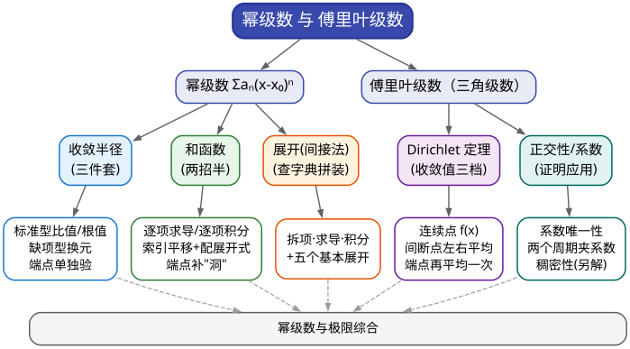

# CMC 手把手精讲
## ——《13 幂级数与傅里叶级数》：把函数"编译"成无穷长的多项式

> 🐱 喵～欢迎来到 CMC 精讲系列的第十三篇，也是**专题篇的最后一篇**。你已经走过了极限、求导、积分、微分方程、解析几何、多元微分、重积分、曲线曲面……现在到最后一根硬骨头：**级数**。12 篇解决"数项级数判不判收敛"，本篇解决另一半：**幂级数怎么定收敛域、怎么求和函数、函数怎么展开成级数，以及傅里叶级数在每一点报什么收敛值**。
>
> **本篇在考试中的地位**（数据口径：第 1–17 届初赛共 19 份卷，逐卷清点【统计】；结论来自板块研究笔记 08）：
> - 级数板块整体出现率约 **95%**（19 份卷 18 份有级数题，唯一例外是第 9 届），单卷分值 **14–20 分**；自第 10 届起稳定占据**卷末压轴位**，且第一问通常不难——先把第一问的分拿稳；
> - 其中"幂级数 × 傅里叶"是本板块里**套路最固定**的一半，历年以"6 分填空 + 14 分大题"的形态反复出现：
>   - **填空位**：第 15 届 A 类填空 4（缺项幂级数收敛域，2023）、第 14 届填空 3（和函数求单侧极限，2022）、第 7 届填空 4（傅里叶收敛值，2015）——近四届（14–17 届）中有两届把 6 分填空直接给了幂级数；
>   - **大题位**：第 7 届第四题（收敛域 + 和函数，14 分）、第 11 届第五题（系数性质 + 收敛半径思想，14 分）、第 13 届补赛第六题（收敛半径 + 反常积分，14 分）、第 12 届七(3)（展开式反用求数项级数和，14 分题的第三问）、第 8 届第六题（傅里叶理论证函数为常数，14 分）、第 3 届一(4)（求和函数 + 代值，6 分）、第 1 届第七、八题（函数项级数求和 15 分 + $`x^{n^2}`$ 渐近 10 分）；
> - 傅里叶级数属"**低频保底**"：只在第 7、8 届整体出现（2016 年后未再考），但大纲白纸黑字写了整整一款——**投入 20 分钟、保住 6 分**，这是全卷性价比最高的"保底项"之一。
>
> **大纲对应条目**（《全国大学生数学竞赛考试内容》非数学专业类·第 8 条"无穷级数"第 4–8 款原文摘录）：
> - 第 4 款：函数项级数的收敛域与和函数的概念；
> - 第 5 款：幂级数及其收敛半径、收敛区间（指开区间）、收敛域与和函数；
> - 第 6 款：幂级数在其收敛区间内的基本性质（和函数的连续性、逐项求导和逐项积分）、简单幂级数的和函数的求法；
> - 第 7 款：初等函数的幂级数展开式；
> - 第 8 款：函数的 Fourier 系数与 Fourier 级数、Dirichlet 定理、函数在 $`[-l,l]`$ 上的 Fourier 级数、函数在 $`[0,l]`$ 上的正弦级数和余弦级数。
>
> （范围注：一致收敛判别法、级数版 Abel/Dirichlet 判别法、Parseval 等式等都是**数学专业类**大纲的内容，非数学 A 类**不考**——本篇只讲上面这五款。）
>
> **先修提示**：本篇依赖 **12 篇**（数项级数判敛：几何级数、比较/比值/根值判别法是求收敛半径的地基）、**01 篇**（极限计算：幂级数与极限综合题会用到）、**05 篇**（积分计算：逐项积分与和函数的求导都要用）。数项级数判敛的细节不在本篇重复，遇到就回翻 12 篇。
>
> **预计学时**：2–3 天（按每天 1–2 小时折算），对应 00 总纲第 5 周 D29–D30 的学习单元（其中"幂级数收敛域与和函数"还提前在 D27–D28 与 12 篇合练过）。三天节奏：第一天 §一 + §二 + 方法 3.1–3.3；第二天方法 3.4–3.8 + 精讲 1–6；第三天精讲 7–10 + 易错点 + 自测题。
>
> 阅读建议：
> 1. 先花 3 分钟扫 §1.2 的方法速查表——本篇的题面信号是全部 13 篇里最"脸熟"的，**认准信号比背公式重要**；
> 2. §二里"收敛半径"与"和函数两招"的**生长史**别跳读：理解"为什么逐项求导/积分够用"，你才能自己推公式、考场不慌；
> 3. 五个基本展开式 + 和函数口诀表（默写点 1、2），务必**默写**——它们是本篇的"乘法口诀表"；
> 4. 真题精讲的"思路分析"保留了真实试错（包括错误方向），先自己卡 1 分钟再看解答。
>
> 符号说明：📌 重点 | 💡 直觉/类比 | ⚠️ 易错点 | ✍️ 动笔练一练 | ❓ 自测题 | 🎯 考试定位 | ⏱️ 省时技巧

---

# 一、本篇地图

## 1.1 目录（读之前先看施工图）

- **§二 知识讲解**：幂级数是什么（从"无穷次多项式"到"把函数编译成级数"）→ 收敛半径三定理（Abel 定理）→ 逐项求导/逐项积分：幂级数为什么这么"乖" → 五个基本展开式：一本函数↔级数的小字典 → 傅里叶级数：用三角函数当"正交基" → 函数项级数简介（点到为止）
- **§三 方法手册**：3.1 收敛半径与收敛域"三件套" | 3.2 求和第一招·逐项求导 | 3.3 求和第二招·逐项积分 | 3.4 求和第三招·索引平移 + 配已知展开 | 3.5 用和函数/展开式求数项级数的和 | 3.6 函数展开幂级数·间接法 | 3.7 幂级数与极限综合 | 3.8 傅里叶：收敛值三档 + 正交性证明
- **§四 真题精讲**：10 道完整精讲（第 15 届一(4)、第 14 届一(3)、第 3 届一(4)、第 7 届四、第 12 届七(3)、第 1 届七、第 11 届五、第 13 届补赛六、第 7 届一(4)、第 8 届六）+ 1 道拓展真题（第 1 届八，"见识型"）
- **§五 易错点清单**：12 条 ❌→✅ 对照
- **§六 自测题**：7 道，附完整答案
- **§七 结语**："幂级数防身八句话" + 学习建议 + 下一阶段（整卷合练）预告

## 1.2 方法速查表：什么题面 → 用什么武器（一屏版）

| 题面长相（信号） | 首选武器 | 说明 / 升级路线 |
|---|---|---|
| "求收敛半径/收敛域"，通项是标准的 $`\sum a_n(x-x_0)^n`$（系数是 $`n`$、$`a^n`$、$`n!`$ 的组合） | **比值法** $`R=\lim\left\lvert\dfrac{a_n}{a_{n+1}}\right\rvert`$（或根值法 $`R=\dfrac{1}{\lim\sqrt[n]{\lvert a_n\rvert}}`$） | 先算 $`R`$；**端点 $`x_0\pm R`$ 必须逐一单独验**——收敛区间永远是开区间，收敛域才谈端点 |
| 只出现 $`x^{2n}`$、$`x^{3n}`$ 这类**缺项**幂级数 | 换元 $`y=x^k`$，或**直接根值法**处理通项 | 不能机械套比值公式（会遇到系数为 0 的项） |
| "求和函数"，系数含 $`n`$、$`n^2`$、$`2n-1`$ | **逐项求导** | 求导后套 $`\sum x^n=\dfrac{1}{1-x}`$，再积分回去；先乘/除 $`x`$ 平移索引往往更快 |
| 系数含 $`\dfrac1n`$、$`\dfrac1{n+1}`$、$`\dfrac1{2n+1}`$ | **逐项积分** | 积分后变几何级数，再求导回去 |
| 通项里挂满 $`n!`$、$`(n+1)!`$、$`(n-2)!`$ | **索引平移 + 拆项 + 套 $`e^x`$** | 先把系数拆成"已知展开式的拼装"，首项单独验证 |
| "将 $`f(x)`$ 展开成幂级数"（$`f`$ 是 $`\arctan`$、$`\ln\dfrac{1+x}{1-x}`$、有理式、$`\int_0^x`$ 型） | **间接法**：拆项/求导/积分，化归五件套 | 展开区间要随推导标注 |
| 数项级数通项含 $`2^n`$、$`n!`$、$`\dfrac{(-1)^n}{n}`$，直接裂项不成 | **认成"某展开式的特殊点取值"** | 常取 $`x=\pm\dfrac12`$、$`\pm1`$（第 12 届七(3) 就是 $`\ln(1+x)`$ 取 $`x=-\dfrac12`$） |
| 极限对象里挂着 $`\sum a_nx^n`$ | **先求和函数、再取极限** | 让 $`(1-x)^k`$ 与分母恰好约干净（第 14 届填空 3） |
| "证明系数为正 / 求 $`\lim\sqrt[n]{c_n}`$" | **几何级数展开 + 系数唯一性 + 对数平均化** | 相邻项比值极限会"传给"$`n`$ 次根的极限（第 11 届五） |
| "傅里叶级数在 $`x_0`$ 处收敛于$`\underline{\qquad}`$" | **Dirichlet 收敛定理三档规则** | 连续点取 $`f(x_0)`$；间断点取左右极限平均；端点取 $`\dfrac{f(l^-)+f(-l^+)}{2}`$ |
| 用傅里叶理论做证明题 | **正交性 + 系数被两个周期约束** | 见到"两个周期不可公度"就往这里想（第 8 届六） |

## 1.3 知识树：本篇全部内容的骨架



一句话总结这张图：**幂级数部分——"半径"三件套管定位、"两招半"管求和、"查字典"管展开；傅里叶部分——Dirichlet 定理管报值、正交性管证明。** 下面逐块拆开。

---

# 二、知识讲解：幂级数从哪来、为什么这么"听话"

## 2.1 幂级数：给函数办一张"无穷长的身份证"

先把镜头拉远。**函数项级数**就是"每一项都带 $`x`$ 的级数"，比如

```math
\sum_{n=1}^{\infty}\frac{x^n}{n}=x+\frac{x^2}{2}+\frac{x^3}{3}+\cdots
```

它和 12 篇学的数项级数只差一件事：**多了一个参数 $`x`$**。对每个固定的 $`x_0`$ 代进去，它就是一条普通的数项级数；让 $`x`$ 跑起来，"哪些 $`x_0`$ 能让它收敛"的集合叫**收敛域**，收敛域上定义出的函数 $`S(x)=\sum u_n(x)`$ 叫**和函数**。这一点是大纲第 4 款的全部要求——**函数项级数只考"收敛域 + 和函数"这两个概念**，一致收敛那套理论（数学专业内容）不碰。

本篇的主角是函数项级数里最乖的一类——**幂级数**：

```math
\sum_{n=0}^{\infty}a_n(x-x_0)^n=a_0+a_1(x-x_0)+a_2(x-x_0)^2+\cdots
```

💡 **打比方（写给会写代码的你）**：幂级数就是把一个函数<strong>"编译"成无穷长的多项式</strong>。系数表 $`(a_0,a_1,a_2,\dots)`$ 是编译产物（目标代码），$`x`$ 是输入；$`\sum x^n=\dfrac{1}{1-x}`$、$`\sum\dfrac{x^n}{n!}=e^x`$ 这些公式就是一份"**编译器字典**"，把常见函数与它们的"代码"一一对应。你平时在程序里算 $`\sin 1`$，标准库干的事本质上就是套这份字典——用多项式在局部逼近函数。

为什么全世界都想要这张"身份证"？因为**多项式是最好伺候的函数**：加减乘、求导、积分全是最简单规则。能把 $`e^x`$、$`\ln(1+x)`$、$`\arctan x`$ 这些"算不动"的函数翻译成多项式，我们就等于把复杂运算**降级**成了加减乘除。

看个最小的例子，把 $`\dfrac{1}{1-x}`$ 展开（几何级数求和，12 篇的老朋友）：

```math
\frac{1}{1-x}=1+x+x^2+x^3+\cdots\qquad(|x|<1).
```

代几个数感受一下：$`x=\dfrac12`$ 时右边 $`=2`$，和左边一致；$`x=2`$ 时右边 $`=1+2+4+\cdots`$ 直接"数值爆炸"（溢出）——**同一条级数，输入不同命运完全不同**。这就是本篇第一个核心概念要解决的问题：$`x`$ 究竟"能跑多远"。

📌 **三个名字，必须分清**（考试最爱在这里挖坑）：

| 名字 | 是什么 | 例：$`\sum\limits_{n=1}^{\infty}\dfrac{x^n}{n}`$ |
|---|---|---|
| 收敛半径 $`R`$ | 一个**数**（或 $`+\infty`$） | $`R=1`$ |
| 收敛区间 | **开区间** $`(x_0-R,\ x_0+R)`$，公式定理保证在它内部处处收敛 | $`(-1,1)`$ |
| 收敛域 | 收敛区间 **并上"收敛的端点"**，是最终答案 | $`[-1,1)`$（$`x=1`$ 调和发散，$`x=-1`$ 交错收敛） |

⚠️ 填空题问"收敛域"而你答开区间，是历年最常见的丢分之一——**只要题目问了收敛域，端点就必须逐个交代**。

## 2.2 收敛半径三定理：Abel 定理的通俗版

幂级数比一般函数项级数乖，乖在一条定理上（教材叫 **Abel 定理**，你只需记它的"三段论"）：

📌 **收敛半径的存在性**：对幂级数 $`\sum a_n(x-x_0)^n`$，必存在唯一的 $`R\in[0,+\infty]`$，使得：

1. 当 $`|x-x_0|<R`$ 时，级数**绝对收敛**；
2. 当 $`|x-x_0|>R`$ 时，级数**发散**（通项甚至不趋于 0）；
3. 当 $`|x-x_0|=R`$ 时，**什么情况都可能**——必须把两个端点分别代入，当成数项级数重新判（12 篇的功夫在这里回本）。

💡 **直觉**：把 $`x`$ "能跑多远"想成射程。半径之内，$`|x-x_0|^n`$ 衰减得足够快，把系数 $`a_n`$ 的任何增长都压住了；半径之外，$`|x-x_0|^n`$ 爆炸，通项兜不住。**临界圈上两边势均力敌，谁赢要看系数 $`a_n`$ 和幂指数赛跑的具体姿势**——所以第三段"十题十议"。

📌 **求 $`R`$ 的两把公式**（都是 12 篇判别法搬到参数级数上）：

```math
R=\lim_{n\to\infty}\left|\frac{a_n}{a_{n+1}}\right|\qquad\text{（比值型，极限存在时用）},\qquad R=\frac{1}{\lim\limits_{n\to\infty}\sqrt[n]{|a_n|}}\qquad\text{（根值型，柯西–阿达马公式）}.
```

两个都用不了（极限不存在）时，说明这个幂级数"不是老老实实标准的幂级数"——最常见的就是**缺项**：只有偶数次幂、只有 $`3`$ 的倍数次幂那种。例如

```math
\sum_{n=1}^{\infty}\frac{(-1)^{n-1}x^{2n}}{n(2n-1)}=x^2-\frac{x^4}{2\cdot3}+\frac{x^6}{3\cdot5}-\cdots
```

（这题就是第 15 届 A 类的 6 分填空，精讲 1 全文拆解。）把它写成标准形 $`\sum b_kx^k`$，系数序列是 $`0,\ 0,\ 1,\ 0,\ -\dfrac16,\ 0,\ \dfrac1{15},\ \dots`$——一半是零！套 $`\left|\dfrac{b_k}{b_{k+1}}\right|`$ 会在零系数处除以零，**机械套公式必翻车**。正确姿势两条：**换元**（令 $`y=x^2`$，把缺项级数变回标准形）或**直接根值法**（对通项 $`u_n`$ 算 $`\sqrt[n]{|u_n|}`$，整体处理，绕开零系数）。

⚠️ 还有一个隐蔽陷阱：**逐项求导/积分之后端点会变**。半径不变（下一节就是原因），但 $`x=\pm R`$ 处的敛散性可能被这两步操作改变——所以求和之前先定收敛域、求完之后再回头看眼端点，两步都不能省。

## 2.3 逐项求导与逐项积分：幂级数为什么会"两招半"

现在到了本篇的看家本领。问一个具体问题：$`\sum\limits_{n=1}^{\infty}nx^n`$ 的和函数是什么？它不在任何"字典"里——字典里只有 $`\sum x^n`$。怎么办？

**想法一：把 $`n`$ 想办法弄掉。** 谁求导会"掉下一个 $`n`$"？是 $`x^n`$。于是对字典页 $`\dfrac{1}{1-x}=\sum\limits_{n=0}^{\infty}x^n`$ **逐项求导**：

```math
\frac{1}{(1-x)^2}=\sum_{n=1}^{\infty}nx^{n-1}\ \Longrightarrow\ \frac{x}{(1-x)^2}=\sum_{n=1}^{\infty}nx^n\qquad(|x|<1).
```

搞定。再求导一次、再乘 $`x`$，就得到 $`\sum n^2x^n`$（精讲 2 会用）。

**想法二：把 $`\dfrac1n`$ 想办法弄掉。** 谁积分会"多出一个 $`\dfrac{1}{n+1}`$"？还是 $`x^n`$。于是对同一页字典**逐项积分**：

```math
\int_0^x\frac{\mathrm{d}t}{1-t}=-\ln(1-x)=\sum_{n=1}^{\infty}\frac{x^n}{n}\qquad(|x|<1).
```

又搞定（顺带把 $`\ln(1-x)`$ 的展开也装进了字典）。

📌 **定理（幂级数的"通行证"）**：幂级数在**收敛区间内部**可以逐项求导、逐项积分，且

```math
\left(\sum_{n=0}^{\infty}a_n(x-x_0)^n\right)'=\sum_{n=1}^{\infty}na_n(x-x_0)^{n-1},\qquad \int_{x_0}^{x}\left(\sum_{n=0}^{\infty}a_n(t-x_0)^n\right)\mathrm{d}t=\sum_{n=0}^{\infty}\frac{a_n}{n+1}(x-x_0)^{n+1},
```

**两边的收敛半径相同**；和函数在收敛区间内连续。

💡 **为什么这么乖（一句话版本）**：在半径内部随便取一段更小的闭区间 $`[a,b]\subsetneq(x_0-R,x_0+R)`$，级数在那里是"一致收敛"的（这个词超纲，你只需知道：**收敛得足够整齐，整齐到"无穷次加法"与"求导/积分"可以交换顺序**）。半径以外换序就可能出错——所以公式都限定在收敛区间内用。

🎯 **考试定位**：这套"逐项求导/积分"就是**求解和函数的主武器**（方法 3.2、3.3 展开）。考试里你不需要写上面这段证明，但需要条件反射地把"**系数里有 $`n`$ → 求导**、**系数里有 $`\dfrac1n`$ → 积分**"变成读题肌肉记忆。

✍️ **动笔练一练（默写点 1）**：合上文档，从 $`\sum\limits_{n=0}^{\infty}x^n=\dfrac{1}{1-x}`$ 出发，推出下面四个"口诀级"公式，再对答案：

```math
\sum_{n=1}^{\infty}nx^n=\frac{x}{(1-x)^2},\qquad \sum_{n=1}^{\infty}n^2x^n=\frac{x(1+x)}{(1-x)^3},\qquad \sum_{n=1}^{\infty}n(n+1)x^n=\frac{2x}{(1-x)^3},\qquad \sum_{n=1}^{\infty}\frac{x^n}{n}=-\ln(1-x).
```

（前三个各自逐项求导 1~2 次即得；第四个逐项积分。全部 $`|x|<1`$。）

## 2.4 五个基本展开式：一本五页的小字典

所有幂级数展开，最后都归约到同一本字典。这本字典就是教材上的**麦克劳林展开**（泰勒公式在 $`x=0`$ 处的特例），每一页都只需"逐阶求导代入"即可验证——但你不需要重新推导，**背下来**：

📌 **五件套 + 一件进阶（含成立区间，必须成对记）**：

```math
\frac{1}{1-x}=\sum_{n=0}^{\infty}x^n\qquad(-1<x<1),
```

```math
e^x=\sum_{n=0}^{\infty}\frac{x^n}{n!}\qquad(-\infty<x<+\infty),
```

```math
\sin x=\sum_{n=0}^{\infty}\frac{(-1)^nx^{2n+1}}{(2n+1)!},\qquad \cos x=\sum_{n=0}^{\infty}\frac{(-1)^nx^{2n}}{(2n)!}\qquad(-\infty<x<+\infty),
```

```math
\ln(1+x)=\sum_{n=1}^{\infty}\frac{(-1)^{n-1}x^n}{n}\qquad(-1<x\le 1),
```

```math
(1+x)^{\alpha}=\sum_{n=0}^{\infty}\binom{\alpha}{n}x^n=1+\alpha x+\frac{\alpha(\alpha-1)}{2!}x^2+\cdots\qquad(-1<x<1).
```

**免费赠品（不做新题，全由五件套变形而来）**：

```math
\frac{1}{1+x}=\sum_{n=0}^{\infty}(-1)^nx^n\ (|x|<1)\quad\text{（把 }x\text{ 换成}-x\text{）};\qquad \ln(1-x)=-\sum_{n=1}^{\infty}\frac{x^n}{n}\ (-1\le x<1);
```

```math
\arctan x=\int_0^x\frac{\mathrm{d}t}{1+t^2}=\sum_{n=0}^{\infty}\frac{(-1)^nx^{2n+1}}{2n+1}\qquad(-1\le x\le 1).
```

💡 **用法说明**：把这本字典想成"**函数 ↔ 级数的编译器**"。§3.6 的"间接法展开"就是把待翻译的函数**拆项、求导、积分、配方**，化归到字典里的某一页；§3.5 的"数项级数求和"则是**反着查字典**——把一个数字级数认成"某页字典在特殊点的取值"。

⚠️ 区间的细节不要记串：$`\ln(1+x)`$ 的右端点是**闭**的（$`x=1`$ 时是交错调和级数，收敛到 $`\ln 2`$），左端点开；$`\arctan`$ 两端都是闭的；其余五件套里 $`e^x,\sin x,\cos x`$ 无限制，$`\dfrac{1}{1-x}`$ 与二项式两端都开。**区间错 = 白展开**（除答案外会扣表述分）。

✍️ **动笔练一练（默写点 2）**：用 90 秒默写上面"五件套"（不写推导，只写等号、级数与区间），再默写三个赠品。考场前的每个早上花 1 分钟过一遍。

## 2.5 傅里叶级数：用三角函数当"正交基"

幂级数的基是"$`1,x,x^2,\dots`$"；傅里叶级数换了一套基——**三角函数**。它回答的问题是：任何一个（分段光滑的）周期函数，能不能写成"一串正弦、余弦波的叠加"？

💡 **打比方（这次连专业课一起用了）**：你在程序设计、信号处理里见过的**离散傅里叶变换（DFT）**、"时域→频域"，老家就是这里。把函数 $`f(x)`$ 拆成 $`\sin\dfrac{n\pi x}{l}`$、$`\cos\dfrac{n\pi x}{l}`$ 的叠加，等于把它**从"每点取值"翻译成"每个频率的振幅"**——系数 $`a_n,b_n`$ 就是"各频率分量的强度"。之所以能这么拆，是因为三角函数系在 $`[-l,l]`$ 上**两两正交**（不同项相乘后积分为 0），于是求系数就是在做**投影**：

```math
a_n=\frac1l\int_{-l}^{l}f(x)\cos\frac{n\pi x}{l}\,\mathrm{d}x,\qquad b_n=\frac1l\int_{-l}^{l}f(x)\sin\frac{n\pi x}{l}\,\mathrm{d}x\qquad(n=0,1,2,\dots),
```

```math
f(x)\ \sim\ \frac{a_0}{2}+\sum_{n=1}^{\infty}\left(a_n\cos\frac{n\pi x}{l}+b_n\sin\frac{n\pi x}{l}\right).
```

（在 $`[-l,l]`$ 上展开；写成 $`\dfrac{a_0}{2}`$ 是为了让 $`n=0`$ 的公式与 $`n\ge1`$ 统一。周期为 $`2\pi`$ 时取 $`l=\pi`$。）
注意"$`\sim`$"不写等号：右端级数**不一定收敛到 $`f`$**，能不能"还原"取决于 $`f`$ 的品相——由下面的定理拍板。

📌 **Dirichlet（狄利克雷）收敛定理**：若 $`f`$ 在 $`[-l,l]`$ 上**分段光滑**（分段单调、有界，且只有有限个第一类间断点），则它的傅里叶级数**处处收敛**，且

```math
\text{在点 }x\text{ 处收敛于}\quad \frac{f(x^-)+f(x^+)}{2}.
```

**收敛值三档规则（考场唯一要背的东西）**：

| $`x_0`$ 是哪种点 | 级数收敛于 | 备注 |
|---|---|---|
| 连续点 | $`f(x_0)`$ | 即左右极限相等的情形 |
| 第一类间断点（跳跃点） | $`\dfrac{f(x_0^-)+f(x_0^+)}{2}`$ | **左右极限的算术平均**（第 7 届填空 4 就考这个） |
| 端点 $`x_0=\pm l`$ | $`\dfrac{f(l^-)+f(-l^+)}{2}`$ | 端点处要"跨周期接上"，本质还是左右平均 |

🎯 **考试定位**：非数学 A 类对傅里叶的底线就是"**报收敛值**"——20 分钟学会三档规则，稳收 6 分填空（大纲第 8 款白纸黑字）。更重的"用傅里叶理论证明"只出过第 8 届一次（精讲 10 会带你见识）；至于**完整计算 $`a_n,b_n`$ 通式**，近 8 届未考、计算量大易错，**不要求**，只在学有余力时看一眼。

**大纲里还要提一句的**：在 $`[0,l]`$ 上的**正弦级数/余弦级数**——把 $`f`$ 奇延拓到 $`[-l,l]`$ 得到正弦级数（只剩 $`b_n`$），偶延拓得到余弦级数（只剩 $`a_n`$）。知道"奇延拓 ↔ 正弦、偶延拓 ↔ 余弦"这层对应即可，真题从没要求完整展开过。

## 2.6 函数项级数简介（点到为止）

最后把大纲第 4 款的概念补齐。一般函数项级数 $`\sum u_n(x)`$ 的两件事：

1. **收敛域**：使 $`\sum u_n(x_0)`$（数项级数）收敛的所有 $`x_0`$ 组成的集合——求法是"把 $`x`$ 当参数，用 12 篇的判别法逐个判"；
2. **和函数**：在收敛域上定义 $`S(x)=\sum u_n(x)`$；若 $`u_n(x)=a_n(x-x_0)^n`$，它就是幂级数。

💡 **为什么本篇对它"点到为止"**：大纲只要概念（第 4 款），历年真题里唯一的重头戏是**第 1 届第七题**——先解微分方程造出 $`u_n(x)`$，再当成幂级数求和（精讲 6）。换句话说：**函数项级数的考题，最后都归结为"幂级数 + 数项级数"两种武器**，你已经有的够用了。

⚠️ 唯一的观念小心结：函数项级数的"收敛域"是按 $`x`$ 的取值**分段判定**的（比如 $`\sum\dfrac{x^n}{n}`$ 在 $`|x|<1`$ 收敛、$`x=1`$ 发散、$`x=-1`$ 收敛），不能像数项级数那样"判一次就完"。写答案时用区间/集合表达。

---

# 三、方法手册：八套武器，见招拆招

每个方法按统一格式展开：【适用信号】→【步骤】→【关键公式】→【真题微型例子】。再次强调："**你缺的不是方法本身，而是什么时候用它**"——【适用信号】永远比公式更值得花时间。

## 3.1 收敛半径与收敛域"三件套"

**【适用信号】** 题面出现"求收敛半径 / 收敛区间 / 收敛域"；或大题第一问为"求定义域"（第 13 届补赛六）。形态：标准型 $`\sum a_n(x-x_0)^n`$、缺项型（只有 $`x^{2n}`$、$`x^{3n}`$）、复合型（$`\sum a_n(2x+1)^n`$ 之类）。

**【步骤】**
1. **认型**：是不是缺项？（通项里 $`x`$ 的指数"跳着走"就是缺项。）
2. **算 $`R`$**：标准型用比值法 $`R=\lim\left|\dfrac{a_n}{a_{n+1}}\right|`$（或根值法 $`R=\dfrac{1}{\lim\sqrt[n]{|a_n|}}`$）；缺项型**换元** $`y=(x-x_0)^k`$ 化成标准型，或**直接对通项用根值法**（$`\sqrt[n]{|u_n(x)|}<1`$ 解出 $`|x-x_0|<R`$）。
3. **端点逐一验**：把 $`x=x_0\pm R`$（复合型是解方程得到的具体点）代回，化成数项级数用 12 篇的判别法判敛散——**两个端点分开判，结论可以不同**。
4. **写答案**：收敛半径 $`R=`$ 数；收敛区间是开区间；收敛域用区间并把收敛的端点收进去（含 $`\pm R`$ 或不含，逐个交代）。

**【关键公式】** $`R=\lim\left|\dfrac{a_n}{a_{n+1}}\right|=\dfrac{1}{\lim\sqrt[n]{|a_n|}}`$；缺项换元 $`y=x^k`$；端点判敛回归 12 篇（几何、$`p`$ 级数、Leibniz）。

**【真题微型例子】**（类型题·仿竞赛风格）求 $`\sum\limits_{n=1}^{\infty}\dfrac{x^n}{n\cdot 2^n}`$ 的收敛域。

比值法：$`a_n=\dfrac{1}{n2^n}`$，$`\left|\dfrac{a_n}{a_{n+1}}\right|=\dfrac{(n+1)2^{n+1}}{n2^n}=2\cdot\dfrac{n+1}{n}\to 2`$，故 $`R=2`$，收敛区间 $`(-2,2)`$。

端点：$`x=2`$ 时级数 $`=\sum\dfrac1n`$ 发散（调和）；$`x=-2`$ 时级数 $`=\sum\dfrac{(-1)^n}{n}`$ 收敛（交错）。故收敛域为 $`[-2,2)`$。

✍️ 对应练习：专题 13 的 A4（第 15 届真题）做完本节即可拿下。

## 3.2 求和第一招·逐项求导（系数含 $`n`$）

**【适用信号】** "求和函数"，且系数里带 $`n`$ 的多项式因子：$`n`$、$`2n-1`$、$`n^2`$、$`n(n+1)`$……读它："**系数有 $`n`$，求导消给你看**"。

**【步骤】**
1. **先定收敛域**（按 3.1 走一遍；半径求对、端点记着最后回头补）；
2. **整理索引**（可选但常用）：提出 $`x^p`$ 或除以 $`x`$，把通项挪成"$`n`$ 与 $`x^{n-1}`$ 搭配"的最顺形状，如 $`\sum(2n-1)x^{n-1}`$；
3. **逐项求导**：设 $`S(x)=\sum a_nx^n`$，求出 $`S'(x)`$（或 $`S^{(k)}`$），此时系数里的 $`n`$ 掉下来、"$`n`$ 与几何级数"合并；
4. **套口诀**：$`S'(x)=\sum nx^{n-1}=\dfrac{1}{(1-x)^2}`$ 之类的现成公式（见 2.3 默写点）；
5. **积回去 + 补常数**：$`S(x)=\int_0^x S'(t)\,\mathrm{d}t+S(0)`$——**$`S(0)`$ 就是那个常数**（多数题是 0，但必须验）；
6. **回头补端点与"洞"**（尤其 $`x=0`$ 处除以 $`x`$ 的题）。

**【关键公式】**

```math
\sum_{n=1}^{\infty}nx^{n-1}=\frac{1}{(1-x)^2},\qquad \sum_{n=1}^{\infty}nx^n=\frac{x}{(1-x)^2},\qquad \sum_{n=1}^{\infty}n^2x^n=\frac{x(1+x)}{(1-x)^3},\qquad \sum_{n=1}^{\infty}n(n+1)x^n=\frac{2x}{(1-x)^3}.
```

**【真题微型例子】**（类型题·仿竞赛风格）求 $`\sum\limits_{n=1}^{\infty}\dfrac{n}{2^n}`$。

它是 $`S(x)=\sum nx^n=\dfrac{x}{(1-x)^2}`$ 在 $`x=\dfrac12`$ 的值：$`\dfrac{1/2}{(1/2)^2}=2`$。（第 14 届填空 3 的 $`\sum n^2x^n`$ 是同一招的升级版——见精讲 2；第 3 届一(4) 是"换元 + 逐项求导"组合——见精讲 3。）

## 3.3 求和第二招·逐项积分（系数含 $`\dfrac1n`$）

**【适用信号】** 系数里带"倒数因子"：$`\dfrac1n`$、$`\dfrac1{n+1}`$、$`\dfrac{1}{2n+1}`$……读它："**系数有分母，积分送它走**"。

**【步骤】**
1. 先定收敛域（同 3.1）；
2. **配平索引**：目标是把通项凑成"$`\dfrac{(\ \ )^{n}}{n+1}`$"的形状，积分后指数加一、分母自然约掉；常用动作是**乘/除 $`x`$**（如 $`\sum\dfrac{x^n}{n+1}=\dfrac1x\sum\dfrac{x^{n+1}}{n+1}`$）；
3. **逐项积分**（积分限取 $`0`$ 到 $`x`$，天然消掉常数）；
4. 积分后的级数多半是几何级数或字典页，直接读出和函数；
5. **求导还原**；
6. **补 $`x=0`$ 的"洞"**：除以 $`x`$ 的操作在 $`x=0`$ 失效，用原级数在 $`x=0`$ 的值或极限补定义。

**【关键公式】** $`\displaystyle\int_0^x\frac{\mathrm{d}t}{1-t}=-\ln(1-x)`$（$`|x|<1`$ 内的主钥匙）；逐项积分不改变收敛半径，但端点要复查。

**【真题微型例子】**（类型题·仿竞赛风格）求 $`S(x)=\sum\limits_{n=0}^{\infty}\dfrac{x^n}{n+1}`$（$`|x|<1`$）与 $`S(0)`$。

$`x\ne0`$ 时 $`S(x)=\dfrac1x\sum\limits_{n=0}^{\infty}\dfrac{x^{n+1}}{n+1}=\dfrac1x\Big(\sum\limits_{m=1}^{\infty}\dfrac{x^m}{m}\Big)=\dfrac{-\ln(1-x)}{x}`$；$`S(0)=1`$（首项）。端点：$`x=-1`$ 时 $`\sum\dfrac{(-1)^n}{n+1}`$ 收敛，$`x=1`$ 时发散，故收敛域 $`[-1,1)`$。（这类"补洞"是评分点——见易错点 ③。）

## 3.4 求和第三招·索引平移 + 配已知展开（"查字典"）

**【适用信号】** 系数是**阶乘/幂混合**的怪形状：$`\dfrac{n^3+2}{(n+1)!}`$、$`\dfrac{n^2}{n!}`$、$`\dfrac{1}{(n-2)!}`$；或者通项长得像"某页字典的系数错位了"。读它："**翻译回字典，逐页对号**"。

**【步骤】**
1. 先定收敛域（这类题用的比值法通常一眼 $`R=+\infty`$）；
2. **换索引**：令 $`m=n+k`$（让分母阶乘的"阶"与索引对齐），或乘/除 $`x`$ 的幂把指数对齐；
3. **拆系数**：把关于 $`n`$ 的多项式（除以阶乘后）拆成若干"整数阶乘"的组合——例如 $`n^3+2=(n+1)n(n-1)+(n+1)+1`$，除以 $`(n+1)!`$ 后每块都是一个平移后的 $`\dfrac{1}{m!}`$；
4. **逐块套字典**（主要是 $`e^x`$ 页），把每块写成 $`x^p e^x`$、$`\dfrac{e^x-1}{x}`$ 之类的闭形；
5. **首项单独验**：拆项往往只对 $`n\ge2`$（或 $`n\ge3`$）成立，前一两项代进去单算；
6. **合并 + 补洞**（如 $`x=x_0`$ 处出现 $`\dfrac{0}{0}`$，用极限值补定义）。

**【关键公式】** $`e^t=\sum\limits_{m=0}^{\infty}\dfrac{t^m}{m!}`$；$`\displaystyle\sum_{m=0}^{\infty}\frac{t^m}{(m+1)!}=\frac{e^t-1}{t}`$（$`t\ne0`$）；$`(1+x)^\alpha`$ 二项式页做备用。

**【真题微型例子】**（类型题·仿竞赛风格）求 $`\sum\limits_{n=0}^{\infty}\dfrac{n^2+1}{n!}x^n`$。

拆三块（注意 $`n^2=n(n-1)+n`$）：$`\sum\dfrac{n(n-1)}{n!}x^n=x^2e^x`$、$`\sum\dfrac{n}{n!}x^n=xe^x`$、$`\sum\dfrac{x^n}{n!}=e^x`$，故和为 $`e^x(x^2+x+1)`$。

## 3.5 用和函数/展开式求数项级数的和（"反着查字典"）

**【适用信号】** 题目要"数项级数的和"，通项含 $`2^n`$、$`n!`$、$`\dfrac{(-1)^n}{n}`$ 这类"级数味"因子，而 12 篇的裂项/部分和又下不去手。读它："**这个数是哪页字典在哪个特殊点的取值？**"

**【步骤】** 两条路线，考场按"题面给不给幂级数背景"选：
- **路线 A（造幂级数）**：把数项改写成 $`\sum a_nx_0^n`$ 在特殊点 $`x_0`$ 的值 → 先求和函数 $`S(x)`$ → 代回 $`x_0`$（**必须验证 $`x_0`$ 落在收敛域内**）。第 3 届一(4)（精讲 3）走的就是这条。
- **路线 B（直接认字典）**：把数项级数当成某页展开式在特殊点的取值——常见取点 $`x=\pm\dfrac12,\ \pm1`$。第 12 届七(3)（精讲 5）走这条：$`\ln(1+x)`$ 取 $`x=-\dfrac12`$ 得 $`\sum\dfrac{1}{n2^n}=\ln2`$。

**【关键公式】** 特殊点取值速查表（$`|x|<1`$ 上的字典页，各取一个"亲测常用点"）：

| 展开式 | 取点 | 得到的数项级数 |
|---|---|---|
| $`\dfrac{1}{1-x}=\sum x^n`$ | $`x=\dfrac12`$ | $`\sum\limits_{n=0}^{\infty}\dfrac{1}{2^n}=2`$ |
| $`\sum nx^n=\dfrac{x}{(1-x)^2}`$ | $`x=\dfrac12`$ | $`\sum\limits_{n=1}^{\infty}\dfrac{n}{2^n}=2`$ |
| $`\ln(1+x)=\sum\dfrac{(-1)^{n-1}x^n}{n}`$ | $`x=-\dfrac12`$ | $`\sum\limits_{n=1}^{\infty}\dfrac{1}{n2^n}=\ln 2`$ |
| 同上 | $`x=\dfrac12`$ | $`\sum\limits_{n=1}^{\infty}\dfrac{(-1)^{n-1}}{n2^n}=\ln\dfrac32`$ |
| $`e^x=\sum\dfrac{x^n}{n!}`$ | $`x=1`$ | $`\sum\limits_{n=0}^{\infty}\dfrac{1}{n!}=e`$ |

**【真题微型例子】**（类型题·仿竞赛风格）求 $`\sum\limits_{n=1}^{\infty}\dfrac{(-1)^{n-1}}{n\cdot 2^n}`$。

认字典：$`\ln(1+x)=\sum\limits_{n=1}^{\infty}\dfrac{(-1)^{n-1}x^n}{n}`$ 在 $`x=\dfrac12`$ 处取值：$`=\ln\dfrac32`$。

✍️ 对应练习：专题 13 的 B3、C1（第 12 届七(3) 原题）都是这一招的实战场。

## 3.6 函数展开成幂级数（间接法）

**【适用信号】** "将 $`f(x)`$ 展开成 $`x`$（或 $`x-x_0`$）的幂级数"；$`f`$ 是 $`\arctan`$、$`\ln\dfrac{1+x}{1-x}`$、有理分式、$`\int_0^x e^{-t^2}\mathrm{d}t`$、$`\sin^2x`$ 这类"字典页的拼装件"。

**【步骤（四板斧）】**
1. **拆**：有理函数先部分分式（$`\dfrac{1}{x^2-3x+2}=\dfrac{1}{x-2}-\dfrac{1}{x-1}`$），再对每块提常数、配方凑 $`\dfrac{1}{1\pm u}`$ 页；
2. **桥**：含 $`\arctan`$、$`\ln`$ 的，用"**先求导理平、再逐项积分**"或"**先逐项积分、再求导**"搭一座桥过去——$`\arctan x`$ 页就是这么从 $`\dfrac{1}{1+x^2}`$ 积出来的；
3. **换**：复合结构换元降级（$`\sin^2x=\dfrac{1-\cos 2x}{2}`$、$`\dfrac{x}{x^2-3x+2}`$ 拆完直接套）；
4. **套 + 标区间**：套字典整理成 $`\sum c_n(x-x_0)^n`$ 的标准形，**每一步都写下成立区间**，最后取**最严格的那个**（"最严"规则：求导不改变开区间；积分可能"捡回"端点，谨慎起见考场按"推导链上最窄者"写，除非你确认端点能捡）。

**【关键公式】** 五件套（2.4 节）；两个样板结果：

```math
\ln\frac{1+x}{1-x}=\ln(1+x)-\ln(1-x)=2\sum_{n=0}^{\infty}\frac{x^{2n+1}}{2n+1}\quad(|x|<1),
```

```math
\int_0^xe^{-t^2}\,\mathrm{d}t=\sum_{n=0}^{\infty}\frac{(-1)^nx^{2n+1}}{(2n+1)\,n!}\quad(x\in\mathbb R).
```

**【真题微型例子】**（类型题·仿竞赛风格）把 $`f(x)=\ln\dfrac{1+x}{1-x}`$ 展开成 $`x`$ 的幂级数。

$`\ln(1+x)=\sum\dfrac{(-1)^{n-1}x^n}{n}`$、$`\ln(1-x)=-\sum\dfrac{x^n}{n}`$，相减：$`f(x)=\sum\Big[\dfrac{(-1)^{n-1}+1}{n}\Big]x^n=2\sum\limits_{m=0}^{\infty}\dfrac{x^{2m+1}}{2m+1}`$（$`|x|<1`$：奇数项留下、偶数项抵消）。

## 3.7 幂级数与极限综合

**【适用信号】** 极限式里**挂着级数**：$`\lim\limits_{x\to x_0}(\ \cdot\ )\sum a_nx^n`$；或者一个函数 $`f`$ 由**幂级数**定义、要研究它在无穷远处的行为（第 13 届补赛六）。读它："**级数是障眼法，主战场是求和函数与定义域**"。

**【步骤】**
1. **先算收敛半径 / 求和函数**——这一步是"通行证"：定义了 $`f`$ 的幂级数，没算 $`R`$ 就没有资格在更大的范围使用 $`f`$（13 补六官方解第 2 分就是 $`R=+\infty`$）；
2. 把级数换成闭形 $`S(x)`$，极限题就还原成 01 篇的普通极限；
3. 常见"约干净"设计：$`(1-x)^k`$ 乘在求和函数上，把分母 $`(1-x)^k`$ 正好约掉一半，$`x\to1^-`$ 直接代入。

**【关键公式】** $`\sum n^2x^n=\dfrac{x(1+x)}{(1-x)^3}`$；求和函数是有理式/对数式时代入验算。

**【真题微型例子】**（类型题·仿竞赛风格）求 $`\lim\limits_{x\to 1^-}(1-x)^3\sum\limits_{n=1}^{\infty}n(n+1)x^n`$。

由口诀 $`\sum n(n+1)x^n=\dfrac{2x}{(1-x)^3}`$，原式 $`=\lim\limits_{x\to1^-}(1-x)^3\cdot\dfrac{2x}{(1-x)^3}=\lim\limits_{x\to1^-}2x=2`$。

⚠️ 顺手体会一下命题人的"设计感"：若把乘子换成 $`(1-x)^2`$（少一阶），结果就发散到 $`+\infty`$——**乘子的阶数恰好等于求和函数分母的阶数**，才逼出那个干净的有限数。考场上遇到这类题，先数阶、再动手：第 14 届填空 3 的三阶配三阶（精讲 2），第 13 届补赛六的"先算 $`R`$ 再利用 $`f`$"（精讲 8），都是这个套路。（渐近型难题第 1 届八见 §四拓展。）

🎯 **考试定位**：第 1 届八（$`\sum x^{n^2}`$ 的渐近）属于"渐近等价超难构造"，研究笔记的建议是**战略上不专项投入**——但它作为"见识题型"值得看一眼（§四拓展）。

## 3.8 傅里叶：收敛值三档 + 正交性证明

**【适用信号】**
- 信号 A："$`f`$ 的傅里叶级数在 $`x_0`$ 处收敛于$`\underline{\qquad}`$"（填空）→ 三档规则**当场报值**；
- 信号 B："用傅里叶级数理论证明……"（大题）→ 召唤**正交性/系数约束**。

**【步骤】**
- 对信号 A：① 确认 $`f`$ 按周期 $`2l`$ 延拓后分段光滑（题给的 $`[-l,l]`$ 或 $`(-l,l]`$ 就是一周期的定义域）；② 判定 $`x_0`$ 是连续点 / 间断点 / 端点；③ 按 2.5 的三档表取平均值或函数值。
- 对信号 B：① 写出以某周期为 $`2l`$ 的 $`a_n,b_n`$；② 用"另一个周期"对系数做代换 $`x=t-\tau`$，把 $`a_n,b_n`$ 变回原区间（利用被积函数的周期性），得到**关于 $`a_n,b_n`$ 的代数方程组**；③ 解方程组：只要第二个周期与第一个**不可公度**（比值无理数），方程组只有零解；④ 由 Dirichlet 定理把级数收敛回 $`f`$，得到 $`f\equiv\dfrac{a_0}{2}`$ 为常数。

**【关键公式】** 三档规则：连续点 $`f(x_0)`$；间断点 $`\dfrac{f(x_0^-)+f(x_0^+)}{2}`$；端点 $`\dfrac{f(l^-)+f(-l^+)}{2}`$。

**【真题微型例子】**（类型题·仿竞赛风格）设 $`f(x)=x`$（$`x\in(-1,1]`$），以 2 为周期延拓，则其傅里叶级数在 $`x=1`$ 处收敛于____。

端点处跨周期求平均：$`f(1^-)=1`$，$`f(-1^+)=-1`$，收敛于 $`\dfrac{1+(-1)}{2}=0`$。（若问 $`x=\dfrac12`$：连续点，收敛于 $`\dfrac12`$。一题两问，把"三档"里最容易错的端点档钉在脑中。）

---

# 四、真题精讲（10 道 + 1 道拓展）

> 说明：以下题目**全部为已核对的真题**（题面按转录逐字核对，出处标注到届数题号；解答对照转录库参考答案，其中**第 7 届为流传版、非官方发布**）。每道题按"**题面 → 思路分析（真实思考过程，含试错方向）→ 完整解答 → 点评**"展开，并标注 ⏱️ **考场目标用时**。
>
> 🎯 总定位：填空 3 道（第 15、14、7 届，每题 6 分，目标"2 分钟内、零失误"）；计算/解答 7 道（第 3、7、12、1、11、13 补、8 届），其中第 3、7、12、1 届四道属"必须拿满"的常规型号，第 11、13 补、8 届三道是压轴级（拿住第一问 + 主要步骤分）。

### 精讲 1：缺项幂级数的收敛域（第 15 届非数学 A 类·填空第 4 题，2023，6 分）

**题面**：幂级数 $`\displaystyle\sum_{n=1}^{\infty}\frac{(-1)^{n-1}x^{2n}}{n(2n-1)}`$ 的收敛域为 $`\underline{\qquad}`$。

**思路分析（真实思考）**：第一眼扫结构——$`x`$ 的指数是 $`2n`$，**缺项**（只有偶次幂）。第二眼本能地想套比值公式 $`R=\lim\left|\dfrac{a_n}{a_{n+1}}\right|`$——立刻叫停：把它写成标准形 $`\sum a_kx^k`$，系数序列是 $`0,\ 0,\ 1,\ 0,\ -\dfrac16,\ 0,\ \dfrac1{15},\dots`$，**一半系数是 0**，公式在零系数处直接除以零。换姿势，有两条正路：
① **换元** $`y=x^2`$：原级数 $`=\sum\dfrac{(-1)^{n-1}y^n}{n(2n-1)}`$，这是标准幂级数，比值法算 $`y`$ 的半径 $`\to1`$；
② **官方路线·根值法整体处理**：不拆开，直接对通项开 $`n`$ 次方，$`\sqrt[n]{\dfrac{|x|^{2n}}{n(2n-1)}}=|x|^2\cdot\dfrac{1}{\sqrt[n]{n(2n-1)}}\to|x|^2`$，要求 $`<1`$ 即得 $`|x|<1`$。
两条路殊途同归：**半径是 1**。还剩最后一步不能省——**端点代进去单独判**。

**完整解答（官方）**：
因为

```math
\lim_{n\to\infty}\sqrt[n]{\frac{1}{n(2n-1)}}=1,
```

所以收敛半径为 $`1`$。当 $`x=\pm1`$ 时，级数为 $`\displaystyle\sum_{n=1}^{\infty}\frac{(-1)^{n-1}}{n(2n-1)}`$，由于 $`\dfrac{1}{n(2n-1)}\sim\dfrac{1}{2n^2}`$，而 $`\sum\dfrac{1}{n^2}`$ 收敛，故它**绝对收敛**。因此收敛域为

```math
\boxed{[-1,\,1]}.
```

**完整解答（教学版·换元视角，推荐在草稿纸上用）**：令 $`y=x^2`$，对 $`\sum\dfrac{(-1)^{n-1}y^n}{n(2n-1)}`$ 用比值法：

```math
\left|\frac{a_n}{a_{n+1}}\right|=\frac{(n+1)(2n+1)}{n(2n-1)}\longrightarrow 1\ \Rightarrow\ R_y=1,
```

即 $`|y|<1\Leftrightarrow|x|<1`$。端点 $`y=1`$（即 $`x=\pm1`$）处绝对收敛（同上 $`p`$ 级数比较）。收敛域 $`[-1,1]`$。

**点评**：这是**最近一届（A 类）的幂级数填空**，三重价值：① **缺项型的标准处理**——换元或根值法整体算，绝不可机械套比值公式；② 端点的 $`\dfrac{1}{n(2n-1)}\sim\dfrac{1}{2n^2}`$ 是比较判别法与 $`p`$ 级数的直接调用（12 篇功夫）；③ 检验"收敛半径是数、收敛区间是开区间、收敛域要带端点"的三分法。考场上一分钟想清楚、一分钟写完。
⏱️ 目标用时：**2 分钟**。

---

### 精讲 2：和函数 + 单侧极限（第 14 届非数学类·填空第 3 题，2022，6 分）

**题面**：极限 $`\lim\limits_{x\to 1^-}(1-x)^3\displaystyle\sum_{n=1}^{\infty}n^2x^n=\underline{\qquad}`$。

**思路分析（真实思考）**：极限里挂着级数——按 3.7 的纪律，**先求和函数，再谈极限**。头疼点是 $`\sum n^2x^n`$ 在字典里没有现成页。三个选择：
① 硬套洛必达？级数不是函数表达式，洛不上去——排除；
② 现场从 $`\sum x^n`$ 推：逐项求导一次得 $`\dfrac{1}{(1-x)^2}`$，但那是 $`x^{n-1}`$ 的系数 $`n`$；要 $`n^2`$，就得再求一次导——对 $`\sum nx^{n-1}=\dfrac{1}{(1-x)^2}`$ 两边再逐项求导，得 $`\sum n(n-1)x^{n-2}=\dfrac{2}{(1-x)^3}`$，再把 $`n^2=n(n-1)+n`$ 拆开合并——可行但现场手写要两分钟；
③ **背口诀直接调**：$`\sum n^2x^n=\dfrac{x(1+x)}{(1-x)^3}`$（默写点 1 里就有）。考场用 ③，草稿上用 ② 抽查一次。
然后数阶：分母 $`(1-x)^3`$ 与乘子 $`(1-x)^3`$ 一阶不差——题目设计好了让你约干净。

**完整解答（官方）**：
易知 $`\displaystyle\sum_{n=1}^{\infty}n^2x^n=\frac{x^2+x}{(1-x)^3}`$（$`|x|<1`$），所以

```math
\lim_{x\to 1^-}(1-x)^3\sum_{n=1}^{\infty}n^2x^n=\lim_{x\to 1^-}(x^2+x)=2.
```

答案：$`\boxed{2}`$。

**点评**：填空题里的"幂级数 × 极限"永远是**一个模板**：先求和函数、化归成普通函数极限、约分代入。附带背熟这一族结论：

```math
\sum_{n=1}^{\infty}nx^n=\frac{x}{(1-x)^2},\qquad \sum_{n=1}^{\infty}n^2x^n=\frac{x(1+x)}{(1-x)^3}\qquad(|x|<1),
```

以及同族极限 $`\lim\limits_{x\to1^-}(1-x)^2\sum nx^n=1`$、$`\lim\limits_{x\to1^-}(1-x)\sum nx^{n-1}=1`$（规律：**乘子阶数 = 求和函数分母的幂次**）。本题（2022）与第 15 届填空 4（2023）连续两届把 6 分填空给了幂级数，说明"幂级数填空 = 送分位"的窗口期还在。
⏱️ 目标用时：**90 秒**。

---

### 精讲 3：换元求和函数 + 代特殊点（第 3 届非数学类·第一题(4)，2011，6 分）

**题面**：求级数 $`\displaystyle\sum_{n=1}^{\infty}\dfrac{2n-1}{2^n}x^{2n-2}`$ 的和函数，并求级数 $`\displaystyle\sum_{n=1}^{\infty}\dfrac{2n-1}{2^{2n-1}}`$ 的和。

**思路分析（真实思考）**：两个 $`\sum`$ 一起扑面而来，先读命题人给的"明示"：第二个是**数项级数**（没有 $`x`$），而它的分子 $`2n-1`$ 与第一个级数的系数一模一样——那它必然等于**第一个级数的和函数在某个特殊点的取值**。先处理第一个：
① 结构是"缺项（$`x^{2n-2}`$）+ 系数含 $`2n-1`$"，两个麻烦可以用**同一个换元**一次解决：令 $`u=\dfrac{x^2}{2}`$，则通项 $`=\dfrac{2n-1}{2}\cdot u^{n-1}`$；
② 求和函数：系数是 $`2n-1`$（一次多项式），可以用"逐项求导"（3.2）也可以"逐项积分"（3.3）——注意积分路线里 $`2n-1`$ 恰好被积掉，比求导路线更干净，官方用的就是积分；
③ 特殊点：让 $`\dfrac{2n-1}{2^n}x^{2n-2}=\dfrac{2n-1}{2^{2n-1}}`$ 对一切 $`n`$ 成立，解得 $`x^2=\dfrac12`$，取 $`x=\dfrac{1}{\sqrt2}`$（要在收敛域内——最后回头确认）。

**完整解答**：
**第一步（收敛域）**：令 $`u=\dfrac{x^2}{2}`$，级数化为 $`\dfrac12\sum(2n-1)u^{n-1}`$，当 $`|u|<1`$ 即 $`|x|<\sqrt2`$ 时收敛；端点 $`x=\pm\sqrt2`$ 时 $`u=1`$，通项 $`=\dfrac{2n-1}{2}\not\to0`$，发散。故收敛域为 $`(-\sqrt2,\sqrt2)`$。

**第二步（和函数·官方路线：逐项积分）**：对 $`x\in(-\sqrt2,\sqrt2)`$，

```math
\int_0^x S(t)\,\mathrm{d}t=\sum_{n=1}^{\infty}\frac{2n-1}{2^n}\int_0^xt^{2n-2}\,\mathrm{d}t=\sum_{n=1}^{\infty}\frac{x^{2n-1}}{2^n}=\frac{x}{2}\sum_{n=1}^{\infty}\left(\frac{x^2}{2}\right)^{n-1}=\frac{x}{2}\cdot\frac{1}{1-\frac{x^2}{2}}=\frac{x}{2-x^2}.
```

所以

```math
S(x)=\left(\frac{x}{2-x^2}\right)'=\frac{(2-x^2)-x(-2x)}{(2-x^2)^2}=\frac{2+x^2}{(2-x^2)^2},\qquad x\in(-\sqrt2,\sqrt2).
```

**第三步（代特殊点）**：当 $`x=\dfrac{1}{\sqrt2}`$ 时，$`x^{2n-2}=\dfrac{1}{2^{n-1}}`$，$`S\!\left(\dfrac{1}{\sqrt2}\right)=\dfrac{2+\frac12}{\left(2-\frac12\right)^2}=\dfrac{5/2}{9/4}=\dfrac{10}{9}`$，且 $`\dfrac{1}{\sqrt2}\in(-\sqrt2,\sqrt2)`$，落在收敛域内，故

```math
\sum_{n=1}^{\infty}\frac{2n-1}{2^{2n-1}}=\frac{10}{9}.
```

（数值核验：$`\dfrac12+\dfrac38+\dfrac{5}{32}+\dfrac{7}{128}+\cdots\approx1.111\ldots=\dfrac{10}{9}`$。✓）

**点评**：这道题是"**换元 + 求和 + 代值**"完整流水线的教科书样本，值得逐字复写两遍。三个教学点：① **一个换元同时吃掉"缺项"和"系数里的 $`2^n`$"**——这是缺项型的高级玩法；② 逐项积分比逐项求导干净（$`2n-1`$ 恰好积掉），考场选工具要看"系数会不会被操作简化"；③ 用和函数求数项级数和，**代入点必须落在收敛域内**（这里 $`x=\dfrac{1}{\sqrt2}`$ 在开区间内，安全；若算出的特殊点是端点，必须先查端点敛散）。另外注意：本题是 6 分小题，但麻雀虽小五脏俱全，把它吃透，第 7 届那道 14 分大题（精讲 4）就只剩计算量问题。
⏱️ 目标用时：**6–8 分钟**。

---

### 精讲 4：收敛域 + 和函数（索引平移 + 拆项）（第 7 届非数学类·第四题，2015，14 分）

**题面**：求级数 $`\displaystyle\sum_{n=0}^{\infty}\dfrac{n^3+2}{(n+1)!}(x-1)^n`$ 的收敛域与和函数。

**思路分析（真实思考）**：老规矩，先定收敛域，再想和函数。
**收敛域**：系数 $`\dfrac{n^3+2}{(n+1)!}`$ 里分母挂着阶乘——阶乘增长快过一切多项式，预感 $`R=+\infty`$。比值法一算：$`\left|\dfrac{a_{n+1}}{a_n}\right|=\dfrac{(n+1)^3+2}{(n+2)(n^3+2)}\to0`$，果然 $`R=+\infty`$，收敛域是整个实轴。
**和函数**：这是真正费脑的部分。系数 $`\dfrac{n^3+2}{(n+1)!}`$ 不在字典任何一页上。观察：分母是 $`(n+1)!`$，分子是三次多项式——**阶乘页（$`e^t`$）的邻居们长这样**：$`\dfrac{1}{(n-2)!},\dfrac1{n!},\dfrac{1}{(n+1)!}`$。试试把分子往"能整除阶乘"的形态凑：令 $`m=n+1`$（索引平移），则

```math
n^3+2=(m-1)^3+2=m^3-3m^2+3m+1=m(m-1)(m-2)+m+1.
```

妙——$`m(m-1)(m-2)`$ 除以 $`m!`$ 恰好是 $`\dfrac{1}{(m-3)!}`$！于是

```math
\frac{n^3+2}{(n+1)!}=\frac{1}{(n-2)!}+\frac{1}{n!}+\frac{1}{(n+1)!}\qquad(n\ge2),
```

三块全是 $`e^t`$ 页的"平移镜面"。**注意 $`n=0,1`$ 两项要单独验证**（分解式对它们不成立），再组装。

**完整解答**：
**（1）收敛域**：记 $`a_n=\dfrac{n^3+2}{(n+1)!}`$，由比值法

```math
\left|\frac{a_{n+1}}{a_n}\right|=\frac{(n+1)^3+2}{(n+2)(n^3+2)}\longrightarrow 0,
```

故收敛半径 $`R=+\infty`$，收敛域为 $`(-\infty,+\infty)`$。
**（2）和函数**：令 $`t=x-1`$。由上面的分解（$`n\ge2`$），且 $`n=0,1`$ 时系数分别为 $`2`$、$`\dfrac32`$：

```math
S(t)=2+\frac32t+\sum_{n=2}^{\infty}\frac{t^n}{(n-2)!}+\sum_{n=2}^{\infty}\frac{t^n}{n!}+\sum_{n=2}^{\infty}\frac{t^n}{(n+1)!}
```

```math
=2+\frac32t+t^2e^t+(e^t-1-t)+\Big[\frac{e^t-1}{t}-1-\frac t2\Big]\qquad(t\ne0),
```

（三块分别用了 $`\sum\limits_{n=2}^{\infty}\dfrac{t^n}{(n-2)!}=t^2e^t`$、$`\sum\limits_{n=2}^{\infty}\dfrac{t^n}{n!}=e^t-1-t`$、$`\sum\limits_{n=0}^{\infty}\dfrac{t^n}{(n+1)!}=\dfrac{e^t-1}{t}`$ 的移位版。）
常数整理：$`2-1-1=0`$，$`\dfrac32t-t-\dfrac t2=0`$——**命题人设计好的两处抵消**。于是

```math
S(t)=e^t(1+t^2)+\frac{e^t-1}{t}\quad(t\ne0),\qquad S(0)=2.
```

（$`S(0)`$ 看原级数首项 $`a_0=2`$；且 $`\lim\limits_{t\to0}\Big[e^t(1+t^2)+\dfrac{e^t-1}{t}\Big]=1+1=2`$，和函数连续，自洽。）写回 $`x`$：

```math
S(x)=e^{x-1}\big[1+(x-1)^2\big]+\frac{e^{x-1}-1}{x-1}\quad(x\ne1),\qquad S(1)=2.
```

**点评**：参考解答（该卷为非官方发布版）按"**收敛域 4 分 → 拆项重写 7 分 → 三块和函数并补 $`S(1)`$ 12 分 → 组装成最终形式 14 分**"的档位给分——即使求和卡壳，只要收敛域和"换元 $`m=n+1`$、把分子拆成 $`m(m-1)(m-2)+m+1`$"写出来，已经站在 7 分上。三个教学点：① 系数"多项式 ÷ 阶乘"是**第三招的标准信号**：索引平移后整除分解；② 首项（这里是 $`n=0,1`$）永远单独验证；③ $`t=0`$（即 $`x=1`$）要补"洞"，且**补的值要能用极限验证连续性**——写解答时顺手写上，这是阅卷人眼里的"素养分"。
⏱️ 目标用时：**12–15 分钟**（拿满 14 分）。

---

### 精讲 5：展开式反用求数项级数和（第 12 届非数学类·第七题(3)，2020，14 分）

**题面**：设 $`u_n=\displaystyle\int_0^1\frac{\mathrm{d}t}{(1+t^4)^n}`$（$`n\ge1`$）。
（1）证明数列 $`\{u_n\}`$ 收敛，并求 $`\lim\limits_{n\to\infty}u_n`$；
（2）证明级数 $`\displaystyle\sum_{n=1}^{\infty}(-1)^nu_n`$ 条件收敛；
（3）证明当 $`p\ge1`$ 时级数 $`\displaystyle\sum_{n=1}^{\infty}\dfrac{u_n}{n^p}`$ 收敛，并求级数 $`\displaystyle\sum_{n=1}^{\infty}\dfrac{u_n}{n}`$ 的和。

**思路分析（真实思考）**：题目三问的"火力分配"很清楚——(1)(2) 是 12 篇/06 篇的地盘（含参积分极限 + 交错级数 + 比较放缩），本讲聚焦 (3)，因为**它的心脏是展开式反用**。
(3) 的目标是 $`\sum\dfrac{u_n}{n}`$：分母的 $`n`$ 提示"分部积分造出 $`\dfrac{u_n}{n}`$ 的可裂项关系"。试一试分部积分：把 $`u_n`$ 里的 $`\dfrac{\mathrm{d}t}{(1+t^4)^n}`$ 处理成 $`t\cdot`$（被积函数）：

```math
u_n=\int_0^1\frac{\mathrm{d}t}{(1+t^4)^n}=\frac{t}{(1+t^4)^n}\Big|_0^1+4n\int_0^1\frac{t^4}{(1+t^4)^{n+1}}\,\mathrm{d}t=\frac{1}{2^n}+4n(u_n-u_{n+1}).
```

出现了 $`\dfrac{1}{2^n}`$ 和 $`u_n-u_{n+1}`$——前者要"认字典"（$`\sum\dfrac{1}{n2^n}`$ 是 $`\ln(1+x)`$ 在 $`x=-\dfrac12`$ 的取值！），后者是**望远镜**。两边除以 $`n`$ 再求和，两条线各走各的。

**完整解答**（(1)(2) 给结论，(3) 全解）：
**（1）** 对任意 $`\varepsilon>0`$ 取 $`0<a<\dfrac\varepsilon2`$，拆 $`\int_0^1=\int_0^a+\int_a^1`$，后一段 $`\le\dfrac{1}{(1+a^4)^n}\to0`$，故 $`\lim\limits_{n\to\infty}u_n=0`$。（细节是 06 篇的含参积分技术。）
**（2）** 被积函数关于 $`n`$ 递减：$`0<u_{n+1}\le u_n`$，又 $`u_n\to0`$，由 Leibniz 判别法 $`\sum(-1)^nu_n`$ 收敛；再用 $`\dfrac{1}{(1+t^4)^n}\ge\dfrac{1}{(1+t)^n}`$ 估得 $`u_n\ge\dfrac{1}{n-1}\big(1-2^{1-n}\big)`$，故 $`\sum u_n`$ 发散——合起来即**条件收敛**（完整放缩链见 12 篇与练习 C1）。
**（3）** 由分部积分得 $`u_n=\dfrac{1}{2^n}+4n(u_n-u_{n+1})`$，两边除以 $`n`$：

```math
\frac{u_n}{n}=\frac{1}{n2^n}+4(u_n-u_{n+1}).
```

对 $`n`$ 求和——右边第二块是望远镜（$`u_n\to0`$）：

```math
\sum_{n=1}^{\infty}\frac{u_n}{n}=\sum_{n=1}^{\infty}\frac{1}{n2^n}+4\sum_{n=1}^{\infty}(u_n-u_{n+1})=\sum_{n=1}^{\infty}\frac{1}{n2^n}+4u_1.
```

第一块**反查字典**：在 $`\ln(1+x)=\sum\limits_{n=1}^{\infty}\dfrac{(-1)^{n-1}}{n}x^n`$ 中取 $`x=-\dfrac12`$：

```math
\ln\frac12=-\sum_{n=1}^{\infty}\frac{1}{n2^n}\ \Longrightarrow\ \sum_{n=1}^{\infty}\frac{1}{n2^n}=\ln2.
```

（这一步就是"展开式反用"：$`2^n`$ 出现在分母不是巧合，是命题人留给你的信号。）
第二块 $`u_1=\displaystyle\int_0^1\frac{\mathrm{d}t}{1+t^4}`$：由 $`1+t^4=(t^2-\sqrt2t+1)(t^2+\sqrt2t+1)`$ 部分分式可算出

```math
u_1=\frac{\sqrt2}{8}\big[\pi+2\ln(1+\sqrt2)\big].
```

于是

```math
\sum_{n=1}^{\infty}\frac{u_n}{n}=\ln2+\frac{\sqrt2}{2}\big[\pi+2\ln(1+\sqrt2)\big].
```

最后 $`p\ge1`$ 时 $`\dfrac{u_n}{n^p}\le\dfrac{u_n}{n}`$，比较判别法给出收敛。

**点评**：官方按 4 分（(1)）/3 分（(2) 收敛）/3 分（(2) 发散）/4 分（(3)）给分。这道题是全卷"**知识点缝合度最高**"的样本：含参积分（06 篇）→ 交错级数（12 篇）→ 分部积分递推（05 篇）→ **展开式反用（本篇）**。给本讲留下的一句话：**看到 $`\sum\dfrac{(\text{常数})^n}{n}`$、$`\sum\dfrac{1}{n2^n}`$ 这种"分母带幂底数"，条件反射去查 $`\ln(1\pm x)`$ 页**。这类"展开式反用"与精讲 3 的"代特殊点"是同一枚硬币的两面：一个由级数到值，一个由值到级数。
⏱️ 目标用时：**该问 6–8 分钟**（整题控制在 20 分钟内）。

---

### 精讲 6：函数项级数求和（微分方程造通项）（第 1 届非数学类·第七题，2009，15 分）

**题面**：已知 $`u_n(x)`$ 满足 $`u_n'(x)=u_n(x)+x^{n-1}e^x`$（$`n`$ 为正整数），且 $`u_n(1)=\dfrac en`$，求函数项级数 $`\displaystyle\sum_{n=1}^{\infty}u_n(x)`$ 之和。

**思路分析（真实思考）**：题面里"函数项级数"四个字容易唬人，但拆开看是**两个熟人的接力**：前半段给的是微分方程 + 初值——07 篇的一阶线性方程；后半段是求和——求和对象长什么样还不知道，得先把 $`u_n(x)`$ 解出来。解方程：$`u_n'-u_n=x^{n-1}e^x`$ 是一阶线性方程（$`p(x)=-1`$、$`q(x)=x^{n-1}e^x`$），积分因子 $`e^{-x}`$：

```math
(u_ne^{-x})'=x^{n-1}\ \Longrightarrow\ u_ne^{-x}=\frac{x^n}{n}+C\ \Longrightarrow\ u_n(x)=e^x\Big(\frac{x^n}{n}+C\Big).
```

初值 $`u_n(1)=\dfrac en`$ 恰好把 $`C`$ 钉成 0（命题人配好的数）。于是 $`u_n(x)=\dfrac{x^ne^x}{n}`$，级数变成**幂级数 $`\sum\dfrac{x^n}{n}`$ 乘上全局因子 $`e^x`$**。剩下的就是查字典 + 端点讨论。

**完整解答**：
**第一步（解方程）**：如上进行，得 $`u_n(x)=\dfrac{x^ne^x}{n}`$（$`n\ge1`$）。
**第二步（求和）**：

```math
\sum_{n=1}^{\infty}u_n(x)=e^x\sum_{n=1}^{\infty}\frac{x^n}{n}.
```

幂级数 $`\sum\dfrac{x^n}{n}`$ 的收敛半径为 $`1`$；端点处：$`x=1`$ 时是调和级数、发散；$`x=-1`$ 时是交错调和级数 $`\sum\dfrac{(-1)^n}{n}`$、收敛。故收敛域为 $`[-1,1)`$，且在 $`(-1,1)`$ 内

```math
s(x)=\sum_{n=1}^{\infty}\frac{x^n}{n}=-\ln(1-x)
```

（逐项求导：$`s'(x)=\sum x^{n-1}=\dfrac{1}{1-x}`$，积分回 $`s(x)=-\ln(1-x)`$，由 $`s(0)=0`$ 定常数）。$`x=-1`$ 处补验：$`\sum\dfrac{x^n}{n}`$ 的和 $`=-\ln2`$，与公式 $`-\ln(1-x)\big|_{x=-1}=-\ln2`$ 一致，公式在端点仍成立。故

```math
\sum_{n=1}^{\infty}u_n(x)=-e^x\ln(1-x),\qquad x\in[-1,1).
```

**点评**：这是 19 份卷里**唯一一道"函数项级数"大题**，形态极具代表性：**先借别的工具（这里是 ODE）造出通项，再回到幂级数求和**——"函数项级数简介"概念部分的真题落地就是它。三个教学点：① 解方程一步是纯 07 篇技术，别被"函数项"三个字带偏；② 求和结束后**必须交代收敛域**，端点 $`x=-1`$ 的单独讨论就是评分点；③ 万用自检：$`x=0`$ 时两边都是 0 ✓（考试最后 30 秒做一次这种代值核对，能抓住大部分低级错误）。
⏱️ 目标用时：**10 分钟**。

---

### 精讲 7：幂级数系数唯一性 + $`n`$ 次根极限（第 11 届非数学类·第五题，2019，14 分）

**题面**：设 $`f(x)`$ 是仅有正实根的多项式函数，满足 $`\dfrac{f'(x)}{f(x)}=-\displaystyle\sum_{n=0}^{+\infty}c_nx^n`$。试证：$`c_n>0`$（$`n\ge0`$），极限 $`\lim\limits_{n\to+\infty}\dfrac{1}{\sqrt[n]{c_n}}`$ 存在，且等于 $`f(x)`$ 的最小根。

**思路分析（真实思考）**：题面给的东西"很代数"：多项式、根、对数导数。**寻宝第一步**是把 $`\dfrac{f'}{f}`$ 这个"对数导数"展开——而对数导数最擅长的正是**部分分式**：如果 $`f`$ 的根是 $`a_1<\cdots<a_k`$（重数 $`r_i`$），那么 $`\dfrac{f'}{f}=\sum\dfrac{r_i}{x-a_i}`$。再往右看，题面要求"很分析"的结论：$`c_n>0`$、$`\sqrt[n]{c_n}`$ 的极限。**两者之间的桥只有一座**：几何级数 $`\dfrac{1}{1-u}=\sum u^n`$——因为 $`\dfrac{1}{x-a_i}=-\dfrac{1}{a_i}\cdot\dfrac{1}{1-x/a_i}`$，一展开就是幂级数，系数唯一性（幂级数的"身份证"性质）直接把 $`c_n`$ 钉死。最后一关是"$`\sqrt[n]{c_n}`$ 的极限"：直接硬算 $`n`$ 次根不好下手，但**相邻项之比**很好算（$`c_n/c_{n+1}\to a_1`$）——用"**对数平均化**"把比值极限传给 $`n`$ 次根：$`\sqrt[n]{c_n}=\exp\Big(\dfrac1n\sum\ln\dfrac{c_{k+1}}{c_k}+\text{零头}\Big)`$。整条链路清晰了。

**完整解答**（官方，评分点照录）：
设 $`f`$ 的全部根为 $`0<a_1<a_2<\cdots<a_k`$，则 $`f(x)=A(x-a_1)^{r_1}\cdots(x-a_k)^{r_k}`$（$`r_i`$ 为 $`a_i`$ 的重数），

```math
f'(x)=f(x)\Big(\frac{r_1}{x-a_1}+\cdots+\frac{r_k}{x-a_k}\Big)\ \Longrightarrow\ -\frac{f'(x)}{f(x)}=\frac{r_1}{a_1}\cdot\frac{1}{1-\frac{x}{a_1}}+\cdots+\frac{r_k}{a_k}\cdot\frac{1}{1-\frac{x}{a_k}}.
```

若 $`|x|<a_1`$，各分式都能展成几何级数（注意这是**在最小根 $`a_1`$ 的"势力范围"里**展开——最小根就是天然的收敛半径）：

```math
-\frac{f'(x)}{f(x)}=\sum_{n=0}^{\infty}\Big(\frac{r_1}{a_1^{n+1}}+\cdots+\frac{r_k}{a_k^{n+1}}\Big)x^n.
```

与题设的 $`\sum c_nx^n`$ 逐项对照，由**幂级数系数唯一性**：

```math
c_n=\frac{r_1}{a_1^{n+1}}+\cdots+\frac{r_k}{a_k^{n+1}}>0.
```

再看比值：

```math
\frac{c_n}{c_{n+1}}=a_1\cdot\frac{r_1+\sum\limits_{i\ge2}\left(\frac{a_1}{a_i}\right)^{n+1}r_i}{r_1+\sum\limits_{i\ge2}\left(\frac{a_1}{a_i}\right)^{n+2}r_i}\ \longrightarrow\ a_1\qquad(\text{因 }\tfrac{a_1}{a_i}<1\text{ 的幂自动消失}),
```

于是 $`\dfrac{c_{n+1}}{c_n}\to\dfrac{1}{a_1}`$。最后由对数平均化：

```math
\sqrt[n]{c_n}=\exp\Big\{\frac{\ln c_1}{n}+\frac1n\Big(\ln\frac{c_2}{c_1}+\cdots+\ln\frac{c_{n+1}}{c_n}\Big)\Big\}\longrightarrow e^{\ln\frac{1}{a_1}}=\frac{1}{a_1},
```

所以 $`\lim\limits_{n\to\infty}\dfrac{1}{\sqrt[n]{c_n}}=a_1`$，即 $`f`$ 的最小正根。∎

**点评**：官方按 2/6/9/12/14 分五档给分：**写出根分解 2 分；对数导数拆部分分式 6 分；几何级数展开 + 唯一性得 $`c_n>0`$ 9 分；比值极限 12 分；对数平均化收尾 14 分**。三个教学点：① "**$`\sqrt[n]{c_n}`$ 的极限 = 幂级数 $`\sum c_nx^n`$ 收敛半径的倒数**"（柯西–阿达马）——这就是做题时说的"收敛半径思想"，题面没出现"收敛半径"四个字，考的却是它；② **相邻项比值极限 → $`n`$ 次根极限的传递**（对数平均化）是竞赛标准套路，务必独立会写；③ 它与 13 补六（精讲 8）构成一对："一个用半径当结论，一个用半径做前提"。本题第 ① 步"几何级数展开"与 2.4 字典里 $`\dfrac{1}{1-x}`$ 页是同一件事——**不要因为题面是抽象的 $`f`$ 就忘了查字典**。
⏱️ 目标用时：**15 分钟**（压轴级，拿满分靠的是链条完整）。

---

### 精讲 8：收敛半径 + 分段放缩（幂级数 × 反常积分）（第 13 届非数学类·初赛补赛·第六题，2021，14 分）

**题面**：设正数列 $`\{a_n\}`$ 单调减少且趋于零，$`f(x)=\displaystyle\sum_{n=1}^{+\infty}a_n^nx^n`$。证明：若级数 $`\displaystyle\sum_{n=1}^{+\infty}a_n`$ 发散，则积分 $`\displaystyle\int_1^{+\infty}\dfrac{\ln f(x)}{x^2}\,\mathrm{d}x`$ 也发散。

**思路分析（真实思考）**：题目把"幂级数"和"反常积分"缝在一起，第一件事按纪律来——**先算收敛半径**：系数是 $`a_n^n`$，根值法 $`R=\lim\dfrac{1}{\sqrt[n]{a_n^n}}=\lim\dfrac{1}{a_n}=+\infty`$（因为 $`a_n\to0`$）。半径无穷意味着 $`f`$ 在整个实轴上都有定义——这是后面对 $`x\to+\infty`$ 放肆使用 $`f(x)`$ 的"通行证"。
接下来要证积分发散，而手里唯一的"发散源"是 $`\sum a_n`$。怎么把"级数发散"塞进"积分"里？想到 12 篇的老办法：**分段**。把 $`x`$ 轴按 $`\dfrac{e}{a_p}`$ 切段，段内用小 $`k`$ 的项 $`(a_kx)^k`$ 打底（$`a_k`$ 单调减少保证 $`a_kx\ge a_px\ge e`$，每项至少 $`e^k`$），于是 $`\ln f(x)`$ 在每段上有线性增长的下界 $`p`$；再分段积分，每段的 $`p\int\dfrac{\mathrm{d}x}{x^2}`$ 累计成 $`\dfrac1e\sum a_p`$——发散的级数就这样"灌注"进了积分。

**完整解答**（官方，照录并加注）：
因为 $`\sum a_n^nx^n`$ 的收敛半径

```math
R=\lim_{n\to\infty}\frac{1}{\sqrt[n]{a_n^n}}=\lim_{n\to\infty}\frac{1}{a_n}=+\infty,
```

所以 $`f(x)`$ 的定义域为 $`(-\infty,+\infty)`$。
若 $`x\in\Big[\dfrac{e}{a_p},\ \dfrac{e}{a_{p+1}}\Big]`$，则当 $`k\le p`$ 时，$`a_kx\ge a_px\ge e`$（$`a_n`$ 单调减少），因此

```math
f(x)\ge\sum_{k=1}^{p}(a_kx)^k\ge\sum_{k=1}^{p}e^k\ge e^p\ \Longrightarrow\ \ln f(x)\ge p.
```

又因为当 $`x\ge1`$ 时 $`f(x)\ge f(1)=\sum a_n^n>0`$。对固定的 $`n`$，当 $`X>\dfrac{e}{a_n}`$ 时，把 $`\int_1^X`$ 按上述分点拆段：

```math
\int_1^X\frac{\ln f(x)}{x^2}\,\mathrm{d}x=\int_1^{\frac{e}{a_1}}+\sum_{p=1}^{n-1}\int_{\frac{e}{a_p}}^{\frac{e}{a_{p+1}}}+\int_{\frac{e}{a_n}}^{X}\ \ge\ \sum_{p=1}^{n-1}p\int_{\frac{e}{a_p}}^{\frac{e}{a_{p+1}}}\frac{\mathrm{d}x}{x^2}+n\int_{\frac{e}{a_n}}^{X}\frac{\mathrm{d}x}{x^2},
```

（原卷在此处略去了首项 $`\int_1^{e/a_1}\dfrac{\ln f(x)}{x^2}\mathrm{d}x`$ 的估计——该项可能为负，但有与 $`n`$ 无关的有限下界，补上不影响结论；**此处照原卷转录并加注**。）

```math
=\frac1e\sum_{p=1}^{n}a_p-\frac{n}{X}.
```

于是当 $`X>\max\Big\{n,\ \dfrac{e}{a_n}\Big\}`$ 时，$`\displaystyle\int_1^X\frac{\ln f(x)}{x^2}\,\mathrm{d}x\ge\frac1e\sum_{p=1}^{n}a_p-1`$。因为 $`\sum a_n`$ 发散，右端随 $`n`$（从而随 $`X`$）无界，故

```math
\lim_{X\to+\infty}\int_1^X\frac{\ln f(x)}{x^2}\,\mathrm{d}x=+\infty,
```

即积分发散。∎

**点评**：官方按 2/6/6 分三段给分：**算 $`R=+\infty`$ 得定义域 2 分；分段下界 $`\ln f\ge p`$ 6 分；分段积分并收尾发散结论 6 分**。三个教学点：① "**先算 $`R`$，再动手**"——没有 $`R=+\infty`$，后面所有"$`x`$ 充分大"的操作都无根无据；② 把发散的 $`\sum a_n`$ **分段灌注**进积分，是"级数 ↔ 积分"相互转化的模板（12 篇思想的延伸）；③ 原卷有一处**技术性省略**（首项估计），练习时把它补全、理解了"有限下界不碍事"的道理，你对放缩的宽容度就上了一个台阶。
⏱️ 目标用时：**15 分钟**（压轴；第一问/第一步必须拿下）。

---

### 精讲 9：傅里叶收敛值（第 7 届非数学类·填空第 4 题，2015，6 分）

**题面**：函数 $`f(x)=\begin{cases}3,&x\in[-5,0),\\0,&x\in[0,5)\end{cases}`$ 在 $`(-5,5]`$ 的傅里叶级数在 $`x=0`$ 收敛的值 $`=\underline{\qquad}`$。

**思路分析（真实思考）**：看到"傅里叶级数……收敛的值"，直接走三档规则，不需要计算任何系数：① 题面给出一整个周期的定义域 $`(-5,5]`$，默认按周期 $`10`$ 延拓；② $`f`$ 是分两段的常值函数，分段光滑，Dirichlet 定理条件满足；③ $`x=0`$ 是什么点？左边极限 $`f(0^-)=3`$、右边极限 $`f(0^+)=0`$，**不相等**——跳跃间断点，按"左右平均"取值。

**完整解答**：
由 Dirichlet 收敛定理，$`x=0`$ 为第一类（跳跃）间断点时，傅里叶级数收敛于左右极限的算术平均：

```math
\frac{f(0^-)+f(0^+)}{2}=\frac{3+0}{2}=\frac32.
```

答案：$`\boxed{\dfrac32}`$。

**点评**（顺手把另两档也练了）：这道题的答案与参考解答（非官方发布版）一致（原卷解答只写"由傅里叶收敛定理，易知 $`f(0)=3/2`$"，表述从简；规范写法如上）。自己做一遍三档扫盲：若问 $`x=2`$（连续点，$`f=0`$ 的区间内）→ 收敛于 $`0`$；若问端点 $`x=5`$（等同 $`x=-5`$）→ $`\dfrac{f(5^-)+f(-5^+)}{2}=\dfrac{0+3}{2}=\dfrac32`$。**"三档全过一遍"比做三道题还保险**——这就是 20 分钟保 6 分的底气。
⏱️ 目标用时：**1 分钟**。

---

### 精讲 10：用傅里叶级数理论证明函数为常数（第 8 届非数学类·第六题，2016，14 分）

**题面**：设 $`f(x)`$ 在 $`(-\infty,+\infty)`$ 上可导，且 $`f(x)=f(x+2)=f\!\left(x+\sqrt{3}\right)`$，用傅里叶（Fourier）级数理论证明 $`f(x)`$ 为常数。

**思路分析（真实思考）**：题目给两个周期：$`2`$ 和 $`\sqrt{3}`$，且**比值 $`\dfrac{2}{\sqrt3}`$ 是无理数**（不可公度）——这是核心信号。按 3.8 信号 B 的套路：把 $`f`$ 按周期 $`2`$ 展开成傅里叶级数，系数 $`a_n,b_n`$ 定义在 $`[-1,1]`$ 上；再用"$`x+\sqrt3`$ 也是周期"这条信息对系数做**代换 $`x=t-\sqrt3`$**，得到一个把 $`(a_n,b_n)`$ 线性变换到自己的**方程组**。若方程组只有零解，则是"只剩常数项"的级数；最后用 Dirichlet 定理（$`f`$ 可导 ⇒ 处处连续）把级数收敛回 $`f`$，得到 $`f\equiv\dfrac{a_0}{2}`$。

**完整解答**（清理符号笔误后的规范版）：
由 $`f(x)=f(x+2)`$ 知 $`f`$ 以 $`2`$ 为周期，$`l=1`$，其傅里叶系数为

```math
a_n=\int_{-1}^{1}f(x)\cos n\pi x\,\mathrm{d}x,\qquad b_n=\int_{-1}^{1}f(x)\sin n\pi x\,\mathrm{d}x.
```

**利用 $`\sqrt3`$ 周期**：在 $`a_n`$ 的积分中作代换 $`x=t-\sqrt3`$，并用 $`f(t-\sqrt3)=f(t)`$：

```math
a_n=\int_{-1+\sqrt3}^{1+\sqrt3}f(t)\cos n\pi(t-\sqrt3)\,\mathrm{d}t=\int_{-1+\sqrt3}^{1+\sqrt3}f(t)\big[\cos n\pi t\cos n\pi\sqrt3+\sin n\pi t\sin n\pi\sqrt3\big]\mathrm{d}t.
```

被积函数 $`f(t)\cos n\pi t`$、$`f(t)\sin n\pi t`$ 都以 $`2`$ 为周期，而 $`[-1+\sqrt3,\ 1+\sqrt3]`$ 也是长度 $`2`$ 的区间，故两个积分都等于在 $`[-1,1]`$ 上的积分：

```math
a_n=a_n\cos n\pi\sqrt3+b_n\sin n\pi\sqrt3.
```

同理（对 $`b_n`$ 作同样代换，用 $`\sin n\pi(t-\sqrt3)=\sin n\pi t\cos n\pi\sqrt3-\cos n\pi t\sin n\pi\sqrt3`$）：

```math
b_n=-a_n\sin n\pi\sqrt3+b_n\cos n\pi\sqrt3.
```

（注：官方参考解答此处第二式印为 $`+a_n\sin\sqrt3n\pi`$，符号为笔误，不影响下文结论；本讲按正确符号书写。）
**解方程组**：把两式整理成

```math
(1-\cos n\pi\sqrt3)\,a_n-\sin n\pi\sqrt3\,b_n=0,\qquad \sin n\pi\sqrt3\,a_n+(1-\cos n\pi\sqrt3)\,b_n=0.
```

系数行列式 $`D=(1-\cos n\pi\sqrt3)^2+\sin^2n\pi\sqrt3=2\big(1-\cos n\pi\sqrt3\big)`$。若 $`D=0`$ 则 $`\cos n\pi\sqrt3=1`$，即 $`n\pi\sqrt3=2k\pi`$，得 $`\sqrt3=\dfrac{2k}{n}`$ 为有理数，矛盾！故 $`D\ne0`$，方程组只有零解：

```math
a_n=b_n=0\qquad(n=1,2,\cdots).
```

**收敛回 $`f`$**：$`f`$ 可导从而处处连续，由 Dirichlet 收敛定理，其傅里叶级数在每一点收敛于 $`f(x)`$：

```math
f(x)=\frac{a_0}{2}+\sum_{n=1}^{\infty}\big(a_n\cos n\pi x+b_n\sin n\pi x\big)=\frac{a_0}{2}=\frac12\int_{-1}^{1}f(x)\,\mathrm{d}x,
```

即 $`f(x)`$ 为常数。∎

**点评**：这是傅里叶级数在大纲里的**最高姿态**——当证明工具用。三个教学点：① 解题骨架 = "**周期 2 展系数 → 周期 $`\sqrt3`$ 造方程 → 不可公度逼出零解 → Dirichlet 收敛回原函数**"；② 全场最关键的判断是"$`\sqrt3`$ 无理"——行列式为零的出路被它封死（这就是竞赛最爱考的"有理数 vs 无理数"结构）；③ 本题另有**不用傅里叶的稠密性另解**（周期集合 $`\{2m+n\sqrt3\}`$ 在 $`\mathbb R`$ 中稠密 + 连续性，见练习 B6），但题面指定"用傅里叶级数理论"，正式作答请以解法一为准，另解只用来加深理解。
🎯 考试定位：低频（2016 年后未考），但"了解成本"低、遇到就是 14 分——考前把这一题的链条默写一遍足矣。
⏱️ 目标用时：**15 分钟**。

---

### 拓展真题（见识型）：$`\sum x^{n^2}`$ 的渐近估计（第 1 届非数学类·第八题，2009，10 分）

**题面**：求 $`x\to1^-`$ 时，与 $`\displaystyle\sum_{n=0}^{\infty}x^{n^2}`$ 等价的无穷大量。

**思路分析**：这是"渐近等价"型难题——研究笔记的建议是**不专项投入**，但值得看一眼技术路线（换元把幂变成指数 + 积分放缩夹逼）。第一步换元 $`x=e^{-t}`$（$`t>0`$），$`x\to1^-`$ 化为 $`t\to0^+`$，且 $`t=-\ln x\sim1-x`$；级数变成 $`S(t)=\sum\limits_{n=0}^{\infty}e^{-n^2t}`$——"格点求和"，用单调函数的积分夹逼（12 篇放缩思想）。

**完整解答（骨架）**：对 $`f(u)=e^{-tu^2}`$（单调递减）有 $`\int_n^{n+1}f\le f(n)\le\int_{n-1}^nf`$，对 $`n\ge1`$ 求和并补 $`f(0)=1`$：

```math
\int_0^{+\infty}e^{-tu^2}\,\mathrm{d}u\le S(t)\le1+\int_0^{+\infty}e^{-tu^2}\,\mathrm{d}u.
```

高斯积分 $`\int_0^{+\infty}e^{-tu^2}\mathrm{d}u=\dfrac{1}{\sqrt t}\int_0^{+\infty}e^{-v^2}\mathrm{d}v=\dfrac{\sqrt\pi}{2\sqrt t}`$，于是

```math
1\le\frac{S(t)}{\dfrac{\sqrt\pi}{2\sqrt t}}\le1+\frac{2\sqrt t}{\sqrt\pi}\xrightarrow{\ t\to0^+\ }1\ \Longrightarrow\ S(t)\sim\frac{\sqrt\pi}{2\sqrt t}.
```

再由 $`t\sim1-x`$，得等价无穷大量：$`\displaystyle\sum_{n=0}^{\infty}x^{n^2}\sim\frac12\sqrt{\frac{\pi}{1-x}}\qquad(x\to1^-)`$。

**点评**：三个"见识点"：① 换元 $`x=e^{-t}`$ 把"幂级数在 $`x\to1^-`$ 的渐近"翻译成"格点求和在 $`t\to0^+`$ 的渐近"；② 高斯积分是第一件要背的"标准常数"（$`\int_0^\infty e^{-v^2}\mathrm dv=\frac{\sqrt\pi}{2}`$）；③ 上界多出的常数 $`1`$ 相对误差 $`\to0`$，**等价性只要求比值趋于 1**，这就是"夹逼出渐近"的合法性。考场上真遇到，把换元和第一行的夹逼写上去就有台阶分。
⏱️ 建议投入：**阅读 10 分钟，不做第二遍**。（对应练习：专题 13 的 B2。）

---

# 五、易错点清单（考场上真丢过分的地方）

> 用法：每条先看 ❌（错误示范，很多是你"觉得对"的写法），默想 3 秒"错在哪"，再看 ✅。考前最后一天，只看这张表。

**① 缺项幂级数机械套比值公式**
❌ 对 $`\sum\dfrac{(-1)^{n-1}x^{2n}}{n(2n-1)}`$ 直接算 $`\lim\left|\dfrac{a_n}{a_{n+1}}\right|`$——写成标准形后奇次幂系数**全是 0**（序列如 $`0,\ 0,\ 1,\ 0,\ -\dfrac16,\dots`$），公式在零系数处**除以零**。
✅ 缺项型两条正道：换元 $`y=x^2`$ 化标准型，或根值法 $`\sqrt[n]{|u_n(x)|}<1`$ 整体处理。（精讲 1）

**② 把"收敛区间"当"收敛域"交卷**
❌ $`\sum\dfrac{x^n}{n}`$ 的收敛域写成 $`(-1,1)`$。
✅ 端点逐一验：$`x=-1`$ 收敛、$`x=1`$ 发散 → 收敛域 $`[-1,1)`$。**收敛区间是开区间，收敛域要带端点结论。**

**③ 和函数不带定义域、"洞"不补**
❌ 算出 $`\sum\limits_{n=0}^{\infty}\dfrac{x^n}{n+1}=\dfrac{-\ln(1-x)}{x}`$ 就交卷。
✅ 补 $`x=0`$ 的定义（$`S(0)=1`$），并写明成立区间（本题收敛域 $`[-1,1)`$）。第 7 届四的 $`S(1)=2`$ 同款。

**④ 逐项求导/积分后端点不复查**
❌ 以为"半径不变"意味着端点敛散性也不变，直接抄前一步的收敛域。
✅ 半径不变，**端点可能被操作改变**：化简完成后回头把端点重新代入验证。

**⑤ 索引平移/拆项时首项漏算**
❌ 第 7 届四里把 $`\dfrac{n^3+2}{(n+1)!}=\dfrac{1}{(n-2)!}+\dfrac{1}{n!}+\dfrac{1}{(n+1)!}`$ 从 $`n=0`$ 开始逐项套 $`e^t`$。
✅ 拆项只对 $`n\ge2`$ 成立，$`n=0,1`$ 两项（系数 $`2`$、$`\dfrac32`$）必须单算再相加。（精讲 4）

**⑥ 用和函数求数项级数和，代值不检查收敛域**
❌ 随手拿一个"顺手的数"代入和函数（在第 3 届一(4) 里若代 $`x=\sqrt2`$——那只是收敛半径的端点，级数在那里发散）。
✅ 特殊点由"两边配平"解出来（本题解出 $`x=\pm\dfrac{1}{\sqrt2}`$），代入前确认 $`\dfrac{1}{\sqrt2}\in(-\sqrt2,\sqrt2)`$——**代值合法性检验**。

**⑦ 展开式符号/区间记串**
❌ 把 $`\sum\dfrac{x^n}{n}`$ 记成 $`\ln(1+x)`$；或把 $`\ln(1+x)`$ 的区间写成 $`(-1,1)`$。
✅ 对号入座：$`\sum\dfrac{x^n}{n}=-\ln(1-x)`$；$`\ln(1+x)=\sum\dfrac{(-1)^{n-1}x^n}{n}`$（$`-1<x\le1`$）；区间错 = 白展开。

**⑧ $`n`$ 次根极限不写"对数平均化"**
❌ 由 $`\dfrac{c_{n+1}}{c_n}\to\dfrac{1}{a_1}`$ 直接宣布 $`\sqrt[n]{c_n}\to\dfrac{1}{a_1}`$（缺论证）。
✅ 补一行：$`\ln\sqrt[n]{c_n}=\dfrac{\ln c_1}{n}+\dfrac1n\sum\limits_{k=1}^{n-1}\ln\dfrac{c_{k+1}}{c_k}\longrightarrow\ln\dfrac{1}{a_1}`$。（精讲 7，这行是评分点）

**⑨ 傅里叶端点档忘记"跨周期平均"**
❌ 断言端点 $`x=l`$ 处收敛于 $`f(l)`$。
✅ 端点取 $`\dfrac{f(l^-)+f(-l^+)}{2}`$——本质是"接上下一个周期后的左右平均"。（3.8 与精讲 9）

**⑩ 幂级数 × 极限：乘子阶数不配平**
❌ 用 $`(1-x)^2`$ 乘 $`\sum n(n+1)x^n`$ 硬算，得到 $`+\infty`$。
✅ 先数阶：分母 $`(1-x)^3`$，乘子就取 $`(1-x)^3`$，约干净后代入。（3.7）

**⑪ 综合题不先算收敛半径就放肆使用 $`f`$**
❌ 第 13 届补赛六里不写 $`R=+\infty`$，直接用 $`f(x)\ge f(1)>0`$（$`x\ge1`$）与 $`\ln f(x)`$ 的放缩。
✅ 第一行先算 $`R=\lim\dfrac1{a_n}=+\infty`$，写"故 $`f`$ 的定义域为 $`\mathbb R`$"——这既是评分点，也是后续操作的许可证。（精讲 8）

**⑫ 奇/偶延拓与正弦/余弦级数配反**
❌ "奇延拓得到余弦级数"。
✅ **奇**延拓 → **正弦**级数（只剩 $`b_n`$）；**偶**延拓 → **余弦**级数（只剩 $`a_n`$）。记法："奇奇得正（正弦），偶偶得余（余弦）"。

---

# 六、自测题（7 道，附完整答案）

> 规则：**先合上答案，限时做**。1–4 题每题 3 分钟；5–6 题每题 5 分钟；7 题 3 分钟。做完对照答案，错题回炉到对应章节。除注明外均为**类型题·仿竞赛风格**（难度对齐填空/小题）。

❓ **自测 1（收敛域，§3.1）**：求幂级数 $`\displaystyle\sum_{n=1}^{\infty}\dfrac{(x-2)^n}{n\cdot 3^n}`$ 的收敛域。

❓ **自测 2（逐项求导型求和，§3.2）**：求 $`\displaystyle\sum_{n=1}^{\infty}n(n+1)x^n`$ 的收敛域与和函数。

❓ **自测 3（补洞，§3.3）**：求 $`\displaystyle\sum_{n=1}^{\infty}\dfrac{x^n}{n(n+1)}`$（$`|x|<1`$）的和函数 $`S(x)`$，并给出 $`S(0)`$。

❓ **自测 4（间接法展开，§3.6）**：将 $`f(x)=\dfrac{x}{x^2-3x+2}`$ 展开成 $`x`$ 的幂级数，并写出成立区间。

❓ **自测 5（数项级数求和，§3.5）**：求 $`\displaystyle\sum_{n=1}^{\infty}\dfrac{n}{2^n}`$ 与 $`\displaystyle\sum_{n=1}^{\infty}\dfrac{n^2}{2^n}`$。

❓ **自测 6（幂级数 × 极限，§3.7）**：求 $`\lim\limits_{x\to1^-}(1-x)^3\displaystyle\sum_{n=1}^{\infty}\dfrac{n(n+1)}{2}x^{n-1}`$。

❓ **自测 7（傅里叶收敛值，§3.8）**：设 $`f(x)=x`$（$`x\in[-1,1)`$），以 $`2`$ 为周期延拓。分别求其傅里叶级数在 $`x=\dfrac12`$、$`x=1`$、$`x=2`$ 处收敛的值。

---

## 自测题答案与完整解答

**答 1**：收敛域为 $`[-1,5)`$。
比值法：$`R=\lim\left|\dfrac{a_n}{a_{n+1}}\right|=\lim\dfrac{(n+1)3^{n+1}}{n3^n}=3`$，收敛区间 $`(2-3,\ 2+3)=(-1,5)`$。
端点：$`x=5`$ 时级数 $`=\sum\dfrac1n`$，**发散**；$`x=-1`$ 时级数 $`=\sum\dfrac{(-1)^n}{n}`$，**收敛**（交错级数）。故收敛域 $`[-1,5)`$。
> 方法出处：§3.1。两个端点一敛一散是本型的标准"设计"，不要只验一个。

**答 2**：收敛域 $`(-1,1)`$，和函数 $`S(x)=\dfrac{2x}{(1-x)^3}`$。
由口诀（默写点 1）直接调用：$`\sum\limits_{n=1}^{\infty}n(n+1)x^n=\dfrac{2x}{(1-x)^3}`$；端点 $`x=\pm1`$ 处通项 $`n(n+1)`$ 不趋于零，级数发散，故收敛域为开区间。
> 方法出处：§3.2、精讲 2。若现场忘了口诀：$`n(n+1)=n^2+n`$，两次求导分别算再加起来。

**答 3**：$`S(x)=1+\dfrac{(1-x)\ln(1-x)}{x}`$（$`0<|x|<1`$）；$`S(0)=0`$。
拆裂项：$`\dfrac{1}{n(n+1)}=\dfrac1n-\dfrac1{n+1}`$，于是

```math
\sum_{n=1}^{\infty}\frac{x^n}{n(n+1)}=\sum_{n=1}^{\infty}\frac{x^n}{n}-\sum_{n=1}^{\infty}\frac{x^n}{n+1}.
```

第一块 $`=-\ln(1-x)`$；第二块 $`=\dfrac1x\sum\limits_{n=1}^{\infty}\dfrac{x^{n+1}}{n+1}=\dfrac{-\ln(1-x)-x}{x}`$。相减：

```math
S(x)=-\ln(1-x)-\frac{-\ln(1-x)-x}{x}=1+\frac{(1-x)\ln(1-x)}{x}\qquad(x\ne0),
```

而 $`S(0)=0`$（原级数 $`x=0`$ 时为 0）。快速校验：$`x\to0`$ 时 $`1+\dfrac{(1-x)\ln(1-x)}{x}\to0`$ ✓。
> 方法出处：§3.3 + 易错点 ③。**注意"拆成两个都收敛的级数分别算"是合法操作**（$`x\in(-1,1)`$ 内两块各自收敛，回指 01 篇"块存在"纪律）。

**答 4**：$`f(x)=\displaystyle\sum_{n=0}^{\infty}\Big(1-\dfrac{1}{2^n}\Big)x^n`$，$`|x|<1`$。
部分分式：$`\dfrac{x}{x^2-3x+2}=\dfrac{x}{(x-1)(x-2)}=-\dfrac{1}{x-1}+\dfrac{2}{x-2}=\dfrac{1}{1-x}-\dfrac{1}{1-\dfrac x2}`$。
各页展开：$`\dfrac{1}{1-x}=\sum x^n`$、$`\dfrac{1}{1-\frac x2}=\sum\Big(\dfrac x2\Big)^n=\sum\dfrac{x^n}{2^n}`$（均 $`|x|<1`$），相减即得。成立区间取两者最严：$`|x|<1`$。
> 方法出处：§3.6。检查首项：$`f(0)=0`$ ✓（和函数的常数项 $`1-1=0`$）；再代 $`x=0.1`$：左边 $`=\dfrac{0.1}{0.01-0.3+2}=\dfrac{0.1}{1.71}\approx0.0585`$，右边首两项 $`\approx(1-\frac12)0.1+(1-\frac14)0.01=0.0575`$，量级吻合 ✓。

**答 5**：$`\displaystyle\sum_{n=1}^{\infty}\dfrac{n}{2^n}=2`$；$`\displaystyle\sum_{n=1}^{\infty}\dfrac{n^2}{2^n}=6`$。
用和函数代点 $`x=\dfrac12`$：$`\sum nx^n=\dfrac{x}{(1-x)^2}\Rightarrow\sum\dfrac{n}{2^n}=\dfrac{1/2}{(1/2)^2}=2`$；
$`\sum n^2x^n=\dfrac{x(1+x)}{(1-x)^3}\Rightarrow\sum\dfrac{n^2}{2^n}=\dfrac{\frac12\cdot\frac32}{(1/2)^3}=\dfrac{3/4}{1/8}=6`$。
> 方法出处：§3.5 路线 A。**代入点 $`x=\frac12`$ 在收敛域 $`(-1,1)`$ 内**，合法。

**答 6**：极限 $`=1`$。
由 $`\sum\dfrac{n(n+1)}{2}x^{n-1}=\dfrac{1}{2}\cdot\dfrac{2}{(1-x)^3}=\dfrac{1}{(1-x)^3}`$（$`|x|<1`$），故原式 $`=\lim\limits_{x\to1^-}(1-x)^3\cdot\dfrac{1}{(1-x)^3}=1`$。
> 方法出处：§3.7。数阶验证：乘子 $`(1-x)^3`$ 与分母 $`(1-x)^3`$ 配平 ✓。

**答 7**：三处收敛值依次为 $`\dfrac12`$、$`0`$、$`0`$。
$`x=\dfrac12`$：**连续点**（$`-1<\frac12<1`$），收敛于 $`f\!\left(\dfrac12\right)=\dfrac12`$；
$`x=1`$：**端点**，跨周期平均 $`\dfrac{f(1^-)+f(-1^+)}{2}=\dfrac{1+(-1)}{2}=0`$；
$`x=2`$：$`x=2`$ 与 $`x=0`$ 相差一个周期（$`f`$ 以 2 为周期延拓），$`x=0`$ 是连续点，收敛于 $`f(0)=0`$。
> 方法出处：§3.8。一题连扫三档——连续点、端点、平移点。

---

# 七、结语：拼上专题篇的最后一块拼图

恭喜！走完这一篇，"高等数学八大板块"的专题篇**全部完工**。回头看一眼你在这篇里征服的东西：

```
§二 概念重建   幂级数=函数的编译产物 → Abel 三定理 → 逐项求导/积分的"乖"
                          → 五页字典 → 傅里叶=用三角函数当正交基 → Dirichlet 三档
§三 武器库     3.1 收敛域三件套 → 3.2 逐项求导 → 3.3 逐项积分 → 3.4 索引平移查字典
                          → 3.5 反查字典 → 3.6 间接法展开 → 3.7 极限综合 → 3.8 傅里叶
§四 真题实战   10 道官方真题（3 道填空 + 7 道计算/解答）+ 1 道见识型拓展
```

**这一篇在整套 14 篇里的位置**：它与 12 篇是一对"级数双子"——12 篇解决"**判与算**"（敛散性、数项级数求和），13 篇解决"**幂与波**"（幂级数的结构 + 傅里叶的收敛值）。向外看，它的每一条血管都连着别的篇：收敛半径的判别法来自 12 篇；逐项积分与和函数的计算来自 05 篇；第 1 届七的函数项级数题一半是 07 篇的 ODE；幂级数 × 极限综合又回到 01 篇的极限手法。**七处引用、两次跨专题合成**——这就是"铁律五：一道题横跨两三个板块"的最生动样本。

## 「幂级数防身八句话」（考前最后一天只看这段）

1. **先判型**：标准型用比值/根值求 $`R`$；缺项型换元或根值法整体处理；**半径是数、区间是开区间、域要带端点**。
2. **端点代回逐一验**：两个端点的敛散性可以不同（$`[-2,2)`$ 这种"半开"是常态设计）。
3. **求和两招半**：系数含 $`n`$ → 逐项求导；系数含 $`\dfrac1n`$ → 逐项积分；多项式 ÷ 阶乘 → 索引平移 + 拆项查字典。
4. **和函数三件套**：带定义域、补"洞"（$`x=0`$ 或 $`x=x_0`$ 处）、用极限验证连续性。
5. **五页字典连区间一起背**；$`\arctan`$、$`\ln\dfrac{1+x}{1-x}`$ 是赠品页。
6. **数项级数求和**：造幂级数代特殊点，或直接认成字典取值（$`x=\pm\dfrac12`$ 最常见，$`\sum\dfrac{1}{n2^n}=\ln2`$ 要认脸）。
7. **极限挂级数**：先求和函数再取极限；乘子阶数 = 求和函数分母阶数；定义 $`f`$ 的幂级数题先算 $`R`$ 再放肆。
8. **傅里叶报值三档**：连续点 $`f`$、间断点平均、端点跨周期平均；证明题靠"两周期夹系数 + 不可约性"。

> 💡 **学习建议**（按每天 1–2 小时、3 天节奏；对应 00 总纲 D29–D30 单元）：
> 1. **第 1 天**：默写"五件套 + 和函数口诀表"（默写点 1、2），做完自测 1–4；把 §1.2 的速查表贴在书桌前。
> 2. **第 2 天**：真题两刷（限时）：第 15 届填空 4、第 14 届填空 3、第 3 届一(4)、第 7 届填空 4（共 4 道小题，目标每题 ≤3 分钟全对）；重写第 7 届四、第 1 届七两道大题（各限时 12 分钟，完整书写含收敛域）。
> 3. **第 3 天**：精讲 7–10 重做一遍（11 届五、13 补六、8 届六以"独立写出链条"为标准）；自测 5–7 + 易错点清单 ❌→✅ 过一遍。
> 4. ✍️ **配套练习**：学习本篇后，按下面的顺序做 `练习/专题练习/13-幂级数与傅里叶级数-练习.md`——
>    - **首轮（当天）**：A3、A4 两道近年填空（检验"和函数口诀 + 收敛域三件套"）；
>    - **二轮（次日）**：B3、B5、B1 三道中等题（完整书写流程，每题 8–10 分钟）；
>    - **三轮（限时）**：A1、A2（每题 15 分钟，体验压轴真实难度，力争前两问/起步分）；
>    - **见识题**：C1（跨专题，30 分钟）、B2 与 B6（重点看构造与放缩，不强求独立完成）。
>    目标正确率：易题 100%、中题 ≥80%；难题写足框架、抢台阶分。
> 5. 有任何一节没看懂，回来问我，我可以把任何一页再展开成十倍的细节。

**下一阶段预告**：13 篇专题到这里全部结束——接下来不再是"学"，而是"打"：按 00 总纲第 5 周 D31–D33 的安排，进入**整卷合练**（`练习/历年真题整卷/题面卷` 里的 17A → 16A → 15A 三套，150 分钟计时、次日复盘），配合 `练习/模拟卷/` 的三套原创卷查漏。级数题从此后的定位是"**卷末遇见老朋友**"：先写收敛域/第一问，再按需要展开求和——你已经拥有全部弹药，考场上要做的只是把第几天练到的东西**原样倒出来**。

最后说一句心底话：从极限到级数，13 篇文档是一座完整的桥，而桥的尽头只是你自己的手和笔。把"防身八句话"默写到能背、把 10 道真题做到"闭卷心跳不加速"，11 月 14 日上午的卷末那道题，就是你的送分题。加油喵！🐱📚（第 7 届第四题的 $`\dfrac{n^3+2}{(n+1)!}`$ 是同一招的硬核版——见精讲 4。）
