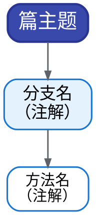

# CMC 知识树 / 结构图 · 画图规范（v1）

> 用途：把教学文档中的 ASCII 知识树、分类树、流程图转成 Graphviz 彩色图。**执行本任务的 agent 必须严格遵守本规范。**

---

## 一、输入与输出

- **唯一内容来源（输入）**：`教学文档/图/_原文备档/<名>.txt`（ASCII 原图，逐字核对的基准）
- **输出（三件套）**：`教学文档/图/<名>.dot` + `<名>.svg` + `<名>.png`（同名，.dot 为源文件，全部落盘保留）
- **命名**：严格按备档文件名，如 `01-知识树`、`02-间断点分类树`、`04-四板斧流程`、`07-ODE求解流程`、`00-作战地图`
- 全部路径以 `教学文档/图/` 为家目录。完整路径前缀：
  `c:/Users/15861/WPSDrive/1876856493/WPS企业云盘/中国科学院大学/我的企业文档/大三上学习/CMC教程和练习/教学文档/图/`

## 二、忠实原则（最重要，先读三遍）

1. **节点文字逐字取自原文**：可去掉纯排版符号（│ ├ └ ─ ┬ ┴ ┼ ～ ※ 及悬挂的 ┌┐┘└），可把括号注解合并为节点第二/三行；**但文字本身不得改写、不得精简**（唯一例外：见 §四.5 宽度优化时的"最小改动"，并在交付说明中注明）。
2. **原文的层级、分组、并列、配对箭头、汇聚关系必须全部保留**。ASCII 的"同一列纵向相连"= 树边；"横向 ────→" = 配对/对应关系（用虚线，见 §五）。
3. **不新增**原文没有的信息（不得自己加例子、代码、结论）；**不删减**任何实质信息（含底部注释、"※"说明）。
4. 原文中确实含混的挂点（跨列长横线连到哪），按上下文最合理解释组织，**并在交付 notes 中注明你的理解**。
5. 数学记号：**不用 LaTeX / $`…`$**。用可显示的 Unicode：`∑ ∫ √ ≤ ≥ ≠ → ↔ λ ∇ ξ θ π ² ³ ₀ ₙ ⁿ ± ·`；幂次直接写 `z=y^(1-n)`；导数用 `y′ y″` 或 `y' y''`；下标用 Unicode（`x₀`、`aₙ`、`f₁`）或平写（`f12`）。**渲染后必须 Read 检查有无豆腐块/缺字**。

## 三、风格规范（彩色区分风 · 与样张一致）

基准样板：`图/sample-01-知识树-彩色风.dot`（01 知识树，色板与线型以它为准）。



**色板（按分支顺序取用，一支一色，最多 6 支）**：

| # | 支色名 | 边框/字色 | 浅底色 |
|---|---|---|---|
| 1 | 蓝 | `#1976d2` | `#e3f2fd` |
| 2 | 绿 | `#2e7d32` | `#e8f5e9` |
| 3 | 橙 | `#e65100` | `#fff3e0` |
| 4 | 紫 | `#6a1b9a` | `#f3e5f5` |
| 5 | 青 | `#00695c` | `#e0f2f1` |
| 6 | 玫红 | `#ad1457` | `#fce4ec` |

**特殊节点样式**：
- 注解 / 公式条 / 底部"※ 总结"块：灰系 —— `color="#616161", fillcolor="#f5f5f5", fontsize=13`，可 `shape=box, style="rounded,filled"` 或 `style="filled"`；
- 重点框（如"三大定理""对称性三件套"）：玫红 —— `color="#ad1457", fillcolor="#fce4ec"`；
- 终点 / 结局节点（流程图用）：绿 —— `color="#2e7d32", fillcolor="#e8f5e9"`；
- 起止节点（流程图用）：`shape=oval`。

## 四、布局与可读性要求

1. **宽度红线**：渲染后 SVG 头部 `width="xxxpt"` —— 目标 **≤700pt**；**超过 800pt 必须优化**。审计命令见 §六.2。
2. 控制宽度的手段（按优先级）：① 节点文字每行 ≤ 12 个全角字符，长注解拆多行（用 `\n`）；② 并列叶子多的支，可改为**纵向链式**（参考样板的"含积分"支：换元→求导→中值→夹逼 竖排）；③ 适当调小 `nodesep`（0.32→0.22）；④ 最后才考虑最小限度的文字缩写（如"（先证收敛再取极限）"→ 拆两行，而非删字）。
3. 同层节点用 `{ rank=same; A; B; C; }` 对齐；切忌为了对齐引入大量长边。
4. **避免连线大量交叉**：dot 引擎自动布局，若交叉严重，调整节点声明顺序或分组。
5. **配对/呼应/汇聚关系**（原文横线、└─┴─┘ 汇合线）用**虚线**：`edge [style=dashed, constraint=false, color="#9e9e9e"]` 单独声明这类边，**不影响主树布局**；汇聚到一点的可加一个小汇合节点。
6. 图不要有孤立漂浮的节点——若原文有（如 05 底部注），挂到语义最近的分支下或作为底部注释块。

## 五、渲染命令

```bash
"D:/anaconda3/envs/pytorch_env/python.exe" "C:/Users/15861/.claude/skills/graphviz-draw/scripts/render.py" \
    --dot-file "<图目录>/<名>.dot" --name "<名>" --outdir "<图目录>" --svg
```

（先把 DOT 用 Write 工具写到 `<图目录>/<名>.dot`，再跑上面命令；PNG 与 SVG 一并生成。）

## 六、质检流程（必须执行，缺一不可）

1. **渲染 → Read PNG 检查**（Read 工具直接看图）：
   - 文字逐字对照原文（节点、注解、符号）；
   - 无重叠、无文字溢出、无穿线、无豆腐块；
   - 配色统一（每支一色到底）、层级清晰、箭头方向合理。
   - 不满意 → 改 DOT → 重渲染 → 再看，**至少迭代到无问题为止**（1–3 轮正常）。
2. **宽度审计**（在 Python 里读 SVG 头部）：
   ```bash
   "D:/anaconda3/envs/pytorch_env/python.exe" -I -c "import re,sys; sys.stdout.reconfigure(encoding='utf-8'); s=open(r'<图目录>/<名>.svg',encoding='utf-8').read(); print(re.search(r'width=\"([\d.]+)pt\"', s).group(1))"
   ```
   超 800pt 必须回 §四.2 优化后重新渲染检查。
3. **原文完整性自查**：把原文每一行信息在图上"点名"一遍，确认没有遗漏（特别是底部的注释块、※ 行）。

## 七、交付

最终消息返回一张图的核验结果（JSON）：
- `name`：图名（如 `01-知识树`）
- `width_pt`：SVG 宽度（数值）
- `iterations`：迭代轮数
- `notes`：对含混挂点的理解、任何文字调整及其理由（没有则空串）
